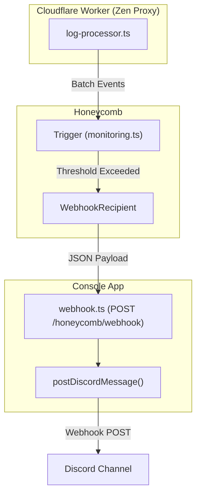
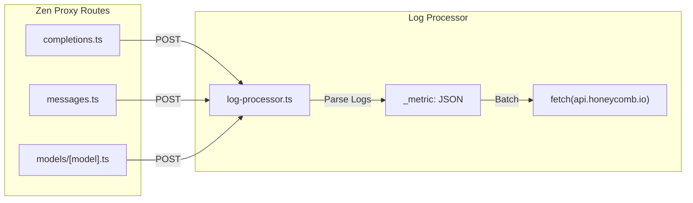

<!-- source: DeepWiki mcp.deepwiki.com · repo browser-use/browsercode · page 10.2 Infrastructure Monitoring · fetched 2026-10-30 -->

# Infrastructure Monitoring

Relevant source files

The following files were used as context for generating this wiki page:

- [infra/enterprise.ts](infra/enterprise.ts)
- [infra/monitoring.ts](infra/monitoring.ts)
- [infra/secret.ts](infra/secret.ts)
- [infra/stage.ts](infra/stage.ts)
- [packages/console/app/src/routes/honeycomb/webhook.ts](packages/console/app/src/routes/honeycomb/webhook.ts)
- [packages/console/app/src/routes/t/[...path].tsx](packages/console/app/src/routes/t/[...path].tsx)
- [packages/console/app/src/routes/zen/go/v1/chat/completions.ts](packages/console/app/src/routes/zen/go/v1/chat/completions.ts)
- [packages/console/app/src/routes/zen/go/v1/messages.ts](packages/console/app/src/routes/zen/go/v1/messages.ts)
- [packages/console/app/src/routes/zen/go/v1/models.ts](packages/console/app/src/routes/zen/go/v1/models.ts)
- [packages/console/app/src/routes/zen/util/modelsHandler.ts](packages/console/app/src/routes/zen/util/modelsHandler.ts)
- [packages/console/app/src/routes/zen/util/variant.ts](packages/console/app/src/routes/zen/util/variant.ts)
- [packages/console/app/src/routes/zen/v1/chat/completions.ts](packages/console/app/src/routes/zen/v1/chat/completions.ts)
- [packages/console/app/src/routes/zen/v1/messages.ts](packages/console/app/src/routes/zen/v1/messages.ts)
- [packages/console/app/src/routes/zen/v1/models.ts](packages/console/app/src/routes/zen/v1/models.ts)
- [packages/console/app/src/routes/zen/v1/models/[model].ts](packages/console/app/src/routes/zen/v1/models/[model].ts)
- [packages/console/app/src/routes/zen/v1/responses.ts](packages/console/app/src/routes/zen/v1/responses.ts)
- [packages/console/core/src/util/crypto.ts](packages/console/core/src/util/crypto.ts)
- [packages/console/function/src/log-processor.ts](packages/console/function/src/log-processor.ts)
- [packages/enterprise/src/routes/index.tsx](packages/enterprise/src/routes/index.tsx)
- [packages/enterprise/tsconfig.json](packages/enterprise/tsconfig.json)
- [packages/enterprise/vite.config.ts](packages/enterprise/vite.config.ts)
- [packages/ui/vite.config.ts](packages/ui/vite.config.ts)

Infrastructure monitoring for the BrowserCode ecosystem is managed through a combination of SST-defined resources, Honeycomb for observability, and Cloudflare Workers for log processing and analytics. The system tracks model performance, provider health, and console usage in real-time.

## Honeycomb Integration and Triggers

The core monitoring logic is defined as an SST resource in `infra/monitoring.ts` [infra/monitoring.ts:1-226](). It configures Honeycomb datasets, queries, and triggers to alert the team via Discord when anomalies occur.

### Webhook Recipient
The system uses a `honeycomb.WebhookRecipient` named `DiscordAlerts` to route alerts to a custom webhook endpoint on the console application [infra/monitoring.ts:6-28](). The URL is dynamically constructed based on the environment stage [infra/monitoring.ts:8]().

### Monitoring Queries
The infrastructure monitors three primary categories of metrics:

1.  **Model HTTP Errors**: Tracks 4xx and 5xx errors for specific LLM models across "Go" and "Zen" product tiers [infra/monitoring.ts:40-71]().
2.  **Provider HTTP Errors**: Monitors failures at the provider level (e.g., Anthropic, OpenAI) by tracking `llm.error` event types [infra/monitoring.ts:73-112]().
3.  **Low TPS (Tokens Per Second)**: Uses a P50 calculation on `tps.output` to detect performance degradation [infra/monitoring.ts:114-140]().

### Alert Thresholds
Triggers are configured to fire based on specific thresholds:
*   **Error Rates**: Increased errors trigger when the failure ratio reaches 0.7 (70%) [infra/monitoring.ts:148]().
*   **Performance**: Low TPS triggers fire if the P50 output drops below 10 tokens per second [infra/monitoring.ts:186]().

| Trigger Name | Frequency | Threshold | Variable |
| :--- | :--- | :--- | :--- |
| `IncreasedModelHttpErrorsGo` | 300s | `>= 0.7` | `model_http_errors` |
| `LowModelTpsZen` | 600s | `<= 10` | `model_low_tps` |

**Sources:** [infra/monitoring.ts:40-226](), [infra/stage.ts:1-5]()

---

## Discord Alert Pipeline

Alerts generated by Honeycomb are processed by the Console application's webhook handler before being forwarded to Discord.

### Webhook Processing Logic
The endpoint at `/honeycomb/webhook` [packages/console/app/src/routes/honeycomb/webhook.ts:77-106]() performs the following steps:
1.  **Authentication**: Validates the `X-Honeycomb-Webhook-Token` header using `safeEqual` against the `HoneycombWebhookSecret` [packages/console/app/src/routes/honeycomb/webhook.ts:78-82]().
2.  **Payload Validation**: Uses `zod` to parse the `honeycombWebhookPayload` [packages/console/app/src/routes/honeycomb/webhook.ts:22-38]().
3.  **Formatting**: The `postDiscordMessage` function converts Honeycomb group results into a readable Discord message, including error percentages or TPS values [packages/console/app/src/routes/honeycomb/webhook.ts:40-75]().
4.  **Notification**: Pings a specific `DISCORD_ALERT_ROLE_ID` in the incident channel [packages/console/app/src/routes/honeycomb/webhook.ts:61-74]().

### Infrastructure Data Flow: Alerting
The following diagram illustrates how a failure in a model call propagates to a developer notification.

**Sources:** [packages/console/app/src/routes/honeycomb/webhook.ts:1-106](), [infra/monitoring.ts:6-28]()

---

## Cloudflare Log Processor

The `log-processor.ts` script acts as a tailing worker for Cloudflare, intercepting requests to the Zen AI Proxy and exporting metrics to Honeycomb [packages/console/function/src/log-processor.ts:1-64]().

### Key Functions
*   **`tail(events)`**: The entry point that iterates over Cloudflare `TraceItem` events [packages/console/function/src/log-processor.ts:5]().
*   **Request Filtering**: It only processes `POST` requests directed at specific Zen API endpoints, such as `/zen/v1/chat/completions` or `/zen/v1/messages` [packages/console/function/src/log-processor.ts:12-22]().
*   **Metric Extraction**: It looks for logs starting with `_metric:` to extract custom JSON data, including model performance and errors [packages/console/function/src/log-processor.ts:41-43]().
*   **Geo-Tagging**: Appends Cloudflare edge metadata (continent, country, city, etc.) to the telemetry [packages/console/function/src/log-processor.ts:25-31]().

### Code Entity Association: Telemetry Flow
This diagram maps the code entities involved in capturing and exporting telemetry from the proxy.

**Sources:** [packages/console/function/src/log-processor.ts:5-59](), [packages/console/app/src/routes/zen/v1/chat/completions.ts:5-14](), [packages/console/app/src/routes/zen/v1/messages.ts:5-14]()

---

## Enterprise and Stage Configuration

Monitoring behavior and infrastructure targets are adjusted based on the deployment stage and enterprise requirements.

### Stage Management
The `infra/stage.ts` file defines the domain hierarchy used for monitoring endpoints:
*   **Production**: `opencode.ai` and `opncd.ai` [infra/stage.ts:2, 16]().
*   **Development**: `dev.opencode.ai` [infra/stage.ts:3]().
*   **Regionality**: A `RegionalHostname` is configured for the `us` region [infra/stage.ts:9-13]().

### Enterprise Infrastructure
The enterprise stack (`packages/enterprise`) is deployed as a Cloudflare `SolidStart` application [infra/enterprise.ts:6-17](). It utilizes R2 storage via the `EnterpriseStorage` bucket for session data and assets [infra/enterprise.ts:4, 11-15]().

**Sources:** [infra/stage.ts:1-20](), [infra/enterprise.ts:1-17](), [packages/enterprise/vite.config.ts:6-18]()

---

