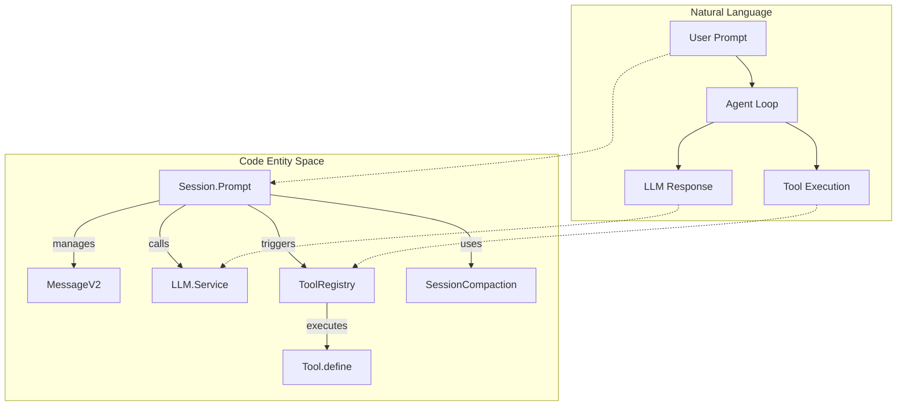
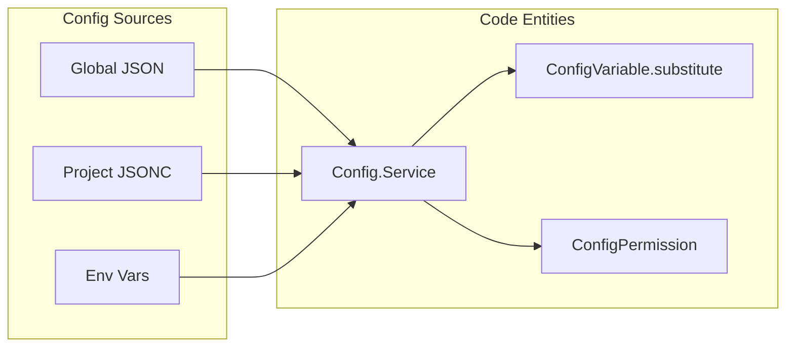

<!-- source: DeepWiki mcp.deepwiki.com · repo browser-use/browsercode · page 11 Glossary · fetched 2026-10-30 -->

# Glossary

Relevant source files

The following files were used as context for generating this wiki page:

- [.gitignore](.gitignore)
- [bun.lock](bun.lock)
- [flake.lock](flake.lock)
- [flake.nix](flake.nix)
- [nix/desktop.nix](nix/desktop.nix)
- [nix/hashes.json](nix/hashes.json)
- [nix/node_modules.nix](nix/node_modules.nix)
- [nix/opencode.nix](nix/opencode.nix)
- [packages/bcode-browser/README.md](packages/bcode-browser/README.md)
- [packages/bcode-browser/package.json](packages/bcode-browser/package.json)
- [packages/bcode-browser/skills/browser-execute/SKILL.md](packages/bcode-browser/skills/browser-execute/SKILL.md)
- [packages/bcode-browser/src/browser-execute.ts](packages/bcode-browser/src/browser-execute.ts)
- [packages/bcode-browser/src/fetch-use.ts](packages/bcode-browser/src/fetch-use.ts)
- [packages/bcode-browser/src/index.ts](packages/bcode-browser/src/index.ts)
- [packages/bcode-browser/src/skills.ts](packages/bcode-browser/src/skills.ts)
- [packages/bcode-browser/test/fetch-use.test.ts](packages/bcode-browser/test/fetch-use.test.ts)
- [packages/bcode-browser/test/skills.test.ts](packages/bcode-browser/test/skills.test.ts)
- [packages/bcode-browser/test/workspace-import.test.ts](packages/bcode-browser/test/workspace-import.test.ts)
- [packages/console/app/package.json](packages/console/app/package.json)
- [packages/console/core/package.json](packages/console/core/package.json)
- [packages/console/function/package.json](packages/console/function/package.json)
- [packages/console/mail/package.json](packages/console/mail/package.json)
- [packages/core/src/plugin/provider/nvidia.ts](packages/core/src/plugin/provider/nvidia.ts)
- [packages/core/src/process.ts](packages/core/src/process.ts)
- [packages/core/test/plugin/provider-nvidia.test.ts](packages/core/test/plugin/provider-nvidia.test.ts)
- [packages/core/test/process/process.test.ts](packages/core/test/process/process.test.ts)
- [packages/desktop/package.json](packages/desktop/package.json)
- [packages/function/package.json](packages/function/package.json)
- [packages/opencode/package.json](packages/opencode/package.json)
- [packages/opencode/parsers-config.ts](packages/opencode/parsers-config.ts)
- [packages/opencode/src/acp/agent.ts](packages/opencode/src/acp/agent.ts)
- [packages/opencode/src/acp/session.ts](packages/opencode/src/acp/session.ts)
- [packages/opencode/src/acp/types.ts](packages/opencode/src/acp/types.ts)
- [packages/opencode/src/agent/agent.ts](packages/opencode/src/agent/agent.ts)
- [packages/opencode/src/cli/cmd/agent.ts](packages/opencode/src/cli/cmd/agent.ts)
- [packages/opencode/src/cli/cmd/mcp.ts](packages/opencode/src/cli/cmd/mcp.ts)
- [packages/opencode/src/cli/cmd/models.ts](packages/opencode/src/cli/cmd/models.ts)
- [packages/opencode/src/cli/cmd/providers.ts](packages/opencode/src/cli/cmd/providers.ts)
- [packages/opencode/src/cli/cmd/tui/app.tsx](packages/opencode/src/cli/cmd/tui/app.tsx)
- [packages/opencode/src/cli/cmd/tui/component/prompt/autocomplete.tsx](packages/opencode/src/cli/cmd/tui/component/prompt/autocomplete.tsx)
- [packages/opencode/src/cli/cmd/tui/component/prompt/index.tsx](packages/opencode/src/cli/cmd/tui/component/prompt/index.tsx)
- [packages/opencode/src/cli/cmd/tui/context/aggregate-failures.ts](packages/opencode/src/cli/cmd/tui/context/aggregate-failures.ts)
- [packages/opencode/src/cli/cmd/tui/routes/session/index.tsx](packages/opencode/src/cli/cmd/tui/routes/session/index.tsx)
- [packages/opencode/src/cli/cmd/tui/routes/session/sidebar.tsx](packages/opencode/src/cli/cmd/tui/routes/session/sidebar.tsx)
- [packages/opencode/src/cli/cmd/tui/util/clipboard.ts](packages/opencode/src/cli/cmd/tui/util/clipboard.ts)
- [packages/opencode/src/command/index.ts](packages/opencode/src/command/index.ts)
- [packages/opencode/src/config/config.ts](packages/opencode/src/config/config.ts)
- [packages/opencode/src/config/permission.ts](packages/opencode/src/config/permission.ts)
- [packages/opencode/src/control-plane/adapters/index.ts](packages/opencode/src/control-plane/adapters/index.ts)
- [packages/opencode/src/control-plane/adapters/worktree.ts](packages/opencode/src/control-plane/adapters/worktree.ts)
- [packages/opencode/src/control-plane/types.ts](packages/opencode/src/control-plane/types.ts)
- [packages/opencode/src/control-plane/workspace.sql.ts](packages/opencode/src/control-plane/workspace.sql.ts)
- [packages/opencode/src/control-plane/workspace.ts](packages/opencode/src/control-plane/workspace.ts)
- [packages/opencode/src/env/index.ts](packages/opencode/src/env/index.ts)
- [packages/opencode/src/event-v2-bridge.ts](packages/opencode/src/event-v2-bridge.ts)
- [packages/opencode/src/format/formatter.ts](packages/opencode/src/format/formatter.ts)
- [packages/opencode/src/format/index.ts](packages/opencode/src/format/index.ts)
- [packages/opencode/src/lsp/client.ts](packages/opencode/src/lsp/client.ts)
- [packages/opencode/src/lsp/language.ts](packages/opencode/src/lsp/language.ts)
- [packages/opencode/src/lsp/lsp.ts](packages/opencode/src/lsp/lsp.ts)
- [packages/opencode/src/lsp/server.ts](packages/opencode/src/lsp/server.ts)
- [packages/opencode/src/mcp/auth.ts](packages/opencode/src/mcp/auth.ts)
- [packages/opencode/src/mcp/index.ts](packages/opencode/src/mcp/index.ts)
- [packages/opencode/src/mcp/oauth-callback.ts](packages/opencode/src/mcp/oauth-callback.ts)
- [packages/opencode/src/mcp/oauth-provider.ts](packages/opencode/src/mcp/oauth-provider.ts)
- [packages/opencode/src/plugin/codex.ts](packages/opencode/src/plugin/codex.ts)
- [packages/opencode/src/project/project.ts](packages/opencode/src/project/project.ts)
- [packages/opencode/src/provider/error.ts](packages/opencode/src/provider/error.ts)
- [packages/opencode/src/provider/provider.ts](packages/opencode/src/provider/provider.ts)
- [packages/opencode/src/provider/transform.ts](packages/opencode/src/provider/transform.ts)
- [packages/opencode/src/question/index.ts](packages/opencode/src/question/index.ts)
- [packages/opencode/src/reference/reference.ts](packages/opencode/src/reference/reference.ts)
- [packages/opencode/src/reference/repository-cache.ts](packages/opencode/src/reference/repository-cache.ts)
- [packages/opencode/src/server/projectors.ts](packages/opencode/src/server/projectors.ts)
- [packages/opencode/src/server/routes/instance/httpapi/groups/global.ts](packages/opencode/src/server/routes/instance/httpapi/groups/global.ts)
- [packages/opencode/src/server/server.ts](packages/opencode/src/server/server.ts)
- [packages/opencode/src/session/compaction.ts](packages/opencode/src/session/compaction.ts)
- [packages/opencode/src/session/llm.ts](packages/opencode/src/session/llm.ts)
- [packages/opencode/src/session/message-v2.ts](packages/opencode/src/session/message-v2.ts)
- [packages/opencode/src/session/processor.ts](packages/opencode/src/session/processor.ts)
- [packages/opencode/src/session/prompt.ts](packages/opencode/src/session/prompt.ts)
- [packages/opencode/src/session/summary.ts](packages/opencode/src/session/summary.ts)
- [packages/opencode/src/session/system.ts](packages/opencode/src/session/system.ts)
- [packages/opencode/src/sync/index.ts](packages/opencode/src/sync/index.ts)
- [packages/opencode/src/tool/apply_patch.ts](packages/opencode/src/tool/apply_patch.ts)
- [packages/opencode/src/tool/apply_patch.txt](packages/opencode/src/tool/apply_patch.txt)
- [packages/opencode/src/tool/browser-execute.ts](packages/opencode/src/tool/browser-execute.ts)
- [packages/opencode/src/tool/browser-execute.txt](packages/opencode/src/tool/browser-execute.txt)
- [packages/opencode/src/tool/edit.ts](packages/opencode/src/tool/edit.ts)
- [packages/opencode/src/tool/external-directory.ts](packages/opencode/src/tool/external-directory.ts)
- [packages/opencode/src/tool/question.ts](packages/opencode/src/tool/question.ts)
- [packages/opencode/src/tool/read.ts](packages/opencode/src/tool/read.ts)
- [packages/opencode/src/tool/skill.ts](packages/opencode/src/tool/skill.ts)
- [packages/opencode/src/tool/task.ts](packages/opencode/src/tool/task.ts)
- [packages/opencode/src/tool/tool.ts](packages/opencode/src/tool/tool.ts)
- [packages/opencode/src/tool/webfetch.ts](packages/opencode/src/tool/webfetch.ts)
- [packages/opencode/src/tool/write.ts](packages/opencode/src/tool/write.ts)
- [packages/opencode/src/worktree/index.ts](packages/opencode/src/worktree/index.ts)
- [packages/opencode/test/acp/event-subscription.test.ts](packages/opencode/test/acp/event-subscription.test.ts)
- [packages/opencode/test/agent/agent.test.ts](packages/opencode/test/agent/agent.test.ts)
- [packages/opencode/test/agent/plugin-agent-regression.test.ts](packages/opencode/test/agent/plugin-agent-regression.test.ts)
- [packages/opencode/test/cli/cmd/tui/aggregate-failures.test.ts](packages/opencode/test/cli/cmd/tui/aggregate-failures.test.ts)
- [packages/opencode/test/config/config.test.ts](packages/opencode/test/config/config.test.ts)
- [packages/opencode/test/control-plane/workspace.test.ts](packages/opencode/test/control-plane/workspace.test.ts)
- [packages/opencode/test/fixture/agent-plugin.constants.ts](packages/opencode/test/fixture/agent-plugin.constants.ts)
- [packages/opencode/test/fixture/agent-plugin.ts](packages/opencode/test/fixture/agent-plugin.ts)
- [packages/opencode/test/fixture/fixture.test.ts](packages/opencode/test/fixture/fixture.test.ts)
- [packages/opencode/test/fixture/fixture.ts](packages/opencode/test/fixture/fixture.ts)
- [packages/opencode/test/fixture/flag.ts](packages/opencode/test/fixture/flag.ts)
- [packages/opencode/test/fixture/lsp/fake-lsp-server.js](packages/opencode/test/fixture/lsp/fake-lsp-server.js)
- [packages/opencode/test/fixture/workspace.ts](packages/opencode/test/fixture/workspace.ts)
- [packages/opencode/test/format/format.test.ts](packages/opencode/test/format/format.test.ts)
- [packages/opencode/test/lsp/client.test.ts](packages/opencode/test/lsp/client.test.ts)
- [packages/opencode/test/lsp/index.test.ts](packages/opencode/test/lsp/index.test.ts)
- [packages/opencode/test/lsp/lifecycle.test.ts](packages/opencode/test/lsp/lifecycle.test.ts)
- [packages/opencode/test/mcp/headers.test.ts](packages/opencode/test/mcp/headers.test.ts)
- [packages/opencode/test/mcp/lifecycle.test.ts](packages/opencode/test/mcp/lifecycle.test.ts)
- [packages/opencode/test/mcp/oauth-auto-connect.test.ts](packages/opencode/test/mcp/oauth-auto-connect.test.ts)
- [packages/opencode/test/mcp/oauth-callback.test.ts](packages/opencode/test/mcp/oauth-callback.test.ts)
- [packages/opencode/test/permission-task.test.ts](packages/opencode/test/permission-task.test.ts)
- [packages/opencode/test/plugin/auth-override.test.ts](packages/opencode/test/plugin/auth-override.test.ts)
- [packages/opencode/test/plugin/trigger.test.ts](packages/opencode/test/plugin/trigger.test.ts)
- [packages/opencode/test/plugin/workspace-adapter.test.ts](packages/opencode/test/plugin/workspace-adapter.test.ts)
- [packages/opencode/test/project/migrate-global.test.ts](packages/opencode/test/project/migrate-global.test.ts)
- [packages/opencode/test/project/project.test.ts](packages/opencode/test/project/project.test.ts)
- [packages/opencode/test/project/worktree-remove.test.ts](packages/opencode/test/project/worktree-remove.test.ts)
- [packages/opencode/test/provider/amazon-bedrock.test.ts](packages/opencode/test/provider/amazon-bedrock.test.ts)
- [packages/opencode/test/provider/gitlab-duo.test.ts](packages/opencode/test/provider/gitlab-duo.test.ts)
- [packages/opencode/test/provider/provider.test.ts](packages/opencode/test/provider/provider.test.ts)
- [packages/opencode/test/provider/transform.test.ts](packages/opencode/test/provider/transform.test.ts)
- [packages/opencode/test/question/question.test.ts](packages/opencode/test/question/question.test.ts)
- [packages/opencode/test/reference/reference.test.ts](packages/opencode/test/reference/reference.test.ts)
- [packages/opencode/test/server/httpapi-instance-context.test.ts](packages/opencode/test/server/httpapi-instance-context.test.ts)
- [packages/opencode/test/server/httpapi-promptasync-context.test.ts](packages/opencode/test/server/httpapi-promptasync-context.test.ts)
- [packages/opencode/test/server/httpapi-workspace-routing.test.ts](packages/opencode/test/server/httpapi-workspace-routing.test.ts)
- [packages/opencode/test/session/compaction.test.ts](packages/opencode/test/session/compaction.test.ts)
- [packages/opencode/test/session/llm.test.ts](packages/opencode/test/session/llm.test.ts)
- [packages/opencode/test/session/message-v2.test.ts](packages/opencode/test/session/message-v2.test.ts)
- [packages/opencode/test/session/processor-effect.test.ts](packages/opencode/test/session/processor-effect.test.ts)
- [packages/opencode/test/session/prompt.test.ts](packages/opencode/test/session/prompt.test.ts)
- [packages/opencode/test/session/revert-compact.test.ts](packages/opencode/test/session/revert-compact.test.ts)
- [packages/opencode/test/session/snapshot-tool-race.test.ts](packages/opencode/test/session/snapshot-tool-race.test.ts)
- [packages/opencode/test/sync/index.test.ts](packages/opencode/test/sync/index.test.ts)
- [packages/opencode/test/tool/apply_patch.test.ts](packages/opencode/test/tool/apply_patch.test.ts)
- [packages/opencode/test/tool/edit.test.ts](packages/opencode/test/tool/edit.test.ts)
- [packages/opencode/test/tool/external-directory.test.ts](packages/opencode/test/tool/external-directory.test.ts)
- [packages/opencode/test/tool/grep.test.ts](packages/opencode/test/tool/grep.test.ts)
- [packages/opencode/test/tool/question.test.ts](packages/opencode/test/tool/question.test.ts)
- [packages/opencode/test/tool/read.test.ts](packages/opencode/test/tool/read.test.ts)
- [packages/opencode/test/tool/skill.test.ts](packages/opencode/test/tool/skill.test.ts)
- [packages/opencode/test/tool/task.test.ts](packages/opencode/test/tool/task.test.ts)
- [packages/opencode/test/tool/webfetch.test.ts](packages/opencode/test/tool/webfetch.test.ts)
- [packages/opencode/test/tool/write.test.ts](packages/opencode/test/tool/write.test.ts)
- [packages/plugin/package.json](packages/plugin/package.json)
- [packages/sdk/js/package.json](packages/sdk/js/package.json)
- [packages/sdk/js/src/gen/sdk.gen.ts](packages/sdk/js/src/gen/sdk.gen.ts)
- [packages/sdk/js/src/gen/types.gen.ts](packages/sdk/js/src/gen/types.gen.ts)
- [packages/sdk/js/src/v2/gen/sdk.gen.ts](packages/sdk/js/src/v2/gen/sdk.gen.ts)
- [packages/sdk/js/src/v2/gen/types.gen.ts](packages/sdk/js/src/v2/gen/types.gen.ts)
- [packages/sdk/openapi.json](packages/sdk/openapi.json)
- [packages/web/package.json](packages/web/package.json)
- [packages/web/src/content/docs/ecosystem.mdx](packages/web/src/content/docs/ecosystem.mdx)
- [packages/web/src/content/docs/formatters.mdx](packages/web/src/content/docs/formatters.mdx)
- [packages/web/src/content/docs/lsp.mdx](packages/web/src/content/docs/lsp.mdx)
- [sdks/vscode/package.json](sdks/vscode/package.json)

This page provides definitions for codebase-specific terms, jargon, and domain concepts used throughout the BrowserCode and OpenCode repositories.

## Core Concepts

### ACP (Agent Client Protocol)
A protocol used to communicate between a client and an AI agent. BrowserCode implements this to allow external tools or interfaces to drive its internal agents.
*   **Implementation**: `packages/opencode/src/acp/agent.ts` defines the server-side implementation of the protocol.
*   **Sources**: [packages/opencode/src/acp/agent.ts:1-50]()

### Agent
An autonomous entity that uses an LLM to perform tasks by calling tools. Agents in BrowserCode are defined by their system prompts, available tools, and specific behaviors (e.g., `build`, `plan`, `explore`).
*   **Service**: `Agent.Service` in `packages/opencode/src/agent/agent.ts` manages agent definitions and instantiation.
*   **Types**: Native agents like `build` and `plan` are defined as `ConfigAgent` specs.
*   **Sources**: [packages/opencode/src/agent/agent.ts:1-100](), [packages/opencode/src/config/config.ts:25-25]()

### Compaction
The process of summarizing or pruning a session's message history to fit within an LLM's context window while preserving essential information.
*   **Service**: `SessionCompaction` handles the logic for condensing history.
*   **Logic**: Located in `packages/opencode/src/session/compaction.ts`.
*   **Sources**: [packages/opencode/src/session/compaction.ts:1-100](), [packages/opencode/src/session/prompt.ts:13-13]()

### MCP (Model Context Protocol)
An open standard that enables AI models to access data and tools from various sources (servers) through a unified interface.
*   **Service**: `MCP.Service` manages connections to local (stdio) and remote (HTTP/SSE) MCP servers.
*   **Sources**: [packages/opencode/src/mcp/index.ts:1-100](), [packages/opencode/src/config/config.ts:31-31]()

### Provider
An abstraction layer for different LLM vendors (Anthropic, OpenAI, Bedrock, etc.). It handles authentication, model discovery, and request/response transformation.
*   **Service**: `Provider.Service` in `packages/opencode/src/provider/provider.ts`.
*   **Transform**: `ProviderTransform` shims handle vendor-specific differences in message formats.
*   **Sources**: [packages/opencode/src/provider/provider.ts:1-120](), [packages/opencode/src/provider/transform.ts:1-50]()

## Code Entity Space Mapping

The following diagrams bridge natural language concepts to specific code entities within the monorepo.

### Session Lifecycle Mapping
"Session Execution" refers to the orchestration of messages, tools, and LLM calls.

**Sources**: [packages/opencode/src/session/prompt.ts:1-50](), [packages/opencode/src/session/message-v2.ts:1-30](), [packages/opencode/src/tool/registry.ts:1-20]()

### Configuration Hierarchy Mapping
"Configuration" is a multi-layered system that resolves settings from global, project, and environment sources.

**Sources**: [packages/opencode/src/config/config.ts:1-100](), [packages/opencode/src/config/variable.ts:1-20]()

## Technical Terms Table

| Term | Definition | Code Pointer |
| :--- | :--- | :--- |
| **BCode** | The primary CLI binary name and shorthand for BrowserCode. | `packages/opencode/package.json:19-21` |
| **Effect** | The functional programming library used for dependency injection and error handling. | `packages/opencode/src/config/config.ts:21-21` |
| **Instance State** | A pattern for managing stateful services within the Effect runtime. | `packages/opencode/src/effect/instance-state.ts` |
| **LSP Service** | Orchestrates Language Server Protocol instances for code intelligence (hover, definitions). | `packages/opencode/src/lsp/lsp.ts` |
| **Message Part** | A constituent element of a `MessageV2`, such as Text, ToolCall, or Reasoning. | `packages/opencode/src/session/message-v2.ts` |
| **Skill** | A pre-defined set of browser-based capabilities or scripts. | `packages/opencode/src/config/skills.ts` |
| **Worktree** | A managed directory where the agent performs file operations and builds. | `packages/opencode/src/worktree/index.ts` |

**Sources**: [packages/opencode/package.json:19-21](), [packages/opencode/src/config/config.ts:21-21](), [packages/opencode/src/session/message-v2.ts:1-50]()

## Infrastructure and Build

### Nix
Used for reproducible builds and packaging the CLI and Desktop apps across platforms.
*   **Hashes**: `nix/hashes.json` tracks platform-specific `node_modules` hashes.
*   **Sources**: [nix/hashes.json:1-8]()

### Zen Proxy
A managed cloud gateway (Console infrastructure) that provides OpenAI-compatible access to multiple models for trial users and enterprise billing.
*   **Implementation**: Part of the `packages/console` subsystem.
*   **Sources**: [packages/console/app/package.json:1-50]()

### TUI (Terminal User Interface)
The terminal-based frontend built using `@opentui/solid` and custom rendering logic.
*   **App Root**: `packages/opencode/src/cli/cmd/tui/app.tsx`.
*   **Prompt**: `packages/opencode/src/cli/cmd/tui/component/prompt/index.tsx`.
*   **Sources**: [packages/opencode/src/cli/cmd/tui/app.tsx:1-50](), [packages/opencode/src/cli/cmd/tui/component/prompt/index.tsx:1-50]()