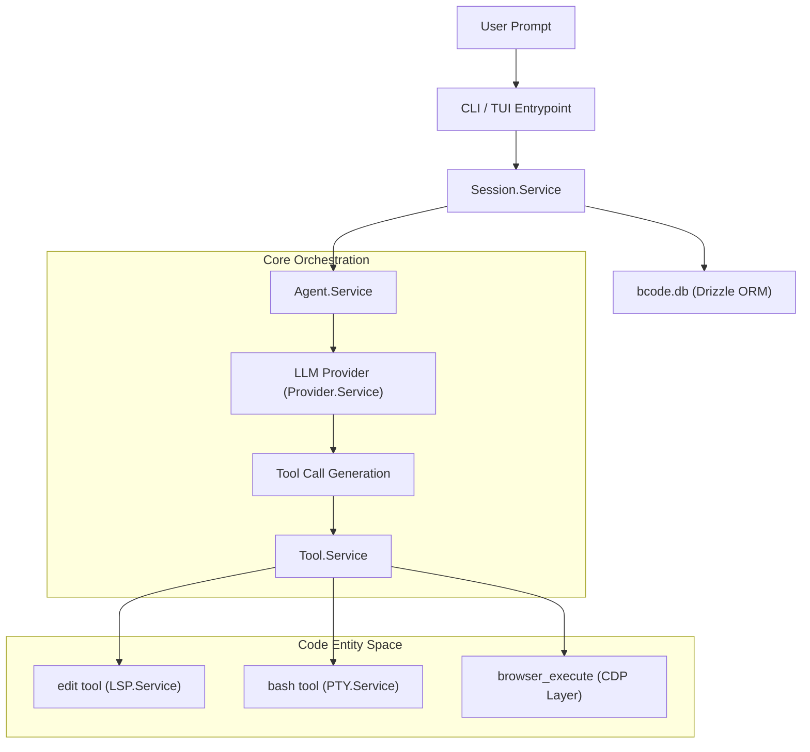
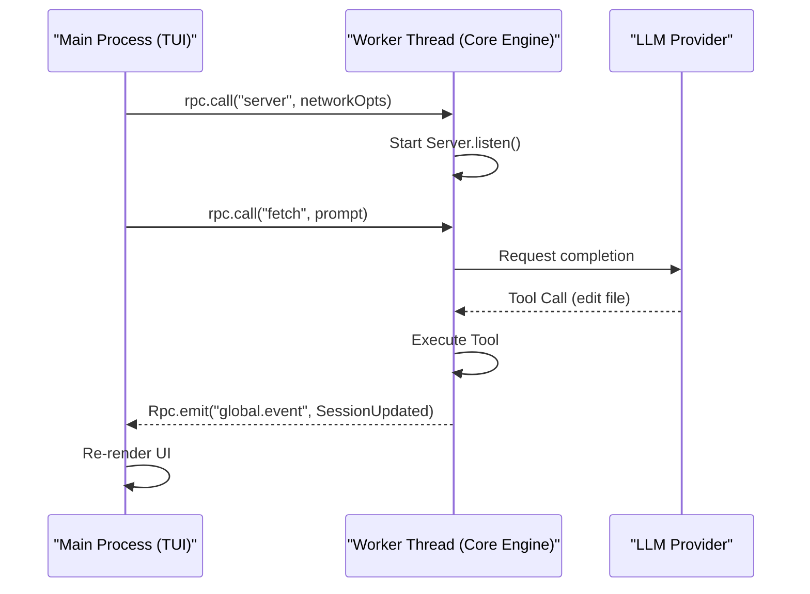

<!-- source: DeepWiki mcp.deepwiki.com · repo browser-use/browsercode · page 2 Core Engine (packages/opencode) · fetched 2026-10-30 -->

# Core Engine (packages/opencode)

Relevant source files

The following files were used as context for generating this wiki page:

- [packages/opencode/src/cli/bootstrap.ts](packages/opencode/src/cli/bootstrap.ts)
- [packages/opencode/src/cli/cmd/acp.ts](packages/opencode/src/cli/cmd/acp.ts)
- [packages/opencode/src/cli/cmd/run.ts](packages/opencode/src/cli/cmd/run.ts)
- [packages/opencode/src/cli/cmd/serve.ts](packages/opencode/src/cli/cmd/serve.ts)
- [packages/opencode/src/cli/cmd/tui/thread.ts](packages/opencode/src/cli/cmd/tui/thread.ts)
- [packages/opencode/src/cli/cmd/tui/worker.ts](packages/opencode/src/cli/cmd/tui/worker.ts)
- [packages/opencode/src/cli/cmd/web.ts](packages/opencode/src/cli/cmd/web.ts)
- [packages/opencode/src/cli/network.ts](packages/opencode/src/cli/network.ts)
- [packages/opencode/src/config/config.ts](packages/opencode/src/config/config.ts)
- [packages/opencode/src/config/permission.ts](packages/opencode/src/config/permission.ts)
- [packages/opencode/src/index.ts](packages/opencode/src/index.ts)
- [packages/opencode/src/server/mdns.ts](packages/opencode/src/server/mdns.ts)
- [packages/opencode/src/server/server.ts](packages/opencode/src/server/server.ts)
- [packages/opencode/test/config/config.test.ts](packages/opencode/test/config/config.test.ts)
- [packages/opencode/test/permission-task.test.ts](packages/opencode/test/permission-task.test.ts)
- [packages/sdk/js/src/gen/sdk.gen.ts](packages/sdk/js/src/gen/sdk.gen.ts)
- [packages/sdk/js/src/gen/types.gen.ts](packages/sdk/js/src/gen/types.gen.ts)
- [packages/sdk/js/src/v2/gen/sdk.gen.ts](packages/sdk/js/src/v2/gen/sdk.gen.ts)
- [packages/sdk/js/src/v2/gen/types.gen.ts](packages/sdk/js/src/v2/gen/types.gen.ts)
- [packages/sdk/openapi.json](packages/sdk/openapi.json)

The `opencode` package is the central engine of the system. It orchestrates the lifecycle of AI agents, manages user sessions, provides a robust tool execution environment, and serves as the primary entry point for all user interfaces (CLI, TUI, and Web). It is built on the [Effect](https://effect.website/) runtime to handle complex asynchronous workflows and resource management.

## System Overview

The engine acts as a bridge between high-level natural language intent and low-level system operations (file manipulation, shell execution, and browser automation).

### From Natural Language to Code Entities
This diagram illustrates how a user prompt moves through the core services to become actionable code operations.

**Sources:** [packages/opencode/src/index.ts:164-186](), [packages/opencode/src/server/server.ts:10-13](), [packages/opencode/src/cli/cmd/run.ts:126-173]()

## Major Subsystems

The core engine is divided into several specialized services, each covered in detail in their respective child pages.

### CLI and Server Entrypoints
The primary binary `bcode` (or `opencode`) is defined in `index.ts`. It supports multiple modes:
*   **Headless/Run:** Execute a single prompt or command.
*   **Serve:** Start an HTTP server with mDNS discovery for remote connections.
*   **TUI:** A terminal user interface that runs a dedicated worker thread to keep the UI responsive while the agent works.

For details, see [CLI and Server Entrypoints](#2.1).
**Sources:** [packages/opencode/src/index.ts:76-186](), [packages/opencode/src/server/server.ts:75-101](), [packages/opencode/src/cli/cmd/tui/thread.ts:146-187]()

### Configuration and Permissions
The `Config.Service` manages a hierarchical configuration system that merges global settings, project-level overrides, and environment variables. It includes a sophisticated permission system that gates tool access (e.g., `allow`, `deny`, or `ask` for filesystem writes).

For details, see [Configuration System](#2.2).
**Sources:** [packages/opencode/src/config/config.ts:120-162](), [packages/opencode/src/config/permission.ts:1-50]()

### Session and Agent Lifecycle
A `Session` represents a continuous conversation and work state. The `Session.Service` manages the agent loop: sending context to the LLM, processing tool calls, and handling "compaction" to keep token usage efficient. It tracks state through various `Part` types (Text, Tool, Reasoning, Patch).

For details, see [Session and Agent Lifecycle](#2.3) and [Agent System](#2.4).
**Sources:** [packages/sdk/js/src/gen/types.gen.ts:384-400](), [packages/opencode/src/cli/cmd/run.ts:4-13]()

### Tool and Provider Abstraction
Tools are the "hands" of the agent. The engine provides a registry of built-in tools for file I/O, searching, and terminal execution. These tools are abstracted from the specific LLM being used via the `Provider.Service`, which normalizes communication with Anthropic, OpenAI, and other models.

For details, see [Tool System](#2.5) and [Provider and LLM Abstraction](#2.6).
**Sources:** [packages/opencode/src/cli/cmd/run.ts:90-124](), [packages/sdk/js/src/v2/gen/types.gen.ts:294-305]()

### Storage and Effect Runtime
The engine persists all session data, logs, and configuration state in a local SQLite database using the Drizzle ORM. The entire system is bootstrapped using an Effect-based runtime that manages dependency injection and graceful shutdowns.

For details, see [Storage, Database, and Effect Runtime](#2.9).
**Sources:** [packages/opencode/src/index.ts:125-160](), [packages/opencode/src/server/server.ts:103-118]()

## Internal Architecture: TUI Worker Thread
The TUI uses a unique architecture where the UI rendering happens in the main process, while the core engine (Server, Agent, LSP) runs in a background `Worker` thread. This prevents the agent's heavy computation or I/O from freezing the terminal UI.

**Sources:** [packages/opencode/src/cli/cmd/tui/thread.ts:146-187](), [packages/opencode/src/cli/cmd/tui/worker.ts:50-102]()

## Child Pages

1.  **[CLI and Server Entrypoints](#2.1)** — Binary commands and HTTP server.
2.  **[Configuration System](#2.2)** — Hierarchy and permissions.
3.  **[Session and Agent Lifecycle](#2.3)** — The prompt/tool loop.
4.  **[Agent System](#2.4)** — Native and plugin agents.
5.  **[Tool System](#2.5)** — Built-in capabilities.
6.  **[Provider and LLM Abstraction](#2.6)** — Model orchestration.
7.  **[LSP, Formatting, and File Intelligence](#2.7)** — Code understanding.
8.  **[MCP Integration](#2.8)** — Model Context Protocol support.
9.  **[Storage, Database, and Effect Runtime](#2.9)** — Persistence and lifecycle.

---

