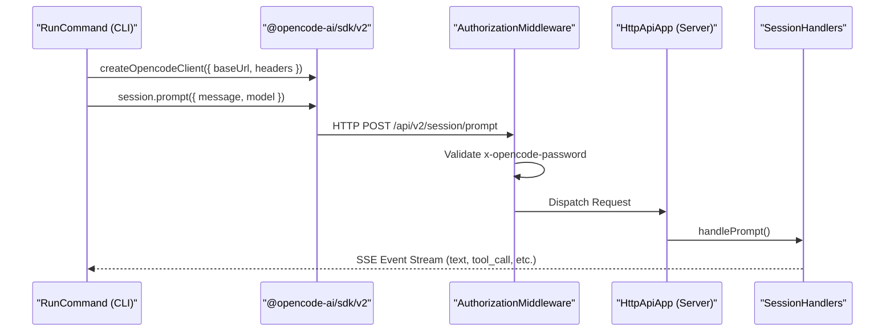
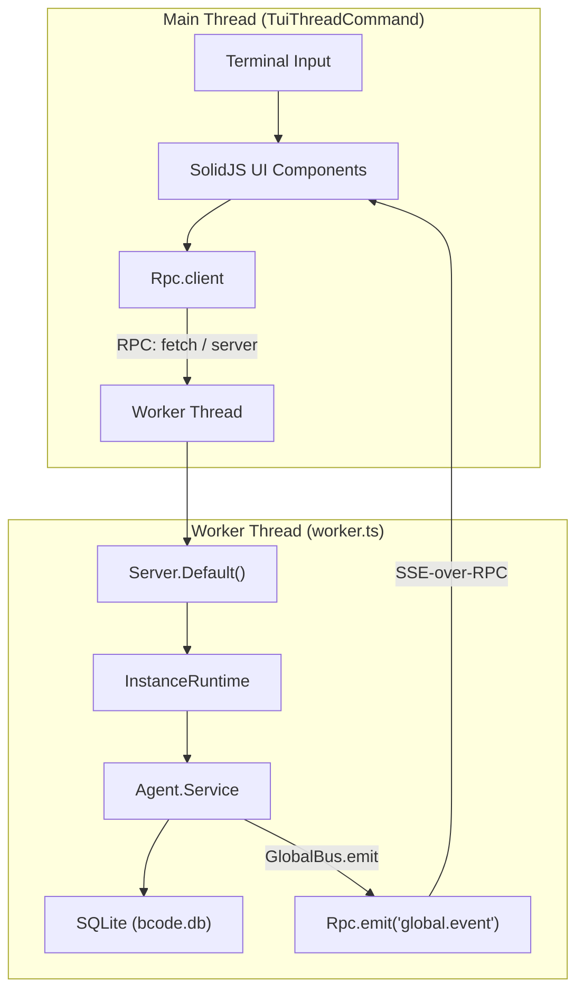

<!-- source: DeepWiki mcp.deepwiki.com · repo browser-use/browsercode · page 2.1 CLI and Server Entrypoints · fetched 2026-10-30 -->

# CLI and Server Entrypoints

Relevant source files

The following files were used as context for generating this wiki page:

- [github/README.md](github/README.md)
- [github/action.yml](github/action.yml)
- [github/index.ts](github/index.ts)
- [packages/opencode/src/account/account.sql.ts](packages/opencode/src/account/account.sql.ts)
- [packages/opencode/src/account/account.ts](packages/opencode/src/account/account.ts)
- [packages/opencode/src/account/repo.ts](packages/opencode/src/account/repo.ts)
- [packages/opencode/src/account/schema.ts](packages/opencode/src/account/schema.ts)
- [packages/opencode/src/account/url.ts](packages/opencode/src/account/url.ts)
- [packages/opencode/src/cli/bootstrap.ts](packages/opencode/src/cli/bootstrap.ts)
- [packages/opencode/src/cli/cmd/account.ts](packages/opencode/src/cli/cmd/account.ts)
- [packages/opencode/src/cli/cmd/acp.ts](packages/opencode/src/cli/cmd/acp.ts)
- [packages/opencode/src/cli/cmd/export.ts](packages/opencode/src/cli/cmd/export.ts)
- [packages/opencode/src/cli/cmd/github.ts](packages/opencode/src/cli/cmd/github.ts)
- [packages/opencode/src/cli/cmd/import.ts](packages/opencode/src/cli/cmd/import.ts)
- [packages/opencode/src/cli/cmd/run.ts](packages/opencode/src/cli/cmd/run.ts)
- [packages/opencode/src/cli/cmd/serve.ts](packages/opencode/src/cli/cmd/serve.ts)
- [packages/opencode/src/cli/cmd/session.ts](packages/opencode/src/cli/cmd/session.ts)
- [packages/opencode/src/cli/cmd/stats.ts](packages/opencode/src/cli/cmd/stats.ts)
- [packages/opencode/src/cli/cmd/tui/thread.ts](packages/opencode/src/cli/cmd/tui/thread.ts)
- [packages/opencode/src/cli/cmd/tui/worker.ts](packages/opencode/src/cli/cmd/tui/worker.ts)
- [packages/opencode/src/cli/cmd/web.ts](packages/opencode/src/cli/cmd/web.ts)
- [packages/opencode/src/cli/network.ts](packages/opencode/src/cli/network.ts)
- [packages/opencode/src/index.ts](packages/opencode/src/index.ts)
- [packages/opencode/src/server/init-projectors.ts](packages/opencode/src/server/init-projectors.ts)
- [packages/opencode/src/server/mdns.ts](packages/opencode/src/server/mdns.ts)
- [packages/opencode/src/server/routes/instance/httpapi/api.ts](packages/opencode/src/server/routes/instance/httpapi/api.ts)
- [packages/opencode/src/server/routes/instance/httpapi/groups/event.ts](packages/opencode/src/server/routes/instance/httpapi/groups/event.ts)
- [packages/opencode/src/server/routes/instance/httpapi/handlers/event.ts](packages/opencode/src/server/routes/instance/httpapi/handlers/event.ts)
- [packages/opencode/src/server/routes/instance/httpapi/handlers/pty.ts](packages/opencode/src/server/routes/instance/httpapi/handlers/pty.ts)
- [packages/opencode/src/server/routes/instance/httpapi/middleware/authorization.ts](packages/opencode/src/server/routes/instance/httpapi/middleware/authorization.ts)
- [packages/opencode/src/server/routes/instance/httpapi/middleware/schema-error.ts](packages/opencode/src/server/routes/instance/httpapi/middleware/schema-error.ts)
- [packages/opencode/src/server/routes/instance/httpapi/server.ts](packages/opencode/src/server/routes/instance/httpapi/server.ts)
- [packages/opencode/src/server/shared/public-ui.ts](packages/opencode/src/server/shared/public-ui.ts)
- [packages/opencode/src/server/shared/ui.ts](packages/opencode/src/server/shared/ui.ts)
- [packages/opencode/src/share/share-next.ts](packages/opencode/src/share/share-next.ts)
- [packages/opencode/src/tool/plan.ts](packages/opencode/src/tool/plan.ts)
- [packages/opencode/src/tool/truncate.ts](packages/opencode/src/tool/truncate.ts)
- [packages/opencode/test/account/repo.test.ts](packages/opencode/test/account/repo.test.ts)
- [packages/opencode/test/account/service.test.ts](packages/opencode/test/account/service.test.ts)
- [packages/opencode/test/cli/account.test.ts](packages/opencode/test/cli/account.test.ts)
- [packages/opencode/test/cli/github-action.test.ts](packages/opencode/test/cli/github-action.test.ts)
- [packages/opencode/test/file/index.test.ts](packages/opencode/test/file/index.test.ts)
- [packages/opencode/test/server/httpapi-authorization.test.ts](packages/opencode/test/server/httpapi-authorization.test.ts)
- [packages/opencode/test/server/httpapi-event.test.ts](packages/opencode/test/server/httpapi-event.test.ts)
- [packages/opencode/test/server/httpapi-listen.test.ts](packages/opencode/test/server/httpapi-listen.test.ts)
- [packages/opencode/test/server/httpapi-pty.test.ts](packages/opencode/test/server/httpapi-pty.test.ts)
- [packages/opencode/test/server/httpapi-raw-route-auth.test.ts](packages/opencode/test/server/httpapi-raw-route-auth.test.ts)
- [packages/opencode/test/server/httpapi-schema-error-body.test.ts](packages/opencode/test/server/httpapi-schema-error-body.test.ts)
- [packages/opencode/test/server/httpapi-sdk.test.ts](packages/opencode/test/server/httpapi-sdk.test.ts)
- [packages/opencode/test/server/httpapi-sync.test.ts](packages/opencode/test/server/httpapi-sync.test.ts)
- [packages/opencode/test/server/httpapi-ui.test.ts](packages/opencode/test/server/httpapi-ui.test.ts)
- [packages/opencode/test/server/sdk-error-shape.test.ts](packages/opencode/test/server/sdk-error-shape.test.ts)
- [packages/opencode/test/server/sdk-v1-smoke.test.ts](packages/opencode/test/server/sdk-v1-smoke.test.ts)
- [packages/opencode/test/share/share-next.test.ts](packages/opencode/test/share/share-next.test.ts)
- [packages/opencode/test/tool/truncation.test.ts](packages/opencode/test/tool/truncation.test.ts)
- [packages/web/src/content/docs/commands.mdx](packages/web/src/content/docs/commands.mdx)
- [packages/web/src/content/docs/github.mdx](packages/web/src/content/docs/github.mdx)
- [packages/web/src/content/docs/gitlab.mdx](packages/web/src/content/docs/gitlab.mdx)
- [packages/web/src/content/docs/mcp-servers.mdx](packages/web/src/content/docs/mcp-servers.mdx)

The `opencode` (or `bcode`) binary serves as the primary interface for the engine. It manages the transition from a shell environment into the Effect-based runtime, handles command-line argument parsing via `yargs`, and orchestrates the lifecycle of both headless servers and interactive TUI sessions.

## CLI Entrypoint and Command Registry

The main entrypoint is [packages/opencode/src/index.ts:1-48](). It initializes telemetry, configures logging via `Log.init` [packages/opencode/src/index.ts:102-110](), and sets global environment markers like `OPENCODE_PID` [packages/opencode/src/index.ts:116]().

Before executing any command, the CLI performs a mandatory one-time database migration using `JsonMigration.run` [packages/opencode/src/index.ts:126-160](). This ensures that legacy JSON-based session storage is migrated to the SQLite `bcode.db` used by the Drizzle ORM.

### Available Commands

The CLI defines a comprehensive set of commands [packages/opencode/src/index.ts:164-186]():

| Command | Class / Definition | Purpose |
|:---|:---|:---|
| `run` | `RunCommand` | Executes a single prompt or starts an interactive session [packages/opencode/src/cli/cmd/run.ts:126](). |
| `serve` | `ServeCommand` | Starts a headless HTTP server for remote connections [packages/opencode/src/cli/cmd/serve.ts:7](). |
| `web` | `WebCommand` | Opens the local web UI in a browser. |
| `tui` | `TuiThreadCommand` | Default command ($0); starts the terminal UI in a worker thread [packages/opencode/src/cli/cmd/tui/thread.ts:79](). |
| `acp` | `AcpCommand` | Starts an Agent Client Protocol server over stdio [packages/opencode/src/cli/cmd/acp.ts:13](). |
| `mcp` | `McpCommand` | Manages Model Context Protocol server integrations. |
| `github` | `GithubCommand` | Installs or runs the GitHub agent for PR/Issue automation [packages/opencode/src/cli/cmd/github.ts:184](). |
| `stats` | `StatsCommand` | Aggregates token usage and cost metrics from `SessionTable` [packages/opencode/src/cli/cmd/stats.ts:49](). |
| `import` / `export` | `ImportCommand` | Migrates session data via JSON files or share URLs [packages/opencode/src/cli/cmd/import.ts:80](). |

Sources: [packages/opencode/src/index.ts:1-210](), [packages/opencode/src/cli/cmd/run.ts:1-135](), [packages/opencode/src/cli/cmd/stats.ts:49-80]()

## The HTTP Server and API Surface

The server is implemented using `Effect`'s `HttpApiBuilder` [packages/opencode/src/server/routes/instance/httpapi/server.ts:2-10](). It supports three primary routing categories:

1.  **Root API**: Global control and account management [packages/opencode/src/server/routes/instance/httpapi/server.ts:110-114]().
2.  **Instance API**: Project-specific operations (files, sessions, terminal access) [packages/opencode/src/server/routes/instance/httpapi/server.ts:123-141]().
3.  **UI Fallback**: Serves the embedded SolidJS web application or proxies to the hosted app [packages/opencode/src/server/routes/instance/httpapi/server.ts:164-171]().

### mDNS Discovery
When started via `serve` or within the TUI, the server can broadcast its presence using mDNS. This allows other `bcode` clients on the local network to discover and attach to the session without manual IP configuration.

### Data Flow: CLI to Server
The following diagram illustrates how a CLI command like `run --attach` interacts with the HTTP Server.

**CLI Attachment Data Flow**

Sources: [packages/opencode/src/server/routes/instance/httpapi/server.ts:103-151](), [packages/opencode/src/cli/cmd/run.ts:190-203](), [packages/opencode/src/server/routes/instance/httpapi/middleware/authorization.ts:1-30]()

## TUI Worker-Thread Architecture

To maintain a responsive UI while the heavy agent logic (LLM calls, LSP indexing, file I/O) runs, the TUI uses a multi-threaded architecture.

1.  **Main Thread**: Handles terminal input, window resizing, and rendering via the `TuiThreadCommand` [packages/opencode/src/cli/cmd/tui/thread.ts:79]().
2.  **Worker Thread**: Runs the `Server` instance and the core agent logic [packages/opencode/src/cli/cmd/tui/worker.ts:1-18]().

### RPC Communication
Communication between the threads happens via a custom `Rpc` bridge [packages/opencode/src/cli/cmd/tui/thread.ts:159](). The main thread provides a `createWorkerFetch` shim [packages/opencode/src/cli/cmd/tui/thread.ts:31-47]() that redirects SDK calls to the worker's internal `Server.app.fetch` handler [packages/opencode/src/cli/cmd/tui/worker.ts:51-69](), bypassing the network stack entirely for local sessions.

**TUI Threading Model**

Sources: [packages/opencode/src/cli/cmd/tui/thread.ts:146-187](), [packages/opencode/src/cli/cmd/tui/worker.ts:50-102](), [packages/opencode/src/bus/global.ts:1-15]()

## Session Sharing and Persistence

The `ShareNext` service [packages/opencode/src/share/share-next.ts:109]() facilitates session portability. When a session is shared:
1.  The CLI/Server captures the session state, messages, and associated model metadata [packages/opencode/src/share/share-next.ts:47-67]().
2.  Data is synced to a remote console (e.g., `opncd.ai`) via `sync()` [packages/opencode/src/share/share-next.ts:120]().
3.  The `ImportCommand` can later reconstruct this session in a different environment by mapping the remote JSON structure back into local `SessionTable`, `MessageTable`, and `PartTable` entries [packages/opencode/src/cli/cmd/import.ts:182-214]().

Sources: [packages/opencode/src/share/share-next.ts:1-150](), [packages/opencode/src/cli/cmd/import.ts:169-218]()

---

