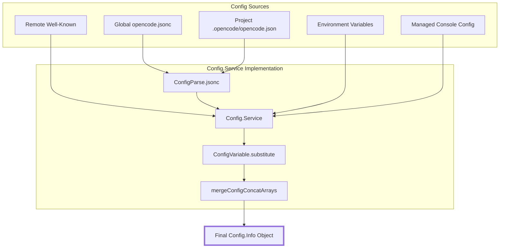
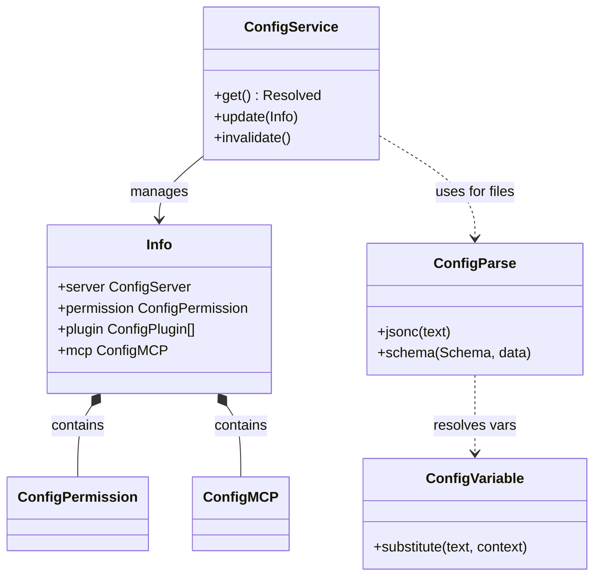

<!-- source: DeepWiki mcp.deepwiki.com · repo browser-use/browsercode · page 2.2 Configuration System · fetched 2026-10-30 -->

# Configuration System

<details>
<summary>Relevant source files</summary>

The following files were used as context for generating this wiki page:

- [packages/opencode/script/schema.ts](packages/opencode/script/schema.ts)
- [packages/opencode/src/cli/cmd/tui/config/keybind.ts](packages/opencode/src/cli/cmd/tui/config/keybind.ts)
- [packages/opencode/src/cli/cmd/tui/config/tui-migrate.ts](packages/opencode/src/cli/cmd/tui/config/tui-migrate.ts)
- [packages/opencode/src/cli/cmd/tui/config/tui-schema.ts](packages/opencode/src/cli/cmd/tui/config/tui-schema.ts)
- [packages/opencode/src/cli/cmd/tui/config/tui.ts](packages/opencode/src/cli/cmd/tui/config/tui.ts)
- [packages/opencode/src/cli/cmd/tui/layer.ts](packages/opencode/src/cli/cmd/tui/layer.ts)
- [packages/opencode/src/config/agent.ts](packages/opencode/src/config/agent.ts)
- [packages/opencode/src/config/command.ts](packages/opencode/src/config/command.ts)
- [packages/opencode/src/config/config.ts](packages/opencode/src/config/config.ts)
- [packages/opencode/src/config/entry-name.ts](packages/opencode/src/config/entry-name.ts)
- [packages/opencode/src/config/error.ts](packages/opencode/src/config/error.ts)
- [packages/opencode/src/config/layout.ts](packages/opencode/src/config/layout.ts)
- [packages/opencode/src/config/managed.ts](packages/opencode/src/config/managed.ts)
- [packages/opencode/src/config/mcp.ts](packages/opencode/src/config/mcp.ts)
- [packages/opencode/src/config/model-id.ts](packages/opencode/src/config/model-id.ts)
- [packages/opencode/src/config/parse.ts](packages/opencode/src/config/parse.ts)
- [packages/opencode/src/config/paths.ts](packages/opencode/src/config/paths.ts)
- [packages/opencode/src/config/permission.ts](packages/opencode/src/config/permission.ts)
- [packages/opencode/src/config/plugin.ts](packages/opencode/src/config/plugin.ts)
- [packages/opencode/src/config/provider.ts](packages/opencode/src/config/provider.ts)
- [packages/opencode/src/config/server.ts](packages/opencode/src/config/server.ts)
- [packages/opencode/src/config/variable.ts](packages/opencode/src/config/variable.ts)
- [packages/opencode/src/server/server.ts](packages/opencode/src/server/server.ts)
- [packages/opencode/test/config/config.test.ts](packages/opencode/test/config/config.test.ts)
- [packages/opencode/test/config/tui.test.ts](packages/opencode/test/config/tui.test.ts)
- [packages/opencode/test/permission-task.test.ts](packages/opencode/test/permission-task.test.ts)
- [packages/sdk/js/src/gen/sdk.gen.ts](packages/sdk/js/src/gen/sdk.gen.ts)
- [packages/sdk/js/src/gen/types.gen.ts](packages/sdk/js/src/gen/types.gen.ts)
- [packages/sdk/js/src/v2/gen/sdk.gen.ts](packages/sdk/js/src/v2/gen/sdk.gen.ts)
- [packages/sdk/js/src/v2/gen/types.gen.ts](packages/sdk/js/src/v2/gen/types.gen.ts)
- [packages/sdk/openapi.json](packages/sdk/openapi.json)

</details>


The configuration system in BrowserCode is managed by the `Config.Service` [packages/opencode/src/config/config.ts:53-53](). It provides a multi-layered, hierarchical resolution engine that merges settings from remote well-known endpoints, global user files, environment variables, project-specific files, and managed cloud settings.

The system supports **JSONC** (JSON with Comments) for user-editable files [packages/opencode/src/config/config.ts:12-12]() and uses the `Effect` schema library for strict validation and documentation generation [packages/opencode/src/config/config.ts:120-120]().

## Configuration Hierarchy

BrowserCode resolves configuration by merging several layers in a specific order of precedence. Later layers override earlier ones, except for certain fields like `instructions` or `plugin` which are concatenated [packages/opencode/src/config/config.ts:53-59]().

### Precedence Order (Low to High)

1.  **Remote Well-Known**: Fetched from a remote URL defined in the configuration [packages/opencode/src/config/config.ts:73-73]().
2.  **Global Config**: Located in the user's global config directory (e.g., `~/.config/opencode/opencode.jsonc`) [packages/opencode/src/config/paths.ts:1-1]().
3.  **Environment Variables**: Prefixed with `OPENCODE_` (e.g., `OPENCODE_MODEL`) [packages/opencode/src/env.ts:1-1]().
4.  **Project Config**: Located in the project root or `.opencode/` directory [packages/opencode/src/config/config.test.ts:114-114]().
5.  **Console/Managed**: Settings synced from the BrowserCode Console or managed enterprise environments [packages/opencode/src/config/managed.ts:1-1]().

### Configuration Data Flow
This diagram illustrates how the `Config.Service` aggregates data from various `ConfigProvider` sources into a unified `Config.Info` object.

"Configuration Aggregation Flow"

Sources: [packages/opencode/src/config/config.ts:49-111](), [packages/opencode/src/config/parse.ts:1-10](), [packages/opencode/src/config/variable.ts:1-10]()

## Key Components

### Config.Service
The primary interface for accessing and updating configuration. It maintains an internal cache and provides methods for invalidation and waiting for dependency resolution (like plugin loading) [packages/opencode/src/config/config.ts:240-260]().

*   `get()`: Returns the fully merged `Config.Resolved` object [packages/opencode/src/config/config.ts:241-241]().
*   `update(info)`: Persists changes to the project-level configuration file [packages/opencode/src/config/config.ts:244-244]().
*   `updateGlobal(info)`: Persists changes to the global configuration file [packages/opencode/src/config/config.ts:245-245]().

### Variable Substitution
BrowserCode supports dynamic variable substitution within configuration strings using the `ConfigVariable` module [packages/opencode/src/config/variable.ts:1-5]().

| Variable | Description |
| :--- | :--- |
| `$HOME` | User's home directory |
| `$CONFIG` | Global configuration directory |
| `$CWD` | Current working directory |
| `$PROJECT` | Resolved project root |

Sources: [packages/opencode/src/config/variable.ts:1-20](), [packages/opencode/src/config/config.ts:76-81]()

## Permission System

The `ConfigPermission` module defines the security sandbox for agents. Permissions can be configured globally or per-tool [packages/opencode/src/config/permission.ts:16-37]().

### Permission Actions
Permissions use a tri-state logic [packages/opencode/src/config/permission.ts:4-5]():
*   `allow`: Automatically grant the permission.
*   `deny`: Automatically reject the request.
*   `ask`: Prompt the user for manual approval (default for sensitive operations).

### Configuration Schema
Permissions are defined in the `permission` block of the config:
```jsonc
{
  "permission": {
    "read": "allow",
    "bash": "ask",
    "websearch": "deny",
    "edit": {
      "include": ["src/**/*.ts"],
      "exclude": ["**/node_modules/**"]
    }
  }
}
```
Sources: [packages/opencode/src/config/permission.ts:16-56](), [packages/sdk/js/src/v2/gen/types.gen.ts:107-120]()

## Configuration Schema Sub-modules

The `Config.Info` struct is composed of several sub-schemas, each managing a specific domain of the engine [packages/opencode/src/config/config.ts:120-180]().

| Module | Purpose | File Reference |
| :--- | :--- | :--- |
| `ConfigProvider` | LLM Provider settings (API keys, endpoints) | [packages/opencode/src/config/provider.ts]() |
| `ConfigAgent` | Agent definitions and system prompts | [packages/opencode/src/config/agent.ts]() |
| `ConfigMCP` | Model Context Protocol server configurations | [packages/opencode/src/config/mcp.ts]() |
| `ConfigCommand` | Custom CLI command aliases | [packages/opencode/src/config/command.ts]() |
| `ConfigLSP` | Language Server Protocol settings | [packages/opencode/src/config/lsp.ts]() |

### Code Entity Mapping
This diagram maps the high-level configuration concepts to the specific TypeScript classes and Schema definitions in the codebase.

"Config Entity Mapping"

Sources: [packages/opencode/src/config/config.ts:120-260](), [packages/opencode/src/config/parse.ts:1-20](), [packages/opencode/src/config/permission.ts:48-56]()

## JSONC Support and Migration

BrowserCode prioritizes `opencode.jsonc` over `opencode.json` to allow users to document their settings. The system includes a migration utility that can move legacy settings (like TUI keybinds) from the main config into specialized files like `tui.jsonc` [packages/opencode/src/cli/cmd/tui/config/tui-migrate.ts:1-10]().

When a config is loaded, `normalizeLoadedConfig` checks for deprecated keys and warns the user to move them to the appropriate sub-config file [packages/opencode/src/config/config.ts:61-71]().

Sources: [packages/opencode/src/config/config.ts:12-12](), [packages/opencode/src/config/config.ts:61-71](), [packages/opencode/src/cli/cmd/tui/config/tui.ts:66-80]()

---

