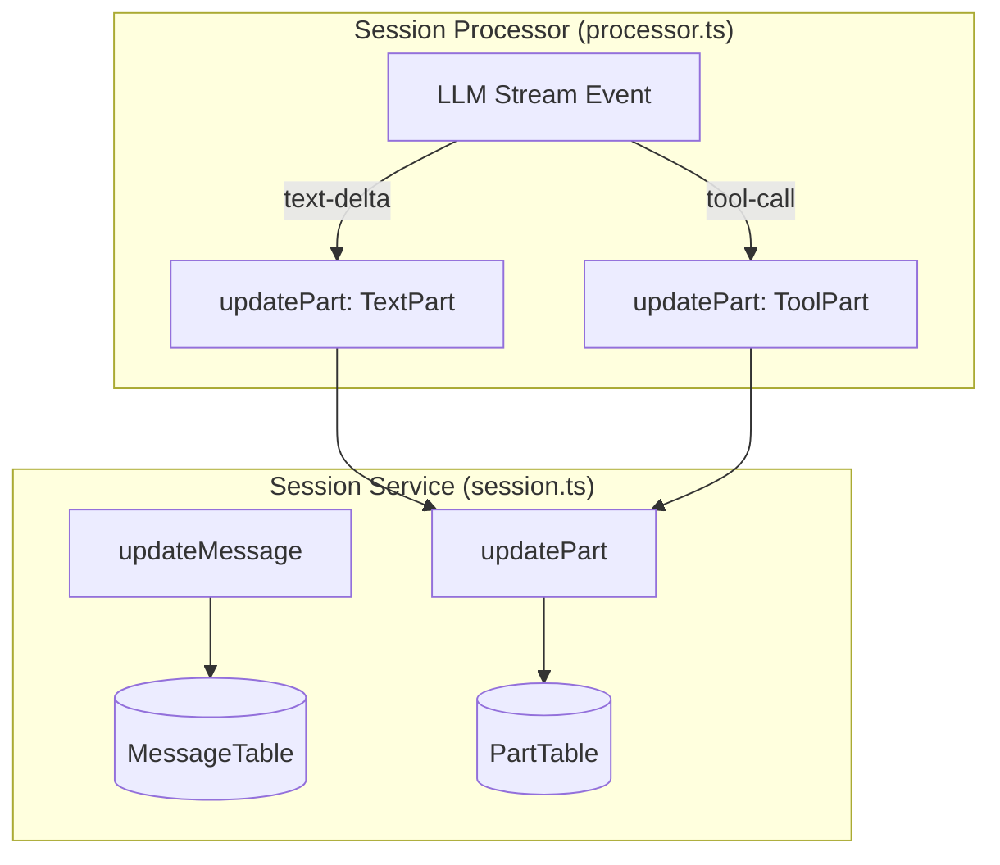
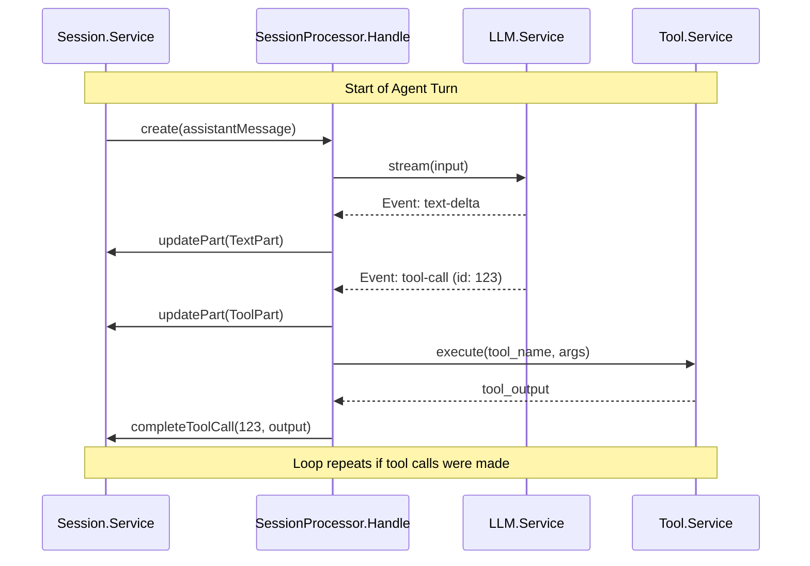

<!-- source: DeepWiki mcp.deepwiki.com · repo browser-use/browsercode · page 2.3 Session and Agent Lifecycle · fetched 2026-10-30 -->

# Session and Agent Lifecycle

Relevant source files

The following files were used as context for generating this wiki page:

- [packages/core/src/global.ts](packages/core/src/global.ts)
- [packages/opencode/src/project/instance-context.ts](packages/opencode/src/project/instance-context.ts)
- [packages/opencode/src/project/instance-store.ts](packages/opencode/src/project/instance-store.ts)
- [packages/opencode/src/project/instance.ts](packages/opencode/src/project/instance.ts)
- [packages/opencode/src/project/project.ts](packages/opencode/src/project/project.ts)
- [packages/opencode/src/provider/error.ts](packages/opencode/src/provider/error.ts)
- [packages/opencode/src/provider/transform.ts](packages/opencode/src/provider/transform.ts)
- [packages/opencode/src/question/index.ts](packages/opencode/src/question/index.ts)
- [packages/opencode/src/server/routes/instance/httpapi/groups/session.ts](packages/opencode/src/server/routes/instance/httpapi/groups/session.ts)
- [packages/opencode/src/server/routes/instance/httpapi/handlers/config.ts](packages/opencode/src/server/routes/instance/httpapi/handlers/config.ts)
- [packages/opencode/src/server/routes/instance/httpapi/handlers/global.ts](packages/opencode/src/server/routes/instance/httpapi/handlers/global.ts)
- [packages/opencode/src/server/routes/instance/httpapi/handlers/session.ts](packages/opencode/src/server/routes/instance/httpapi/handlers/session.ts)
- [packages/opencode/src/server/routes/instance/httpapi/lifecycle.ts](packages/opencode/src/server/routes/instance/httpapi/lifecycle.ts)
- [packages/opencode/src/server/routes/instance/httpapi/middleware/instance-context.ts](packages/opencode/src/server/routes/instance/httpapi/middleware/instance-context.ts)
- [packages/opencode/src/session/compaction.ts](packages/opencode/src/session/compaction.ts)
- [packages/opencode/src/session/instruction.ts](packages/opencode/src/session/instruction.ts)
- [packages/opencode/src/session/llm.ts](packages/opencode/src/session/llm.ts)
- [packages/opencode/src/session/message-v2.ts](packages/opencode/src/session/message-v2.ts)
- [packages/opencode/src/session/processor.ts](packages/opencode/src/session/processor.ts)
- [packages/opencode/src/session/prompt.ts](packages/opencode/src/session/prompt.ts)
- [packages/opencode/src/session/retry.ts](packages/opencode/src/session/retry.ts)
- [packages/opencode/src/session/revert.ts](packages/opencode/src/session/revert.ts)
- [packages/opencode/src/session/session.ts](packages/opencode/src/session/session.ts)
- [packages/opencode/src/session/status.ts](packages/opencode/src/session/status.ts)
- [packages/opencode/src/session/summary.ts](packages/opencode/src/session/summary.ts)
- [packages/opencode/src/session/todo.ts](packages/opencode/src/session/todo.ts)
- [packages/opencode/src/storage/json-migration.ts](packages/opencode/src/storage/json-migration.ts)
- [packages/opencode/src/tool/question.ts](packages/opencode/src/tool/question.ts)
- [packages/opencode/src/tool/todo.ts](packages/opencode/src/tool/todo.ts)
- [packages/opencode/src/worktree/index.ts](packages/opencode/src/worktree/index.ts)
- [packages/opencode/test/fixture/fixture.test.ts](packages/opencode/test/fixture/fixture.test.ts)
- [packages/opencode/test/fixture/fixture.ts](packages/opencode/test/fixture/fixture.ts)
- [packages/opencode/test/project/migrate-global.test.ts](packages/opencode/test/project/migrate-global.test.ts)
- [packages/opencode/test/project/project.test.ts](packages/opencode/test/project/project.test.ts)
- [packages/opencode/test/project/worktree-remove.test.ts](packages/opencode/test/project/worktree-remove.test.ts)
- [packages/opencode/test/provider/transform.test.ts](packages/opencode/test/provider/transform.test.ts)
- [packages/opencode/test/question/question.test.ts](packages/opencode/test/question/question.test.ts)
- [packages/opencode/test/server/global-session-list.test.ts](packages/opencode/test/server/global-session-list.test.ts)
- [packages/opencode/test/server/httpapi-session.test.ts](packages/opencode/test/server/httpapi-session.test.ts)
- [packages/opencode/test/session/compaction.test.ts](packages/opencode/test/session/compaction.test.ts)
- [packages/opencode/test/session/instruction.test.ts](packages/opencode/test/session/instruction.test.ts)
- [packages/opencode/test/session/llm.test.ts](packages/opencode/test/session/llm.test.ts)
- [packages/opencode/test/session/message-v2.test.ts](packages/opencode/test/session/message-v2.test.ts)
- [packages/opencode/test/session/messages-pagination.test.ts](packages/opencode/test/session/messages-pagination.test.ts)
- [packages/opencode/test/session/processor-effect.test.ts](packages/opencode/test/session/processor-effect.test.ts)
- [packages/opencode/test/session/prompt.test.ts](packages/opencode/test/session/prompt.test.ts)
- [packages/opencode/test/session/retry.test.ts](packages/opencode/test/session/retry.test.ts)
- [packages/opencode/test/session/schema-decoding.test.ts](packages/opencode/test/session/schema-decoding.test.ts)
- [packages/opencode/test/session/snapshot-tool-race.test.ts](packages/opencode/test/session/snapshot-tool-race.test.ts)

This page details the lifecycle of sessions and the agent execution loop within BrowserCode. It covers the services responsible for managing project workspaces, the stateful message history, and the iterative process where the LLM consumes context to produce tool calls and responses.

## Overview of Services

The session lifecycle is managed by a hierarchy of services that bridge the gap between a physical directory on disk and a stateful AI conversation.

| Service | Responsibility | Key Code Entity |
| :--- | :--- | :--- |
| **Project Service** | Manages project metadata, directory discovery, and sandbox tracking. | `Project.Service` [packages/opencode/src/project/project.ts:108-125]() |
| **Worktree Service** | Handles Git worktree creation, branch management, and environment setup. | `Worktree.Service` [packages/opencode/src/worktree/index.ts:137-144]() |
| **Session Service** | The primary interface for CRUD operations on sessions, messages, and parts. | `Session.Service` [packages/opencode/src/session/session.ts:223-267]() |
| **Session Processor** | Orchestrates the streaming interaction between the LLM and tool execution. | `SessionProcessor.Service` [packages/opencode/src/session/processor.ts:109-129]() |

### Project and Worktree Management

A `Project` represents a root directory containing code. The `Project.Service` tracks these via the `ProjectTable` in SQLite [packages/opencode/src/project/project.sql:1-35](). 

The `Worktree.Service` allows the agent to create isolated environments for tasks. It uses `git worktree add` to create new directories linked to the main repository [packages/opencode/src/worktree/index.ts:165-183](). This ensures that the agent's changes do not interfere with the user's primary working directory unless explicitly merged.

**Sources:** [packages/opencode/src/project/project.ts](), [packages/opencode/src/worktree/index.ts]()

## Session and Message Schema

Sessions are composed of a sequence of **Messages**, and each message is composed of one or more **Parts**. This granular structure allows the system to handle multi-modal inputs, tool calls, and background processes like compaction within a single turn.

### Message Parts
The `MessageV2.Part` union [packages/opencode/src/session/message-v2.ts:241-255]() defines the fundamental units of communication:

*   **TextPart**: Standard natural language text [packages/opencode/src/session/message-v2.ts:97-111]().
*   **ToolPart**: Represents a tool invocation, including the `toolCallID`, `method`, and `input` arguments [packages/opencode/src/session/message-v2.ts:211-230]().
*   **ReasoningPart**: Internal "chain-of-thought" produced by models (e.g., Claude 3.7 or DeepSeek R1) [packages/opencode/src/session/message-v2.ts:113-124]().
*   **PatchPart**: Represents a code change applied to the worktree [packages/opencode/src/session/message-v2.ts:89-95]().
*   **SnapshotPart**: A pointer to a specific state of the filesystem [packages/opencode/src/session/message-v2.ts:82-88]().
*   **SubtaskPart**: Used when an agent delegates a specific task to a child agent [packages/opencode/src/session/message-v2.ts:193-209]().

### Data Flow: Message Persistence

**Sources:** [packages/opencode/src/session/message-v2.ts](), [packages/opencode/src/session/session.ts](), [packages/opencode/src/session/processor.ts]()

## The Agent Loop

The core execution logic resides in `SessionProcessor.Service.create` [packages/opencode/src/session/processor.ts:129](). It manages the `streamText` call to the LLM and the subsequent handling of events.

### Execution Phases
1.  **Prompt Construction**: The `LLM.Service` assembles the system prompt, conversation history, and active tools [packages/opencode/src/session/llm.ts:76-195]().
2.  **Streaming**: The LLM emits deltas. The `SessionProcessor` captures these and updates the database in real-time [packages/opencode/src/session/processor.ts:233-280]().
3.  **Tool Execution**: When a `tool-call` is finalized, the system looks up the tool in the `ToolRegistry` and executes it.
4.  **Result Integration**: Tool outputs are appended as new messages (role: `user` or `tool` depending on the provider) and the loop continues until a "stop" condition (e.g., `finish_reason: stop`) is met.

### Agent Loop Diagram

**Sources:** [packages/opencode/src/session/processor.ts](), [packages/opencode/src/session/llm.ts]()

## Compaction and Context Management

As conversations grow, they may exceed the LLM's context window. `SessionCompaction.Service` handles this by summarizing old messages [packages/opencode/src/session/compaction.ts:188-208]().

*   **Overflow Detection**: `isOverflow` checks if the current token count exceeds model limits [packages/opencode/src/session/compaction.ts:189-192]().
*   **Pruning**: Removes intermediate tool outputs and redundant parts to save space [packages/opencode/src/session/compaction.ts:193]().
*   **Summarization**: Uses a specialized prompt `SUMMARY_TEMPLATE` [packages/opencode/src/session/compaction.ts:44-79]() to condense history into a "Goal/Progress/Next Steps" format, which is then injected back into the context.

**Sources:** [packages/opencode/src/session/compaction.ts]()

## Session Recovery: Retry and Revert

The system provides mechanisms to recover from errors or undesirable agent actions.

### Retry
`SessionRetry.Service` allows the system to re-attempt a failed turn. It specifically handles errors like `ContextOverflowError` by triggering an immediate compaction before retrying the LLM call [packages/opencode/src/session/retry.ts:36-50]().

### Revert
`SessionRevert.Service` allows rolling back the session state to a previous message. This involves:
1.  Identifying the target `MessageID` [packages/opencode/src/session/revert.ts:19-24]().
2.  Deleting all messages and parts created after that point in the `SessionTable` and `PartTable`.
3.  Restoring the filesystem state if a `Snapshot` was associated with the target message [packages/opencode/src/session/revert.ts:25-40]().

**Sources:** [packages/opencode/src/session/retry.ts](), [packages/opencode/src/session/revert.ts]()

## The Question Service

When an agent requires user clarification, it uses the `Question.Service` [packages/opencode/src/question/index.ts:13-18](). 

1.  The agent calls the `question` tool [packages/opencode/src/tool/question.ts:10-25]().
2.  The `SessionProcessor` marks the session as `blocked` [packages/opencode/src/session/processor.ts:101]().
3.  The UI renders the question and waits for user input.
4.  Once the user responds, the session is unblocked, and the response is fed back into the agent loop as a tool result.

**Sources:** [packages/opencode/src/question/index.ts](), [packages/opencode/src/tool/question.ts](), [packages/opencode/src/session/processor.ts]()

---

