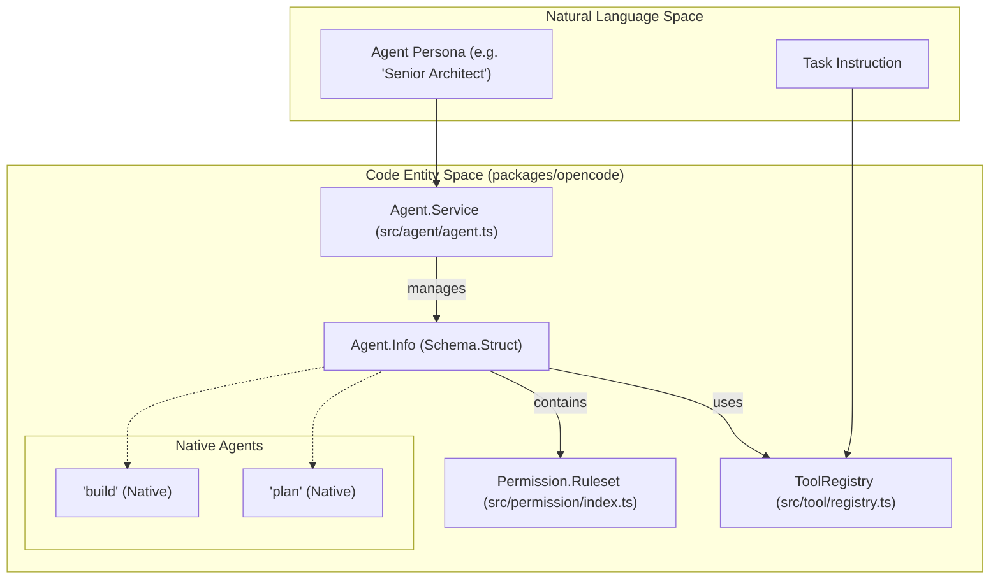
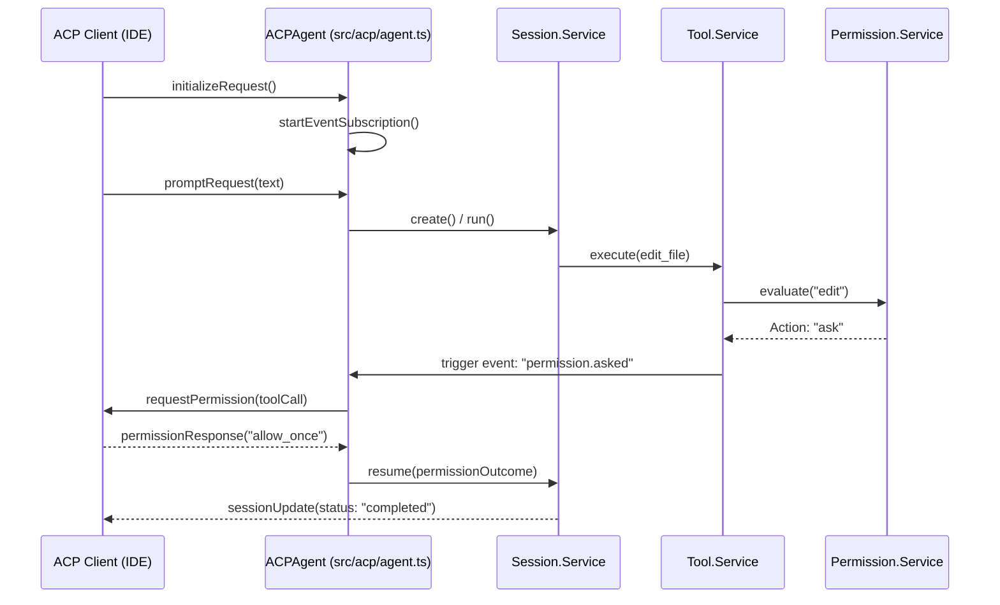

<!-- source: DeepWiki mcp.deepwiki.com · repo browser-use/browsercode · page 2.4 Agent System · fetched 2026-10-30 -->

# Agent System

Relevant source files

The following files were used as context for generating this wiki page:

- [packages/opencode/src/acp/agent.ts](packages/opencode/src/acp/agent.ts)
- [packages/opencode/src/acp/session.ts](packages/opencode/src/acp/session.ts)
- [packages/opencode/src/acp/types.ts](packages/opencode/src/acp/types.ts)
- [packages/opencode/src/agent/agent.ts](packages/opencode/src/agent/agent.ts)
- [packages/opencode/src/effect/runner.ts](packages/opencode/src/effect/runner.ts)
- [packages/opencode/src/plugin/index.ts](packages/opencode/src/plugin/index.ts)
- [packages/opencode/src/reference/reference.ts](packages/opencode/src/reference/reference.ts)
- [packages/opencode/src/reference/repository-cache.ts](packages/opencode/src/reference/repository-cache.ts)
- [packages/opencode/src/session/prompt/anthropic.txt](packages/opencode/src/session/prompt/anthropic.txt)
- [packages/opencode/src/session/prompt/beast.txt](packages/opencode/src/session/prompt/beast.txt)
- [packages/opencode/src/session/prompt/codex.txt](packages/opencode/src/session/prompt/codex.txt)
- [packages/opencode/src/session/prompt/copilot-gpt-5.txt](packages/opencode/src/session/prompt/copilot-gpt-5.txt)
- [packages/opencode/src/session/prompt/trinity.txt](packages/opencode/src/session/prompt/trinity.txt)
- [packages/opencode/src/session/run-state.ts](packages/opencode/src/session/run-state.ts)
- [packages/opencode/src/tool/registry.ts](packages/opencode/src/tool/registry.ts)
- [packages/opencode/src/tool/task_status.ts](packages/opencode/src/tool/task_status.ts)
- [packages/opencode/test/acp/event-subscription.test.ts](packages/opencode/test/acp/event-subscription.test.ts)
- [packages/opencode/test/agent/agent.test.ts](packages/opencode/test/agent/agent.test.ts)
- [packages/opencode/test/agent/plugin-agent-regression.test.ts](packages/opencode/test/agent/plugin-agent-regression.test.ts)
- [packages/opencode/test/effect/runner.test.ts](packages/opencode/test/effect/runner.test.ts)
- [packages/opencode/test/fixture/agent-plugin.constants.ts](packages/opencode/test/fixture/agent-plugin.constants.ts)
- [packages/opencode/test/fixture/agent-plugin.ts](packages/opencode/test/fixture/agent-plugin.ts)
- [packages/opencode/test/plugin/auth-override.test.ts](packages/opencode/test/plugin/auth-override.test.ts)
- [packages/opencode/test/reference/reference.test.ts](packages/opencode/test/reference/reference.test.ts)
- [packages/opencode/test/tool/external-directory.test.ts](packages/opencode/test/tool/external-directory.test.ts)
- [packages/opencode/test/tool/registry.test.ts](packages/opencode/test/tool/registry.test.ts)
- [packages/plugin/src/index.ts](packages/plugin/src/index.ts)

The Agent System is the orchestration layer that defines the capabilities, personas, and permission boundaries for LLM interactions. It is managed by the `Agent.Service`, which coordinates built-in "native" agents, custom agents defined in user configuration, and plugin-contributed agents.

## Agent.Service and Info

The `Agent.Service` is the central registry for agent definitions. Each agent is defined by an `Info` object which specifies its system prompt, model constraints, and a unique `Permission.Ruleset` [packages/opencode/src/agent/agent.ts:31-52]().

### Data Flow: Agent Resolution
When a session starts or an agent is invoked, the system resolves the agent configuration through the following hierarchy:
1.  **Native Agents**: Hardcoded defaults (e.g., `build`, `plan`) [packages/opencode/src/agent/agent.ts:151-244]().
2.  **Plugin Agents**: Contributed by loaded plugins via `Hooks` [packages/opencode/src/plugin/index.ts:240-243]().
3.  **User Configuration**: Overrides defined in `opencode.json` [packages/opencode/src/agent/agent.ts:246-270]().

### Agent Types and Modes
Agents operate in different `mode` settings [packages/opencode/src/agent/agent.ts:34]():
-   `primary`: Can be the main entry point for a session.
-   `subagent`: Intended for specialized tasks (e.g., exploration).
-   `all`: Valid for both primary and sub-task roles.

**Sources:** [packages/opencode/src/agent/agent.ts:31-80](), [packages/opencode/src/plugin/index.ts:118-170]()

---

## Native Agents

Native agents are the core personas bundled with the engine. They utilize specialized system prompts and restricted permission sets to ensure safety and task efficiency.

| Agent | Purpose | Key Permissions |
| :--- | :--- | :--- |
| `build` | Default general-purpose agent. | Allows `edit`, `bash`, `question`, and `plan_enter` [packages/opencode/src/agent/agent.ts:152-166](). |
| `plan` | Architect mode for high-level design. | Denies most edits; allows writing to `.bcode/plans/*.md` [packages/opencode/src/agent/agent.ts:167-189](). |
| `explore` | Read-only repository analysis. | Denies `edit` and `write`; allows `read`, `grep`, and `lsptool` [packages/opencode/src/agent/agent.ts:190-205](). |
| `scout` | External repository researcher. | Allows `repo_clone` and `repo_overview` (requires experimental flag) [packages/opencode/src/agent/agent.ts:206-224](). |
| `compaction` | Context management (Hidden). | Denies all tools; specialized for summarizing message history [packages/opencode/src/agent/agent.ts:233-244](). |

**Sources:** [packages/opencode/test/agent/agent.test.ts:50-128](), [packages/opencode/src/agent/agent.ts:151-244]()

---

## Permission Rulesets

The Agent System implements a robust permission gating mechanism. Every tool execution is checked against the agent's `Permission.Ruleset`.

### Permission Evaluation Logic
The system uses a hierarchy of "allow", "deny", and "ask" [packages/opencode/src/agent/agent.ts:120-147]().
-   **Internal Whitelisting**: Agents are automatically granted access to their own temporary data, such as browser screenshots in `<Global.Path.data>/sessions/*` [packages/opencode/src/agent/agent.ts:98-116]().
-   **Agent Workspace**: A dedicated directory `**/.bcode/agent-workspace/**/*` is often whitelisted for agents to store persistent scratchpad files without user prompts [packages/opencode/src/agent/agent.ts:104-134]().
-   **Sensitive Files**: By default, `.env` files are set to `ask` even if general `read` is allowed [packages/opencode/src/agent/agent.ts:141-146]().

**Sources:** [packages/opencode/src/agent/agent.ts:92-150](), [packages/opencode/test/tool/external-directory.test.ts:40-107]()

---

## Agent Client Protocol (ACP)

The `acp/agent.ts` file implements the **Agent Client Protocol**, allowing external IDEs or clients to interact with the BrowserCode agent system over a standardized JSON-RPC-like interface.

### ACP Implementation Details
The `ACPAgent` class maps protocol requests (like `prompt`, `initialize`, `listSessions`) to internal engine services [packages/opencode/src/acp/agent.ts:143-165]().

-   **Session Management**: Handled by `ACPSessionManager`, which maps ACP `sessionId` to internal `Session.Service` instances [packages/opencode/src/acp/session.ts:8-20]().
-   **Permission Bridging**: When an internal tool requires an `ask` permission, the ACP agent translates this into a `requestPermission` call back to the client [packages/opencode/src/acp/agent.ts:195-214]().
-   **Usage Tracking**: Calculates token usage and costs, streaming updates to the client via `sessionUpdate` [packages/opencode/src/acp/agent.ts:85-133]().

**Sources:** [packages/opencode/src/acp/agent.ts:1-165](), [packages/opencode/src/acp/session.ts:8-122]()

---

## Reference and Scout Subsystem

The Scout subsystem is an experimental feature for deep research into external repositories without polluting the current workspace.

### Scout Workflow
1.  **Tooling**: Uses `repo_clone` to pull external code into a managed cache directory (`Global.Path.repos`) [packages/opencode/src/tool/registry.ts:130-131]().
2.  **Overview**: Uses `repo_overview` to generate a high-level map of the external codebase.
3.  **Isolation**: The `scout` agent is restricted to reading from these external directories and is denied from editing the local project [packages/opencode/src/agent/agent.ts:206-224]().

**Sources:** [packages/opencode/src/agent/agent.ts:206-231](), [packages/opencode/test/tool/registry.test.ts:93-101]()

---

## System Architecture Diagrams

### Agent Entity Mapping
This diagram bridges the Natural Language concepts of "Personas" to the specific Code Entities that implement them.

**Sources:** [packages/opencode/src/agent/agent.ts:31-80](), [packages/opencode/src/tool/registry.ts:75-82]()

### ACP Interaction Flow
This diagram illustrates the data flow between an external ACP Client and the internal Agent System.

**Sources:** [packages/opencode/src/acp/agent.ts:167-214](), [packages/opencode/test/acp/event-subscription.test.ts:192-231]()

---

## Plugin-Defined Agents

Plugins can extend the agent system by providing `Hooks` that define new agent behaviors or modify existing ones.

### Implementation
Plugins register via the `Plugin.Service` [packages/opencode/src/plugin/index.ts:64](). During the `Agent.Service` initialization, it iterates through loaded plugins and merges any provided agent definitions into the master registry [packages/opencode/src/agent/agent.ts:87-93]().

-   **Auth Overrides**: Plugins can specifically override authentication methods for agents, such as replacing the default GitHub Copilot auth with a custom implementation [packages/opencode/test/plugin/auth-override.test.ts:46-70]().
-   **Custom Tools**: Plugins often define a suite of tools and a corresponding agent that has exclusive `allow` permissions for those tools [packages/opencode/src/tool/registry.ts:146-170]().

**Sources:** [packages/opencode/src/plugin/index.ts:105-116](), [packages/opencode/src/tool/registry.ts:142-180]()

---

