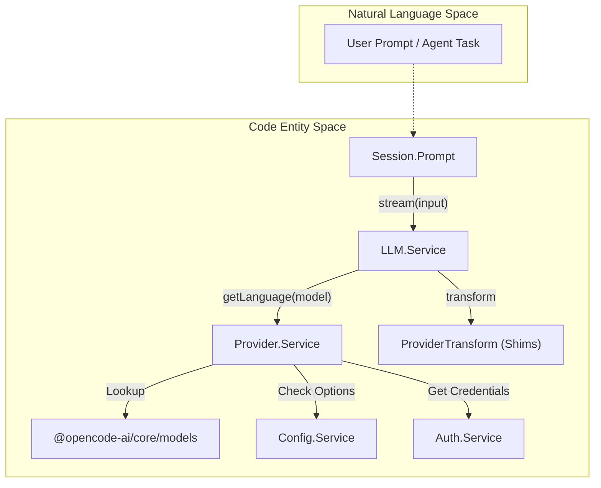
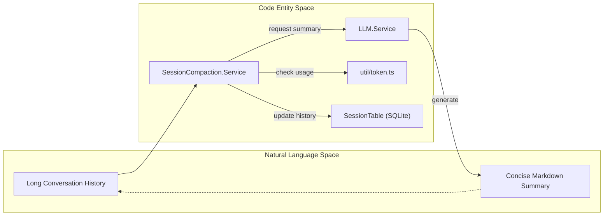

<!-- source: DeepWiki mcp.deepwiki.com · repo browser-use/browsercode · page 2.6 Provider and LLM Abstraction · fetched 2026-10-30 -->

# Provider and LLM Abstraction

Relevant source files

The following files were used as context for generating this wiki page:

- [packages/core/src/plugin/provider/nvidia.ts](packages/core/src/plugin/provider/nvidia.ts)
- [packages/core/test/plugin/provider-nvidia.test.ts](packages/core/test/plugin/provider-nvidia.test.ts)
- [packages/llm/example/tutorial.ts](packages/llm/example/tutorial.ts)
- [packages/llm/src/index.ts](packages/llm/src/index.ts)
- [packages/llm/src/protocols/anthropic-messages.ts](packages/llm/src/protocols/anthropic-messages.ts)
- [packages/llm/src/protocols/bedrock-converse.ts](packages/llm/src/protocols/bedrock-converse.ts)
- [packages/llm/src/protocols/gemini.ts](packages/llm/src/protocols/gemini.ts)
- [packages/llm/src/protocols/openai-chat.ts](packages/llm/src/protocols/openai-chat.ts)
- [packages/llm/src/protocols/openai-responses.ts](packages/llm/src/protocols/openai-responses.ts)
- [packages/llm/src/protocols/shared.ts](packages/llm/src/protocols/shared.ts)
- [packages/llm/src/protocols/utils/lifecycle.ts](packages/llm/src/protocols/utils/lifecycle.ts)
- [packages/llm/src/protocols/utils/tool-stream.ts](packages/llm/src/protocols/utils/tool-stream.ts)
- [packages/llm/src/schema/errors.ts](packages/llm/src/schema/errors.ts)
- [packages/llm/src/schema/events.ts](packages/llm/src/schema/events.ts)
- [packages/llm/src/tool-runtime.ts](packages/llm/src/tool-runtime.ts)
- [packages/llm/src/tool.ts](packages/llm/src/tool.ts)
- [packages/llm/test/adapter.test.ts](packages/llm/test/adapter.test.ts)
- [packages/llm/test/llm.test.ts](packages/llm/test/llm.test.ts)
- [packages/llm/test/provider/anthropic-messages.test.ts](packages/llm/test/provider/anthropic-messages.test.ts)
- [packages/llm/test/provider/bedrock-converse.test.ts](packages/llm/test/provider/bedrock-converse.test.ts)
- [packages/llm/test/provider/gemini.test.ts](packages/llm/test/provider/gemini.test.ts)
- [packages/llm/test/provider/openai-chat.test.ts](packages/llm/test/provider/openai-chat.test.ts)
- [packages/llm/test/provider/openai-compatible-chat.test.ts](packages/llm/test/provider/openai-compatible-chat.test.ts)
- [packages/llm/test/provider/openai-responses.test.ts](packages/llm/test/provider/openai-responses.test.ts)
- [packages/llm/test/recorded-scenarios.ts](packages/llm/test/recorded-scenarios.ts)
- [packages/llm/test/schema.test.ts](packages/llm/test/schema.test.ts)
- [packages/llm/test/tool-runtime.test.ts](packages/llm/test/tool-runtime.test.ts)
- [packages/opencode/src/cli/cmd/models.ts](packages/opencode/src/cli/cmd/models.ts)
- [packages/opencode/src/env/index.ts](packages/opencode/src/env/index.ts)
- [packages/opencode/src/provider/error.ts](packages/opencode/src/provider/error.ts)
- [packages/opencode/src/provider/provider.ts](packages/opencode/src/provider/provider.ts)
- [packages/opencode/src/provider/transform.ts](packages/opencode/src/provider/transform.ts)
- [packages/opencode/src/session/compaction.ts](packages/opencode/src/session/compaction.ts)
- [packages/opencode/src/session/llm.ts](packages/opencode/src/session/llm.ts)
- [packages/opencode/src/session/message-v2.ts](packages/opencode/src/session/message-v2.ts)
- [packages/opencode/src/session/processor.ts](packages/opencode/src/session/processor.ts)
- [packages/opencode/src/session/prompt.ts](packages/opencode/src/session/prompt.ts)
- [packages/opencode/src/session/summary.ts](packages/opencode/src/session/summary.ts)
- [packages/opencode/test/provider/amazon-bedrock.test.ts](packages/opencode/test/provider/amazon-bedrock.test.ts)
- [packages/opencode/test/provider/gitlab-duo.test.ts](packages/opencode/test/provider/gitlab-duo.test.ts)
- [packages/opencode/test/provider/provider.test.ts](packages/opencode/test/provider/provider.test.ts)
- [packages/opencode/test/provider/transform.test.ts](packages/opencode/test/provider/transform.test.ts)
- [packages/opencode/test/session/compaction.test.ts](packages/opencode/test/session/compaction.test.ts)
- [packages/opencode/test/session/llm.test.ts](packages/opencode/test/session/llm.test.ts)
- [packages/opencode/test/session/message-v2.test.ts](packages/opencode/test/session/message-v2.test.ts)
- [packages/opencode/test/session/processor-effect.test.ts](packages/opencode/test/session/processor-effect.test.ts)
- [packages/opencode/test/session/prompt.test.ts](packages/opencode/test/session/prompt.test.ts)
- [packages/opencode/test/session/snapshot-tool-race.test.ts](packages/opencode/test/session/snapshot-tool-race.test.ts)
- [packages/web/src/content/docs/ar/providers.mdx](packages/web/src/content/docs/ar/providers.mdx)
- [packages/web/src/content/docs/bs/providers.mdx](packages/web/src/content/docs/bs/providers.mdx)
- [packages/web/src/content/docs/da/providers.mdx](packages/web/src/content/docs/da/providers.mdx)
- [packages/web/src/content/docs/de/providers.mdx](packages/web/src/content/docs/de/providers.mdx)
- [packages/web/src/content/docs/es/providers.mdx](packages/web/src/content/docs/es/providers.mdx)
- [packages/web/src/content/docs/fr/providers.mdx](packages/web/src/content/docs/fr/providers.mdx)
- [packages/web/src/content/docs/it/providers.mdx](packages/web/src/content/docs/it/providers.mdx)
- [packages/web/src/content/docs/ja/providers.mdx](packages/web/src/content/docs/ja/providers.mdx)
- [packages/web/src/content/docs/ko/providers.mdx](packages/web/src/content/docs/ko/providers.mdx)
- [packages/web/src/content/docs/nb/providers.mdx](packages/web/src/content/docs/nb/providers.mdx)
- [packages/web/src/content/docs/pl/providers.mdx](packages/web/src/content/docs/pl/providers.mdx)
- [packages/web/src/content/docs/providers.mdx](packages/web/src/content/docs/providers.mdx)
- [packages/web/src/content/docs/zh-cn/providers.mdx](packages/web/src/content/docs/zh-cn/providers.mdx)
- [packages/web/src/content/docs/zh-tw/providers.mdx](packages/web/src/content/docs/zh-tw/providers.mdx)

The Provider and LLM Abstraction layer in BrowserCode/OpenCode provides a unified interface for interacting with over 75 LLM providers. It leverages the Vercel AI SDK and the `models.dev` catalog to handle multi-provider support, including Anthropic, OpenAI, AWS Bedrock, Google Vertex/AI, and Mistral. This layer is responsible for model discovery, credential management, message transformation (shims), and the orchestration of streaming responses.

## Provider Service Architecture

The `Provider.Service` is the central hub for managing LLM providers and their respective models. It handles the lifecycle of provider configurations, model listing, and the instantiation of language model objects.

### Key Responsibilities
- **Model Cataloging**: Consumes `models.dev` definitions to provide a standard set of capabilities and costs for known models [packages/opencode/src/provider/provider.ts:11]().
- **Dynamic Discovery**: Supports discovering models at runtime for providers like OpenRouter or local Ollama instances [packages/opencode/src/provider/provider.ts:121-128]().
- **Credential Resolution**: Interfaces with `Auth.Service` and `Env` to resolve API keys, AWS profiles, or OAuth tokens [packages/opencode/src/provider/provider.ts:12-13]().
- **Provider Shims**: Wraps standard SDKs with `ProviderTransform` to handle provider-specific quirks (e.g., Anthropic's requirement for non-empty messages) [packages/opencode/src/provider/provider.ts:26]().

### Data Flow: Provider Resolution
The following diagram illustrates how the system resolves a model request from a session into a functional LLM instance.

**Provider Resolution Logic**

Sources: [packages/opencode/src/session/prompt.ts:40](), [packages/opencode/src/session/llm.ts:71-74](), [packages/opencode/src/provider/provider.ts:11-13]()

## LLM Orchestration Layer

The `LLM.Service` acts as the orchestration layer between the high-level Agent/Session logic and the low-level Provider instances. It manages the construction of system prompts, tool injection, and the execution of the chat loop.

### Streaming and SSE Handling
To ensure reliability during long-running inference, the system includes an SSE (Server-Sent Events) wrapper that implements read timeouts. If a provider stops sending chunks without closing the connection, the `wrapSSE` function aborts the controller to prevent hanging the agent loop [packages/opencode/src/provider/provider.ts:39-85]().

### Provider Shims (`ProviderTransform`)
Different LLM providers have varying requirements for message structures. `ProviderTransform` provides a set of "sanitization" functions:
- **Surrogate Pair Cleaning**: Replaces invalid UTF-16 surrogates that often cause crashes in JSON serialization [packages/opencode/src/provider/transform.ts:21-23]().
- **Empty Message Filtering**: Anthropic and Bedrock reject messages with empty content; the shim filters these out or removes empty text parts [packages/opencode/src/provider/transform.ts:128-153]().
- **Tool ID Scrubbing**: Claude requires tool IDs to match specific regex patterns (`[a-zA-Z0-9_-]`); the shim automatically scrubs invalid characters from tool call IDs [packages/opencode/src/provider/transform.ts:183-206]().

Sources: [packages/opencode/src/provider/transform.ts:21-23](), [packages/opencode/src/provider/transform.ts:128-153](), [packages/opencode/src/provider/transform.ts:183-206]()

## Multi-Provider Support

The system maintains a registry of `BUNDLED_PROVIDERS` which are dynamically imported to keep the initial binary size small while supporting a vast array of APIs.

| Provider Category | Key Packages / APIs | Implementation Detail |
| :--- | :--- | :--- |
| **Cloud Native** | Bedrock, Vertex AI, Azure | Uses specialized SDKs for AWS/GCP/Azure authentication chains [packages/opencode/src/provider/provider.ts:92-98](). |
| **Standard APIs** | Anthropic, OpenAI, Mistral | Standard REST wrappers with `ProviderTransform` shims [packages/opencode/src/provider/provider.ts:93-103](). |
| **Aggregators** | OpenRouter, DeepInfra | Support for dynamic model discovery [packages/opencode/src/provider/provider.ts:101-105](). |
| **Specialized** | GitHub Copilot, GitLab Duo | Custom shims for enterprise-specific headers and tool protocols [packages/opencode/src/provider/provider.ts:114-115](). |

### Cross-Region Inference & Bedrock
For Amazon Bedrock, the provider abstraction supports complex authentication chains, including `AWS_PROFILE`, `AWS_ACCESS_KEY_ID`, and Web Identity Tokens for EKS environments [packages/web/src/content/docs/providers.mdx:172-186](). It also supports custom VPC endpoints via the `endpoint` or `baseURL` configuration options [packages/web/src/content/docs/providers.mdx:227-241]().

Sources: [packages/opencode/src/provider/provider.ts:91-117](), [packages/web/src/content/docs/providers.mdx:172-186](), [packages/web/src/content/docs/providers.mdx:227-241]()

## Session Context and Compaction

As conversations grow, they may exceed the model's context window. The `SessionCompaction` service monitors token usage and triggers summarization or pruning.

### Compaction Logic
1. **Overflow Detection**: `SessionCompaction.isOverflow` checks if the current message history exceeds the `usable` context for the selected model [packages/opencode/src/session/compaction.ts:189-192]().
2. **Summarization**: The service uses a `SUMMARY_TEMPLATE` to condense the "Done", "In Progress", and "Critical Context" sections of the conversation [packages/opencode/src/session/compaction.ts:44-79]().
3. **Pruning**: Older messages are removed, leaving a "tail" of recent turns to maintain immediate conversation flow [packages/opencode/src/session/compaction.ts:41-43]().

**Compaction Data Flow**

Sources: [packages/opencode/src/session/compaction.ts:44-79](), [packages/opencode/src/session/compaction.ts:189-207](), [packages/opencode/src/session/llm.ts:28]()

## Model Status and Selection

Models are classified by their status to help users choose reliable inference:
- **Active**: Fully supported and tested.
- **Experimental**: New models with potentially unstable tool-calling behavior [packages/opencode/src/provider/provider.ts:29]().
- **Alpha**: Internal or very early stage models [packages/opencode/test/provider/provider.test.ts:105]().

The `models` CLI command (`packages/opencode/src/cli/cmd/models.ts`) allows users to interactively filter and select models based on these statuses and their specific capabilities (e.g., image support, reasoning).

Sources: [packages/opencode/src/provider/provider.ts:27-29](), [packages/opencode/test/provider/provider.test.ts:103-107]()

---

