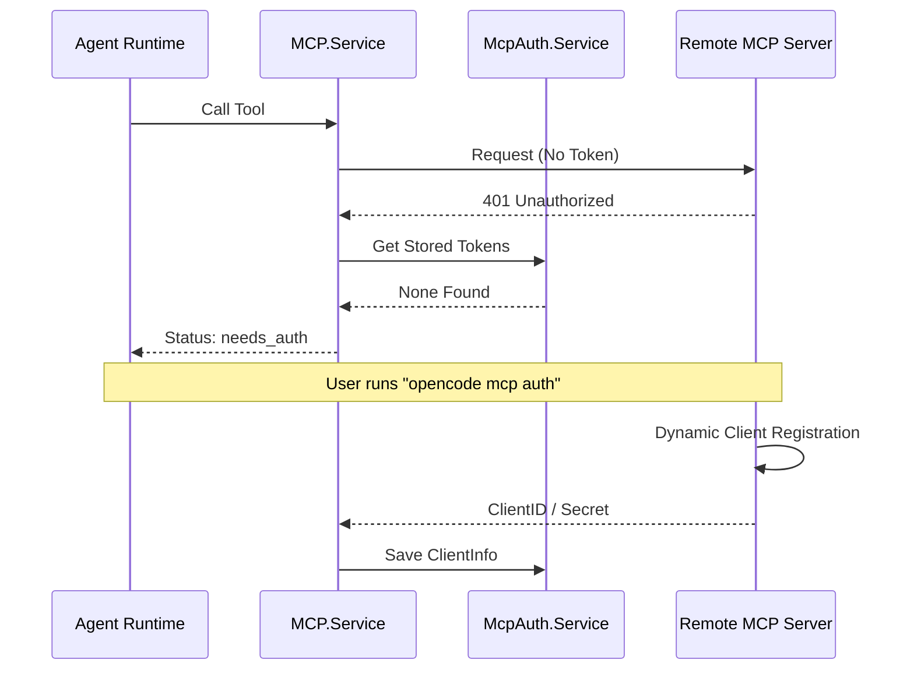
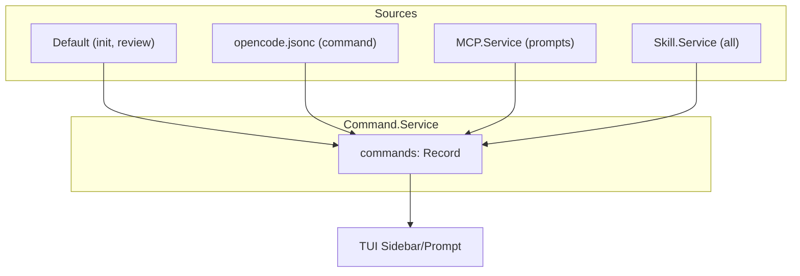

<!-- source: DeepWiki mcp.deepwiki.com · repo browser-use/browsercode · page 2.8 MCP Integration · fetched 2026-10-30 -->

# MCP Integration

Relevant source files

The following files were used as context for generating this wiki page:

- [github/README.md](github/README.md)
- [github/action.yml](github/action.yml)
- [github/index.ts](github/index.ts)
- [packages/opencode/src/cli/cmd/agent.ts](packages/opencode/src/cli/cmd/agent.ts)
- [packages/opencode/src/cli/cmd/github.ts](packages/opencode/src/cli/cmd/github.ts)
- [packages/opencode/src/cli/cmd/mcp.ts](packages/opencode/src/cli/cmd/mcp.ts)
- [packages/opencode/src/cli/cmd/providers.ts](packages/opencode/src/cli/cmd/providers.ts)
- [packages/opencode/src/cli/cmd/tui/routes/session/sidebar.tsx](packages/opencode/src/cli/cmd/tui/routes/session/sidebar.tsx)
- [packages/opencode/src/command/index.ts](packages/opencode/src/command/index.ts)
- [packages/opencode/src/mcp/auth.ts](packages/opencode/src/mcp/auth.ts)
- [packages/opencode/src/mcp/index.ts](packages/opencode/src/mcp/index.ts)
- [packages/opencode/src/mcp/oauth-callback.ts](packages/opencode/src/mcp/oauth-callback.ts)
- [packages/opencode/src/mcp/oauth-provider.ts](packages/opencode/src/mcp/oauth-provider.ts)
- [packages/opencode/src/plugin/codex.ts](packages/opencode/src/plugin/codex.ts)
- [packages/opencode/test/cli/github-action.test.ts](packages/opencode/test/cli/github-action.test.ts)
- [packages/opencode/test/mcp/headers.test.ts](packages/opencode/test/mcp/headers.test.ts)
- [packages/opencode/test/mcp/lifecycle.test.ts](packages/opencode/test/mcp/lifecycle.test.ts)
- [packages/opencode/test/mcp/oauth-auto-connect.test.ts](packages/opencode/test/mcp/oauth-auto-connect.test.ts)
- [packages/opencode/test/mcp/oauth-callback.test.ts](packages/opencode/test/mcp/oauth-callback.test.ts)
- [packages/web/src/content/docs/commands.mdx](packages/web/src/content/docs/commands.mdx)
- [packages/web/src/content/docs/github.mdx](packages/web/src/content/docs/github.mdx)
- [packages/web/src/content/docs/gitlab.mdx](packages/web/src/content/docs/gitlab.mdx)
- [packages/web/src/content/docs/mcp-servers.mdx](packages/web/src/content/docs/mcp-servers.mdx)

The **Model Context Protocol (MCP)** integration allows BrowserCode to extend its capabilities by connecting to external tool servers. The system supports local servers via `stdio` and remote servers via `HTTP/SSE`. It includes a robust authentication layer for OAuth/PKCE and integrates these external tools directly into the agent's runtime and the command palette.

## MCP Service Architecture

The `MCP.Service` manages the lifecycle of MCP clients, including discovery, connection, and tool conversion. It abstracts the underlying transport mechanisms provided by the `@modelcontextprotocol/sdk`.

### Transport Modes
BrowserCode supports three primary transport types for MCP:
1.  **Stdio**: For local processes started via a command. [packages/opencode/src/mcp/index.ts:5-5]()
2.  **SSE (Server-Sent Events)**: For remote servers providing a persistent event stream. [packages/opencode/src/mcp/index.ts:4-4]()
3.  **HTTP**: For stateless remote requests. [packages/opencode/src/mcp/index.ts:3-3]()

### Implementation Logic
The service iterates through the `mcp` configuration in `opencode.jsonc`. For each enabled server, it initializes a `Client` and attempts to list available tools.

| Component | Entity Space Identifier | Description |
| :--- | :--- | :--- |
| **Tool Discovery** | `listTools` | Fetches tool definitions from the MCP server with fallback for schema validation errors. [packages/opencode/src/mcp/index.ts:124-151]() |
| **Tool Conversion** | `convertMcpTool` | Transforms an MCP tool definition into an AI SDK `Tool` type for agent consumption. [packages/opencode/src/mcp/index.ts:154-182]() |
| **Status Tracking** | `MCPStatus` | A tagged union tracking whether a server is `connected`, `needs_auth`, `failed`, or `disabled`. [packages/opencode/src/mcp/index.ts:89-95]() |

**Sources:** [packages/opencode/src/mcp/index.ts:1-182](), [packages/web/src/content/docs/mcp-servers.mdx:70-163]()

## Authentication and OAuth/PKCE

For remote MCP servers that require authorization, BrowserCode implements an OAuth 2.0 flow with **Dynamic Client Registration (RFC 7591)** and **PKCE**.

### Data Flow: OAuth Flow
The `McpAuth.Service` persists tokens and client information in a local JSON file (`mcp-auth.json`). [packages/opencode/src/mcp/auth.ts:34-34]()

**Sources:** [packages/opencode/src/mcp/auth.ts:6-29](), [packages/opencode/src/mcp/index.ts:81-83](), [packages/web/src/content/docs/mcp-servers.mdx:166-192]()

### CodexAuthPlugin
The `CodexAuthPlugin` is a specialized implementation for OpenAI's Codex/ChatGPT backend. It handles a complex PKCE flow including local server redirection on port `1455` to capture the authorization code. [packages/opencode/src/plugin/codex.ts:12-15]()

- **PKCE Generation**: Uses `crypto.subtle.digest` to create challenges. [packages/opencode/src/plugin/codex.ts:31-38]()
- **JWT Parsing**: Extracts `chatgpt_account_id` from identity tokens to manage multi-organization access. [packages/opencode/src/plugin/codex.ts:67-96]()

**Sources:** [packages/opencode/src/plugin/codex.ts:1-153]()

## Command Integration

The `Command.Service` aggregates prompts and tools from various sources (Built-in, MCP, and Skills) into a unified registry.

### MCP Prompt Resolution
MCP servers can expose "Prompts" (templates) in addition to tools. The `Command.Service` resolves these prompts by:
1.  Listing prompts via the MCP client. [packages/opencode/src/command/index.ts:112-112]()
2.  Mapping MCP arguments to `$1`, `$2`, etc., syntax. [packages/opencode/src/command/index.ts:124-124]()
3.  Wrapping the resolution in a `Promise` within the `Info` object to allow lazy loading. [packages/opencode/src/command/index.ts:41-41]()

### Unified Command Structure

**Sources:** [packages/opencode/src/command/index.ts:65-157]()

## CLI Commands (`mcp`)

The `mcp` CLI group provides management utilities for the protocol.

| Command | Function | Entity Site |
| :--- | :--- | :--- |
| `list` | Displays connectivity status, OAuth state, and transport details for all configured servers. | [packages/opencode/src/cli/cmd/mcp.ts:109-168]() |
| `add` | Interactively adds a local or remote server to `opencode.jsonc`. | [packages/opencode/src/cli/cmd/mcp.ts:100-100]() |
| `auth` | Triggers the OAuth flow for a specific server, opening the system browser. | [packages/opencode/src/cli/cmd/mcp.ts:170-220]() |
| `logout` | Removes stored tokens and client registrations for a server. | [packages/opencode/src/cli/cmd/mcp.ts:103-103]() |

**Sources:** [packages/opencode/src/cli/cmd/mcp.ts:95-220]()

## GitHub Integration (Agent Mode)

While not a standard MCP server, the `GithubCommand` utilizes similar patterns to bridge external environments (GitHub Actions) with the BrowserCode agent.

- **Triggering**: Listens for `issue_comment`, `pull_request`, and `schedule` events. [packages/opencode/src/cli/cmd/github.ts:148-150]()
- **Action Flow**: When a `/oc` or `/opencode` comment is detected, it initializes a `Session` and executes the requested task within the runner. [packages/opencode/src/cli/cmd/github.ts:53-55]()
- **Context Handling**: It extracts diff context and file paths specifically for `pull_request_review_comment` events. [packages/opencode/src/cli/cmd/github.ts:51-54]()

**Sources:** [packages/opencode/src/cli/cmd/github.ts:141-182](), [github/README.md:33-50]()

---

