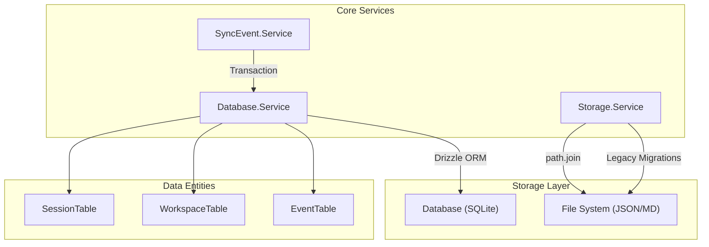
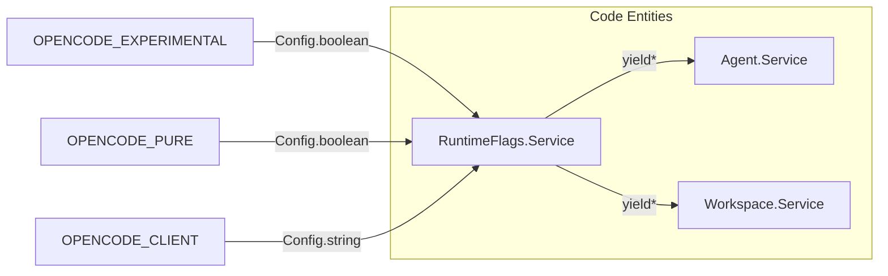

<!-- source: DeepWiki mcp.deepwiki.com · repo browser-use/browsercode · page 2.9 Storage, Database, and Effect Runtime · fetched 2026-10-30 -->

# Storage, Database, and Effect Runtime

Relevant source files

The following files were used as context for generating this wiki page:

- [packages/core/src/flag/flag.ts](packages/core/src/flag/flag.ts)
- [packages/desktop/src/main/env.d.ts](packages/desktop/src/main/env.d.ts)
- [packages/http-recorder/README.md](packages/http-recorder/README.md)
- [packages/http-recorder/src/cassette.ts](packages/http-recorder/src/cassette.ts)
- [packages/http-recorder/src/effect.ts](packages/http-recorder/src/effect.ts)
- [packages/http-recorder/src/index.ts](packages/http-recorder/src/index.ts)
- [packages/http-recorder/src/matching.ts](packages/http-recorder/src/matching.ts)
- [packages/http-recorder/src/recorder.ts](packages/http-recorder/src/recorder.ts)
- [packages/http-recorder/src/redaction.ts](packages/http-recorder/src/redaction.ts)
- [packages/http-recorder/src/schema.ts](packages/http-recorder/src/schema.ts)
- [packages/http-recorder/src/websocket.ts](packages/http-recorder/src/websocket.ts)
- [packages/http-recorder/test/record-replay.test.ts](packages/http-recorder/test/record-replay.test.ts)
- [packages/llm/test/recorded-test.ts](packages/llm/test/recorded-test.ts)
- [packages/llm/test/recorded-websocket.ts](packages/llm/test/recorded-websocket.ts)
- [packages/opencode/migration/20260413175956_chief_energizer/migration.sql](packages/opencode/migration/20260413175956_chief_energizer/migration.sql)
- [packages/opencode/migration/20260413175956_chief_energizer/snapshot.json](packages/opencode/migration/20260413175956_chief_energizer/snapshot.json)
- [packages/opencode/migration/20260510033149_session_usage/migration.sql](packages/opencode/migration/20260510033149_session_usage/migration.sql)
- [packages/opencode/migration/20260510033149_session_usage/snapshot.json](packages/opencode/migration/20260510033149_session_usage/snapshot.json)
- [packages/opencode/migration/20260511000411_data_migration_state/migration.sql](packages/opencode/migration/20260511000411_data_migration_state/migration.sql)
- [packages/opencode/migration/20260511000411_data_migration_state/snapshot.json](packages/opencode/migration/20260511000411_data_migration_state/snapshot.json)
- [packages/opencode/src/auth/index.ts](packages/opencode/src/auth/index.ts)
- [packages/opencode/src/cli/cmd/db.ts](packages/opencode/src/cli/cmd/db.ts)
- [packages/opencode/src/cli/cmd/tui/context/aggregate-failures.ts](packages/opencode/src/cli/cmd/tui/context/aggregate-failures.ts)
- [packages/opencode/src/control-plane/adapters/index.ts](packages/opencode/src/control-plane/adapters/index.ts)
- [packages/opencode/src/control-plane/adapters/worktree.ts](packages/opencode/src/control-plane/adapters/worktree.ts)
- [packages/opencode/src/control-plane/types.ts](packages/opencode/src/control-plane/types.ts)
- [packages/opencode/src/control-plane/workspace.sql.ts](packages/opencode/src/control-plane/workspace.sql.ts)
- [packages/opencode/src/control-plane/workspace.ts](packages/opencode/src/control-plane/workspace.ts)
- [packages/opencode/src/data-migration.sql.ts](packages/opencode/src/data-migration.sql.ts)
- [packages/opencode/src/data-migration.ts](packages/opencode/src/data-migration.ts)
- [packages/opencode/src/effect/runtime-flags.ts](packages/opencode/src/effect/runtime-flags.ts)
- [packages/opencode/src/event-v2-bridge.ts](packages/opencode/src/event-v2-bridge.ts)
- [packages/opencode/src/provider/auth.ts](packages/opencode/src/provider/auth.ts)
- [packages/opencode/src/server/projectors.ts](packages/opencode/src/server/projectors.ts)
- [packages/opencode/src/server/routes/instance/httpapi/AGENTS.md](packages/opencode/src/server/routes/instance/httpapi/AGENTS.md)
- [packages/opencode/src/server/routes/instance/httpapi/errors.ts](packages/opencode/src/server/routes/instance/httpapi/errors.ts)
- [packages/opencode/src/server/routes/instance/httpapi/groups/global.ts](packages/opencode/src/server/routes/instance/httpapi/groups/global.ts)
- [packages/opencode/src/server/routes/instance/httpapi/handlers/session-errors.ts](packages/opencode/src/server/routes/instance/httpapi/handlers/session-errors.ts)
- [packages/opencode/src/session/projectors.ts](packages/opencode/src/session/projectors.ts)
- [packages/opencode/src/session/session.sql.ts](packages/opencode/src/session/session.sql.ts)
- [packages/opencode/src/skill/index.ts](packages/opencode/src/skill/index.ts)
- [packages/opencode/src/storage/db.ts](packages/opencode/src/storage/db.ts)
- [packages/opencode/src/storage/storage.ts](packages/opencode/src/storage/storage.ts)
- [packages/opencode/src/sync/index.ts](packages/opencode/src/sync/index.ts)
- [packages/opencode/src/util/filesystem.ts](packages/opencode/src/util/filesystem.ts)
- [packages/opencode/src/v2/session.ts](packages/opencode/src/v2/session.ts)
- [packages/opencode/test/cli/cmd/tui/aggregate-failures.test.ts](packages/opencode/test/cli/cmd/tui/aggregate-failures.test.ts)
- [packages/opencode/test/cli/tui/thread.test.ts](packages/opencode/test/cli/tui/thread.test.ts)
- [packages/opencode/test/control-plane/workspace.test.ts](packages/opencode/test/control-plane/workspace.test.ts)
- [packages/opencode/test/effect/runtime-flags.test.ts](packages/opencode/test/effect/runtime-flags.test.ts)
- [packages/opencode/test/fixture/db.ts](packages/opencode/test/fixture/db.ts)
- [packages/opencode/test/fixture/flag.ts](packages/opencode/test/fixture/flag.ts)
- [packages/opencode/test/fixture/workspace.ts](packages/opencode/test/fixture/workspace.ts)
- [packages/opencode/test/plugin/trigger.test.ts](packages/opencode/test/plugin/trigger.test.ts)
- [packages/opencode/test/plugin/workspace-adapter.test.ts](packages/opencode/test/plugin/workspace-adapter.test.ts)
- [packages/opencode/test/preload.ts](packages/opencode/test/preload.ts)
- [packages/opencode/test/server/httpapi-instance-context.test.ts](packages/opencode/test/server/httpapi-instance-context.test.ts)
- [packages/opencode/test/server/httpapi-promptasync-context.test.ts](packages/opencode/test/server/httpapi-promptasync-context.test.ts)
- [packages/opencode/test/server/httpapi-workspace-routing.test.ts](packages/opencode/test/server/httpapi-workspace-routing.test.ts)
- [packages/opencode/test/server/session-messages.test.ts](packages/opencode/test/server/session-messages.test.ts)
- [packages/opencode/test/session/system.test.ts](packages/opencode/test/session/system.test.ts)
- [packages/opencode/test/skill/skill.test.ts](packages/opencode/test/skill/skill.test.ts)
- [packages/opencode/test/storage/db.test.ts](packages/opencode/test/storage/db.test.ts)
- [packages/opencode/test/storage/storage.test.ts](packages/opencode/test/storage/storage.test.ts)
- [packages/opencode/test/sync/index.test.ts](packages/opencode/test/sync/index.test.ts)
- [packages/opencode/test/util/filesystem.test.ts](packages/opencode/test/util/filesystem.test.ts)

This section covers the persistence layer and execution environment of BrowserCode. It details the transition from file-based storage to a relational SQLite database, the configuration of the Effect runtime, and the mechanisms for managing authentication and test recording.

## Database and Drizzle ORM

BrowserCode uses **SQLite** as its primary data store, managed through the **Drizzle ORM**. The database handles structured data including sessions, projects, workspaces, and event logs.

### Database Initialization and Connection
The database connection is managed by `Database.Service`. In test environments, the system often defaults to an in-memory SQLite instance via the `OPENCODE_DB` environment variable `[packages/opencode/test/preload.ts:80-80]()`.

*   **Migrations**: Schema changes are handled via Drizzle migrations. The CLI provides a `db` command to manage these `[packages/opencode/src/cli/cmd/db.ts:1-20]()`. Migrations can be skipped using the `OPENCODE_SKIP_MIGRATIONS` flag `[packages/core/src/flag/flag.ts:65-65]()`.
*   **Transaction Handling**: The system supports immediate transactions to ensure data consistency during concurrent writes, particularly within the event sync system `[packages/opencode/src/sync/index.ts:164-181]()`.

### Table Schemas
Key tables include:
*   **SessionTable**: Stores session metadata and state `[packages/opencode/src/session/session.sql.ts:1-10]()`.
*   **WorkspaceTable**: Manages cloud and local workspace environments `[packages/opencode/src/control-plane/workspace.sql:1-20]()`.
*   **EventTable & EventSequenceTable**: Power the legacy sync system by tracking ordered events for specific aggregates `[packages/opencode/src/sync/event.sql:1-20]()`.

**Sources:** `[packages/opencode/src/storage/db.ts]()`, `[packages/opencode/src/sync/index.ts]()`, `[packages/core/src/flag/flag.ts]()`, `[packages/opencode/test/preload.ts]()`.

---

## Storage.ts and File Persistence

Before the full migration to SQLite, and for specific unstructured data, `Storage.Service` provides a JSON-based file persistence layer.

### Key Functions
*   **Read/Write**: Provides type-safe access to JSON files using Effect schemas `[packages/opencode/src/storage/storage.ts:61-63]()`.
*   **Migrations**: `Storage.ts` contains legacy migration logic (e.g., `migration.1`, `migration.2`) that transforms older directory structures into the current format, moving session and message data into organized subdirectories `[packages/opencode/src/storage/storage.ts:87-202]()`.

### Path Resolution
The system uses a custom `resolve` utility to handle path normalization across platforms, specifically translating Git Bash, Cygwin, and WSL paths to canonical Windows paths when necessary `[packages/opencode/src/util/filesystem.ts:136-144]()`, `[packages/opencode/src/util/filesystem.ts:152-164]()`.

**Sources:** `[packages/opencode/src/storage/storage.ts]()`, `[packages/opencode/src/util/filesystem.ts]()`.

---

## Effect Runtime and Flags

The codebase is built on the **Effect** library, which provides a functional, type-safe runtime for dependency injection and error handling.

### Runtime Flags
`RuntimeFlags.Service` centralizes feature toggles and experimental settings. These are parsed from environment variables prefixed with `OPENCODE_`.

| Flag | Purpose | Source |
| :--- | :--- | :--- |
| `pure` | Runs the agent in a restricted environment | `[packages/opencode/src/effect/runtime-flags.ts:16-16]()` |
| `experimentalWorkspaces` | Enables multi-workspace support | `[packages/opencode/src/effect/runtime-flags.ts:42-42]()` |
| `enableParallel` | Allows parallel tool execution | `[packages/opencode/src/effect/runtime-flags.ts:29-32]()` |
| `autoShare` | Automatically shares session snapshots | `[packages/opencode/src/effect/runtime-flags.ts:15-15]()` |

### InstanceState Pattern
`InstanceState` is a pattern used to manage mutable state within the Effect runtime, typically used for services that need to maintain internal caches or connection pools (e.g., `Workspace.Service` or `ProviderAuth.Service`) `[packages/opencode/src/control-plane/workspace.ts:181-181]()`, `[packages/opencode/src/provider/auth.ts:110-124]()`.

**Sources:** `[packages/opencode/src/effect/runtime-flags.ts]()`, `[packages/opencode/src/control-plane/workspace.ts]()`, `[packages/opencode/src/provider/auth.ts]()`.

---

## Authentication (auth.ts)

Authentication is handled via `Auth.Service`, which persists credentials in `auth.json` located in the global data directory `[packages/opencode/src/auth/index.ts:9-9]()`.

### Supported Auth Types
The system uses a discriminated union `Info` to support different authentication strategies `[packages/opencode/src/auth/index.ts:34-34]()`:
1.  **OAuth**: Stores refresh/access tokens and expiry `[packages/opencode/src/auth/index.ts:13-20]()`.
2.  **API**: Simple API key storage with optional metadata `[packages/opencode/src/auth/index.ts:22-26]()`.
3.  **WellKnown**: Specialized tokens for known service endpoints `[packages/opencode/src/auth/index.ts:28-32]()`.

**Sources:** `[packages/opencode/src/auth/index.ts]()`.

---

## HTTP Recorder and Test Cassettes

The `http-recorder` package provides a mechanism to record and replay HTTP interactions, similar to VCR. This is used extensively for deterministic testing of LLM providers and external APIs.

*   **Cassettes**: Recorded interactions are stored as "cassettes" (JSON files).
*   **Redaction**: Sensitive data like API keys are automatically redacted during recording `[packages/http-recorder/src/redaction.ts:1-10]()`.
*   **Effect Integration**: A specialized `HttpRecorder` layer allows wrapping the `HttpClient` in tests to intercept traffic `[packages/http-recorder/src/effect.ts:1-20]()`.

**Sources:** `[packages/http-recorder/src/recorder.ts]()`, `[packages/http-recorder/src/effect.ts]()`.

---

## Data Flow Diagrams

### Storage and Database Architecture
This diagram shows the relationship between the file system, the SQLite database, and the Effect services that manage them.

**Sources:** `[packages/opencode/src/storage/db.ts]()`, `[packages/opencode/src/storage/storage.ts:59-65]()`, `[packages/opencode/src/sync/index.ts:164-181]()`.

### Runtime Flag and Config Resolution
This diagram bridges the environment variables (Natural Language/Shell Space) to the `RuntimeFlags.Service` (Code Space).

**Sources:** `[packages/opencode/src/effect/runtime-flags.ts:1-46]()`, `[packages/opencode/src/control-plane/workspace.ts:178-178]()`.

---

