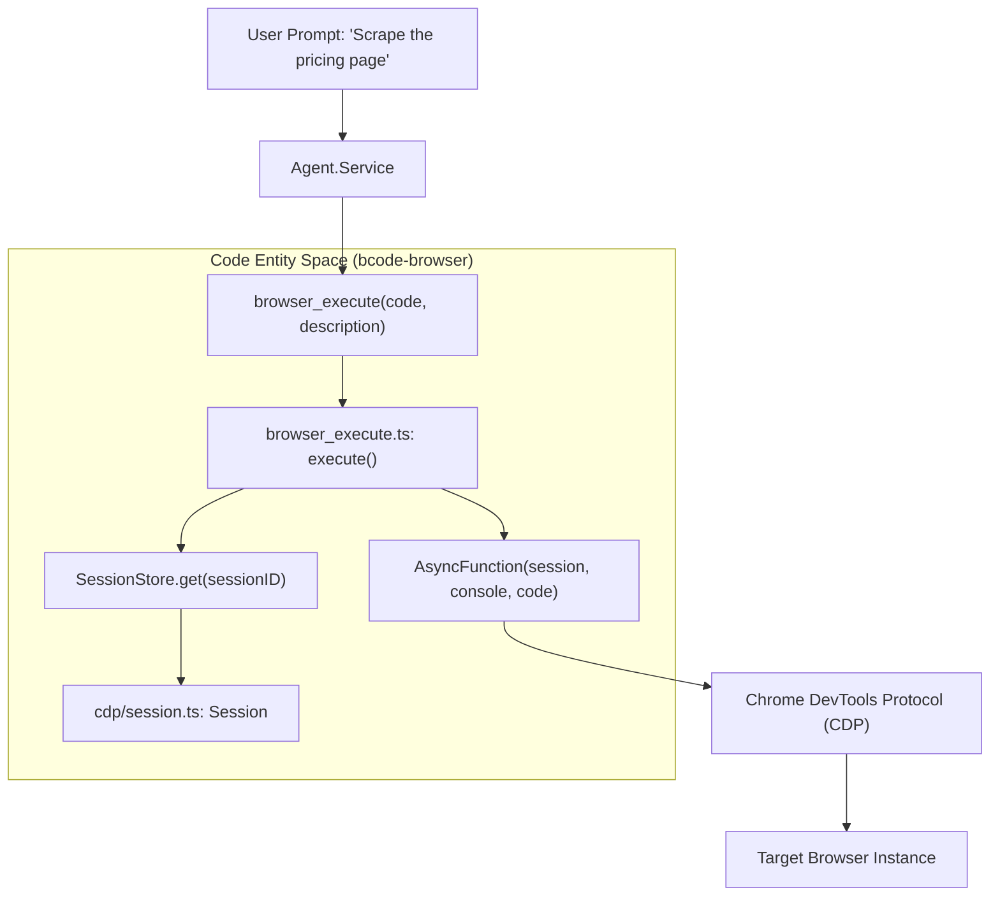
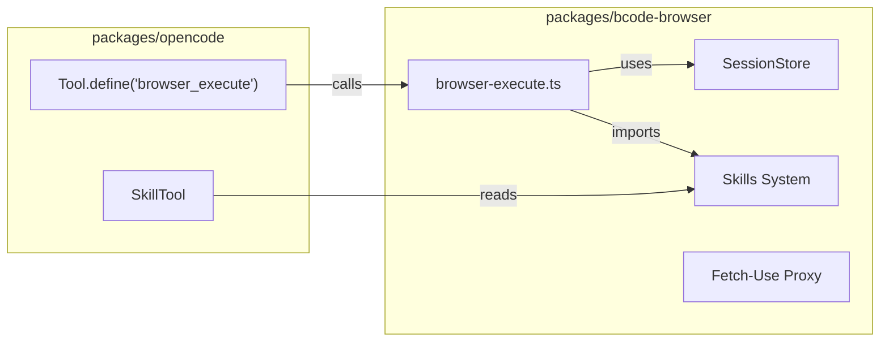

<!-- source: DeepWiki mcp.deepwiki.com · repo browser-use/browsercode · page 3 Browser Integration (bcode-browser) · fetched 2026-10-30 -->

# Browser Integration (bcode-browser)

Relevant source files

The following files were used as context for generating this wiki page:

- [packages/bcode-browser/README.md](packages/bcode-browser/README.md)
- [packages/bcode-browser/package.json](packages/bcode-browser/package.json)
- [packages/bcode-browser/skills/browser-execute/SKILL.md](packages/bcode-browser/skills/browser-execute/SKILL.md)
- [packages/bcode-browser/src/browser-execute.ts](packages/bcode-browser/src/browser-execute.ts)
- [packages/bcode-browser/src/fetch-use.ts](packages/bcode-browser/src/fetch-use.ts)
- [packages/bcode-browser/src/index.ts](packages/bcode-browser/src/index.ts)
- [packages/bcode-browser/src/skills.ts](packages/bcode-browser/src/skills.ts)
- [packages/bcode-browser/test/fetch-use.test.ts](packages/bcode-browser/test/fetch-use.test.ts)
- [packages/bcode-browser/test/skills.test.ts](packages/bcode-browser/test/skills.test.ts)
- [packages/bcode-browser/test/workspace-import.test.ts](packages/bcode-browser/test/workspace-import.test.ts)
- [packages/opencode/src/session/system.ts](packages/opencode/src/session/system.ts)
- [packages/opencode/src/tool/apply_patch.ts](packages/opencode/src/tool/apply_patch.ts)
- [packages/opencode/src/tool/apply_patch.txt](packages/opencode/src/tool/apply_patch.txt)
- [packages/opencode/src/tool/browser-execute.ts](packages/opencode/src/tool/browser-execute.ts)
- [packages/opencode/src/tool/browser-execute.txt](packages/opencode/src/tool/browser-execute.txt)
- [packages/opencode/src/tool/edit.ts](packages/opencode/src/tool/edit.ts)
- [packages/opencode/src/tool/external-directory.ts](packages/opencode/src/tool/external-directory.ts)
- [packages/opencode/src/tool/read.ts](packages/opencode/src/tool/read.ts)
- [packages/opencode/src/tool/skill.ts](packages/opencode/src/tool/skill.ts)
- [packages/opencode/src/tool/task.ts](packages/opencode/src/tool/task.ts)
- [packages/opencode/src/tool/tool.ts](packages/opencode/src/tool/tool.ts)
- [packages/opencode/src/tool/webfetch.ts](packages/opencode/src/tool/webfetch.ts)
- [packages/opencode/src/tool/write.ts](packages/opencode/src/tool/write.ts)
- [packages/opencode/test/tool/apply_patch.test.ts](packages/opencode/test/tool/apply_patch.test.ts)
- [packages/opencode/test/tool/edit.test.ts](packages/opencode/test/tool/edit.test.ts)
- [packages/opencode/test/tool/grep.test.ts](packages/opencode/test/tool/grep.test.ts)
- [packages/opencode/test/tool/question.test.ts](packages/opencode/test/tool/question.test.ts)
- [packages/opencode/test/tool/read.test.ts](packages/opencode/test/tool/read.test.ts)
- [packages/opencode/test/tool/skill.test.ts](packages/opencode/test/tool/skill.test.ts)
- [packages/opencode/test/tool/task.test.ts](packages/opencode/test/tool/task.test.ts)
- [packages/opencode/test/tool/webfetch.test.ts](packages/opencode/test/tool/webfetch.test.ts)
- [packages/opencode/test/tool/write.test.ts](packages/opencode/test/tool/write.test.ts)

The `bcode-browser` package provides the specialized infrastructure for browser-based tool execution within BrowserCode. While base OpenCode focuses on local file manipulation and shell execution, BrowserCode extends these capabilities with a high-fidelity Chrome DevTools Protocol (CDP) layer, a persistent session store, and a "Skills" system designed to teach LLMs how to perform complex web automation.

## The browser_execute Tool

The primary interface for browser interaction is the `browser_execute` tool. Unlike tools that spawn subprocesses, `browser_execute` runs JavaScript snippets in-process against a live CDP connection.

### Execution Model
- **Snippet Scope**: Snippets are executed using `AsyncFunction` [packages/bcode-browser/src/browser-execute.ts:129-131](). The environment injects a `session` object (the CDP transport) and a `console` object for output capture [packages/bcode-browser/src/browser-execute.ts:8-12]().
- **State Persistence**: The `session` object is persistent across multiple tool calls within the same BrowserCode session [packages/bcode-browser/src/browser-execute.ts:74-76]().
- **Output Capture**: Console logs, errors, and warnings are buffered and returned as part of the `ExecuteResult` [packages/bcode-browser/src/browser-execute.ts:99-103]().
- **Screenshot Integration**: Snippets can capture screenshots which are automatically converted to base64 and attached to the message turn [packages/bcode-browser/src/browser-execute.ts:93-96]().

### Bridge: Natural Language to Browser Entities

The following diagram shows how a natural language request to "scrape a site" is transformed into code execution through the tool system.

Sources: [packages/bcode-browser/src/browser-execute.ts:37-41](), [packages/bcode-browser/src/browser-execute.ts:146-149](), [packages/opencode/src/tool/tool.ts:132-140]()

## CDP Layer and Browser Sessions

BrowserCode maintains a vendored CDP layer to ensure stable communication with Chromium-based browsers. It supports three primary connection modes:
1.  **Current Tab**: Attaching to an existing browser instance.
2.  **New Profile**: Launching a fresh, isolated browser profile.
3.  **Cloud Browser**: Connecting to managed infrastructure via **Browser Use Cloud**.

The `SessionStore` maps BrowserCode session IDs to active CDP connections, allowing the agent to maintain "memory" of the browser state (like logged-in sessions or multi-page workflows) across different turns.

For details, see [CDP Layer and Browser Sessions](#3.1).

Sources: [packages/bcode-browser/src/session-store.ts:1-20](), [packages/bcode-browser/src/browser-execute.ts:146-150]()

## Browser Skills and Fetch-Use

To handle complex tasks without bloating the system prompt, BrowserCode uses a **Skills System**. Skills are Markdown-based instructions and reference implementations (e.g., `SKILL.md`) that the agent can "load" dynamically.

### Key Components
- **Browser Skills**: Located in `packages/bcode-browser/skills/`, these provide the LLM with patterns for common tasks like "connecting to local Chrome" or "handling dynamic selectors" [packages/bcode-browser/skills/browser-execute/SKILL.md:1-50]().
- **Fetch-Use**: A cloud proxy service integrated into the `webfetch` tool. When enabled via `experimental.fetch_use`, it routes web requests through a managed service to bypass bot detection and handle JS-heavy sites [packages/opencode/src/tool/webfetch.ts:56-62]().
- **Skill Embedding**: During the build process, skills are embedded into the final binary to ensure they are available in distributed versions [packages/bcode-browser/src/skills.ts:1-30]().

For details, see [Browser Skills and Fetch-Use](#3.2).

Sources: [packages/opencode/src/tool/skill.ts:23-30](), [packages/opencode/src/tool/webfetch.ts:26-32](), [packages/bcode-browser/src/skills.ts:1-10]()

## Integration Architecture

The browser integration is structured to keep the core engine (`opencode`) decoupled from the browser specifics (`bcode-browser`).

Sources: [packages/opencode/src/tool/tool.ts:132-150](), [packages/bcode-browser/src/browser-execute.ts:43-47](), [packages/opencode/src/tool/skill.ts:14-18]()

## Value Proposition over OpenCode
While base OpenCode provides a robust tool-calling framework, `bcode-browser` adds:
- **Workspace Isolation**: The agent can write helper scripts to `.bcode/agent-workspace/` and import them dynamically into the browser context [packages/bcode-browser/src/browser-execute.ts:78-83]().
- **Rich Media Support**: Native handling of screenshots and image-based reasoning [packages/bcode-browser/src/browser-execute.ts:104-108]().
- **Managed Connectivity**: Out-of-the-box support for cloud-hosted browsers and proxying, reducing the setup friction for web-heavy agents.

---

