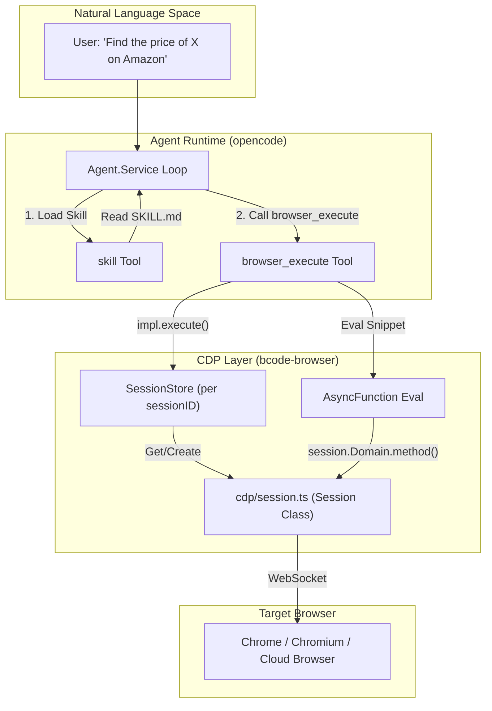
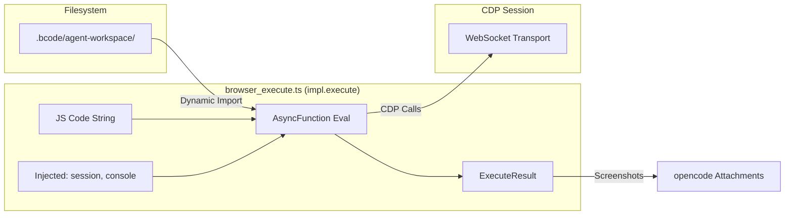

<!-- source: DeepWiki mcp.deepwiki.com · repo browser-use/browsercode · page 3.1 CDP Layer and Browser Sessions · fetched 2026-10-30 -->

# CDP Layer and Browser Sessions

Relevant source files

The following files were used as context for generating this wiki page:

- [packages/bcode-browser/README.md](packages/bcode-browser/README.md)
- [packages/bcode-browser/package.json](packages/bcode-browser/package.json)
- [packages/bcode-browser/skills/browser-execute/SKILL.md](packages/bcode-browser/skills/browser-execute/SKILL.md)
- [packages/bcode-browser/src/browser-execute.ts](packages/bcode-browser/src/browser-execute.ts)
- [packages/bcode-browser/src/index.ts](packages/bcode-browser/src/index.ts)
- [packages/bcode-browser/src/skills.ts](packages/bcode-browser/src/skills.ts)
- [packages/bcode-browser/test/skills.test.ts](packages/bcode-browser/test/skills.test.ts)
- [packages/bcode-browser/test/workspace-import.test.ts](packages/bcode-browser/test/workspace-import.test.ts)
- [packages/opencode/src/tool/browser-execute.ts](packages/opencode/src/tool/browser-execute.ts)
- [packages/opencode/src/tool/browser-execute.txt](packages/opencode/src/tool/browser-execute.txt)

The BrowserCode browser integration provides a high-performance, in-process interface for driving web browsers via the Chrome DevTools Protocol (CDP). Unlike traditional automation frameworks that rely on external drivers or heavy subprocesses, BrowserCode executes JavaScript snippets directly within the Bun runtime, sharing a persistent CDP transport across tool calls within a session.

## Architecture Overview

The browser subsystem is split into two layers:
1.  **Level 1 (`@browser-use/bcode-browser`)**: Contains the core CDP implementation, the vendored protocol definitions, the session store, and the snippet execution engine [packages/bcode-browser/src/index.ts:1-28]().
2.  **Level 2 (`packages/opencode`)**: A thin adapter that registers the `browser_execute` tool and connects it to the opencode agent runtime and permission system [packages/opencode/src/tool/browser-execute.ts:1-4]().

### Data Flow: Natural Language to Browser Execution

The following diagram illustrates how an agent's natural language intent to "browse the web" translates into CDP commands through the code entities.

**Browser Execution Data Flow**

Sources: [packages/bcode-browser/src/browser-execute.ts:146-150](), [packages/opencode/src/tool/browser-execute.ts:23-57](), [packages/bcode-browser/src/session-store.ts:1-13]()

## The CDP Layer

BrowserCode vendors its own CDP layer to ensure stability and zero upstream friction. This includes:
*   **`cdp/session.ts`**: The primary transport class managing the WebSocket connection and message multiplexing [packages/bcode-browser/src/index.ts:10-12]().
*   **`cdp/generated.ts`**: Full TypeScript definitions for all 652+ CDP commands and events, generated from the protocol JSON [packages/bcode-browser/package.json:11]().

### Session Management
The `SessionStore` maps opencode `sessionID`s to active `CDPSession` instances. This allows an agent to call `session.connect()` in one tool turn and maintain that connection in subsequent turns [packages/bcode-browser/src/session-store.ts:1-13]().

## Connection Modes

The agent typically reads the `browser-execute` skill [packages/bcode-browser/skills/browser-execute/SKILL.md:1-4]() to understand the four primary ways to connect to a browser:

| Mode | Description | Trigger |
| :--- | :--- | :--- |
| **Way 1: Local Chrome** | Connects to the user's existing browser profile via remote debugging. | `await session.connect()` [packages/bcode-browser/skills/browser-execute/SKILL.md:16-22]() |
| **Way 2: Isolated Profile** | Launches a new Chrome instance with a specific `--user-data-dir`. | `await session.connect({ wsUrl })` [packages/bcode-browser/skills/browser-execute/SKILL.md:30-53]() |
| **Way 3: Cloud Browser** | Provisions a browser via Browser Use Cloud API. | `fetch("https://api.browser-use.com/...")` [packages/bcode-browser/skills/browser-execute/SKILL.md:63-78]() |
| **Way 4: Preconfigured** | Uses `BU_CDP_WS` environment variable. | Automatic on `connect()` [packages/bcode-browser/skills/browser-execute/SKILL.md:93-96]() |

## Snippet Execution Engine

The `browser_execute` tool uses an `AsyncFunction` constructor to evaluate snippets. This provides a clean lexical scope where `session` and `console` are injected [packages/bcode-browser/src/browser-execute.ts:1-12]().

### Workspace and Persistence
To support complex tasks, the agent uses a per-project workspace at `<projectDir>/.bcode/agent-workspace/` [packages/opencode/src/tool/browser-execute.ts:17-21](). 
*   **Dynamic Imports**: Agents can write `.ts` helper files to this directory and import them within snippets using `await import("/abs/path/to/file.ts?t=" + Date.now())` to bypass the module cache [packages/bcode-browser/src/browser-execute.ts:14-19]().
*   **Output Capture**: A virtual `console` object captures logs, which are streamed back to the UI via `onChunk` callbacks [packages/bcode-browser/src/browser-execute.ts:21-28]().
*   **Vision Integration**: Screenshots taken via `Page.captureScreenshot` are automatically collected and returned as `FilePart` attachments, allowing the LLM to "see" the page natively in the next turn [packages/opencode/src/tool/browser-execute.ts:58-68]().

**Snippet Execution Internal Logic**

Sources: [packages/bcode-browser/src/browser-execute.ts:56-108](), [packages/opencode/src/tool/browser-execute.ts:49-82](), [packages/bcode-browser/test/workspace-import.test.ts:26-30]()

## Skill Embedding and Resolution

Browser skills are embedded into the compiled binary at build time by `script/embed-skills.ts` [packages/bcode-browser/README.md:16](). At runtime, the `Skills.resolveSkillsDir` function materializes these files to the user's data directory [packages/bcode-browser/src/skills.ts:1-12]().

The resolver performs a template substitution, replacing `{{SKILLS_DIR}}` with the actual absolute path on the user's machine, ensuring that the agent can always find and read its reference documentation [packages/bcode-browser/src/skills.ts:55-61]().

Sources:
- [packages/bcode-browser/src/browser-execute.ts:1-150]()
- [packages/opencode/src/tool/browser-execute.ts:1-87]()
- [packages/bcode-browser/src/skills.ts:1-84]()
- [packages/bcode-browser/skills/browser-execute/SKILL.md:1-110]()
- [packages/bcode-browser/src/index.ts:1-29]()
- [packages/bcode-browser/README.md:1-29]()

---

