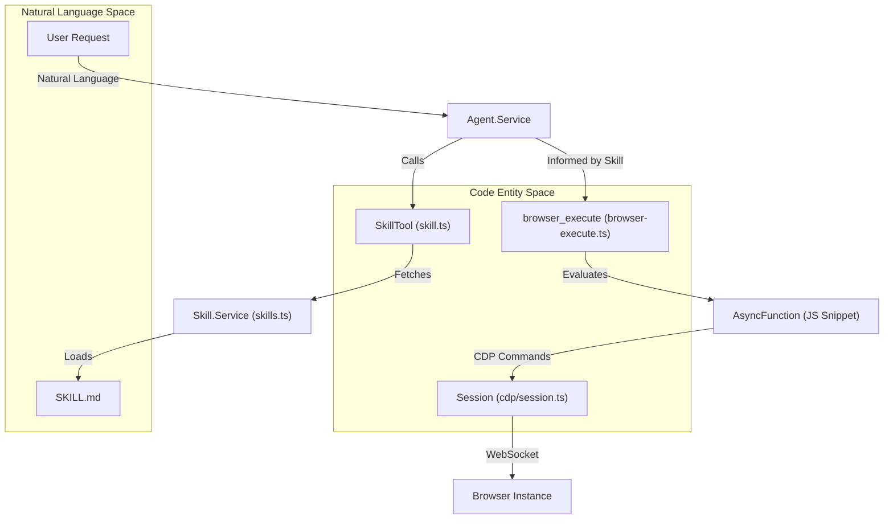
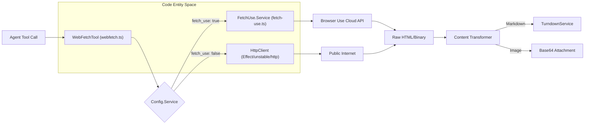

<!-- source: DeepWiki mcp.deepwiki.com · repo browser-use/browsercode · page 3.2 Browser Skills and Fetch-Use · fetched 2026-10-30 -->

# Browser Skills and Fetch-Use

Relevant source files

The following files were used as context for generating this wiki page:

- [packages/bcode-browser/README.md](packages/bcode-browser/README.md)
- [packages/bcode-browser/package.json](packages/bcode-browser/package.json)
- [packages/bcode-browser/skills/browser-execute/SKILL.md](packages/bcode-browser/skills/browser-execute/SKILL.md)
- [packages/bcode-browser/src/browser-execute.ts](packages/bcode-browser/src/browser-execute.ts)
- [packages/bcode-browser/src/fetch-use.ts](packages/bcode-browser/src/fetch-use.ts)
- [packages/bcode-browser/src/index.ts](packages/bcode-browser/src/index.ts)
- [packages/bcode-browser/src/skills.ts](packages/bcode-browser/src/skills.ts)
- [packages/bcode-browser/test/fetch-use.test.ts](packages/bcode-browser/test/fetch-use.test.ts)
- [packages/bcode-browser/test/skills.test.ts](packages/bcode-browser/test/skills.test.ts)
- [packages/bcode-browser/test/workspace-import.test.ts](packages/bcode-browser/test/workspace-import.test.ts)
- [packages/opencode/src/session/system.ts](packages/opencode/src/session/system.ts)
- [packages/opencode/src/tool/apply_patch.ts](packages/opencode/src/tool/apply_patch.ts)
- [packages/opencode/src/tool/apply_patch.txt](packages/opencode/src/tool/apply_patch.txt)
- [packages/opencode/src/tool/browser-execute.ts](packages/opencode/src/tool/browser-execute.ts)
- [packages/opencode/src/tool/browser-execute.txt](packages/opencode/src/tool/browser-execute.txt)
- [packages/opencode/src/tool/edit.ts](packages/opencode/src/tool/edit.ts)
- [packages/opencode/src/tool/external-directory.ts](packages/opencode/src/tool/external-directory.ts)
- [packages/opencode/src/tool/read.ts](packages/opencode/src/tool/read.ts)
- [packages/opencode/src/tool/skill.ts](packages/opencode/src/tool/skill.ts)
- [packages/opencode/src/tool/task.ts](packages/opencode/src/tool/task.ts)
- [packages/opencode/src/tool/tool.ts](packages/opencode/src/tool/tool.ts)
- [packages/opencode/src/tool/webfetch.ts](packages/opencode/src/tool/webfetch.ts)
- [packages/opencode/src/tool/write.ts](packages/opencode/src/tool/write.ts)
- [packages/opencode/test/tool/apply_patch.test.ts](packages/opencode/test/tool/apply_patch.test.ts)
- [packages/opencode/test/tool/edit.test.ts](packages/opencode/test/tool/edit.test.ts)
- [packages/opencode/test/tool/grep.test.ts](packages/opencode/test/tool/grep.test.ts)
- [packages/opencode/test/tool/question.test.ts](packages/opencode/test/tool/question.test.ts)
- [packages/opencode/test/tool/read.test.ts](packages/opencode/test/tool/read.test.ts)
- [packages/opencode/test/tool/skill.test.ts](packages/opencode/test/tool/skill.test.ts)
- [packages/opencode/test/tool/task.test.ts](packages/opencode/test/tool/task.test.ts)
- [packages/opencode/test/tool/webfetch.test.ts](packages/opencode/test/tool/webfetch.test.ts)
- [packages/opencode/test/tool/write.test.ts](packages/opencode/test/tool/write.test.ts)

This page describes the browser-specific skill system and the `fetch-use` cloud proxy integration. These components extend the base agentic capabilities of OpenCode to handle complex web interactions, automated browser scripting, and high-fidelity web fetching.

## Browser Skills System

BrowserCode utilizes a specialized "Skills" system to provide the LLM with structured, high-level instructions and workflows for browser automation. Unlike standard tools, skills are domain-specific prompt extensions that are dynamically loaded into the agent's context.

### Skill Definition and Embedding
Skills are defined in the `bcode-browser` package as a collection of Markdown instructions (`SKILL.md`) and supporting scripts. During the build process, these skills are embedded into the compiled binary to ensure they are available in standalone distributions.

- **`SKILL.md`**: The primary entry point for a skill, containing the natural language instructions for the agent [packages/bcode-browser/skills/browser-execute/SKILL.md:1-10]().
- **Embedding**: The `Skill.Service` handles the discovery and loading of these embedded assets at runtime [packages/opencode/src/session/system.ts:45-45]().

### Runtime Resolver
The `SkillTool` allows the agent to explicitly load a skill when a task matches its description.

1. **Discovery**: The agent sees a list of available skills in its system prompt, generated by `SystemPrompt.skills` [packages/opencode/src/session/system.ts:65-78]().
2. **Loading**: When the agent calls the `skill` tool with a specific name, the `Skill.Service` retrieves the content [packages/opencode/src/tool/skill.ts:25-30]().
3. **Context Injection**: The skill content is returned as tool output, effectively "teaching" the agent how to use specialized browser interfaces like `browser_execute` [packages/opencode/src/tool/skill.ts:51-66]().

### The `browser_execute` Skill
The core of the browser integration is the `browser_execute` tool, which allows the agent to run arbitrary JavaScript snippets against a live Chrome DevTools Protocol (CDP) session [packages/bcode-browser/src/browser-execute.ts:1-7]().

- **Snippet Scope**: Snippets have access to a `session` (the CDP transport) and a `console` (for output capture) [packages/bcode-browser/src/browser-execute.ts:8-12]().
- **Workspace**: Agents can write `.ts` files to a specialized workspace directory (`.bcode/agent-workspace/`) and import them within snippets using `await import(...)` [packages/bcode-browser/src/browser-execute.ts:14-19]().

### Data Flow: Skill Execution
The following diagram illustrates how a natural language request for a browser task is translated into a code execution within the browser environment.

**Diagram: Browser Skill Execution Flow**

Sources: [packages/opencode/src/tool/skill.ts:14-16](), [packages/bcode-browser/src/browser-execute.ts:45-47](), [packages/bcode-browser/src/browser-execute.ts:129-131]()

---

## Fetch-Use Cloud Proxy

`fetch-use` is a specialized web fetching service that allows BrowserCode to bypass common bot detection (like Cloudflare challenges) and retrieve content with high fidelity by routing requests through a cloud-based browser proxy.

### Implementation Logic
The `WebFetchTool` implements a dual-path strategy for retrieving web content [packages/opencode/src/tool/webfetch.ts:26-31]().

1. **Standard Path**: Uses `HttpClient` with a standard User-Agent. If a 403 Forbidden/Cloudflare challenge is detected, it attempts a retry with a "honest" UA [packages/opencode/src/tool/webfetch.ts:93-107]().
2. **Fetch-Use Path**: If `experimental.fetch_use` is enabled in the config and a `BROWSER_USE_API_KEY` is present, the request is routed through the `FetchUse.Service` [packages/opencode/src/tool/webfetch.ts:59-62]().

### Content Transformation
Regardless of the fetch method, the tool processes the response into formats usable by the LLM:
- **Markdown**: Uses `turndown` to convert HTML to clean Markdown [packages/opencode/src/tool/webfetch.ts:151-153]().
- **Text**: Extracts plain text from HTML [packages/opencode/src/tool/webfetch.ts:162-164]().
- **Images**: If the content type is an image, it is returned as a base64 attachment [packages/opencode/src/tool/webfetch.ts:130-144]().

### System Architecture: Fetch-Use Integration
This diagram bridges the agent's `webfetch` tool call to the underlying network and cloud services.

**Diagram: Web Fetching and Proxy Architecture**

Sources: [packages/opencode/src/tool/webfetch.ts:29-32](), [packages/opencode/src/tool/webfetch.ts:59-64](), [packages/opencode/src/tool/webfetch.ts:149-165]()

---

## Telemetry and Observability

BrowserCode integrates `bcode-laminar` for OpenTelemetry tracing of browser tool executions.

- **Tracing**: Every tool execution, including `browser_execute`, is wrapped in an OpenTelemetry span via `Effect.withSpan` [packages/opencode/src/tool/tool.ts:126-126]().
- **Attributes**: Spans include metadata such as `session.id`, `tool.name`, and `message.id` to allow for deep inspection of agent behavior in production [packages/opencode/src/tool/tool.ts:94-99]().
- **Graceful Shutdown**: The telemetry system hooks into the plugin lifecycle to ensure all spans are flushed before the process exits.

## Key Classes and Functions

| Entity | File | Role |
| :--- | :--- | :--- |
| `SkillTool` | `packages/opencode/src/tool/skill.ts` | The tool the agent calls to load a specific browser skill. |
| `WebFetchTool` | `packages/opencode/src/tool/webfetch.ts` | Handles web content retrieval with optional `fetch-use` proxying. |
| `FetchUse` | `packages/bcode-browser/src/fetch-use.ts` | Client for the Browser Use Cloud API. |
| `browser_execute` | `packages/bcode-browser/src/browser-execute.ts` | Implementation of the JS snippet execution engine. |
| `SystemPrompt.skills` | `packages/opencode/src/session/system.ts` | Generates the skill listing for the agent's initial context. |

Sources: [packages/opencode/src/tool/skill.ts:14-15](), [packages/opencode/src/tool/webfetch.ts:26-27](), [packages/bcode-browser/src/browser-execute.ts:1-7](), [packages/opencode/src/session/system.ts:65-65]()

---

