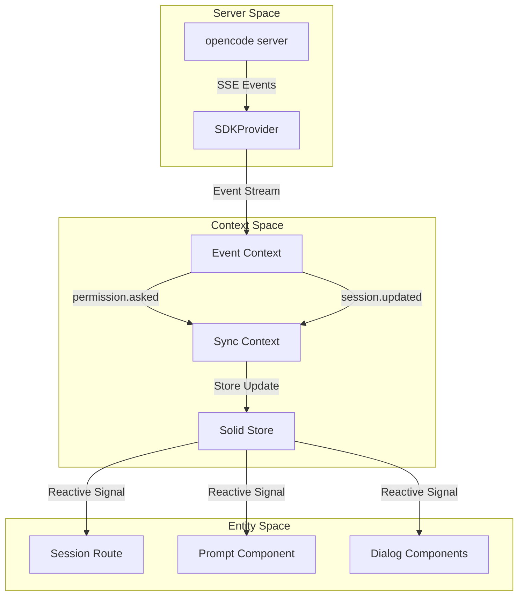
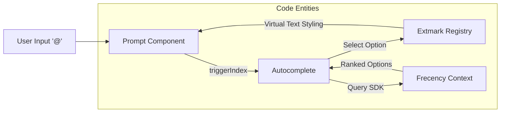

<!-- source: DeepWiki mcp.deepwiki.com · repo browser-use/browsercode · page 4.1 Terminal User Interface (TUI) · fetched 2026-10-30 -->

# Terminal User Interface (TUI)

Relevant source files

The following files were used as context for generating this wiki page:

- [.opencode/plugins/tui-smoke.tsx](.opencode/plugins/tui-smoke.tsx)
- [packages/app/tsconfig.json](packages/app/tsconfig.json)
- [packages/core/src/process.ts](packages/core/src/process.ts)
- [packages/core/test/process/process.test.ts](packages/core/test/process/process.test.ts)
- [packages/desktop/tsconfig.json](packages/desktop/tsconfig.json)
- [packages/opencode/specs/tui-plugins.md](packages/opencode/specs/tui-plugins.md)
- [packages/opencode/src/cli/cmd/tui/app.tsx](packages/opencode/src/cli/cmd/tui/app.tsx)
- [packages/opencode/src/cli/cmd/tui/attach.ts](packages/opencode/src/cli/cmd/tui/attach.ts)
- [packages/opencode/src/cli/cmd/tui/component/dialog-model.tsx](packages/opencode/src/cli/cmd/tui/component/dialog-model.tsx)
- [packages/opencode/src/cli/cmd/tui/component/dialog-provider.tsx](packages/opencode/src/cli/cmd/tui/component/dialog-provider.tsx)
- [packages/opencode/src/cli/cmd/tui/component/dialog-session-delete-failed.tsx](packages/opencode/src/cli/cmd/tui/component/dialog-session-delete-failed.tsx)
- [packages/opencode/src/cli/cmd/tui/component/dialog-session-list.tsx](packages/opencode/src/cli/cmd/tui/component/dialog-session-list.tsx)
- [packages/opencode/src/cli/cmd/tui/component/dialog-status.tsx](packages/opencode/src/cli/cmd/tui/component/dialog-status.tsx)
- [packages/opencode/src/cli/cmd/tui/component/dialog-theme-list.tsx](packages/opencode/src/cli/cmd/tui/component/dialog-theme-list.tsx)
- [packages/opencode/src/cli/cmd/tui/component/dialog-variant.tsx](packages/opencode/src/cli/cmd/tui/component/dialog-variant.tsx)
- [packages/opencode/src/cli/cmd/tui/component/dialog-workspace-create.tsx](packages/opencode/src/cli/cmd/tui/component/dialog-workspace-create.tsx)
- [packages/opencode/src/cli/cmd/tui/component/dialog-workspace-unavailable.tsx](packages/opencode/src/cli/cmd/tui/component/dialog-workspace-unavailable.tsx)
- [packages/opencode/src/cli/cmd/tui/component/prompt/autocomplete.tsx](packages/opencode/src/cli/cmd/tui/component/prompt/autocomplete.tsx)
- [packages/opencode/src/cli/cmd/tui/component/prompt/index.tsx](packages/opencode/src/cli/cmd/tui/component/prompt/index.tsx)
- [packages/opencode/src/cli/cmd/tui/context/editor-zed.ts](packages/opencode/src/cli/cmd/tui/context/editor-zed.ts)
- [packages/opencode/src/cli/cmd/tui/context/editor.ts](packages/opencode/src/cli/cmd/tui/context/editor.ts)
- [packages/opencode/src/cli/cmd/tui/context/local.tsx](packages/opencode/src/cli/cmd/tui/context/local.tsx)
- [packages/opencode/src/cli/cmd/tui/context/sdk.tsx](packages/opencode/src/cli/cmd/tui/context/sdk.tsx)
- [packages/opencode/src/cli/cmd/tui/context/sync.tsx](packages/opencode/src/cli/cmd/tui/context/sync.tsx)
- [packages/opencode/src/cli/cmd/tui/context/theme.tsx](packages/opencode/src/cli/cmd/tui/context/theme.tsx)
- [packages/opencode/src/cli/cmd/tui/plugin/api.tsx](packages/opencode/src/cli/cmd/tui/plugin/api.tsx)
- [packages/opencode/src/cli/cmd/tui/plugin/runtime.ts](packages/opencode/src/cli/cmd/tui/plugin/runtime.ts)
- [packages/opencode/src/cli/cmd/tui/routes/home.tsx](packages/opencode/src/cli/cmd/tui/routes/home.tsx)
- [packages/opencode/src/cli/cmd/tui/routes/session/index.tsx](packages/opencode/src/cli/cmd/tui/routes/session/index.tsx)
- [packages/opencode/src/cli/cmd/tui/routes/session/question.tsx](packages/opencode/src/cli/cmd/tui/routes/session/question.tsx)
- [packages/opencode/src/cli/cmd/tui/routes/session/subagent-footer.tsx](packages/opencode/src/cli/cmd/tui/routes/session/subagent-footer.tsx)
- [packages/opencode/src/cli/cmd/tui/ui/dialog-alert.tsx](packages/opencode/src/cli/cmd/tui/ui/dialog-alert.tsx)
- [packages/opencode/src/cli/cmd/tui/ui/dialog-confirm.tsx](packages/opencode/src/cli/cmd/tui/ui/dialog-confirm.tsx)
- [packages/opencode/src/cli/cmd/tui/ui/dialog-export-options.tsx](packages/opencode/src/cli/cmd/tui/ui/dialog-export-options.tsx)
- [packages/opencode/src/cli/cmd/tui/ui/dialog-help.tsx](packages/opencode/src/cli/cmd/tui/ui/dialog-help.tsx)
- [packages/opencode/src/cli/cmd/tui/ui/dialog-prompt.tsx](packages/opencode/src/cli/cmd/tui/ui/dialog-prompt.tsx)
- [packages/opencode/src/cli/cmd/tui/ui/dialog-select.tsx](packages/opencode/src/cli/cmd/tui/ui/dialog-select.tsx)
- [packages/opencode/src/cli/cmd/tui/util/clipboard.ts](packages/opencode/src/cli/cmd/tui/util/clipboard.ts)
- [packages/opencode/src/plugin/github-copilot/copilot.ts](packages/opencode/src/plugin/github-copilot/copilot.ts)
- [packages/opencode/src/plugin/github-copilot/models.ts](packages/opencode/src/plugin/github-copilot/models.ts)
- [packages/opencode/src/plugin/install.ts](packages/opencode/src/plugin/install.ts)
- [packages/opencode/src/plugin/loader.ts](packages/opencode/src/plugin/loader.ts)
- [packages/opencode/src/plugin/shared.ts](packages/opencode/src/plugin/shared.ts)
- [packages/opencode/test/cli/cmd/tui/dialog-workspace-create.test.ts](packages/opencode/test/cli/cmd/tui/dialog-workspace-create.test.ts)
- [packages/opencode/test/cli/tui/editor-context-zed.test.ts](packages/opencode/test/cli/tui/editor-context-zed.test.ts)
- [packages/opencode/test/cli/tui/editor-context.test.tsx](packages/opencode/test/cli/tui/editor-context.test.tsx)
- [packages/opencode/test/cli/tui/plugin-add.test.ts](packages/opencode/test/cli/tui/plugin-add.test.ts)
- [packages/opencode/test/cli/tui/plugin-install.test.ts](packages/opencode/test/cli/tui/plugin-install.test.ts)
- [packages/opencode/test/cli/tui/plugin-loader-entrypoint.test.ts](packages/opencode/test/cli/tui/plugin-loader-entrypoint.test.ts)
- [packages/opencode/test/cli/tui/plugin-loader-pure.test.ts](packages/opencode/test/cli/tui/plugin-loader-pure.test.ts)
- [packages/opencode/test/cli/tui/plugin-loader.test.ts](packages/opencode/test/cli/tui/plugin-loader.test.ts)
- [packages/opencode/test/cli/tui/plugin-toggle.test.ts](packages/opencode/test/cli/tui/plugin-toggle.test.ts)
- [packages/opencode/test/fixture/tui-plugin.ts](packages/opencode/test/fixture/tui-plugin.ts)
- [packages/opencode/test/fixture/tui-runtime.ts](packages/opencode/test/fixture/tui-runtime.ts)
- [packages/opencode/test/lib/websocket.ts](packages/opencode/test/lib/websocket.ts)
- [packages/opencode/test/plugin/github-copilot-models.test.ts](packages/opencode/test/plugin/github-copilot-models.test.ts)
- [packages/opencode/test/plugin/install.test.ts](packages/opencode/test/plugin/install.test.ts)
- [packages/opencode/test/plugin/loader-shared.test.ts](packages/opencode/test/plugin/loader-shared.test.ts)
- [packages/plugin/src/example.ts](packages/plugin/src/example.ts)
- [packages/plugin/src/tui.ts](packages/plugin/src/tui.ts)
- [packages/plugin/tsconfig.json](packages/plugin/tsconfig.json)
- [packages/sdk/js/example/example.ts](packages/sdk/js/example/example.ts)
- [packages/sdk/js/src/client.ts](packages/sdk/js/src/client.ts)
- [packages/sdk/js/src/gen/client/client.gen.ts](packages/sdk/js/src/gen/client/client.gen.ts)
- [packages/sdk/js/src/gen/client/index.ts](packages/sdk/js/src/gen/client/index.ts)
- [packages/sdk/js/src/gen/client/types.gen.ts](packages/sdk/js/src/gen/client/types.gen.ts)
- [packages/sdk/js/src/gen/client/utils.gen.ts](packages/sdk/js/src/gen/client/utils.gen.ts)
- [packages/sdk/js/src/gen/core/bodySerializer.gen.ts](packages/sdk/js/src/gen/core/bodySerializer.gen.ts)
- [packages/sdk/js/src/gen/core/pathSerializer.gen.ts](packages/sdk/js/src/gen/core/pathSerializer.gen.ts)
- [packages/sdk/js/src/gen/core/serverSentEvents.gen.ts](packages/sdk/js/src/gen/core/serverSentEvents.gen.ts)
- [packages/sdk/js/src/gen/core/types.gen.ts](packages/sdk/js/src/gen/core/types.gen.ts)
- [packages/sdk/js/src/gen/core/utils.gen.ts](packages/sdk/js/src/gen/core/utils.gen.ts)
- [packages/sdk/js/src/process.ts](packages/sdk/js/src/process.ts)
- [packages/sdk/js/src/server.ts](packages/sdk/js/src/server.ts)
- [packages/sdk/js/src/v2/server.ts](packages/sdk/js/src/v2/server.ts)
- [packages/sdk/js/tsconfig.json](packages/sdk/js/tsconfig.json)
- [tsconfig.json](tsconfig.json)

The BrowserCode Terminal User Interface (TUI) is a high-performance, reactive terminal application built using **SolidJS** and the **OpenTUI** rendering stack. It provides a rich, interactive environment for agent orchestration, code editing, and session management directly within the terminal emulator.

## Rendering Stack: OpenTUI and SolidJS

The TUI architecture bridges the gap between web-native reactive paradigms and terminal-native rendering. It utilizes `@opentui/solid` to provide a SolidJS-compatible renderer for terminal environments [packages/opencode/src/cli/cmd/tui/app.tsx:1-20]().

### Component Lifecycle and Entrypoint
The TUI entrypoint is defined in `tui()` within `app.tsx`. It initializes the terminal renderer, sets up the global keymap, and mounts the root application component [packages/opencode/src/cli/cmd/tui/app.tsx:161-200]().

| Component | Role |
| :--- | :--- |
| `createCliRenderer` | Initializes the low-level OpenTUI renderer with mouse support and FPS targeting [packages/opencode/src/cli/cmd/tui/app.tsx:187-190](). |
| `OpencodeKeymapProvider` | Manages the global registry of keybindings and command shortcuts [packages/opencode/src/cli/cmd/tui/app.tsx:70-70](). |
| `SyncProvider` | Orchestrates real-time state synchronization between the TUI and the `opencode` server [packages/opencode/src/cli/cmd/tui/context/sync.tsx:37-40](). |
| `ThemeProvider` | Injects the active theme context (colors, syntax highlighting) [packages/opencode/src/cli/cmd/tui/context/theme.tsx:45-50](). |

### Data Flow Diagram
This diagram shows how server-side events propagate through the TUI's reactive context system.

**TUI Reactive Data Flow**

Sources: [packages/opencode/src/cli/cmd/tui/context/sync.tsx:133-211](), [packages/opencode/src/cli/cmd/tui/context/sdk.tsx](), [packages/opencode/src/cli/cmd/tui/app.tsx:31-35]()

## Session Route and Sidebar

The `Session` component is the primary interface for interacting with an agent. It handles the rendering of message transcripts, tool outputs, and the sub-agent hierarchy [packages/opencode/src/cli/cmd/tui/routes/session/index.tsx:177-195]().

- **Message Rendering**: Supports multiple message parts including `Text`, `Tool`, `Reasoning`, and `Snapshot` [packages/opencode/src/cli/cmd/tui/routes/session/index.tsx:28-35]().
- **Sidebar**: Displays metadata about the current session, including project context and active providers [packages/opencode/src/cli/cmd/tui/routes/session/index.tsx:66-66]().
- **Subagent Footer**: Visualizes the status of nested agent loops [packages/opencode/src/cli/cmd/tui/routes/session/subagent-footer.tsx]().

Sources: [packages/opencode/src/cli/cmd/tui/routes/session/index.tsx:121-155]()

## Prompt Component

The `Prompt` component is a sophisticated `TextareaRenderable` that handles natural language input, file mentions, and agent switching [packages/opencode/src/cli/cmd/tui/component/prompt/index.tsx:136-150]().

### Extmarks and Mentions
Mentions (using `@`) are implemented using **extmarks**, which allow for virtual styling and metadata attachment to specific text ranges within the input buffer [packages/opencode/src/cli/cmd/tui/component/prompt/autocomplete.tsx:176-187]().

- **Stash**: Allows users to temporarily save and recall prompt drafts [packages/opencode/src/cli/cmd/tui/component/prompt/stash.ts]().
- **Frecency Autocomplete**: The `Autocomplete` component uses a frecency (frequency + recency) algorithm to rank file and agent suggestions [packages/opencode/src/cli/cmd/tui/component/prompt/autocomplete.tsx:91-95]().

**Prompt Input Logic**

Sources: [packages/opencode/src/cli/cmd/tui/component/prompt/autocomplete.tsx:159-187](), [packages/opencode/src/cli/cmd/tui/component/prompt/index.tsx:29-34]()

## Command Palette and Dialog System

The TUI uses a modal dialog system for complex interactions like model selection, provider configuration, and session management.

### DialogSelect
`DialogSelect` is the base component for searchable, keyboard-navigable lists. It supports fuzzy filtering via `fuzzysort` [packages/opencode/src/cli/cmd/tui/ui/dialog-select.tsx:64-74]().

- **Model Dialog**: Allows switching between LLM providers and models, with support for "Favorites" and "Recent" categories [packages/opencode/src/cli/cmd/tui/component/dialog-model.tsx:23-50]().
- **Provider Dialog**: Handles authentication flows for providers, including OAuth (via `CodeMethod`) and API Key entry [packages/opencode/src/cli/cmd/tui/component/dialog-provider.tsx:112-140]().

Sources: [packages/opencode/src/cli/cmd/tui/ui/dialog-select.tsx:111-130](), [packages/opencode/src/cli/cmd/tui/component/dialog-model.tsx:149-174]()

## Keybinding Registry

Keybindings are managed centrally via `OpencodeKeymapProvider`. It maps terminal key events to named commands (e.g., `session.new`, `command.palette.show`) [packages/opencode/src/cli/cmd/tui/app.tsx:75-119]().

- **Contextual Bindings**: Routes and components can register specific bindings that are only active when they are focused [packages/opencode/src/cli/cmd/tui/routes/session/index.tsx:121-155]().
- **Leader Key**: Supports complex chord sequences starting with a configurable leader key [packages/opencode/src/cli/cmd/tui/component/prompt/index.tsx:141-141]().

Sources: [packages/opencode/src/cli/cmd/tui/app.tsx:192-194]()

## Clipboard and OSC-52

The TUI implements a robust clipboard system that works across local and remote (SSH) environments [packages/opencode/src/cli/cmd/tui/util/clipboard.ts:37-44]().

- **OSC-52**: Writes text to the terminal's clipboard using escape sequences, enabling clipboard sync over SSH without X11 forwarding [packages/opencode/src/cli/cmd/tui/util/clipboard.ts:37-44]().
- **Native Fallbacks**: Detects and uses platform-specific tools like `pbcopy` (macOS), `wl-copy` (Wayland), `xclip` (X11), and PowerShell (Windows) [packages/opencode/src/cli/cmd/tui/util/clipboard.ts:125-166]().

Sources: [packages/opencode/src/cli/cmd/tui/util/clipboard.ts:175-179]()

## TUI Plugin System

The TUI features a plugin runtime that allows external modules to extend the UI surface [packages/opencode/src/cli/cmd/tui/plugin/runtime.ts]().

- **Slots**: Plugins can register components to be rendered in specific "slots" within the TUI (e.g., sidebar widgets, status bar items).
- **API**: The `createTuiApi` function provides plugins with access to the TUI's internal state, navigation, and notification systems [packages/opencode/src/cli/cmd/tui/plugin/api.tsx]().

Sources: [packages/opencode/src/cli/cmd/tui/app.tsx:64-66](), [packages/opencode/src/cli/cmd/tui/plugin/runtime.ts]()

## Theme Context

The `ThemeProvider` manages the visual appearance of the TUI using a JSON-based theme schema [packages/opencode/src/cli/cmd/tui/context/theme.tsx:78-86]().

- **Color Resolution**: Resolves hex codes and variable references (e.g., `primary`, `accent`) into `RGBA` values used by the renderer [packages/opencode/src/cli/cmd/tui/context/theme.tsx:198-213]().
- **Adaptive Modes**: Supports switching between `dark` and `light` modes, with the ability to lock a specific mode [packages/opencode/src/cli/cmd/tui/context/theme.tsx:124-130]().
- **Syntax Highlighting**: Integrates with the `SyntaxStyle` system for code block rendering [packages/opencode/src/cli/cmd/tui/context/theme.tsx:1-5]().

Sources: [packages/opencode/src/cli/cmd/tui/context/theme.tsx:88-122]()

---

