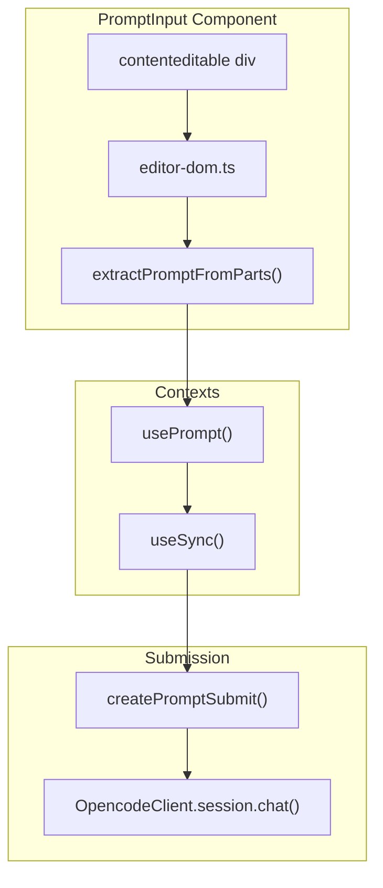
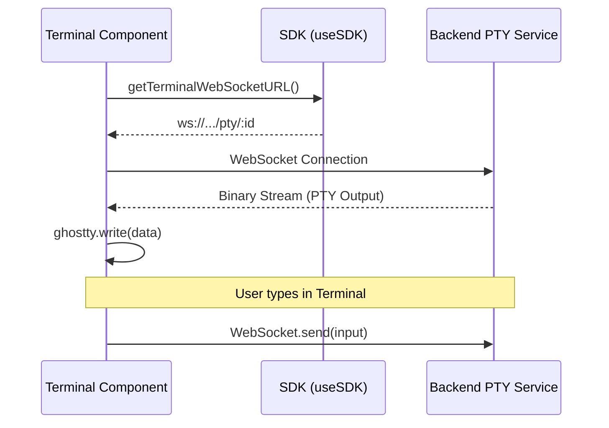

<!-- source: DeepWiki mcp.deepwiki.com · repo browser-use/browsercode · page 4.2 Web App (packages/app) · fetched 2026-10-30 -->

# Web App (packages/app)

Relevant source files

The following files were used as context for generating this wiki page:

- [packages/app/playwright.config.ts](packages/app/playwright.config.ts)
- [packages/app/src/app.tsx](packages/app/src/app.tsx)
- [packages/app/src/components/dialog-edit-project.tsx](packages/app/src/components/dialog-edit-project.tsx)
- [packages/app/src/components/dialog-fork.tsx](packages/app/src/components/dialog-fork.tsx)
- [packages/app/src/components/dialog-select-file.tsx](packages/app/src/components/dialog-select-file.tsx)
- [packages/app/src/components/dialog-select-mcp.tsx](packages/app/src/components/dialog-select-mcp.tsx)
- [packages/app/src/components/dialog-select-server.tsx](packages/app/src/components/dialog-select-server.tsx)
- [packages/app/src/components/dialog-settings.tsx](packages/app/src/components/dialog-settings.tsx)
- [packages/app/src/components/file-tree.tsx](packages/app/src/components/file-tree.tsx)
- [packages/app/src/components/prompt-input.tsx](packages/app/src/components/prompt-input.tsx)
- [packages/app/src/components/session-context-usage.tsx](packages/app/src/components/session-context-usage.tsx)
- [packages/app/src/components/session/session-context-tab.tsx](packages/app/src/components/session/session-context-tab.tsx)
- [packages/app/src/components/session/session-header.tsx](packages/app/src/components/session/session-header.tsx)
- [packages/app/src/components/session/session-new-view.tsx](packages/app/src/components/session/session-new-view.tsx)
- [packages/app/src/components/session/session-sortable-tab.tsx](packages/app/src/components/session/session-sortable-tab.tsx)
- [packages/app/src/components/session/session-sortable-terminal-tab.tsx](packages/app/src/components/session/session-sortable-terminal-tab.tsx)
- [packages/app/src/components/settings-general.tsx](packages/app/src/components/settings-general.tsx)
- [packages/app/src/components/settings-keybinds.tsx](packages/app/src/components/settings-keybinds.tsx)
- [packages/app/src/components/settings-models.tsx](packages/app/src/components/settings-models.tsx)
- [packages/app/src/components/settings-providers.tsx](packages/app/src/components/settings-providers.tsx)
- [packages/app/src/components/status-popover-body.tsx](packages/app/src/components/status-popover-body.tsx)
- [packages/app/src/components/status-popover.tsx](packages/app/src/components/status-popover.tsx)
- [packages/app/src/components/terminal.tsx](packages/app/src/components/terminal.tsx)
- [packages/app/src/components/titlebar.tsx](packages/app/src/components/titlebar.tsx)
- [packages/app/src/context/command-keybind.test.ts](packages/app/src/context/command-keybind.test.ts)
- [packages/app/src/context/command.tsx](packages/app/src/context/command.tsx)
- [packages/app/src/context/file.tsx](packages/app/src/context/file.tsx)
- [packages/app/src/context/global-sdk.tsx](packages/app/src/context/global-sdk.tsx)
- [packages/app/src/context/global-sync.tsx](packages/app/src/context/global-sync.tsx)
- [packages/app/src/context/global-sync/bootstrap.ts](packages/app/src/context/global-sync/bootstrap.ts)
- [packages/app/src/context/global-sync/child-store.test.ts](packages/app/src/context/global-sync/child-store.test.ts)
- [packages/app/src/context/global-sync/child-store.ts](packages/app/src/context/global-sync/child-store.ts)
- [packages/app/src/context/global-sync/types.ts](packages/app/src/context/global-sync/types.ts)
- [packages/app/src/context/layout-scroll.test.ts](packages/app/src/context/layout-scroll.test.ts)
- [packages/app/src/context/layout-scroll.ts](packages/app/src/context/layout-scroll.ts)
- [packages/app/src/context/layout.tsx](packages/app/src/context/layout.tsx)
- [packages/app/src/context/local.tsx](packages/app/src/context/local.tsx)
- [packages/app/src/context/notification.tsx](packages/app/src/context/notification.tsx)
- [packages/app/src/context/permission-auto-respond.test.ts](packages/app/src/context/permission-auto-respond.test.ts)
- [packages/app/src/context/permission-auto-respond.ts](packages/app/src/context/permission-auto-respond.ts)
- [packages/app/src/context/permission.tsx](packages/app/src/context/permission.tsx)
- [packages/app/src/context/platform.tsx](packages/app/src/context/platform.tsx)
- [packages/app/src/context/prompt.tsx](packages/app/src/context/prompt.tsx)
- [packages/app/src/context/sdk.tsx](packages/app/src/context/sdk.tsx)
- [packages/app/src/context/server.tsx](packages/app/src/context/server.tsx)
- [packages/app/src/context/settings.tsx](packages/app/src/context/settings.tsx)
- [packages/app/src/context/sync.tsx](packages/app/src/context/sync.tsx)
- [packages/app/src/context/terminal.tsx](packages/app/src/context/terminal.tsx)
- [packages/app/src/entry.tsx](packages/app/src/entry.tsx)
- [packages/app/src/hooks/use-providers.ts](packages/app/src/hooks/use-providers.ts)
- [packages/app/src/i18n/ar.ts](packages/app/src/i18n/ar.ts)
- [packages/app/src/i18n/da.ts](packages/app/src/i18n/da.ts)
- [packages/app/src/i18n/de.ts](packages/app/src/i18n/de.ts)
- [packages/app/src/i18n/en.ts](packages/app/src/i18n/en.ts)
- [packages/app/src/i18n/es.ts](packages/app/src/i18n/es.ts)
- [packages/app/src/i18n/fr.ts](packages/app/src/i18n/fr.ts)
- [packages/app/src/i18n/ja.ts](packages/app/src/i18n/ja.ts)
- [packages/app/src/i18n/ko.ts](packages/app/src/i18n/ko.ts)
- [packages/app/src/i18n/pl.ts](packages/app/src/i18n/pl.ts)
- [packages/app/src/i18n/ru.ts](packages/app/src/i18n/ru.ts)
- [packages/app/src/i18n/zh.ts](packages/app/src/i18n/zh.ts)
- [packages/app/src/i18n/zht.ts](packages/app/src/i18n/zht.ts)
- [packages/app/src/index.ts](packages/app/src/index.ts)
- [packages/app/src/pages/home.tsx](packages/app/src/pages/home.tsx)
- [packages/app/src/pages/layout.tsx](packages/app/src/pages/layout.tsx)
- [packages/app/src/pages/layout/deep-links.ts](packages/app/src/pages/layout/deep-links.ts)
- [packages/app/src/pages/layout/helpers.test.ts](packages/app/src/pages/layout/helpers.test.ts)
- [packages/app/src/pages/layout/helpers.ts](packages/app/src/pages/layout/helpers.ts)
- [packages/app/src/pages/layout/sidebar-items.tsx](packages/app/src/pages/layout/sidebar-items.tsx)
- [packages/app/src/pages/layout/sidebar-project.tsx](packages/app/src/pages/layout/sidebar-project.tsx)
- [packages/app/src/pages/layout/sidebar-workspace.tsx](packages/app/src/pages/layout/sidebar-workspace.tsx)
- [packages/app/src/pages/session.tsx](packages/app/src/pages/session.tsx)
- [packages/app/src/pages/session/composer/session-composer-region.tsx](packages/app/src/pages/session/composer/session-composer-region.tsx)
- [packages/app/src/pages/session/composer/session-composer-state.test.ts](packages/app/src/pages/session/composer/session-composer-state.test.ts)
- [packages/app/src/pages/session/composer/session-composer-state.ts](packages/app/src/pages/session/composer/session-composer-state.ts)
- [packages/app/src/pages/session/composer/session-question-dock.tsx](packages/app/src/pages/session/composer/session-question-dock.tsx)
- [packages/app/src/pages/session/composer/session-request-tree.ts](packages/app/src/pages/session/composer/session-request-tree.ts)
- [packages/app/src/pages/session/composer/session-revert-dock.tsx](packages/app/src/pages/session/composer/session-revert-dock.tsx)
- [packages/app/src/pages/session/composer/session-todo-dock.tsx](packages/app/src/pages/session/composer/session-todo-dock.tsx)
- [packages/app/src/pages/session/file-tabs.tsx](packages/app/src/pages/session/file-tabs.tsx)
- [packages/app/src/pages/session/helpers.test.ts](packages/app/src/pages/session/helpers.test.ts)
- [packages/app/src/pages/session/helpers.ts](packages/app/src/pages/session/helpers.ts)
- [packages/app/src/pages/session/message-timeline.tsx](packages/app/src/pages/session/message-timeline.tsx)
- [packages/app/src/pages/session/review-tab.tsx](packages/app/src/pages/session/review-tab.tsx)
- [packages/app/src/pages/session/session-side-panel.tsx](packages/app/src/pages/session/session-side-panel.tsx)
- [packages/app/src/pages/session/terminal-panel.tsx](packages/app/src/pages/session/terminal-panel.tsx)
- [packages/app/src/pages/session/use-session-commands.tsx](packages/app/src/pages/session/use-session-commands.tsx)
- [packages/app/src/pages/session/use-session-hash-scroll.ts](packages/app/src/pages/session/use-session-hash-scroll.ts)
- [packages/app/src/utils/agent.ts](packages/app/src/utils/agent.ts)
- [packages/app/src/utils/persist.test.ts](packages/app/src/utils/persist.test.ts)
- [packages/app/src/utils/persist.ts](packages/app/src/utils/persist.ts)
- [packages/app/vite.js](packages/app/vite.js)
- [packages/opencode/src/pty/index.ts](packages/opencode/src/pty/index.ts)
- [packages/opencode/src/shell/shell.ts](packages/opencode/src/shell/shell.ts)
- [packages/opencode/test/pty/pty-output-isolation.test.ts](packages/opencode/test/pty/pty-output-isolation.test.ts)
- [packages/opencode/test/pty/pty-session.test.ts](packages/opencode/test/pty/pty-session.test.ts)
- [packages/opencode/test/pty/pty-shell.test.ts](packages/opencode/test/pty/pty-shell.test.ts)
- [packages/opencode/test/shell/shell.test.ts](packages/opencode/test/shell/shell.test.ts)
- [packages/ui/src/components/dialog.css](packages/ui/src/components/dialog.css)
- [packages/ui/src/components/dialog.tsx](packages/ui/src/components/dialog.tsx)
- [packages/ui/src/components/dock-prompt.tsx](packages/ui/src/components/dock-prompt.tsx)
- [packages/ui/src/components/file-icon.css](packages/ui/src/components/file-icon.css)
- [packages/ui/src/components/file-icon.tsx](packages/ui/src/components/file-icon.tsx)
- [packages/ui/src/components/font.tsx](packages/ui/src/components/font.tsx)
- [packages/ui/src/components/scroll-view.css](packages/ui/src/components/scroll-view.css)
- [packages/ui/src/components/scroll-view.tsx](packages/ui/src/components/scroll-view.tsx)
- [packages/ui/src/components/tabs.css](packages/ui/src/components/tabs.css)
- [packages/ui/src/components/tabs.tsx](packages/ui/src/components/tabs.tsx)
- [packages/ui/src/context/dialog.tsx](packages/ui/src/context/dialog.tsx)

The `packages/app` directory contains the SolidJS Single Page Application (SPA) that serves as the primary graphical interface for BrowserCode. It is designed to run both as a web application and as the UI layer for the Tauri-based desktop application.

## Overview and Layout Shell

The application is structured around a central `Layout` component that manages global state, including workspace organization, sidebar state, and project navigation. It utilizes a sophisticated persistence layer to ensure UI state (like sidebar width or expanded folders) survives reloads.

### Layout Implementation
The layout shell handles the high-level arrangement of the UI, including the sidebar, main content area, and global contexts.
- **`Layout` Component**: Manages the main application grid and global event listeners for deep links and navigation [packages/app/src/pages/layout.tsx:91-104]().
- **State Persistence**: Uses a custom `persisted` utility and `Persist.global` to store layout configuration in local storage [packages/app/src/pages/layout.tsx:92-103]().
- **Sidebar Management**: Implements draggable workspaces and projects using `@thisbeyond/solid-dnd` [packages/app/src/pages/layout.tsx:33-34]().

### Titlebar and Tauri Integration
The `Titlebar` component provides a native-like experience for the desktop app by integrating with Tauri's window APIs.
- **Window Controls**: Uses `__TAURI__` window APIs to handle dragging (`startDragging`) and maximizing (`toggleMaximize`) the window [packages/app/src/components/titlebar.tsx:17-37]().
- **Theme Sync**: Synchronizes the application's color scheme with the OS-level window frame [packages/app/src/components/titlebar.tsx:131-141]().
- **Navigation History**: Maintains a local history stack to support back/forward navigation within the SPA [packages/app/src/components/titlebar.tsx:66-70]().

**Sources:** [packages/app/src/pages/layout.tsx](), [packages/app/src/components/titlebar.tsx]()

## Data Synchronization Contexts

The application relies on two primary synchronization layers to keep the UI in sync with the `opencode` backend.

### GlobalSync Context
The `GlobalSyncProvider` manages state that spans multiple projects or the entire application instance.
- **Bootstrapping**: Coordinates the initial loading of projects, providers, and global configuration [packages/app/src/context/global-sync.tsx:159-173]().
- **Query Management**: Uses `@tanstack/solid-query` for fetching and caching global data like MCP status and LSP diagnostics [packages/app/src/context/global-sync.tsx:54-64]().
- **Event Reducer**: Processes incoming server-sent events (SSE) to update the global store incrementally [packages/app/src/context/global-sync.tsx:28-30]().

### Sync Context
While `GlobalSync` handles instance-wide data, the `Sync` context (found in `packages/app/src/context/sync.tsx`) typically handles session-specific state, such as message history and tool execution status.

**Sources:** [packages/app/src/context/global-sync.tsx](), [packages/app/src/app.tsx:34-42]()

## Session Page and Message Timeline

The `Session` page is the core interactive area where users communicate with agents. It features a virtualized timeline to handle large conversation histories.

### Timeline Staging and Windowing
To maintain performance with thousands of messages, the app implements a windowing system.
- **`createSessionHistoryWindow`**: Manages which subset of messages are currently rendered in the DOM, loading more as the user scrolls up [packages/app/src/pages/session.tsx:94-130]().
- **`createTimelineStaging`**: Defer-mounts timeline segments to prevent blocking the main thread during initial paint [packages/app/src/pages/session/message-timeline.tsx:132-154]().
- **Virtualized Rendering**: Uses `renderedUserMessages` to slice the message array based on scroll position [packages/app/src/pages/session.tsx:131-142]().

### Message Components
- **`SessionTurn`**: A shared UI component that renders a single exchange (User message + Assistant response) [packages/app/src/pages/session/message-timeline.tsx:13]().
- **`MessagePart`**: Renders individual content types within a turn, such as text, tool calls, or reasoning [packages/app/src/pages/session/message-timeline.tsx:16]().

**Sources:** [packages/app/src/pages/session.tsx](), [packages/app/src/pages/session/message-timeline.tsx]()

## Prompt Input (Pills and Editor)

The `PromptInput` is a sophisticated `contenteditable` component that supports "pills" for files, agents, and images.

### Implementation Details
- **Editor DOM**: Manages the selection and range of the `contenteditable` div [packages/app/src/components/prompt-input/editor-dom.ts:38]().
- **Attachments**: Supports dragging and dropping files or pasting images, which are converted into `FileAttachmentPart` or `ImageAttachmentPart` [packages/app/src/components/prompt-input.tsx:13-16]().
- **Slash Commands**: Implements a popover for slash commands (e.g., `/shell`) and `@` mentions for agents or files [packages/app/src/components/prompt-input.tsx:51]().
- **History Navigation**: Users can use Arrow Up/Down to cycle through previous prompts [packages/app/src/components/prompt-input.tsx:42-49]().

### Input Data Flow

**Sources:** [packages/app/src/components/prompt-input.tsx](), [packages/app/src/pages/session.tsx:64]()

## Terminal and PTY Integration

The web app integrates a full terminal emulator via `ghostty-web` to interact with the backend PTY (Pseudo-Terminal).

### Terminal Architecture
- **`Terminal` Component**: Initializes the Ghostty emulator and establishes a WebSocket connection to the backend PTY stream [packages/app/src/components/terminal.tsx:157-190]().
- **`LocalPTY`**: A client-side representation of a backend terminal session, including its buffer and cursor state [packages/app/src/components/terminal.tsx:15]().
- **Persistence**: The terminal buffer is serialized using a `SerializeAddon` so that terminal state can be restored when switching tabs [packages/app/src/components/terminal.tsx:130-155]().
- **Theme Sync**: Terminal colors (background, foreground, cursor) are dynamically resolved from the application's CSS variables [packages/app/src/components/terminal.tsx:51-64]().

### Terminal Connection Flow

**Sources:** [packages/app/src/components/terminal.tsx](), [packages/app/src/context/terminal.tsx]()

## Settings and i18n

### Settings Dialogs
The settings system is modular, divided into general, provider, and keybinding sections.
- **`SettingsGeneral`**: Handles UI preferences (font family, sound effects, theme) and desktop update checks [packages/app/src/components/settings-general.tsx:84-174]().
- **`SettingsProvider`**: Manages LLM provider connections and API keys [packages/app/src/components/settings-providers.tsx]().
- **Font Management**: Supports custom font families for mono, sans, and terminal displays [packages/app/src/context/settings.tsx:18-28]().

### Internationalization (i18n)
The application uses a dictionary-based i18n system.
- **Dictionary**: Located in `packages/app/src/i18n/`, with `en.ts` as the base [packages/app/src/i18n/en.ts:1]().
- **LanguageProvider**: Wraps the app to provide the `t` (translate) function and manage the current locale [packages/app/src/context/language.tsx]().
- **Command Palette Integration**: All command titles and categories are localized using the dictionary [packages/app/src/i18n/en.ts:2-18]().

**Sources:** [packages/app/src/components/settings-general.tsx](), [packages/app/src/i18n/en.ts](), [packages/app/src/app.tsx:150-151]()

---

