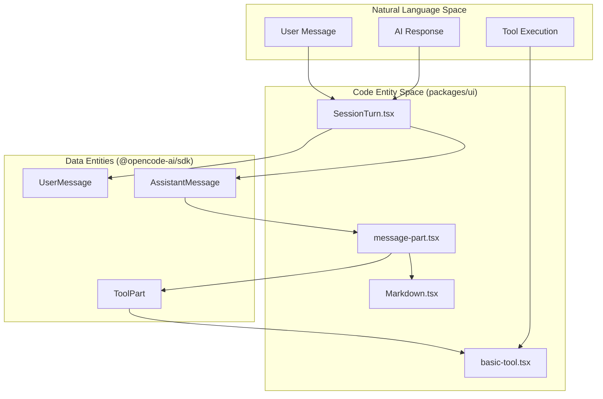
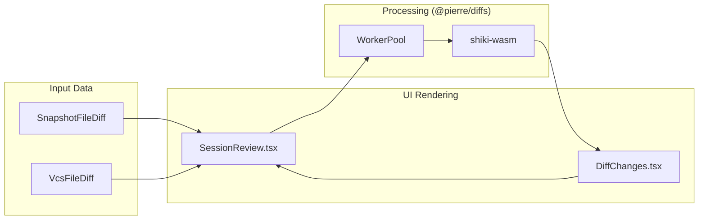

<!-- source: DeepWiki mcp.deepwiki.com · repo browser-use/browsercode · page 4.4 Shared UI Component Library (packages/ui) · fetched 2026-10-30 -->

# Shared UI Component Library (packages/ui)

Relevant source files

The following files were used as context for generating this wiki page:

- [packages/app/src/components/dialog-select-model-unpaid.tsx](packages/app/src/components/dialog-select-model-unpaid.tsx)
- [packages/app/src/components/dialog-select-model.tsx](packages/app/src/components/dialog-select-model.tsx)
- [packages/app/src/components/model-tooltip.tsx](packages/app/src/components/model-tooltip.tsx)
- [packages/app/src/pages/directory-layout.tsx](packages/app/src/pages/directory-layout.tsx)
- [packages/enterprise/src/routes/share/[shareID].tsx](packages/enterprise/src/routes/share/[shareID].tsx)
- [packages/opencode/src/cli/cmd/tui/context/theme/gruvbox.json](packages/opencode/src/cli/cmd/tui/context/theme/gruvbox.json)
- [packages/sdk/js/src/v2/gen/client/client.gen.ts](packages/sdk/js/src/v2/gen/client/client.gen.ts)
- [packages/sdk/js/src/v2/gen/core/serverSentEvents.gen.ts](packages/sdk/js/src/v2/gen/core/serverSentEvents.gen.ts)
- [packages/ui/package.json](packages/ui/package.json)
- [packages/ui/script/colors.txt](packages/ui/script/colors.txt)
- [packages/ui/src/components/basic-tool.css](packages/ui/src/components/basic-tool.css)
- [packages/ui/src/components/basic-tool.tsx](packages/ui/src/components/basic-tool.tsx)
- [packages/ui/src/components/button.css](packages/ui/src/components/button.css)
- [packages/ui/src/components/button.tsx](packages/ui/src/components/button.tsx)
- [packages/ui/src/components/checkbox.css](packages/ui/src/components/checkbox.css)
- [packages/ui/src/components/collapsible.css](packages/ui/src/components/collapsible.css)
- [packages/ui/src/components/collapsible.tsx](packages/ui/src/components/collapsible.tsx)
- [packages/ui/src/components/hover-card.css](packages/ui/src/components/hover-card.css)
- [packages/ui/src/components/icon-button.css](packages/ui/src/components/icon-button.css)
- [packages/ui/src/components/icon-button.tsx](packages/ui/src/components/icon-button.tsx)
- [packages/ui/src/components/icon.tsx](packages/ui/src/components/icon.tsx)
- [packages/ui/src/components/image-preview.tsx](packages/ui/src/components/image-preview.tsx)
- [packages/ui/src/components/list.css](packages/ui/src/components/list.css)
- [packages/ui/src/components/list.tsx](packages/ui/src/components/list.tsx)
- [packages/ui/src/components/message-nav.css](packages/ui/src/components/message-nav.css)
- [packages/ui/src/components/message-nav.tsx](packages/ui/src/components/message-nav.tsx)
- [packages/ui/src/components/message-part.css](packages/ui/src/components/message-part.css)
- [packages/ui/src/components/message-part.tsx](packages/ui/src/components/message-part.tsx)
- [packages/ui/src/components/motion-spring.tsx](packages/ui/src/components/motion-spring.tsx)
- [packages/ui/src/components/popover.tsx](packages/ui/src/components/popover.tsx)
- [packages/ui/src/components/select.css](packages/ui/src/components/select.css)
- [packages/ui/src/components/select.tsx](packages/ui/src/components/select.tsx)
- [packages/ui/src/components/session-review.css](packages/ui/src/components/session-review.css)
- [packages/ui/src/components/session-review.tsx](packages/ui/src/components/session-review.tsx)
- [packages/ui/src/components/session-turn.css](packages/ui/src/components/session-turn.css)
- [packages/ui/src/components/session-turn.tsx](packages/ui/src/components/session-turn.tsx)
- [packages/ui/src/components/shell-submessage-motion.stories.tsx](packages/ui/src/components/shell-submessage-motion.stories.tsx)
- [packages/ui/src/components/sticky-accordion-header.css](packages/ui/src/components/sticky-accordion-header.css)
- [packages/ui/src/components/switch.css](packages/ui/src/components/switch.css)
- [packages/ui/src/components/text-field.css](packages/ui/src/components/text-field.css)
- [packages/ui/src/components/text-field.tsx](packages/ui/src/components/text-field.tsx)
- [packages/ui/src/components/text-reveal.css](packages/ui/src/components/text-reveal.css)
- [packages/ui/src/components/text-reveal.stories.tsx](packages/ui/src/components/text-reveal.stories.tsx)
- [packages/ui/src/components/text-reveal.tsx](packages/ui/src/components/text-reveal.tsx)
- [packages/ui/src/components/thinking-heading.stories.tsx](packages/ui/src/components/thinking-heading.stories.tsx)
- [packages/ui/src/components/timeline-playground.stories.tsx](packages/ui/src/components/timeline-playground.stories.tsx)
- [packages/ui/src/components/toast.css](packages/ui/src/components/toast.css)
- [packages/ui/src/components/toast.tsx](packages/ui/src/components/toast.tsx)
- [packages/ui/src/components/todo-panel-motion.stories.tsx](packages/ui/src/components/todo-panel-motion.stories.tsx)
- [packages/ui/src/components/tool-count-summary.css](packages/ui/src/components/tool-count-summary.css)
- [packages/ui/src/components/tool-status-title.tsx](packages/ui/src/components/tool-status-title.tsx)
- [packages/ui/src/components/tooltip.css](packages/ui/src/components/tooltip.css)
- [packages/ui/src/components/tooltip.tsx](packages/ui/src/components/tooltip.tsx)
- [packages/ui/src/context/data.tsx](packages/ui/src/context/data.tsx)
- [packages/ui/src/hooks/create-auto-scroll.tsx](packages/ui/src/hooks/create-auto-scroll.tsx)
- [packages/ui/src/hooks/index.ts](packages/ui/src/hooks/index.ts)
- [packages/ui/src/hooks/use-filtered-list.tsx](packages/ui/src/hooks/use-filtered-list.tsx)
- [packages/ui/src/i18n/ar.ts](packages/ui/src/i18n/ar.ts)
- [packages/ui/src/i18n/br.ts](packages/ui/src/i18n/br.ts)
- [packages/ui/src/i18n/da.ts](packages/ui/src/i18n/da.ts)
- [packages/ui/src/i18n/de.ts](packages/ui/src/i18n/de.ts)
- [packages/ui/src/i18n/en.ts](packages/ui/src/i18n/en.ts)
- [packages/ui/src/i18n/es.ts](packages/ui/src/i18n/es.ts)
- [packages/ui/src/i18n/fr.ts](packages/ui/src/i18n/fr.ts)
- [packages/ui/src/i18n/ja.ts](packages/ui/src/i18n/ja.ts)
- [packages/ui/src/i18n/ko.ts](packages/ui/src/i18n/ko.ts)
- [packages/ui/src/i18n/no.ts](packages/ui/src/i18n/no.ts)
- [packages/ui/src/i18n/pl.ts](packages/ui/src/i18n/pl.ts)
- [packages/ui/src/i18n/ru.ts](packages/ui/src/i18n/ru.ts)
- [packages/ui/src/i18n/zh.ts](packages/ui/src/i18n/zh.ts)
- [packages/ui/src/i18n/zht.ts](packages/ui/src/i18n/zht.ts)
- [packages/ui/src/pierre/index.ts](packages/ui/src/pierre/index.ts)
- [packages/ui/src/pierre/worker.ts](packages/ui/src/pierre/worker.ts)
- [packages/ui/src/styles/index.css](packages/ui/src/styles/index.css)
- [packages/ui/src/styles/tailwind/colors.css](packages/ui/src/styles/tailwind/colors.css)
- [packages/ui/src/styles/tailwind/index.css](packages/ui/src/styles/tailwind/index.css)
- [packages/ui/src/styles/theme.css](packages/ui/src/styles/theme.css)
- [packages/ui/src/styles/utilities.css](packages/ui/src/styles/utilities.css)
- [packages/ui/src/theme/color.ts](packages/ui/src/theme/color.ts)
- [packages/ui/src/theme/context.tsx](packages/ui/src/theme/context.tsx)
- [packages/ui/src/theme/default-themes.ts](packages/ui/src/theme/default-themes.ts)
- [packages/ui/src/theme/desktop-theme.schema.json](packages/ui/src/theme/desktop-theme.schema.json)
- [packages/ui/src/theme/index.ts](packages/ui/src/theme/index.ts)
- [packages/ui/src/theme/loader.ts](packages/ui/src/theme/loader.ts)
- [packages/ui/src/theme/resolve.ts](packages/ui/src/theme/resolve.ts)
- [packages/ui/src/theme/themes/amoled.json](packages/ui/src/theme/themes/amoled.json)
- [packages/ui/src/theme/themes/aura.json](packages/ui/src/theme/themes/aura.json)
- [packages/ui/src/theme/themes/ayu.json](packages/ui/src/theme/themes/ayu.json)
- [packages/ui/src/theme/themes/carbonfox.json](packages/ui/src/theme/themes/carbonfox.json)
- [packages/ui/src/theme/themes/catppuccin.json](packages/ui/src/theme/themes/catppuccin.json)
- [packages/ui/src/theme/themes/dracula.json](packages/ui/src/theme/themes/dracula.json)
- [packages/ui/src/theme/themes/gruvbox.json](packages/ui/src/theme/themes/gruvbox.json)
- [packages/ui/src/theme/themes/monokai.json](packages/ui/src/theme/themes/monokai.json)
- [packages/ui/src/theme/themes/nightowl.json](packages/ui/src/theme/themes/nightowl.json)
- [packages/ui/src/theme/themes/nord.json](packages/ui/src/theme/themes/nord.json)
- [packages/ui/src/theme/themes/oc-2.json](packages/ui/src/theme/themes/oc-2.json)
- [packages/ui/src/theme/themes/onedarkpro.json](packages/ui/src/theme/themes/onedarkpro.json)
- [packages/ui/src/theme/themes/shadesofpurple.json](packages/ui/src/theme/themes/shadesofpurple.json)
- [packages/ui/src/theme/themes/solarized.json](packages/ui/src/theme/themes/solarized.json)
- [packages/ui/src/theme/themes/tokyonight.json](packages/ui/src/theme/themes/tokyonight.json)
- [packages/ui/src/theme/themes/vesper.json](packages/ui/src/theme/themes/vesper.json)
- [packages/ui/src/theme/types.ts](packages/ui/src/theme/types.ts)

The `@opencode-ai/ui` package is a shared library of SolidJS components, hooks, and styling utilities used across the BrowserCode ecosystem, including the Web App, Desktop App, and Enterprise Share pages `[packages/ui/package.json:1-3]()`. It provides a unified design language and complex specialized components for AI interactions, such as streaming message turns, code diffing, and markdown rendering.

## Core Component Architecture

The library is built on **SolidJS** and leverages **Tailwind CSS** for styling `[packages/ui/package.json:40,73]()`. It defines a set of high-level components that consume data from the `@opencode-ai/sdk` and `@opencode-ai/core` packages `[packages/ui/package.json:48-49]()`.

### Session Rendering Pipeline
The primary entry point for displaying an AI conversation is the `SessionTurn` component. It orchestrates the rendering of user prompts and assistant responses.

*   **`SessionTurn`**: Manages the lifecycle of a single message exchange (turn) `[packages/ui/src/components/session-turn.tsx:152-169]()`. It calculates whether an assistant message is "active" (streaming) and handles the transition between thinking states and final output `[packages/ui/src/components/session-turn.tsx:207-225]()`.
*   **`Message`**: A generic container for message content, using `PART_MAPPING` to dynamically render different types of message parts `[packages/ui/src/components/message-part.tsx:159]()`.
*   **`AssistantParts`**: Iterates through the parts of an assistant message (text, reasoning, tool calls) and applies rendering logic `[packages/ui/src/components/session-turn.tsx:16]()`.

### Message Parts & Tool UI
The UI distinguishes between various content types via `PartType` `[packages/ui/src/components/message-part.tsx:23]()`:
*   **`TextPart`**: Renders markdown content using a paced rendering system to simulate streaming `[packages/ui/src/components/message-part.tsx:235-246]()`.
*   **`ReasoningPart`**: Displays the "thought process" of the LLM, often styled with lower contrast `[packages/ui/src/components/message-part.css:280-305]()`.
*   **`ToolPart`**: Handles tool execution UI. It uses `BasicTool` or `GenericTool` to show tool names, arguments, and outputs `[packages/ui/src/components/message-part.tsx:37]()`.

### Component Interaction Diagram

This diagram shows how high-level session components relate to specific code entities and data types.

Sources: `[packages/ui/src/components/session-turn.tsx:1-20]()`, `[packages/ui/src/components/message-part.tsx:1-40]()`.

---

## Diffing and Code Review (Pierre Engine)

The library includes a sophisticated diffing engine based on the **Pierre** architecture. This is used for showing file changes within a session and in the full-screen `SessionReview` component.

### SessionReview Component
The `SessionReview` component provides a GitHub-like interface for reviewing large sets of changes `[packages/ui/src/components/session-review.tsx:164]()`.
*   **Worker Pool**: To maintain UI responsiveness, diffing and syntax highlighting are offloaded to a worker pool (`WorkerPoolProvider`) `[packages/enterprise/src/routes/share/[shareID].tsx:27-33]()`.
*   **Diff Styles**: Supports both `unified` and `split` (side-by-side) views `[packages/ui/src/components/session-review.tsx:31]()`.
*   **Line Annotations**: Integrates `createLineCommentController` for adding comments directly to specific lines in a diff `[packages/ui/src/components/session-review.tsx:24]()`.

### Diff Data Flow

Sources: `[packages/ui/src/components/session-review.tsx:65-71]()`, `[packages/enterprise/src/routes/share/[shareID].tsx:3-6]()`.

---

## Markdown & Syntax Highlighting

The markdown pipeline converts raw LLM output into sanitized HTML with syntax-highlighted code blocks.

1.  **Marked**: Used as the primary markdown parser `[packages/ui/package.json:63]()`.
2.  **Shiki**: Provides VS Code-grade syntax highlighting using WebAssembly `[packages/ui/package.json:72]()`.
3.  **DOMPurify**: Sanitizes the resulting HTML to prevent XSS, especially important when rendering tool outputs or LLM-generated HTML `[packages/ui/package.json:59]()`.
4.  **KaTeX**: Supports mathematical expression rendering via `marked-katex-extension` `[packages/ui/package.json:61,64]()`.

The `PacedMarkdown` component specifically handles **streaming content**. It uses a "paced value" hook to ensure that markdown tokens are revealed at a readable speed rather than jumping abruptly as chunks arrive from the LLM `[packages/ui/src/components/message-part.tsx:235-246]()`.

---

## Hooks and Utilities

The library exports several specialized hooks for terminal and web environments:

*   **`createAutoScroll`**: A hook used in `SessionTurn` to automatically scroll the container as new messages or tool outputs are appended, while respecting user manual scroll overrides `[packages/ui/src/components/session-turn.tsx:25]()`.
*   **`useFilteredList`**: Powering the `List` component, it provides fuzzy searching (via `fuzzysort`) and keyboard navigation logic (Up/Down/Enter) `[packages/ui/src/components/list.tsx:90]()`.
*   **`useI18n`**: Accesses the translation system, supporting multiple languages (English, Chinese, Arabic, etc.) `[packages/ui/src/components/session-turn.tsx:26]()`.

---

## Theme System and Styling

Styling is managed through a CSS variable-based theme system defined in `packages/ui/src/styles/theme.css`.

*   **Design Tokens**: Variables for spacing, typography, and shadows are defined at the `:root` level `[packages/ui/src/styles/theme.css:1-60]()`.
*   **Color Semantic Mapping**: Colors are mapped to semantic roles like `--surface-base`, `--text-strong`, and `--border-critical-base` `[packages/ui/src/styles/theme.css:98,167,81]()`.
*   **Component Styling**: Components use data attributes (e.g., `[data-component="button"]`) for styling to avoid class collisions and facilitate easy targeting in different environments `[packages/ui/src/components/button.css:1]()`.
*   **Icons**: A custom `Icon` component renders inline SVGs from a predefined set including app-specific icons like `brain`, `fork`, and `terminal` `[packages/ui/src/components/icon.tsx:11-25]()`.

Sources: `[packages/ui/src/styles/theme.css:1-200]()`, `[packages/ui/src/components/icon.tsx:1-40]()`.

---

