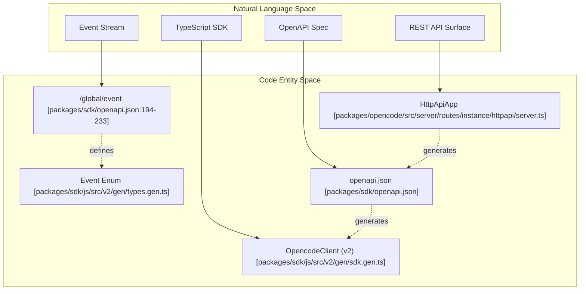
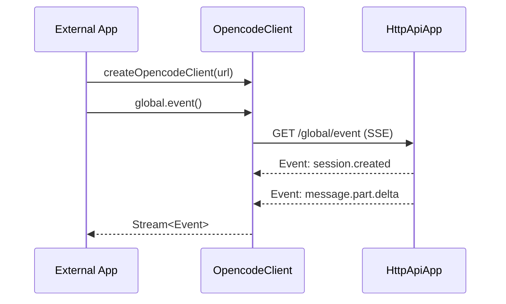

<!-- source: DeepWiki mcp.deepwiki.com · repo browser-use/browsercode · page 5 SDK and API · fetched 2026-10-30 -->

# SDK and API

<details>
<summary>Relevant source files</summary>

The following files were used as context for generating this wiki page:

- [packages/app/tsconfig.json](packages/app/tsconfig.json)
- [packages/desktop/tsconfig.json](packages/desktop/tsconfig.json)
- [packages/opencode/src/cli/cmd/tui/attach.ts](packages/opencode/src/cli/cmd/tui/attach.ts)
- [packages/opencode/src/cli/cmd/tui/context/sdk.tsx](packages/opencode/src/cli/cmd/tui/context/sdk.tsx)
- [packages/opencode/src/config/config.ts](packages/opencode/src/config/config.ts)
- [packages/opencode/src/config/permission.ts](packages/opencode/src/config/permission.ts)
- [packages/opencode/src/server/server.ts](packages/opencode/src/server/server.ts)
- [packages/opencode/test/config/config.test.ts](packages/opencode/test/config/config.test.ts)
- [packages/opencode/test/permission-task.test.ts](packages/opencode/test/permission-task.test.ts)
- [packages/plugin/src/example.ts](packages/plugin/src/example.ts)
- [packages/plugin/tsconfig.json](packages/plugin/tsconfig.json)
- [packages/sdk/js/example/example.ts](packages/sdk/js/example/example.ts)
- [packages/sdk/js/src/client.ts](packages/sdk/js/src/client.ts)
- [packages/sdk/js/src/gen/client/client.gen.ts](packages/sdk/js/src/gen/client/client.gen.ts)
- [packages/sdk/js/src/gen/client/index.ts](packages/sdk/js/src/gen/client/index.ts)
- [packages/sdk/js/src/gen/client/types.gen.ts](packages/sdk/js/src/gen/client/types.gen.ts)
- [packages/sdk/js/src/gen/client/utils.gen.ts](packages/sdk/js/src/gen/client/utils.gen.ts)
- [packages/sdk/js/src/gen/core/bodySerializer.gen.ts](packages/sdk/js/src/gen/core/bodySerializer.gen.ts)
- [packages/sdk/js/src/gen/core/pathSerializer.gen.ts](packages/sdk/js/src/gen/core/pathSerializer.gen.ts)
- [packages/sdk/js/src/gen/core/serverSentEvents.gen.ts](packages/sdk/js/src/gen/core/serverSentEvents.gen.ts)
- [packages/sdk/js/src/gen/core/types.gen.ts](packages/sdk/js/src/gen/core/types.gen.ts)
- [packages/sdk/js/src/gen/core/utils.gen.ts](packages/sdk/js/src/gen/core/utils.gen.ts)
- [packages/sdk/js/src/gen/sdk.gen.ts](packages/sdk/js/src/gen/sdk.gen.ts)
- [packages/sdk/js/src/gen/types.gen.ts](packages/sdk/js/src/gen/types.gen.ts)
- [packages/sdk/js/src/process.ts](packages/sdk/js/src/process.ts)
- [packages/sdk/js/src/server.ts](packages/sdk/js/src/server.ts)
- [packages/sdk/js/src/v2/gen/sdk.gen.ts](packages/sdk/js/src/v2/gen/sdk.gen.ts)
- [packages/sdk/js/src/v2/gen/types.gen.ts](packages/sdk/js/src/v2/gen/types.gen.ts)
- [packages/sdk/js/src/v2/server.ts](packages/sdk/js/src/v2/server.ts)
- [packages/sdk/js/tsconfig.json](packages/sdk/js/tsconfig.json)
- [packages/sdk/openapi.json](packages/sdk/openapi.json)
- [tsconfig.json](tsconfig.json)

</details>


The BrowserCode/OpenCode platform is built on a decoupled architecture where the core engine (the `opencode` server) exposes its entire functionality through a structured REST API and a real-time event system. This surface is formalized via an OpenAPI specification and consumed by the official `@opencode-ai/sdk`, which provides typed clients for JavaScript/TypeScript environments.

## Architecture Overview

The relationship between the server, the API, and the SDK is defined by a "Spec-First" approach. The `HttpApiApp` in the server defines the routes, which are then exported as an `openapi.json` specification to generate the SDK.

### System Mapping

The following diagram maps high-level concepts to their specific code entities:


Sources: [packages/opencode/src/server/routes/instance/httpapi/server.ts:10-13](), [packages/sdk/js/src/v2/gen/sdk.gen.ts:5-229](), [packages/sdk/js/src/v2/gen/types.gen.ts:7-81](), [packages/sdk/openapi.json:1-8]()

## REST API and OpenAPI Spec

The server utilizes the `Effect` framework's `HttpApi` to define a strictly typed API surface. This surface is categorized into several functional groups including `session`, `pty`, `mcp`, `config`, and `permission`.

- **Routing:** The `HttpApiApp` serves as the primary router [packages/opencode/src/server/server.ts:10-13]().
- **Specification:** The `openapi.json` file provides a machine-readable description of all endpoints, including request bodies, response schemas, and authentication requirements [packages/sdk/openapi.json:1-56]().
- **Middleware:** The API includes standard infrastructure for CORS, authorization, and error handling [packages/opencode/src/server/server.ts:103-118]().

For details, see [REST API and OpenAPI Spec](#5.1).

## Generated SDK and Event Streaming

The `@opencode-ai/sdk` package is the primary vehicle for programmatic interaction with a BrowserCode instance. It consists of auto-generated types and a client class that abstracts the underlying HTTP and SSE protocols.

### The SDK Client
The `OpencodeClient` (v2) provides a hierarchical interface to the API. It is initialized via `createOpencodeClient`, which configures the base URL and necessary headers like `x-opencode-directory` [packages/sdk/js/src/client.ts:33-57]().

### Event Streaming (SSE)
Real-time updates are delivered via Server-Sent Events (SSE). The SDK tracks over 50 distinct event types, ranging from `EventFileEdited` to `EventSessionNextStepStarted` [packages/sdk/js/src/v2/gen/types.gen.ts:7-81](). These events allow UIs (like the TUI or Web App) to maintain a reactive state without constant polling.


Sources: [packages/sdk/js/src/v2/gen/sdk.gen.ts:233-243](), [packages/sdk/js/src/v2/gen/types.gen.ts:7-81](), [packages/sdk/js/src/client.ts:33-57]()

### State Mirroring
The SDK includes a `SyncEvent` sub-system designed for aggregate-based state mirroring, ensuring that complex objects like Worktrees or Sessions stay in sync across the network [packages/sdk/js/src/v2/gen/sdk.gen.ts:171-177]().

For details, see [Generated SDK and Event Streaming](#5.2).

## SDK Usage Example

Developers typically interact with the SDK by creating a client and calling methods mapped to the API tags.

```typescript
import { createOpencodeClient } from "@opencode-ai/sdk/v2";

const client = createOpencodeClient({ baseUrl: "http://localhost:4096" });

// Start a new session
const session = await client.session.create({
  prompt: "Help me refactor this component"
});

// Listen for events
const events = await client.global.event();
for await (const event of events.stream) {
  console.log("Received event:", event.type);
}
```
Sources: [packages/sdk/js/src/client.ts:33-57](), [packages/sdk/js/src/v2/gen/sdk.gen.ts:233-243]()

## Summary of API Groups

| Group | Purpose | Key Code Reference |
| :--- | :--- | :--- |
| **Control** | Server lifecycle, auth setting, and logging. | [packages/sdk/openapi.json:9-193]() |
| **Global** | Health checks, event streaming, and upgrades. | [packages/sdk/openapi.json:194-233]() |
| **Session** | Creating, prompting, and managing agent sessions. | [packages/sdk/js/src/v2/gen/sdk.gen.ts:123-170]() |
| **PTY** | Terminal session management and command execution. | [packages/sdk/js/src/v2/gen/sdk.gen.ts:103-116]() |
| **Config** | Reading and updating server/project configuration. | [packages/opencode/src/config/config.ts:120-162]() |
| **Permission** | Managing security gates for tool execution. | [packages/opencode/src/config/permission.ts:16-37]() |

Sources: [packages/sdk/openapi.json](), [packages/sdk/js/src/v2/gen/sdk.gen.ts](), [packages/opencode/src/config/config.ts](), [packages/opencode/src/config/permission.ts]()

---

