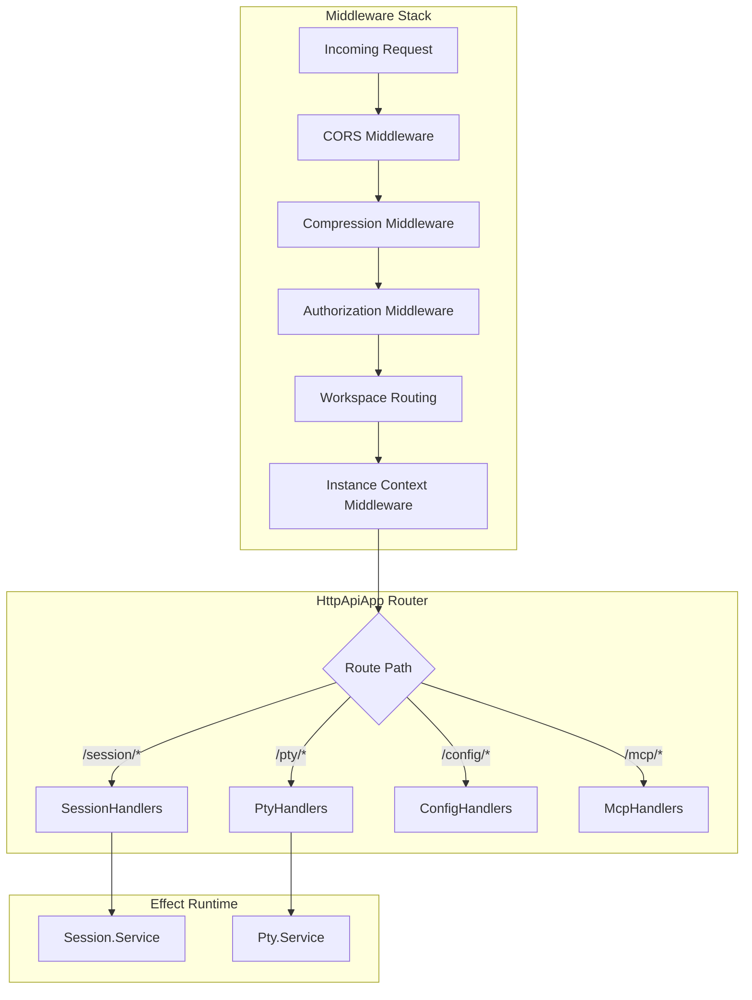
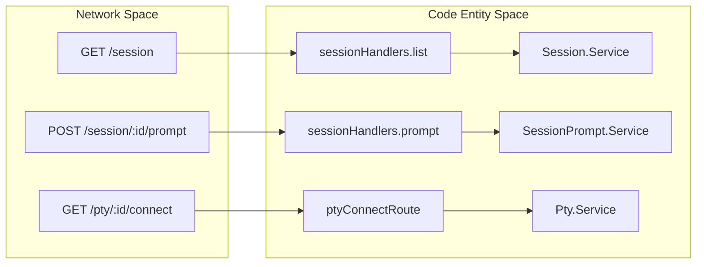

<!-- source: DeepWiki mcp.deepwiki.com · repo browser-use/browsercode · page 5.1 REST API and OpenAPI Spec · fetched 2026-10-30 -->

# REST API and OpenAPI Spec

Relevant source files

The following files were used as context for generating this wiki page:

- [packages/app/src/utils/terminal-websocket-url.ts](packages/app/src/utils/terminal-websocket-url.ts)
- [packages/opencode/specs/openapi-translation-cleanup.md](packages/opencode/specs/openapi-translation-cleanup.md)
- [packages/opencode/src/config/config.ts](packages/opencode/src/config/config.ts)
- [packages/opencode/src/config/permission.ts](packages/opencode/src/config/permission.ts)
- [packages/opencode/src/effect/service-use.ts](packages/opencode/src/effect/service-use.ts)
- [packages/opencode/src/pty/ticket.ts](packages/opencode/src/pty/ticket.ts)
- [packages/opencode/src/server/cors.ts](packages/opencode/src/server/cors.ts)
- [packages/opencode/src/server/init-projectors.ts](packages/opencode/src/server/init-projectors.ts)
- [packages/opencode/src/server/proxy-util.ts](packages/opencode/src/server/proxy-util.ts)
- [packages/opencode/src/server/routes/instance/httpapi/api.ts](packages/opencode/src/server/routes/instance/httpapi/api.ts)
- [packages/opencode/src/server/routes/instance/httpapi/groups/config.ts](packages/opencode/src/server/routes/instance/httpapi/groups/config.ts)
- [packages/opencode/src/server/routes/instance/httpapi/groups/event.ts](packages/opencode/src/server/routes/instance/httpapi/groups/event.ts)
- [packages/opencode/src/server/routes/instance/httpapi/groups/experimental.ts](packages/opencode/src/server/routes/instance/httpapi/groups/experimental.ts)
- [packages/opencode/src/server/routes/instance/httpapi/groups/file.ts](packages/opencode/src/server/routes/instance/httpapi/groups/file.ts)
- [packages/opencode/src/server/routes/instance/httpapi/groups/instance.ts](packages/opencode/src/server/routes/instance/httpapi/groups/instance.ts)
- [packages/opencode/src/server/routes/instance/httpapi/groups/mcp.ts](packages/opencode/src/server/routes/instance/httpapi/groups/mcp.ts)
- [packages/opencode/src/server/routes/instance/httpapi/groups/permission.ts](packages/opencode/src/server/routes/instance/httpapi/groups/permission.ts)
- [packages/opencode/src/server/routes/instance/httpapi/groups/project.ts](packages/opencode/src/server/routes/instance/httpapi/groups/project.ts)
- [packages/opencode/src/server/routes/instance/httpapi/groups/pty.ts](packages/opencode/src/server/routes/instance/httpapi/groups/pty.ts)
- [packages/opencode/src/server/routes/instance/httpapi/groups/query.ts](packages/opencode/src/server/routes/instance/httpapi/groups/query.ts)
- [packages/opencode/src/server/routes/instance/httpapi/groups/question.ts](packages/opencode/src/server/routes/instance/httpapi/groups/question.ts)
- [packages/opencode/src/server/routes/instance/httpapi/groups/sync.ts](packages/opencode/src/server/routes/instance/httpapi/groups/sync.ts)
- [packages/opencode/src/server/routes/instance/httpapi/groups/tui.ts](packages/opencode/src/server/routes/instance/httpapi/groups/tui.ts)
- [packages/opencode/src/server/routes/instance/httpapi/groups/workspace.ts](packages/opencode/src/server/routes/instance/httpapi/groups/workspace.ts)
- [packages/opencode/src/server/routes/instance/httpapi/handlers/event.ts](packages/opencode/src/server/routes/instance/httpapi/handlers/event.ts)
- [packages/opencode/src/server/routes/instance/httpapi/handlers/experimental.ts](packages/opencode/src/server/routes/instance/httpapi/handlers/experimental.ts)
- [packages/opencode/src/server/routes/instance/httpapi/handlers/pty.ts](packages/opencode/src/server/routes/instance/httpapi/handlers/pty.ts)
- [packages/opencode/src/server/routes/instance/httpapi/handlers/workspace.ts](packages/opencode/src/server/routes/instance/httpapi/handlers/workspace.ts)
- [packages/opencode/src/server/routes/instance/httpapi/middleware/authorization.ts](packages/opencode/src/server/routes/instance/httpapi/middleware/authorization.ts)
- [packages/opencode/src/server/routes/instance/httpapi/middleware/proxy.ts](packages/opencode/src/server/routes/instance/httpapi/middleware/proxy.ts)
- [packages/opencode/src/server/routes/instance/httpapi/middleware/schema-error.ts](packages/opencode/src/server/routes/instance/httpapi/middleware/schema-error.ts)
- [packages/opencode/src/server/routes/instance/httpapi/middleware/workspace-routing.ts](packages/opencode/src/server/routes/instance/httpapi/middleware/workspace-routing.ts)
- [packages/opencode/src/server/routes/instance/httpapi/public.ts](packages/opencode/src/server/routes/instance/httpapi/public.ts)
- [packages/opencode/src/server/routes/instance/httpapi/server.ts](packages/opencode/src/server/routes/instance/httpapi/server.ts)
- [packages/opencode/src/server/routes/instance/httpapi/websocket-tracker.ts](packages/opencode/src/server/routes/instance/httpapi/websocket-tracker.ts)
- [packages/opencode/src/server/server.ts](packages/opencode/src/server/server.ts)
- [packages/opencode/src/server/shared/public-ui.ts](packages/opencode/src/server/shared/public-ui.ts)
- [packages/opencode/src/server/shared/ui.ts](packages/opencode/src/server/shared/ui.ts)
- [packages/opencode/test/config/config.test.ts](packages/opencode/test/config/config.test.ts)
- [packages/opencode/test/permission-task.test.ts](packages/opencode/test/permission-task.test.ts)
- [packages/opencode/test/pty/ticket.test.ts](packages/opencode/test/pty/ticket.test.ts)
- [packages/opencode/test/server/global-bus.ts](packages/opencode/test/server/global-bus.ts)
- [packages/opencode/test/server/httpapi-authorization.test.ts](packages/opencode/test/server/httpapi-authorization.test.ts)
- [packages/opencode/test/server/httpapi-config.test.ts](packages/opencode/test/server/httpapi-config.test.ts)
- [packages/opencode/test/server/httpapi-event.test.ts](packages/opencode/test/server/httpapi-event.test.ts)
- [packages/opencode/test/server/httpapi-experimental.test.ts](packages/opencode/test/server/httpapi-experimental.test.ts)
- [packages/opencode/test/server/httpapi-instance.test.ts](packages/opencode/test/server/httpapi-instance.test.ts)
- [packages/opencode/test/server/httpapi-listen.test.ts](packages/opencode/test/server/httpapi-listen.test.ts)
- [packages/opencode/test/server/httpapi-pty.test.ts](packages/opencode/test/server/httpapi-pty.test.ts)
- [packages/opencode/test/server/httpapi-query-schema-drift.test.ts](packages/opencode/test/server/httpapi-query-schema-drift.test.ts)
- [packages/opencode/test/server/httpapi-raw-route-auth.test.ts](packages/opencode/test/server/httpapi-raw-route-auth.test.ts)
- [packages/opencode/test/server/httpapi-schema-error-body.test.ts](packages/opencode/test/server/httpapi-schema-error-body.test.ts)
- [packages/opencode/test/server/httpapi-sdk.test.ts](packages/opencode/test/server/httpapi-sdk.test.ts)
- [packages/opencode/test/server/httpapi-sync.test.ts](packages/opencode/test/server/httpapi-sync.test.ts)
- [packages/opencode/test/server/httpapi-ui.test.ts](packages/opencode/test/server/httpapi-ui.test.ts)
- [packages/opencode/test/server/httpapi-workspace.test.ts](packages/opencode/test/server/httpapi-workspace.test.ts)
- [packages/opencode/test/server/sdk-error-shape.test.ts](packages/opencode/test/server/sdk-error-shape.test.ts)
- [packages/opencode/test/server/sdk-v1-smoke.test.ts](packages/opencode/test/server/sdk-v1-smoke.test.ts)
- [packages/opencode/test/server/workspace-proxy.test.ts](packages/opencode/test/server/workspace-proxy.test.ts)
- [packages/opencode/test/server/worktree-endpoint-repro.test.ts](packages/opencode/test/server/worktree-endpoint-repro.test.ts)
- [packages/sdk/js/src/gen/sdk.gen.ts](packages/sdk/js/src/gen/sdk.gen.ts)
- [packages/sdk/js/src/gen/types.gen.ts](packages/sdk/js/src/gen/types.gen.ts)
- [packages/sdk/js/src/v2/gen/sdk.gen.ts](packages/sdk/js/src/v2/gen/sdk.gen.ts)
- [packages/sdk/js/src/v2/gen/types.gen.ts](packages/sdk/js/src/v2/gen/types.gen.ts)
- [packages/sdk/openapi.json](packages/sdk/openapi.json)

The BrowserCode/OpenCode server exposes a comprehensive REST API and a real-time Server-Sent Events (SSE) stream to facilitate communication between the agent engine and various user interfaces (TUI, Web, Desktop). The API is built using the `effect/unstable/httpapi` framework, which provides type-safe routing and automatic OpenAPI specification generation.

## HttpApiApp and Routing Architecture

The core of the server is the `HttpApiApp` [packages/opencode/src/server/server.ts:10-10](). It defines the high-level routing structure, separating global control operations from instance-specific project operations.

The routing is divided into several logical layers:
1.  **Root API Routes**: Handles `/global/*` and `/control/*` endpoints, such as health checks and global authentication settings [packages/opencode/src/server/routes/instance/httpapi/server.ts:110-114]().
2.  **Instance API Routes**: Handles project-specific logic under a workspace context (e.g., sessions, files, PTYs). These routes are gated by workspace routing and instance context middleware [packages/opencode/src/server/routes/instance/httpapi/server.ts:123-141]().
3.  **Event API**: A specialized group for the `/event` and `/global/event` SSE streams [packages/opencode/src/server/routes/instance/httpapi/server.ts:119-122]().
4.  **UI and Static Assets**: A fallback handler that serves the embedded SolidJS Web UI or proxies requests to a remote UI instance [packages/opencode/src/server/routes/instance/httpapi/server.ts:164-171]().

### Data Flow: Request to Handler

The following diagram illustrates how an incoming HTTP request is processed through the middleware stack before reaching a specific group handler.

**API Request Lifecycle**

Sources: [packages/opencode/src/server/routes/instance/httpapi/server.ts:94-151](), [packages/opencode/src/server/server.ts:103-118]()

## API Groups

The API is partitioned into functional groups defined in `InstanceHttpApi` and `RootHttpApi` [packages/opencode/src/server/routes/instance/httpapi/api.ts]().

| Group | Purpose | Key Endpoints |
| :--- | :--- | :--- |
| **Control** | Global server state and logging | `/log`, `/auth/{providerID}` |
| **Global** | System-wide status and updates | `/global/health`, `/global/upgrade` |
| **Session** | Agent lifecycle and message history | `/session`, `/session/{id}/prompt`, `/session/{id}/revert` |
| **PTY** | Terminal management | `/pty`, `/pty/{id}/connect` |
| **MCP** | Model Context Protocol integration | `/mcp/status`, `/mcp/add`, `/mcp/auth` |
| **Config** | Configuration management | `/config`, `/config/providers` |
| **Provider** | LLM provider metadata and OAuth | `/provider`, `/provider/oauth/authorize` |
| **Permission** | Security gating for tool execution | `/session/{id}/permissions`, `/permission/reply` |
| **Worktree** | Git worktree management | `/experimental/worktree` |
| **Experimental**| Beta features and workspace ops | `/experimental/workspace`, `/experimental/session` |

Sources: [packages/sdk/openapi.json:9-232](), [packages/opencode/src/server/routes/instance/httpapi/server.ts:123-141]()

## OpenAPI Specification

The server automatically generates an `openapi.json` spec from the `PublicApi` definition [packages/opencode/src/server/server.ts:69-71](). This spec is served at the `/doc` endpoint [packages/opencode/src/server/routes/instance/httpapi/server.ts:160-162]().

### Spec Transformation
Because the internal `Effect` schemas often include complex types (like `Schema.optional` which emits `anyOf: [T, null]`), the server performs a "cleanup" pass in `matchLegacyOpenApi` to ensure compatibility with standard OpenAPI generators and the legacy SDK [packages/opencode/src/server/routes/instance/httpapi/public.ts:81-107]().

Key transformations include:
*   **Inlining Self-References**: Resolving recursive component definitions [packages/opencode/src/server/routes/instance/httpapi/public.ts:89-89]().
*   **Null Stripping**: Removing `{type: "null"}` from optional fields to match TypeScript's `?` property behavior [packages/opencode/src/server/routes/instance/httpapi/public.ts:94-96]().
*   **Error Normalization**: Mapping internal Effect errors to standard `BadRequestError` or `NotFoundError` schemas [packages/opencode/src/server/routes/instance/httpapi/public.ts:101-106]().

Sources: [packages/opencode/src/server/routes/instance/httpapi/public.ts:58-166](), [packages/sdk/openapi.json:1-193]()

## HTTP Server Middleware

The server utilizes several layers of middleware to handle cross-cutting concerns:

### 1. Authorization
The `authorizationRouterMiddleware` enforces security based on `OPENCODE_SERVER_USERNAME` and `OPENCODE_SERVER_PASSWORD` environment variables [packages/opencode/src/server/routes/instance/httpapi/middleware/authorization.ts](). It supports Basic Auth for standard HTTP requests and ticket-based authentication for WebSockets (specifically for PTY connections) [packages/opencode/src/pty/ticket.ts:1-10]().

### 2. Workspace Routing
The `workspaceRouterMiddleware` interprets the `x-opencode-directory` header or query parameter to route requests to the correct project instance [packages/opencode/src/server/routes/instance/httpapi/middleware/workspace-routing.ts](). This allows a single server process to manage multiple distinct projects simultaneously.

### 3. Compression and CORS
*   **Compression**: Uses `compressionLayer` to reduce payload size for large session histories [packages/opencode/src/server/routes/instance/httpapi/server.ts:86-86]().
*   **CORS**: Configured via `isAllowedCorsOrigin` to permit connections from the BrowserCode Web UI and local development environments [packages/opencode/src/server/routes/instance/httpapi/server.ts:94-101]().

### 4. Schema Error Handling
The `schemaErrorLayer` intercepts Zod-like validation errors from the `Effect` schemas and transforms them into readable JSON responses with `400 Bad Request` status codes, including specific details about which fields failed validation [packages/opencode/src/server/routes/instance/httpapi/middleware/schema-error.ts]().

**Entity Mapping: API to Code**

Sources: [packages/opencode/src/server/routes/instance/httpapi/server.ts:123-143](), [packages/opencode/src/server/routes/instance/httpapi/handlers/session.ts](), [packages/opencode/src/server/routes/instance/httpapi/handlers/pty.ts]()

Sources:
*   `HttpApiApp` implementation: [packages/opencode/src/server/routes/instance/httpapi/server.ts:1-166]()
*   OpenAPI Generation: [packages/opencode/src/server/routes/instance/httpapi/public.ts:1-166]()
*   Server Entrypoint: [packages/opencode/src/server/server.ts:1-196]()
*   OpenAPI Schema: [packages/sdk/openapi.json:1-232]()

---

