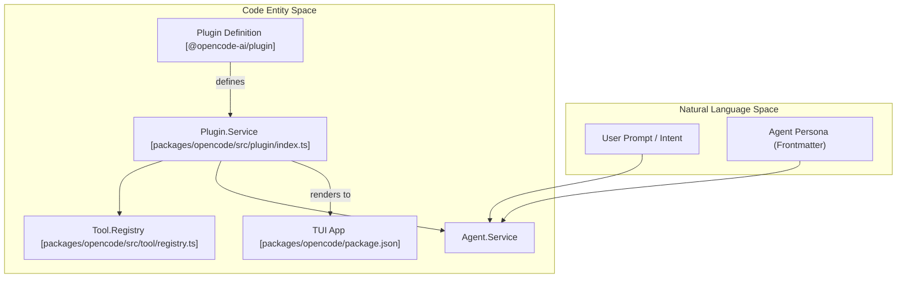
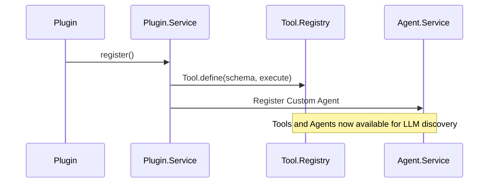

<!-- source: DeepWiki mcp.deepwiki.com · repo browser-use/browsercode · page 6 Plugin System · fetched 2026-10-30 -->

# Plugin System

Relevant source files

The following files were used as context for generating this wiki page:

- [bun.lock](bun.lock)
- [packages/console/app/package.json](packages/console/app/package.json)
- [packages/console/core/package.json](packages/console/core/package.json)
- [packages/console/function/package.json](packages/console/function/package.json)
- [packages/console/mail/package.json](packages/console/mail/package.json)
- [packages/desktop/package.json](packages/desktop/package.json)
- [packages/function/package.json](packages/function/package.json)
- [packages/opencode/package.json](packages/opencode/package.json)
- [packages/opencode/src/effect/runner.ts](packages/opencode/src/effect/runner.ts)
- [packages/opencode/src/plugin/index.ts](packages/opencode/src/plugin/index.ts)
- [packages/opencode/src/session/run-state.ts](packages/opencode/src/session/run-state.ts)
- [packages/opencode/src/tool/registry.ts](packages/opencode/src/tool/registry.ts)
- [packages/opencode/src/tool/task_status.ts](packages/opencode/src/tool/task_status.ts)
- [packages/opencode/test/effect/runner.test.ts](packages/opencode/test/effect/runner.test.ts)
- [packages/opencode/test/tool/registry.test.ts](packages/opencode/test/tool/registry.test.ts)
- [packages/plugin/package.json](packages/plugin/package.json)
- [packages/plugin/src/index.ts](packages/plugin/src/index.ts)
- [packages/sdk/js/package.json](packages/sdk/js/package.json)
- [packages/web/package.json](packages/web/package.json)
- [sdks/vscode/package.json](sdks/vscode/package.json)

The Plugin System allows BrowserCode to be extended with custom capabilities, including new tools for agents, specialized agent personas, and UI components for the Terminal User Interface (TUI). It is managed primarily via the `@opencode-ai/plugin` package and the `Plugin.Service` within the core engine.

The system is designed to bridge the gap between high-level agent instructions (Natural Language Space) and concrete execution logic (Code Entity Space) by providing a structured way to register and load external modules.

## System Overview

The plugin system coordinates several distinct layers of the application:
1.  **Tool Definition**: Using Zod schemas to define input/output contracts for LLM tool calls.
2.  **Lifecycle Management**: Handling the installation, loading, and graceful shutdown of plugins.
3.  **UI Extension**: Injecting SolidJS components into TUI slots.
4.  **Provider Overrides**: Allowing plugins to intercept authentication or modify how LLM models are loaded.

### Relationship Diagram

This diagram illustrates how the `Plugin.Service` interacts with other core services to register tools and agents.

Sources: [packages/opencode/src/plugin/index.ts:1-50](), [packages/opencode/src/tool/registry.ts:1-30](), [packages/plugin/package.json:1-20]()

## The `@opencode-ai/plugin` Package

The extension surface is defined in the `packages/plugin` workspace. This package provides the factory functions and types necessary for developers to create plugins that are compatible with the BrowserCode runtime.

| Export | File Path | Purpose |
| :--- | :--- | :--- |
| `.` | [packages/plugin/src/index.ts]() | Main entry point for plugin definitions and lifecycle hooks. |
| `./tool` | [packages/plugin/package.json:13]() | Utilities for defining tools with Zod schemas. |
| `./tui` | [packages/plugin/package.json:14]() | Types and components for TUI slot injection. |

### Dependencies
The plugin package relies on `effect` for functional logic and `zod` for schema validation. It also lists `@opentui` packages as peer dependencies for TUI-specific extensions.

Sources: [packages/plugin/package.json:11-39]()

## Plugin Lifecycle and Architecture

Plugins are managed by the `Plugin.Service`. This service handles:
*   **Loading**: Discovering plugins in local project directories or global configuration paths.
*   **Installation**: Managing background `npm install` processes for plugin dependencies.
*   **Initialization**: Running the `setup` or `init` hooks defined by the plugin.
*   **Shutdown**: Ensuring telemetry (like `bcode-laminar`) is flushed and resources are released.

For a deep dive into the service implementation and loading logic, see **[Plugin Architecture and Lifecycle](#6.1)**.

Sources: [packages/opencode/src/plugin/index.ts:1-100](), [packages/opencode/package.json:104]()

## Custom Tools and Agents

Plugins are the primary mechanism for adding domain-specific tools. A tool in BrowserCode is defined using the `Tool.define` factory, which requires:
*   **Name and Description**: For the LLM to understand when to call it.
*   **Zod Schema**: To validate the arguments provided by the LLM.
*   **Execute Function**: The actual logic to be run on the host machine.

Beyond tools, plugins can define **Custom Agents** with specific frontmatter (system prompts) and permission requirements. They can also provide **Provider Overrides** to handle custom authentication flows (e.g., GitHub Copilot auth hooks).

For implementation details and reference examples like the GitHub Copilot plugin, see **[Custom Tools and Agents via Plugins](#6.2)**.

### Tool Registration Flow

Sources: [packages/opencode/src/tool/registry.ts:1-50](), [packages/opencode/src/plugin/index.ts:1-50]()

## TUI Component Plugins

The Terminal User Interface (TUI) supports "slots" where plugins can inject custom SolidJS components. This allows plugins to provide specialized visualizations (e.g., diff viewers, status dashboards) directly within the terminal session.

*   **Slots**: Defined areas in the TUI (Sidebar, Header, Message Footer).
*   **Runtime**: TUI plugins run in a specific environment that has access to the `@opentui` API for keybindings and rendering.

Sources: [packages/plugin/package.json:24-39](), [packages/opencode/package.json:114-116]()

---

## Child Pages
*   **[Plugin Architecture and Lifecycle](#6.1)**: Technical details on `Plugin.Service`, dependency management, and the shared module system.
*   **[Custom Tools and Agents via Plugins](#6.2)**: How to write tool definitions, define agent permissions, and override provider behavior.

---

