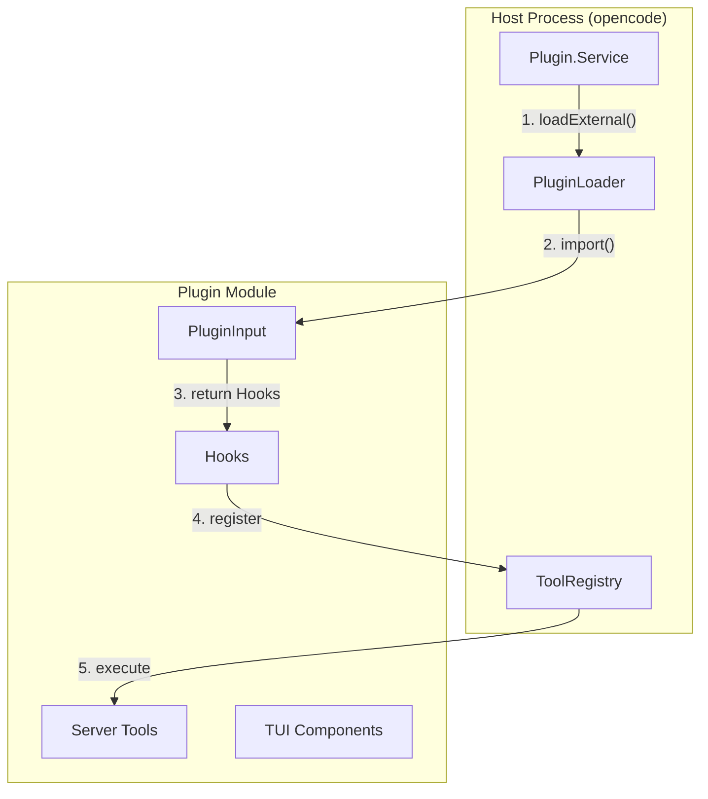
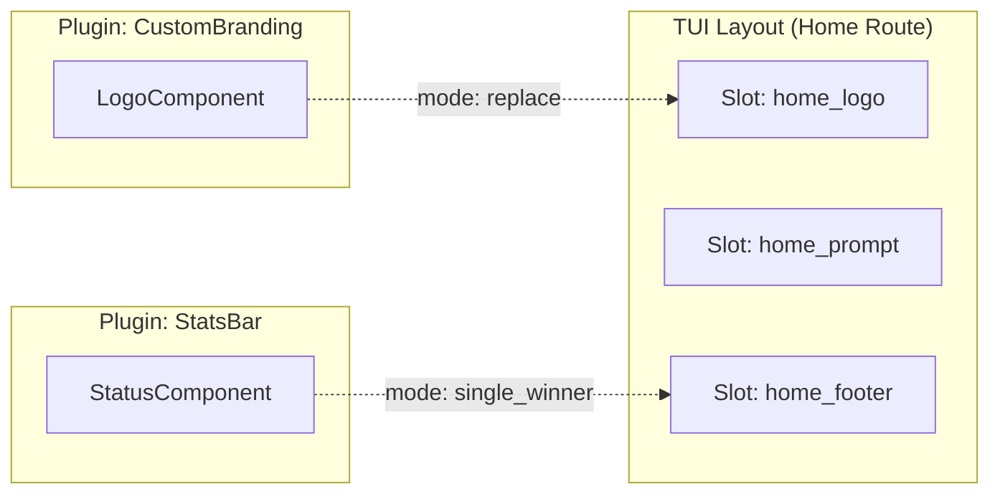

<!-- source: DeepWiki mcp.deepwiki.com · repo browser-use/browsercode · page 6.1 Plugin Architecture and Lifecycle · fetched 2026-10-30 -->

# Plugin Architecture and Lifecycle

Relevant source files

The following files were used as context for generating this wiki page:

- [.opencode/plugins/tui-smoke.tsx](.opencode/plugins/tui-smoke.tsx)
- [packages/opencode/specs/tui-plugins.md](packages/opencode/specs/tui-plugins.md)
- [packages/opencode/src/cli/cmd/tui/plugin/api.tsx](packages/opencode/src/cli/cmd/tui/plugin/api.tsx)
- [packages/opencode/src/cli/cmd/tui/plugin/runtime.ts](packages/opencode/src/cli/cmd/tui/plugin/runtime.ts)
- [packages/opencode/src/cli/cmd/tui/routes/home.tsx](packages/opencode/src/cli/cmd/tui/routes/home.tsx)
- [packages/opencode/src/effect/runner.ts](packages/opencode/src/effect/runner.ts)
- [packages/opencode/src/plugin/index.ts](packages/opencode/src/plugin/index.ts)
- [packages/opencode/src/plugin/install.ts](packages/opencode/src/plugin/install.ts)
- [packages/opencode/src/plugin/loader.ts](packages/opencode/src/plugin/loader.ts)
- [packages/opencode/src/plugin/shared.ts](packages/opencode/src/plugin/shared.ts)
- [packages/opencode/src/session/run-state.ts](packages/opencode/src/session/run-state.ts)
- [packages/opencode/src/tool/registry.ts](packages/opencode/src/tool/registry.ts)
- [packages/opencode/src/tool/task_status.ts](packages/opencode/src/tool/task_status.ts)
- [packages/opencode/test/cli/tui/plugin-add.test.ts](packages/opencode/test/cli/tui/plugin-add.test.ts)
- [packages/opencode/test/cli/tui/plugin-install.test.ts](packages/opencode/test/cli/tui/plugin-install.test.ts)
- [packages/opencode/test/cli/tui/plugin-loader-entrypoint.test.ts](packages/opencode/test/cli/tui/plugin-loader-entrypoint.test.ts)
- [packages/opencode/test/cli/tui/plugin-loader-pure.test.ts](packages/opencode/test/cli/tui/plugin-loader-pure.test.ts)
- [packages/opencode/test/cli/tui/plugin-loader.test.ts](packages/opencode/test/cli/tui/plugin-loader.test.ts)
- [packages/opencode/test/cli/tui/plugin-toggle.test.ts](packages/opencode/test/cli/tui/plugin-toggle.test.ts)
- [packages/opencode/test/effect/runner.test.ts](packages/opencode/test/effect/runner.test.ts)
- [packages/opencode/test/fixture/tui-plugin.ts](packages/opencode/test/fixture/tui-plugin.ts)
- [packages/opencode/test/fixture/tui-runtime.ts](packages/opencode/test/fixture/tui-runtime.ts)
- [packages/opencode/test/plugin/install.test.ts](packages/opencode/test/plugin/install.test.ts)
- [packages/opencode/test/plugin/loader-shared.test.ts](packages/opencode/test/plugin/loader-shared.test.ts)
- [packages/opencode/test/tool/registry.test.ts](packages/opencode/test/tool/registry.test.ts)
- [packages/plugin/src/index.ts](packages/plugin/src/index.ts)
- [packages/plugin/src/tui.ts](packages/plugin/src/tui.ts)

The BrowserCode plugin system allows extending the core agent capabilities (server-side) and the terminal user interface (client-side). Plugins are modular units that can define custom tools, agents, authentication hooks, and UI components.

## Plugin.Service and Architecture

The `Plugin.Service` is the central coordinator for plugin management within the `opencode` engine. It manages the lifecycle of both internal (built-in) and external (npm/local) plugins.

### Server-Side Plugins
Server-side plugins interact with the agent runtime by providing `Hooks`. These hooks allow plugins to:
- Register custom tools via `tool` [packages/plugin/src/index.ts:239-241]().
- Provide custom authentication methods for LLM providers or external services via `auth` [packages/plugin/src/index.ts:242-242]().
- Intercept and modify chat messages or LLM parameters [packages/plugin/src/index.ts:247-260]().
- Register workspace adapters for custom environment management [packages/plugin/src/index.ts:148-152]().

### TUI Plugins
TUI plugins extend the `@opentui/solid` rendering stack. They use "Slots" to inject UI components into the terminal interface and can register custom keybindings or command palette entries [packages/opencode/src/cli/cmd/tui/plugin/runtime.ts:79-107]().

### Core Plugin Interface
A plugin is defined as a function that receives `PluginInput` (containing an SDK client, project context, and directory information) and returns a `Hooks` object [packages/plugin/src/index.ts:56-74]().

**Diagram: Plugin Service Data Flow**

Sources: [packages/opencode/src/plugin/index.ts:50-64](), [packages/opencode/src/tool/registry.ts:146-180](), [packages/plugin/src/index.ts:222-260]()

---

## Plugin Loading and Scopes

Plugins can be loaded from two distinct scopes:
1.  **Global Scope**: Installed in the user's global BrowserCode directory (e.g., `~/.opencode/plugins`).
2.  **Local Scope**: Defined within a specific project's `.opencode/plugins` or referenced in a project-local `opencode.json` [packages/opencode/src/plugin/loader.ts:1-20]().

### Loading Mechanism
The `PluginLoader` resolves plugin specifiers, which can be:
- **NPM Packages**: Fetched and installed into a managed `node_modules` directory [packages/opencode/src/plugin/shared.ts:207-213]().
- **Local Files**: Loaded via `file://` URLs or relative paths [packages/opencode/src/plugin/shared.ts:171-173]().

### Background Dependency Management
When a plugin is added via an npm specifier, the system triggers a background `npm install` (using Bun's internal package management) to ensure dependencies are available without blocking the main engine startup [packages/opencode/src/plugin/install.ts:31-35]().

Sources: [packages/opencode/src/plugin/shared.ts:56-59](), [packages/opencode/src/plugin/shared.ts:175-192](), [packages/opencode/src/plugin/loader.ts:177-180]()

---

## TUI Plugin Runtime

The TUI runtime (`TuiPluginRuntime`) manages the lifecycle of UI-specific extensions. It bridges the SolidJS-based terminal interface with plugin code.

### Slots and API
The TUI uses a "Slot" architecture where specific regions of the UI (e.g., `home_logo`, `home_prompt`) are designated as extension points [packages/opencode/src/cli/cmd/tui/routes/home.tsx:67-93]().

- **Slot Modes**:
    - `replace`: Replaces the default content [packages/opencode/src/cli/cmd/tui/routes/home.tsx:67-67]().
    - `append`: Adds to the existing content.
    - `single_winner`: Only one plugin can occupy the slot [packages/opencode/src/cli/cmd/tui/routes/home.tsx:92-92]().

### Keymap and Commands
Plugins can register layers in the TUI keymap to handle keyboard shortcuts. The runtime provides a scoped API that automatically cleans up these bindings when the plugin is disabled or the session ends [packages/opencode/src/cli/cmd/tui/plugin/runtime.ts:144-161]().

**Diagram: TUI Plugin Slot Integration**

Sources: [packages/opencode/src/cli/cmd/tui/routes/home.tsx:1-97](), [packages/opencode/src/cli/cmd/tui/plugin/runtime.ts:122-140]()

---

## Plugin Lifecycle (Install/Uninstall)

The lifecycle of a plugin involves resolution, installation, initialization, and eventual shutdown.

### Install Flow
1.  **Resolution**: The `resolvePluginTarget` function determines if the specifier is a local path or an NPM package [packages/opencode/src/plugin/shared.ts:207-213]().
2.  **Compatibility Check**: The engine verifies the plugin's `engines.opencode` field against the current version [packages/opencode/src/plugin/shared.ts:194-205]().
3.  **Registration**: The plugin origin is added to the configuration (`cfg.plugin_origins`) [packages/opencode/src/plugin/index.ts:171-171]().
4.  **Initialization**: The plugin's `server` or `tui` entry point is invoked with the `PluginInput` [packages/opencode/src/plugin/index.ts:105-116]().

### Shutdown Flow
Plugins can register synchronous shutdown hooks. These are critical for cleaning up resources like OpenTelemetry spans or flushing telemetry data before the process exits [packages/opencode/src/plugin/index.ts:35-39]().

- **`pluginShutdownHooks`**: A global `Set` of callbacks invoked during the process's `finally` block [packages/opencode/src/plugin/index.ts:39-39]().
- **`shutdown` Hook**: A method in the `Hooks` interface that returns a `Promise`, allowing for async cleanup with a bounded timeout [packages/plugin/src/index.ts:238-238]().

### Uninstall Flow
Uninstalling a plugin involves removing its entry from the configuration and, if it was a local file-based plugin, potentially cleaning up cached artifacts. For NPM-based plugins, the system relies on the managed `node_modules` structure [packages/opencode/src/plugin/install.ts:31-35]().

Sources: [packages/opencode/src/plugin/index.ts:35-43](), [packages/opencode/src/plugin/shared.ts:207-213](), [packages/plugin/src/index.ts:222-244]()

---

