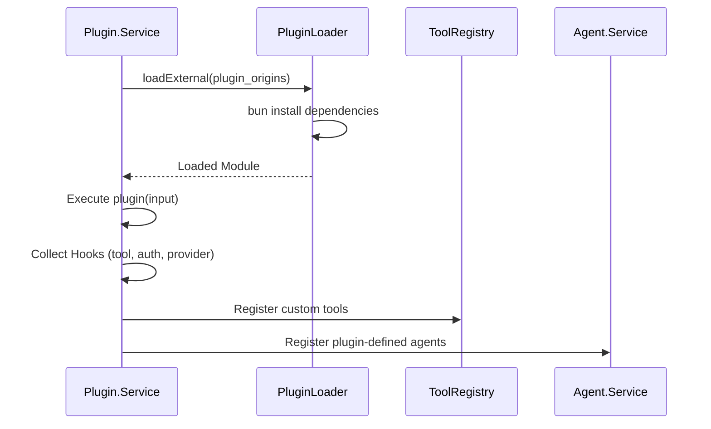
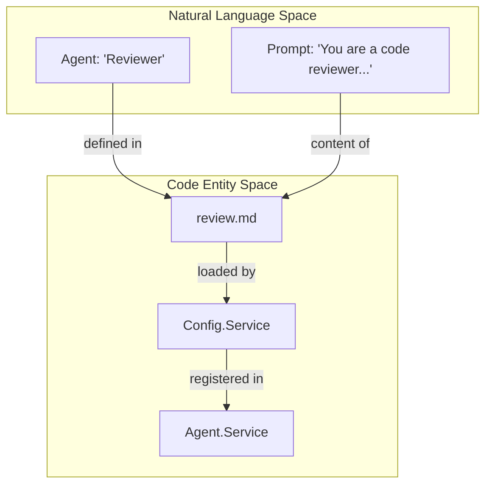
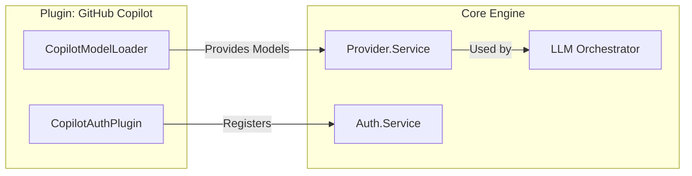

<!-- source: DeepWiki mcp.deepwiki.com · repo browser-use/browsercode · page 6.2 Custom Tools and Agents via Plugins · fetched 2026-10-30 -->

# Custom Tools and Agents via Plugins

<details>
<summary>Relevant source files</summary>

The following files were used as context for generating this wiki page:

- [packages/opencode/src/cli/cmd/tui/context/editor-zed.ts](packages/opencode/src/cli/cmd/tui/context/editor-zed.ts)
- [packages/opencode/src/cli/cmd/tui/context/editor.ts](packages/opencode/src/cli/cmd/tui/context/editor.ts)
- [packages/opencode/src/command/template/initialize.txt](packages/opencode/src/command/template/initialize.txt)
- [packages/opencode/src/effect/runner.ts](packages/opencode/src/effect/runner.ts)
- [packages/opencode/src/plugin/github-copilot/copilot.ts](packages/opencode/src/plugin/github-copilot/copilot.ts)
- [packages/opencode/src/plugin/github-copilot/models.ts](packages/opencode/src/plugin/github-copilot/models.ts)
- [packages/opencode/src/plugin/index.ts](packages/opencode/src/plugin/index.ts)
- [packages/opencode/src/session/run-state.ts](packages/opencode/src/session/run-state.ts)
- [packages/opencode/src/tool/registry.ts](packages/opencode/src/tool/registry.ts)
- [packages/opencode/src/tool/task_status.ts](packages/opencode/src/tool/task_status.ts)
- [packages/opencode/test/cli/tui/editor-context-zed.test.ts](packages/opencode/test/cli/tui/editor-context-zed.test.ts)
- [packages/opencode/test/cli/tui/editor-context.test.tsx](packages/opencode/test/cli/tui/editor-context.test.tsx)
- [packages/opencode/test/effect/runner.test.ts](packages/opencode/test/effect/runner.test.ts)
- [packages/opencode/test/lib/websocket.ts](packages/opencode/test/lib/websocket.ts)
- [packages/opencode/test/plugin/github-copilot-models.test.ts](packages/opencode/test/plugin/github-copilot-models.test.ts)
- [packages/opencode/test/tool/registry.test.ts](packages/opencode/test/tool/registry.test.ts)
- [packages/plugin/src/index.ts](packages/plugin/src/index.ts)
- [packages/plugin/src/tool.ts](packages/plugin/src/tool.ts)
- [packages/sdk/js/src/gen/client.gen.ts](packages/sdk/js/src/gen/client.gen.ts)
- [packages/sdk/js/src/index.ts](packages/sdk/js/src/index.ts)
- [packages/web/src/content/docs/agents.mdx](packages/web/src/content/docs/agents.mdx)
- [packages/web/src/content/docs/cli.mdx](packages/web/src/content/docs/cli.mdx)
- [packages/web/src/content/docs/config.mdx](packages/web/src/content/docs/config.mdx)
- [packages/web/src/content/docs/custom-tools.mdx](packages/web/src/content/docs/custom-tools.mdx)
- [packages/web/src/content/docs/ide.mdx](packages/web/src/content/docs/ide.mdx)
- [packages/web/src/content/docs/keybinds.mdx](packages/web/src/content/docs/keybinds.mdx)
- [packages/web/src/content/docs/models.mdx](packages/web/src/content/docs/models.mdx)
- [packages/web/src/content/docs/permissions.mdx](packages/web/src/content/docs/permissions.mdx)
- [packages/web/src/content/docs/plugins.mdx](packages/web/src/content/docs/plugins.mdx)
- [packages/web/src/content/docs/rules.mdx](packages/web/src/content/docs/rules.mdx)
- [packages/web/src/content/docs/sdk.mdx](packages/web/src/content/docs/sdk.mdx)
- [packages/web/src/content/docs/server.mdx](packages/web/src/content/docs/server.mdx)
- [packages/web/src/content/docs/tools.mdx](packages/web/src/content/docs/tools.mdx)
- [packages/web/src/content/docs/tui.mdx](packages/web/src/content/docs/tui.mdx)

</details>


The BrowserCode/OpenCode plugin system allows developers to extend the core engine with specialized capabilities. This includes defining custom tools for LLMs to execute, creating specialized agents with unique prompts and permission sets, and overriding provider authentication or model discovery logic.

## Plugin Architecture

Plugins are implemented as JavaScript or TypeScript modules that export a initialization function. This function receives a `PluginInput` context and returns a `Hooks` object containing the plugin's functionality [packages/plugin/src/index.ts:74-80]().

### Data Flow: Plugin Loading and Execution

The `Plugin.Service` manages the lifecycle of both internal and external plugins. It resolves dependencies, installs npm-based plugins via Bun, and registers hooks into the system [packages/opencode/src/plugin/index.ts:118-176]().

**Plugin Registration Flow**

Sources: [packages/opencode/src/plugin/index.ts:105-116](), [packages/opencode/src/tool/registry.ts:142-146]()

---

## Custom Tools

Plugins define custom tools using the `tool` factory or by providing a `ToolDefinition` object. Each tool requires a name, a description (for the LLM), a Zod schema for argument validation, and an `execute` function [packages/plugin/src/tool.ts:1-20]().

### Tool Definition Components
1.  **Zod Schema**: Defines the parameters the LLM must provide. The system automatically converts these to JSON Schema for the model context [packages/opencode/src/tool/registry.ts:149-153]().
2.  **Execute Function**: The logic executed when the LLM calls the tool. It receives the validated arguments and a `PluginToolContext` [packages/opencode/src/tool/registry.ts:161-168]().
3.  **Permission Gating**: Tools are subject to the `Permission.Service`. Plugins can hook into `tool.execute.before` to implement custom security logic, such as blocking access to specific files [packages/web/src/content/docs/plugins.mdx:247-257]().

### Implementation Example
```typescript
import { type Plugin, tool } from "@opencode-ai/plugin"
import z from "zod"

export const MyPlugin: Plugin = async (ctx) => {
  return {
    tool: {
      "my_custom_tool": {
        description: "Does something unique",
        args: {
          input: z.string().describe("The input to process")
        },
        execute: async ({ input }, toolCtx) => {
          return `Processed: ${input}`
        }
      }
    }
  }
}
```
Sources: [packages/web/src/content/docs/plugins.mdx:282-295](), [packages/opencode/src/tool/registry.ts:146-170]()

---

## Custom Agents

Agents are specialized AI personas. Plugins can define agents through the `config` hook or by placing Markdown files in the `.opencode/agents/` directory [packages/web/src/content/docs/agents.mdx:188-195]().

### Agent Frontmatter and Permissions
Custom agents are configured via YAML frontmatter in Markdown files. Key fields include:
*   **mode**: `primary` (user-selectable) or `subagent` (invoked by other agents) [packages/web/src/content/docs/agents.mdx:198]().
*   **permission**: A granular map of allowed/denied tools for that specific agent [packages/web/src/content/docs/agents.mdx:201-204]().
*   **model**: The default model for this agent [packages/web/src/content/docs/agents.mdx:199]().

**Agent Persona to Code Mapping**

Sources: [packages/web/src/content/docs/agents.mdx:188-216](), [packages/opencode/src/plugin/index.ts:142-158]()

---

## Provider and Auth Overrides

Plugins can extend the LLM orchestration layer by adding custom authentication methods or overriding how models are discovered for specific providers.

### Auth Hooks
The `auth` hook allows plugins to implement OAuth or API-key based authentication for providers. This is used by the `CopilotAuthPlugin` to handle GitHub device flow authentication [packages/opencode/src/plugin/github-copilot/copilot.ts:1-20]().

### Provider Hooks
The `provider` hook allows a plugin to dynamically list models. For example, the GitHub Copilot plugin fetches available models directly from GitHub's API rather than relying on a static list [packages/opencode/src/plugin/github-copilot/models.ts:1-15]().

| Hook Type | Role | Key File |
| :--- | :--- | :--- |
| `AuthHook` | Defines OAuth/API login prompts and logic | [packages/plugin/src/index.ts:88-163]() |
| `ProviderHook` | Dynamically loads models for a provider | [packages/plugin/src/index.ts:214-217]() |

---

## Reference Implementation: GitHub Copilot Plugin

The GitHub Copilot plugin serves as the primary reference for complex integrations. It implements:
1.  **Custom Auth**: Uses the `auth` hook to perform GitHub's device code flow [packages/opencode/src/plugin/github-copilot/copilot.ts]().
2.  **Model Loading**: Uses the `provider` hook to fetch and map GitHub-hosted models (e.g., GPT-4o, Claude 3.5 Sonnet) into the OpenCode `Provider.Service` [packages/opencode/test/plugin/github-copilot-models.test.ts]().
3.  **Token Management**: Manages refreshing and securely storing GitHub tokens via the internal `ServerAuth` mechanism [packages/opencode/src/plugin/github-copilot/copilot.ts]().

**Copilot Plugin Integration**

Sources: [packages/opencode/src/plugin/index.ts:69](), [packages/opencode/src/plugin/github-copilot/copilot.ts:1-50]()

---

