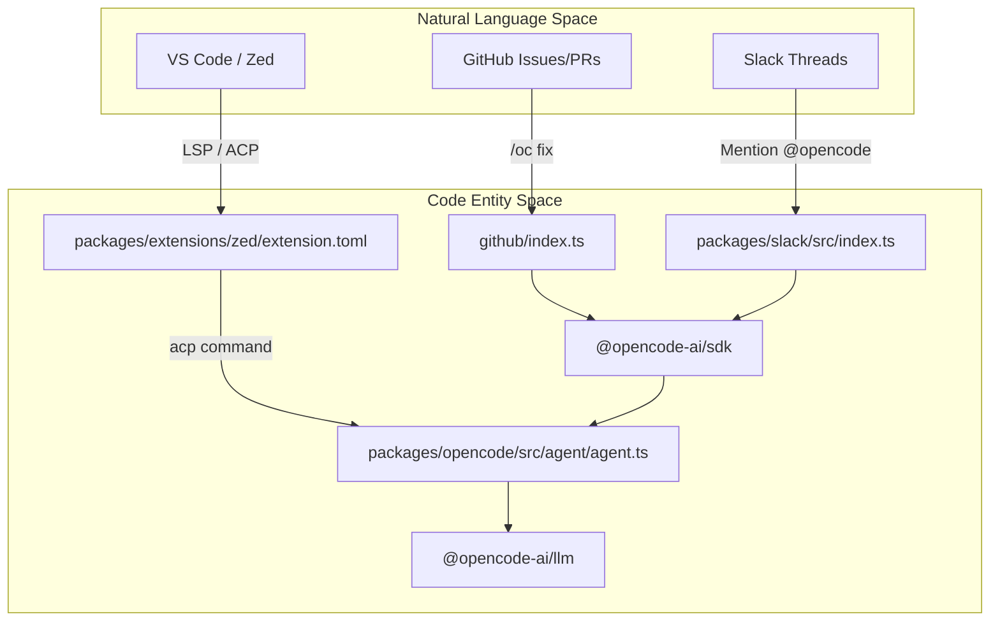
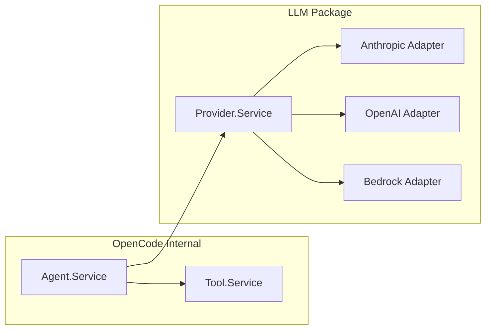

<!-- source: DeepWiki mcp.deepwiki.com · repo browser-use/browsercode · page 7 Integrations and Extensions · fetched 2026-10-30 -->

# Integrations and Extensions

Relevant source files

The following files were used as context for generating this wiki page:

- [github/README.md](github/README.md)
- [github/action.yml](github/action.yml)
- [github/index.ts](github/index.ts)
- [packages/extensions/zed/extension.toml](packages/extensions/zed/extension.toml)
- [packages/opencode/src/cli/cmd/github.ts](packages/opencode/src/cli/cmd/github.ts)
- [packages/opencode/test/cli/github-action.test.ts](packages/opencode/test/cli/github-action.test.ts)
- [packages/slack/package.json](packages/slack/package.json)
- [packages/web/src/content/docs/commands.mdx](packages/web/src/content/docs/commands.mdx)
- [packages/web/src/content/docs/github.mdx](packages/web/src/content/docs/github.mdx)
- [packages/web/src/content/docs/gitlab.mdx](packages/web/src/content/docs/gitlab.mdx)
- [packages/web/src/content/docs/mcp-servers.mdx](packages/web/src/content/docs/mcp-servers.mdx)

OpenCode is designed to exist where developers work, extending beyond a standalone CLI into CI/CD pipelines, IDEs, and communication platforms. This section provides an overview of the external integrations available in the monorepo, ranging from automated GitHub Actions to real-time Slack bots and dedicated IDE extensions.

### Integration Landscape

The following diagram illustrates how external interfaces connect to the OpenCode core engine and the `Agent.Service`.

**System Integration Flow**

Sources: [github/index.ts:9-10](), [packages/slack/package.json:11-12](), [packages/extensions/zed/extension.toml:13-16](), [packages/opencode/src/cli/cmd/github.ts:184-189]()

---

## [GitHub Action and CI Integration](#7.1)

The GitHub integration allows OpenCode to act as a project contributor directly within GitHub's infrastructure. It is primarily driven by the `github/` package and the `GithubCommand` within the main CLI.

- **Triggering**: Responds to `/opencode` or `/oc` triggers in `issue_comment` and `pull_request_review_comment` events [packages/opencode/src/cli/cmd/github.ts:145-150]().
- **Capabilities**: Can triage issues, implement features in new branches, and perform line-level code reviews [github/README.md:8-40]().
- **Deployment**: Runs inside GitHub Action runners using a composite action [github/action.yml:41-43]().
- **Setup**: The `opencode github install` command automates GitHub App installation and workflow file creation [packages/opencode/src/cli/cmd/github.ts:191-194]().

For details, see [GitHub Action and CI Integration](#7.1).

## [VS Code and Zed Extensions](#7.2)

OpenCode provides extensions for modern editors to bring agentic capabilities into the local development environment.

- **Zed**: Uses the Agent Client Protocol (ACP) to communicate with the `opencode acp` server [packages/extensions/zed/extension.toml:9-16]().
- **VS Code**: Integrates with the running local server to provide terminal enhancements and file-path sharing.
- **Protocol**: These extensions leverage the `acp` command in the CLI to bridge the editor's UI with the `Agent.Service` [packages/extensions/zed/extension.toml:33-36]().

For details, see [VS Code and Zed Extensions](#7.2).

## [Slack Bot Integration](#7.3)

The Slack integration (`@opencode-ai/slack`) enables team-based interaction with OpenCode agents.

- **Architecture**: Built using the `@slack/bolt` framework [packages/slack/package.json:12]().
- **Session Management**: Maps Slack threads to individual OpenCode sessions via the `@opencode-ai/sdk` [packages/slack/package.json:11]().
- **Interactions**: Supports message handling and real-time tool update streaming back to Slack channels.

For details, see [Slack Bot Integration](#7.3).

## [LLM Package (packages/llm)](#7.4)

The `@opencode-ai/llm` package is a standalone abstraction layer for interacting with various Large Language Model providers.

- **Multi-Provider**: Implements protocols for OpenAI, Anthropic, Bedrock, and Gemini.
- **Tool Runtime**: Provides the foundational logic for tool execution and response parsing used by the core agent.
- **Observability**: Includes an `http-recorder` for capturing test cassettes and managing cache policies.

For details, see [LLM Package (packages/llm)](#7.4).

---

### Summary of Integration Packages

| Package | Purpose | Primary Entrypoint |
| :--- | :--- | :--- |
| `github/` | GitHub Action runner logic | [github/index.ts:1-10]() |
| `packages/slack/` | Slack Bolt application | [packages/slack/src/index.ts]() |
| `packages/extensions/zed/` | Zed editor manifest | [packages/extensions/zed/extension.toml:1-5]() |
| `@opencode-ai/llm` | Provider abstraction layer | `packages/llm/src/` |

**Agent-to-Provider Mapping**

Sources: [packages/opencode/src/cli/cmd/github.ts:28-30](), [packages/opencode/test/cli/github-action.test.ts:2-4]()

---

