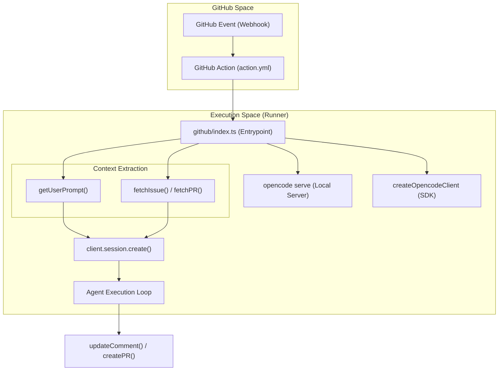
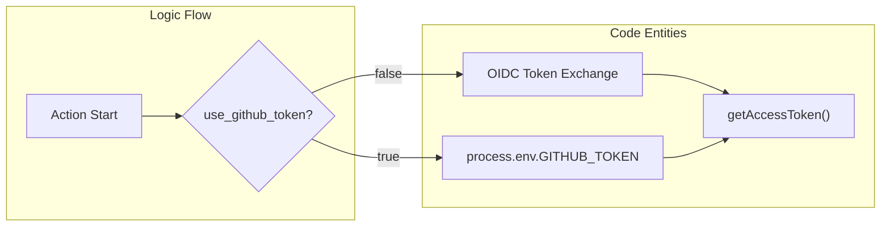

<!-- source: DeepWiki mcp.deepwiki.com · repo browser-use/browsercode · page 7.1 GitHub Action and CI Integration · fetched 2026-10-30 -->

# GitHub Action and CI Integration

Relevant source files

The following files were used as context for generating this wiki page:

- [github/README.md](github/README.md)
- [github/action.yml](github/action.yml)
- [github/index.ts](github/index.ts)
- [packages/opencode/src/cli/cmd/github.ts](packages/opencode/src/cli/cmd/github.ts)
- [packages/opencode/test/cli/github-action.test.ts](packages/opencode/test/cli/github-action.test.ts)
- [packages/web/src/content/docs/commands.mdx](packages/web/src/content/docs/commands.mdx)
- [packages/web/src/content/docs/github.mdx](packages/web/src/content/docs/github.mdx)
- [packages/web/src/content/docs/gitlab.mdx](packages/web/src/content/docs/gitlab.mdx)
- [packages/web/src/content/docs/mcp-servers.mdx](packages/web/src/content/docs/mcp-servers.mdx)

The `github/` package provides deep integration between OpenCode and the GitHub ecosystem. It allows OpenCode to function as an autonomous agent within GitHub Actions, responding to issue comments, reviewing pull requests, and performing automated code changes. This integration bridges the gap between natural language requests in GitHub threads and the OpenCode execution engine.

## Overview and Core Triggers

The integration is primarily driven by the OpenCode GitHub Action, which listens for specific comment triggers (defaulting to `/opencode` or `/oc`) [github/action.yml:30-30](). When triggered, it spins up a local OpenCode server and executes a task based on the context of the GitHub event [github/index.ts:231-242]().

### Trigger Mechanisms
- **Issue Comments**: Triggered by `/oc` or `/opencode` in any issue or PR comment [github/index.ts:244-250]().
- **Line-Level Review**: Triggered by comments on specific code lines in a PR's "Files" tab. OpenCode automatically receives the file path, line numbers, and surrounding diff context [github/index.ts:252-277]().
- **Automated Triggers**: Can be configured for `schedule` (cron) or `workflow_dispatch` (manual) events, requiring a pre-defined `prompt` input [packages/web/src/content/docs/github.mdx:104-115]().

### Data Flow: GitHub Event to OpenCode Task

The following diagram illustrates how a GitHub event is transformed into an OpenCode session.

**GitHub Event Pipeline**

Sources: [github/index.ts:116-210](), [github/action.yml:67-70](), [github/index.ts:231-242]()

---

## The `github` CLI Command

The `opencode github` command is the primary interface for managing the integration from the local terminal. It is implemented in `packages/opencode/src/cli/cmd/github.ts`.

### `opencode github install`
This command automates the setup process [packages/opencode/src/cli/cmd/github.ts:191-240]():
1. **App Installation**: Guides the user to install the OpenCode GitHub App [packages/opencode/src/cli/cmd/github.ts:205-205]().
2. **Provider Configuration**: Prompts for the LLM provider and model to be used in CI [packages/opencode/src/cli/cmd/github.ts:213-214]().
3. **Workflow Generation**: Automatically creates the `.github/workflows/opencode.yml` file [packages/opencode/src/cli/cmd/github.ts:217-217]().
4. **Secret Management**: Informs the user about required secrets (e.g., `ANTHROPIC_API_KEY`) based on the selected provider [packages/opencode/src/cli/cmd/github.ts:222-231]().

### `opencode github run`
This is the internal command executed by the GitHub Action [github/action.yml:70-70](). It performs the following:
- Asserts that the current environment is a valid GitHub Action [github/index.ts:128-130]().
- Authenticates using either the OpenCode App token exchange or a provided `GITHUB_TOKEN` [github/index.ts:132-133]().
- Configures local `git` credentials for the runner [github/index.ts:139-139]().
- Orchestrates the session lifecycle: creating a session, subscribing to events, and pushing results back to GitHub [github/index.ts:145-210]().

Sources: [packages/opencode/src/cli/cmd/github.ts:184-240](), [github/index.ts:1-115]()

---

## Authentication Flow

OpenCode supports two primary authentication modes for GitHub operations:

1. **OpenCode GitHub App (Default)**: Uses OIDC (OpenID Connect) to exchange a GitHub Actions identity token for an installation access token via `api.opencode.ai` [github/action.yml:37-39](). This allows comments and commits to appear as the `opencode-agent[bot]` [packages/opencode/src/cli/cmd/github.ts:141-141]().
2. **Direct `GITHUB_TOKEN`**: If `use_github_token` is set to `true`, the action uses the runner's built-in token [github/action.yml:24-27](). This requires explicit permissions (`contents: write`, `pull-requests: write`, etc.) in the workflow YAML [packages/web/src/content/docs/github.mdx:90-98]().

**Authentication Logic Mapping**

Sources: [github/index.ts:132-133](), [github/action.yml:24-27](), [packages/web/src/content/docs/github.mdx:88-101]()

---

## Issue and PR Handling Logic

The `github/index.ts` entrypoint implements specialized logic for different GitHub contexts:

### Pull Request Handling
- **Local PRs**: Checks out the head branch, applies changes, and pushes directly [github/index.ts:167-177]().
- **Fork PRs**: Detects if the PR comes from a fork and uses `checkoutForkBranch` and `pushToForkBranch` logic to handle cross-repository contributions [github/index.ts:180-189]().
- **Context Injection**: Uses `buildPromptDataForPR` to include PR metadata, file lists, and previous comments in the LLM prompt [github/index.ts:169-170]().

### Issue Handling
- **Branch Creation**: Automatically creates a new branch for the fix [github/index.ts:193-193]().
- **PR Generation**: If changes are made (detected via `branchIsDirty`), it pushes the branch and opens a new Pull Request, linking it to the original issue via "Closes #ID" [github/index.ts:198-206]().

### Response Processing
The integration uses `extractResponseText` to parse the `MessageV2.Part[]` stream [packages/opencode/src/cli/cmd/github.ts:162-170]().
- If a text part exists, it is used as the GitHub comment [packages/opencode/src/cli/cmd/github.ts:163-164]().
- If only tool calls or reasoning occurred, it signals that a summary is needed [packages/opencode/src/cli/cmd/github.ts:167-167]().
- It handles `PROMPT_TOO_LARGE` errors by formatting a detailed message showing file sizes in KB [packages/opencode/src/cli/cmd/github.ts:176-182]().

Sources: [github/index.ts:160-210](), [packages/opencode/src/cli/cmd/github.ts:162-182](), [packages/opencode/test/cli/github-action.test.ts:83-162]()

---

## Summary of Configuration Inputs

The GitHub Action accepts several inputs defined in `action.yml`:

| Input | Description | Implementation Pointer |
| :--- | :--- | :--- |
| `model` | The LLM to use (e.g., `anthropic/claude-3-5-sonnet`) | `MODEL` env in [github/action.yml:72]() |
| `agent` | Primary agent (defaults to `build`) | `AGENT` env in [github/action.yml:73]() |
| `share` | Toggle session sharing (public URLs) | `SHARE` env in [github/action.yml:74]() |
| `prompt` | Override default instruction extraction | `PROMPT` env in [github/action.yml:75]() |
| `mentions` | Custom trigger phrases (CSV) | `MENTIONS` env in [github/action.yml:77]() |
| `variant` | Model reasoning effort (high/max/minimal) | `VARIANT` env in [github/action.yml:78]() |

Sources: [github/action.yml:7-40](), [github/action.yml:71-79]()

---

