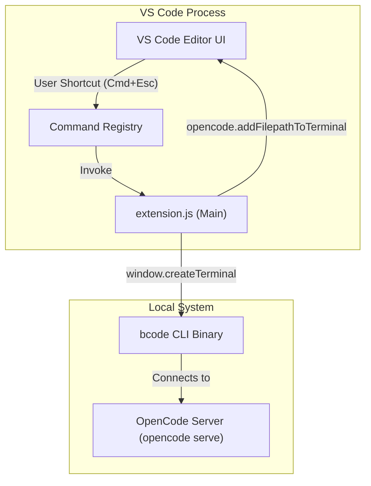
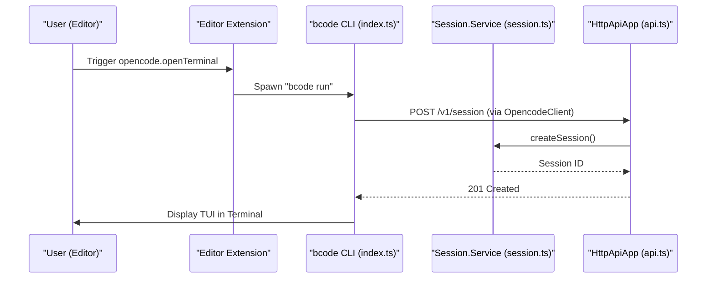

<!-- source: DeepWiki mcp.deepwiki.com · repo browser-use/browsercode · page 7.2 VS Code and Zed Extensions · fetched 2026-10-30 -->

# VS Code and Zed Extensions

Relevant source files

The following files were used as context for generating this wiki page:

- [bun.lock](bun.lock)
- [packages/console/app/package.json](packages/console/app/package.json)
- [packages/console/core/package.json](packages/console/core/package.json)
- [packages/console/function/package.json](packages/console/function/package.json)
- [packages/console/mail/package.json](packages/console/mail/package.json)
- [packages/desktop/package.json](packages/desktop/package.json)
- [packages/extensions/zed/extension.toml](packages/extensions/zed/extension.toml)
- [packages/function/package.json](packages/function/package.json)
- [packages/opencode/package.json](packages/opencode/package.json)
- [packages/plugin/package.json](packages/plugin/package.json)
- [packages/sdk/js/package.json](packages/sdk/js/package.json)
- [packages/web/package.json](packages/web/package.json)
- [sdks/vscode/package.json](sdks/vscode/package.json)

This page covers the editor integrations for OpenCode, specifically the VS Code and Zed extensions. These extensions act as bridge layers between the user's primary development environment and the running `opencode` server, enabling seamless context sharing, terminal orchestration, and "at-mention" file referencing.

## VS Code Extension

The VS Code extension (publisher: `sst-dev`) provides a deep integration with the VS Code terminal and editor context. It is defined in the `sdks/vscode` directory and is packaged as a standard VS Code extension.

### Commands and Keybindings
The extension contributes several key commands that facilitate interaction with the OpenCode CLI:

| Command | Title | Default Keybinding | Purpose |
| :--- | :--- | :--- | :--- |
| `opencode.openTerminal` | Open opencode | `Cmd+Esc` | Opens or focuses an OpenCode session in the integrated terminal. |
| `opencode.openNewTerminal` | Open opencode in new tab | `Cmd+Shift+Esc` | Spawns a fresh OpenCode session in a new terminal tab. |
| `opencode.addFilepathToTerminal` | Add Filepath to Terminal | `Cmd+Alt+K` | Inserts the current file path into the terminal for at-mentioning. |

Sources: [sdks/vscode/package.json:26-47](), [sdks/vscode/package.json:56-81]()

### Data Flow: VS Code to OpenCode Server
The extension integrates with the running `opencode` server primarily by spawning terminal instances that execute the `bcode` (or `opencode`) binary.

1.  **Terminal Management**: When `opencode.openTerminal` is invoked, the extension checks for existing OpenCode terminals or creates a new one using the VS Code `window.createTerminal` API.
2.  **Context Injection**: The extension can inject the current editor state (active file, selection) into the OpenCode prompt via the "At-Mention" feature.
3.  **Command Execution**: Commands are registered in the `contributes` section of the manifest and mapped to internal TypeScript functions in the extension's entry point.

### Integration Diagram: VS Code Bridge
The following diagram illustrates how the VS Code extension interacts with the local `opencode` environment.

**VS Code Extension Architecture**

Sources: [sdks/vscode/package.json:24-24](), [sdks/vscode/package.json:28-46]()

## Zed Extension

The Zed extension is a lightweight integration defined in `packages/extensions/zed/extension.toml`. Unlike the VS Code extension, which uses a full TypeScript execution environment, the Zed extension primarily configures Zed to recognize OpenCode as a tool or language-specific enhancer.

### Configuration
The extension is defined by its manifest, which specifies the extension's metadata and hooks into Zed's extension system.

Sources: [packages/extensions/zed/extension.toml:1-1]()

## Integration with OpenCode Server

Both extensions rely on a running instance of the `opencode` server (often started via `bcode serve`). This server provides the REST and SSE (Server-Sent Events) APIs that allow external tools to monitor session state and trigger actions.

### Shared Infrastructure
*   **CLI Binary**: The extensions trigger the `bcode` binary, which is the main entry point for the `@browser-use/browsercode-core` package.
*   **SDK Usage**: While the VS Code extension is currently focused on terminal orchestration, it is designed to eventually leverage the `@opencode-ai/sdk` to communicate directly with the server's `HttpApiApp`.

### Communication Flow Diagram
This diagram bridges the "Natural Language Space" of user intent to the "Code Entity Space" of the underlying services.

**Command and Event Flow**

Sources: [packages/opencode/package.json:19-21](), [packages/sdk/js/package.json:11-18](), [sdks/vscode/package.json:28-34]()

## Development and Build Pipeline

The VS Code extension uses `esbuild` for rapid compilation and packaging.

### Build Commands
*   **Compile**: `node esbuild.js` — Bundles the TypeScript source into `dist/extension.js`.
*   **Watch**: `node esbuild.js --watch` — Re-bundles on every file change.
*   **Package**: `bun run package` — Prepares the extension for publication to the VS Code Marketplace.

The extension targets VS Code engine version `^1.94.0`.

Sources: [sdks/vscode/package.json:83-94](), [sdks/vscode/package.json:17-19]()

## Technical Specifications

### VS Code Manifest Summary
| Field | Value |
| :--- | :--- |
| **Name** | `opencode` |
| **Publisher** | `sst-dev` |
| **Main Entry** | `./dist/extension.js` |
| **Activation** | On command invocation (Lazy-loaded) |

Sources: [sdks/vscode/package.json:2-6](), [sdks/vscode/package.json:23-24]()

### Dependencies
The VS Code extension maintains minimal dependencies to ensure compatibility:
*   `@types/vscode`: Provides API definitions for VS Code integration.
*   `esbuild`: Used as the primary bundler.
*   `eslint`: For code quality enforcement in the `src` directory.

Sources: [sdks/vscode/package.json:96-107]()

---

