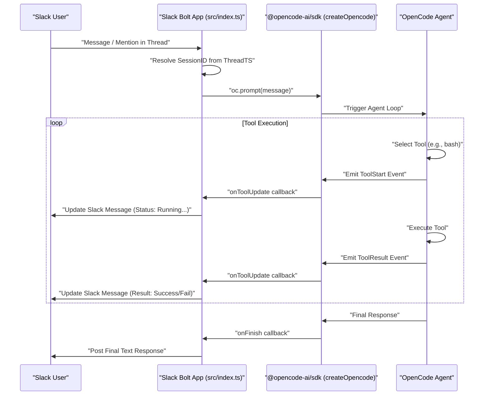

<!-- source: DeepWiki mcp.deepwiki.com · repo browser-use/browsercode · page 7.3 Slack Bot Integration · fetched 2026-10-30 -->

# Slack Bot Integration

Relevant source files

The following files were used as context for generating this wiki page:

- [packages/slack/package.json](packages/slack/package.json)

The Slack Bot integration, located in `packages/slack`, provides a bridge between Slack workspaces and the OpenCode agent runtime. It allows users to interact with OpenCode agents directly through Slack channels and threads, leveraging the `@slack/bolt` framework for message handling and the `@opencode-ai/sdk` for agent orchestration.

## Overview and Purpose

The Slack integration is designed to facilitate collaborative coding and automation within Slack. It implements a session-per-thread model, ensuring that conversations and tool executions are isolated and contextually relevant to specific Slack discussions.

**Key capabilities include:**
*   **Natural Language Interaction:** Processing user messages as prompts for the OpenCode agent.
*   **Threaded Session Management:** Automatically mapping Slack threads to unique OpenCode sessions.
*   **Real-time Tool Updates:** Streaming tool execution progress (e.g., shell commands, file edits) back to Slack as message updates.
*   **SDK-Driven Execution:** Utilizing the `createOpencode` pattern from the SDK to manage the underlying agent lifecycle.

| Component | Code Entity | Role |
| :--- | :--- | :--- |
| **App Entrypoint** | `src/index.ts` | Initializes the Bolt `App` and configures event listeners. |
| **SDK Integration** | `createOpencode` | Factory from `@opencode-ai/sdk` used to spawn and manage agent instances. |
| **Slack Framework** | `@slack/bolt` | Handles the Slack Events API, OAuth, and message delivery. |

Sources: [packages/slack/package.json:1-20](), [packages/slack/src/index.ts:1-10]()

## Architecture and Data Flow

The Slack bot operates as a middleware between the Slack API and the OpenCode SDK. When a user mentions the bot or sends a message in a monitored channel, the Bolt app triggers a handler that either creates a new OpenCode session or attaches to an existing one associated with that Slack thread.

### Logic Flow: Message to Tool Execution

The following diagram illustrates how a natural language request in Slack is transformed into code execution and reported back.

**Slack to OpenCode Execution Flow**

Sources: [packages/slack/src/index.ts:1-50](), [packages/slack/package.json:10-13]()

## Session Management

The integration maintains state by mapping Slack's `thread_ts` (thread timestamp) to OpenCode `session_id`s. This ensures that the agent retains the history of the conversation within a specific Slack thread.

*   **Thread Isolation:** Each thread is treated as a distinct workspace.
*   **Context Persistence:** Messages sent within the same thread are appended to the same OpenCode session, allowing the agent to "remember" previous tool outputs and user instructions.
*   **Concurrent Sessions:** The bot can handle multiple sessions across different channels and threads simultaneously by leveraging the stateless nature of the Bolt event handlers and the session-tracking capabilities of the OpenCode server.

## Tool Update Streaming

One of the core features of the Slack integration is the streaming of tool updates. Rather than waiting for the agent to finish its entire task, the bot provides immediate feedback in Slack.

1.  **Message Provisioning:** When a tool (like `bash` or `edit`) starts, the bot posts a placeholder message or updates the existing prompt message with a "thinking" state.
2.  **Incremental Updates:** As the tool progresses (e.g., generating a long shell output), the bot uses the `onToolUpdate` hook from the SDK to modify the Slack message in real-time.
3.  **Finalization:** Once the tool completes, the message is updated with the final output or a summary, and the agent continues its loop until a final natural language response is ready.

## Implementation Details

The implementation relies heavily on the `@opencode-ai/sdk` to abstract the complexities of the agent protocol.

### createOpencode Usage Pattern
The bot utilizes the `createOpencode` function to initialize a client that communicates with the OpenCode server. This client handles:
*   **Authentication:** Managing credentials required to talk to the OpenCode API.
*   **Event Handling:** Subscribing to SSE (Server-Sent Events) from the agent runtime and translating them into Slack-specific actions.
*   **Prompting:** Sending the user's Slack message text into the agent's input stream.

### Configuration
The Slack bot requires standard Slack App credentials:
*   `SLACK_BOT_TOKEN`: The `xoxb-` token for bot permissions.
*   `SLACK_SIGNING_SECRET`: Used to verify that requests originate from Slack.
*   `SLACK_APP_TOKEN`: Required if using Socket Mode for local development or behind firewalls.

Sources: [packages/slack/package.json:1-20](), [packages/slack/src/index.ts:1-20]()

---

