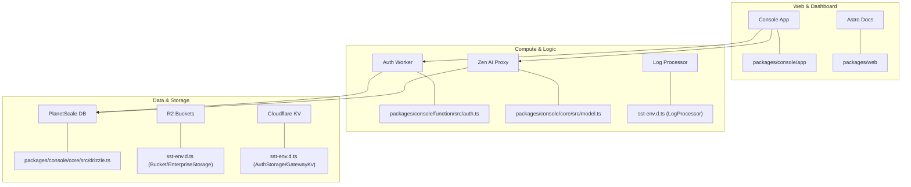
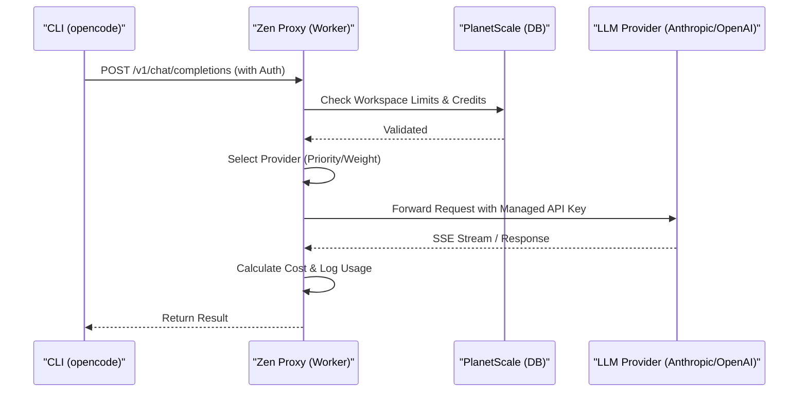

<!-- source: DeepWiki mcp.deepwiki.com · repo browser-use/browsercode · page 8 Console and Cloud Infrastructure · fetched 2026-10-30 -->

# Console and Cloud Infrastructure

Relevant source files

The following files were used as context for generating this wiki page:

- [github/sst-env.d.ts](github/sst-env.d.ts)
- [infra/app.ts](infra/app.ts)
- [infra/console.ts](infra/console.ts)
- [packages/console/app/src/asset/lander/desktop-app-icon.png](packages/console/app/src/asset/lander/desktop-app-icon.png)
- [packages/console/app/src/asset/lander/opencode-desktop-icon.png](packages/console/app/src/asset/lander/opencode-desktop-icon.png)
- [packages/console/app/src/component/header.tsx](packages/console/app/src/component/header.tsx)
- [packages/console/app/src/routes/brand/index.css](packages/console/app/src/routes/brand/index.css)
- [packages/console/app/src/routes/download/index.css](packages/console/app/src/routes/download/index.css)
- [packages/console/app/src/routes/download/index.tsx](packages/console/app/src/routes/download/index.tsx)
- [packages/console/app/src/routes/download/types.ts](packages/console/app/src/routes/download/types.ts)
- [packages/console/app/src/routes/enterprise/index.css](packages/console/app/src/routes/enterprise/index.css)
- [packages/console/app/src/routes/index.css](packages/console/app/src/routes/index.css)
- [packages/console/app/src/routes/index.tsx](packages/console/app/src/routes/index.tsx)
- [packages/console/app/src/routes/temp.tsx](packages/console/app/src/routes/temp.tsx)
- [packages/console/app/src/routes/zen/index.css](packages/console/app/src/routes/zen/index.css)
- [packages/console/app/src/routes/zen/index.tsx](packages/console/app/src/routes/zen/index.tsx)
- [packages/console/app/sst-env.d.ts](packages/console/app/sst-env.d.ts)
- [packages/console/core/script/promote-models.ts](packages/console/core/script/promote-models.ts)
- [packages/console/core/script/pull-models.ts](packages/console/core/script/pull-models.ts)
- [packages/console/core/script/update-models.ts](packages/console/core/script/update-models.ts)
- [packages/console/core/src/model.ts](packages/console/core/src/model.ts)
- [packages/console/core/sst-env.d.ts](packages/console/core/sst-env.d.ts)
- [packages/console/function/sst-env.d.ts](packages/console/function/sst-env.d.ts)
- [packages/console/resource/sst-env.d.ts](packages/console/resource/sst-env.d.ts)
- [packages/enterprise/sst-env.d.ts](packages/enterprise/sst-env.d.ts)
- [packages/function/src/api.ts](packages/function/src/api.ts)
- [packages/function/sst-env.d.ts](packages/function/sst-env.d.ts)
- [packages/opencode/sst-env.d.ts](packages/opencode/sst-env.d.ts)
- [packages/plugin/sst-env.d.ts](packages/plugin/sst-env.d.ts)
- [packages/sdk/js/sst-env.d.ts](packages/sdk/js/sst-env.d.ts)
- [packages/web/astro.config.mjs](packages/web/astro.config.mjs)
- [packages/web/config.mjs](packages/web/config.mjs)
- [packages/web/src/components/Head.astro](packages/web/src/components/Head.astro)
- [packages/web/src/content/docs/acp.mdx](packages/web/src/content/docs/acp.mdx)
- [packages/web/sst-env.d.ts](packages/web/sst-env.d.ts)
- [sdks/vscode/sst-env.d.ts](sdks/vscode/sst-env.d.ts)
- [sst-env.d.ts](sst-env.d.ts)
- [sst.config.ts](sst.config.ts)

The BrowserCode managed cloud infrastructure provides the backend services required for user authentication, billing, managed LLM access (Zen AI), and session sharing. This ecosystem is built on a modern serverless stack using **SST (Ion)**, **Cloudflare Workers**, and **SolidStart**.

## System Overview

The cloud infrastructure is divided into several primary components that interact to provide a seamless managed experience:

1.  **Console Application**: A SolidStart-based web dashboard for managing workspaces, billing, and model access.
2.  **Zen AI Proxy**: A high-performance Cloudflare Worker acting as an OpenAI-compatible gateway to various LLM providers (Anthropic, OpenAI, Google).
3.  **Core Data Layer**: A centralized data management layer using Drizzle ORM and PlanetScale (MySQL).
4.  **SST Infrastructure**: The "Infrastructure as Code" layer that orchestrates Cloudflare resources, secrets, and deployments.

### Infrastructure Map

The following diagram illustrates the relationship between the cloud entities and the underlying code modules.

**Cloud Infrastructure Entity Mapping**

**Sources:** [infra/console.ts:61-66](), [sst-env.d.ts:25-80](), [packages/console/core/src/model.ts:1-10]()

---

## Console Application and Workspace Management
The Console is the central hub for users. It manages **Workspaces**, which are the primary unit of multi-tenancy. Within a workspace, admins can manage members, view usage stats, and configure model availability via `Model.enable` and `Model.disable` functions [packages/console/core/src/model.ts:178-201]().

The application handles complex billing flows via **Stripe** integration, including specialized tiers like "OpenCode Black" and "OpenCode Go" (Zen Lite) [infra/console.ts:140-183]().

For details, see [Console Application and Workspace Management](#8.1).

## Zen AI Proxy and Cloud Functions
Zen AI is a managed proxy that allows users to access high-end models without managing individual API keys. It uses a sophisticated model configuration system stored in `ZEN_MODELS` secrets, which are parsed and validated using Zod [packages/console/core/src/model.ts:10-73]().

The proxy handles:
*   **Provider Failover**: Falling back between providers if one is down [packages/console/core/src/model.ts:31]().
*   **Load Balancing**: Weight-based distribution across multiple API keys [packages/console/core/src/model.ts:40]().
*   **Cost Tracking**: Input/Output token pricing management [packages/console/core/src/model.ts:14-25]().

For details, see [Zen AI Proxy and Cloud Functions](#8.2).

## SST Infrastructure and Deployment
The entire backend is defined using **SST (Ion)**. The `infra/` directory contains the resource definitions for the Cloudflare environment. This includes:
*   **Database**: PlanetScale MySQL cluster linked as a `sst.Linkable` resource [infra/console.ts:34-42]().
*   **Secrets**: Management of sensitive keys like `STRIPE_SECRET_KEY` and `GITHUB_APP_PRIVATE_KEY` [sst-env.d.ts:149-155]().
*   **Routing**: Domain management for `auth.`, `api.`, and the main console [infra/console.ts:62]().

For details, see [SST Infrastructure and Deployment](#8.3).

## Session Sharing and Enterprise
BrowserCode supports public session sharing through a dedicated sync server implemented as a Cloudflare **Durable Object** [packages/function/src/api.ts:15-114](). This allows real-time state synchronization of agent turns and browser snapshots.

The **Enterprise package** extends these capabilities with:
*   **Isolated Storage**: Dedicated R2 buckets for enterprise data [sst-env.d.ts:77-80]().
*   **Custom Deployment**: Support for internal corporate environments.
*   **SSR Rendering**: Server-side rendering of session files for secure sharing.

For details, see [Session Sharing and Enterprise](#8.4).

---

### Data Flow: Managed Model Request
The following diagram shows how a request flows from the CLI through the Zen Proxy to a provider.

**Managed Inference Flow**

**Sources:** [packages/console/core/src/model.ts:126-174](), [packages/function/src/api.ts:150-163]()

---

### Key Code Entities

| Entity | Code Path | Description |
| :--- | :--- | :--- |
| **ZenData** | [packages/console/core/src/model.ts:10]() | Namespace for model/provider schema and validation. |
| **SyncServer** | [packages/function/src/api.ts:15]() | Durable Object handling real-time session sharing. |
| **Database** | [infra/console.ts:34]() | SST Linkable resource for the PlanetScale connection. |
| **ModelTable** | [packages/console/core/src/model.ts:4]() | Drizzle schema for workspace-specific model settings. |
| **AuthApi** | [infra/console.ts:61]() | Cloudflare Worker handling OpenAuth and JWTs. |

**Sources:** [packages/console/core/src/model.ts:1-201](), [packages/function/src/api.ts:1-120](), [infra/console.ts:1-100]()

---

