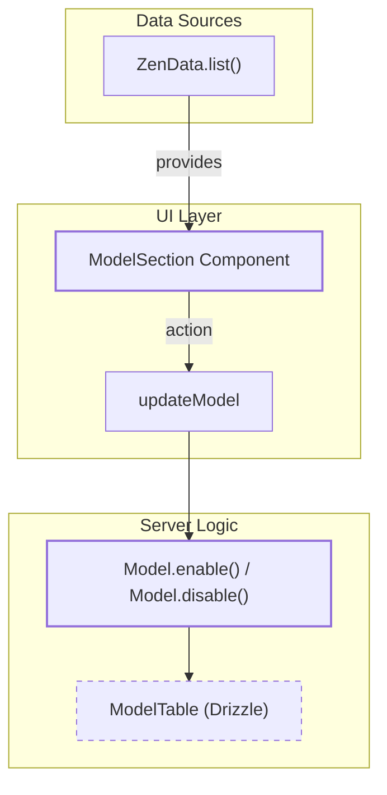
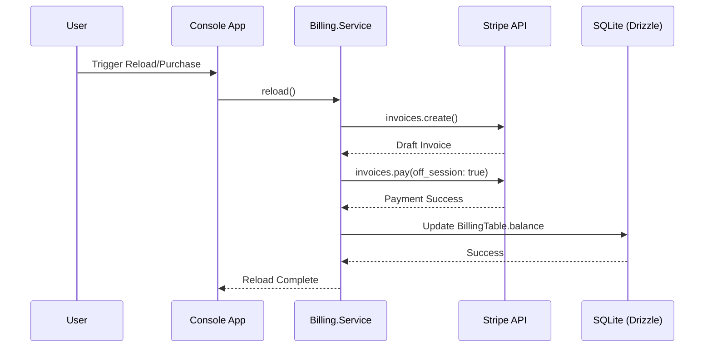

<!-- source: DeepWiki mcp.deepwiki.com · repo browser-use/browsercode · page 8.1 Console Application and Workspace Management · fetched 2026-10-30 -->

# Console Application and Workspace Management

Relevant source files

The following files were used as context for generating this wiki page:

- [packages/console/app/public/favicon.svg](packages/console/app/public/favicon.svg)
- [packages/console/app/public/social-share-black.png](packages/console/app/public/social-share-black.png)
- [packages/console/app/src/asset/black/hero.png](packages/console/app/src/asset/black/hero.png)
- [packages/console/app/src/asset/lander/desktop-app-icon.png](packages/console/app/src/asset/lander/desktop-app-icon.png)
- [packages/console/app/src/asset/lander/opencode-desktop-icon.png](packages/console/app/src/asset/lander/opencode-desktop-icon.png)
- [packages/console/app/src/component/footer.tsx](packages/console/app/src/component/footer.tsx)
- [packages/console/app/src/component/header.tsx](packages/console/app/src/component/header.tsx)
- [packages/console/app/src/component/icon.tsx](packages/console/app/src/component/icon.tsx)
- [packages/console/app/src/component/language-picker.tsx](packages/console/app/src/component/language-picker.tsx)
- [packages/console/app/src/component/spotlight.css](packages/console/app/src/component/spotlight.css)
- [packages/console/app/src/component/spotlight.tsx](packages/console/app/src/component/spotlight.tsx)
- [packages/console/app/src/config.ts](packages/console/app/src/config.ts)
- [packages/console/app/src/context/auth.ts](packages/console/app/src/context/auth.ts)
- [packages/console/app/src/context/language.tsx](packages/console/app/src/context/language.tsx)
- [packages/console/app/src/entry-server.tsx](packages/console/app/src/entry-server.tsx)
- [packages/console/app/src/i18n/ar.ts](packages/console/app/src/i18n/ar.ts)
- [packages/console/app/src/i18n/br.ts](packages/console/app/src/i18n/br.ts)
- [packages/console/app/src/i18n/da.ts](packages/console/app/src/i18n/da.ts)
- [packages/console/app/src/i18n/de.ts](packages/console/app/src/i18n/de.ts)
- [packages/console/app/src/i18n/en.ts](packages/console/app/src/i18n/en.ts)
- [packages/console/app/src/i18n/es.ts](packages/console/app/src/i18n/es.ts)
- [packages/console/app/src/i18n/fr.ts](packages/console/app/src/i18n/fr.ts)
- [packages/console/app/src/i18n/it.ts](packages/console/app/src/i18n/it.ts)
- [packages/console/app/src/i18n/ja.ts](packages/console/app/src/i18n/ja.ts)
- [packages/console/app/src/i18n/ko.ts](packages/console/app/src/i18n/ko.ts)
- [packages/console/app/src/i18n/no.ts](packages/console/app/src/i18n/no.ts)
- [packages/console/app/src/i18n/pl.ts](packages/console/app/src/i18n/pl.ts)
- [packages/console/app/src/i18n/zh.ts](packages/console/app/src/i18n/zh.ts)
- [packages/console/app/src/i18n/zht.ts](packages/console/app/src/i18n/zht.ts)
- [packages/console/app/src/lib/changelog.ts](packages/console/app/src/lib/changelog.ts)
- [packages/console/app/src/lib/github.ts](packages/console/app/src/lib/github.ts)
- [packages/console/app/src/routes/auth/authorize.ts](packages/console/app/src/routes/auth/authorize.ts)
- [packages/console/app/src/routes/black.css](packages/console/app/src/routes/black.css)
- [packages/console/app/src/routes/black.tsx](packages/console/app/src/routes/black.tsx)
- [packages/console/app/src/routes/black/common.tsx](packages/console/app/src/routes/black/common.tsx)
- [packages/console/app/src/routes/black/index.tsx](packages/console/app/src/routes/black/index.tsx)
- [packages/console/app/src/routes/black/subscribe/[plan].tsx](packages/console/app/src/routes/black/subscribe/[plan].tsx)
- [packages/console/app/src/routes/brand/index.css](packages/console/app/src/routes/brand/index.css)
- [packages/console/app/src/routes/changelog.json.ts](packages/console/app/src/routes/changelog.json.ts)
- [packages/console/app/src/routes/changelog/index.css](packages/console/app/src/routes/changelog/index.css)
- [packages/console/app/src/routes/changelog/index.tsx](packages/console/app/src/routes/changelog/index.tsx)
- [packages/console/app/src/routes/download/index.css](packages/console/app/src/routes/download/index.css)
- [packages/console/app/src/routes/download/index.tsx](packages/console/app/src/routes/download/index.tsx)
- [packages/console/app/src/routes/download/types.ts](packages/console/app/src/routes/download/types.ts)
- [packages/console/app/src/routes/enterprise/index.css](packages/console/app/src/routes/enterprise/index.css)
- [packages/console/app/src/routes/go/index.css](packages/console/app/src/routes/go/index.css)
- [packages/console/app/src/routes/go/index.tsx](packages/console/app/src/routes/go/index.tsx)
- [packages/console/app/src/routes/index.css](packages/console/app/src/routes/index.css)
- [packages/console/app/src/routes/index.tsx](packages/console/app/src/routes/index.tsx)
- [packages/console/app/src/routes/stripe/webhook.ts](packages/console/app/src/routes/stripe/webhook.ts)
- [packages/console/app/src/routes/temp.tsx](packages/console/app/src/routes/temp.tsx)
- [packages/console/app/src/routes/workspace-picker.tsx](packages/console/app/src/routes/workspace-picker.tsx)
- [packages/console/app/src/routes/workspace.tsx](packages/console/app/src/routes/workspace.tsx)
- [packages/console/app/src/routes/workspace/[id].css](packages/console/app/src/routes/workspace/[id].css)
- [packages/console/app/src/routes/workspace/[id].tsx](packages/console/app/src/routes/workspace/[id].tsx)
- [packages/console/app/src/routes/workspace/[id]/billing/billing-section.module.css](packages/console/app/src/routes/workspace/[id]/billing/billing-section.module.css)
- [packages/console/app/src/routes/workspace/[id]/billing/billing-section.tsx](packages/console/app/src/routes/workspace/[id]/billing/billing-section.tsx)
- [packages/console/app/src/routes/workspace/[id]/billing/black-section.module.css](packages/console/app/src/routes/workspace/[id]/billing/black-section.module.css)
- [packages/console/app/src/routes/workspace/[id]/billing/black-section.tsx](packages/console/app/src/routes/workspace/[id]/billing/black-section.tsx)
- [packages/console/app/src/routes/workspace/[id]/billing/black-waitlist-section.module.css](packages/console/app/src/routes/workspace/[id]/billing/black-waitlist-section.module.css)
- [packages/console/app/src/routes/workspace/[id]/billing/index.tsx](packages/console/app/src/routes/workspace/[id]/billing/index.tsx)
- [packages/console/app/src/routes/workspace/[id]/billing/monthly-limit-section.module.css](packages/console/app/src/routes/workspace/[id]/billing/monthly-limit-section.module.css)
- [packages/console/app/src/routes/workspace/[id]/billing/monthly-limit-section.tsx](packages/console/app/src/routes/workspace/[id]/billing/monthly-limit-section.tsx)
- [packages/console/app/src/routes/workspace/[id]/billing/payment-section.module.css](packages/console/app/src/routes/workspace/[id]/billing/payment-section.module.css)
- [packages/console/app/src/routes/workspace/[id]/billing/payment-section.tsx](packages/console/app/src/routes/workspace/[id]/billing/payment-section.tsx)
- [packages/console/app/src/routes/workspace/[id]/billing/reload-section.module.css](packages/console/app/src/routes/workspace/[id]/billing/reload-section.module.css)
- [packages/console/app/src/routes/workspace/[id]/billing/reload-section.tsx](packages/console/app/src/routes/workspace/[id]/billing/reload-section.tsx)
- [packages/console/app/src/routes/workspace/[id]/index.tsx](packages/console/app/src/routes/workspace/[id]/index.tsx)
- [packages/console/app/src/routes/workspace/[id]/keys/key-section.module.css](packages/console/app/src/routes/workspace/[id]/keys/key-section.module.css)
- [packages/console/app/src/routes/workspace/[id]/keys/key-section.tsx](packages/console/app/src/routes/workspace/[id]/keys/key-section.tsx)
- [packages/console/app/src/routes/workspace/[id]/model-section.module.css](packages/console/app/src/routes/workspace/[id]/model-section.module.css)
- [packages/console/app/src/routes/workspace/[id]/model-section.tsx](packages/console/app/src/routes/workspace/[id]/model-section.tsx)
- [packages/console/app/src/routes/workspace/[id]/new-user-section.module.css](packages/console/app/src/routes/workspace/[id]/new-user-section.module.css)
- [packages/console/app/src/routes/workspace/[id]/provider-section.module.css](packages/console/app/src/routes/workspace/[id]/provider-section.module.css)
- [packages/console/app/src/routes/workspace/[id]/provider-section.tsx](packages/console/app/src/routes/workspace/[id]/provider-section.tsx)
- [packages/console/app/src/routes/workspace/[id]/settings/settings-section.tsx](packages/console/app/src/routes/workspace/[id]/settings/settings-section.tsx)
- [packages/console/app/src/routes/workspace/common.tsx](packages/console/app/src/routes/workspace/common.tsx)
- [packages/console/app/src/routes/zen/index.css](packages/console/app/src/routes/zen/index.css)
- [packages/console/app/src/routes/zen/index.tsx](packages/console/app/src/routes/zen/index.tsx)
- [packages/console/core/script/black-cancel-waitlist.ts](packages/console/core/script/black-cancel-waitlist.ts)
- [packages/console/core/script/black-transfer.ts](packages/console/core/script/black-transfer.ts)
- [packages/console/core/script/credit-workspace.ts](packages/console/core/script/credit-workspace.ts)
- [packages/console/core/script/lookup-user.ts](packages/console/core/script/lookup-user.ts)
- [packages/console/core/src/account.ts](packages/console/core/src/account.ts)
- [packages/console/core/src/actor.ts](packages/console/core/src/actor.ts)
- [packages/console/core/src/billing.ts](packages/console/core/src/billing.ts)
- [packages/console/core/src/black.ts](packages/console/core/src/black.ts)
- [packages/console/core/src/lite.ts](packages/console/core/src/lite.ts)
- [packages/console/core/src/provider.ts](packages/console/core/src/provider.ts)
- [packages/console/core/src/schema/billing.sql.ts](packages/console/core/src/schema/billing.sql.ts)
- [packages/console/core/src/schema/user.sql.ts](packages/console/core/src/schema/user.sql.ts)
- [packages/console/core/src/schema/workspace.sql.ts](packages/console/core/src/schema/workspace.sql.ts)
- [packages/console/core/src/user.ts](packages/console/core/src/user.ts)
- [packages/console/core/src/workspace.ts](packages/console/core/src/workspace.ts)
- [packages/console/function/src/auth.ts](packages/console/function/src/auth.ts)
- [packages/console/function/tsconfig.json](packages/console/function/tsconfig.json)
- [packages/ui/src/assets/images/social-share-black.png](packages/ui/src/assets/images/social-share-black.png)

The Console Application is a SolidStart-based web interface providing a centralized dashboard for managing workspaces, billing, LLM provider configurations, and user memberships. It serves as the administrative layer for the BrowserCode/OpenCode ecosystem, allowing users to configure managed model access (Zen/Go tiers) and monitor usage across teams.

## Workspace and Dashboard Architecture

The console is structured around the concept of a "Workspace" (`WorkspaceTable`), which acts as the primary container for users, billing accounts, and configurations [packages/console/core/src/schema/workspace.sql.ts:1-12]().

### Navigation and Routing
The application uses SolidStart's file-based routing. Key routes include:
- **Lander**: The root index page [packages/console/app/src/routes/index.tsx:29-45]().
- **Workspace Dashboard**: Managed under `/workspace/[id]`, providing access to model settings and team management [packages/console/app/src/routes/workspace/[id].tsx:1-10]().
- **Go/Zen Tiers**: Dedicated landing and configuration pages for managed model access [packages/console/app/src/routes/go/index.tsx:25-38](), [packages/console/app/src/routes/zen/index.tsx:30-47]().

### Workspace Management Data Flow
Workspaces are managed via the `Workspace` namespace in the core package, which interacts with the database using the Drizzle ORM [packages/console/core/src/workspace.ts:1-20]().

**Workspace Interaction Logic**
"Natural Language Space" to "Code Entity Space" Mapping:
- **Selecting a Workspace**: Handled by `WorkspacePicker` [packages/console/app/src/routes/workspace-picker.tsx:1-20]().
- **Last Seen Workspace**: Persisted via `getLastSeenWorkspaceID` to maintain session context [packages/console/app/src/routes/workspace/common.tsx:14-14]().
- **Creating Workspaces**: Triggered by the `workspace.createNew` i18n key in the UI [packages/console/app/src/i18n/en.ts:52-52]().

Sources: [packages/console/app/src/routes/workspace/[id].tsx](), [packages/console/core/src/workspace.ts](), [packages/console/app/src/routes/workspace/common.tsx]()

## Model and Provider Management

The Console allows users to enable or disable specific models within a workspace. This is primarily managed through the `ModelSection` component.

### Implementation Details
- **Model Discovery**: Models are retrieved from `ZenData.list("full")` [packages/console/app/src/routes/workspace/[id]/model-section.tsx:45-45]().
- **Toggling Models**: The `updateModel` action calls `Model.disable` or `Model.enable` to update workspace-specific overrides [packages/console/app/src/routes/workspace/[id]/model-section.tsx:69-86]().
- **Provider Identification**: The `getModelLab` function maps model IDs (e.g., `claude-*`, `gpt-*`) to their respective providers like Anthropic or OpenAI for UI categorization [packages/console/app/src/routes/workspace/[id]/model-section.tsx:26-39]().

### Model Management Diagram
"Natural Language Space" to "Code Entity Space" Mapping:

Sources: [packages/console/app/src/routes/workspace/[id]/model-section.tsx:26-86](), [packages/console/core/src/schema/model.sql.ts]()

## Billing and Subscription System

The billing system manages credits, subscriptions (Black and Go tiers), and automated reloads using Stripe.

### Key Components
- **Stripe Integration**: The `Billing` namespace initializes the Stripe client using `Resource.STRIPE_SECRET_KEY` [packages/console/core/src/billing.ts:29-33]().
- **Balance Management**: Credits are stored in micro-cents to prevent rounding errors. The `grantCredit` function updates the `BillingTable.balance` [packages/console/core/src/billing.ts:137-156]().
- **Automated Reloads**: When a workspace balance falls below `RELOAD_TRIGGER`, the `reload` function generates a Stripe invoice and attempts an off-session payment [packages/console/core/src/billing.ts:75-135]().
- **Tier Limits**:
    - **Black Tier**: Managed via `SubscriptionTable`, offering higher limits and team seats [packages/console/core/src/schema/billing.sql.ts:50-70]().
    - **Monthly Limits**: Users can set a hard `monthlyLimit` on their spending via `setMonthlyLimit` [packages/console/core/src/billing.ts:189-198]().

### Billing Logic Flow

Sources: [packages/console/core/src/billing.ts:75-210](), [packages/console/core/src/schema/billing.sql.ts]()

## User Authentication and Member Management

Authentication is handled via **OpenAuth**, supporting various providers (Email, GitHub, etc.).

### Authentication Lifecycle
1. **Login**: Users are redirected to the `/auth` route [packages/console/app/src/routes/zen/index.tsx:175-175]().
2. **Session Persistence**: The `getLastSeenWorkspaceID` function is used to verify login status on protected routes [packages/console/app/src/routes/go/index.tsx:20-23]().
3. **Actor Context**: Server-side operations use `withActor` to ensure the request is authenticated for the specific workspace [packages/console/app/src/routes/workspace/[id]/model-section.tsx:43-43]().

### Member Management
Workspace owners can manage members through the `UserTable`. 
- **Roles**: Users are assigned roles (e.g., owner, member) [packages/console/core/script/lookup-user.ts:83-83]().
- **Usage Tracking**: Each user's individual `monthlyUsage` is tracked to enforce limits [packages/console/core/script/lookup-user.ts:128-128]().

Sources: [packages/console/function/src/auth.ts](), [packages/console/core/src/user.ts](), [packages/console/core/script/lookup-user.ts]()

## Changelog and Metadata

The console serves a public changelog to track platform updates.
- **Route**: `/changelog` [packages/console/app/src/routes/changelog/index.tsx]().
- **Data Source**: A static JSON file or API endpoint providing version history [packages/console/app/src/routes/changelog.json.ts]().
- **I18n Support**: All strings, including the changelog navigation, are localized via the `useI18n` hook [packages/console/app/src/i18n/en.ts:4-4]().

Sources: [packages/console/app/src/routes/changelog/index.tsx](), [packages/console/app/src/i18n/en.ts]()

---

