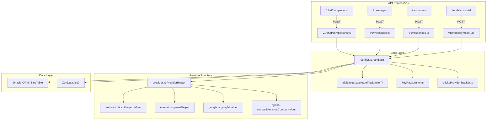
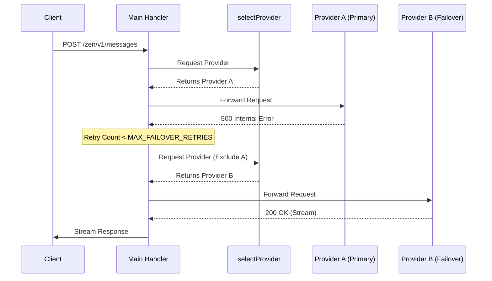

<!-- source: DeepWiki mcp.deepwiki.com · repo browser-use/browsercode · page 8.2 Zen AI Proxy and Cloud Functions · fetched 2026-10-30 -->

# Zen AI Proxy and Cloud Functions

Relevant source files

The following files were used as context for generating this wiki page:

- [packages/console/app/src/routes/workspace/[id]/usage/usage-section.tsx](packages/console/app/src/routes/workspace/[id]/usage/usage-section.tsx)
- [packages/console/app/src/routes/zen/go/v1/chat/completions.ts](packages/console/app/src/routes/zen/go/v1/chat/completions.ts)
- [packages/console/app/src/routes/zen/go/v1/messages.ts](packages/console/app/src/routes/zen/go/v1/messages.ts)
- [packages/console/app/src/routes/zen/go/v1/models.ts](packages/console/app/src/routes/zen/go/v1/models.ts)
- [packages/console/app/src/routes/zen/util/handler.ts](packages/console/app/src/routes/zen/util/handler.ts)
- [packages/console/app/src/routes/zen/util/modelsHandler.ts](packages/console/app/src/routes/zen/util/modelsHandler.ts)
- [packages/console/app/src/routes/zen/util/provider/anthropic.ts](packages/console/app/src/routes/zen/util/provider/anthropic.ts)
- [packages/console/app/src/routes/zen/util/provider/google.ts](packages/console/app/src/routes/zen/util/provider/google.ts)
- [packages/console/app/src/routes/zen/util/provider/openai-compatible.ts](packages/console/app/src/routes/zen/util/provider/openai-compatible.ts)
- [packages/console/app/src/routes/zen/util/provider/openai.ts](packages/console/app/src/routes/zen/util/provider/openai.ts)
- [packages/console/app/src/routes/zen/util/provider/provider.ts](packages/console/app/src/routes/zen/util/provider/provider.ts)
- [packages/console/app/src/routes/zen/util/trialLimiter.ts](packages/console/app/src/routes/zen/util/trialLimiter.ts)
- [packages/console/app/src/routes/zen/util/variant.ts](packages/console/app/src/routes/zen/util/variant.ts)
- [packages/console/app/src/routes/zen/v1/chat/completions.ts](packages/console/app/src/routes/zen/v1/chat/completions.ts)
- [packages/console/app/src/routes/zen/v1/messages.ts](packages/console/app/src/routes/zen/v1/messages.ts)
- [packages/console/app/src/routes/zen/v1/models.ts](packages/console/app/src/routes/zen/v1/models.ts)
- [packages/console/app/src/routes/zen/v1/models/[model].ts](packages/console/app/src/routes/zen/v1/models/[model].ts)
- [packages/console/app/src/routes/zen/v1/responses.ts](packages/console/app/src/routes/zen/v1/responses.ts)
- [packages/console/function/src/log-processor.ts](packages/console/function/src/log-processor.ts)
- [packages/web/src/content/docs/zen.mdx](packages/web/src/content/docs/zen.mdx)

OpenCode Zen is a managed AI gateway and proxy service that provides unified, optimized access to a curated list of LLMs specifically tested for coding tasks. It acts as an OpenAI-compatible API gateway that handles model failover, billing, rate limiting, and provider-specific transformations.

## Architecture Overview

The Zen Proxy is implemented as a set of routes within the Console application, typically deployed as Cloudflare Workers or similar edge functions. It abstracts multiple upstream providers (Anthropic, OpenAI, Google, and various OpenAI-compatible providers) into a single interface.

### Data Flow and Request Lifecycle

The core logic resides in the `handler` function [packages/console/app/src/routes/zen/util/handler.ts:68-78](), which orchestrates the following flow:

1.  **Request Parsing**: Extracts the model, variant, and stream preferences from the incoming request [packages/console/app/src/routes/zen/util/handler.ts:95-108]().
2.  **Validation**: Validates the model against the `ZenData` catalog [packages/console/app/src/routes/zen/util/handler.ts:117-118]().
3.  **Authentication & Billing**: Authenticates the API key and verifies the user's billing status (Subscription, Lite, or Credits) [packages/console/app/src/routes/zen/util/handler.ts:128-129]().
4.  **Limiting**: Applies IP or Key-based rate limits [packages/console/app/src/routes/zen/util/handler.ts:122-125](), trial limits [packages/console/app/src/routes/zen/util/handler.ts:119-121](), and Model TPM/TPS limits [packages/console/app/src/routes/zen/util/handler.ts:131-134]().
5.  **Provider Selection**: Selects the optimal upstream provider based on availability, health, and sticky session tracking [packages/console/app/src/routes/zen/util/handler.ts:137-149]().
6.  **Transformation**: Converts the incoming request format (e.g., OpenAI) to the provider's native format (e.g., Anthropic) using `ProviderHelper` adapters [packages/console/app/src/routes/zen/util/handler.ts:158-167]().
7.  **Execution & Streaming**: Forwards the request to the upstream API and streams the response back to the client, calculating costs in real-time [packages/console/app/src/routes/zen/util/handler.ts:173-210]().

### System Component Mapping

The following diagram maps high-level proxy concepts to specific code entities and files.

**Zen Proxy Component Map**

Sources: [packages/console/app/src/routes/zen/util/handler.ts:68-150](), [packages/console/app/src/routes/zen/v1/chat/completions.ts:5-14](), [packages/console/app/src/routes/zen/v1/messages.ts:5-14](), [packages/console/app/src/routes/zen/util/provider/provider.ts:36-53]().

## Provider Adapters

Zen uses a `ProviderHelper` interface to handle the nuances of different LLM providers. Each adapter is responsible for URL modification, header injection, body transformation, and usage normalization.

| Provider | Adapter | Format | Features |
| :--- | :--- | :--- | :--- |
| **Anthropic** | `anthropicHelper` | `anthropic` | Supports Bedrock ARNs, Databricks, and 1M context beta headers [packages/console/app/src/routes/zen/util/provider/anthropic.ts:19-41](). |
| **OpenAI** | `openaiHelper` | `openai` | Maps OpenAI Responses API items and handles reasoning tokens [packages/console/app/src/routes/zen/util/provider/openai.ts:15-59](). |
| **Google** | `googleHelper` | `google` | Handles Gemini-specific streaming URL patterns (`streamGenerateContent`) [packages/console/app/src/routes/zen/v1/models/[model].ts:12-14](). |
| **Generic** | `oaCompatHelper` | `oa-compat` | Generic adapter for DeepSeek, Qwen, and others; includes cache usage adjustment [packages/console/app/src/routes/zen/util/provider/openai-compatible.ts:26-81](). |

### Usage Normalization
To provide consistent billing, Zen normalizes usage data from various providers into a `UsageInfo` object containing `inputTokens`, `outputTokens`, `reasoningTokens`, and various cache token types [packages/console/app/src/routes/zen/util/provider/provider.ts:27-34]().

Sources: [packages/console/app/src/routes/zen/util/provider/anthropic.ts:178-185](), [packages/console/app/src/routes/zen/util/provider/openai.ts:46-59](), [packages/console/app/src/routes/zen/util/provider/openai-compatible.ts:61-80]().

## Limits and Failover

### Trial Limiter
The `TrialLimiter` manages free access for anonymous or new users based on their IP address. It tracks token usage in the `IpTable` and checks against `Subscription.getFreeLimits().promoTokens` [packages/console/app/src/routes/zen/util/trialLimiter.ts:6-28]().

### Failover Logic
The `handler` implements a retry mechanism for failed upstream requests. It can attempt up to 3 failover retries and 3 rate-limit (429) retries [packages/console/app/src/routes/zen/util/handler.ts:84-85](). When a provider fails, it is added to an `excludeProviders` list for the next attempt [packages/console/app/src/routes/zen/util/handler.ts:136-149]().

**Failover and Retry Flow**

Sources: [packages/console/app/src/routes/zen/util/handler.ts:136-155](), [packages/console/app/src/routes/zen/util/trialLimiter.ts:6-46]().

## Log Processor and Telemetry

Zen uses a Cloudflare Worker `tail` consumer to process logs and export metrics to Honeycomb.

### Log Processor (`log-processor.ts`)
The `log-processor.ts` script listens for worker events and filters for Zen API paths [packages/console/function/src/log-processor.ts:5-22](). It extracts:
*   **Cloudflare Metadata**: Continent, country, city, and latency [packages/console/function/src/log-processor.ts:24-32]().
*   **Custom Metrics**: Parsed from `_metric:` prefixed log lines generated during the request lifecycle [packages/console/function/src/log-processor.ts:39-48]().
*   **LLM Errors**: Specifically identifies `llm.error` events for monitoring upstream reliability [packages/console/function/src/log-processor.ts:44-46]().

The aggregated data is batched and sent to the Honeycomb API [packages/console/function/src/log-processor.ts:52-59]().

Sources: [packages/console/function/src/log-processor.ts:1-64]().

## API Reference

Zen exposes several OpenAI-compatible endpoints:

| Endpoint | Format | Primary File |
| :--- | :--- | :--- |
| `POST /zen/v1/chat/completions` | OpenAI Compatible | [packages/console/app/src/routes/zen/v1/chat/completions.ts]() |
| `POST /zen/v1/messages` | Anthropic | [packages/console/app/src/routes/zen/v1/messages.ts]() |
| `POST /zen/v1/responses` | OpenAI Responses | [packages/console/app/src/routes/zen/v1/responses.ts]() |
| `POST /zen/v1/models/:model` | Google | [packages/console/app/src/routes/zen/v1/models/[model].ts]() |
| `GET /zen/v1/models` | List Models | [packages/console/app/src/routes/zen/v1/models.ts]() |

The `GET /v1/models` endpoint dynamically filters the model list based on the user's workspace permissions and disabled models in the database [packages/console/app/src/routes/zen/v1/models.ts:13-36]().

Sources: [packages/console/app/src/routes/zen/v1/models.ts:13-37](), [packages/web/src/content/docs/zen.mdx:61-106]().

---

