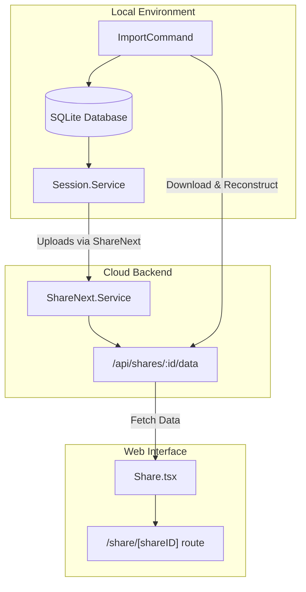
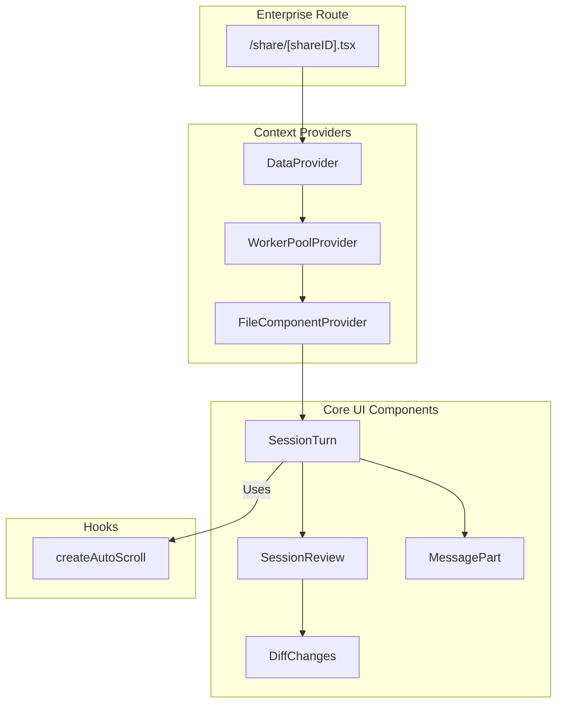

<!-- source: DeepWiki mcp.deepwiki.com · repo browser-use/browsercode · page 8.4 Session Sharing and Enterprise · fetched 2026-10-30 -->

# Session Sharing and Enterprise

Relevant source files

The following files were used as context for generating this wiki page:

- [packages/app/src/pages/directory-layout.tsx](packages/app/src/pages/directory-layout.tsx)
- [packages/enterprise/package.json](packages/enterprise/package.json)
- [packages/enterprise/src/routes/share/[shareID].tsx](packages/enterprise/src/routes/share/[shareID].tsx)
- [packages/opencode/src/account/account.sql.ts](packages/opencode/src/account/account.sql.ts)
- [packages/opencode/src/account/account.ts](packages/opencode/src/account/account.ts)
- [packages/opencode/src/account/repo.ts](packages/opencode/src/account/repo.ts)
- [packages/opencode/src/account/schema.ts](packages/opencode/src/account/schema.ts)
- [packages/opencode/src/account/url.ts](packages/opencode/src/account/url.ts)
- [packages/opencode/src/cli/cmd/account.ts](packages/opencode/src/cli/cmd/account.ts)
- [packages/opencode/src/cli/cmd/import.ts](packages/opencode/src/cli/cmd/import.ts)
- [packages/opencode/src/share/share-next.ts](packages/opencode/src/share/share-next.ts)
- [packages/opencode/src/tool/plan.ts](packages/opencode/src/tool/plan.ts)
- [packages/opencode/src/tool/truncate.ts](packages/opencode/src/tool/truncate.ts)
- [packages/opencode/test/account/repo.test.ts](packages/opencode/test/account/repo.test.ts)
- [packages/opencode/test/account/service.test.ts](packages/opencode/test/account/service.test.ts)
- [packages/opencode/test/cli/account.test.ts](packages/opencode/test/cli/account.test.ts)
- [packages/opencode/test/file/index.test.ts](packages/opencode/test/file/index.test.ts)
- [packages/opencode/test/share/share-next.test.ts](packages/opencode/test/share/share-next.test.ts)
- [packages/opencode/test/tool/truncation.test.ts](packages/opencode/test/tool/truncation.test.ts)
- [packages/ui/src/components/basic-tool.tsx](packages/ui/src/components/basic-tool.tsx)
- [packages/ui/src/components/markdown.css](packages/ui/src/components/markdown.css)
- [packages/ui/src/components/markdown.tsx](packages/ui/src/components/markdown.tsx)
- [packages/ui/src/components/message-part.css](packages/ui/src/components/message-part.css)
- [packages/ui/src/components/message-part.tsx](packages/ui/src/components/message-part.tsx)
- [packages/ui/src/components/session-review.css](packages/ui/src/components/session-review.css)
- [packages/ui/src/components/session-review.tsx](packages/ui/src/components/session-review.tsx)
- [packages/ui/src/components/session-turn.css](packages/ui/src/components/session-turn.css)
- [packages/ui/src/components/session-turn.tsx](packages/ui/src/components/session-turn.tsx)
- [packages/ui/src/components/sticky-accordion-header.css](packages/ui/src/components/sticky-accordion-header.css)
- [packages/ui/src/components/timeline-playground.stories.tsx](packages/ui/src/components/timeline-playground.stories.tsx)
- [packages/ui/src/context/data.tsx](packages/ui/src/context/data.tsx)
- [packages/ui/src/hooks/create-auto-scroll.tsx](packages/ui/src/hooks/create-auto-scroll.tsx)
- [packages/ui/src/pierre/index.ts](packages/ui/src/pierre/index.ts)
- [packages/ui/src/pierre/worker.ts](packages/ui/src/pierre/worker.ts)
- [packages/web/public/robots.txt](packages/web/public/robots.txt)
- [packages/web/src/components/Header.astro](packages/web/src/components/Header.astro)
- [packages/web/src/components/Share.tsx](packages/web/src/components/Share.tsx)
- [packages/web/src/components/icons/custom.tsx](packages/web/src/components/icons/custom.tsx)
- [packages/web/src/components/share.module.css](packages/web/src/components/share.module.css)
- [packages/web/src/components/share/content-bash.module.css](packages/web/src/components/share/content-bash.module.css)
- [packages/web/src/components/share/content-bash.tsx](packages/web/src/components/share/content-bash.tsx)
- [packages/web/src/components/share/content-code.module.css](packages/web/src/components/share/content-code.module.css)
- [packages/web/src/components/share/content-diff.module.css](packages/web/src/components/share/content-diff.module.css)
- [packages/web/src/components/share/content-diff.tsx](packages/web/src/components/share/content-diff.tsx)
- [packages/web/src/components/share/content-error.module.css](packages/web/src/components/share/content-error.module.css)
- [packages/web/src/components/share/content-error.tsx](packages/web/src/components/share/content-error.tsx)
- [packages/web/src/components/share/content-markdown.module.css](packages/web/src/components/share/content-markdown.module.css)
- [packages/web/src/components/share/content-markdown.tsx](packages/web/src/components/share/content-markdown.tsx)
- [packages/web/src/components/share/content-text.module.css](packages/web/src/components/share/content-text.module.css)
- [packages/web/src/components/share/content-text.tsx](packages/web/src/components/share/content-text.tsx)
- [packages/web/src/components/share/copy-button.module.css](packages/web/src/components/share/copy-button.module.css)
- [packages/web/src/components/share/copy-button.tsx](packages/web/src/components/share/copy-button.tsx)
- [packages/web/src/components/share/part.module.css](packages/web/src/components/share/part.module.css)
- [packages/web/src/components/share/part.tsx](packages/web/src/components/share/part.tsx)
- [packages/web/src/pages/s/[id].astro](packages/web/src/pages/s/[id].astro)

This section covers the architecture and implementation of the session sharing mechanism and the specialized enterprise features within the BrowserCode ecosystem. It details the data flow from local CLI sessions to shared web views, the server-side rendering (SSR) of code artifacts, and the enterprise-grade UI components.

## Session Sharing Architecture

Session sharing allows users to export local agent interactions into a web-accessible format. This involves capturing the session state (info, messages, and parts) and synchronizing it with a central repository via the `ShareNext` service.

### Data Flow: Local to Cloud

The sharing process begins in the local environment where the `opencode` CLI or app captures session data.

1.  **Extraction**: The local session data is fetched from the SQLite database using the `Session.Service`.
2.  **Transformation**: Data is flattened into a `ShareData` union containing `session`, `message`, `part`, and `session_diff` types [packages/opencode/src/cli/cmd/import.ts:17-22]().
3.  **Upload**: The `ShareNext.Service` handles the transmission to the cloud backend [packages/opencode/src/share/share-next.ts]().
4.  **Retrieval**: The web interface consumes this data via the `GET /api/shares/:id/data` endpoint [packages/opencode/src/cli/cmd/import.ts:17-17]().

### Share Import and Reconstruction

The `import` command allows users to pull a shared session back into their local environment. The `transformShareData` function reconstructs the nested hierarchy required for local storage from the flat API response [packages/opencode/src/cli/cmd/import.ts:46-76]().

| Entity | Role | File |
| :--- | :--- | :--- |
| `ShareData` | Discriminated union for API exchange | [packages/opencode/src/cli/cmd/import.ts:17-22]() |
| `transformShareData` | Rebuilds `messages` and `parts` hierarchy | [packages/opencode/src/cli/cmd/import.ts:46-76]() |
| `ImportCommand` | CLI entry point for session ingestion | [packages/opencode/src/cli/cmd/import.ts:80-94]() |
| `parseShareUrl` | Extracts slug from shareable links | [packages/opencode/src/cli/cmd/import.ts:25-28]() |

### Share Lifecycle Diagram

"Natural Language Space" to "Code Entity Space" mapping for Session Sharing:

"Session Sharing Lifecycle"

Sources: [packages/opencode/src/cli/cmd/import.ts:17-94](), [packages/enterprise/src/routes/share/[shareID].tsx:58-122](), [packages/web/src/components/Share.tsx:81-175]()

## Enterprise Package (@opencode-ai/enterprise)

The `@opencode-ai/enterprise` package is a SolidStart application designed for high-performance rendering of shared sessions and enterprise-specific dashboards. It utilizes server-side rendering (SSR) and specialized worker pools for heavy computation like diffing.

### SSR and Data Fetching

The enterprise share route (`/share/[shareID]`) uses SolidStart's `query` and `createAsync` to fetch session data on the server [packages/enterprise/src/routes/share/[shareID].tsx:58-134]().

- **`getData`**: A server-side query that fetches session info, messages, parts, and diffs. It throws a `SessionDataMissingError` if the ID is invalid [packages/enterprise/src/routes/share/[shareID].tsx:58-61]().
- **Cache Control**: Sets public cache headers to optimize delivery via CDNs [packages/enterprise/src/routes/share/[shareID].tsx:125-128]().
- **Metadata**: Dynamically generates OpenGraph images using social-card services based on the session title and model IDs [packages/enterprise/src/routes/share/[shareID].tsx:161-183]().

### WorkerPoolProvider

To prevent UI jank during complex diff rendering, the enterprise app uses a `WorkerPoolProvider`. This offloads the `pierre` diffing engine logic to web workers [packages/enterprise/src/routes/share/[shareID].tsx:27-33]().

Sources: [packages/enterprise/src/routes/share/[shareID].tsx:1-134](), [packages/enterprise/package.json:15-30]()

## Web Share Components

The sharing UI is composed of several high-level components shared between the web app and the enterprise package.

### Share.tsx

The main `Share` component manages the real-time connection to a shared session via WebSockets [packages/web/src/components/Share.tsx:41-46]().

- **WebSocket Polling**: Connects to `/share_poll?id=[id]` to receive live updates if the session is still active [packages/web/src/components/Share.tsx:109-111]().
- **State Reconciliation**: Uses Solid's `reconcile` to efficiently update the store with incoming message and part updates [packages/web/src/components/Share.tsx:125-143]().

### SessionReview and Diffing

The `SessionReview` component is the primary interface for inspecting changes made by the agent [packages/ui/src/components/session-review.tsx:164-164]().

- **Unified/Split Diffs**: Supports multiple diff styles via `SessionReviewDiffStyle` [packages/ui/src/components/session-review.tsx:31-31]().
- **Line Comments**: Implements a `createLineCommentController` to allow users to leave feedback on specific code ranges [packages/ui/src/components/session-review.tsx:24-24]().
- **SSR Rendering**: Uses `FileSSR` for initial code display before the client-side diffing engine hydrates [packages/enterprise/src/routes/share/[shareID].tsx:21-21]().

### Auto-Scrolling Logic

The `createAutoScroll` hook manages the "follow-bottom" behavior common in terminal-like interfaces [packages/ui/src/hooks/create-auto-scroll.tsx:13-13]().

- **User Interaction Detection**: Pauses auto-scroll if the user manually scrolls up or selects text [packages/ui/src/hooks/create-auto-scroll.tsx:100-111]().
- **Resize Observation**: Uses `createResizeObserver` to ensure the scroll position stays locked to the bottom as new content (like streaming text) is added [packages/ui/src/hooks/create-auto-scroll.tsx:172-187]().

### Component Hierarchy Diagram

"UI Component Space"

Sources: [packages/enterprise/src/routes/share/[shareID].tsx:1-25](), [packages/ui/src/components/session-turn.tsx:152-169](), [packages/ui/src/components/session-review.tsx:164-183](), [packages/ui/src/hooks/create-auto-scroll.tsx:13-25]()

## Technical Implementation Details

### Session Reification

When a session is shared, it is not just a static snapshot. The `SessionTurn` component handles the logic for rendering complex assistant messages, including:
- **Reasoning Parts**: Hidden or collapsed by default based on `showReasoningSummaries` [packages/ui/src/components/session-turn.tsx:101-114]().
- **Tool Execution**: Renders tool calls and their outputs using the `PART_MAPPING` registry [packages/ui/src/components/message-part.tsx:159-159]().
- **Paced Rendering**: Uses `createPacedValue` to simulate streaming text for a more natural UI experience [packages/ui/src/components/message-part.tsx:180-233]().

### Diff Normalization

The system uses a `normalize` function to transform various diff formats (`SnapshotFileDiff`, `VcsFileDiff`) into a consistent `ViewDiff` structure for the `SessionReview` component [packages/ui/src/components/session-review.tsx:26-26](). This ensures that whether a change comes from a local file snapshot or a git patch, it renders identically in the web share.

Sources: [packages/ui/src/components/session-turn.tsx:101-114](), [packages/ui/src/components/message-part.tsx:180-233](), [packages/ui/src/components/session-review.tsx:26-26]()

---

