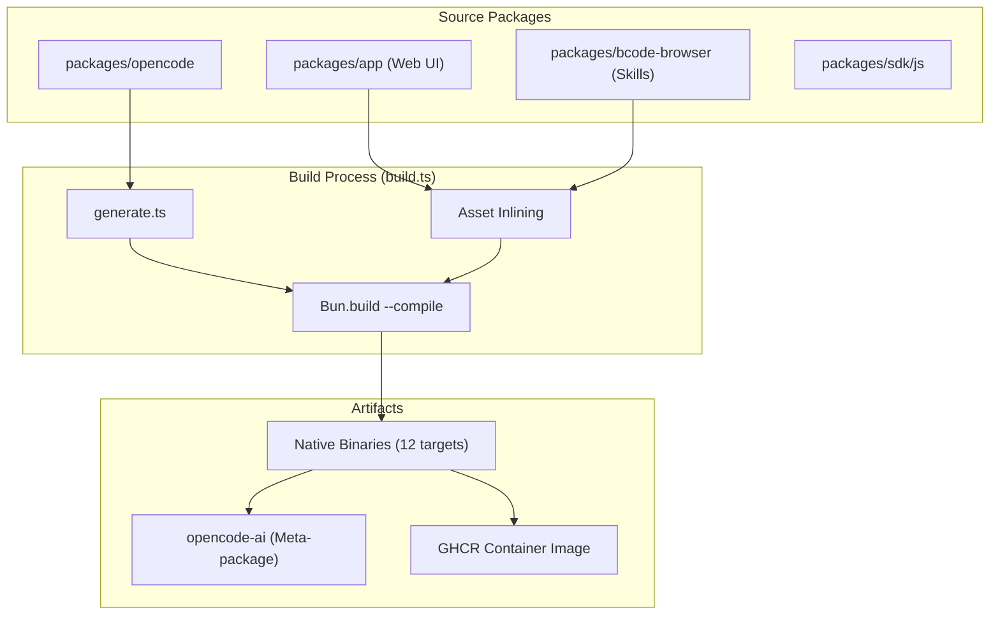
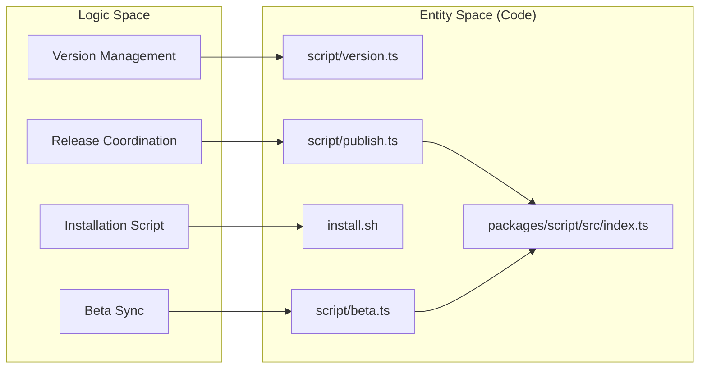

<!-- source: DeepWiki mcp.deepwiki.com · repo browser-use/browsercode · page 9 Build, Release, and Infrastructure · fetched 2026-10-30 -->

# Build, Release, and Infrastructure

Relevant source files

The following files were used as context for generating this wiki page:

- [.github/actions/setup-bun/action.yml](.github/actions/setup-bun/action.yml)
- [.gitignore](.gitignore)
- [.opencode/command/changelog.md](.opencode/command/changelog.md)
- [flake.lock](flake.lock)
- [flake.nix](flake.nix)
- [install](install)
- [nix/desktop.nix](nix/desktop.nix)
- [nix/hashes.json](nix/hashes.json)
- [nix/node_modules.nix](nix/node_modules.nix)
- [nix/opencode.nix](nix/opencode.nix)
- [package.json](package.json)
- [packages/desktop/scripts/predev.ts](packages/desktop/scripts/predev.ts)
- [packages/desktop/scripts/prepare.ts](packages/desktop/scripts/prepare.ts)
- [packages/desktop/scripts/utils.ts](packages/desktop/scripts/utils.ts)
- [packages/opencode/Dockerfile](packages/opencode/Dockerfile)
- [packages/opencode/script/build.ts](packages/opencode/script/build.ts)
- [packages/opencode/script/postinstall.mjs](packages/opencode/script/postinstall.mjs)
- [packages/opencode/script/publish.ts](packages/opencode/script/publish.ts)
- [packages/plugin/script/publish.ts](packages/plugin/script/publish.ts)
- [packages/script/package.json](packages/script/package.json)
- [packages/script/src/index.ts](packages/script/src/index.ts)
- [packages/sdk/js/script/build.ts](packages/sdk/js/script/build.ts)
- [packages/sdk/js/script/publish.ts](packages/sdk/js/script/publish.ts)
- [script/beta.ts](script/beta.ts)
- [script/changelog.ts](script/changelog.ts)
- [script/publish.ts](script/publish.ts)
- [script/raw-changelog.ts](script/raw-changelog.ts)
- [script/version.ts](script/version.ts)

This section provides a technical overview of the systems responsible for compiling, packaging, and distributing BrowserCode (OpenCode). The repository uses a Bun-based monorepo structure with a sophisticated build pipeline that produces cross-platform binaries, Nix packages, and container images.

## Overview of the Release Stack

The BrowserCode release process is managed by a series of TypeScript scripts executed by Bun, coordinated with GitHub Actions for CI/CD. The pipeline handles everything from compiling the core agent to generating LLM-assisted changelogs and synchronizing the `beta` branch.

### Core Build Flow
The primary build logic resides in `packages/opencode/script/build.ts`. It performs the following high-level tasks:
1.  **Migration Loading**: Scans `packages/opencode/migration/` for SQL files and embeds them into the binary as `OPENCODE_MIGRATIONS` [packages/opencode/script/build.ts:21-48]().
2.  **Asset Embedding**: Compiles the SolidJS Web UI from `packages/app` and browser skills from `packages/bcode-browser` into virtual file maps that are baked into the final executable [packages/opencode/script/build.ts:58-83]().
3.  **Cross-Compilation**: Uses `Bun.build` with the `compile` flag to target 12 distinct platform/architecture combinations, including specialized `musl` and `baseline` (non-AVX2) builds [packages/opencode/script/build.ts:85-146]().

### Distribution Strategy
BrowserCode is distributed through multiple channels to ensure accessibility across different environments:

| Channel | Mechanism | Code Reference |
| :--- | :--- | :--- |
| **NPM** | Meta-package `opencode-ai` with platform-specific optional dependencies. | [packages/opencode/script/publish.ts:39-56]() |
| **Homebrew** | Automatic formula generation and PRs to a custom tap. | [packages/opencode/script/publish.ts:130-180]() |
| **AUR** | `PKGBUILD` generation and pushing to Arch User Repository. | [packages/opencode/script/publish.ts:81-108]() |
| **Docker** | Multi-arch images pushed to GHCR. | [packages/opencode/script/publish.ts:64-71]() |
| **Nix** | Flake-based builds for CLI and Desktop. | [flake.nix:1-27]() |

### Build Pipeline Architecture
The following diagram illustrates the relationship between source packages and the final distribution artifacts.

**Figure 1: Build Artifact Lineage**

Sources: [packages/opencode/script/build.ts:15-231](), [packages/opencode/script/publish.ts:34-71]()

---

## Sub-Systems

### 9.1 Build Pipeline and Release Scripts
The release process is driven by `script/publish.ts`, which coordinates version bumps across all `package.json` files in the monorepo [script/publish.ts:13-32](). It handles the "publishing cascade" where the SDK and Plugins are released before the main CLI package [script/publish.ts:46-52](). This section also covers the LLM-assisted changelog generation which uses the agent itself to summarize commits [script/changelog.ts:51-53]().

For details, see [Build Pipeline and Release Scripts](#9.1).

### 9.2 Nix Packaging
BrowserCode provides a first-class Nix experience via `flake.nix`. The packaging logic is split into three stages to optimize for caching: fetching `node_modules`, building the `opencode` CLI, and finally wrapping the `desktop` application. It uses a `hashes.json` file to track content-addressable hashes for dependencies across Linux and Darwin [nix/hashes.json:1-8]().

For details, see [Nix Packaging](#9.2).

### 9.3 CI/CD and Containers
The infrastructure is automated via GitHub Actions, primarily utilizing a custom `setup-bun` action that handles caching and baseline binary requirements for runners [/.github/actions/setup-bun/action.yml:1-30](). Containerization is handled via a multi-stage `Dockerfile` in `packages/opencode` that produces a lightweight execution environment for the server [packages/opencode/Dockerfile]().

For details, see [CI/CD and Containers](#9.3).

---

## Infrastructure Logic Mapping

The following diagram maps infrastructure concepts to the specific script entities that implement them.

**Figure 2: Infrastructure to Code Mapping**

Sources: [script/publish.ts:3-11](), [script/beta.ts:1-6](), [install:1-3]()

### Key Infrastructure Components

| Component | File Path | Role |
| :--- | :--- | :--- |
| **Script Utility** | `packages/script/src/index.ts` | Provides shared metadata like `Script.version`, `Script.channel`, and `Script.team` [packages/script/src/index.ts:60-76](). |
| **Post-Install Shim** | `packages/opencode/script/postinstall.mjs` | Detects the user's platform and downloads the correct native binary during `npm install` [packages/opencode/script/publish.ts:36-47](). |
| **Beta Synchronizer** | `script/beta.ts` | Uses an LLM to auto-resolve merge conflicts when syncing PRs labeled `beta` into the release branch [script/beta.ts:144-189](). |
| **One-Line Installer** | `install` (root) | A bash script that detects OS/Arch, AVX2 support, and `musl` presence to fetch the optimal binary [install:79-168](). |

Sources: [packages/script/src/index.ts:1-78](), [packages/opencode/script/publish.ts:1-63](), [script/beta.ts:1-242](), [install:1-210]()

---

