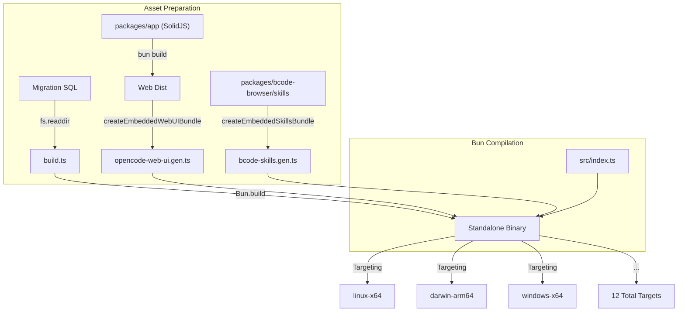
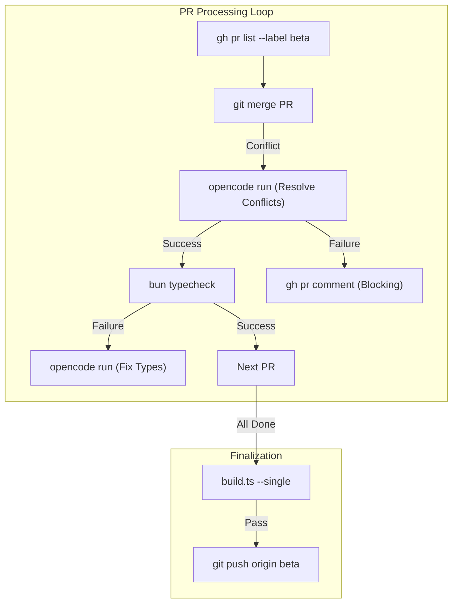

<!-- source: DeepWiki mcp.deepwiki.com · repo browser-use/browsercode · page 9.1 Build Pipeline and Release Scripts · fetched 2026-10-30 -->

# Build Pipeline and Release Scripts

Relevant source files

The following files were used as context for generating this wiki page:

- [.opencode/command/changelog.md](.opencode/command/changelog.md)
- [install.sh](install.sh)
- [package.json](package.json)
- [packages/opencode/BUN_SHELL_MIGRATION_PLAN.md](packages/opencode/BUN_SHELL_MIGRATION_PLAN.md)
- [packages/opencode/script/build.ts](packages/opencode/script/build.ts)
- [packages/opencode/script/postinstall.mjs](packages/opencode/script/postinstall.mjs)
- [packages/opencode/script/publish.ts](packages/opencode/script/publish.ts)
- [packages/opencode/src/cli/cmd/tui/util/editor.ts](packages/opencode/src/cli/cmd/tui/util/editor.ts)
- [packages/opencode/src/cli/cmd/uninstall.ts](packages/opencode/src/cli/cmd/uninstall.ts)
- [packages/opencode/src/cli/cmd/upgrade.ts](packages/opencode/src/cli/cmd/upgrade.ts)
- [packages/opencode/src/cli/upgrade.ts](packages/opencode/src/cli/upgrade.ts)
- [packages/opencode/src/installation/index.ts](packages/opencode/src/installation/index.ts)
- [packages/opencode/src/util/process.ts](packages/opencode/src/util/process.ts)
- [packages/opencode/test/installation/installation.test.ts](packages/opencode/test/installation/installation.test.ts)
- [packages/opencode/test/util/process.test.ts](packages/opencode/test/util/process.test.ts)
- [packages/plugin/script/publish.ts](packages/plugin/script/publish.ts)
- [packages/script/package.json](packages/script/package.json)
- [packages/script/src/index.ts](packages/script/src/index.ts)
- [packages/sdk/js/script/build.ts](packages/sdk/js/script/build.ts)
- [packages/sdk/js/script/publish.ts](packages/sdk/js/script/publish.ts)
- [script/beta.ts](script/beta.ts)
- [script/changelog.ts](script/changelog.ts)
- [script/publish.ts](script/publish.ts)
- [script/raw-changelog.ts](script/raw-changelog.ts)
- [script/version.ts](script/version.ts)

The BrowserCode build pipeline is a sophisticated Bun-based system that manages cross-platform compilation, asset embedding, and a multi-stage publishing cascade. It transforms a TypeScript monorepo into optimized, standalone binaries for 12 distinct platform/architecture targets and handles the distribution of associated SDKs and plugins.

## Compilation Pipeline (`build.ts`)

The primary build logic resides in `packages/opencode/script/build.ts`. It utilizes `Bun.build` to generate single-file executables that bundle the core engine, the web UI, and browser-specific skills.

### Key Build Phases

1.  **Migration Loading**: The script scans the `packages/opencode/migration` directory for SQL files. These are sorted by timestamp and embedded directly into the binary as the `OPENCODE_MIGRATIONS` constant [packages/opencode/script/build.ts:21-49]().
2.  **Web UI Embedding**: It builds the SolidJS SPA in `packages/app` and generates a TypeScript mapping (`opencode-web-ui.gen.ts`) where each static asset is imported as a file reference to be bundled [packages/opencode/script/build.ts:58-82]().
3.  **Browser Skills Embedding**: It calls `createEmbeddedSkillsBundle` to package browser-use automation scripts into the binary [packages/opencode/script/build.ts:18-18](), [packages/opencode/script/build.ts:83-83]().
4.  **Multi-Target Compilation**: The pipeline iterates through 12 targets covering Linux (glibc and musl), Darwin (macOS), and Windows, for both x64 and arm64 architectures [packages/opencode/script/build.ts:85-146]().

### Compilation Flow

**Sources:**
- `packages/opencode/script/build.ts:21-49` (Migration loading)
- `packages/opencode/script/build.ts:58-82` (Web UI embedding)
- `packages/opencode/script/build.ts:85-146` (Target definitions)
- `packages/opencode/script/build.ts:202-235` (Bun.build configuration)

## Publishing Cascade

The release process is managed by `script/publish.ts` at the root, which orchestrates version bumps across the monorepo and triggers package-specific publish scripts.

### 1. Version Synchronization
The script updates `package.json` files across the repository and `extension.toml` for the Zed extension to match the target release version [script/publish.ts:19-33]().

### 2. The Meta-Package Strategy (`opencode-ai`)
BrowserCode uses a "shim" approach for NPM distribution.
- **Platform Packages**: Each binary target is published as an individual package (e.g., `opencode-linux-x64`) [packages/opencode/script/publish.ts:58-60]().
- **Meta Package**: The `@browser-use/opencode-ai` package is a wrapper that lists all platform-specific packages as `optionalDependencies` [packages/opencode/script/publish.ts:39-56]().
- **Post-install Shim**: On installation, `postinstall.mjs` detects the user's OS/Arch, locates the correct binary from `node_modules`, and creates a symlink or copy to the execution path [packages/opencode/script/postinstall.mjs:12-69](), [packages/opencode/script/postinstall.mjs:82-90]().

### 3. SDK Publish Transform
The SDK (`@opencode-ai/sdk`) requires a specific transformation during publishing. The `transformExports` function converts source TypeScript paths in `package.json` to their compiled `.js` and `.d.ts` counterparts in the `dist` folder before calling `npm publish` [packages/sdk/js/script/publish.ts:20-33](), [packages/sdk/js/script/publish.ts:37-44]().

**Sources:**
- `script/publish.ts:1-75` (Main publish orchestrator)
- `packages/opencode/script/publish.ts:39-62` (Meta-package construction)
- `packages/opencode/script/postinstall.mjs:1-103` (Binary shim logic)
- `packages/sdk/js/script/publish.ts:1-46` (SDK export transformation)

## Automated Changelog Generation

BrowserCode utilizes its own agentic capabilities to generate release notes. The `script/changelog.ts` script invokes the `opencode run` command with a specialized `changelog` tool [script/changelog.ts:51-53]().

- **Input**: It takes `--from` and `--to` git references [script/changelog.ts:23-24]().
- **Processing**: It uses an LLM (configured via `--variant`) to analyze commits and generate `UPCOMING_CHANGELOG.md` [script/changelog.ts:8-53]().
- **Integration**: During the release flow, `script/version.ts` calls this script to generate notes that are automatically attached to the GitHub Release via the `gh` CLI [script/version.ts:10-18]().

**Sources:**
- `script/changelog.ts:1-77` (Changelog script implementation)
- `script/version.ts:9-21` (GitHub Release integration)

## Beta Branch Sync (`beta.ts`)

The `script/beta.ts` script automates the maintenance of a `beta` branch by merging all open PRs labeled `beta`. It is unique because it uses the BrowserCode agent (`opencode run`) to resolve merge conflicts.

### Beta Sync Logic

1.  **PR Collection**: Fetches all open PRs with the `beta` label using `gh pr list` [script/beta.ts:220-224]().
2.  **Conflict Resolution**: If a standard `git merge` fails, it constructs a prompt containing the conflict details and instructs the `opencode` agent to resolve them, specifically handling `bun.lock` regeneration and typecheck fixes [script/beta.ts:144-189]().
3.  **Smoke Testing**: After merging, it runs `bun typecheck` and a single-target build check to ensure the beta branch is stable [script/beta.ts:73-101]().
4.  **Feedback**: If a PR cannot be merged even with agentic help, it posts a blocking comment on the PR [script/beta.ts:21-34]().

**Sources:**
- `script/beta.ts:220-240` (PR fetching and checkout)
- `script/beta.ts:144-189` (Agentic conflict resolution)
- `script/beta.ts:191-217` (Final smoke check and fix)
- `script/beta.ts:21-34` (GitHub feedback)

## Upgrade Mechanism

The `UpgradeCommand` [packages/opencode/src/cli/cmd/upgrade.ts:7-74]() provides the user-facing interface for the distribution pipeline.

- **Method Detection**: It uses `Installation.method()` to determine if the user installed via `curl` or a package manager [packages/opencode/src/cli/cmd/upgrade.ts:28-29]().
- **Version Check**: It compares the `InstallationVersion` with the latest tag from the GitHub API [packages/opencode/src/installation/index.ts:140-152]().
- **Execution**: For `curl` installations, it re-downloads the install script from `https://bcode.sh/install` and executes it with the target version [packages/opencode/src/installation/index.ts:107-123]().

**Sources:**
- `packages/opencode/src/cli/cmd/upgrade.ts:7-74` (CLI handler)
- `packages/opencode/src/installation/index.ts:86-174` (Installation Service implementation)
- `packages/opencode/src/installation/index.ts:107-123` (Curl upgrade logic)

---

