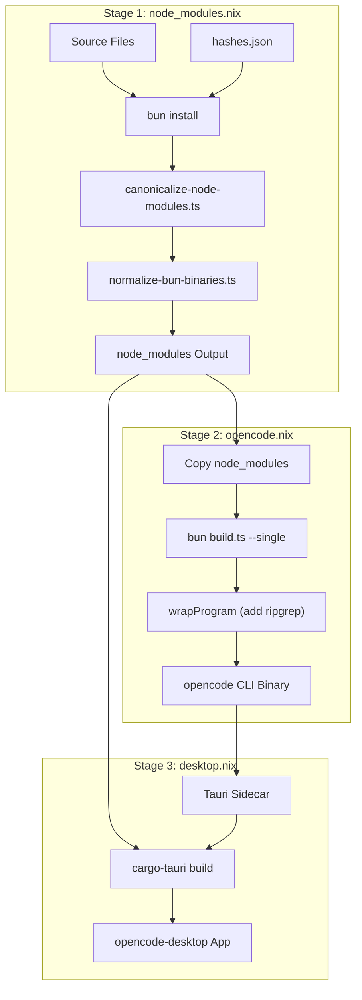
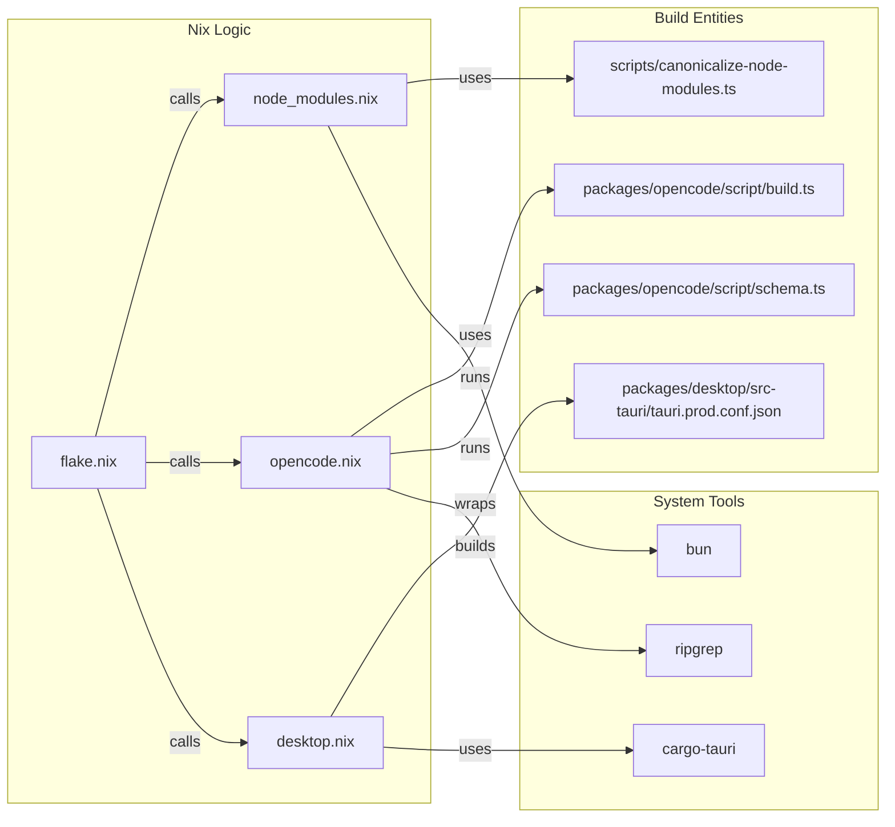

<!-- source: DeepWiki mcp.deepwiki.com · repo browser-use/browsercode · page 9.2 Nix Packaging · fetched 2026-10-30 -->

# Nix Packaging

Relevant source files

The following files were used as context for generating this wiki page:

- [.gitignore](.gitignore)
- [flake.lock](flake.lock)
- [flake.nix](flake.nix)
- [nix/desktop.nix](nix/desktop.nix)
- [nix/hashes.json](nix/hashes.json)
- [nix/node_modules.nix](nix/node_modules.nix)
- [nix/opencode.nix](nix/opencode.nix)

The BrowserCode/OpenCode repository utilizes Nix for reproducible builds, multi-platform packaging, and development environment management. The packaging logic is structured as a three-stage pipeline defined in a Nix flake, transforming raw source code into optimized CLI binaries and desktop applications across Linux and macOS architectures.

## Flake Architecture

The `flake.nix` file serves as the entry point for the Nix configuration. It defines supported systems, development shells, and the package hierarchy.

### Supported Systems
The packaging supports the following platforms:
- `x86_64-linux`
- `aarch64-linux`
- `aarch64-darwin`
- `x86_64-darwin`
[flake.nix:11-16]()

### Flake Outputs
The flake provides several key outputs:
- **`packages.default`**: Points to the `opencode` CLI package [flake.nix:67]().
- **`packages.opencode`**: The standalone CLI binary [flake.nix:68]().
- **`packages.desktop`**: The Tauri-based desktop application [flake.nix:68]().
- **`packages.node_modules_updater`**: A utility derivation used to recalculate fixed-output hashes for dependency updates [flake.nix:70-72]().
- **`devShells.default`**: A development environment containing `bun`, `nodejs_20`, `pkg-config`, `openssl`, and `git` [flake.nix:21-31]().

## Build Pipeline

The packaging is implemented as a three-stage derivation chain where each stage depends on the output of the previous one.

### 1. Dependency Stage (`node_modules.nix`)
This is a **fixed-output derivation** that fetches and prepares the Bun workspace dependencies. It uses a recursive hash to ensure reproducibility.

- **Source Filtering**: Uses `lib.fileset` to include only necessary files like `package.json`, `bun.lock`, and relevant package directories to avoid unnecessary rebuilds when unrelated files change [nix/node_modules.nix:25-37]().
- **Multi-Platform Bun**: Detects the host platform to pass correct `--cpu` and `--os` flags to `bun install` [nix/node_modules.nix:18-19, 51-53]().
- **Canonicalization**: Runs two specialized scripts after installation:
    - `canonicalize-node-modules.ts`: Ensures consistent file metadata [nix/node_modules.nix:61]().
    - `normalize-bun-binaries.ts`: Handles platform-specific binary stubs [nix/node_modules.nix:62]().
- **Hashing**: Hashes are stored in `nix/hashes.json` per architecture [nix/node_modules.nix:7-10](), [nix/hashes.json:1-8]().

### 2. CLI Stage (`opencode.nix`)
This stage builds the main `opencode` binary using the `node_modules` from the previous stage.

- **Environment Setup**: Injects `MODELS_DEV_API_JSON` to bundle the model catalog and sets `OPENCODE_DISABLE_MODELS_FETCH=true` for hermetic builds [nix/opencode.nix:40-41]().
- **Compilation**: Executes `bun --bun ./script/build.ts --single` to produce a standalone executable [nix/opencode.nix:49]().
- **Schema Generation**: Runs `script/schema.ts` to generate the JSON schema for configuration [nix/opencode.nix:50]().
- **Wrapping**: Uses `makeBinaryWrapper` to ensure `ripgrep` is available in the binary's `PATH` at runtime [nix/opencode.nix:61-70]().
- **Completions**: Generates Bash and Zsh shell completions by invoking the newly built binary [nix/opencode.nix:75-80]().

### 3. Desktop Stage (`desktop.nix`)
The final stage packages the Tauri desktop application, integrating the CLI as a sidecar.

- **Sidecar Integration**: Copies the `opencode` binary from the CLI stage into the Tauri `sidecars` directory, renaming it to match the Rust target triple (e.g., `opencode-cli-x86_64-unknown-linux-gnu`) [nix/desktop.nix:74-76]().
- **Build Hooks**: Uses `cargo-tauri.hook` and `wrapGAppsHook4` for Linux GUI environment setup [nix/desktop.nix:41, 48]().
- **Linux Post-Fixup**: Renames the binary to `opencode-desktop` and updates the `.desktop` entry to prevent naming conflicts with the CLI on case-insensitive filesystems [nix/desktop.nix:88-91]().

### Data Flow and Dependency Graph

Title: Nix Build Pipeline Data Flow

Sources: [nix/node_modules.nix:48-71](), [nix/opencode.nix:30-73](), [nix/desktop.nix:68-76]()

## Code Entity Mapping

The following diagram maps the Nix packaging concepts to the specific files and build tools used in the process.

Title: Nix Packaging Entity Map

Sources: [flake.nix:33-51](), [nix/node_modules.nix:61](), [nix/opencode.nix:49-50](), [nix/desktop.nix:79-81]()

## Key Implementation Details

### Hash Management
Because Nix requires pre-determined hashes for network-dependent steps, the `node_modules` derivation uses a manual hash verification system. When dependencies change, the `node_modules_updater` (which uses `lib.fakeHash`) is run to trigger a failure that reveals the new hash [flake.nix:69-72](). These hashes are stored in `nix/hashes.json` [nix/hashes.json:1-8]().

### Writable Home Hook
During the build and install check phases, the derivations use `writableTmpDirAsHomeHook` [nix/opencode.nix:27, 84](). This is necessary because Bun and other tools often attempt to write to `$HOME/.cache` or `$HOME/.config`, which is prohibited in the standard Nix build sandbox.

### Cross-Platform Logic
The `node_modules.nix` derivation handles platform detection to ensure Bun fetches the correct native binaries for its internal cache:
| Nix System | Bun CPU | Bun OS |
| :--- | :--- | :--- |
| `x86_64-linux` | `x64` | `linux` |
| `aarch64-linux` | `arm64` | `linux` |
| `x86_64-darwin` | `x64` | `darwin` |
| `aarch64-darwin` | `arm64` | `darwin` |
[nix/node_modules.nix:17-19]()

Sources: [nix/node_modules.nix:17-19](), [nix/opencode.nix:27-84](), [flake.nix:69-72]()

---

