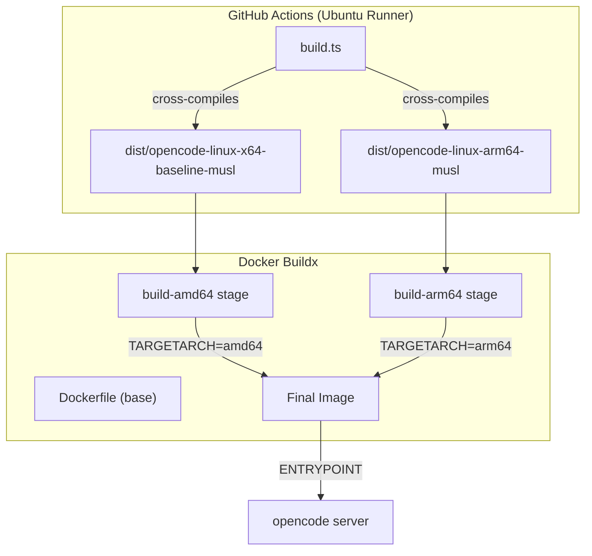
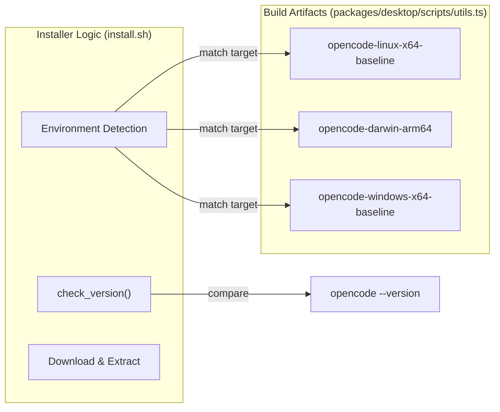

<!-- source: DeepWiki mcp.deepwiki.com · repo browser-use/browsercode · page 9.3 CI/CD and Containers · fetched 2026-10-30 -->

# CI/CD and Containers

Relevant source files

The following files were used as context for generating this wiki page:

- [.github/actions/setup-bun/action.yml](.github/actions/setup-bun/action.yml)
- [.github/workflows/release.yml](.github/workflows/release.yml)
- [install](install)
- [packages/bcode-browser/src/telemetry.ts](packages/bcode-browser/src/telemetry.ts)
- [packages/bcode-laminar/LICENSE](packages/bcode-laminar/LICENSE)
- [packages/bcode-laminar/VENDOR.md](packages/bcode-laminar/VENDOR.md)
- [packages/bcode-laminar/package.json](packages/bcode-laminar/package.json)
- [packages/bcode-laminar/src/attributes.ts](packages/bcode-laminar/src/attributes.ts)
- [packages/bcode-laminar/src/compat.ts](packages/bcode-laminar/src/compat.ts)
- [packages/bcode-laminar/src/exporter.ts](packages/bcode-laminar/src/exporter.ts)
- [packages/bcode-laminar/src/index.ts](packages/bcode-laminar/src/index.ts)
- [packages/bcode-laminar/src/plugin.ts](packages/bcode-laminar/src/plugin.ts)
- [packages/bcode-laminar/src/processor.ts](packages/bcode-laminar/src/processor.ts)
- [packages/desktop/scripts/predev.ts](packages/desktop/scripts/predev.ts)
- [packages/desktop/scripts/prepare.ts](packages/desktop/scripts/prepare.ts)
- [packages/desktop/scripts/utils.ts](packages/desktop/scripts/utils.ts)
- [packages/opencode/Dockerfile](packages/opencode/Dockerfile)

The BrowserCode infrastructure leverages GitHub Actions for automated cross-platform builds, a custom Bun-based release pipeline, and multi-architecture Docker containers for server deployments. The system is designed to produce verifiable, signed binaries for six major platform/architecture combinations and provide a seamless installation experience via a unified shell script.

### Release Workflow and Binary Distribution

The primary release mechanism is defined in `.github/workflows/release.yml`. This workflow triggers on version tags (e.g., `v1.0.0`) and coordinates the cross-compilation of the `opencode` CLI.

#### Build Process Flow
The release workflow reuses the existing `packages/opencode/script/build.ts` logic to target multiple platforms from a single Ubuntu runner [ .github/workflows/release.yml:9-13 ](). It enforces a strict "main-only" release policy, verifying that the tag is reachable from the `main` branch before proceeding [ .github/workflows/release.yml:63-89 ]().

| Step | Code Entity / Tool | Purpose |
| :--- | :--- | :--- |
| **Setup** | `setup-bun` Action | Installs Bun with baseline x64 support and caches dependencies [ .github/actions/setup-bun/action.yml:1-67 ](). |
| **Validation** | `git merge-base` | Ensures release tags are cut from the canonical history [ .github/workflows/release.yml:86-89 ](). |
| **Build** | `build.ts` | Compiles 12+ targets (baseline, musl, arm64) using Bun's cross-compiler [ .github/workflows/release.yml:120 ](). |
| **Publish** | `gh release upload` | Attaches `.tar.gz` and `.zip` archives to the GitHub Release [ .github/workflows/release.yml:14-16 ](). |

#### Supported Targets
The build matrix includes specific targets for different CPU features, notably "baseline" builds for older x86_64 processors that lack AVX2 support [ packages/desktop/scripts/utils.ts:11-42 ]().

**Sources:** [ .github/workflows/release.yml:1-131 ](), [ packages/desktop/scripts/utils.ts:11-42 ]()

---

### CI Infrastructure and Actions

#### Setup-Bun Composite Action
The repository uses a custom composite action at `.github/actions/setup-bun/action.yml` to standardize the environment across all workflows.
*   **Baseline Detection:** It detects if the runner is `X64` and forces the download of the `baseline` Bun binary to ensure compatibility with older instruction sets [ .github/actions/setup-bun/action.yml:11-23 ]().
*   **Caching:** Implements a two-stage cache (restore/save) for Bun dependencies based on the `bun.lock` hash [ .github/actions/setup-bun/action.yml:36-67 ]().
*   **Dependency Workarounds:** Explicitly installs `setuptools` to maintain `distutils` compatibility for certain Python-based node-gyp builds [ .github/actions/setup-bun/action.yml:45-48 ]().

#### Telemetry Injection
During the build process, a default Laminar telemetry key is injected into the binary via Bun's `define` feature [ .github/workflows/release.yml:118 ](). This key is sourced from `BCODE_DEFAULT_LMNR_KEY` and is only active if the user has not set `DO_NOT_TRACK` [ packages/bcode-browser/src/telemetry.ts:34-46 ]().

**Sources:** [ .github/actions/setup-bun/action.yml:1-67 ](), [ packages/bcode-browser/src/telemetry.ts:1-83 ]()

---

### Containerization

BrowserCode provides a Docker-based deployment path for the `opencode` server, optimized for ephemeral environments.

#### Dockerfile Implementation
The `packages/opencode/Dockerfile` uses a multi-stage build to support both `amd64` and `arm64` architectures.
*   **Base Layer:** Uses `alpine` and installs `libgcc`, `libstdc++`, and `ripgrep` [ packages/opencode/Dockerfile:1-7 ]().
*   **Performance Optimization:** Sets `BUN_RUNTIME_TRANSPILER_CACHE_PATH=0` to disable the transpiler cache, as it provides no benefit in ephemeral containers [ packages/opencode/Dockerfile:3-6 ]().
*   **Architecture Selection:** Uses `TARGETARCH` to copy the correct pre-built musl binary (either `x64-baseline-musl` or `arm64-musl`) into `/usr/local/bin/opencode` [ packages/opencode/Dockerfile:9-16 ]().

#### Data Flow: Build to Container

**Sources:** [ packages/opencode/Dockerfile:1-19 ]()

---

### Installation Script (`install.sh`)

The `install` script provides a high-level wrapper for fetching the correct binary for the user's host system.

#### Environment Detection
The script performs granular detection of the host environment to select the most compatible binary:
1.  **OS/Arch:** Maps `uname` outputs to internal target strings (e.g., `aarch64` to `arm64`) [ install:87-110 ]().
2.  **C Library:** Checks for `musl` by inspecting `/etc/alpine-release` or running `ldd --version` [ install:117-128 ]().
3.  **CPU Features:** On x86_64, it checks for `avx2` support via `/proc/cpuinfo` (Linux), `sysctl` (macOS), or a PowerShell snippet (Windows) to decide if a `baseline` build is required [ install:130-158 ]().

#### Entity Mapping: Installer to Codebase
This diagram maps the installer's logic to the release artifacts generated by the build system.

**Sources:** [ install:79-168 ](), [ packages/desktop/scripts/utils.ts:11-42 ]()

---

### Observability and Tracing Integration

The `bcode-laminar` package integrates OpenTelemetry (OTel) into the CI/CD and runtime environment.

#### Span Processing
The `OpenCodeLaminarSpanProcessor` manages the lifecycle of traces during agent execution:
*   **Reparenting:** It intercepts AI-SDK spans and reparents them under the current "turn" span [ packages/bcode-laminar/src/processor.ts:70-89 ]().
*   **Path Stamping:** Adds `lmnr.span.path` and `lmnr.span.ids_path` attributes, which the Laminar UI uses for nesting instead of standard OTel IDs [ packages/bcode-laminar/src/processor.ts:106-130 ]().
*   **Sub-agent Linking:** Tags descendant spans with `lmnr.spawning_subagent.tool_use_id` when they originate from a `task` tool call [ packages/bcode-laminar/src/processor.ts:133-149 ]().

#### Exporter Selection
The `createSpanExporter` function dynamically chooses between the Laminar gRPC exporter and a standard OTLP/HTTP protobuf exporter based on the presence of `OTEL_EXPORTER_OTLP_ENDPOINT` [ packages/bcode-laminar/src/exporter.ts:57-67 ](). This allows BrowserCode to be used with generic OTel collectors like Honeycomb or Jaeger without requiring a Laminar account [ packages/bcode-laminar/VENDOR.md:39-42 ]().

**Sources:** [ packages/bcode-laminar/src/processor.ts:44-165 ](), [ packages/bcode-laminar/src/exporter.ts:14-68 ](), [ packages/bcode-laminar/VENDOR.md:1-62 ]()

---

