# Page: Overview

# Overview

<details>
<summary>Relevant source files</summary>

The following files were used as context for generating this wiki page:

- [.github/ISSUE_TEMPLATE/bug-report.yml](.github/ISSUE_TEMPLATE/bug-report.yml)
- [.github/ISSUE_TEMPLATE/config.yml](.github/ISSUE_TEMPLATE/config.yml)
- [.github/ISSUE_TEMPLATE/feature-request.yml](.github/ISSUE_TEMPLATE/feature-request.yml)
- [.github/ISSUE_TEMPLATE/question.yml](.github/ISSUE_TEMPLATE/question.yml)
- [.opencode/opencode.jsonc](.opencode/opencode.jsonc)
- [.vscode/launch.example.json](.vscode/launch.example.json)
- [.vscode/settings.example.json](.vscode/settings.example.json)
- [AGENTS.md](AGENTS.md)
- [CONTRIBUTING.md](CONTRIBUTING.md)
- [README.md](README.md)
- [STATS.md](STATS.md)
- [bun.lock](bun.lock)
- [packages/console/app/package.json](packages/console/app/package.json)
- [packages/console/core/package.json](packages/console/core/package.json)
- [packages/console/function/package.json](packages/console/function/package.json)
- [packages/console/mail/package.json](packages/console/mail/package.json)
- [packages/desktop/README.md](packages/desktop/README.md)
- [packages/desktop/package.json](packages/desktop/package.json)
- [packages/function/package.json](packages/function/package.json)
- [packages/opencode/package.json](packages/opencode/package.json)
- [packages/opencode/src/cli/cmd/tui/routes/session/permission.tsx](packages/opencode/src/cli/cmd/tui/routes/session/permission.tsx)
- [packages/plugin/package.json](packages/plugin/package.json)
- [packages/sdk/js/package.json](packages/sdk/js/package.json)
- [packages/web/package.json](packages/web/package.json)
- [packages/web/src/components/Lander.astro](packages/web/src/components/Lander.astro)
- [packages/web/src/content/docs/index.mdx](packages/web/src/content/docs/index.mdx)
- [packages/web/src/content/docs/troubleshooting.mdx](packages/web/src/content/docs/troubleshooting.mdx)
- [sdks/vscode/package.json](sdks/vscode/package.json)
- [specs/project.md](specs/project.md)
- [static/browser_harness_by_model_dark.png](static/browser_harness_by_model_dark.png)
- [static/browser_harness_by_model_light.png](static/browser_harness_by_model_light.png)

</details>


BrowserCode (also referred to as OpenCode in its open-source core) is a high-performance, AI-native development environment designed to bridge the gap between Large Language Models (LLMs) and local/cloud execution environments. It provides a suite of tools for agents to browse the web, edit code, execute terminal commands, and interact with complex repository structures.

The system is built as a modular monorepo using [Bun](https://bun.sh) and [Turbo](https://turbo.build), enabling it to run as a CLI, a headless server, a TUI (Terminal User Interface), or a full desktop application.

## Key Capabilities

*   **Autonomous Agent Loop**: A sophisticated agent runtime that handles multi-step planning, tool execution, and context compaction [packages/opencode/package.json:72-91]().
*   **Deep Browser Integration**: Native Chrome DevTools Protocol (CDP) support for direct browser manipulation and "skills" for complex web interactions [packages/bcode-browser/package.json:85-91]().
*   **Multi-Provider LLM Support**: A unified abstraction layer for Anthropic, OpenAI, Bedrock, Vertex AI, and more [packages/opencode/package.json:73-91]().
*   **Extensible Tooling**: Built-in tools for LSP diagnostics, file manipulation, shell execution, and MCP (Model Context Protocol) integration [packages/opencode/package.json:100-113]().
*   **Cross-Platform Interfaces**: Support for Terminal (TUI), Web (SolidJS), and Desktop (Electron) environments [packages/desktop/package.json:1-35]().

## System Architecture

The following diagram illustrates how natural language intents from a user are transformed into concrete code entities and executed through the system's core services.

### From Intent to Execution
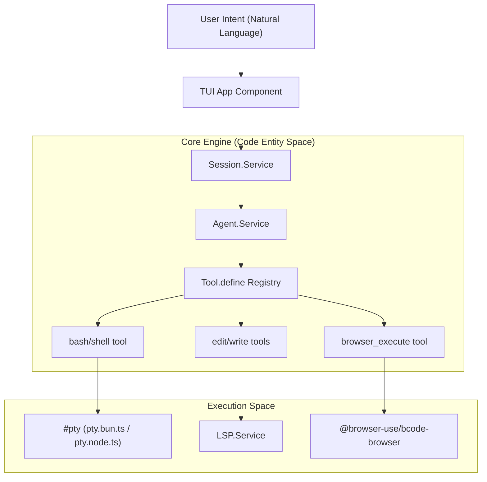
Sources: [packages/opencode/package.json:19-36](), [packages/opencode/package.json:93-100](), [packages/plugin/package.json:11-15]()

## Repository Structure

The project is organized as a Bun monorepo. The core logic resides in `packages/opencode`, while specialized integrations and UI surfaces are split into separate packages to maintain a clean dependency graph.

| Package | Purpose |
| :--- | :--- |
| `packages/opencode` | The core engine, CLI, and agent runtime. |
| `packages/bcode-browser` | Browser automation and CDP integration layer. |
| `packages/sdk` | JS/TS client for interacting with the OpenCode server. |
| `packages/ui` | Shared SolidJS component library for all UI surfaces. |
| `packages/desktop` | Electron-based desktop application wrapper. |
| `packages/app` | SolidJS SPA web interface. |
| `packages/console` | Managed cloud infrastructure and billing dashboard. |

For a detailed breakdown of the directory layout and build pipeline, see [Repository Structure](#1.2).

### Component Relationships
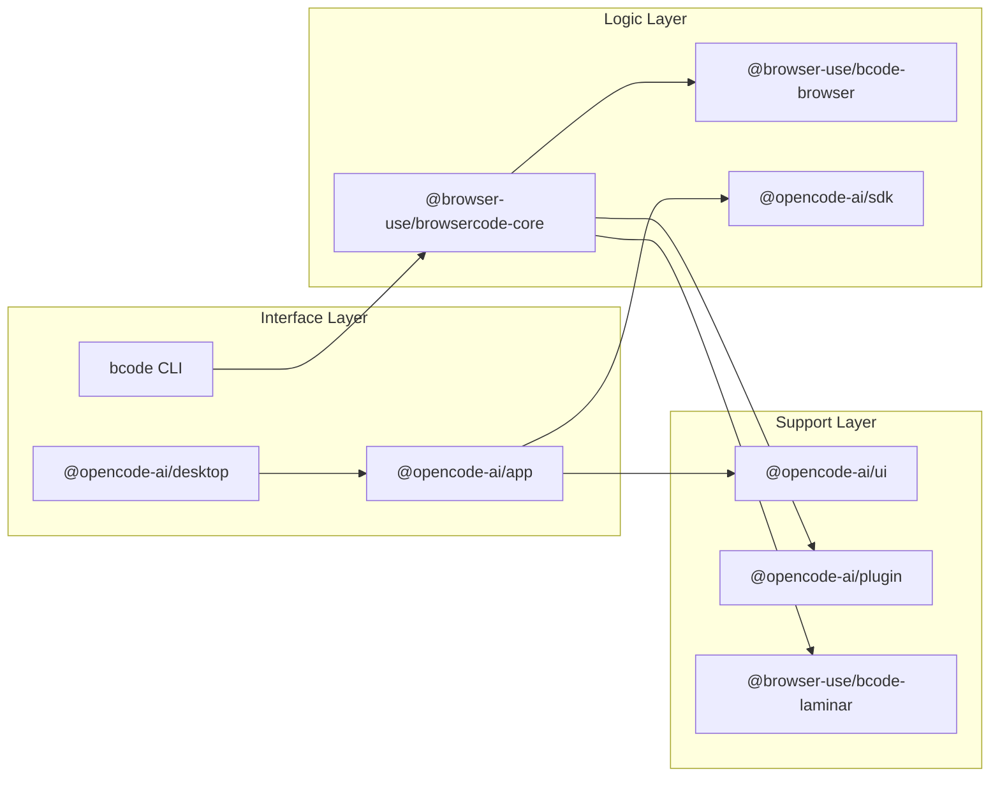
Sources: [bun.lock:1-150](), [packages/opencode/package.json:1-107](), [packages/desktop/package.json:36-45]()

## Navigation Guide

This wiki is structured to guide you from initial setup to deep technical contributions.

*   **[Getting Started](#1.1)**: If you are new to the codebase, start here to set up your environment using the `install.sh` script and connect your first LLM provider.
*   **[Repository Structure](#1.2)**: Understand the monorepo layout, how `turbo.json` manages the build pipeline, and how to run specific packages in development mode.
*   **Core Engine (Section 2)**: Deep dives into the agent runtime, the permission system, and the tool registry within `packages/opencode`.
*   **Browser Integration (Section 3)**: Technical details on the CDP layer and browser skills.
*   **User Interfaces (Section 4)**: Architecture of the TUI, Web, and Desktop applications.
*   **SDK and API (Section 5)**: Documentation for the REST API and the generated TypeScript SDK.
*   **Plugin System (Section 6)**: How to extend the system with custom tools and agents.

Sources: [README.md:1-50](), [packages/opencode/package.json:1-171]()

---

# Page: Getting Started

# Getting Started

<details>
<summary>Relevant source files</summary>

The following files were used as context for generating this wiki page:

- [.github/actions/setup-bun/action.yml](.github/actions/setup-bun/action.yml)
- [README.md](README.md)
- [install](install)
- [install.sh](install.sh)
- [packages/desktop/scripts/predev.ts](packages/desktop/scripts/predev.ts)
- [packages/desktop/scripts/prepare.ts](packages/desktop/scripts/prepare.ts)
- [packages/desktop/scripts/utils.ts](packages/desktop/scripts/utils.ts)
- [packages/opencode/BUN_SHELL_MIGRATION_PLAN.md](packages/opencode/BUN_SHELL_MIGRATION_PLAN.md)
- [packages/opencode/Dockerfile](packages/opencode/Dockerfile)
- [packages/opencode/src/cli/cmd/tui/util/editor.ts](packages/opencode/src/cli/cmd/tui/util/editor.ts)
- [packages/opencode/src/cli/cmd/uninstall.ts](packages/opencode/src/cli/cmd/uninstall.ts)
- [packages/opencode/src/cli/cmd/upgrade.ts](packages/opencode/src/cli/cmd/upgrade.ts)
- [packages/opencode/src/cli/upgrade.ts](packages/opencode/src/cli/upgrade.ts)
- [packages/opencode/src/command/template/initialize.txt](packages/opencode/src/command/template/initialize.txt)
- [packages/opencode/src/installation/index.ts](packages/opencode/src/installation/index.ts)
- [packages/opencode/src/util/process.ts](packages/opencode/src/util/process.ts)
- [packages/opencode/test/installation/installation.test.ts](packages/opencode/test/installation/installation.test.ts)
- [packages/opencode/test/util/process.test.ts](packages/opencode/test/util/process.test.ts)
- [packages/plugin/src/tool.ts](packages/plugin/src/tool.ts)
- [packages/sdk/js/src/gen/client.gen.ts](packages/sdk/js/src/gen/client.gen.ts)
- [packages/sdk/js/src/index.ts](packages/sdk/js/src/index.ts)
- [packages/web/src/components/Lander.astro](packages/web/src/components/Lander.astro)
- [packages/web/src/content/docs/agents.mdx](packages/web/src/content/docs/agents.mdx)
- [packages/web/src/content/docs/cli.mdx](packages/web/src/content/docs/cli.mdx)
- [packages/web/src/content/docs/config.mdx](packages/web/src/content/docs/config.mdx)
- [packages/web/src/content/docs/custom-tools.mdx](packages/web/src/content/docs/custom-tools.mdx)
- [packages/web/src/content/docs/ide.mdx](packages/web/src/content/docs/ide.mdx)
- [packages/web/src/content/docs/index.mdx](packages/web/src/content/docs/index.mdx)
- [packages/web/src/content/docs/keybinds.mdx](packages/web/src/content/docs/keybinds.mdx)
- [packages/web/src/content/docs/models.mdx](packages/web/src/content/docs/models.mdx)
- [packages/web/src/content/docs/permissions.mdx](packages/web/src/content/docs/permissions.mdx)
- [packages/web/src/content/docs/plugins.mdx](packages/web/src/content/docs/plugins.mdx)
- [packages/web/src/content/docs/rules.mdx](packages/web/src/content/docs/rules.mdx)
- [packages/web/src/content/docs/sdk.mdx](packages/web/src/content/docs/sdk.mdx)
- [packages/web/src/content/docs/server.mdx](packages/web/src/content/docs/server.mdx)
- [packages/web/src/content/docs/tools.mdx](packages/web/src/content/docs/tools.mdx)
- [packages/web/src/content/docs/troubleshooting.mdx](packages/web/src/content/docs/troubleshooting.mdx)
- [packages/web/src/content/docs/tui.mdx](packages/web/src/content/docs/tui.mdx)
- [static/browser_harness_by_model_dark.png](static/browser_harness_by_model_dark.png)
- [static/browser_harness_by_model_light.png](static/browser_harness_by_model_light.png)

</details>


This page provides technical details on installing and initializing BrowserCode. It covers the installation infrastructure, first-run workflows, and the mechanisms for connecting LLM providers and browsers.

## Installation Infrastructure

The primary entry point for users is a one-line install script that detects the host environment and fetches the appropriate pre-compiled binary.

### The `install.sh` Script
The installation script (`install.sh`) performs environment detection for OS (Darwin, Linux, Windows), architecture (x64, arm64), and C library (glibc vs musl) [install:79-130](). It also checks for AVX2 support to determine if a "baseline" build is required for older CPUs [install:131-163]().

The script creates a local bin directory at `$HOME/.opencode/bin` [install:68-69]() and downloads the corresponding release archive from GitHub [install:184-204]().

### Automated Upgrades
BrowserCode includes a built-in upgrade mechanism managed by the `Installation.Service`. This service handles version checking and the execution of the upgrade flow.

| Function | Description | File Reference |
| :--- | :--- | :--- |
| `latest()` | Fetches the latest version tag from the GitHub repository API. | [packages/opencode/src/installation/index.ts:140-152]() |
| `method()` | Detects if the current binary was installed via `curl` by checking the `execPath`. | [packages/opencode/src/installation/index.ts:135-139]() |
| `upgrade()` | Downloads the latest `install.sh` and executes it with the target version. | [packages/opencode/src/installation/index.ts:153-169]() |

**Upgrade Flow Diagram**
This diagram illustrates the transition from the `Installation.Service` logic to the physical system execution.

"Installation Logic to System Execution"
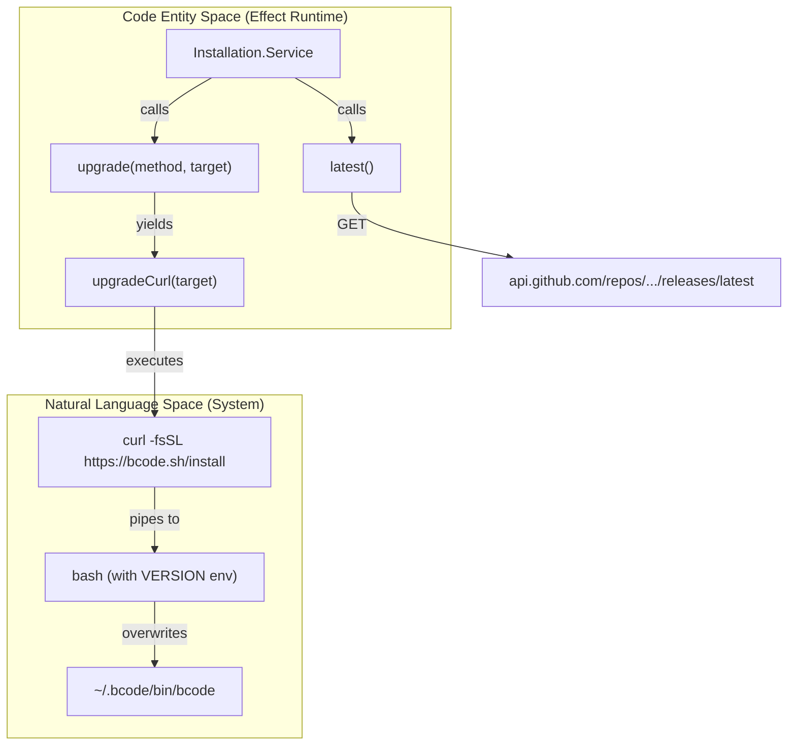
Sources: [packages/opencode/src/installation/index.ts:107-169](), [install:1-30]()

## First-Run Usage

BrowserCode can be operated in two primary modes: an interactive Terminal User Interface (TUI) and a non-interactive headless mode.

### TUI Mode
Invoking the binary without arguments starts the TUI [packages/web/src/content/docs/cli.mdx:8-12]().
- **Command:** `bcode`
- **Key Bindings:** Uses a "Leader" key (default `ctrl+x`) for complex actions like starting a new session (`leader n`) or switching models (`leader m`) [packages/web/src/content/docs/keybinds.mdx:12-176]().
- **Agent Switching:** Use `Tab` to cycle between primary agents (e.g., `Build` and `Plan`) [packages/web/src/content/docs/agents.mdx:24-31]().

### Headless Mode
The `run` command allows for one-off task execution directly from the shell [README.md:29-33]().
- **Command:** `bcode run "task description"`
- **Implementation:** This bypasses the TUI rendering loop and streams agent turns directly to the standard output.

## Connecting an LLM Provider

BrowserCode abstracts LLM communication through a provider system. It supports both environment-variable-based configuration and interactive connection via the TUI.

### Connection Methods
1.  **Environment Variables:** Set keys like `ANTHROPIC_API_KEY` or `OPENAI_API_KEY` in the shell [README.md:45]().
2.  **Interactive Connect:** Run `/connect` within the TUI to open the provider selection dialog [packages/web/src/content/docs/index.mdx:141-145]().
3.  **Managed Proxy (Zen):** BrowserCode can route requests through a managed proxy at `opencode.ai/auth` for simplified billing and access to multiple models [packages/web/src/content/docs/index.mdx:137-141]().

Sources: [README.md:43-51](), [packages/web/src/content/docs/index.mdx:133-158]()

## Connecting a Browser

The core differentiator of BrowserCode is its ability to drive browsers via the Chrome DevTools Protocol (CDP). Unlike standard agents that use high-level wrappers, BrowserCode's `browser_execute` tool runs raw JavaScript in the browser context [README.md:94-102]().

### Connection Modes
The agent selects the connection strategy based on the user's natural language prompt:

| Mode | Prompt Example | Behavior |
| :--- | :--- | :--- |
| **Current Tab** | "Connect to my current tab..." | Attaches to an existing open Chrome instance via CDP port. |
| **New Profile** | "Make a new browser profile..." | Launches a fresh, isolated local browser instance. |
| **Cloud Browser** | "Open a remote browser..." | Connects to Browser Use Cloud via `BROWSER_USE_API_KEY`. |

**Browser Connection Logic**
"Natural Language Intent to Code Entity"
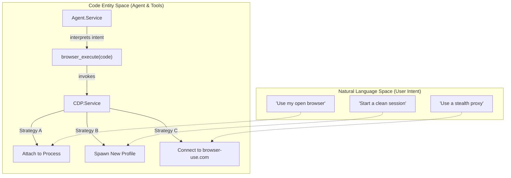
Sources: [README.md:53-81](), [README.md:94-102]()

---

# Page: Repository Structure

# Repository Structure

<details>
<summary>Relevant source files</summary>

The following files were used as context for generating this wiki page:

- [.opencode/command/changelog.md](.opencode/command/changelog.md)
- [bun.lock](bun.lock)
- [package.json](package.json)
- [packages/app/AGENTS.md](packages/app/AGENTS.md)
- [packages/app/src/components/session/index.ts](packages/app/src/components/session/index.ts)
- [packages/app/src/index.css](packages/app/src/index.css)
- [packages/console/app/package.json](packages/console/app/package.json)
- [packages/console/core/package.json](packages/console/core/package.json)
- [packages/console/function/package.json](packages/console/function/package.json)
- [packages/console/mail/package.json](packages/console/mail/package.json)
- [packages/desktop/package.json](packages/desktop/package.json)
- [packages/function/package.json](packages/function/package.json)
- [packages/opencode/AGENTS.md](packages/opencode/AGENTS.md)
- [packages/opencode/package.json](packages/opencode/package.json)
- [packages/opencode/script/build.ts](packages/opencode/script/build.ts)
- [packages/opencode/script/postinstall.mjs](packages/opencode/script/postinstall.mjs)
- [packages/opencode/script/publish.ts](packages/opencode/script/publish.ts)
- [packages/plugin/package.json](packages/plugin/package.json)
- [packages/plugin/script/publish.ts](packages/plugin/script/publish.ts)
- [packages/script/package.json](packages/script/package.json)
- [packages/script/src/index.ts](packages/script/src/index.ts)
- [packages/sdk/js/package.json](packages/sdk/js/package.json)
- [packages/sdk/js/script/build.ts](packages/sdk/js/script/build.ts)
- [packages/sdk/js/script/publish.ts](packages/sdk/js/script/publish.ts)
- [packages/ui/src/components/session-diff.test.ts](packages/ui/src/components/session-diff.test.ts)
- [packages/ui/src/components/session-diff.ts](packages/ui/src/components/session-diff.ts)
- [packages/web/package.json](packages/web/package.json)
- [script/beta.ts](script/beta.ts)
- [script/changelog.ts](script/changelog.ts)
- [script/hooks](script/hooks)
- [script/publish.ts](script/publish.ts)
- [script/raw-changelog.ts](script/raw-changelog.ts)
- [script/release](script/release)
- [script/stats.ts](script/stats.ts)
- [script/version.ts](script/version.ts)
- [sdks/vscode/package.json](sdks/vscode/package.json)
- [turbo.json](turbo.json)

</details>


This page describes the technical architecture and organization of the BrowserCode monorepo. The project is managed as a **Bun monorepo** using **Turborepo** for build orchestration. It encompasses the core agent engine, multiple user interfaces (TUI, Web, Desktop), SDKs, and cloud infrastructure.

## Monorepo Overview

The repository is organized into `packages/`, `sdks/`, and `infra/` directories. It utilizes Bun workspaces to manage internal dependencies and shared code.

### Core Dependency Graph
The following diagram illustrates how major packages relate to one another in the build and dependency hierarchy.

**Package Relationship Diagram**
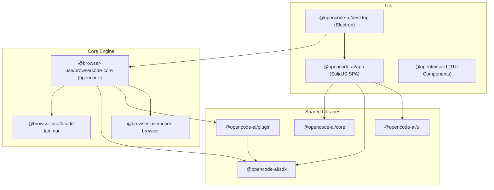
Sources: [bun.lock:4-114](), [packages/opencode/package.json:93-107](), [packages/app/package.json:33-37](), [packages/desktop/package.json:39-40]()

---

## Key Packages

### 1. `@browser-use/browsercode-core` (packages/opencode)
The heart of the system. It contains the CLI entrypoint, the HTTP server, and the agent runtime.
- **Entrypoint:** `src/index.ts` is the main entry for the CLI and server [packages/opencode/package.json:15-15]().
- **Binaries:** Exports the `bcode` binary [packages/opencode/package.json:19-21]().
- **Responsibilities:** Session management, tool execution, LLM provider abstraction, and the Agent Client Protocol (ACP) implementation.

### 2. `@opencode-ai/sdk` (packages/sdk/js)
The TypeScript SDK used for programmatic interaction with the OpenCode server.
- **Exports:** Provides both `v1` and `v2` clients [packages/sdk/js/package.json:11-19]().
- **Generation:** Uses `@hey-api/openapi-ts` to generate types and clients from the OpenAPI spec [packages/sdk/js/package.json:24-24]().

### 3. `@opencode-ai/ui` (packages/ui)
A shared library of SolidJS components used across the Web App, Desktop App, and Console.
- **Key Entities:** Includes complex UI logic like the `Pierre` diffing engine and `SessionTurn` components.

### 4. `@opencode-ai/app` (packages/app)
The main web-based interface built with SolidJS.
- **Technology:** Uses Vite, TailwindCSS, and Kobalte [packages/app/package.json:34-82]().
- **Integration:** This package is embedded into the `opencode` binary during the build process to provide the local web UI [packages/opencode/script/build.ts:13-13]().

### 5. `@browser-use/bcode-browser` (packages/bcode-browser)
Specialized integration for browser-based automation.
- **Functionality:** Implements the CDP (Chrome DevTools Protocol) layer and browser-specific skills [packages/bcode-browser/package.json:85-91]().

### 6. `@opencode-ai/plugin` (packages/plugin)
The framework for extending OpenCode.
- **API:** Provides `tool.ts` and `tui.ts` for plugins to define custom tools and TUI components [packages/plugin/package.json:11-15]().

---

## Build Pipeline (turbo.json)

The project uses `turbo` to handle task execution and caching across the monorepo.

**Code to Build Mapping**
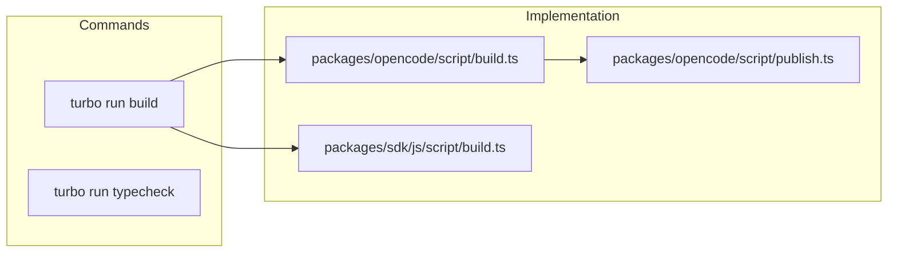

### Key Build Scripts
- **Main Build:** `packages/opencode/script/build.ts` orchestrates the compilation of the CLI, embedding the UI, and preparing cross-platform binaries [packages/opencode/package.json:13-13]().
- **Publishing:** `packages/opencode/script/publish.ts` handles the release cascade to npm and other targets [packages/opencode/script/publish.ts:1-10]().
- **SDK Generation:** `packages/sdk/js/script/build.ts` triggers the OpenAPI client generation [packages/sdk/js/package.json:9-9]().

Sources: [turbo.json:1-27](), [packages/opencode/package.json:8-17](), [packages/sdk/js/package.json:7-10]()

---

## Cloud and Console Infrastructure

The `packages/console/` directory contains the managed cloud offering components.

| Package | Purpose | Technology |
| :--- | :--- | :--- |
| `console-app` | The user dashboard (billing, workspace mgmt) | SolidStart, Cloudflare [packages/console/app/package.json:14-35]() |
| `console-core` | Shared database logic and Drizzle schemas | Drizzle ORM, PlanetScale [packages/console/core/package.json:8-20]() |
| `console-function` | Zen AI Proxy and cloud functions | Cloudflare Workers, AI SDK [packages/console/function/package.json:19-28]() |
| `console-mail` | Email templates for notifications | JSX-Email [packages/console/mail/package.json:4-11]() |

Sources: [packages/console/app/package.json:1-48](), [packages/console/core/package.json:1-53](), [packages/console/function/package.json:1-30]()

---

## External Integrations

Beyond the core monorepo, the repository hosts various extensions in `sdks/` and `packages/github/`.

- **VS Code Extension:** Located in `sdks/vscode/`, it provides commands like `opencode.openTerminal` and `opencode.addFilepathToTerminal` [sdks/vscode/package.json:26-47]().
- **GitHub Integration:** Found in `packages/function/` (specifically for GitHub App auth) and related scripts for CI/CD automation [packages/function/package.json:15-18]().
- **Desktop App:** The `packages/desktop/` package uses Electron to wrap the `@opencode-ai/app` and manage the local `opencode` server as a sidecar [packages/desktop/package.json:25-53]().

Sources: [sdks/vscode/package.json:1-109](), [packages/desktop/package.json:1-77](), [packages/function/package.json:1-21]()

---

# Page: Core Engine (packages/opencode)

# Core Engine (packages/opencode)

<details>
<summary>Relevant source files</summary>

The following files were used as context for generating this wiki page:

- [packages/opencode/src/cli/bootstrap.ts](packages/opencode/src/cli/bootstrap.ts)
- [packages/opencode/src/cli/cmd/acp.ts](packages/opencode/src/cli/cmd/acp.ts)
- [packages/opencode/src/cli/cmd/run.ts](packages/opencode/src/cli/cmd/run.ts)
- [packages/opencode/src/cli/cmd/serve.ts](packages/opencode/src/cli/cmd/serve.ts)
- [packages/opencode/src/cli/cmd/tui/thread.ts](packages/opencode/src/cli/cmd/tui/thread.ts)
- [packages/opencode/src/cli/cmd/tui/worker.ts](packages/opencode/src/cli/cmd/tui/worker.ts)
- [packages/opencode/src/cli/cmd/web.ts](packages/opencode/src/cli/cmd/web.ts)
- [packages/opencode/src/cli/network.ts](packages/opencode/src/cli/network.ts)
- [packages/opencode/src/config/config.ts](packages/opencode/src/config/config.ts)
- [packages/opencode/src/config/permission.ts](packages/opencode/src/config/permission.ts)
- [packages/opencode/src/index.ts](packages/opencode/src/index.ts)
- [packages/opencode/src/server/mdns.ts](packages/opencode/src/server/mdns.ts)
- [packages/opencode/src/server/server.ts](packages/opencode/src/server/server.ts)
- [packages/opencode/test/config/config.test.ts](packages/opencode/test/config/config.test.ts)
- [packages/opencode/test/permission-task.test.ts](packages/opencode/test/permission-task.test.ts)
- [packages/sdk/js/src/gen/sdk.gen.ts](packages/sdk/js/src/gen/sdk.gen.ts)
- [packages/sdk/js/src/gen/types.gen.ts](packages/sdk/js/src/gen/types.gen.ts)
- [packages/sdk/js/src/v2/gen/sdk.gen.ts](packages/sdk/js/src/v2/gen/sdk.gen.ts)
- [packages/sdk/js/src/v2/gen/types.gen.ts](packages/sdk/js/src/v2/gen/types.gen.ts)
- [packages/sdk/openapi.json](packages/sdk/openapi.json)

</details>


The `opencode` package is the central engine of the system. It orchestrates the lifecycle of AI agents, manages user sessions, provides a robust tool execution environment, and serves as the primary entry point for all user interfaces (CLI, TUI, and Web). It is built on the [Effect](https://effect.website/) runtime to handle complex asynchronous workflows and resource management.

## System Overview

The engine acts as a bridge between high-level natural language intent and low-level system operations (file manipulation, shell execution, and browser automation).

### From Natural Language to Code Entities
This diagram illustrates how a user prompt moves through the core services to become actionable code operations.

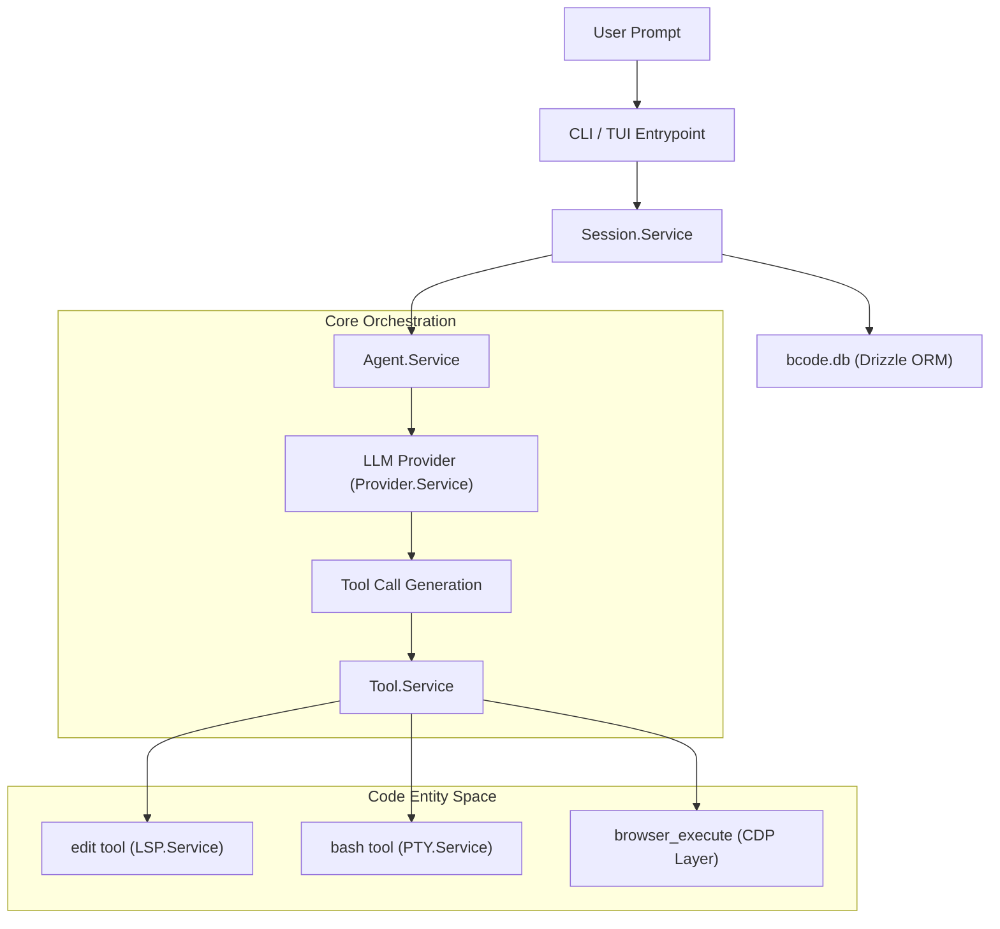
**Sources:** [packages/opencode/src/index.ts:164-186](), [packages/opencode/src/server/server.ts:10-13](), [packages/opencode/src/cli/cmd/run.ts:126-173]()

## Major Subsystems

The core engine is divided into several specialized services, each covered in detail in their respective child pages.

### CLI and Server Entrypoints
The primary binary `bcode` (or `opencode`) is defined in `index.ts`. It supports multiple modes:
*   **Headless/Run:** Execute a single prompt or command.
*   **Serve:** Start an HTTP server with mDNS discovery for remote connections.
*   **TUI:** A terminal user interface that runs a dedicated worker thread to keep the UI responsive while the agent works.

For details, see [CLI and Server Entrypoints](#2.1).
**Sources:** [packages/opencode/src/index.ts:76-186](), [packages/opencode/src/server/server.ts:75-101](), [packages/opencode/src/cli/cmd/tui/thread.ts:146-187]()

### Configuration and Permissions
The `Config.Service` manages a hierarchical configuration system that merges global settings, project-level overrides, and environment variables. It includes a sophisticated permission system that gates tool access (e.g., `allow`, `deny`, or `ask` for filesystem writes).

For details, see [Configuration System](#2.2).
**Sources:** [packages/opencode/src/config/config.ts:120-162](), [packages/opencode/src/config/permission.ts:1-50]()

### Session and Agent Lifecycle
A `Session` represents a continuous conversation and work state. The `Session.Service` manages the agent loop: sending context to the LLM, processing tool calls, and handling "compaction" to keep token usage efficient. It tracks state through various `Part` types (Text, Tool, Reasoning, Patch).

For details, see [Session and Agent Lifecycle](#2.3) and [Agent System](#2.4).
**Sources:** [packages/sdk/js/src/gen/types.gen.ts:384-400](), [packages/opencode/src/cli/cmd/run.ts:4-13]()

### Tool and Provider Abstraction
Tools are the "hands" of the agent. The engine provides a registry of built-in tools for file I/O, searching, and terminal execution. These tools are abstracted from the specific LLM being used via the `Provider.Service`, which normalizes communication with Anthropic, OpenAI, and other models.

For details, see [Tool System](#2.5) and [Provider and LLM Abstraction](#2.6).
**Sources:** [packages/opencode/src/cli/cmd/run.ts:90-124](), [packages/sdk/js/src/v2/gen/types.gen.ts:294-305]()

### Storage and Effect Runtime
The engine persists all session data, logs, and configuration state in a local SQLite database using the Drizzle ORM. The entire system is bootstrapped using an Effect-based runtime that manages dependency injection and graceful shutdowns.

For details, see [Storage, Database, and Effect Runtime](#2.9).
**Sources:** [packages/opencode/src/index.ts:125-160](), [packages/opencode/src/server/server.ts:103-118]()

## Internal Architecture: TUI Worker Thread
The TUI uses a unique architecture where the UI rendering happens in the main process, while the core engine (Server, Agent, LSP) runs in a background `Worker` thread. This prevents the agent's heavy computation or I/O from freezing the terminal UI.

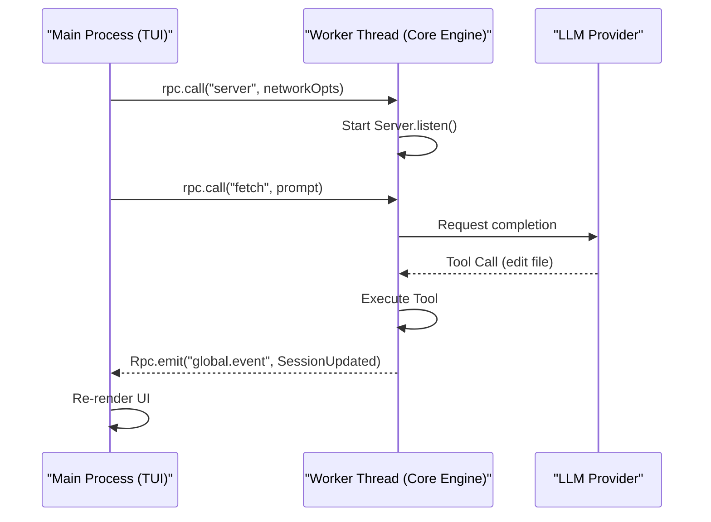
**Sources:** [packages/opencode/src/cli/cmd/tui/thread.ts:146-187](), [packages/opencode/src/cli/cmd/tui/worker.ts:50-102]()

## Child Pages

1.  **[CLI and Server Entrypoints](#2.1)** — Binary commands and HTTP server.
2.  **[Configuration System](#2.2)** — Hierarchy and permissions.
3.  **[Session and Agent Lifecycle](#2.3)** — The prompt/tool loop.
4.  **[Agent System](#2.4)** — Native and plugin agents.
5.  **[Tool System](#2.5)** — Built-in capabilities.
6.  **[Provider and LLM Abstraction](#2.6)** — Model orchestration.
7.  **[LSP, Formatting, and File Intelligence](#2.7)** — Code understanding.
8.  **[MCP Integration](#2.8)** — Model Context Protocol support.
9.  **[Storage, Database, and Effect Runtime](#2.9)** — Persistence and lifecycle.

---

# Page: CLI and Server Entrypoints

# CLI and Server Entrypoints

<details>
<summary>Relevant source files</summary>

The following files were used as context for generating this wiki page:

- [github/README.md](github/README.md)
- [github/action.yml](github/action.yml)
- [github/index.ts](github/index.ts)
- [packages/opencode/src/account/account.sql.ts](packages/opencode/src/account/account.sql.ts)
- [packages/opencode/src/account/account.ts](packages/opencode/src/account/account.ts)
- [packages/opencode/src/account/repo.ts](packages/opencode/src/account/repo.ts)
- [packages/opencode/src/account/schema.ts](packages/opencode/src/account/schema.ts)
- [packages/opencode/src/account/url.ts](packages/opencode/src/account/url.ts)
- [packages/opencode/src/cli/bootstrap.ts](packages/opencode/src/cli/bootstrap.ts)
- [packages/opencode/src/cli/cmd/account.ts](packages/opencode/src/cli/cmd/account.ts)
- [packages/opencode/src/cli/cmd/acp.ts](packages/opencode/src/cli/cmd/acp.ts)
- [packages/opencode/src/cli/cmd/export.ts](packages/opencode/src/cli/cmd/export.ts)
- [packages/opencode/src/cli/cmd/github.ts](packages/opencode/src/cli/cmd/github.ts)
- [packages/opencode/src/cli/cmd/import.ts](packages/opencode/src/cli/cmd/import.ts)
- [packages/opencode/src/cli/cmd/run.ts](packages/opencode/src/cli/cmd/run.ts)
- [packages/opencode/src/cli/cmd/serve.ts](packages/opencode/src/cli/cmd/serve.ts)
- [packages/opencode/src/cli/cmd/session.ts](packages/opencode/src/cli/cmd/session.ts)
- [packages/opencode/src/cli/cmd/stats.ts](packages/opencode/src/cli/cmd/stats.ts)
- [packages/opencode/src/cli/cmd/tui/thread.ts](packages/opencode/src/cli/cmd/tui/thread.ts)
- [packages/opencode/src/cli/cmd/tui/worker.ts](packages/opencode/src/cli/cmd/tui/worker.ts)
- [packages/opencode/src/cli/cmd/web.ts](packages/opencode/src/cli/cmd/web.ts)
- [packages/opencode/src/cli/network.ts](packages/opencode/src/cli/network.ts)
- [packages/opencode/src/index.ts](packages/opencode/src/index.ts)
- [packages/opencode/src/server/init-projectors.ts](packages/opencode/src/server/init-projectors.ts)
- [packages/opencode/src/server/mdns.ts](packages/opencode/src/server/mdns.ts)
- [packages/opencode/src/server/routes/instance/httpapi/api.ts](packages/opencode/src/server/routes/instance/httpapi/api.ts)
- [packages/opencode/src/server/routes/instance/httpapi/groups/event.ts](packages/opencode/src/server/routes/instance/httpapi/groups/event.ts)
- [packages/opencode/src/server/routes/instance/httpapi/handlers/event.ts](packages/opencode/src/server/routes/instance/httpapi/handlers/event.ts)
- [packages/opencode/src/server/routes/instance/httpapi/handlers/pty.ts](packages/opencode/src/server/routes/instance/httpapi/handlers/pty.ts)
- [packages/opencode/src/server/routes/instance/httpapi/middleware/authorization.ts](packages/opencode/src/server/routes/instance/httpapi/middleware/authorization.ts)
- [packages/opencode/src/server/routes/instance/httpapi/middleware/schema-error.ts](packages/opencode/src/server/routes/instance/httpapi/middleware/schema-error.ts)
- [packages/opencode/src/server/routes/instance/httpapi/server.ts](packages/opencode/src/server/routes/instance/httpapi/server.ts)
- [packages/opencode/src/server/shared/public-ui.ts](packages/opencode/src/server/shared/public-ui.ts)
- [packages/opencode/src/server/shared/ui.ts](packages/opencode/src/server/shared/ui.ts)
- [packages/opencode/src/share/share-next.ts](packages/opencode/src/share/share-next.ts)
- [packages/opencode/src/tool/plan.ts](packages/opencode/src/tool/plan.ts)
- [packages/opencode/src/tool/truncate.ts](packages/opencode/src/tool/truncate.ts)
- [packages/opencode/test/account/repo.test.ts](packages/opencode/test/account/repo.test.ts)
- [packages/opencode/test/account/service.test.ts](packages/opencode/test/account/service.test.ts)
- [packages/opencode/test/cli/account.test.ts](packages/opencode/test/cli/account.test.ts)
- [packages/opencode/test/cli/github-action.test.ts](packages/opencode/test/cli/github-action.test.ts)
- [packages/opencode/test/file/index.test.ts](packages/opencode/test/file/index.test.ts)
- [packages/opencode/test/server/httpapi-authorization.test.ts](packages/opencode/test/server/httpapi-authorization.test.ts)
- [packages/opencode/test/server/httpapi-event.test.ts](packages/opencode/test/server/httpapi-event.test.ts)
- [packages/opencode/test/server/httpapi-listen.test.ts](packages/opencode/test/server/httpapi-listen.test.ts)
- [packages/opencode/test/server/httpapi-pty.test.ts](packages/opencode/test/server/httpapi-pty.test.ts)
- [packages/opencode/test/server/httpapi-raw-route-auth.test.ts](packages/opencode/test/server/httpapi-raw-route-auth.test.ts)
- [packages/opencode/test/server/httpapi-schema-error-body.test.ts](packages/opencode/test/server/httpapi-schema-error-body.test.ts)
- [packages/opencode/test/server/httpapi-sdk.test.ts](packages/opencode/test/server/httpapi-sdk.test.ts)
- [packages/opencode/test/server/httpapi-sync.test.ts](packages/opencode/test/server/httpapi-sync.test.ts)
- [packages/opencode/test/server/httpapi-ui.test.ts](packages/opencode/test/server/httpapi-ui.test.ts)
- [packages/opencode/test/server/sdk-error-shape.test.ts](packages/opencode/test/server/sdk-error-shape.test.ts)
- [packages/opencode/test/server/sdk-v1-smoke.test.ts](packages/opencode/test/server/sdk-v1-smoke.test.ts)
- [packages/opencode/test/share/share-next.test.ts](packages/opencode/test/share/share-next.test.ts)
- [packages/opencode/test/tool/truncation.test.ts](packages/opencode/test/tool/truncation.test.ts)
- [packages/web/src/content/docs/commands.mdx](packages/web/src/content/docs/commands.mdx)
- [packages/web/src/content/docs/github.mdx](packages/web/src/content/docs/github.mdx)
- [packages/web/src/content/docs/gitlab.mdx](packages/web/src/content/docs/gitlab.mdx)
- [packages/web/src/content/docs/mcp-servers.mdx](packages/web/src/content/docs/mcp-servers.mdx)

</details>


The `opencode` (or `bcode`) binary serves as the primary interface for the engine. It manages the transition from a shell environment into the Effect-based runtime, handles command-line argument parsing via `yargs`, and orchestrates the lifecycle of both headless servers and interactive TUI sessions.

## CLI Entrypoint and Command Registry

The main entrypoint is [packages/opencode/src/index.ts:1-48](). It initializes telemetry, configures logging via `Log.init` [packages/opencode/src/index.ts:102-110](), and sets global environment markers like `OPENCODE_PID` [packages/opencode/src/index.ts:116]().

Before executing any command, the CLI performs a mandatory one-time database migration using `JsonMigration.run` [packages/opencode/src/index.ts:126-160](). This ensures that legacy JSON-based session storage is migrated to the SQLite `bcode.db` used by the Drizzle ORM.

### Available Commands

The CLI defines a comprehensive set of commands [packages/opencode/src/index.ts:164-186]():

| Command | Class / Definition | Purpose |
|:---|:---|:---|
| `run` | `RunCommand` | Executes a single prompt or starts an interactive session [packages/opencode/src/cli/cmd/run.ts:126](). |
| `serve` | `ServeCommand` | Starts a headless HTTP server for remote connections [packages/opencode/src/cli/cmd/serve.ts:7](). |
| `web` | `WebCommand` | Opens the local web UI in a browser. |
| `tui` | `TuiThreadCommand` | Default command ($0); starts the terminal UI in a worker thread [packages/opencode/src/cli/cmd/tui/thread.ts:79](). |
| `acp` | `AcpCommand` | Starts an Agent Client Protocol server over stdio [packages/opencode/src/cli/cmd/acp.ts:13](). |
| `mcp` | `McpCommand` | Manages Model Context Protocol server integrations. |
| `github` | `GithubCommand` | Installs or runs the GitHub agent for PR/Issue automation [packages/opencode/src/cli/cmd/github.ts:184](). |
| `stats` | `StatsCommand` | Aggregates token usage and cost metrics from `SessionTable` [packages/opencode/src/cli/cmd/stats.ts:49](). |
| `import` / `export` | `ImportCommand` | Migrates session data via JSON files or share URLs [packages/opencode/src/cli/cmd/import.ts:80](). |

Sources: [packages/opencode/src/index.ts:1-210](), [packages/opencode/src/cli/cmd/run.ts:1-135](), [packages/opencode/src/cli/cmd/stats.ts:49-80]()

## The HTTP Server and API Surface

The server is implemented using `Effect`'s `HttpApiBuilder` [packages/opencode/src/server/routes/instance/httpapi/server.ts:2-10](). It supports three primary routing categories:

1.  **Root API**: Global control and account management [packages/opencode/src/server/routes/instance/httpapi/server.ts:110-114]().
2.  **Instance API**: Project-specific operations (files, sessions, terminal access) [packages/opencode/src/server/routes/instance/httpapi/server.ts:123-141]().
3.  **UI Fallback**: Serves the embedded SolidJS web application or proxies to the hosted app [packages/opencode/src/server/routes/instance/httpapi/server.ts:164-171]().

### mDNS Discovery
When started via `serve` or within the TUI, the server can broadcast its presence using mDNS. This allows other `bcode` clients on the local network to discover and attach to the session without manual IP configuration.

### Data Flow: CLI to Server
The following diagram illustrates how a CLI command like `run --attach` interacts with the HTTP Server.

**CLI Attachment Data Flow**
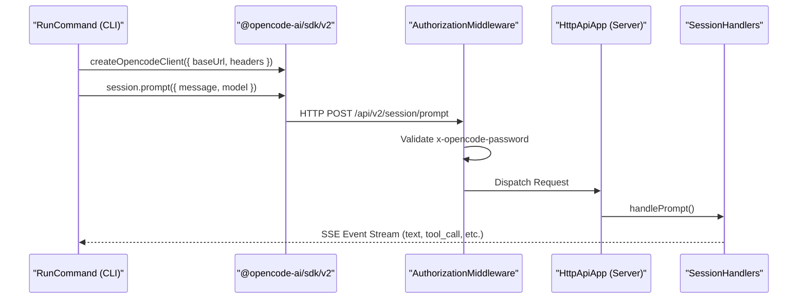
Sources: [packages/opencode/src/server/routes/instance/httpapi/server.ts:103-151](), [packages/opencode/src/cli/cmd/run.ts:190-203](), [packages/opencode/src/server/routes/instance/httpapi/middleware/authorization.ts:1-30]()

## TUI Worker-Thread Architecture

To maintain a responsive UI while the heavy agent logic (LLM calls, LSP indexing, file I/O) runs, the TUI uses a multi-threaded architecture.

1.  **Main Thread**: Handles terminal input, window resizing, and rendering via the `TuiThreadCommand` [packages/opencode/src/cli/cmd/tui/thread.ts:79]().
2.  **Worker Thread**: Runs the `Server` instance and the core agent logic [packages/opencode/src/cli/cmd/tui/worker.ts:1-18]().

### RPC Communication
Communication between the threads happens via a custom `Rpc` bridge [packages/opencode/src/cli/cmd/tui/thread.ts:159](). The main thread provides a `createWorkerFetch` shim [packages/opencode/src/cli/cmd/tui/thread.ts:31-47]() that redirects SDK calls to the worker's internal `Server.app.fetch` handler [packages/opencode/src/cli/cmd/tui/worker.ts:51-69](), bypassing the network stack entirely for local sessions.

**TUI Threading Model**
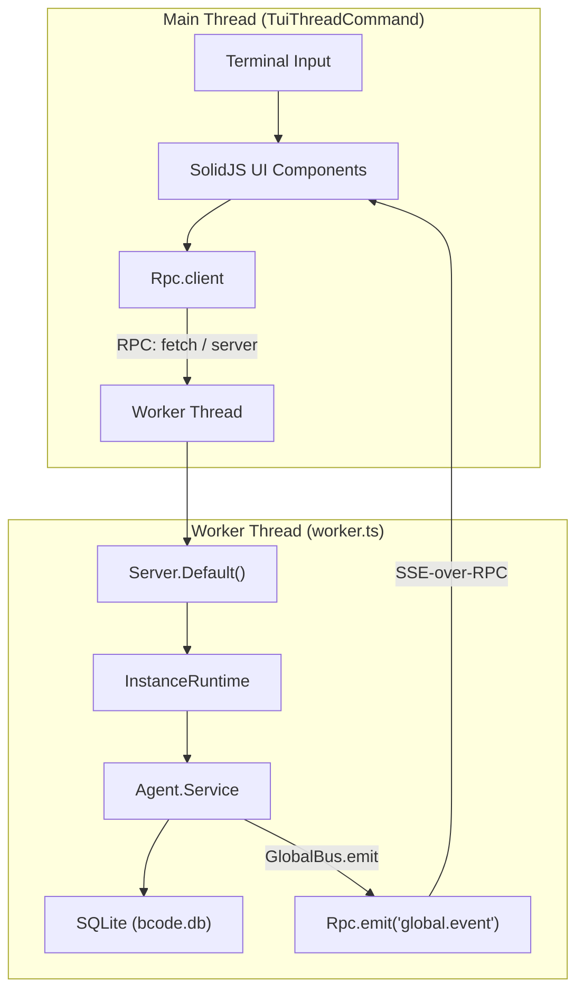
Sources: [packages/opencode/src/cli/cmd/tui/thread.ts:146-187](), [packages/opencode/src/cli/cmd/tui/worker.ts:50-102](), [packages/opencode/src/bus/global.ts:1-15]()

## Session Sharing and Persistence

The `ShareNext` service [packages/opencode/src/share/share-next.ts:109]() facilitates session portability. When a session is shared:
1.  The CLI/Server captures the session state, messages, and associated model metadata [packages/opencode/src/share/share-next.ts:47-67]().
2.  Data is synced to a remote console (e.g., `opncd.ai`) via `sync()` [packages/opencode/src/share/share-next.ts:120]().
3.  The `ImportCommand` can later reconstruct this session in a different environment by mapping the remote JSON structure back into local `SessionTable`, `MessageTable`, and `PartTable` entries [packages/opencode/src/cli/cmd/import.ts:182-214]().

Sources: [packages/opencode/src/share/share-next.ts:1-150](), [packages/opencode/src/cli/cmd/import.ts:169-218]()

---

# Page: Configuration System

# Configuration System

<details>
<summary>Relevant source files</summary>

The following files were used as context for generating this wiki page:

- [packages/opencode/script/schema.ts](packages/opencode/script/schema.ts)
- [packages/opencode/src/cli/cmd/tui/config/keybind.ts](packages/opencode/src/cli/cmd/tui/config/keybind.ts)
- [packages/opencode/src/cli/cmd/tui/config/tui-migrate.ts](packages/opencode/src/cli/cmd/tui/config/tui-migrate.ts)
- [packages/opencode/src/cli/cmd/tui/config/tui-schema.ts](packages/opencode/src/cli/cmd/tui/config/tui-schema.ts)
- [packages/opencode/src/cli/cmd/tui/config/tui.ts](packages/opencode/src/cli/cmd/tui/config/tui.ts)
- [packages/opencode/src/cli/cmd/tui/layer.ts](packages/opencode/src/cli/cmd/tui/layer.ts)
- [packages/opencode/src/config/agent.ts](packages/opencode/src/config/agent.ts)
- [packages/opencode/src/config/command.ts](packages/opencode/src/config/command.ts)
- [packages/opencode/src/config/config.ts](packages/opencode/src/config/config.ts)
- [packages/opencode/src/config/entry-name.ts](packages/opencode/src/config/entry-name.ts)
- [packages/opencode/src/config/error.ts](packages/opencode/src/config/error.ts)
- [packages/opencode/src/config/layout.ts](packages/opencode/src/config/layout.ts)
- [packages/opencode/src/config/managed.ts](packages/opencode/src/config/managed.ts)
- [packages/opencode/src/config/mcp.ts](packages/opencode/src/config/mcp.ts)
- [packages/opencode/src/config/model-id.ts](packages/opencode/src/config/model-id.ts)
- [packages/opencode/src/config/parse.ts](packages/opencode/src/config/parse.ts)
- [packages/opencode/src/config/paths.ts](packages/opencode/src/config/paths.ts)
- [packages/opencode/src/config/permission.ts](packages/opencode/src/config/permission.ts)
- [packages/opencode/src/config/plugin.ts](packages/opencode/src/config/plugin.ts)
- [packages/opencode/src/config/provider.ts](packages/opencode/src/config/provider.ts)
- [packages/opencode/src/config/server.ts](packages/opencode/src/config/server.ts)
- [packages/opencode/src/config/variable.ts](packages/opencode/src/config/variable.ts)
- [packages/opencode/src/server/server.ts](packages/opencode/src/server/server.ts)
- [packages/opencode/test/config/config.test.ts](packages/opencode/test/config/config.test.ts)
- [packages/opencode/test/config/tui.test.ts](packages/opencode/test/config/tui.test.ts)
- [packages/opencode/test/permission-task.test.ts](packages/opencode/test/permission-task.test.ts)
- [packages/sdk/js/src/gen/sdk.gen.ts](packages/sdk/js/src/gen/sdk.gen.ts)
- [packages/sdk/js/src/gen/types.gen.ts](packages/sdk/js/src/gen/types.gen.ts)
- [packages/sdk/js/src/v2/gen/sdk.gen.ts](packages/sdk/js/src/v2/gen/sdk.gen.ts)
- [packages/sdk/js/src/v2/gen/types.gen.ts](packages/sdk/js/src/v2/gen/types.gen.ts)
- [packages/sdk/openapi.json](packages/sdk/openapi.json)

</details>


The configuration system in BrowserCode is managed by the `Config.Service` [packages/opencode/src/config/config.ts:53-53](). It provides a multi-layered, hierarchical resolution engine that merges settings from remote well-known endpoints, global user files, environment variables, project-specific files, and managed cloud settings.

The system supports **JSONC** (JSON with Comments) for user-editable files [packages/opencode/src/config/config.ts:12-12]() and uses the `Effect` schema library for strict validation and documentation generation [packages/opencode/src/config/config.ts:120-120]().

## Configuration Hierarchy

BrowserCode resolves configuration by merging several layers in a specific order of precedence. Later layers override earlier ones, except for certain fields like `instructions` or `plugin` which are concatenated [packages/opencode/src/config/config.ts:53-59]().

### Precedence Order (Low to High)

1.  **Remote Well-Known**: Fetched from a remote URL defined in the configuration [packages/opencode/src/config/config.ts:73-73]().
2.  **Global Config**: Located in the user's global config directory (e.g., `~/.config/opencode/opencode.jsonc`) [packages/opencode/src/config/paths.ts:1-1]().
3.  **Environment Variables**: Prefixed with `OPENCODE_` (e.g., `OPENCODE_MODEL`) [packages/opencode/src/env.ts:1-1]().
4.  **Project Config**: Located in the project root or `.opencode/` directory [packages/opencode/src/config/config.test.ts:114-114]().
5.  **Console/Managed**: Settings synced from the BrowserCode Console or managed enterprise environments [packages/opencode/src/config/managed.ts:1-1]().

### Configuration Data Flow
This diagram illustrates how the `Config.Service` aggregates data from various `ConfigProvider` sources into a unified `Config.Info` object.

"Configuration Aggregation Flow"
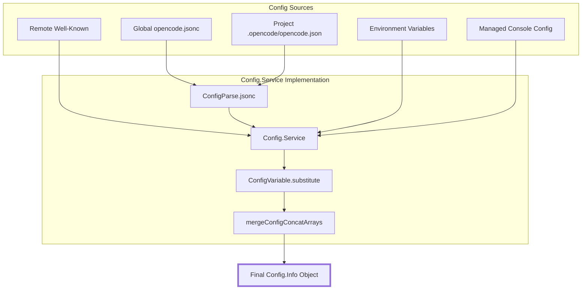
Sources: [packages/opencode/src/config/config.ts:49-111](), [packages/opencode/src/config/parse.ts:1-10](), [packages/opencode/src/config/variable.ts:1-10]()

## Key Components

### Config.Service
The primary interface for accessing and updating configuration. It maintains an internal cache and provides methods for invalidation and waiting for dependency resolution (like plugin loading) [packages/opencode/src/config/config.ts:240-260]().

*   `get()`: Returns the fully merged `Config.Resolved` object [packages/opencode/src/config/config.ts:241-241]().
*   `update(info)`: Persists changes to the project-level configuration file [packages/opencode/src/config/config.ts:244-244]().
*   `updateGlobal(info)`: Persists changes to the global configuration file [packages/opencode/src/config/config.ts:245-245]().

### Variable Substitution
BrowserCode supports dynamic variable substitution within configuration strings using the `ConfigVariable` module [packages/opencode/src/config/variable.ts:1-5]().

| Variable | Description |
| :--- | :--- |
| `$HOME` | User's home directory |
| `$CONFIG` | Global configuration directory |
| `$CWD` | Current working directory |
| `$PROJECT` | Resolved project root |

Sources: [packages/opencode/src/config/variable.ts:1-20](), [packages/opencode/src/config/config.ts:76-81]()

## Permission System

The `ConfigPermission` module defines the security sandbox for agents. Permissions can be configured globally or per-tool [packages/opencode/src/config/permission.ts:16-37]().

### Permission Actions
Permissions use a tri-state logic [packages/opencode/src/config/permission.ts:4-5]():
*   `allow`: Automatically grant the permission.
*   `deny`: Automatically reject the request.
*   `ask`: Prompt the user for manual approval (default for sensitive operations).

### Configuration Schema
Permissions are defined in the `permission` block of the config:
```jsonc
{
  "permission": {
    "read": "allow",
    "bash": "ask",
    "websearch": "deny",
    "edit": {
      "include": ["src/**/*.ts"],
      "exclude": ["**/node_modules/**"]
    }
  }
}
```
Sources: [packages/opencode/src/config/permission.ts:16-56](), [packages/sdk/js/src/v2/gen/types.gen.ts:107-120]()

## Configuration Schema Sub-modules

The `Config.Info` struct is composed of several sub-schemas, each managing a specific domain of the engine [packages/opencode/src/config/config.ts:120-180]().

| Module | Purpose | File Reference |
| :--- | :--- | :--- |
| `ConfigProvider` | LLM Provider settings (API keys, endpoints) | [packages/opencode/src/config/provider.ts]() |
| `ConfigAgent` | Agent definitions and system prompts | [packages/opencode/src/config/agent.ts]() |
| `ConfigMCP` | Model Context Protocol server configurations | [packages/opencode/src/config/mcp.ts]() |
| `ConfigCommand` | Custom CLI command aliases | [packages/opencode/src/config/command.ts]() |
| `ConfigLSP` | Language Server Protocol settings | [packages/opencode/src/config/lsp.ts]() |

### Code Entity Mapping
This diagram maps the high-level configuration concepts to the specific TypeScript classes and Schema definitions in the codebase.

"Config Entity Mapping"
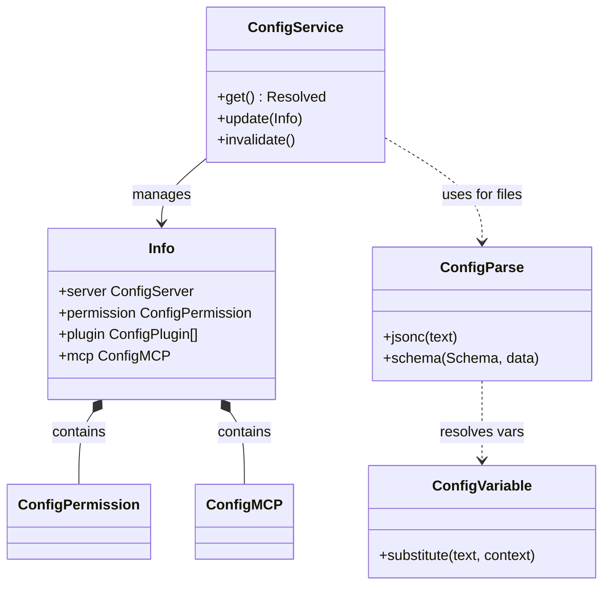
Sources: [packages/opencode/src/config/config.ts:120-260](), [packages/opencode/src/config/parse.ts:1-20](), [packages/opencode/src/config/permission.ts:48-56]()

## JSONC Support and Migration

BrowserCode prioritizes `opencode.jsonc` over `opencode.json` to allow users to document their settings. The system includes a migration utility that can move legacy settings (like TUI keybinds) from the main config into specialized files like `tui.jsonc` [packages/opencode/src/cli/cmd/tui/config/tui-migrate.ts:1-10]().

When a config is loaded, `normalizeLoadedConfig` checks for deprecated keys and warns the user to move them to the appropriate sub-config file [packages/opencode/src/config/config.ts:61-71]().

Sources: [packages/opencode/src/config/config.ts:12-12](), [packages/opencode/src/config/config.ts:61-71](), [packages/opencode/src/cli/cmd/tui/config/tui.ts:66-80]()

---

# Page: Session and Agent Lifecycle

# Session and Agent Lifecycle

<details>
<summary>Relevant source files</summary>

The following files were used as context for generating this wiki page:

- [packages/core/src/global.ts](packages/core/src/global.ts)
- [packages/opencode/src/project/instance-context.ts](packages/opencode/src/project/instance-context.ts)
- [packages/opencode/src/project/instance-store.ts](packages/opencode/src/project/instance-store.ts)
- [packages/opencode/src/project/instance.ts](packages/opencode/src/project/instance.ts)
- [packages/opencode/src/project/project.ts](packages/opencode/src/project/project.ts)
- [packages/opencode/src/provider/error.ts](packages/opencode/src/provider/error.ts)
- [packages/opencode/src/provider/transform.ts](packages/opencode/src/provider/transform.ts)
- [packages/opencode/src/question/index.ts](packages/opencode/src/question/index.ts)
- [packages/opencode/src/server/routes/instance/httpapi/groups/session.ts](packages/opencode/src/server/routes/instance/httpapi/groups/session.ts)
- [packages/opencode/src/server/routes/instance/httpapi/handlers/config.ts](packages/opencode/src/server/routes/instance/httpapi/handlers/config.ts)
- [packages/opencode/src/server/routes/instance/httpapi/handlers/global.ts](packages/opencode/src/server/routes/instance/httpapi/handlers/global.ts)
- [packages/opencode/src/server/routes/instance/httpapi/handlers/session.ts](packages/opencode/src/server/routes/instance/httpapi/handlers/session.ts)
- [packages/opencode/src/server/routes/instance/httpapi/lifecycle.ts](packages/opencode/src/server/routes/instance/httpapi/lifecycle.ts)
- [packages/opencode/src/server/routes/instance/httpapi/middleware/instance-context.ts](packages/opencode/src/server/routes/instance/httpapi/middleware/instance-context.ts)
- [packages/opencode/src/session/compaction.ts](packages/opencode/src/session/compaction.ts)
- [packages/opencode/src/session/instruction.ts](packages/opencode/src/session/instruction.ts)
- [packages/opencode/src/session/llm.ts](packages/opencode/src/session/llm.ts)
- [packages/opencode/src/session/message-v2.ts](packages/opencode/src/session/message-v2.ts)
- [packages/opencode/src/session/processor.ts](packages/opencode/src/session/processor.ts)
- [packages/opencode/src/session/prompt.ts](packages/opencode/src/session/prompt.ts)
- [packages/opencode/src/session/retry.ts](packages/opencode/src/session/retry.ts)
- [packages/opencode/src/session/revert.ts](packages/opencode/src/session/revert.ts)
- [packages/opencode/src/session/session.ts](packages/opencode/src/session/session.ts)
- [packages/opencode/src/session/status.ts](packages/opencode/src/session/status.ts)
- [packages/opencode/src/session/summary.ts](packages/opencode/src/session/summary.ts)
- [packages/opencode/src/session/todo.ts](packages/opencode/src/session/todo.ts)
- [packages/opencode/src/storage/json-migration.ts](packages/opencode/src/storage/json-migration.ts)
- [packages/opencode/src/tool/question.ts](packages/opencode/src/tool/question.ts)
- [packages/opencode/src/tool/todo.ts](packages/opencode/src/tool/todo.ts)
- [packages/opencode/src/worktree/index.ts](packages/opencode/src/worktree/index.ts)
- [packages/opencode/test/fixture/fixture.test.ts](packages/opencode/test/fixture/fixture.test.ts)
- [packages/opencode/test/fixture/fixture.ts](packages/opencode/test/fixture/fixture.ts)
- [packages/opencode/test/project/migrate-global.test.ts](packages/opencode/test/project/migrate-global.test.ts)
- [packages/opencode/test/project/project.test.ts](packages/opencode/test/project/project.test.ts)
- [packages/opencode/test/project/worktree-remove.test.ts](packages/opencode/test/project/worktree-remove.test.ts)
- [packages/opencode/test/provider/transform.test.ts](packages/opencode/test/provider/transform.test.ts)
- [packages/opencode/test/question/question.test.ts](packages/opencode/test/question/question.test.ts)
- [packages/opencode/test/server/global-session-list.test.ts](packages/opencode/test/server/global-session-list.test.ts)
- [packages/opencode/test/server/httpapi-session.test.ts](packages/opencode/test/server/httpapi-session.test.ts)
- [packages/opencode/test/session/compaction.test.ts](packages/opencode/test/session/compaction.test.ts)
- [packages/opencode/test/session/instruction.test.ts](packages/opencode/test/session/instruction.test.ts)
- [packages/opencode/test/session/llm.test.ts](packages/opencode/test/session/llm.test.ts)
- [packages/opencode/test/session/message-v2.test.ts](packages/opencode/test/session/message-v2.test.ts)
- [packages/opencode/test/session/messages-pagination.test.ts](packages/opencode/test/session/messages-pagination.test.ts)
- [packages/opencode/test/session/processor-effect.test.ts](packages/opencode/test/session/processor-effect.test.ts)
- [packages/opencode/test/session/prompt.test.ts](packages/opencode/test/session/prompt.test.ts)
- [packages/opencode/test/session/retry.test.ts](packages/opencode/test/session/retry.test.ts)
- [packages/opencode/test/session/schema-decoding.test.ts](packages/opencode/test/session/schema-decoding.test.ts)
- [packages/opencode/test/session/snapshot-tool-race.test.ts](packages/opencode/test/session/snapshot-tool-race.test.ts)

</details>


This page details the lifecycle of sessions and the agent execution loop within BrowserCode. It covers the services responsible for managing project workspaces, the stateful message history, and the iterative process where the LLM consumes context to produce tool calls and responses.

## Overview of Services

The session lifecycle is managed by a hierarchy of services that bridge the gap between a physical directory on disk and a stateful AI conversation.

| Service | Responsibility | Key Code Entity |
| :--- | :--- | :--- |
| **Project Service** | Manages project metadata, directory discovery, and sandbox tracking. | `Project.Service` [packages/opencode/src/project/project.ts:108-125]() |
| **Worktree Service** | Handles Git worktree creation, branch management, and environment setup. | `Worktree.Service` [packages/opencode/src/worktree/index.ts:137-144]() |
| **Session Service** | The primary interface for CRUD operations on sessions, messages, and parts. | `Session.Service` [packages/opencode/src/session/session.ts:223-267]() |
| **Session Processor** | Orchestrates the streaming interaction between the LLM and tool execution. | `SessionProcessor.Service` [packages/opencode/src/session/processor.ts:109-129]() |

### Project and Worktree Management

A `Project` represents a root directory containing code. The `Project.Service` tracks these via the `ProjectTable` in SQLite [packages/opencode/src/project/project.sql:1-35](). 

The `Worktree.Service` allows the agent to create isolated environments for tasks. It uses `git worktree add` to create new directories linked to the main repository [packages/opencode/src/worktree/index.ts:165-183](). This ensures that the agent's changes do not interfere with the user's primary working directory unless explicitly merged.

**Sources:** [packages/opencode/src/project/project.ts](), [packages/opencode/src/worktree/index.ts]()

## Session and Message Schema

Sessions are composed of a sequence of **Messages**, and each message is composed of one or more **Parts**. This granular structure allows the system to handle multi-modal inputs, tool calls, and background processes like compaction within a single turn.

### Message Parts
The `MessageV2.Part` union [packages/opencode/src/session/message-v2.ts:241-255]() defines the fundamental units of communication:

*   **TextPart**: Standard natural language text [packages/opencode/src/session/message-v2.ts:97-111]().
*   **ToolPart**: Represents a tool invocation, including the `toolCallID`, `method`, and `input` arguments [packages/opencode/src/session/message-v2.ts:211-230]().
*   **ReasoningPart**: Internal "chain-of-thought" produced by models (e.g., Claude 3.7 or DeepSeek R1) [packages/opencode/src/session/message-v2.ts:113-124]().
*   **PatchPart**: Represents a code change applied to the worktree [packages/opencode/src/session/message-v2.ts:89-95]().
*   **SnapshotPart**: A pointer to a specific state of the filesystem [packages/opencode/src/session/message-v2.ts:82-88]().
*   **SubtaskPart**: Used when an agent delegates a specific task to a child agent [packages/opencode/src/session/message-v2.ts:193-209]().

### Data Flow: Message Persistence
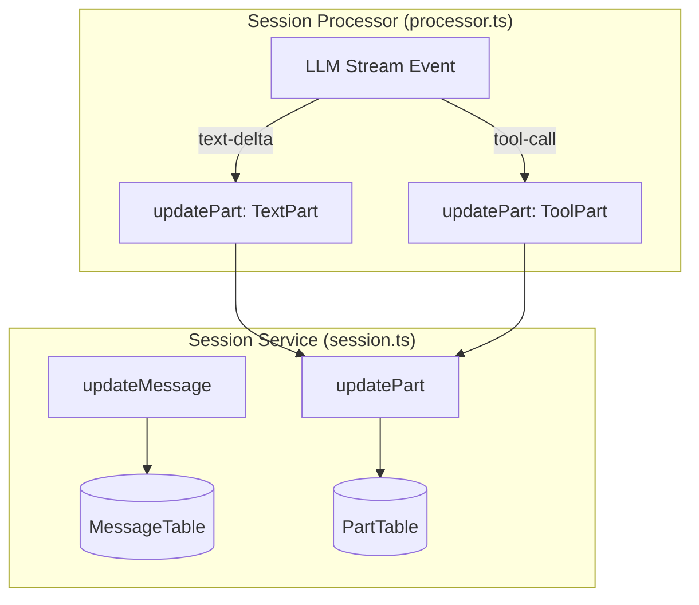
**Sources:** [packages/opencode/src/session/message-v2.ts](), [packages/opencode/src/session/session.ts](), [packages/opencode/src/session/processor.ts]()

## The Agent Loop

The core execution logic resides in `SessionProcessor.Service.create` [packages/opencode/src/session/processor.ts:129](). It manages the `streamText` call to the LLM and the subsequent handling of events.

### Execution Phases
1.  **Prompt Construction**: The `LLM.Service` assembles the system prompt, conversation history, and active tools [packages/opencode/src/session/llm.ts:76-195]().
2.  **Streaming**: The LLM emits deltas. The `SessionProcessor` captures these and updates the database in real-time [packages/opencode/src/session/processor.ts:233-280]().
3.  **Tool Execution**: When a `tool-call` is finalized, the system looks up the tool in the `ToolRegistry` and executes it.
4.  **Result Integration**: Tool outputs are appended as new messages (role: `user` or `tool` depending on the provider) and the loop continues until a "stop" condition (e.g., `finish_reason: stop`) is met.

### Agent Loop Diagram
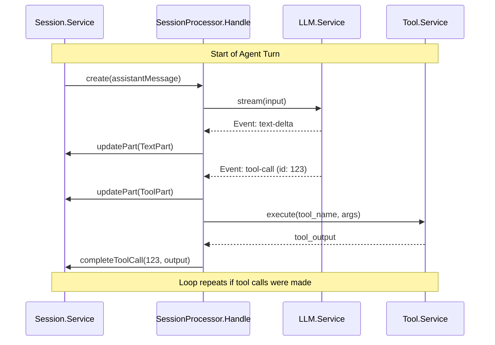
**Sources:** [packages/opencode/src/session/processor.ts](), [packages/opencode/src/session/llm.ts]()

## Compaction and Context Management

As conversations grow, they may exceed the LLM's context window. `SessionCompaction.Service` handles this by summarizing old messages [packages/opencode/src/session/compaction.ts:188-208]().

*   **Overflow Detection**: `isOverflow` checks if the current token count exceeds model limits [packages/opencode/src/session/compaction.ts:189-192]().
*   **Pruning**: Removes intermediate tool outputs and redundant parts to save space [packages/opencode/src/session/compaction.ts:193]().
*   **Summarization**: Uses a specialized prompt `SUMMARY_TEMPLATE` [packages/opencode/src/session/compaction.ts:44-79]() to condense history into a "Goal/Progress/Next Steps" format, which is then injected back into the context.

**Sources:** [packages/opencode/src/session/compaction.ts]()

## Session Recovery: Retry and Revert

The system provides mechanisms to recover from errors or undesirable agent actions.

### Retry
`SessionRetry.Service` allows the system to re-attempt a failed turn. It specifically handles errors like `ContextOverflowError` by triggering an immediate compaction before retrying the LLM call [packages/opencode/src/session/retry.ts:36-50]().

### Revert
`SessionRevert.Service` allows rolling back the session state to a previous message. This involves:
1.  Identifying the target `MessageID` [packages/opencode/src/session/revert.ts:19-24]().
2.  Deleting all messages and parts created after that point in the `SessionTable` and `PartTable`.
3.  Restoring the filesystem state if a `Snapshot` was associated with the target message [packages/opencode/src/session/revert.ts:25-40]().

**Sources:** [packages/opencode/src/session/retry.ts](), [packages/opencode/src/session/revert.ts]()

## The Question Service

When an agent requires user clarification, it uses the `Question.Service` [packages/opencode/src/question/index.ts:13-18](). 

1.  The agent calls the `question` tool [packages/opencode/src/tool/question.ts:10-25]().
2.  The `SessionProcessor` marks the session as `blocked` [packages/opencode/src/session/processor.ts:101]().
3.  The UI renders the question and waits for user input.
4.  Once the user responds, the session is unblocked, and the response is fed back into the agent loop as a tool result.

**Sources:** [packages/opencode/src/question/index.ts](), [packages/opencode/src/tool/question.ts](), [packages/opencode/src/session/processor.ts]()

---

# Page: Agent System

# Agent System

<details>
<summary>Relevant source files</summary>

The following files were used as context for generating this wiki page:

- [packages/opencode/src/acp/agent.ts](packages/opencode/src/acp/agent.ts)
- [packages/opencode/src/acp/session.ts](packages/opencode/src/acp/session.ts)
- [packages/opencode/src/acp/types.ts](packages/opencode/src/acp/types.ts)
- [packages/opencode/src/agent/agent.ts](packages/opencode/src/agent/agent.ts)
- [packages/opencode/src/effect/runner.ts](packages/opencode/src/effect/runner.ts)
- [packages/opencode/src/plugin/index.ts](packages/opencode/src/plugin/index.ts)
- [packages/opencode/src/reference/reference.ts](packages/opencode/src/reference/reference.ts)
- [packages/opencode/src/reference/repository-cache.ts](packages/opencode/src/reference/repository-cache.ts)
- [packages/opencode/src/session/prompt/anthropic.txt](packages/opencode/src/session/prompt/anthropic.txt)
- [packages/opencode/src/session/prompt/beast.txt](packages/opencode/src/session/prompt/beast.txt)
- [packages/opencode/src/session/prompt/codex.txt](packages/opencode/src/session/prompt/codex.txt)
- [packages/opencode/src/session/prompt/copilot-gpt-5.txt](packages/opencode/src/session/prompt/copilot-gpt-5.txt)
- [packages/opencode/src/session/prompt/trinity.txt](packages/opencode/src/session/prompt/trinity.txt)
- [packages/opencode/src/session/run-state.ts](packages/opencode/src/session/run-state.ts)
- [packages/opencode/src/tool/registry.ts](packages/opencode/src/tool/registry.ts)
- [packages/opencode/src/tool/task_status.ts](packages/opencode/src/tool/task_status.ts)
- [packages/opencode/test/acp/event-subscription.test.ts](packages/opencode/test/acp/event-subscription.test.ts)
- [packages/opencode/test/agent/agent.test.ts](packages/opencode/test/agent/agent.test.ts)
- [packages/opencode/test/agent/plugin-agent-regression.test.ts](packages/opencode/test/agent/plugin-agent-regression.test.ts)
- [packages/opencode/test/effect/runner.test.ts](packages/opencode/test/effect/runner.test.ts)
- [packages/opencode/test/fixture/agent-plugin.constants.ts](packages/opencode/test/fixture/agent-plugin.constants.ts)
- [packages/opencode/test/fixture/agent-plugin.ts](packages/opencode/test/fixture/agent-plugin.ts)
- [packages/opencode/test/plugin/auth-override.test.ts](packages/opencode/test/plugin/auth-override.test.ts)
- [packages/opencode/test/reference/reference.test.ts](packages/opencode/test/reference/reference.test.ts)
- [packages/opencode/test/tool/external-directory.test.ts](packages/opencode/test/tool/external-directory.test.ts)
- [packages/opencode/test/tool/registry.test.ts](packages/opencode/test/tool/registry.test.ts)
- [packages/plugin/src/index.ts](packages/plugin/src/index.ts)

</details>


The Agent System is the orchestration layer that defines the capabilities, personas, and permission boundaries for LLM interactions. It is managed by the `Agent.Service`, which coordinates built-in "native" agents, custom agents defined in user configuration, and plugin-contributed agents.

## Agent.Service and Info

The `Agent.Service` is the central registry for agent definitions. Each agent is defined by an `Info` object which specifies its system prompt, model constraints, and a unique `Permission.Ruleset` [packages/opencode/src/agent/agent.ts:31-52]().

### Data Flow: Agent Resolution
When a session starts or an agent is invoked, the system resolves the agent configuration through the following hierarchy:
1.  **Native Agents**: Hardcoded defaults (e.g., `build`, `plan`) [packages/opencode/src/agent/agent.ts:151-244]().
2.  **Plugin Agents**: Contributed by loaded plugins via `Hooks` [packages/opencode/src/plugin/index.ts:240-243]().
3.  **User Configuration**: Overrides defined in `opencode.json` [packages/opencode/src/agent/agent.ts:246-270]().

### Agent Types and Modes
Agents operate in different `mode` settings [packages/opencode/src/agent/agent.ts:34]():
-   `primary`: Can be the main entry point for a session.
-   `subagent`: Intended for specialized tasks (e.g., exploration).
-   `all`: Valid for both primary and sub-task roles.

**Sources:** [packages/opencode/src/agent/agent.ts:31-80](), [packages/opencode/src/plugin/index.ts:118-170]()

---

## Native Agents

Native agents are the core personas bundled with the engine. They utilize specialized system prompts and restricted permission sets to ensure safety and task efficiency.

| Agent | Purpose | Key Permissions |
| :--- | :--- | :--- |
| `build` | Default general-purpose agent. | Allows `edit`, `bash`, `question`, and `plan_enter` [packages/opencode/src/agent/agent.ts:152-166](). |
| `plan` | Architect mode for high-level design. | Denies most edits; allows writing to `.bcode/plans/*.md` [packages/opencode/src/agent/agent.ts:167-189](). |
| `explore` | Read-only repository analysis. | Denies `edit` and `write`; allows `read`, `grep`, and `lsptool` [packages/opencode/src/agent/agent.ts:190-205](). |
| `scout` | External repository researcher. | Allows `repo_clone` and `repo_overview` (requires experimental flag) [packages/opencode/src/agent/agent.ts:206-224](). |
| `compaction` | Context management (Hidden). | Denies all tools; specialized for summarizing message history [packages/opencode/src/agent/agent.ts:233-244](). |

**Sources:** [packages/opencode/test/agent/agent.test.ts:50-128](), [packages/opencode/src/agent/agent.ts:151-244]()

---

## Permission Rulesets

The Agent System implements a robust permission gating mechanism. Every tool execution is checked against the agent's `Permission.Ruleset`.

### Permission Evaluation Logic
The system uses a hierarchy of "allow", "deny", and "ask" [packages/opencode/src/agent/agent.ts:120-147]().
-   **Internal Whitelisting**: Agents are automatically granted access to their own temporary data, such as browser screenshots in `<Global.Path.data>/sessions/*` [packages/opencode/src/agent/agent.ts:98-116]().
-   **Agent Workspace**: A dedicated directory `**/.bcode/agent-workspace/**/*` is often whitelisted for agents to store persistent scratchpad files without user prompts [packages/opencode/src/agent/agent.ts:104-134]().
-   **Sensitive Files**: By default, `.env` files are set to `ask` even if general `read` is allowed [packages/opencode/src/agent/agent.ts:141-146]().

**Sources:** [packages/opencode/src/agent/agent.ts:92-150](), [packages/opencode/test/tool/external-directory.test.ts:40-107]()

---

## Agent Client Protocol (ACP)

The `acp/agent.ts` file implements the **Agent Client Protocol**, allowing external IDEs or clients to interact with the BrowserCode agent system over a standardized JSON-RPC-like interface.

### ACP Implementation Details
The `ACPAgent` class maps protocol requests (like `prompt`, `initialize`, `listSessions`) to internal engine services [packages/opencode/src/acp/agent.ts:143-165]().

-   **Session Management**: Handled by `ACPSessionManager`, which maps ACP `sessionId` to internal `Session.Service` instances [packages/opencode/src/acp/session.ts:8-20]().
-   **Permission Bridging**: When an internal tool requires an `ask` permission, the ACP agent translates this into a `requestPermission` call back to the client [packages/opencode/src/acp/agent.ts:195-214]().
-   **Usage Tracking**: Calculates token usage and costs, streaming updates to the client via `sessionUpdate` [packages/opencode/src/acp/agent.ts:85-133]().

**Sources:** [packages/opencode/src/acp/agent.ts:1-165](), [packages/opencode/src/acp/session.ts:8-122]()

---

## Reference and Scout Subsystem

The Scout subsystem is an experimental feature for deep research into external repositories without polluting the current workspace.

### Scout Workflow
1.  **Tooling**: Uses `repo_clone` to pull external code into a managed cache directory (`Global.Path.repos`) [packages/opencode/src/tool/registry.ts:130-131]().
2.  **Overview**: Uses `repo_overview` to generate a high-level map of the external codebase.
3.  **Isolation**: The `scout` agent is restricted to reading from these external directories and is denied from editing the local project [packages/opencode/src/agent/agent.ts:206-224]().

**Sources:** [packages/opencode/src/agent/agent.ts:206-231](), [packages/opencode/test/tool/registry.test.ts:93-101]()

---

## System Architecture Diagrams

### Agent Entity Mapping
This diagram bridges the Natural Language concepts of "Personas" to the specific Code Entities that implement them.

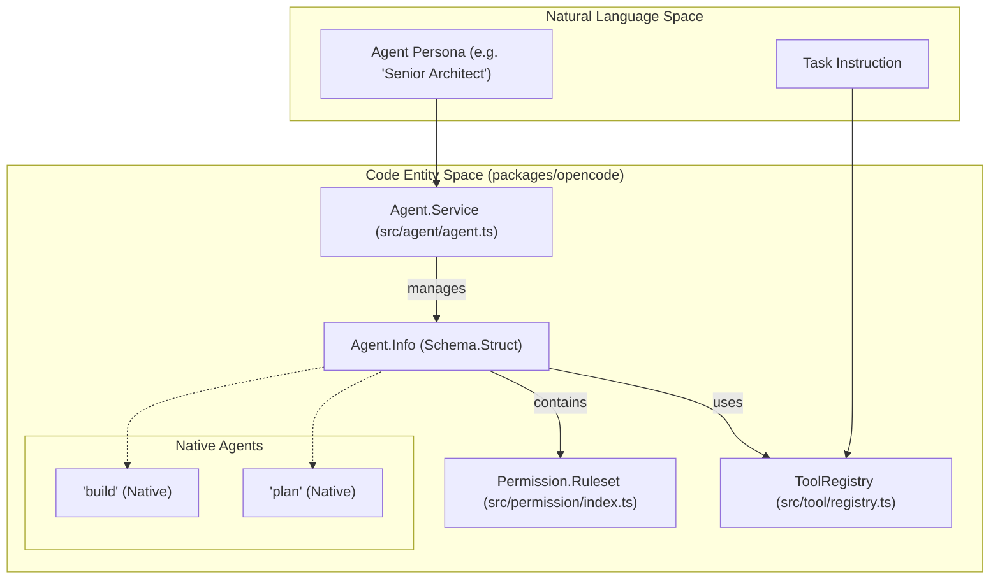
**Sources:** [packages/opencode/src/agent/agent.ts:31-80](), [packages/opencode/src/tool/registry.ts:75-82]()

### ACP Interaction Flow
This diagram illustrates the data flow between an external ACP Client and the internal Agent System.

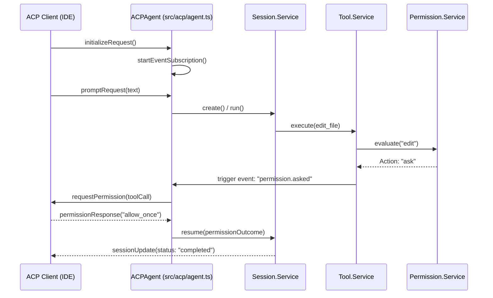
**Sources:** [packages/opencode/src/acp/agent.ts:167-214](), [packages/opencode/test/acp/event-subscription.test.ts:192-231]()

---

## Plugin-Defined Agents

Plugins can extend the agent system by providing `Hooks` that define new agent behaviors or modify existing ones.

### Implementation
Plugins register via the `Plugin.Service` [packages/opencode/src/plugin/index.ts:64](). During the `Agent.Service` initialization, it iterates through loaded plugins and merges any provided agent definitions into the master registry [packages/opencode/src/agent/agent.ts:87-93]().

-   **Auth Overrides**: Plugins can specifically override authentication methods for agents, such as replacing the default GitHub Copilot auth with a custom implementation [packages/opencode/test/plugin/auth-override.test.ts:46-70]().
-   **Custom Tools**: Plugins often define a suite of tools and a corresponding agent that has exclusive `allow` permissions for those tools [packages/opencode/src/tool/registry.ts:146-170]().

**Sources:** [packages/opencode/src/plugin/index.ts:105-116](), [packages/opencode/src/tool/registry.ts:142-180]()

---

# Page: Tool System

# Tool System

<details>
<summary>Relevant source files</summary>

The following files were used as context for generating this wiki page:

- [packages/bcode-browser/README.md](packages/bcode-browser/README.md)
- [packages/bcode-browser/package.json](packages/bcode-browser/package.json)
- [packages/bcode-browser/skills/browser-execute/SKILL.md](packages/bcode-browser/skills/browser-execute/SKILL.md)
- [packages/bcode-browser/src/browser-execute.ts](packages/bcode-browser/src/browser-execute.ts)
- [packages/bcode-browser/src/fetch-use.ts](packages/bcode-browser/src/fetch-use.ts)
- [packages/bcode-browser/src/index.ts](packages/bcode-browser/src/index.ts)
- [packages/bcode-browser/src/skills.ts](packages/bcode-browser/src/skills.ts)
- [packages/bcode-browser/test/fetch-use.test.ts](packages/bcode-browser/test/fetch-use.test.ts)
- [packages/bcode-browser/test/skills.test.ts](packages/bcode-browser/test/skills.test.ts)
- [packages/bcode-browser/test/workspace-import.test.ts](packages/bcode-browser/test/workspace-import.test.ts)
- [packages/opencode/src/effect/runner.ts](packages/opencode/src/effect/runner.ts)
- [packages/opencode/src/file/index.ts](packages/opencode/src/file/index.ts)
- [packages/opencode/src/file/ripgrep.ts](packages/opencode/src/file/ripgrep.ts)
- [packages/opencode/src/plugin/index.ts](packages/opencode/src/plugin/index.ts)
- [packages/opencode/src/session/run-state.ts](packages/opencode/src/session/run-state.ts)
- [packages/opencode/src/session/system.ts](packages/opencode/src/session/system.ts)
- [packages/opencode/src/tool/apply_patch.ts](packages/opencode/src/tool/apply_patch.ts)
- [packages/opencode/src/tool/apply_patch.txt](packages/opencode/src/tool/apply_patch.txt)
- [packages/opencode/src/tool/browser-execute.ts](packages/opencode/src/tool/browser-execute.ts)
- [packages/opencode/src/tool/browser-execute.txt](packages/opencode/src/tool/browser-execute.txt)
- [packages/opencode/src/tool/edit.ts](packages/opencode/src/tool/edit.ts)
- [packages/opencode/src/tool/external-directory.ts](packages/opencode/src/tool/external-directory.ts)
- [packages/opencode/src/tool/glob.ts](packages/opencode/src/tool/glob.ts)
- [packages/opencode/src/tool/grep.ts](packages/opencode/src/tool/grep.ts)
- [packages/opencode/src/tool/lsp.ts](packages/opencode/src/tool/lsp.ts)
- [packages/opencode/src/tool/lsp.txt](packages/opencode/src/tool/lsp.txt)
- [packages/opencode/src/tool/read.ts](packages/opencode/src/tool/read.ts)
- [packages/opencode/src/tool/registry.ts](packages/opencode/src/tool/registry.ts)
- [packages/opencode/src/tool/shell.ts](packages/opencode/src/tool/shell.ts)
- [packages/opencode/src/tool/shell/prompt.ts](packages/opencode/src/tool/shell/prompt.ts)
- [packages/opencode/src/tool/skill.ts](packages/opencode/src/tool/skill.ts)
- [packages/opencode/src/tool/task.ts](packages/opencode/src/tool/task.ts)
- [packages/opencode/src/tool/task_status.ts](packages/opencode/src/tool/task_status.ts)
- [packages/opencode/src/tool/tool.ts](packages/opencode/src/tool/tool.ts)
- [packages/opencode/src/tool/webfetch.ts](packages/opencode/src/tool/webfetch.ts)
- [packages/opencode/src/tool/write.ts](packages/opencode/src/tool/write.ts)
- [packages/opencode/test/effect/runner.test.ts](packages/opencode/test/effect/runner.test.ts)
- [packages/opencode/test/file/ripgrep.test.ts](packages/opencode/test/file/ripgrep.test.ts)
- [packages/opencode/test/tool/__snapshots__/parameters.test.ts.snap](packages/opencode/test/tool/__snapshots__/parameters.test.ts.snap)
- [packages/opencode/test/tool/apply_patch.test.ts](packages/opencode/test/tool/apply_patch.test.ts)
- [packages/opencode/test/tool/edit.test.ts](packages/opencode/test/tool/edit.test.ts)
- [packages/opencode/test/tool/grep.test.ts](packages/opencode/test/tool/grep.test.ts)
- [packages/opencode/test/tool/lsp.test.ts](packages/opencode/test/tool/lsp.test.ts)
- [packages/opencode/test/tool/parameters.test.ts](packages/opencode/test/tool/parameters.test.ts)
- [packages/opencode/test/tool/question.test.ts](packages/opencode/test/tool/question.test.ts)
- [packages/opencode/test/tool/read.test.ts](packages/opencode/test/tool/read.test.ts)
- [packages/opencode/test/tool/registry.test.ts](packages/opencode/test/tool/registry.test.ts)
- [packages/opencode/test/tool/shell.test.ts](packages/opencode/test/tool/shell.test.ts)
- [packages/opencode/test/tool/skill.test.ts](packages/opencode/test/tool/skill.test.ts)
- [packages/opencode/test/tool/task.test.ts](packages/opencode/test/tool/task.test.ts)
- [packages/opencode/test/tool/webfetch.test.ts](packages/opencode/test/tool/webfetch.test.ts)
- [packages/opencode/test/tool/write.test.ts](packages/opencode/test/tool/write.test.ts)
- [packages/plugin/src/index.ts](packages/plugin/src/index.ts)

</details>


The Tool System is the interface through which the Agent interacts with the operating system, file system, and external web resources. It provides a structured framework for defining, registering, and executing capabilities that bridge the gap between Large Language Model (LLM) reasoning and concrete code actions.

## Tool Registry and Definition

The Tool System is governed by the `ToolRegistry` service, which manages both built-in tools and custom tools provided by plugins.

### Tool Definition Factory
Tools are defined using the `Tool.define` factory. This utility wraps the tool's execution logic with common concerns such as:
*   **Argument Validation**: Uses `effect/Schema` to validate LLM-provided arguments [packages/opencode/src/tool/tool.ts:101-110]().
*   **Output Truncation**: Automatically truncates large tool outputs to prevent context window overflow [packages/opencode/src/tool/tool.ts:116-125]().
*   **Observability**: Wraps execution in an OpenTelemetry span (`Tool.execute`) with attributes for `tool.name`, `session.id`, and `message.id` [packages/opencode/src/tool/tool.ts:126]().

### The Registry Service
The `ToolRegistry.Service` aggregates all available tools. It dynamically resolves which tools are available to a specific agent based on the agent's permissions and the model's capabilities [packages/opencode/src/tool/registry.ts:79-80]().

#### Natural Language to Code Entity Mapping: Tool Registration
This diagram shows how the `ToolRegistry` connects tool identifiers used in natural language prompts to the underlying TypeScript classes and execution logic.

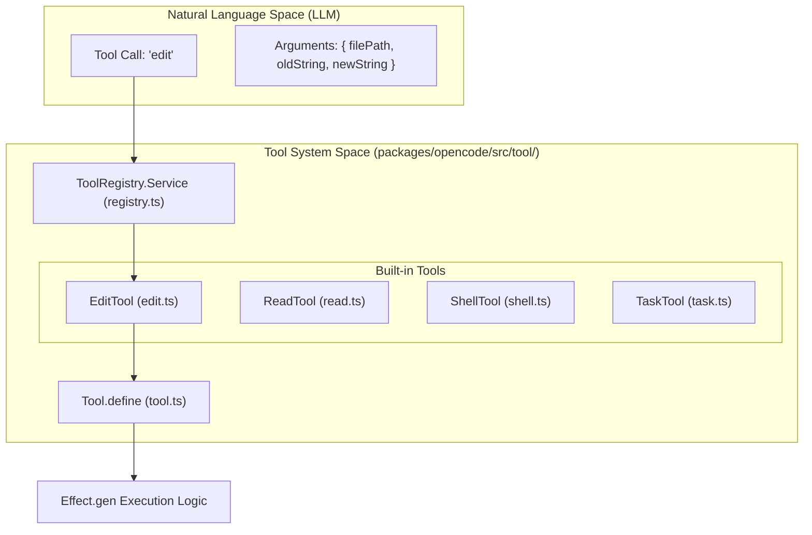
Sources: [packages/opencode/src/tool/registry.ts:112-140](), [packages/opencode/src/tool/tool.ts:132-150]()

## Core Built-in Tools

BrowserCode provides a comprehensive suite of tools for repository manipulation and web interaction.

### File Manipulation
| Tool | File | Purpose | Key Features |
| :--- | :--- | :--- | :--- |
| `read` | `read.ts` | Reads file/directory content | Line-based reading, binary detection, PDF/Image attachment support [packages/opencode/src/tool/read.ts:106-147](). |
| `write` | `write.ts` | Overwrites or creates files | Integration with LSP for immediate diagnostic feedback [packages/opencode/src/tool/write.ts:76-90](). |
| `edit` | `edit.ts` | Performs precise string replacement | Search-and-replace with support for multiple occurrences and BOM preservation [packages/opencode/src/tool/edit.ts:129-151](). |
| `apply_patch` | `apply_patch.ts` | Applies unified diff patches | Efficiently applies standard patches to files. |

### Search and Exploration
| Tool | File | Purpose | Implementation |
| :--- | :--- | :--- | :--- |
| `grep` | `grep.ts` | Content search across files | Powered by `Ripgrep.Service` [packages/opencode/src/tool/registry.ts:137](). |
| `glob` | `glob.ts` | Filename pattern matching | Uses the `Glob` utility for file discovery. |
| `lsp` | `lsp.ts` | Language Server Protocol queries | Provides hover, definition, and reference information [packages/opencode/src/tool/lsp.ts](). |

### Execution and Orchestration
| Tool | File | Purpose | Implementation |
| :--- | :--- | :--- | :--- |
| `shell` | `shell.ts` | Executes bash/shell commands | Runs in the project's working directory. |
| `task` | `task.ts` | Spawns sub-agents | Creates a new `Session` with derived permissions for a specialized task [packages/opencode/src/tool/task.ts:144-161](). |
| `skill` | `skill.ts` | Loads specialized instructions | Injects `SKILL.md` content into the agent's system prompt context [packages/opencode/src/session/system.ts:65-78](). |

### Web Capabilities
| Tool | File | Purpose | Implementation |
| :--- | :--- | :--- | :--- |
| `webfetch` | `webfetch.ts` | Fetches URL content | Converts HTML to Markdown/Text; supports `fetch-use` cloud proxy [packages/opencode/src/tool/webfetch.ts:60-165](). |
| `websearch` | `websearch.ts` | Performs web searches | Integrated search via Exa or Opencode Search. |
| `browser_execute`| `browser-execute.ts` | Controls a real browser | Executes CDP commands via `bcode-browser` [packages/opencode/src/tool/registry.ts:139](). |

Sources: [packages/opencode/src/tool/registry.ts:121-140](), [packages/opencode/src/tool/read.ts:37-38](), [packages/opencode/src/tool/edit.ts:58-59](), [packages/opencode/src/tool/task.ts:95-96]()

## Data Flow: Tool Execution

Tool execution follows a strict lifecycle involving argument decoding, permission gating, and output processing.

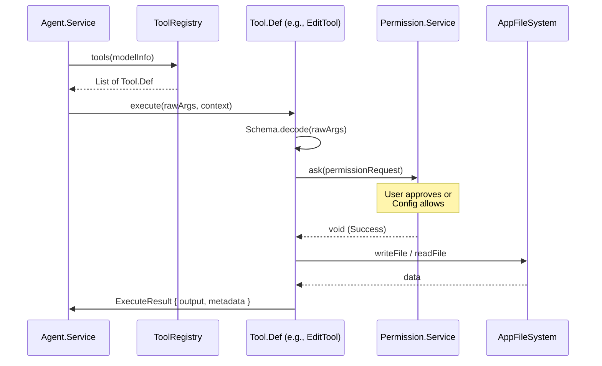
Sources: [packages/opencode/src/tool/tool.ts:93-128](), [packages/opencode/src/tool/edit.ts:88-149](), [packages/opencode/src/tool/registry.ts:146-175]()

## Permission Gating

Before any tool performs a side-effecting action, it must call `ctx.ask` [packages/opencode/src/tool/tool.ts:25](). This triggers the permission system:

1.  **Request Construction**: The tool provides the permission type (e.g., `edit`, `shell`), the target patterns (e.g., file paths), and metadata for the UI [packages/opencode/src/tool/edit.ts:141-149]().
2.  **Config Evaluation**: The `Permission.Service` checks the `Config.Service` for `allow`/`deny` rules.
3.  **User Interaction**: If no rule matches, the execution pauses, and a request is sent to the UI (TUI/Web/Desktop) for manual approval.

Sources: [packages/opencode/src/tool/edit.ts:141-149](), [packages/opencode/src/tool/write.ts:54-62](), [packages/opencode/src/tool/webfetch.ts:43-52]()

## Plugin Tool Integration

Plugins can extend the Tool System by defining custom tools in their `server` hook.

1.  **Definition**: Plugins return a `tool` object where keys are tool names and values are `ToolDefinition` objects [packages/plugin/src/index.ts:239-241]().
2.  **Registration**: The `Plugin.Service` loads these hooks, and `ToolRegistry` converts them into the internal `Tool.Def` format [packages/opencode/src/tool/registry.ts:146-180]().
3.  **Context**: Plugin tools receive a `PluginToolContext`, which provides a limited version of the agent's capabilities, such as `ask`, `directory`, and `worktree` [packages/opencode/src/tool/registry.ts:163-168]().

Sources: [packages/opencode/src/plugin/index.ts:105-116](), [packages/opencode/src/tool/registry.ts:146-180](), [packages/plugin/src/index.ts:239-241]()

---

# Page: Provider and LLM Abstraction

# Provider and LLM Abstraction

<details>
<summary>Relevant source files</summary>

The following files were used as context for generating this wiki page:

- [packages/core/src/plugin/provider/nvidia.ts](packages/core/src/plugin/provider/nvidia.ts)
- [packages/core/test/plugin/provider-nvidia.test.ts](packages/core/test/plugin/provider-nvidia.test.ts)
- [packages/llm/example/tutorial.ts](packages/llm/example/tutorial.ts)
- [packages/llm/src/index.ts](packages/llm/src/index.ts)
- [packages/llm/src/protocols/anthropic-messages.ts](packages/llm/src/protocols/anthropic-messages.ts)
- [packages/llm/src/protocols/bedrock-converse.ts](packages/llm/src/protocols/bedrock-converse.ts)
- [packages/llm/src/protocols/gemini.ts](packages/llm/src/protocols/gemini.ts)
- [packages/llm/src/protocols/openai-chat.ts](packages/llm/src/protocols/openai-chat.ts)
- [packages/llm/src/protocols/openai-responses.ts](packages/llm/src/protocols/openai-responses.ts)
- [packages/llm/src/protocols/shared.ts](packages/llm/src/protocols/shared.ts)
- [packages/llm/src/protocols/utils/lifecycle.ts](packages/llm/src/protocols/utils/lifecycle.ts)
- [packages/llm/src/protocols/utils/tool-stream.ts](packages/llm/src/protocols/utils/tool-stream.ts)
- [packages/llm/src/schema/errors.ts](packages/llm/src/schema/errors.ts)
- [packages/llm/src/schema/events.ts](packages/llm/src/schema/events.ts)
- [packages/llm/src/tool-runtime.ts](packages/llm/src/tool-runtime.ts)
- [packages/llm/src/tool.ts](packages/llm/src/tool.ts)
- [packages/llm/test/adapter.test.ts](packages/llm/test/adapter.test.ts)
- [packages/llm/test/llm.test.ts](packages/llm/test/llm.test.ts)
- [packages/llm/test/provider/anthropic-messages.test.ts](packages/llm/test/provider/anthropic-messages.test.ts)
- [packages/llm/test/provider/bedrock-converse.test.ts](packages/llm/test/provider/bedrock-converse.test.ts)
- [packages/llm/test/provider/gemini.test.ts](packages/llm/test/provider/gemini.test.ts)
- [packages/llm/test/provider/openai-chat.test.ts](packages/llm/test/provider/openai-chat.test.ts)
- [packages/llm/test/provider/openai-compatible-chat.test.ts](packages/llm/test/provider/openai-compatible-chat.test.ts)
- [packages/llm/test/provider/openai-responses.test.ts](packages/llm/test/provider/openai-responses.test.ts)
- [packages/llm/test/recorded-scenarios.ts](packages/llm/test/recorded-scenarios.ts)
- [packages/llm/test/schema.test.ts](packages/llm/test/schema.test.ts)
- [packages/llm/test/tool-runtime.test.ts](packages/llm/test/tool-runtime.test.ts)
- [packages/opencode/src/cli/cmd/models.ts](packages/opencode/src/cli/cmd/models.ts)
- [packages/opencode/src/env/index.ts](packages/opencode/src/env/index.ts)
- [packages/opencode/src/provider/error.ts](packages/opencode/src/provider/error.ts)
- [packages/opencode/src/provider/provider.ts](packages/opencode/src/provider/provider.ts)
- [packages/opencode/src/provider/transform.ts](packages/opencode/src/provider/transform.ts)
- [packages/opencode/src/session/compaction.ts](packages/opencode/src/session/compaction.ts)
- [packages/opencode/src/session/llm.ts](packages/opencode/src/session/llm.ts)
- [packages/opencode/src/session/message-v2.ts](packages/opencode/src/session/message-v2.ts)
- [packages/opencode/src/session/processor.ts](packages/opencode/src/session/processor.ts)
- [packages/opencode/src/session/prompt.ts](packages/opencode/src/session/prompt.ts)
- [packages/opencode/src/session/summary.ts](packages/opencode/src/session/summary.ts)
- [packages/opencode/test/provider/amazon-bedrock.test.ts](packages/opencode/test/provider/amazon-bedrock.test.ts)
- [packages/opencode/test/provider/gitlab-duo.test.ts](packages/opencode/test/provider/gitlab-duo.test.ts)
- [packages/opencode/test/provider/provider.test.ts](packages/opencode/test/provider/provider.test.ts)
- [packages/opencode/test/provider/transform.test.ts](packages/opencode/test/provider/transform.test.ts)
- [packages/opencode/test/session/compaction.test.ts](packages/opencode/test/session/compaction.test.ts)
- [packages/opencode/test/session/llm.test.ts](packages/opencode/test/session/llm.test.ts)
- [packages/opencode/test/session/message-v2.test.ts](packages/opencode/test/session/message-v2.test.ts)
- [packages/opencode/test/session/processor-effect.test.ts](packages/opencode/test/session/processor-effect.test.ts)
- [packages/opencode/test/session/prompt.test.ts](packages/opencode/test/session/prompt.test.ts)
- [packages/opencode/test/session/snapshot-tool-race.test.ts](packages/opencode/test/session/snapshot-tool-race.test.ts)
- [packages/web/src/content/docs/ar/providers.mdx](packages/web/src/content/docs/ar/providers.mdx)
- [packages/web/src/content/docs/bs/providers.mdx](packages/web/src/content/docs/bs/providers.mdx)
- [packages/web/src/content/docs/da/providers.mdx](packages/web/src/content/docs/da/providers.mdx)
- [packages/web/src/content/docs/de/providers.mdx](packages/web/src/content/docs/de/providers.mdx)
- [packages/web/src/content/docs/es/providers.mdx](packages/web/src/content/docs/es/providers.mdx)
- [packages/web/src/content/docs/fr/providers.mdx](packages/web/src/content/docs/fr/providers.mdx)
- [packages/web/src/content/docs/it/providers.mdx](packages/web/src/content/docs/it/providers.mdx)
- [packages/web/src/content/docs/ja/providers.mdx](packages/web/src/content/docs/ja/providers.mdx)
- [packages/web/src/content/docs/ko/providers.mdx](packages/web/src/content/docs/ko/providers.mdx)
- [packages/web/src/content/docs/nb/providers.mdx](packages/web/src/content/docs/nb/providers.mdx)
- [packages/web/src/content/docs/pl/providers.mdx](packages/web/src/content/docs/pl/providers.mdx)
- [packages/web/src/content/docs/providers.mdx](packages/web/src/content/docs/providers.mdx)
- [packages/web/src/content/docs/zh-cn/providers.mdx](packages/web/src/content/docs/zh-cn/providers.mdx)
- [packages/web/src/content/docs/zh-tw/providers.mdx](packages/web/src/content/docs/zh-tw/providers.mdx)

</details>


The Provider and LLM Abstraction layer in BrowserCode/OpenCode provides a unified interface for interacting with over 75 LLM providers. It leverages the Vercel AI SDK and the `models.dev` catalog to handle multi-provider support, including Anthropic, OpenAI, AWS Bedrock, Google Vertex/AI, and Mistral. This layer is responsible for model discovery, credential management, message transformation (shims), and the orchestration of streaming responses.

## Provider Service Architecture

The `Provider.Service` is the central hub for managing LLM providers and their respective models. It handles the lifecycle of provider configurations, model listing, and the instantiation of language model objects.

### Key Responsibilities
- **Model Cataloging**: Consumes `models.dev` definitions to provide a standard set of capabilities and costs for known models [packages/opencode/src/provider/provider.ts:11]().
- **Dynamic Discovery**: Supports discovering models at runtime for providers like OpenRouter or local Ollama instances [packages/opencode/src/provider/provider.ts:121-128]().
- **Credential Resolution**: Interfaces with `Auth.Service` and `Env` to resolve API keys, AWS profiles, or OAuth tokens [packages/opencode/src/provider/provider.ts:12-13]().
- **Provider Shims**: Wraps standard SDKs with `ProviderTransform` to handle provider-specific quirks (e.g., Anthropic's requirement for non-empty messages) [packages/opencode/src/provider/provider.ts:26]().

### Data Flow: Provider Resolution
The following diagram illustrates how the system resolves a model request from a session into a functional LLM instance.

**Provider Resolution Logic**
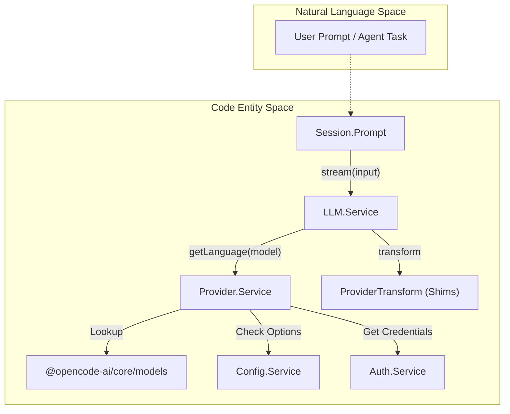
Sources: [packages/opencode/src/session/prompt.ts:40](), [packages/opencode/src/session/llm.ts:71-74](), [packages/opencode/src/provider/provider.ts:11-13]()

## LLM Orchestration Layer

The `LLM.Service` acts as the orchestration layer between the high-level Agent/Session logic and the low-level Provider instances. It manages the construction of system prompts, tool injection, and the execution of the chat loop.

### Streaming and SSE Handling
To ensure reliability during long-running inference, the system includes an SSE (Server-Sent Events) wrapper that implements read timeouts. If a provider stops sending chunks without closing the connection, the `wrapSSE` function aborts the controller to prevent hanging the agent loop [packages/opencode/src/provider/provider.ts:39-85]().

### Provider Shims (`ProviderTransform`)
Different LLM providers have varying requirements for message structures. `ProviderTransform` provides a set of "sanitization" functions:
- **Surrogate Pair Cleaning**: Replaces invalid UTF-16 surrogates that often cause crashes in JSON serialization [packages/opencode/src/provider/transform.ts:21-23]().
- **Empty Message Filtering**: Anthropic and Bedrock reject messages with empty content; the shim filters these out or removes empty text parts [packages/opencode/src/provider/transform.ts:128-153]().
- **Tool ID Scrubbing**: Claude requires tool IDs to match specific regex patterns (`[a-zA-Z0-9_-]`); the shim automatically scrubs invalid characters from tool call IDs [packages/opencode/src/provider/transform.ts:183-206]().

Sources: [packages/opencode/src/provider/transform.ts:21-23](), [packages/opencode/src/provider/transform.ts:128-153](), [packages/opencode/src/provider/transform.ts:183-206]()

## Multi-Provider Support

The system maintains a registry of `BUNDLED_PROVIDERS` which are dynamically imported to keep the initial binary size small while supporting a vast array of APIs.

| Provider Category | Key Packages / APIs | Implementation Detail |
| :--- | :--- | :--- |
| **Cloud Native** | Bedrock, Vertex AI, Azure | Uses specialized SDKs for AWS/GCP/Azure authentication chains [packages/opencode/src/provider/provider.ts:92-98](). |
| **Standard APIs** | Anthropic, OpenAI, Mistral | Standard REST wrappers with `ProviderTransform` shims [packages/opencode/src/provider/provider.ts:93-103](). |
| **Aggregators** | OpenRouter, DeepInfra | Support for dynamic model discovery [packages/opencode/src/provider/provider.ts:101-105](). |
| **Specialized** | GitHub Copilot, GitLab Duo | Custom shims for enterprise-specific headers and tool protocols [packages/opencode/src/provider/provider.ts:114-115](). |

### Cross-Region Inference & Bedrock
For Amazon Bedrock, the provider abstraction supports complex authentication chains, including `AWS_PROFILE`, `AWS_ACCESS_KEY_ID`, and Web Identity Tokens for EKS environments [packages/web/src/content/docs/providers.mdx:172-186](). It also supports custom VPC endpoints via the `endpoint` or `baseURL` configuration options [packages/web/src/content/docs/providers.mdx:227-241]().

Sources: [packages/opencode/src/provider/provider.ts:91-117](), [packages/web/src/content/docs/providers.mdx:172-186](), [packages/web/src/content/docs/providers.mdx:227-241]()

## Session Context and Compaction

As conversations grow, they may exceed the model's context window. The `SessionCompaction` service monitors token usage and triggers summarization or pruning.

### Compaction Logic
1. **Overflow Detection**: `SessionCompaction.isOverflow` checks if the current message history exceeds the `usable` context for the selected model [packages/opencode/src/session/compaction.ts:189-192]().
2. **Summarization**: The service uses a `SUMMARY_TEMPLATE` to condense the "Done", "In Progress", and "Critical Context" sections of the conversation [packages/opencode/src/session/compaction.ts:44-79]().
3. **Pruning**: Older messages are removed, leaving a "tail" of recent turns to maintain immediate conversation flow [packages/opencode/src/session/compaction.ts:41-43]().

**Compaction Data Flow**
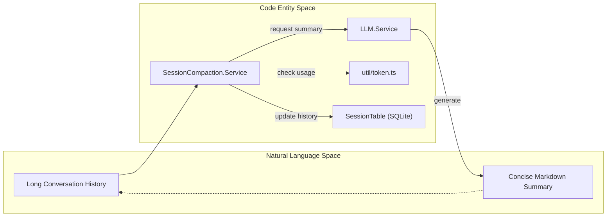
Sources: [packages/opencode/src/session/compaction.ts:44-79](), [packages/opencode/src/session/compaction.ts:189-207](), [packages/opencode/src/session/llm.ts:28]()

## Model Status and Selection

Models are classified by their status to help users choose reliable inference:
- **Active**: Fully supported and tested.
- **Experimental**: New models with potentially unstable tool-calling behavior [packages/opencode/src/provider/provider.ts:29]().
- **Alpha**: Internal or very early stage models [packages/opencode/test/provider/provider.test.ts:105]().

The `models` CLI command (`packages/opencode/src/cli/cmd/models.ts`) allows users to interactively filter and select models based on these statuses and their specific capabilities (e.g., image support, reasoning).

Sources: [packages/opencode/src/provider/provider.ts:27-29](), [packages/opencode/test/provider/provider.test.ts:103-107]()

---

# Page: LSP, Formatting, and File Intelligence

# LSP, Formatting, and File Intelligence

<details>
<summary>Relevant source files</summary>

The following files were used as context for generating this wiki page:

- [packages/opencode/parsers-config.ts](packages/opencode/parsers-config.ts)
- [packages/opencode/src/cli/cmd/debug/agent.ts](packages/opencode/src/cli/cmd/debug/agent.ts)
- [packages/opencode/src/cli/cmd/debug/config.ts](packages/opencode/src/cli/cmd/debug/config.ts)
- [packages/opencode/src/cli/cmd/debug/file.ts](packages/opencode/src/cli/cmd/debug/file.ts)
- [packages/opencode/src/cli/cmd/debug/index.ts](packages/opencode/src/cli/cmd/debug/index.ts)
- [packages/opencode/src/cli/cmd/debug/lsp.ts](packages/opencode/src/cli/cmd/debug/lsp.ts)
- [packages/opencode/src/cli/cmd/debug/ripgrep.ts](packages/opencode/src/cli/cmd/debug/ripgrep.ts)
- [packages/opencode/src/cli/cmd/debug/scrap.ts](packages/opencode/src/cli/cmd/debug/scrap.ts)
- [packages/opencode/src/cli/cmd/debug/skill.ts](packages/opencode/src/cli/cmd/debug/skill.ts)
- [packages/opencode/src/cli/cmd/debug/snapshot.ts](packages/opencode/src/cli/cmd/debug/snapshot.ts)
- [packages/opencode/src/cli/cmd/debug/startup.ts](packages/opencode/src/cli/cmd/debug/startup.ts)
- [packages/opencode/src/cli/cmd/pr.ts](packages/opencode/src/cli/cmd/pr.ts)
- [packages/opencode/src/control-plane/workspace-context.ts](packages/opencode/src/control-plane/workspace-context.ts)
- [packages/opencode/src/effect/app-runtime.ts](packages/opencode/src/effect/app-runtime.ts)
- [packages/opencode/src/effect/bootstrap-runtime.ts](packages/opencode/src/effect/bootstrap-runtime.ts)
- [packages/opencode/src/effect/bridge.ts](packages/opencode/src/effect/bridge.ts)
- [packages/opencode/src/effect/instance-ref.ts](packages/opencode/src/effect/instance-ref.ts)
- [packages/opencode/src/effect/instance-state.ts](packages/opencode/src/effect/instance-state.ts)
- [packages/opencode/src/effect/run-service.ts](packages/opencode/src/effect/run-service.ts)
- [packages/opencode/src/file/index.ts](packages/opencode/src/file/index.ts)
- [packages/opencode/src/file/ripgrep.ts](packages/opencode/src/file/ripgrep.ts)
- [packages/opencode/src/file/watcher.ts](packages/opencode/src/file/watcher.ts)
- [packages/opencode/src/format/formatter.ts](packages/opencode/src/format/formatter.ts)
- [packages/opencode/src/format/index.ts](packages/opencode/src/format/index.ts)
- [packages/opencode/src/git/index.ts](packages/opencode/src/git/index.ts)
- [packages/opencode/src/lsp/client.ts](packages/opencode/src/lsp/client.ts)
- [packages/opencode/src/lsp/language.ts](packages/opencode/src/lsp/language.ts)
- [packages/opencode/src/lsp/lsp.ts](packages/opencode/src/lsp/lsp.ts)
- [packages/opencode/src/lsp/server.ts](packages/opencode/src/lsp/server.ts)
- [packages/opencode/src/project/bootstrap.ts](packages/opencode/src/project/bootstrap.ts)
- [packages/opencode/src/project/vcs.ts](packages/opencode/src/project/vcs.ts)
- [packages/opencode/src/share/session.ts](packages/opencode/src/share/session.ts)
- [packages/opencode/src/snapshot/index.ts](packages/opencode/src/snapshot/index.ts)
- [packages/opencode/src/tool/glob.ts](packages/opencode/src/tool/glob.ts)
- [packages/opencode/src/tool/grep.ts](packages/opencode/src/tool/grep.ts)
- [packages/opencode/test/effect/app-runtime-logger.test.ts](packages/opencode/test/effect/app-runtime-logger.test.ts)
- [packages/opencode/test/effect/instance-state.test.ts](packages/opencode/test/effect/instance-state.test.ts)
- [packages/opencode/test/file/ripgrep.test.ts](packages/opencode/test/file/ripgrep.test.ts)
- [packages/opencode/test/fixture/lsp/fake-lsp-server.js](packages/opencode/test/fixture/lsp/fake-lsp-server.js)
- [packages/opencode/test/format/format.test.ts](packages/opencode/test/format/format.test.ts)
- [packages/opencode/test/git/git.test.ts](packages/opencode/test/git/git.test.ts)
- [packages/opencode/test/lsp/client.test.ts](packages/opencode/test/lsp/client.test.ts)
- [packages/opencode/test/lsp/index.test.ts](packages/opencode/test/lsp/index.test.ts)
- [packages/opencode/test/lsp/lifecycle.test.ts](packages/opencode/test/lsp/lifecycle.test.ts)
- [packages/opencode/test/project/vcs.test.ts](packages/opencode/test/project/vcs.test.ts)
- [packages/opencode/test/server/project-init-git.test.ts](packages/opencode/test/server/project-init-git.test.ts)
- [packages/opencode/test/session/revert-compact.test.ts](packages/opencode/test/session/revert-compact.test.ts)
- [packages/opencode/test/snapshot/snapshot.test.ts](packages/opencode/test/snapshot/snapshot.test.ts)
- [packages/web/src/content/docs/ecosystem.mdx](packages/web/src/content/docs/ecosystem.mdx)
- [packages/web/src/content/docs/formatters.mdx](packages/web/src/content/docs/formatters.mdx)
- [packages/web/src/content/docs/lsp.mdx](packages/web/src/content/docs/lsp.mdx)

</details>


This section covers the subsystems responsible for providing deep code understanding and structural integrity within BrowserCode. This includes the Language Server Protocol (LSP) integration for diagnostics and navigation, the formatting engine for maintaining code style, and file intelligence systems including high-performance search and change tracking.

## LSP Service

The `LSP.Service` manages the lifecycle of Language Servers, enabling the LLM to receive real-time feedback (diagnostics) and perform precise code navigation (definitions, references, hover).

### Language Server Lifecycle
LSP servers are lazily initialized when a file with a matching extension is opened [packages/opencode/src/lsp/lsp.ts:1-10](). The `LSP.Service` maintains a registry of `Info` objects that define how to locate the project root and spawn the server process [packages/opencode/src/lsp/server.ts:59-65]().

Key built-in servers include:
*   **TypeScript/JS**: Uses `typescript-language-server` and resolves the local `tsserver.js` from the project's `node_modules` [packages/opencode/src/lsp/server.ts:95-123]().
*   **ESLint**: Dynamically downloads and compiles the VS Code ESLint server if not present [packages/opencode/src/lsp/server.ts:154-209]().
*   **Deno**: Auto-detects `deno.json` or `deno.jsonc` to start the Deno LSP [packages/opencode/src/lsp/server.ts:67-93]().

### LSP Client Implementation
The `LSP.Client` handles the JSON-RPC communication with the spawned processes [packages/opencode/src/lsp/client.ts:141-144](). It supports both "Push" diagnostics (server-initiated) and "Pull" diagnostics (client-requested) [packages/opencode/src/lsp/client.ts:156-160]().

*   **Diagnostics Debouncing**: To prevent flooding the LLM with transient errors, diagnostics are debounced by 150ms [packages/opencode/src/lsp/client.ts:15]().
*   **Workspace Sync**: Implements `textDocument/didOpen`, `didChange`, and `didSave` to keep the server's virtual filesystem in sync with the agent's edits [packages/opencode/src/lsp/client.ts:380-450]().

### LSP System Architecture
The following diagram illustrates the flow from a file edit to diagnostic feedback.

**LSP Diagnostic Flow**
```mermaid
graph TD
    "Agent.Service" -- "edit_file" --> "File.Service"
    "File.Service" -- "BusEvent(file.edited)" --> "LSP.Service"
    "LSP.Service" -- "didChange" --> "LSP.Client"
    "LSP.Client" -- "JSON-RPC" --> "LSPServerProcess"
    "LSPServerProcess" -- "textDocument/publishDiagnostics" --> "LSP.Client"
    "LSP.Client" -- "Bus.publish" --> "LSP_Diagnostics_Event"
    "LSP_Diagnostics_Event" -- "Feedback" --> "Agent.Service"
```
Sources: [packages/opencode/src/lsp/lsp.ts](), [packages/opencode/src/lsp/client.ts](), [packages/opencode/src/file/index.ts]()

## Formatting Service

The `Format.Service` ensures that any code generated or modified by the LLM adheres to the project's styling rules.

### Auto-Detection and Configuration
The service detects available formatters by checking the project's environment and configuration files [packages/opencode/src/format/index.ts:38-50]().
*   **Prettier**: Enabled if `prettier` is found in `package.json` dependencies [packages/opencode/src/format/formatter.ts:38-85]().
*   **Ruff/UV**: Specifically handles Python projects, preferring `ruff` if configured in `pyproject.toml` [packages/opencode/src/format/formatter.ts:189-247]().
*   **Oxfmt**: An experimental high-performance Rust-based formatter for JS/TS [packages/opencode/src/format/formatter.ts:87-108]().

### Command Execution
Formatters are executed as sub-processes. The service uses `$FILE` substitution to inject the target path into the formatter's CLI arguments [packages/opencode/src/format/index.ts:83-86]().

| Formatter | Detection Logic | Default Command |
| :--- | :--- | :--- |
| `gofmt` | `which("gofmt")` | `["gofmt", "-w", "$FILE"]` |
| `biome` | `biome.json` exists | `["biome", "format", "--write", "$FILE"]` |
| `clang-format` | `.clang-format` exists | `["clang-format", "-i", "$FILE"]` |

Sources: [packages/opencode/src/format/index.ts](), [packages/opencode/src/format/formatter.ts]()

## File Intelligence and Search

BrowserCode utilizes specialized tools for high-speed file discovery and content searching.

### Ripgrep Integration
The `Ripgrep.Service` provides a wrapper around the `rg` binary. It handles platform-specific binary downloads and provides a streaming interface for search results [packages/opencode/src/file/ripgrep.ts:136-140]().
*   **Streaming Results**: Uses `effect/Stream` to process JSON output from `rg --json` [packages/opencode/src/file/ripgrep.ts:188-190]().
*   **Performance**: Implements `core.longpaths` and `core.quotepath=false` to handle complex directory structures [packages/opencode/src/file/ripgrep.ts:34-36]().

### File Watching
The `FileWatcher.Service` uses `@parcel/watcher` to monitor the filesystem for external changes [packages/opencode/src/file/watcher.ts:33-43]().
*   **Native Bindings**: Utilizes native C++ bindings for `inotify` (Linux), `fs-events` (macOS), and `windows` backends [packages/opencode/src/file/watcher.ts:45-49]().
*   **VCS Integration**: Specifically watches the `.git` directory (excluding `HEAD`) to detect branch switches or external commits [packages/opencode/src/file/watcher.ts:130-141]().

Sources: [packages/opencode/src/file/ripgrep.ts](), [packages/opencode/src/file/watcher.ts]()

## Snapshot and Patch System

The `Snapshot.Service` provides a "Git-on-the-side" mechanism to track all changes made during a session, allowing for precise reverts and diff generation without interfering with the user's primary Git state.

### Implementation Details
*   **Shadow Git Directory**: Snapshots are stored in a dedicated directory under `Global.Path.data/snapshot/[project_id]/[hash]` [packages/opencode/src/snapshot/index.ts:81]().
*   **Tracking**: The `track()` function creates a commit in the shadow repository representing the current state of the worktree [packages/opencode/src/snapshot/index.ts:48]().
*   **Patch Generation**: Uses `diff` to create structured patches between snapshots [packages/opencode/src/snapshot/index.ts:3]().

### Data Structures
The system uses `Schema` to define the shape of file changes:
*   `FileDiff`: Contains additions, deletions, and status (`added`, `deleted`, `modified`) [packages/opencode/src/snapshot/index.ts:19-28]().
*   `Patch`: A collection of file paths associated with a specific snapshot hash [packages/opencode/src/snapshot/index.ts:13-16]().

### Snapshot Logic Entity Mapping
The following diagram bridges the internal Git operations to the Snapshot Service interface.

**Snapshot Logic Mapping**
```mermaid
graph LR
    subgraph "Interface (Snapshot.Service)"
        "track()"
        "revert(patches)"
        "diff(hash)"
    end

    subgraph "Git Command Space"
        "git_add"["git add --all --sparse"]
        "git_commit"["git commit -m snapshot"]
        "git_apply"["git apply --reverse"]
        "git_diff"["git diff --cached"]
    end

    "track()" --> "git_add"
    "git_add" --> "git_commit"
    "revert(patches)" --> "git_apply"
    "diff(hash)" --> "git_diff"
```
Sources: [packages/opencode/src/snapshot/index.ts](), [packages/opencode/test/snapshot/snapshot.test.ts]()

---

# Page: MCP Integration

# MCP Integration

<details>
<summary>Relevant source files</summary>

The following files were used as context for generating this wiki page:

- [github/README.md](github/README.md)
- [github/action.yml](github/action.yml)
- [github/index.ts](github/index.ts)
- [packages/opencode/src/cli/cmd/agent.ts](packages/opencode/src/cli/cmd/agent.ts)
- [packages/opencode/src/cli/cmd/github.ts](packages/opencode/src/cli/cmd/github.ts)
- [packages/opencode/src/cli/cmd/mcp.ts](packages/opencode/src/cli/cmd/mcp.ts)
- [packages/opencode/src/cli/cmd/providers.ts](packages/opencode/src/cli/cmd/providers.ts)
- [packages/opencode/src/cli/cmd/tui/routes/session/sidebar.tsx](packages/opencode/src/cli/cmd/tui/routes/session/sidebar.tsx)
- [packages/opencode/src/command/index.ts](packages/opencode/src/command/index.ts)
- [packages/opencode/src/mcp/auth.ts](packages/opencode/src/mcp/auth.ts)
- [packages/opencode/src/mcp/index.ts](packages/opencode/src/mcp/index.ts)
- [packages/opencode/src/mcp/oauth-callback.ts](packages/opencode/src/mcp/oauth-callback.ts)
- [packages/opencode/src/mcp/oauth-provider.ts](packages/opencode/src/mcp/oauth-provider.ts)
- [packages/opencode/src/plugin/codex.ts](packages/opencode/src/plugin/codex.ts)
- [packages/opencode/test/cli/github-action.test.ts](packages/opencode/test/cli/github-action.test.ts)
- [packages/opencode/test/mcp/headers.test.ts](packages/opencode/test/mcp/headers.test.ts)
- [packages/opencode/test/mcp/lifecycle.test.ts](packages/opencode/test/mcp/lifecycle.test.ts)
- [packages/opencode/test/mcp/oauth-auto-connect.test.ts](packages/opencode/test/mcp/oauth-auto-connect.test.ts)
- [packages/opencode/test/mcp/oauth-callback.test.ts](packages/opencode/test/mcp/oauth-callback.test.ts)
- [packages/web/src/content/docs/commands.mdx](packages/web/src/content/docs/commands.mdx)
- [packages/web/src/content/docs/github.mdx](packages/web/src/content/docs/github.mdx)
- [packages/web/src/content/docs/gitlab.mdx](packages/web/src/content/docs/gitlab.mdx)
- [packages/web/src/content/docs/mcp-servers.mdx](packages/web/src/content/docs/mcp-servers.mdx)

</details>


The **Model Context Protocol (MCP)** integration allows BrowserCode to extend its capabilities by connecting to external tool servers. The system supports local servers via `stdio` and remote servers via `HTTP/SSE`. It includes a robust authentication layer for OAuth/PKCE and integrates these external tools directly into the agent's runtime and the command palette.

## MCP Service Architecture

The `MCP.Service` manages the lifecycle of MCP clients, including discovery, connection, and tool conversion. It abstracts the underlying transport mechanisms provided by the `@modelcontextprotocol/sdk`.

### Transport Modes
BrowserCode supports three primary transport types for MCP:
1.  **Stdio**: For local processes started via a command. [packages/opencode/src/mcp/index.ts:5-5]()
2.  **SSE (Server-Sent Events)**: For remote servers providing a persistent event stream. [packages/opencode/src/mcp/index.ts:4-4]()
3.  **HTTP**: For stateless remote requests. [packages/opencode/src/mcp/index.ts:3-3]()

### Implementation Logic
The service iterates through the `mcp` configuration in `opencode.jsonc`. For each enabled server, it initializes a `Client` and attempts to list available tools.

| Component | Entity Space Identifier | Description |
| :--- | :--- | :--- |
| **Tool Discovery** | `listTools` | Fetches tool definitions from the MCP server with fallback for schema validation errors. [packages/opencode/src/mcp/index.ts:124-151]() |
| **Tool Conversion** | `convertMcpTool` | Transforms an MCP tool definition into an AI SDK `Tool` type for agent consumption. [packages/opencode/src/mcp/index.ts:154-182]() |
| **Status Tracking** | `MCPStatus` | A tagged union tracking whether a server is `connected`, `needs_auth`, `failed`, or `disabled`. [packages/opencode/src/mcp/index.ts:89-95]() |

**Sources:** [packages/opencode/src/mcp/index.ts:1-182](), [packages/web/src/content/docs/mcp-servers.mdx:70-163]()

## Authentication and OAuth/PKCE

For remote MCP servers that require authorization, BrowserCode implements an OAuth 2.0 flow with **Dynamic Client Registration (RFC 7591)** and **PKCE**.

### Data Flow: OAuth Flow
The `McpAuth.Service` persists tokens and client information in a local JSON file (`mcp-auth.json`). [packages/opencode/src/mcp/auth.ts:34-34]()

```mermaid
sequenceDiagram
    participant Agent as Agent Runtime
    participant MCP as MCP.Service
    participant Auth as McpAuth.Service
    participant Remote as Remote MCP Server

    Agent->>MCP: Call Tool
    MCP->>Remote: Request (No Token)
    Remote-->>MCP: 401 Unauthorized
    MCP->>Auth: Get Stored Tokens
    Auth-->>MCP: None Found
    MCP-->>Agent: Status: needs_auth
    Note over Agent, Remote: User runs "opencode mcp auth"
    Remote->>Remote: Dynamic Client Registration
    Remote-->>MCP: ClientID / Secret
    MCP->>Auth: Save ClientInfo
```
**Sources:** [packages/opencode/src/mcp/auth.ts:6-29](), [packages/opencode/src/mcp/index.ts:81-83](), [packages/web/src/content/docs/mcp-servers.mdx:166-192]()

### CodexAuthPlugin
The `CodexAuthPlugin` is a specialized implementation for OpenAI's Codex/ChatGPT backend. It handles a complex PKCE flow including local server redirection on port `1455` to capture the authorization code. [packages/opencode/src/plugin/codex.ts:12-15]()

- **PKCE Generation**: Uses `crypto.subtle.digest` to create challenges. [packages/opencode/src/plugin/codex.ts:31-38]()
- **JWT Parsing**: Extracts `chatgpt_account_id` from identity tokens to manage multi-organization access. [packages/opencode/src/plugin/codex.ts:67-96]()

**Sources:** [packages/opencode/src/plugin/codex.ts:1-153]()

## Command Integration

The `Command.Service` aggregates prompts and tools from various sources (Built-in, MCP, and Skills) into a unified registry.

### MCP Prompt Resolution
MCP servers can expose "Prompts" (templates) in addition to tools. The `Command.Service` resolves these prompts by:
1.  Listing prompts via the MCP client. [packages/opencode/src/command/index.ts:112-112]()
2.  Mapping MCP arguments to `$1`, `$2`, etc., syntax. [packages/opencode/src/command/index.ts:124-124]()
3.  Wrapping the resolution in a `Promise` within the `Info` object to allow lazy loading. [packages/opencode/src/command/index.ts:41-41]()

### Unified Command Structure
```mermaid
graph TD
    subgraph "Command.Service"
        Registry["commands: Record<string, Info>"]
    end

    subgraph "Sources"
        Builtin["Default (init, review)"]
        Config["opencode.jsonc (command)"]
        MCP["MCP.Service (prompts)"]
        Skill["Skill.Service (all)"]
    end

    Builtin --> Registry
    Config --> Registry
    MCP --> Registry
    Skill --> Registry

    Registry --> TUI["TUI Sidebar/Prompt"]
```
**Sources:** [packages/opencode/src/command/index.ts:65-157]()

## CLI Commands (`mcp`)

The `mcp` CLI group provides management utilities for the protocol.

| Command | Function | Entity Site |
| :--- | :--- | :--- |
| `list` | Displays connectivity status, OAuth state, and transport details for all configured servers. | [packages/opencode/src/cli/cmd/mcp.ts:109-168]() |
| `add` | Interactively adds a local or remote server to `opencode.jsonc`. | [packages/opencode/src/cli/cmd/mcp.ts:100-100]() |
| `auth` | Triggers the OAuth flow for a specific server, opening the system browser. | [packages/opencode/src/cli/cmd/mcp.ts:170-220]() |
| `logout` | Removes stored tokens and client registrations for a server. | [packages/opencode/src/cli/cmd/mcp.ts:103-103]() |

**Sources:** [packages/opencode/src/cli/cmd/mcp.ts:95-220]()

## GitHub Integration (Agent Mode)

While not a standard MCP server, the `GithubCommand` utilizes similar patterns to bridge external environments (GitHub Actions) with the BrowserCode agent.

- **Triggering**: Listens for `issue_comment`, `pull_request`, and `schedule` events. [packages/opencode/src/cli/cmd/github.ts:148-150]()
- **Action Flow**: When a `/oc` or `/opencode` comment is detected, it initializes a `Session` and executes the requested task within the runner. [packages/opencode/src/cli/cmd/github.ts:53-55]()
- **Context Handling**: It extracts diff context and file paths specifically for `pull_request_review_comment` events. [packages/opencode/src/cli/cmd/github.ts:51-54]()

**Sources:** [packages/opencode/src/cli/cmd/github.ts:141-182](), [github/README.md:33-50]()

---

# Page: Storage, Database, and Effect Runtime

# Storage, Database, and Effect Runtime

<details>
<summary>Relevant source files</summary>

The following files were used as context for generating this wiki page:

- [packages/core/src/flag/flag.ts](packages/core/src/flag/flag.ts)
- [packages/desktop/src/main/env.d.ts](packages/desktop/src/main/env.d.ts)
- [packages/http-recorder/README.md](packages/http-recorder/README.md)
- [packages/http-recorder/src/cassette.ts](packages/http-recorder/src/cassette.ts)
- [packages/http-recorder/src/effect.ts](packages/http-recorder/src/effect.ts)
- [packages/http-recorder/src/index.ts](packages/http-recorder/src/index.ts)
- [packages/http-recorder/src/matching.ts](packages/http-recorder/src/matching.ts)
- [packages/http-recorder/src/recorder.ts](packages/http-recorder/src/recorder.ts)
- [packages/http-recorder/src/redaction.ts](packages/http-recorder/src/redaction.ts)
- [packages/http-recorder/src/schema.ts](packages/http-recorder/src/schema.ts)
- [packages/http-recorder/src/websocket.ts](packages/http-recorder/src/websocket.ts)
- [packages/http-recorder/test/record-replay.test.ts](packages/http-recorder/test/record-replay.test.ts)
- [packages/llm/test/recorded-test.ts](packages/llm/test/recorded-test.ts)
- [packages/llm/test/recorded-websocket.ts](packages/llm/test/recorded-websocket.ts)
- [packages/opencode/migration/20260413175956_chief_energizer/migration.sql](packages/opencode/migration/20260413175956_chief_energizer/migration.sql)
- [packages/opencode/migration/20260413175956_chief_energizer/snapshot.json](packages/opencode/migration/20260413175956_chief_energizer/snapshot.json)
- [packages/opencode/migration/20260510033149_session_usage/migration.sql](packages/opencode/migration/20260510033149_session_usage/migration.sql)
- [packages/opencode/migration/20260510033149_session_usage/snapshot.json](packages/opencode/migration/20260510033149_session_usage/snapshot.json)
- [packages/opencode/migration/20260511000411_data_migration_state/migration.sql](packages/opencode/migration/20260511000411_data_migration_state/migration.sql)
- [packages/opencode/migration/20260511000411_data_migration_state/snapshot.json](packages/opencode/migration/20260511000411_data_migration_state/snapshot.json)
- [packages/opencode/src/auth/index.ts](packages/opencode/src/auth/index.ts)
- [packages/opencode/src/cli/cmd/db.ts](packages/opencode/src/cli/cmd/db.ts)
- [packages/opencode/src/cli/cmd/tui/context/aggregate-failures.ts](packages/opencode/src/cli/cmd/tui/context/aggregate-failures.ts)
- [packages/opencode/src/control-plane/adapters/index.ts](packages/opencode/src/control-plane/adapters/index.ts)
- [packages/opencode/src/control-plane/adapters/worktree.ts](packages/opencode/src/control-plane/adapters/worktree.ts)
- [packages/opencode/src/control-plane/types.ts](packages/opencode/src/control-plane/types.ts)
- [packages/opencode/src/control-plane/workspace.sql.ts](packages/opencode/src/control-plane/workspace.sql.ts)
- [packages/opencode/src/control-plane/workspace.ts](packages/opencode/src/control-plane/workspace.ts)
- [packages/opencode/src/data-migration.sql.ts](packages/opencode/src/data-migration.sql.ts)
- [packages/opencode/src/data-migration.ts](packages/opencode/src/data-migration.ts)
- [packages/opencode/src/effect/runtime-flags.ts](packages/opencode/src/effect/runtime-flags.ts)
- [packages/opencode/src/event-v2-bridge.ts](packages/opencode/src/event-v2-bridge.ts)
- [packages/opencode/src/provider/auth.ts](packages/opencode/src/provider/auth.ts)
- [packages/opencode/src/server/projectors.ts](packages/opencode/src/server/projectors.ts)
- [packages/opencode/src/server/routes/instance/httpapi/AGENTS.md](packages/opencode/src/server/routes/instance/httpapi/AGENTS.md)
- [packages/opencode/src/server/routes/instance/httpapi/errors.ts](packages/opencode/src/server/routes/instance/httpapi/errors.ts)
- [packages/opencode/src/server/routes/instance/httpapi/groups/global.ts](packages/opencode/src/server/routes/instance/httpapi/groups/global.ts)
- [packages/opencode/src/server/routes/instance/httpapi/handlers/session-errors.ts](packages/opencode/src/server/routes/instance/httpapi/handlers/session-errors.ts)
- [packages/opencode/src/session/projectors.ts](packages/opencode/src/session/projectors.ts)
- [packages/opencode/src/session/session.sql.ts](packages/opencode/src/session/session.sql.ts)
- [packages/opencode/src/skill/index.ts](packages/opencode/src/skill/index.ts)
- [packages/opencode/src/storage/db.ts](packages/opencode/src/storage/db.ts)
- [packages/opencode/src/storage/storage.ts](packages/opencode/src/storage/storage.ts)
- [packages/opencode/src/sync/index.ts](packages/opencode/src/sync/index.ts)
- [packages/opencode/src/util/filesystem.ts](packages/opencode/src/util/filesystem.ts)
- [packages/opencode/src/v2/session.ts](packages/opencode/src/v2/session.ts)
- [packages/opencode/test/cli/cmd/tui/aggregate-failures.test.ts](packages/opencode/test/cli/cmd/tui/aggregate-failures.test.ts)
- [packages/opencode/test/cli/tui/thread.test.ts](packages/opencode/test/cli/tui/thread.test.ts)
- [packages/opencode/test/control-plane/workspace.test.ts](packages/opencode/test/control-plane/workspace.test.ts)
- [packages/opencode/test/effect/runtime-flags.test.ts](packages/opencode/test/effect/runtime-flags.test.ts)
- [packages/opencode/test/fixture/db.ts](packages/opencode/test/fixture/db.ts)
- [packages/opencode/test/fixture/flag.ts](packages/opencode/test/fixture/flag.ts)
- [packages/opencode/test/fixture/workspace.ts](packages/opencode/test/fixture/workspace.ts)
- [packages/opencode/test/plugin/trigger.test.ts](packages/opencode/test/plugin/trigger.test.ts)
- [packages/opencode/test/plugin/workspace-adapter.test.ts](packages/opencode/test/plugin/workspace-adapter.test.ts)
- [packages/opencode/test/preload.ts](packages/opencode/test/preload.ts)
- [packages/opencode/test/server/httpapi-instance-context.test.ts](packages/opencode/test/server/httpapi-instance-context.test.ts)
- [packages/opencode/test/server/httpapi-promptasync-context.test.ts](packages/opencode/test/server/httpapi-promptasync-context.test.ts)
- [packages/opencode/test/server/httpapi-workspace-routing.test.ts](packages/opencode/test/server/httpapi-workspace-routing.test.ts)
- [packages/opencode/test/server/session-messages.test.ts](packages/opencode/test/server/session-messages.test.ts)
- [packages/opencode/test/session/system.test.ts](packages/opencode/test/session/system.test.ts)
- [packages/opencode/test/skill/skill.test.ts](packages/opencode/test/skill/skill.test.ts)
- [packages/opencode/test/storage/db.test.ts](packages/opencode/test/storage/db.test.ts)
- [packages/opencode/test/storage/storage.test.ts](packages/opencode/test/storage/storage.test.ts)
- [packages/opencode/test/sync/index.test.ts](packages/opencode/test/sync/index.test.ts)
- [packages/opencode/test/util/filesystem.test.ts](packages/opencode/test/util/filesystem.test.ts)

</details>


This section covers the persistence layer and execution environment of BrowserCode. It details the transition from file-based storage to a relational SQLite database, the configuration of the Effect runtime, and the mechanisms for managing authentication and test recording.

## Database and Drizzle ORM

BrowserCode uses **SQLite** as its primary data store, managed through the **Drizzle ORM**. The database handles structured data including sessions, projects, workspaces, and event logs.

### Database Initialization and Connection
The database connection is managed by `Database.Service`. In test environments, the system often defaults to an in-memory SQLite instance via the `OPENCODE_DB` environment variable `[packages/opencode/test/preload.ts:80-80]()`.

*   **Migrations**: Schema changes are handled via Drizzle migrations. The CLI provides a `db` command to manage these `[packages/opencode/src/cli/cmd/db.ts:1-20]()`. Migrations can be skipped using the `OPENCODE_SKIP_MIGRATIONS` flag `[packages/core/src/flag/flag.ts:65-65]()`.
*   **Transaction Handling**: The system supports immediate transactions to ensure data consistency during concurrent writes, particularly within the event sync system `[packages/opencode/src/sync/index.ts:164-181]()`.

### Table Schemas
Key tables include:
*   **SessionTable**: Stores session metadata and state `[packages/opencode/src/session/session.sql.ts:1-10]()`.
*   **WorkspaceTable**: Manages cloud and local workspace environments `[packages/opencode/src/control-plane/workspace.sql:1-20]()`.
*   **EventTable & EventSequenceTable**: Power the legacy sync system by tracking ordered events for specific aggregates `[packages/opencode/src/sync/event.sql:1-20]()`.

**Sources:** `[packages/opencode/src/storage/db.ts]()`, `[packages/opencode/src/sync/index.ts]()`, `[packages/core/src/flag/flag.ts]()`, `[packages/opencode/test/preload.ts]()`.

---

## Storage.ts and File Persistence

Before the full migration to SQLite, and for specific unstructured data, `Storage.Service` provides a JSON-based file persistence layer.

### Key Functions
*   **Read/Write**: Provides type-safe access to JSON files using Effect schemas `[packages/opencode/src/storage/storage.ts:61-63]()`.
*   **Migrations**: `Storage.ts` contains legacy migration logic (e.g., `migration.1`, `migration.2`) that transforms older directory structures into the current format, moving session and message data into organized subdirectories `[packages/opencode/src/storage/storage.ts:87-202]()`.

### Path Resolution
The system uses a custom `resolve` utility to handle path normalization across platforms, specifically translating Git Bash, Cygwin, and WSL paths to canonical Windows paths when necessary `[packages/opencode/src/util/filesystem.ts:136-144]()`, `[packages/opencode/src/util/filesystem.ts:152-164]()`.

**Sources:** `[packages/opencode/src/storage/storage.ts]()`, `[packages/opencode/src/util/filesystem.ts]()`.

---

## Effect Runtime and Flags

The codebase is built on the **Effect** library, which provides a functional, type-safe runtime for dependency injection and error handling.

### Runtime Flags
`RuntimeFlags.Service` centralizes feature toggles and experimental settings. These are parsed from environment variables prefixed with `OPENCODE_`.

| Flag | Purpose | Source |
| :--- | :--- | :--- |
| `pure` | Runs the agent in a restricted environment | `[packages/opencode/src/effect/runtime-flags.ts:16-16]()` |
| `experimentalWorkspaces` | Enables multi-workspace support | `[packages/opencode/src/effect/runtime-flags.ts:42-42]()` |
| `enableParallel` | Allows parallel tool execution | `[packages/opencode/src/effect/runtime-flags.ts:29-32]()` |
| `autoShare` | Automatically shares session snapshots | `[packages/opencode/src/effect/runtime-flags.ts:15-15]()` |

### InstanceState Pattern
`InstanceState` is a pattern used to manage mutable state within the Effect runtime, typically used for services that need to maintain internal caches or connection pools (e.g., `Workspace.Service` or `ProviderAuth.Service`) `[packages/opencode/src/control-plane/workspace.ts:181-181]()`, `[packages/opencode/src/provider/auth.ts:110-124]()`.

**Sources:** `[packages/opencode/src/effect/runtime-flags.ts]()`, `[packages/opencode/src/control-plane/workspace.ts]()`, `[packages/opencode/src/provider/auth.ts]()`.

---

## Authentication (auth.ts)

Authentication is handled via `Auth.Service`, which persists credentials in `auth.json` located in the global data directory `[packages/opencode/src/auth/index.ts:9-9]()`.

### Supported Auth Types
The system uses a discriminated union `Info` to support different authentication strategies `[packages/opencode/src/auth/index.ts:34-34]()`:
1.  **OAuth**: Stores refresh/access tokens and expiry `[packages/opencode/src/auth/index.ts:13-20]()`.
2.  **API**: Simple API key storage with optional metadata `[packages/opencode/src/auth/index.ts:22-26]()`.
3.  **WellKnown**: Specialized tokens for known service endpoints `[packages/opencode/src/auth/index.ts:28-32]()`.

**Sources:** `[packages/opencode/src/auth/index.ts]()`.

---

## HTTP Recorder and Test Cassettes

The `http-recorder` package provides a mechanism to record and replay HTTP interactions, similar to VCR. This is used extensively for deterministic testing of LLM providers and external APIs.

*   **Cassettes**: Recorded interactions are stored as "cassettes" (JSON files).
*   **Redaction**: Sensitive data like API keys are automatically redacted during recording `[packages/http-recorder/src/redaction.ts:1-10]()`.
*   **Effect Integration**: A specialized `HttpRecorder` layer allows wrapping the `HttpClient` in tests to intercept traffic `[packages/http-recorder/src/effect.ts:1-20]()`.

**Sources:** `[packages/http-recorder/src/recorder.ts]()`, `[packages/http-recorder/src/effect.ts]()`.

---

## Data Flow Diagrams

### Storage and Database Architecture
This diagram shows the relationship between the file system, the SQLite database, and the Effect services that manage them.

```mermaid
graph TD
    subgraph "Storage Layer"
        DB["Database (SQLite)"]
        FS["File System (JSON/MD)"]
    end

    subgraph "Core Services"
        DB_S["Database.Service"]
        ST_S["Storage.Service"]
        SYNC["SyncEvent.Service"]
    end

    subgraph "Data Entities"
        SESS["SessionTable"]
        WORK["WorkspaceTable"]
        EV_T["EventTable"]
    end

    DB_S -->|Drizzle ORM| DB
    ST_S -->|path.join| FS
    SYNC -->|Transaction| DB_S
    DB_S --> SESS
    DB_S --> WORK
    DB_S --> EV_T
    
    ST_S -->|Legacy Migrations| FS
```
**Sources:** `[packages/opencode/src/storage/db.ts]()`, `[packages/opencode/src/storage/storage.ts:59-65]()`, `[packages/opencode/src/sync/index.ts:164-181]()`.

### Runtime Flag and Config Resolution
This diagram bridges the environment variables (Natural Language/Shell Space) to the `RuntimeFlags.Service` (Code Space).

```mermaid
graph LR
    ENV_VAR["OPENCODE_EXPERIMENTAL"] -->|Config.boolean| RF_S["RuntimeFlags.Service"]
    ENV_VAR2["OPENCODE_PURE"] -->|Config.boolean| RF_S
    ENV_VAR3["OPENCODE_CLIENT"] -->|Config.string| RF_S
    
    RF_S -->|yield*| AGENT["Agent.Service"]
    RF_S -->|yield*| WORK_S["Workspace.Service"]
    
    subgraph "Code Entities"
        RF_S
        AGENT
        WORK_S
    end
```
**Sources:** `[packages/opencode/src/effect/runtime-flags.ts:1-46]()`, `[packages/opencode/src/control-plane/workspace.ts:178-178]()`.

---

# Page: Browser Integration (bcode-browser)

# Browser Integration (bcode-browser)

<details>
<summary>Relevant source files</summary>

The following files were used as context for generating this wiki page:

- [packages/bcode-browser/README.md](packages/bcode-browser/README.md)
- [packages/bcode-browser/package.json](packages/bcode-browser/package.json)
- [packages/bcode-browser/skills/browser-execute/SKILL.md](packages/bcode-browser/skills/browser-execute/SKILL.md)
- [packages/bcode-browser/src/browser-execute.ts](packages/bcode-browser/src/browser-execute.ts)
- [packages/bcode-browser/src/fetch-use.ts](packages/bcode-browser/src/fetch-use.ts)
- [packages/bcode-browser/src/index.ts](packages/bcode-browser/src/index.ts)
- [packages/bcode-browser/src/skills.ts](packages/bcode-browser/src/skills.ts)
- [packages/bcode-browser/test/fetch-use.test.ts](packages/bcode-browser/test/fetch-use.test.ts)
- [packages/bcode-browser/test/skills.test.ts](packages/bcode-browser/test/skills.test.ts)
- [packages/bcode-browser/test/workspace-import.test.ts](packages/bcode-browser/test/workspace-import.test.ts)
- [packages/opencode/src/session/system.ts](packages/opencode/src/session/system.ts)
- [packages/opencode/src/tool/apply_patch.ts](packages/opencode/src/tool/apply_patch.ts)
- [packages/opencode/src/tool/apply_patch.txt](packages/opencode/src/tool/apply_patch.txt)
- [packages/opencode/src/tool/browser-execute.ts](packages/opencode/src/tool/browser-execute.ts)
- [packages/opencode/src/tool/browser-execute.txt](packages/opencode/src/tool/browser-execute.txt)
- [packages/opencode/src/tool/edit.ts](packages/opencode/src/tool/edit.ts)
- [packages/opencode/src/tool/external-directory.ts](packages/opencode/src/tool/external-directory.ts)
- [packages/opencode/src/tool/read.ts](packages/opencode/src/tool/read.ts)
- [packages/opencode/src/tool/skill.ts](packages/opencode/src/tool/skill.ts)
- [packages/opencode/src/tool/task.ts](packages/opencode/src/tool/task.ts)
- [packages/opencode/src/tool/tool.ts](packages/opencode/src/tool/tool.ts)
- [packages/opencode/src/tool/webfetch.ts](packages/opencode/src/tool/webfetch.ts)
- [packages/opencode/src/tool/write.ts](packages/opencode/src/tool/write.ts)
- [packages/opencode/test/tool/apply_patch.test.ts](packages/opencode/test/tool/apply_patch.test.ts)
- [packages/opencode/test/tool/edit.test.ts](packages/opencode/test/tool/edit.test.ts)
- [packages/opencode/test/tool/grep.test.ts](packages/opencode/test/tool/grep.test.ts)
- [packages/opencode/test/tool/question.test.ts](packages/opencode/test/tool/question.test.ts)
- [packages/opencode/test/tool/read.test.ts](packages/opencode/test/tool/read.test.ts)
- [packages/opencode/test/tool/skill.test.ts](packages/opencode/test/tool/skill.test.ts)
- [packages/opencode/test/tool/task.test.ts](packages/opencode/test/tool/task.test.ts)
- [packages/opencode/test/tool/webfetch.test.ts](packages/opencode/test/tool/webfetch.test.ts)
- [packages/opencode/test/tool/write.test.ts](packages/opencode/test/tool/write.test.ts)

</details>


The `bcode-browser` package provides the specialized infrastructure for browser-based tool execution within BrowserCode. While base OpenCode focuses on local file manipulation and shell execution, BrowserCode extends these capabilities with a high-fidelity Chrome DevTools Protocol (CDP) layer, a persistent session store, and a "Skills" system designed to teach LLMs how to perform complex web automation.

## The browser_execute Tool

The primary interface for browser interaction is the `browser_execute` tool. Unlike tools that spawn subprocesses, `browser_execute` runs JavaScript snippets in-process against a live CDP connection.

### Execution Model
- **Snippet Scope**: Snippets are executed using `AsyncFunction` [packages/bcode-browser/src/browser-execute.ts:129-131](). The environment injects a `session` object (the CDP transport) and a `console` object for output capture [packages/bcode-browser/src/browser-execute.ts:8-12]().
- **State Persistence**: The `session` object is persistent across multiple tool calls within the same BrowserCode session [packages/bcode-browser/src/browser-execute.ts:74-76]().
- **Output Capture**: Console logs, errors, and warnings are buffered and returned as part of the `ExecuteResult` [packages/bcode-browser/src/browser-execute.ts:99-103]().
- **Screenshot Integration**: Snippets can capture screenshots which are automatically converted to base64 and attached to the message turn [packages/bcode-browser/src/browser-execute.ts:93-96]().

### Bridge: Natural Language to Browser Entities

The following diagram shows how a natural language request to "scrape a site" is transformed into code execution through the tool system.

```mermaid
graph TD
    User["User Prompt: 'Scrape the pricing page'"] --> Agent["Agent.Service"]
    Agent --> ToolCall["browser_execute(code, description)"]
    
    subgraph "Code Entity Space (bcode-browser)"
        ToolCall --> BExec["browser_execute.ts: execute()"]
        BExec --> SStore["SessionStore.get(sessionID)"]
        SStore --> CDPSess["cdp/session.ts: Session"]
        BExec --> Eval["AsyncFunction(session, console, code)"]
    end
    
    Eval --> CDP["Chrome DevTools Protocol (CDP)"]
    CDP --> Browser["Target Browser Instance"]
```
Sources: [packages/bcode-browser/src/browser-execute.ts:37-41](), [packages/bcode-browser/src/browser-execute.ts:146-149](), [packages/opencode/src/tool/tool.ts:132-140]()

## CDP Layer and Browser Sessions

BrowserCode maintains a vendored CDP layer to ensure stable communication with Chromium-based browsers. It supports three primary connection modes:
1.  **Current Tab**: Attaching to an existing browser instance.
2.  **New Profile**: Launching a fresh, isolated browser profile.
3.  **Cloud Browser**: Connecting to managed infrastructure via **Browser Use Cloud**.

The `SessionStore` maps BrowserCode session IDs to active CDP connections, allowing the agent to maintain "memory" of the browser state (like logged-in sessions or multi-page workflows) across different turns.

For details, see [CDP Layer and Browser Sessions](#3.1).

Sources: [packages/bcode-browser/src/session-store.ts:1-20](), [packages/bcode-browser/src/browser-execute.ts:146-150]()

## Browser Skills and Fetch-Use

To handle complex tasks without bloating the system prompt, BrowserCode uses a **Skills System**. Skills are Markdown-based instructions and reference implementations (e.g., `SKILL.md`) that the agent can "load" dynamically.

### Key Components
- **Browser Skills**: Located in `packages/bcode-browser/skills/`, these provide the LLM with patterns for common tasks like "connecting to local Chrome" or "handling dynamic selectors" [packages/bcode-browser/skills/browser-execute/SKILL.md:1-50]().
- **Fetch-Use**: A cloud proxy service integrated into the `webfetch` tool. When enabled via `experimental.fetch_use`, it routes web requests through a managed service to bypass bot detection and handle JS-heavy sites [packages/opencode/src/tool/webfetch.ts:56-62]().
- **Skill Embedding**: During the build process, skills are embedded into the final binary to ensure they are available in distributed versions [packages/bcode-browser/src/skills.ts:1-30]().

For details, see [Browser Skills and Fetch-Use](#3.2).

Sources: [packages/opencode/src/tool/skill.ts:23-30](), [packages/opencode/src/tool/webfetch.ts:26-32](), [packages/bcode-browser/src/skills.ts:1-10]()

## Integration Architecture

The browser integration is structured to keep the core engine (`opencode`) decoupled from the browser specifics (`bcode-browser`).

```mermaid
graph LR
    subgraph "packages/opencode"
        ToolDef["Tool.define('browser_execute')"]
        SkillTool["SkillTool"]
    end

    subgraph "packages/bcode-browser"
        BExecImpl["browser-execute.ts"]
        SStore["SessionStore"]
        Skills["Skills System"]
        FetchUse["Fetch-Use Proxy"]
    end

    ToolDef -- "calls" --> BExecImpl
    BExecImpl -- "uses" --> SStore
    SkillTool -- "reads" --> Skills
    BExecImpl -- "imports" --> Skills
```
Sources: [packages/opencode/src/tool/tool.ts:132-150](), [packages/bcode-browser/src/browser-execute.ts:43-47](), [packages/opencode/src/tool/skill.ts:14-18]()

## Value Proposition over OpenCode
While base OpenCode provides a robust tool-calling framework, `bcode-browser` adds:
- **Workspace Isolation**: The agent can write helper scripts to `.bcode/agent-workspace/` and import them dynamically into the browser context [packages/bcode-browser/src/browser-execute.ts:78-83]().
- **Rich Media Support**: Native handling of screenshots and image-based reasoning [packages/bcode-browser/src/browser-execute.ts:104-108]().
- **Managed Connectivity**: Out-of-the-box support for cloud-hosted browsers and proxying, reducing the setup friction for web-heavy agents.

---

# Page: CDP Layer and Browser Sessions

# CDP Layer and Browser Sessions

<details>
<summary>Relevant source files</summary>

The following files were used as context for generating this wiki page:

- [packages/bcode-browser/README.md](packages/bcode-browser/README.md)
- [packages/bcode-browser/package.json](packages/bcode-browser/package.json)
- [packages/bcode-browser/skills/browser-execute/SKILL.md](packages/bcode-browser/skills/browser-execute/SKILL.md)
- [packages/bcode-browser/src/browser-execute.ts](packages/bcode-browser/src/browser-execute.ts)
- [packages/bcode-browser/src/index.ts](packages/bcode-browser/src/index.ts)
- [packages/bcode-browser/src/skills.ts](packages/bcode-browser/src/skills.ts)
- [packages/bcode-browser/test/skills.test.ts](packages/bcode-browser/test/skills.test.ts)
- [packages/bcode-browser/test/workspace-import.test.ts](packages/bcode-browser/test/workspace-import.test.ts)
- [packages/opencode/src/tool/browser-execute.ts](packages/opencode/src/tool/browser-execute.ts)
- [packages/opencode/src/tool/browser-execute.txt](packages/opencode/src/tool/browser-execute.txt)

</details>


The BrowserCode browser integration provides a high-performance, in-process interface for driving web browsers via the Chrome DevTools Protocol (CDP). Unlike traditional automation frameworks that rely on external drivers or heavy subprocesses, BrowserCode executes JavaScript snippets directly within the Bun runtime, sharing a persistent CDP transport across tool calls within a session.

## Architecture Overview

The browser subsystem is split into two layers:
1.  **Level 1 (`@browser-use/bcode-browser`)**: Contains the core CDP implementation, the vendored protocol definitions, the session store, and the snippet execution engine [packages/bcode-browser/src/index.ts:1-28]().
2.  **Level 2 (`packages/opencode`)**: A thin adapter that registers the `browser_execute` tool and connects it to the opencode agent runtime and permission system [packages/opencode/src/tool/browser-execute.ts:1-4]().

### Data Flow: Natural Language to Browser Execution

The following diagram illustrates how an agent's natural language intent to "browse the web" translates into CDP commands through the code entities.

**Browser Execution Data Flow**
```mermaid
graph TD
    subgraph "Natural Language Space"
        UserIntent["User: 'Find the price of X on Amazon'"]
    end

    subgraph "Agent Runtime (opencode)"
        AgentLoop["Agent.Service Loop"]
        SkillTool["skill Tool"]
        ExecTool["browser_execute Tool"]
    end

    subgraph "CDP Layer (bcode-browser)"
        SessionStore["SessionStore (per sessionID)"]
        CDPSession["cdp/session.ts (Session Class)"]
        EvalEngine["AsyncFunction Eval"]
    end

    subgraph "Target Browser"
        Chrome["Chrome / Chromium / Cloud Browser"]
    end

    UserIntent --> AgentLoop
    AgentLoop -->|"1. Load Skill"| SkillTool
    SkillTool -->|"Read SKILL.md"| AgentLoop
    AgentLoop -->|"2. Call browser_execute"| ExecTool
    ExecTool -->|"impl.execute()"| SessionStore
    SessionStore -->|"Get/Create"| CDPSession
    CDPSession -->|"WebSocket"| Chrome
    ExecTool -->|"Eval Snippet"| EvalEngine
    EvalEngine -->|"session.Domain.method()"| CDPSession
```
Sources: [packages/bcode-browser/src/browser-execute.ts:146-150](), [packages/opencode/src/tool/browser-execute.ts:23-57](), [packages/bcode-browser/src/session-store.ts:1-13]()

## The CDP Layer

BrowserCode vendors its own CDP layer to ensure stability and zero upstream friction. This includes:
*   **`cdp/session.ts`**: The primary transport class managing the WebSocket connection and message multiplexing [packages/bcode-browser/src/index.ts:10-12]().
*   **`cdp/generated.ts`**: Full TypeScript definitions for all 652+ CDP commands and events, generated from the protocol JSON [packages/bcode-browser/package.json:11]().

### Session Management
The `SessionStore` maps opencode `sessionID`s to active `CDPSession` instances. This allows an agent to call `session.connect()` in one tool turn and maintain that connection in subsequent turns [packages/bcode-browser/src/session-store.ts:1-13]().

## Connection Modes

The agent typically reads the `browser-execute` skill [packages/bcode-browser/skills/browser-execute/SKILL.md:1-4]() to understand the four primary ways to connect to a browser:

| Mode | Description | Trigger |
| :--- | :--- | :--- |
| **Way 1: Local Chrome** | Connects to the user's existing browser profile via remote debugging. | `await session.connect()` [packages/bcode-browser/skills/browser-execute/SKILL.md:16-22]() |
| **Way 2: Isolated Profile** | Launches a new Chrome instance with a specific `--user-data-dir`. | `await session.connect({ wsUrl })` [packages/bcode-browser/skills/browser-execute/SKILL.md:30-53]() |
| **Way 3: Cloud Browser** | Provisions a browser via Browser Use Cloud API. | `fetch("https://api.browser-use.com/...")` [packages/bcode-browser/skills/browser-execute/SKILL.md:63-78]() |
| **Way 4: Preconfigured** | Uses `BU_CDP_WS` environment variable. | Automatic on `connect()` [packages/bcode-browser/skills/browser-execute/SKILL.md:93-96]() |

## Snippet Execution Engine

The `browser_execute` tool uses an `AsyncFunction` constructor to evaluate snippets. This provides a clean lexical scope where `session` and `console` are injected [packages/bcode-browser/src/browser-execute.ts:1-12]().

### Workspace and Persistence
To support complex tasks, the agent uses a per-project workspace at `<projectDir>/.bcode/agent-workspace/` [packages/opencode/src/tool/browser-execute.ts:17-21](). 
*   **Dynamic Imports**: Agents can write `.ts` helper files to this directory and import them within snippets using `await import("/abs/path/to/file.ts?t=" + Date.now())` to bypass the module cache [packages/bcode-browser/src/browser-execute.ts:14-19]().
*   **Output Capture**: A virtual `console` object captures logs, which are streamed back to the UI via `onChunk` callbacks [packages/bcode-browser/src/browser-execute.ts:21-28]().
*   **Vision Integration**: Screenshots taken via `Page.captureScreenshot` are automatically collected and returned as `FilePart` attachments, allowing the LLM to "see" the page natively in the next turn [packages/opencode/src/tool/browser-execute.ts:58-68]().

**Snippet Execution Internal Logic**
```mermaid
graph LR
    subgraph "browser_execute.ts (impl.execute)"
        Input["JS Code String"]
        Inject["Injected: session, console"]
        Eval["AsyncFunction Eval"]
        Result["ExecuteResult"]
    end

    subgraph "Filesystem"
        WS[".bcode/agent-workspace/"]
    end

    subgraph "CDP Session"
        Transport["WebSocket Transport"]
    end

    Input --> Eval
    WS -->|"Dynamic Import"| Eval
    Eval -->|"CDP Calls"| Transport
    Inject --> Eval
    Eval --> Result
    Result -->|"Screenshots"| Attachments["opencode Attachments"]
```
Sources: [packages/bcode-browser/src/browser-execute.ts:56-108](), [packages/opencode/src/tool/browser-execute.ts:49-82](), [packages/bcode-browser/test/workspace-import.test.ts:26-30]()

## Skill Embedding and Resolution

Browser skills are embedded into the compiled binary at build time by `script/embed-skills.ts` [packages/bcode-browser/README.md:16](). At runtime, the `Skills.resolveSkillsDir` function materializes these files to the user's data directory [packages/bcode-browser/src/skills.ts:1-12]().

The resolver performs a template substitution, replacing `{{SKILLS_DIR}}` with the actual absolute path on the user's machine, ensuring that the agent can always find and read its reference documentation [packages/bcode-browser/src/skills.ts:55-61]().

Sources:
- [packages/bcode-browser/src/browser-execute.ts:1-150]()
- [packages/opencode/src/tool/browser-execute.ts:1-87]()
- [packages/bcode-browser/src/skills.ts:1-84]()
- [packages/bcode-browser/skills/browser-execute/SKILL.md:1-110]()
- [packages/bcode-browser/src/index.ts:1-29]()
- [packages/bcode-browser/README.md:1-29]()

---

# Page: Browser Skills and Fetch-Use

# Browser Skills and Fetch-Use

<details>
<summary>Relevant source files</summary>

The following files were used as context for generating this wiki page:

- [packages/bcode-browser/README.md](packages/bcode-browser/README.md)
- [packages/bcode-browser/package.json](packages/bcode-browser/package.json)
- [packages/bcode-browser/skills/browser-execute/SKILL.md](packages/bcode-browser/skills/browser-execute/SKILL.md)
- [packages/bcode-browser/src/browser-execute.ts](packages/bcode-browser/src/browser-execute.ts)
- [packages/bcode-browser/src/fetch-use.ts](packages/bcode-browser/src/fetch-use.ts)
- [packages/bcode-browser/src/index.ts](packages/bcode-browser/src/index.ts)
- [packages/bcode-browser/src/skills.ts](packages/bcode-browser/src/skills.ts)
- [packages/bcode-browser/test/fetch-use.test.ts](packages/bcode-browser/test/fetch-use.test.ts)
- [packages/bcode-browser/test/skills.test.ts](packages/bcode-browser/test/skills.test.ts)
- [packages/bcode-browser/test/workspace-import.test.ts](packages/bcode-browser/test/workspace-import.test.ts)
- [packages/opencode/src/session/system.ts](packages/opencode/src/session/system.ts)
- [packages/opencode/src/tool/apply_patch.ts](packages/opencode/src/tool/apply_patch.ts)
- [packages/opencode/src/tool/apply_patch.txt](packages/opencode/src/tool/apply_patch.txt)
- [packages/opencode/src/tool/browser-execute.ts](packages/opencode/src/tool/browser-execute.ts)
- [packages/opencode/src/tool/browser-execute.txt](packages/opencode/src/tool/browser-execute.txt)
- [packages/opencode/src/tool/edit.ts](packages/opencode/src/tool/edit.ts)
- [packages/opencode/src/tool/external-directory.ts](packages/opencode/src/tool/external-directory.ts)
- [packages/opencode/src/tool/read.ts](packages/opencode/src/tool/read.ts)
- [packages/opencode/src/tool/skill.ts](packages/opencode/src/tool/skill.ts)
- [packages/opencode/src/tool/task.ts](packages/opencode/src/tool/task.ts)
- [packages/opencode/src/tool/tool.ts](packages/opencode/src/tool/tool.ts)
- [packages/opencode/src/tool/webfetch.ts](packages/opencode/src/tool/webfetch.ts)
- [packages/opencode/src/tool/write.ts](packages/opencode/src/tool/write.ts)
- [packages/opencode/test/tool/apply_patch.test.ts](packages/opencode/test/tool/apply_patch.test.ts)
- [packages/opencode/test/tool/edit.test.ts](packages/opencode/test/tool/edit.test.ts)
- [packages/opencode/test/tool/grep.test.ts](packages/opencode/test/tool/grep.test.ts)
- [packages/opencode/test/tool/question.test.ts](packages/opencode/test/tool/question.test.ts)
- [packages/opencode/test/tool/read.test.ts](packages/opencode/test/tool/read.test.ts)
- [packages/opencode/test/tool/skill.test.ts](packages/opencode/test/tool/skill.test.ts)
- [packages/opencode/test/tool/task.test.ts](packages/opencode/test/tool/task.test.ts)
- [packages/opencode/test/tool/webfetch.test.ts](packages/opencode/test/tool/webfetch.test.ts)
- [packages/opencode/test/tool/write.test.ts](packages/opencode/test/tool/write.test.ts)

</details>


This page describes the browser-specific skill system and the `fetch-use` cloud proxy integration. These components extend the base agentic capabilities of OpenCode to handle complex web interactions, automated browser scripting, and high-fidelity web fetching.

## Browser Skills System

BrowserCode utilizes a specialized "Skills" system to provide the LLM with structured, high-level instructions and workflows for browser automation. Unlike standard tools, skills are domain-specific prompt extensions that are dynamically loaded into the agent's context.

### Skill Definition and Embedding
Skills are defined in the `bcode-browser` package as a collection of Markdown instructions (`SKILL.md`) and supporting scripts. During the build process, these skills are embedded into the compiled binary to ensure they are available in standalone distributions.

- **`SKILL.md`**: The primary entry point for a skill, containing the natural language instructions for the agent [packages/bcode-browser/skills/browser-execute/SKILL.md:1-10]().
- **Embedding**: The `Skill.Service` handles the discovery and loading of these embedded assets at runtime [packages/opencode/src/session/system.ts:45-45]().

### Runtime Resolver
The `SkillTool` allows the agent to explicitly load a skill when a task matches its description.

1. **Discovery**: The agent sees a list of available skills in its system prompt, generated by `SystemPrompt.skills` [packages/opencode/src/session/system.ts:65-78]().
2. **Loading**: When the agent calls the `skill` tool with a specific name, the `Skill.Service` retrieves the content [packages/opencode/src/tool/skill.ts:25-30]().
3. **Context Injection**: The skill content is returned as tool output, effectively "teaching" the agent how to use specialized browser interfaces like `browser_execute` [packages/opencode/src/tool/skill.ts:51-66]().

### The `browser_execute` Skill
The core of the browser integration is the `browser_execute` tool, which allows the agent to run arbitrary JavaScript snippets against a live Chrome DevTools Protocol (CDP) session [packages/bcode-browser/src/browser-execute.ts:1-7]().

- **Snippet Scope**: Snippets have access to a `session` (the CDP transport) and a `console` (for output capture) [packages/bcode-browser/src/browser-execute.ts:8-12]().
- **Workspace**: Agents can write `.ts` files to a specialized workspace directory (`.bcode/agent-workspace/`) and import them within snippets using `await import(...)` [packages/bcode-browser/src/browser-execute.ts:14-19]().

### Data Flow: Skill Execution
The following diagram illustrates how a natural language request for a browser task is translated into a code execution within the browser environment.

**Diagram: Browser Skill Execution Flow**
```mermaid
graph TD
    User["User Request"] -- "Natural Language" --> Agent["Agent.Service"]
    Agent -- "Calls" --> SkillTool["SkillTool (skill.ts)"]
    SkillTool -- "Fetches" --> SkillService["Skill.Service (skills.ts)"]
    SkillService -- "Loads" --> SkillMD["SKILL.md"]
    
    Agent -- "Informed by Skill" --> BrowserExec["browser_execute (browser-execute.ts)"]
    BrowserExec -- "Evaluates" --> AsyncFn["AsyncFunction (JS Snippet)"]
    AsyncFn -- "CDP Commands" --> CDPSession["Session (cdp/session.ts)"]
    CDPSession -- "WebSocket" --> Browser["Browser Instance"]
    
    subgraph "Natural Language Space"
    User
    SkillMD
    end
    
    subgraph "Code Entity Space"
    SkillTool
    BrowserExec
    CDPSession
    end
```
Sources: [packages/opencode/src/tool/skill.ts:14-16](), [packages/bcode-browser/src/browser-execute.ts:45-47](), [packages/bcode-browser/src/browser-execute.ts:129-131]()

---

## Fetch-Use Cloud Proxy

`fetch-use` is a specialized web fetching service that allows BrowserCode to bypass common bot detection (like Cloudflare challenges) and retrieve content with high fidelity by routing requests through a cloud-based browser proxy.

### Implementation Logic
The `WebFetchTool` implements a dual-path strategy for retrieving web content [packages/opencode/src/tool/webfetch.ts:26-31]().

1. **Standard Path**: Uses `HttpClient` with a standard User-Agent. If a 403 Forbidden/Cloudflare challenge is detected, it attempts a retry with a "honest" UA [packages/opencode/src/tool/webfetch.ts:93-107]().
2. **Fetch-Use Path**: If `experimental.fetch_use` is enabled in the config and a `BROWSER_USE_API_KEY` is present, the request is routed through the `FetchUse.Service` [packages/opencode/src/tool/webfetch.ts:59-62]().

### Content Transformation
Regardless of the fetch method, the tool processes the response into formats usable by the LLM:
- **Markdown**: Uses `turndown` to convert HTML to clean Markdown [packages/opencode/src/tool/webfetch.ts:151-153]().
- **Text**: Extracts plain text from HTML [packages/opencode/src/tool/webfetch.ts:162-164]().
- **Images**: If the content type is an image, it is returned as a base64 attachment [packages/opencode/src/tool/webfetch.ts:130-144]().

### System Architecture: Fetch-Use Integration
This diagram bridges the agent's `webfetch` tool call to the underlying network and cloud services.

**Diagram: Web Fetching and Proxy Architecture**
```mermaid
graph LR
    Agent["Agent Tool Call"] --> WebFetch["WebFetchTool (webfetch.ts)"]
    
    WebFetch --> ConfigCheck{"Config.Service"}
    ConfigCheck -- "fetch_use: true" --> FetchUseSvc["FetchUse.Service (fetch-use.ts)"]
    ConfigCheck -- "fetch_use: false" --> StandardHTTP["HttpClient (Effect/unstable/http)"]
    
    FetchUseSvc --> CloudProxy["Browser Use Cloud API"]
    StandardHTTP --> PublicWeb["Public Internet"]
    
    CloudProxy --> Content["Raw HTML/Binary"]
    PublicWeb --> Content
    
    Content --> Transformer["Content Transformer"]
    Transformer -- "Markdown" --> Turndown["TurndownService"]
    Transformer -- "Image" --> Base64["Base64 Attachment"]
    
    subgraph "Code Entity Space"
    WebFetch
    FetchUseSvc
    StandardHTTP
    end
```
Sources: [packages/opencode/src/tool/webfetch.ts:29-32](), [packages/opencode/src/tool/webfetch.ts:59-64](), [packages/opencode/src/tool/webfetch.ts:149-165]()

---

## Telemetry and Observability

BrowserCode integrates `bcode-laminar` for OpenTelemetry tracing of browser tool executions.

- **Tracing**: Every tool execution, including `browser_execute`, is wrapped in an OpenTelemetry span via `Effect.withSpan` [packages/opencode/src/tool/tool.ts:126-126]().
- **Attributes**: Spans include metadata such as `session.id`, `tool.name`, and `message.id` to allow for deep inspection of agent behavior in production [packages/opencode/src/tool/tool.ts:94-99]().
- **Graceful Shutdown**: The telemetry system hooks into the plugin lifecycle to ensure all spans are flushed before the process exits.

## Key Classes and Functions

| Entity | File | Role |
| :--- | :--- | :--- |
| `SkillTool` | `packages/opencode/src/tool/skill.ts` | The tool the agent calls to load a specific browser skill. |
| `WebFetchTool` | `packages/opencode/src/tool/webfetch.ts` | Handles web content retrieval with optional `fetch-use` proxying. |
| `FetchUse` | `packages/bcode-browser/src/fetch-use.ts` | Client for the Browser Use Cloud API. |
| `browser_execute` | `packages/bcode-browser/src/browser-execute.ts` | Implementation of the JS snippet execution engine. |
| `SystemPrompt.skills` | `packages/opencode/src/session/system.ts` | Generates the skill listing for the agent's initial context. |

Sources: [packages/opencode/src/tool/skill.ts:14-15](), [packages/opencode/src/tool/webfetch.ts:26-27](), [packages/bcode-browser/src/browser-execute.ts:1-7](), [packages/opencode/src/session/system.ts:65-65]()

---

# Page: User Interfaces

# User Interfaces

<details>
<summary>Relevant source files</summary>

The following files were used as context for generating this wiki page:

- [packages/app/src/components/dialog-edit-project.tsx](packages/app/src/components/dialog-edit-project.tsx)
- [packages/app/src/components/dialog-select-file.tsx](packages/app/src/components/dialog-select-file.tsx)
- [packages/app/src/components/prompt-input.tsx](packages/app/src/components/prompt-input.tsx)
- [packages/app/src/components/session-context-usage.tsx](packages/app/src/components/session-context-usage.tsx)
- [packages/app/src/components/session/session-context-tab.tsx](packages/app/src/components/session/session-context-tab.tsx)
- [packages/app/src/components/session/session-header.tsx](packages/app/src/components/session/session-header.tsx)
- [packages/app/src/components/session/session-new-view.tsx](packages/app/src/components/session/session-new-view.tsx)
- [packages/app/src/components/titlebar.tsx](packages/app/src/components/titlebar.tsx)
- [packages/app/src/context/global-sync.tsx](packages/app/src/context/global-sync.tsx)
- [packages/app/src/context/layout.tsx](packages/app/src/context/layout.tsx)
- [packages/app/src/context/sync.tsx](packages/app/src/context/sync.tsx)
- [packages/app/src/pages/layout.tsx](packages/app/src/pages/layout.tsx)
- [packages/app/src/pages/session.tsx](packages/app/src/pages/session.tsx)
- [packages/core/src/process.ts](packages/core/src/process.ts)
- [packages/core/test/process/process.test.ts](packages/core/test/process/process.test.ts)
- [packages/desktop/electron-builder.config.ts](packages/desktop/electron-builder.config.ts)
- [packages/desktop/electron.vite.config.ts](packages/desktop/electron.vite.config.ts)
- [packages/desktop/src/main/apps.ts](packages/desktop/src/main/apps.ts)
- [packages/desktop/src/main/index.ts](packages/desktop/src/main/index.ts)
- [packages/desktop/src/main/ipc.ts](packages/desktop/src/main/ipc.ts)
- [packages/desktop/src/main/logging.ts](packages/desktop/src/main/logging.ts)
- [packages/desktop/src/main/server.ts](packages/desktop/src/main/server.ts)
- [packages/desktop/src/main/shell-env.test.ts](packages/desktop/src/main/shell-env.test.ts)
- [packages/desktop/src/main/shell-env.ts](packages/desktop/src/main/shell-env.ts)
- [packages/desktop/src/main/sidecar.ts](packages/desktop/src/main/sidecar.ts)
- [packages/desktop/src/main/store.ts](packages/desktop/src/main/store.ts)
- [packages/desktop/src/main/updater.ts](packages/desktop/src/main/updater.ts)
- [packages/opencode/src/cli/cmd/tui/app.tsx](packages/opencode/src/cli/cmd/tui/app.tsx)
- [packages/opencode/src/cli/cmd/tui/component/prompt/autocomplete.tsx](packages/opencode/src/cli/cmd/tui/component/prompt/autocomplete.tsx)
- [packages/opencode/src/cli/cmd/tui/component/prompt/index.tsx](packages/opencode/src/cli/cmd/tui/component/prompt/index.tsx)
- [packages/opencode/src/cli/cmd/tui/routes/session/index.tsx](packages/opencode/src/cli/cmd/tui/routes/session/index.tsx)
- [packages/opencode/src/cli/cmd/tui/util/clipboard.ts](packages/opencode/src/cli/cmd/tui/util/clipboard.ts)

</details>


BrowserCode provides three primary user interface surfaces designed for different workflows: a high-performance Terminal User Interface (TUI) for CLI-centric development, a cross-platform Desktop Application for a native experience, and a Web Application for browser-based access. All interfaces leverage a shared UI component library and synchronize state via the Core Engine's SDK.

## Interface Overview

The following diagram illustrates how the different UI surfaces interact with the core `opencode` services and the shared component architecture.

### UI to Code Entity Mapping
```mermaid
graph TD
    subgraph "Natural Language Space"
        "Terminal Interface"
        "Web Interface"
        "Desktop App"
    end

    subgraph "Code Entity Space (packages/)"
        direction LR
        subgraph "opencode/src/cli/cmd/tui"
            TUI_App["App.tsx"]
            TUI_Session["routes/session/index.tsx"]
        end

        subgraph "app/src"
            Web_Layout["pages/layout.tsx"]
            Web_Session["pages/session.tsx"]
            Web_Sync["context/global-sync.tsx"]
        end

        subgraph "desktop/src/main"
            Electron_Main["index.ts"]
            Sidecar["sidecar.ts"]
        end

        subgraph "ui/src"
            Shared_Comp["@opencode-ai/ui"]
        end
    end

    "Terminal Interface" --> TUI_App
    "Web Interface" --> Web_Layout
    "Desktop App" --> Electron_Main
    
    TUI_Session -.-> Shared_Comp
    Web_Session -.-> Shared_Comp
    Electron_Main --> Sidecar
    Sidecar --> TUI_App
```
**Sources:** [packages/opencode/src/cli/cmd/tui/app.tsx:161-170](), [packages/app/src/pages/layout.tsx:91-104](), [packages/desktop/src/main/index.ts:1-20](), [packages/desktop/src/main/sidecar.ts:1-10]()

---

## Terminal User Interface (TUI)

The TUI is built using `@opentui/solid`, a custom rendering stack that brings SolidJS-style reactive components to the terminal [packages/opencode/src/cli/cmd/tui/app.tsx:1-6](). It is designed for low-latency interactions and features a sophisticated `Prompt` component with support for extmarks, stash management, and frecency-based autocomplete [packages/opencode/src/cli/cmd/tui/component/prompt/index.tsx:26-34]().

**Key Components:**
*   **App Shell**: Manages the main TUI loop, keybinding registration, and terminal resizing [packages/opencode/src/cli/cmd/tui/app.tsx:121-142]().
*   **Session Route**: Handles the rendering of message timelines, tool outputs, and agent reasoning steps within the terminal [packages/opencode/src/cli/cmd/tui/routes/session/index.tsx:177-195]().
*   **Command Palette**: Provides a centralized interface for executing global commands and switching sessions [packages/opencode/src/cli/cmd/tui/app.tsx:75-119]().

For details, see [Terminal User Interface (TUI)](#4.1).

**Sources:** [packages/opencode/src/cli/cmd/tui/app.tsx:1-6](), [packages/opencode/src/cli/cmd/tui/component/prompt/index.tsx:136-150](), [packages/opencode/src/cli/cmd/tui/routes/session/index.tsx:121-155]()

---

## Web Application

The Web App is a SolidJS Single Page Application (SPA) located in `packages/app`. It serves as the foundation for both the standalone web interface and the UI rendered within the Desktop App [packages/app/src/pages/layout.tsx:91-104](). It utilizes a complex `GlobalSync` context to mirror state from the `opencode` server across multiple workspaces and sessions [packages/app/src/context/global-sync.tsx:81-110]().

**Core Features:**
*   **Session Management**: A detailed timeline view with auto-scrolling, history windowing, and message composition [packages/app/src/pages/session.tsx:88-101]().
*   **Prompt Input**: A rich `contenteditable` input supporting file "pills", image attachments, and slash commands [packages/app/src/components/prompt-input.tsx:104-125]().
*   **Layout Shell**: A persistent sidebar for project navigation, workspace switching, and global settings [packages/app/src/pages/layout.tsx:153-163]().

For details, see [Web App (packages/app)](#4.2).

**Sources:** [packages/app/src/pages/layout.tsx:91-104](), [packages/app/src/context/global-sync.tsx:10-28](), [packages/app/src/pages/session.tsx:45-60](), [packages/app/src/components/prompt-input.tsx:38-55]()

---

## Desktop Application

The Desktop App uses Electron to wrap the Web App, providing deeper OS integration [packages/desktop/src/main/index.ts:1-20](). It orchestrates the `opencode` server as a sidecar process and handles native features like deep-linking (`opencode://`), shell environment probing, and auto-updates [packages/desktop/src/main/sidecar.ts:1-10](), [packages/desktop/src/main/shell-env.ts:1-15]().

**System Integration:**
*   **Sidecar Orchestration**: Automatically starts and manages the lifecycle of the `opencode` binary [packages/desktop/src/main/server.ts:1-20]().
*   **IPC Handlers**: Facilitates communication between the Electron main process and the web frontend for operations like file system access and window management [packages/desktop/src/main/ipc.ts:1-15]().
*   **Titlebar**: A custom native-style titlebar that integrates with Tauri/Electron APIs for window controls and navigation history [packages/app/src/components/titlebar.tsx:42-64]().

For details, see [Desktop Application (Electron)](#4.3).

**Sources:** [packages/desktop/src/main/index.ts:1-20](), [packages/desktop/src/main/server.ts:1-20](), [packages/app/src/components/titlebar.tsx:17-37]()

---

## Shared UI Component Library

All interfaces share a common set of components defined in `@opencode-ai/ui`. This library ensures visual consistency and encapsulates complex logic for rendering AI-specific data structures [packages/app/src/pages/layout.tsx:22-30]().

| Component Category | Key Entities |
| :--- | :--- |
| **Session Rendering** | `SessionTurn`, `MessagePart`, `SessionReview` |
| **Diffing Engine** | `Pierre` (Worker-based WASM diffing), `Shiki` highlighting |
| **Input & Control** | `PromptInput`, `ResizeHandle`, `CommandPalette` |
| **Layout** | `DockShell`, `Sidebar`, `Titlebar` |

For details, see [Shared UI Component Library (packages/ui)](#4.4).

**Sources:** [packages/app/src/pages/layout.tsx:22-30](), [packages/app/src/pages/session.tsx:24-30](), [packages/app/src/components/prompt-input.tsx:21-28]()

---

# Page: Terminal User Interface (TUI)

# Terminal User Interface (TUI)

<details>
<summary>Relevant source files</summary>

The following files were used as context for generating this wiki page:

- [.opencode/plugins/tui-smoke.tsx](.opencode/plugins/tui-smoke.tsx)
- [packages/app/tsconfig.json](packages/app/tsconfig.json)
- [packages/core/src/process.ts](packages/core/src/process.ts)
- [packages/core/test/process/process.test.ts](packages/core/test/process/process.test.ts)
- [packages/desktop/tsconfig.json](packages/desktop/tsconfig.json)
- [packages/opencode/specs/tui-plugins.md](packages/opencode/specs/tui-plugins.md)
- [packages/opencode/src/cli/cmd/tui/app.tsx](packages/opencode/src/cli/cmd/tui/app.tsx)
- [packages/opencode/src/cli/cmd/tui/attach.ts](packages/opencode/src/cli/cmd/tui/attach.ts)
- [packages/opencode/src/cli/cmd/tui/component/dialog-model.tsx](packages/opencode/src/cli/cmd/tui/component/dialog-model.tsx)
- [packages/opencode/src/cli/cmd/tui/component/dialog-provider.tsx](packages/opencode/src/cli/cmd/tui/component/dialog-provider.tsx)
- [packages/opencode/src/cli/cmd/tui/component/dialog-session-delete-failed.tsx](packages/opencode/src/cli/cmd/tui/component/dialog-session-delete-failed.tsx)
- [packages/opencode/src/cli/cmd/tui/component/dialog-session-list.tsx](packages/opencode/src/cli/cmd/tui/component/dialog-session-list.tsx)
- [packages/opencode/src/cli/cmd/tui/component/dialog-status.tsx](packages/opencode/src/cli/cmd/tui/component/dialog-status.tsx)
- [packages/opencode/src/cli/cmd/tui/component/dialog-theme-list.tsx](packages/opencode/src/cli/cmd/tui/component/dialog-theme-list.tsx)
- [packages/opencode/src/cli/cmd/tui/component/dialog-variant.tsx](packages/opencode/src/cli/cmd/tui/component/dialog-variant.tsx)
- [packages/opencode/src/cli/cmd/tui/component/dialog-workspace-create.tsx](packages/opencode/src/cli/cmd/tui/component/dialog-workspace-create.tsx)
- [packages/opencode/src/cli/cmd/tui/component/dialog-workspace-unavailable.tsx](packages/opencode/src/cli/cmd/tui/component/dialog-workspace-unavailable.tsx)
- [packages/opencode/src/cli/cmd/tui/component/prompt/autocomplete.tsx](packages/opencode/src/cli/cmd/tui/component/prompt/autocomplete.tsx)
- [packages/opencode/src/cli/cmd/tui/component/prompt/index.tsx](packages/opencode/src/cli/cmd/tui/component/prompt/index.tsx)
- [packages/opencode/src/cli/cmd/tui/context/editor-zed.ts](packages/opencode/src/cli/cmd/tui/context/editor-zed.ts)
- [packages/opencode/src/cli/cmd/tui/context/editor.ts](packages/opencode/src/cli/cmd/tui/context/editor.ts)
- [packages/opencode/src/cli/cmd/tui/context/local.tsx](packages/opencode/src/cli/cmd/tui/context/local.tsx)
- [packages/opencode/src/cli/cmd/tui/context/sdk.tsx](packages/opencode/src/cli/cmd/tui/context/sdk.tsx)
- [packages/opencode/src/cli/cmd/tui/context/sync.tsx](packages/opencode/src/cli/cmd/tui/context/sync.tsx)
- [packages/opencode/src/cli/cmd/tui/context/theme.tsx](packages/opencode/src/cli/cmd/tui/context/theme.tsx)
- [packages/opencode/src/cli/cmd/tui/plugin/api.tsx](packages/opencode/src/cli/cmd/tui/plugin/api.tsx)
- [packages/opencode/src/cli/cmd/tui/plugin/runtime.ts](packages/opencode/src/cli/cmd/tui/plugin/runtime.ts)
- [packages/opencode/src/cli/cmd/tui/routes/home.tsx](packages/opencode/src/cli/cmd/tui/routes/home.tsx)
- [packages/opencode/src/cli/cmd/tui/routes/session/index.tsx](packages/opencode/src/cli/cmd/tui/routes/session/index.tsx)
- [packages/opencode/src/cli/cmd/tui/routes/session/question.tsx](packages/opencode/src/cli/cmd/tui/routes/session/question.tsx)
- [packages/opencode/src/cli/cmd/tui/routes/session/subagent-footer.tsx](packages/opencode/src/cli/cmd/tui/routes/session/subagent-footer.tsx)
- [packages/opencode/src/cli/cmd/tui/ui/dialog-alert.tsx](packages/opencode/src/cli/cmd/tui/ui/dialog-alert.tsx)
- [packages/opencode/src/cli/cmd/tui/ui/dialog-confirm.tsx](packages/opencode/src/cli/cmd/tui/ui/dialog-confirm.tsx)
- [packages/opencode/src/cli/cmd/tui/ui/dialog-export-options.tsx](packages/opencode/src/cli/cmd/tui/ui/dialog-export-options.tsx)
- [packages/opencode/src/cli/cmd/tui/ui/dialog-help.tsx](packages/opencode/src/cli/cmd/tui/ui/dialog-help.tsx)
- [packages/opencode/src/cli/cmd/tui/ui/dialog-prompt.tsx](packages/opencode/src/cli/cmd/tui/ui/dialog-prompt.tsx)
- [packages/opencode/src/cli/cmd/tui/ui/dialog-select.tsx](packages/opencode/src/cli/cmd/tui/ui/dialog-select.tsx)
- [packages/opencode/src/cli/cmd/tui/util/clipboard.ts](packages/opencode/src/cli/cmd/tui/util/clipboard.ts)
- [packages/opencode/src/plugin/github-copilot/copilot.ts](packages/opencode/src/plugin/github-copilot/copilot.ts)
- [packages/opencode/src/plugin/github-copilot/models.ts](packages/opencode/src/plugin/github-copilot/models.ts)
- [packages/opencode/src/plugin/install.ts](packages/opencode/src/plugin/install.ts)
- [packages/opencode/src/plugin/loader.ts](packages/opencode/src/plugin/loader.ts)
- [packages/opencode/src/plugin/shared.ts](packages/opencode/src/plugin/shared.ts)
- [packages/opencode/test/cli/cmd/tui/dialog-workspace-create.test.ts](packages/opencode/test/cli/cmd/tui/dialog-workspace-create.test.ts)
- [packages/opencode/test/cli/tui/editor-context-zed.test.ts](packages/opencode/test/cli/tui/editor-context-zed.test.ts)
- [packages/opencode/test/cli/tui/editor-context.test.tsx](packages/opencode/test/cli/tui/editor-context.test.tsx)
- [packages/opencode/test/cli/tui/plugin-add.test.ts](packages/opencode/test/cli/tui/plugin-add.test.ts)
- [packages/opencode/test/cli/tui/plugin-install.test.ts](packages/opencode/test/cli/tui/plugin-install.test.ts)
- [packages/opencode/test/cli/tui/plugin-loader-entrypoint.test.ts](packages/opencode/test/cli/tui/plugin-loader-entrypoint.test.ts)
- [packages/opencode/test/cli/tui/plugin-loader-pure.test.ts](packages/opencode/test/cli/tui/plugin-loader-pure.test.ts)
- [packages/opencode/test/cli/tui/plugin-loader.test.ts](packages/opencode/test/cli/tui/plugin-loader.test.ts)
- [packages/opencode/test/cli/tui/plugin-toggle.test.ts](packages/opencode/test/cli/tui/plugin-toggle.test.ts)
- [packages/opencode/test/fixture/tui-plugin.ts](packages/opencode/test/fixture/tui-plugin.ts)
- [packages/opencode/test/fixture/tui-runtime.ts](packages/opencode/test/fixture/tui-runtime.ts)
- [packages/opencode/test/lib/websocket.ts](packages/opencode/test/lib/websocket.ts)
- [packages/opencode/test/plugin/github-copilot-models.test.ts](packages/opencode/test/plugin/github-copilot-models.test.ts)
- [packages/opencode/test/plugin/install.test.ts](packages/opencode/test/plugin/install.test.ts)
- [packages/opencode/test/plugin/loader-shared.test.ts](packages/opencode/test/plugin/loader-shared.test.ts)
- [packages/plugin/src/example.ts](packages/plugin/src/example.ts)
- [packages/plugin/src/tui.ts](packages/plugin/src/tui.ts)
- [packages/plugin/tsconfig.json](packages/plugin/tsconfig.json)
- [packages/sdk/js/example/example.ts](packages/sdk/js/example/example.ts)
- [packages/sdk/js/src/client.ts](packages/sdk/js/src/client.ts)
- [packages/sdk/js/src/gen/client/client.gen.ts](packages/sdk/js/src/gen/client/client.gen.ts)
- [packages/sdk/js/src/gen/client/index.ts](packages/sdk/js/src/gen/client/index.ts)
- [packages/sdk/js/src/gen/client/types.gen.ts](packages/sdk/js/src/gen/client/types.gen.ts)
- [packages/sdk/js/src/gen/client/utils.gen.ts](packages/sdk/js/src/gen/client/utils.gen.ts)
- [packages/sdk/js/src/gen/core/bodySerializer.gen.ts](packages/sdk/js/src/gen/core/bodySerializer.gen.ts)
- [packages/sdk/js/src/gen/core/pathSerializer.gen.ts](packages/sdk/js/src/gen/core/pathSerializer.gen.ts)
- [packages/sdk/js/src/gen/core/serverSentEvents.gen.ts](packages/sdk/js/src/gen/core/serverSentEvents.gen.ts)
- [packages/sdk/js/src/gen/core/types.gen.ts](packages/sdk/js/src/gen/core/types.gen.ts)
- [packages/sdk/js/src/gen/core/utils.gen.ts](packages/sdk/js/src/gen/core/utils.gen.ts)
- [packages/sdk/js/src/process.ts](packages/sdk/js/src/process.ts)
- [packages/sdk/js/src/server.ts](packages/sdk/js/src/server.ts)
- [packages/sdk/js/src/v2/server.ts](packages/sdk/js/src/v2/server.ts)
- [packages/sdk/js/tsconfig.json](packages/sdk/js/tsconfig.json)
- [tsconfig.json](tsconfig.json)

</details>


The BrowserCode Terminal User Interface (TUI) is a high-performance, reactive terminal application built using **SolidJS** and the **OpenTUI** rendering stack. It provides a rich, interactive environment for agent orchestration, code editing, and session management directly within the terminal emulator.

## Rendering Stack: OpenTUI and SolidJS

The TUI architecture bridges the gap between web-native reactive paradigms and terminal-native rendering. It utilizes `@opentui/solid` to provide a SolidJS-compatible renderer for terminal environments [packages/opencode/src/cli/cmd/tui/app.tsx:1-20]().

### Component Lifecycle and Entrypoint
The TUI entrypoint is defined in `tui()` within `app.tsx`. It initializes the terminal renderer, sets up the global keymap, and mounts the root application component [packages/opencode/src/cli/cmd/tui/app.tsx:161-200]().

| Component | Role |
| :--- | :--- |
| `createCliRenderer` | Initializes the low-level OpenTUI renderer with mouse support and FPS targeting [packages/opencode/src/cli/cmd/tui/app.tsx:187-190](). |
| `OpencodeKeymapProvider` | Manages the global registry of keybindings and command shortcuts [packages/opencode/src/cli/cmd/tui/app.tsx:70-70](). |
| `SyncProvider` | Orchestrates real-time state synchronization between the TUI and the `opencode` server [packages/opencode/src/cli/cmd/tui/context/sync.tsx:37-40](). |
| `ThemeProvider` | Injects the active theme context (colors, syntax highlighting) [packages/opencode/src/cli/cmd/tui/context/theme.tsx:45-50](). |

### Data Flow Diagram
This diagram shows how server-side events propagate through the TUI's reactive context system.

**TUI Reactive Data Flow**
```mermaid
graph TD
    subgraph "Server Space"
        S["opencode server"] -- "SSE Events" --> SDK["SDKProvider"]
    end

    subgraph "Context Space"
        SDK -- "Event Stream" --> EV["Event Context"]
        EV -- "permission.asked" --> SY["Sync Context"]
        EV -- "session.updated" --> SY
        SY -- "Store Update" --> SO["Solid Store"]
    end

    subgraph "Entity Space"
        SO -- "Reactive Signal" --> SE["Session Route"]
        SO -- "Reactive Signal" --> PR["Prompt Component"]
        SO -- "Reactive Signal" --> DI["Dialog Components"]
    end
```
Sources: [packages/opencode/src/cli/cmd/tui/context/sync.tsx:133-211](), [packages/opencode/src/cli/cmd/tui/context/sdk.tsx](), [packages/opencode/src/cli/cmd/tui/app.tsx:31-35]()

## Session Route and Sidebar

The `Session` component is the primary interface for interacting with an agent. It handles the rendering of message transcripts, tool outputs, and the sub-agent hierarchy [packages/opencode/src/cli/cmd/tui/routes/session/index.tsx:177-195]().

- **Message Rendering**: Supports multiple message parts including `Text`, `Tool`, `Reasoning`, and `Snapshot` [packages/opencode/src/cli/cmd/tui/routes/session/index.tsx:28-35]().
- **Sidebar**: Displays metadata about the current session, including project context and active providers [packages/opencode/src/cli/cmd/tui/routes/session/index.tsx:66-66]().
- **Subagent Footer**: Visualizes the status of nested agent loops [packages/opencode/src/cli/cmd/tui/routes/session/subagent-footer.tsx]().

Sources: [packages/opencode/src/cli/cmd/tui/routes/session/index.tsx:121-155]()

## Prompt Component

The `Prompt` component is a sophisticated `TextareaRenderable` that handles natural language input, file mentions, and agent switching [packages/opencode/src/cli/cmd/tui/component/prompt/index.tsx:136-150]().

### Extmarks and Mentions
Mentions (using `@`) are implemented using **extmarks**, which allow for virtual styling and metadata attachment to specific text ranges within the input buffer [packages/opencode/src/cli/cmd/tui/component/prompt/autocomplete.tsx:176-187]().

- **Stash**: Allows users to temporarily save and recall prompt drafts [packages/opencode/src/cli/cmd/tui/component/prompt/stash.ts]().
- **Frecency Autocomplete**: The `Autocomplete` component uses a frecency (frequency + recency) algorithm to rank file and agent suggestions [packages/opencode/src/cli/cmd/tui/component/prompt/autocomplete.tsx:91-95]().

**Prompt Input Logic**
```mermaid
graph LR
    subgraph "Code Entities"
        P["Prompt Component"]
        A["Autocomplete"]
        E["Extmark Registry"]
        F["Frecency Context"]
    end

    U["User Input '@'"] --> P
    P -- "triggerIndex" --> A
    A -- "Query SDK" --> F
    F -- "Ranked Options" --> A
    A -- "Select Option" --> E
    E -- "Virtual Text Styling" --> P
```
Sources: [packages/opencode/src/cli/cmd/tui/component/prompt/autocomplete.tsx:159-187](), [packages/opencode/src/cli/cmd/tui/component/prompt/index.tsx:29-34]()

## Command Palette and Dialog System

The TUI uses a modal dialog system for complex interactions like model selection, provider configuration, and session management.

### DialogSelect
`DialogSelect` is the base component for searchable, keyboard-navigable lists. It supports fuzzy filtering via `fuzzysort` [packages/opencode/src/cli/cmd/tui/ui/dialog-select.tsx:64-74]().

- **Model Dialog**: Allows switching between LLM providers and models, with support for "Favorites" and "Recent" categories [packages/opencode/src/cli/cmd/tui/component/dialog-model.tsx:23-50]().
- **Provider Dialog**: Handles authentication flows for providers, including OAuth (via `CodeMethod`) and API Key entry [packages/opencode/src/cli/cmd/tui/component/dialog-provider.tsx:112-140]().

Sources: [packages/opencode/src/cli/cmd/tui/ui/dialog-select.tsx:111-130](), [packages/opencode/src/cli/cmd/tui/component/dialog-model.tsx:149-174]()

## Keybinding Registry

Keybindings are managed centrally via `OpencodeKeymapProvider`. It maps terminal key events to named commands (e.g., `session.new`, `command.palette.show`) [packages/opencode/src/cli/cmd/tui/app.tsx:75-119]().

- **Contextual Bindings**: Routes and components can register specific bindings that are only active when they are focused [packages/opencode/src/cli/cmd/tui/routes/session/index.tsx:121-155]().
- **Leader Key**: Supports complex chord sequences starting with a configurable leader key [packages/opencode/src/cli/cmd/tui/component/prompt/index.tsx:141-141]().

Sources: [packages/opencode/src/cli/cmd/tui/app.tsx:192-194]()

## Clipboard and OSC-52

The TUI implements a robust clipboard system that works across local and remote (SSH) environments [packages/opencode/src/cli/cmd/tui/util/clipboard.ts:37-44]().

- **OSC-52**: Writes text to the terminal's clipboard using escape sequences, enabling clipboard sync over SSH without X11 forwarding [packages/opencode/src/cli/cmd/tui/util/clipboard.ts:37-44]().
- **Native Fallbacks**: Detects and uses platform-specific tools like `pbcopy` (macOS), `wl-copy` (Wayland), `xclip` (X11), and PowerShell (Windows) [packages/opencode/src/cli/cmd/tui/util/clipboard.ts:125-166]().

Sources: [packages/opencode/src/cli/cmd/tui/util/clipboard.ts:175-179]()

## TUI Plugin System

The TUI features a plugin runtime that allows external modules to extend the UI surface [packages/opencode/src/cli/cmd/tui/plugin/runtime.ts]().

- **Slots**: Plugins can register components to be rendered in specific "slots" within the TUI (e.g., sidebar widgets, status bar items).
- **API**: The `createTuiApi` function provides plugins with access to the TUI's internal state, navigation, and notification systems [packages/opencode/src/cli/cmd/tui/plugin/api.tsx]().

Sources: [packages/opencode/src/cli/cmd/tui/app.tsx:64-66](), [packages/opencode/src/cli/cmd/tui/plugin/runtime.ts]()

## Theme Context

The `ThemeProvider` manages the visual appearance of the TUI using a JSON-based theme schema [packages/opencode/src/cli/cmd/tui/context/theme.tsx:78-86]().

- **Color Resolution**: Resolves hex codes and variable references (e.g., `primary`, `accent`) into `RGBA` values used by the renderer [packages/opencode/src/cli/cmd/tui/context/theme.tsx:198-213]().
- **Adaptive Modes**: Supports switching between `dark` and `light` modes, with the ability to lock a specific mode [packages/opencode/src/cli/cmd/tui/context/theme.tsx:124-130]().
- **Syntax Highlighting**: Integrates with the `SyntaxStyle` system for code block rendering [packages/opencode/src/cli/cmd/tui/context/theme.tsx:1-5]().

Sources: [packages/opencode/src/cli/cmd/tui/context/theme.tsx:88-122]()

---

# Page: Web App (packages/app)

# Web App (packages/app)

<details>
<summary>Relevant source files</summary>

The following files were used as context for generating this wiki page:

- [packages/app/playwright.config.ts](packages/app/playwright.config.ts)
- [packages/app/src/app.tsx](packages/app/src/app.tsx)
- [packages/app/src/components/dialog-edit-project.tsx](packages/app/src/components/dialog-edit-project.tsx)
- [packages/app/src/components/dialog-fork.tsx](packages/app/src/components/dialog-fork.tsx)
- [packages/app/src/components/dialog-select-file.tsx](packages/app/src/components/dialog-select-file.tsx)
- [packages/app/src/components/dialog-select-mcp.tsx](packages/app/src/components/dialog-select-mcp.tsx)
- [packages/app/src/components/dialog-select-server.tsx](packages/app/src/components/dialog-select-server.tsx)
- [packages/app/src/components/dialog-settings.tsx](packages/app/src/components/dialog-settings.tsx)
- [packages/app/src/components/file-tree.tsx](packages/app/src/components/file-tree.tsx)
- [packages/app/src/components/prompt-input.tsx](packages/app/src/components/prompt-input.tsx)
- [packages/app/src/components/session-context-usage.tsx](packages/app/src/components/session-context-usage.tsx)
- [packages/app/src/components/session/session-context-tab.tsx](packages/app/src/components/session/session-context-tab.tsx)
- [packages/app/src/components/session/session-header.tsx](packages/app/src/components/session/session-header.tsx)
- [packages/app/src/components/session/session-new-view.tsx](packages/app/src/components/session/session-new-view.tsx)
- [packages/app/src/components/session/session-sortable-tab.tsx](packages/app/src/components/session/session-sortable-tab.tsx)
- [packages/app/src/components/session/session-sortable-terminal-tab.tsx](packages/app/src/components/session/session-sortable-terminal-tab.tsx)
- [packages/app/src/components/settings-general.tsx](packages/app/src/components/settings-general.tsx)
- [packages/app/src/components/settings-keybinds.tsx](packages/app/src/components/settings-keybinds.tsx)
- [packages/app/src/components/settings-models.tsx](packages/app/src/components/settings-models.tsx)
- [packages/app/src/components/settings-providers.tsx](packages/app/src/components/settings-providers.tsx)
- [packages/app/src/components/status-popover-body.tsx](packages/app/src/components/status-popover-body.tsx)
- [packages/app/src/components/status-popover.tsx](packages/app/src/components/status-popover.tsx)
- [packages/app/src/components/terminal.tsx](packages/app/src/components/terminal.tsx)
- [packages/app/src/components/titlebar.tsx](packages/app/src/components/titlebar.tsx)
- [packages/app/src/context/command-keybind.test.ts](packages/app/src/context/command-keybind.test.ts)
- [packages/app/src/context/command.tsx](packages/app/src/context/command.tsx)
- [packages/app/src/context/file.tsx](packages/app/src/context/file.tsx)
- [packages/app/src/context/global-sdk.tsx](packages/app/src/context/global-sdk.tsx)
- [packages/app/src/context/global-sync.tsx](packages/app/src/context/global-sync.tsx)
- [packages/app/src/context/global-sync/bootstrap.ts](packages/app/src/context/global-sync/bootstrap.ts)
- [packages/app/src/context/global-sync/child-store.test.ts](packages/app/src/context/global-sync/child-store.test.ts)
- [packages/app/src/context/global-sync/child-store.ts](packages/app/src/context/global-sync/child-store.ts)
- [packages/app/src/context/global-sync/types.ts](packages/app/src/context/global-sync/types.ts)
- [packages/app/src/context/layout-scroll.test.ts](packages/app/src/context/layout-scroll.test.ts)
- [packages/app/src/context/layout-scroll.ts](packages/app/src/context/layout-scroll.ts)
- [packages/app/src/context/layout.tsx](packages/app/src/context/layout.tsx)
- [packages/app/src/context/local.tsx](packages/app/src/context/local.tsx)
- [packages/app/src/context/notification.tsx](packages/app/src/context/notification.tsx)
- [packages/app/src/context/permission-auto-respond.test.ts](packages/app/src/context/permission-auto-respond.test.ts)
- [packages/app/src/context/permission-auto-respond.ts](packages/app/src/context/permission-auto-respond.ts)
- [packages/app/src/context/permission.tsx](packages/app/src/context/permission.tsx)
- [packages/app/src/context/platform.tsx](packages/app/src/context/platform.tsx)
- [packages/app/src/context/prompt.tsx](packages/app/src/context/prompt.tsx)
- [packages/app/src/context/sdk.tsx](packages/app/src/context/sdk.tsx)
- [packages/app/src/context/server.tsx](packages/app/src/context/server.tsx)
- [packages/app/src/context/settings.tsx](packages/app/src/context/settings.tsx)
- [packages/app/src/context/sync.tsx](packages/app/src/context/sync.tsx)
- [packages/app/src/context/terminal.tsx](packages/app/src/context/terminal.tsx)
- [packages/app/src/entry.tsx](packages/app/src/entry.tsx)
- [packages/app/src/hooks/use-providers.ts](packages/app/src/hooks/use-providers.ts)
- [packages/app/src/i18n/ar.ts](packages/app/src/i18n/ar.ts)
- [packages/app/src/i18n/da.ts](packages/app/src/i18n/da.ts)
- [packages/app/src/i18n/de.ts](packages/app/src/i18n/de.ts)
- [packages/app/src/i18n/en.ts](packages/app/src/i18n/en.ts)
- [packages/app/src/i18n/es.ts](packages/app/src/i18n/es.ts)
- [packages/app/src/i18n/fr.ts](packages/app/src/i18n/fr.ts)
- [packages/app/src/i18n/ja.ts](packages/app/src/i18n/ja.ts)
- [packages/app/src/i18n/ko.ts](packages/app/src/i18n/ko.ts)
- [packages/app/src/i18n/pl.ts](packages/app/src/i18n/pl.ts)
- [packages/app/src/i18n/ru.ts](packages/app/src/i18n/ru.ts)
- [packages/app/src/i18n/zh.ts](packages/app/src/i18n/zh.ts)
- [packages/app/src/i18n/zht.ts](packages/app/src/i18n/zht.ts)
- [packages/app/src/index.ts](packages/app/src/index.ts)
- [packages/app/src/pages/home.tsx](packages/app/src/pages/home.tsx)
- [packages/app/src/pages/layout.tsx](packages/app/src/pages/layout.tsx)
- [packages/app/src/pages/layout/deep-links.ts](packages/app/src/pages/layout/deep-links.ts)
- [packages/app/src/pages/layout/helpers.test.ts](packages/app/src/pages/layout/helpers.test.ts)
- [packages/app/src/pages/layout/helpers.ts](packages/app/src/pages/layout/helpers.ts)
- [packages/app/src/pages/layout/sidebar-items.tsx](packages/app/src/pages/layout/sidebar-items.tsx)
- [packages/app/src/pages/layout/sidebar-project.tsx](packages/app/src/pages/layout/sidebar-project.tsx)
- [packages/app/src/pages/layout/sidebar-workspace.tsx](packages/app/src/pages/layout/sidebar-workspace.tsx)
- [packages/app/src/pages/session.tsx](packages/app/src/pages/session.tsx)
- [packages/app/src/pages/session/composer/session-composer-region.tsx](packages/app/src/pages/session/composer/session-composer-region.tsx)
- [packages/app/src/pages/session/composer/session-composer-state.test.ts](packages/app/src/pages/session/composer/session-composer-state.test.ts)
- [packages/app/src/pages/session/composer/session-composer-state.ts](packages/app/src/pages/session/composer/session-composer-state.ts)
- [packages/app/src/pages/session/composer/session-question-dock.tsx](packages/app/src/pages/session/composer/session-question-dock.tsx)
- [packages/app/src/pages/session/composer/session-request-tree.ts](packages/app/src/pages/session/composer/session-request-tree.ts)
- [packages/app/src/pages/session/composer/session-revert-dock.tsx](packages/app/src/pages/session/composer/session-revert-dock.tsx)
- [packages/app/src/pages/session/composer/session-todo-dock.tsx](packages/app/src/pages/session/composer/session-todo-dock.tsx)
- [packages/app/src/pages/session/file-tabs.tsx](packages/app/src/pages/session/file-tabs.tsx)
- [packages/app/src/pages/session/helpers.test.ts](packages/app/src/pages/session/helpers.test.ts)
- [packages/app/src/pages/session/helpers.ts](packages/app/src/pages/session/helpers.ts)
- [packages/app/src/pages/session/message-timeline.tsx](packages/app/src/pages/session/message-timeline.tsx)
- [packages/app/src/pages/session/review-tab.tsx](packages/app/src/pages/session/review-tab.tsx)
- [packages/app/src/pages/session/session-side-panel.tsx](packages/app/src/pages/session/session-side-panel.tsx)
- [packages/app/src/pages/session/terminal-panel.tsx](packages/app/src/pages/session/terminal-panel.tsx)
- [packages/app/src/pages/session/use-session-commands.tsx](packages/app/src/pages/session/use-session-commands.tsx)
- [packages/app/src/pages/session/use-session-hash-scroll.ts](packages/app/src/pages/session/use-session-hash-scroll.ts)
- [packages/app/src/utils/agent.ts](packages/app/src/utils/agent.ts)
- [packages/app/src/utils/persist.test.ts](packages/app/src/utils/persist.test.ts)
- [packages/app/src/utils/persist.ts](packages/app/src/utils/persist.ts)
- [packages/app/vite.js](packages/app/vite.js)
- [packages/opencode/src/pty/index.ts](packages/opencode/src/pty/index.ts)
- [packages/opencode/src/shell/shell.ts](packages/opencode/src/shell/shell.ts)
- [packages/opencode/test/pty/pty-output-isolation.test.ts](packages/opencode/test/pty/pty-output-isolation.test.ts)
- [packages/opencode/test/pty/pty-session.test.ts](packages/opencode/test/pty/pty-session.test.ts)
- [packages/opencode/test/pty/pty-shell.test.ts](packages/opencode/test/pty/pty-shell.test.ts)
- [packages/opencode/test/shell/shell.test.ts](packages/opencode/test/shell/shell.test.ts)
- [packages/ui/src/components/dialog.css](packages/ui/src/components/dialog.css)
- [packages/ui/src/components/dialog.tsx](packages/ui/src/components/dialog.tsx)
- [packages/ui/src/components/dock-prompt.tsx](packages/ui/src/components/dock-prompt.tsx)
- [packages/ui/src/components/file-icon.css](packages/ui/src/components/file-icon.css)
- [packages/ui/src/components/file-icon.tsx](packages/ui/src/components/file-icon.tsx)
- [packages/ui/src/components/font.tsx](packages/ui/src/components/font.tsx)
- [packages/ui/src/components/scroll-view.css](packages/ui/src/components/scroll-view.css)
- [packages/ui/src/components/scroll-view.tsx](packages/ui/src/components/scroll-view.tsx)
- [packages/ui/src/components/tabs.css](packages/ui/src/components/tabs.css)
- [packages/ui/src/components/tabs.tsx](packages/ui/src/components/tabs.tsx)
- [packages/ui/src/context/dialog.tsx](packages/ui/src/context/dialog.tsx)

</details>


The `packages/app` directory contains the SolidJS Single Page Application (SPA) that serves as the primary graphical interface for BrowserCode. It is designed to run both as a web application and as the UI layer for the Tauri-based desktop application.

## Overview and Layout Shell

The application is structured around a central `Layout` component that manages global state, including workspace organization, sidebar state, and project navigation. It utilizes a sophisticated persistence layer to ensure UI state (like sidebar width or expanded folders) survives reloads.

### Layout Implementation
The layout shell handles the high-level arrangement of the UI, including the sidebar, main content area, and global contexts.
- **`Layout` Component**: Manages the main application grid and global event listeners for deep links and navigation [packages/app/src/pages/layout.tsx:91-104]().
- **State Persistence**: Uses a custom `persisted` utility and `Persist.global` to store layout configuration in local storage [packages/app/src/pages/layout.tsx:92-103]().
- **Sidebar Management**: Implements draggable workspaces and projects using `@thisbeyond/solid-dnd` [packages/app/src/pages/layout.tsx:33-34]().

### Titlebar and Tauri Integration
The `Titlebar` component provides a native-like experience for the desktop app by integrating with Tauri's window APIs.
- **Window Controls**: Uses `__TAURI__` window APIs to handle dragging (`startDragging`) and maximizing (`toggleMaximize`) the window [packages/app/src/components/titlebar.tsx:17-37]().
- **Theme Sync**: Synchronizes the application's color scheme with the OS-level window frame [packages/app/src/components/titlebar.tsx:131-141]().
- **Navigation History**: Maintains a local history stack to support back/forward navigation within the SPA [packages/app/src/components/titlebar.tsx:66-70]().

**Sources:** [packages/app/src/pages/layout.tsx](), [packages/app/src/components/titlebar.tsx]()

## Data Synchronization Contexts

The application relies on two primary synchronization layers to keep the UI in sync with the `opencode` backend.

### GlobalSync Context
The `GlobalSyncProvider` manages state that spans multiple projects or the entire application instance.
- **Bootstrapping**: Coordinates the initial loading of projects, providers, and global configuration [packages/app/src/context/global-sync.tsx:159-173]().
- **Query Management**: Uses `@tanstack/solid-query` for fetching and caching global data like MCP status and LSP diagnostics [packages/app/src/context/global-sync.tsx:54-64]().
- **Event Reducer**: Processes incoming server-sent events (SSE) to update the global store incrementally [packages/app/src/context/global-sync.tsx:28-30]().

### Sync Context
While `GlobalSync` handles instance-wide data, the `Sync` context (found in `packages/app/src/context/sync.tsx`) typically handles session-specific state, such as message history and tool execution status.

**Sources:** [packages/app/src/context/global-sync.tsx](), [packages/app/src/app.tsx:34-42]()

## Session Page and Message Timeline

The `Session` page is the core interactive area where users communicate with agents. It features a virtualized timeline to handle large conversation histories.

### Timeline Staging and Windowing
To maintain performance with thousands of messages, the app implements a windowing system.
- **`createSessionHistoryWindow`**: Manages which subset of messages are currently rendered in the DOM, loading more as the user scrolls up [packages/app/src/pages/session.tsx:94-130]().
- **`createTimelineStaging`**: Defer-mounts timeline segments to prevent blocking the main thread during initial paint [packages/app/src/pages/session/message-timeline.tsx:132-154]().
- **Virtualized Rendering**: Uses `renderedUserMessages` to slice the message array based on scroll position [packages/app/src/pages/session.tsx:131-142]().

### Message Components
- **`SessionTurn`**: A shared UI component that renders a single exchange (User message + Assistant response) [packages/app/src/pages/session/message-timeline.tsx:13]().
- **`MessagePart`**: Renders individual content types within a turn, such as text, tool calls, or reasoning [packages/app/src/pages/session/message-timeline.tsx:16]().

**Sources:** [packages/app/src/pages/session.tsx](), [packages/app/src/pages/session/message-timeline.tsx]()

## Prompt Input (Pills and Editor)

The `PromptInput` is a sophisticated `contenteditable` component that supports "pills" for files, agents, and images.

### Implementation Details
- **Editor DOM**: Manages the selection and range of the `contenteditable` div [packages/app/src/components/prompt-input/editor-dom.ts:38]().
- **Attachments**: Supports dragging and dropping files or pasting images, which are converted into `FileAttachmentPart` or `ImageAttachmentPart` [packages/app/src/components/prompt-input.tsx:13-16]().
- **Slash Commands**: Implements a popover for slash commands (e.g., `/shell`) and `@` mentions for agents or files [packages/app/src/components/prompt-input.tsx:51]().
- **History Navigation**: Users can use Arrow Up/Down to cycle through previous prompts [packages/app/src/components/prompt-input.tsx:42-49]().

### Input Data Flow
```mermaid
graph TD
    subgraph "PromptInput Component"
        UI["contenteditable div"] --> DOM["editor-dom.ts"]
        DOM --> Parser["extractPromptFromParts()"]
    end
    
    subgraph "Contexts"
        Parser --> PromptContext["usePrompt()"]
        PromptContext --> Sync["useSync()"]
    end
    
    subgraph "Submission"
        Sync --> Submit["createPromptSubmit()"]
        Submit --> SDK["OpencodeClient.session.chat()"]
    end
```
**Sources:** [packages/app/src/components/prompt-input.tsx](), [packages/app/src/pages/session.tsx:64]()

## Terminal and PTY Integration

The web app integrates a full terminal emulator via `ghostty-web` to interact with the backend PTY (Pseudo-Terminal).

### Terminal Architecture
- **`Terminal` Component**: Initializes the Ghostty emulator and establishes a WebSocket connection to the backend PTY stream [packages/app/src/components/terminal.tsx:157-190]().
- **`LocalPTY`**: A client-side representation of a backend terminal session, including its buffer and cursor state [packages/app/src/components/terminal.tsx:15]().
- **Persistence**: The terminal buffer is serialized using a `SerializeAddon` so that terminal state can be restored when switching tabs [packages/app/src/components/terminal.tsx:130-155]().
- **Theme Sync**: Terminal colors (background, foreground, cursor) are dynamically resolved from the application's CSS variables [packages/app/src/components/terminal.tsx:51-64]().

### Terminal Connection Flow
```mermaid
sequenceDiagram
    participant UI as Terminal Component
    participant SDK as SDK (useSDK)
    participant PTY as Backend PTY Service
    
    UI->>SDK: getTerminalWebSocketURL()
    SDK-->>UI: ws://.../pty/:id
    UI->>PTY: WebSocket Connection
    PTY-->>UI: Binary Stream (PTY Output)
    UI->>UI: ghostty.write(data)
    Note over UI, PTY: User types in Terminal
    UI->>PTY: WebSocket.send(input)
```
**Sources:** [packages/app/src/components/terminal.tsx](), [packages/app/src/context/terminal.tsx]()

## Settings and i18n

### Settings Dialogs
The settings system is modular, divided into general, provider, and keybinding sections.
- **`SettingsGeneral`**: Handles UI preferences (font family, sound effects, theme) and desktop update checks [packages/app/src/components/settings-general.tsx:84-174]().
- **`SettingsProvider`**: Manages LLM provider connections and API keys [packages/app/src/components/settings-providers.tsx]().
- **Font Management**: Supports custom font families for mono, sans, and terminal displays [packages/app/src/context/settings.tsx:18-28]().

### Internationalization (i18n)
The application uses a dictionary-based i18n system.
- **Dictionary**: Located in `packages/app/src/i18n/`, with `en.ts` as the base [packages/app/src/i18n/en.ts:1]().
- **LanguageProvider**: Wraps the app to provide the `t` (translate) function and manage the current locale [packages/app/src/context/language.tsx]().
- **Command Palette Integration**: All command titles and categories are localized using the dictionary [packages/app/src/i18n/en.ts:2-18]().

**Sources:** [packages/app/src/components/settings-general.tsx](), [packages/app/src/i18n/en.ts](), [packages/app/src/app.tsx:150-151]()

---

# Page: Desktop Application (Electron)

# Desktop Application (Electron)

<details>
<summary>Relevant source files</summary>

The following files were used as context for generating this wiki page:

- [packages/app/package.json](packages/app/package.json)
- [packages/desktop/electron-builder.config.ts](packages/desktop/electron-builder.config.ts)
- [packages/desktop/electron.vite.config.ts](packages/desktop/electron.vite.config.ts)
- [packages/desktop/src/main/apps.ts](packages/desktop/src/main/apps.ts)
- [packages/desktop/src/main/index.ts](packages/desktop/src/main/index.ts)
- [packages/desktop/src/main/ipc.ts](packages/desktop/src/main/ipc.ts)
- [packages/desktop/src/main/logging.ts](packages/desktop/src/main/logging.ts)
- [packages/desktop/src/main/server.ts](packages/desktop/src/main/server.ts)
- [packages/desktop/src/main/shell-env.test.ts](packages/desktop/src/main/shell-env.test.ts)
- [packages/desktop/src/main/shell-env.ts](packages/desktop/src/main/shell-env.ts)
- [packages/desktop/src/main/sidecar.ts](packages/desktop/src/main/sidecar.ts)
- [packages/desktop/src/main/store.ts](packages/desktop/src/main/store.ts)
- [packages/desktop/src/main/updater.ts](packages/desktop/src/main/updater.ts)

</details>


The Desktop Application provides a native wrapper for the OpenCode ecosystem, integrating the SolidJS-based web UI with local system capabilities. It manages a background "sidecar" server, handles native OS integrations like deep links and shell environments, and provides automated updates.

## Architecture Overview

The application follows a standard Electron multi-process architecture but introduces a third process type: the **Sidecar Utility Process**.

### Process Model
1.  **Main Process**: Orchestrates window management, IPC handlers, and sidecar lifecycle [packages/desktop/src/main/index.ts:10-40]().
2.  **Sidecar Process**: A `utilityProcess` that runs the actual OpenCode server logic (compiled from `packages/opencode`) [packages/desktop/src/main/server.ts:69-81]().
3.  **Renderer Process**: Displays the SolidJS UI (from `@opencode-ai/app`) within a `BrowserWindow` [packages/desktop/electron.vite.config.ts:81-97]().

### Sidecar Orchestration
The Main process uses `utilityProcess.fork` to spawn the sidecar [packages/desktop/src/main/server.ts:76](). This sidecar runs the OpenCode HTTP server and handles heavy lifting like SQLite migrations and agent execution.

**Sidecar Lifecycle Diagram**
```mermaid
sequenceDiagram
    participant M as Main Process (index.ts)
    participant S as Sidecar (utilityProcess)
    participant R as Renderer (SolidJS App)

    M->>S: spawnLocalServer() via utilityProcess.fork
    S->>S: Initialize SQLite / Migrations
    S-->>M: postMessage({ type: "sqlite", progress })
    M-->>R: sendSqliteMigrationProgress() via IPC
    S-->>M: postMessage({ type: "ready" })
    M->>M: Deferred.resolve(serverReady)
    R->>M: invoke("await-initialization")
    M-->>R: return ServerReadyData (URL, password)
```
Sources: [packages/desktop/src/main/server.ts:69-160](), [packages/desktop/src/main/index.ts:204-221]()

## Sidecar Server Management

The sidecar is managed via `spawnLocalServer`, which configures the execution environment and monitors health [packages/desktop/src/main/server.ts:69-202]().

*   **Communication**: Uses `child.postMessage` and `child.on('message')` for structured communication between Main and Sidecar [packages/desktop/src/main/server.ts:120-156]().
*   **Health Checks**: After the process reports "ready", the Main process performs HTTP GET requests to `/global/health` using Basic Auth to confirm the server is responsive [packages/desktop/src/main/server.ts:204-228]().
*   **Termination**: The sidecar is gracefully stopped during `before-quit` or `will-quit` events by sending a `stop` message, with a 6-second timeout before a hard `kill()` [packages/desktop/src/main/server.ts:187-201]().

Sources: [packages/desktop/src/main/server.ts:20-33](), [packages/desktop/src/main/server.ts:187-201]()

## Shell Environment and WSL Integration

To ensure tools (like `bash` or `git`) work exactly as they do in the user's terminal, the app probes the user's shell environment.

### Shell Probing
The `loadShellEnv` function attempts to spawn the user's login shell (e.g., `/bin/zsh -il`) to capture exported environment variables [packages/desktop/src/main/shell-env.ts:68-93]().
*   It supports `-il` (interactive login) and falls back to `-l` (login) [packages/desktop/src/main/shell-env.ts:75-89]().
*   It explicitly skips probing for `nushell` to avoid hangs [packages/desktop/src/main/shell-env.ts:70-73]().

### WSL Integration
On Windows, the app supports WSL (Windows Subsystem for Linux) integration:
*   **Path Translation**: Uses `wslpath` to convert paths between Windows and Linux formats [packages/desktop/src/main/apps.ts:24-41]().
*   **WSL Config**: Persistence of WSL status is handled via `getWslConfig` and `setWslConfig` using the electron-store [packages/desktop/src/main/server.ts:49-56]().

Sources: [packages/desktop/src/main/shell-env.ts:34-60](), [packages/desktop/src/main/apps.ts:24-41]()

## Deep Link Protocol (opencode://)

The application registers the `opencode://` protocol to handle external triggers (e.g., opening a specific session from a browser).

*   **Registration**: Defined in the `electron-builder.config.ts` [packages/desktop/electron-builder.config.ts:56-59]().
*   **Handling**:
    *   **macOS**: Handled via the `open-url` event [packages/desktop/src/main/index.ts:181-185]().
    *   **Windows/Linux**: Handled via `second-instance` event arguments [packages/desktop/src/main/index.ts:169-179]().
*   **Buffer**: Deep links received before the UI is ready are stored in `pendingDeepLinks` and consumed via the `consume-initial-deep-links` IPC handler [packages/desktop/src/main/index.ts:60-75]().

Sources: [packages/desktop/src/main/index.ts:169-185](), [packages/desktop/src/main/ipc.ts:50]()

## IPC Handlers and Persistence

The `registerIpcHandlers` function bridges the Renderer process to native capabilities [packages/desktop/src/main/ipc.ts:43-165]().

### Key IPC Groups
| Group | Functionality |
| :--- | :--- |
| **System** | `open-directory-picker`, `save-file-picker`, `read-clipboard-image` |
| **Lifecycle** | `await-initialization`, `kill-sidecar`, `loading-window-complete` |
| **WSL/Apps** | `wsl-path`, `resolve-app-path`, `check-app-exists` |
| **Storage** | `store-get`, `store-set`, `store-delete`, `store-clear` |

### Persistence (electron-store)
The app uses `electron-store` for persistent settings. To ensure the store is created in the correct `userData` directory (especially during dev/beta/prod channel switching), it is lazily instantiated via `getStore()` [packages/desktop/src/main/store.ts:12-23]().

Sources: [packages/desktop/src/main/ipc.ts:72-98](), [packages/desktop/src/main/store.ts:12-23]()

## Auto-Updater

The application uses `electron-updater` to manage releases across three channels: `dev`, `beta`, and `prod` [packages/desktop/src/main/updater.ts:11-25]().

1.  **Check**: `checkUpdate()` fetches metadata from GitHub releases [packages/desktop/src/main/updater.ts:27-66]().
2.  **Download**: Updates are downloaded in the background if available [packages/desktop/src/main/updater.ts:58]().
3.  **Install**: Before calling `autoUpdater.quitAndInstall()`, the app invokes `killSidecar()` to ensure the background server and database connections are closed [packages/desktop/src/main/updater.ts:68-80]().

Sources: [packages/desktop/src/main/updater.ts:11-80](), [packages/desktop/src/main/index.ts:41-50]()

## Code Entity Map

**System Entrypoint and IPC Mapping**
```mermaid
graph TD
    subgraph "Main Process"
        Entry["index.ts:main"]
        IPC["ipc.ts:registerIpcHandlers"]
        Sidecar["server.ts:spawnLocalServer"]
        Store["store.ts:getStore"]
        Updater["updater.ts:setupAutoUpdater"]
    end

    subgraph "IPC Entity Map"
        IPC -- "kill-sidecar" --> Sidecar
        IPC -- "store-get" --> Store
        IPC -- "run-updater" --> Updater
        IPC -- "wsl-path" --> Apps["apps.ts:wslPath"]
    end

    Entry --> IPC
    Entry --> Sidecar
    Entry --> Updater
```
Sources: [packages/desktop/src/main/index.ts:110-204](), [packages/desktop/src/main/ipc.ts:43-165]()

---

# Page: Shared UI Component Library (packages/ui)

# Shared UI Component Library (packages/ui)

<details>
<summary>Relevant source files</summary>

The following files were used as context for generating this wiki page:

- [packages/app/src/components/dialog-select-model-unpaid.tsx](packages/app/src/components/dialog-select-model-unpaid.tsx)
- [packages/app/src/components/dialog-select-model.tsx](packages/app/src/components/dialog-select-model.tsx)
- [packages/app/src/components/model-tooltip.tsx](packages/app/src/components/model-tooltip.tsx)
- [packages/app/src/pages/directory-layout.tsx](packages/app/src/pages/directory-layout.tsx)
- [packages/enterprise/src/routes/share/[shareID].tsx](packages/enterprise/src/routes/share/[shareID].tsx)
- [packages/opencode/src/cli/cmd/tui/context/theme/gruvbox.json](packages/opencode/src/cli/cmd/tui/context/theme/gruvbox.json)
- [packages/sdk/js/src/v2/gen/client/client.gen.ts](packages/sdk/js/src/v2/gen/client/client.gen.ts)
- [packages/sdk/js/src/v2/gen/core/serverSentEvents.gen.ts](packages/sdk/js/src/v2/gen/core/serverSentEvents.gen.ts)
- [packages/ui/package.json](packages/ui/package.json)
- [packages/ui/script/colors.txt](packages/ui/script/colors.txt)
- [packages/ui/src/components/basic-tool.css](packages/ui/src/components/basic-tool.css)
- [packages/ui/src/components/basic-tool.tsx](packages/ui/src/components/basic-tool.tsx)
- [packages/ui/src/components/button.css](packages/ui/src/components/button.css)
- [packages/ui/src/components/button.tsx](packages/ui/src/components/button.tsx)
- [packages/ui/src/components/checkbox.css](packages/ui/src/components/checkbox.css)
- [packages/ui/src/components/collapsible.css](packages/ui/src/components/collapsible.css)
- [packages/ui/src/components/collapsible.tsx](packages/ui/src/components/collapsible.tsx)
- [packages/ui/src/components/hover-card.css](packages/ui/src/components/hover-card.css)
- [packages/ui/src/components/icon-button.css](packages/ui/src/components/icon-button.css)
- [packages/ui/src/components/icon-button.tsx](packages/ui/src/components/icon-button.tsx)
- [packages/ui/src/components/icon.tsx](packages/ui/src/components/icon.tsx)
- [packages/ui/src/components/image-preview.tsx](packages/ui/src/components/image-preview.tsx)
- [packages/ui/src/components/list.css](packages/ui/src/components/list.css)
- [packages/ui/src/components/list.tsx](packages/ui/src/components/list.tsx)
- [packages/ui/src/components/message-nav.css](packages/ui/src/components/message-nav.css)
- [packages/ui/src/components/message-nav.tsx](packages/ui/src/components/message-nav.tsx)
- [packages/ui/src/components/message-part.css](packages/ui/src/components/message-part.css)
- [packages/ui/src/components/message-part.tsx](packages/ui/src/components/message-part.tsx)
- [packages/ui/src/components/motion-spring.tsx](packages/ui/src/components/motion-spring.tsx)
- [packages/ui/src/components/popover.tsx](packages/ui/src/components/popover.tsx)
- [packages/ui/src/components/select.css](packages/ui/src/components/select.css)
- [packages/ui/src/components/select.tsx](packages/ui/src/components/select.tsx)
- [packages/ui/src/components/session-review.css](packages/ui/src/components/session-review.css)
- [packages/ui/src/components/session-review.tsx](packages/ui/src/components/session-review.tsx)
- [packages/ui/src/components/session-turn.css](packages/ui/src/components/session-turn.css)
- [packages/ui/src/components/session-turn.tsx](packages/ui/src/components/session-turn.tsx)
- [packages/ui/src/components/shell-submessage-motion.stories.tsx](packages/ui/src/components/shell-submessage-motion.stories.tsx)
- [packages/ui/src/components/sticky-accordion-header.css](packages/ui/src/components/sticky-accordion-header.css)
- [packages/ui/src/components/switch.css](packages/ui/src/components/switch.css)
- [packages/ui/src/components/text-field.css](packages/ui/src/components/text-field.css)
- [packages/ui/src/components/text-field.tsx](packages/ui/src/components/text-field.tsx)
- [packages/ui/src/components/text-reveal.css](packages/ui/src/components/text-reveal.css)
- [packages/ui/src/components/text-reveal.stories.tsx](packages/ui/src/components/text-reveal.stories.tsx)
- [packages/ui/src/components/text-reveal.tsx](packages/ui/src/components/text-reveal.tsx)
- [packages/ui/src/components/thinking-heading.stories.tsx](packages/ui/src/components/thinking-heading.stories.tsx)
- [packages/ui/src/components/timeline-playground.stories.tsx](packages/ui/src/components/timeline-playground.stories.tsx)
- [packages/ui/src/components/toast.css](packages/ui/src/components/toast.css)
- [packages/ui/src/components/toast.tsx](packages/ui/src/components/toast.tsx)
- [packages/ui/src/components/todo-panel-motion.stories.tsx](packages/ui/src/components/todo-panel-motion.stories.tsx)
- [packages/ui/src/components/tool-count-summary.css](packages/ui/src/components/tool-count-summary.css)
- [packages/ui/src/components/tool-status-title.tsx](packages/ui/src/components/tool-status-title.tsx)
- [packages/ui/src/components/tooltip.css](packages/ui/src/components/tooltip.css)
- [packages/ui/src/components/tooltip.tsx](packages/ui/src/components/tooltip.tsx)
- [packages/ui/src/context/data.tsx](packages/ui/src/context/data.tsx)
- [packages/ui/src/hooks/create-auto-scroll.tsx](packages/ui/src/hooks/create-auto-scroll.tsx)
- [packages/ui/src/hooks/index.ts](packages/ui/src/hooks/index.ts)
- [packages/ui/src/hooks/use-filtered-list.tsx](packages/ui/src/hooks/use-filtered-list.tsx)
- [packages/ui/src/i18n/ar.ts](packages/ui/src/i18n/ar.ts)
- [packages/ui/src/i18n/br.ts](packages/ui/src/i18n/br.ts)
- [packages/ui/src/i18n/da.ts](packages/ui/src/i18n/da.ts)
- [packages/ui/src/i18n/de.ts](packages/ui/src/i18n/de.ts)
- [packages/ui/src/i18n/en.ts](packages/ui/src/i18n/en.ts)
- [packages/ui/src/i18n/es.ts](packages/ui/src/i18n/es.ts)
- [packages/ui/src/i18n/fr.ts](packages/ui/src/i18n/fr.ts)
- [packages/ui/src/i18n/ja.ts](packages/ui/src/i18n/ja.ts)
- [packages/ui/src/i18n/ko.ts](packages/ui/src/i18n/ko.ts)
- [packages/ui/src/i18n/no.ts](packages/ui/src/i18n/no.ts)
- [packages/ui/src/i18n/pl.ts](packages/ui/src/i18n/pl.ts)
- [packages/ui/src/i18n/ru.ts](packages/ui/src/i18n/ru.ts)
- [packages/ui/src/i18n/zh.ts](packages/ui/src/i18n/zh.ts)
- [packages/ui/src/i18n/zht.ts](packages/ui/src/i18n/zht.ts)
- [packages/ui/src/pierre/index.ts](packages/ui/src/pierre/index.ts)
- [packages/ui/src/pierre/worker.ts](packages/ui/src/pierre/worker.ts)
- [packages/ui/src/styles/index.css](packages/ui/src/styles/index.css)
- [packages/ui/src/styles/tailwind/colors.css](packages/ui/src/styles/tailwind/colors.css)
- [packages/ui/src/styles/tailwind/index.css](packages/ui/src/styles/tailwind/index.css)
- [packages/ui/src/styles/theme.css](packages/ui/src/styles/theme.css)
- [packages/ui/src/styles/utilities.css](packages/ui/src/styles/utilities.css)
- [packages/ui/src/theme/color.ts](packages/ui/src/theme/color.ts)
- [packages/ui/src/theme/context.tsx](packages/ui/src/theme/context.tsx)
- [packages/ui/src/theme/default-themes.ts](packages/ui/src/theme/default-themes.ts)
- [packages/ui/src/theme/desktop-theme.schema.json](packages/ui/src/theme/desktop-theme.schema.json)
- [packages/ui/src/theme/index.ts](packages/ui/src/theme/index.ts)
- [packages/ui/src/theme/loader.ts](packages/ui/src/theme/loader.ts)
- [packages/ui/src/theme/resolve.ts](packages/ui/src/theme/resolve.ts)
- [packages/ui/src/theme/themes/amoled.json](packages/ui/src/theme/themes/amoled.json)
- [packages/ui/src/theme/themes/aura.json](packages/ui/src/theme/themes/aura.json)
- [packages/ui/src/theme/themes/ayu.json](packages/ui/src/theme/themes/ayu.json)
- [packages/ui/src/theme/themes/carbonfox.json](packages/ui/src/theme/themes/carbonfox.json)
- [packages/ui/src/theme/themes/catppuccin.json](packages/ui/src/theme/themes/catppuccin.json)
- [packages/ui/src/theme/themes/dracula.json](packages/ui/src/theme/themes/dracula.json)
- [packages/ui/src/theme/themes/gruvbox.json](packages/ui/src/theme/themes/gruvbox.json)
- [packages/ui/src/theme/themes/monokai.json](packages/ui/src/theme/themes/monokai.json)
- [packages/ui/src/theme/themes/nightowl.json](packages/ui/src/theme/themes/nightowl.json)
- [packages/ui/src/theme/themes/nord.json](packages/ui/src/theme/themes/nord.json)
- [packages/ui/src/theme/themes/oc-2.json](packages/ui/src/theme/themes/oc-2.json)
- [packages/ui/src/theme/themes/onedarkpro.json](packages/ui/src/theme/themes/onedarkpro.json)
- [packages/ui/src/theme/themes/shadesofpurple.json](packages/ui/src/theme/themes/shadesofpurple.json)
- [packages/ui/src/theme/themes/solarized.json](packages/ui/src/theme/themes/solarized.json)
- [packages/ui/src/theme/themes/tokyonight.json](packages/ui/src/theme/themes/tokyonight.json)
- [packages/ui/src/theme/themes/vesper.json](packages/ui/src/theme/themes/vesper.json)
- [packages/ui/src/theme/types.ts](packages/ui/src/theme/types.ts)

</details>


The `@opencode-ai/ui` package is a shared library of SolidJS components, hooks, and styling utilities used across the BrowserCode ecosystem, including the Web App, Desktop App, and Enterprise Share pages `[packages/ui/package.json:1-3]()`. It provides a unified design language and complex specialized components for AI interactions, such as streaming message turns, code diffing, and markdown rendering.

## Core Component Architecture

The library is built on **SolidJS** and leverages **Tailwind CSS** for styling `[packages/ui/package.json:40,73]()`. It defines a set of high-level components that consume data from the `@opencode-ai/sdk` and `@opencode-ai/core` packages `[packages/ui/package.json:48-49]()`.

### Session Rendering Pipeline
The primary entry point for displaying an AI conversation is the `SessionTurn` component. It orchestrates the rendering of user prompts and assistant responses.

*   **`SessionTurn`**: Manages the lifecycle of a single message exchange (turn) `[packages/ui/src/components/session-turn.tsx:152-169]()`. It calculates whether an assistant message is "active" (streaming) and handles the transition between thinking states and final output `[packages/ui/src/components/session-turn.tsx:207-225]()`.
*   **`Message`**: A generic container for message content, using `PART_MAPPING` to dynamically render different types of message parts `[packages/ui/src/components/message-part.tsx:159]()`.
*   **`AssistantParts`**: Iterates through the parts of an assistant message (text, reasoning, tool calls) and applies rendering logic `[packages/ui/src/components/session-turn.tsx:16]()`.

### Message Parts & Tool UI
The UI distinguishes between various content types via `PartType` `[packages/ui/src/components/message-part.tsx:23]()`:
*   **`TextPart`**: Renders markdown content using a paced rendering system to simulate streaming `[packages/ui/src/components/message-part.tsx:235-246]()`.
*   **`ReasoningPart`**: Displays the "thought process" of the LLM, often styled with lower contrast `[packages/ui/src/components/message-part.css:280-305]()`.
*   **`ToolPart`**: Handles tool execution UI. It uses `BasicTool` or `GenericTool` to show tool names, arguments, and outputs `[packages/ui/src/components/message-part.tsx:37]()`.

### Component Interaction Diagram

This diagram shows how high-level session components relate to specific code entities and data types.

```mermaid
graph TD
    subgraph "Natural Language Space"
        A["User Message"]
        B["AI Response"]
        C["Tool Execution"]
    end

    subgraph "Code Entity Space (packages/ui)"
        ST["SessionTurn.tsx"]
        MP["message-part.tsx"]
        BT["basic-tool.tsx"]
        MD["Markdown.tsx"]
    end

    subgraph "Data Entities (@opencode-ai/sdk)"
        UM["UserMessage"]
        AM["AssistantMessage"]
        TP["ToolPart"]
    end

    A --> ST
    B --> ST
    ST --> UM
    ST --> AM
    AM --> MP
    MP --> TP
    TP --> BT
    MP --> MD
    C --> BT
```
Sources: `[packages/ui/src/components/session-turn.tsx:1-20]()`, `[packages/ui/src/components/message-part.tsx:1-40]()`.

---

## Diffing and Code Review (Pierre Engine)

The library includes a sophisticated diffing engine based on the **Pierre** architecture. This is used for showing file changes within a session and in the full-screen `SessionReview` component.

### SessionReview Component
The `SessionReview` component provides a GitHub-like interface for reviewing large sets of changes `[packages/ui/src/components/session-review.tsx:164]()`.
*   **Worker Pool**: To maintain UI responsiveness, diffing and syntax highlighting are offloaded to a worker pool (`WorkerPoolProvider`) `[packages/enterprise/src/routes/share/[shareID].tsx:27-33]()`.
*   **Diff Styles**: Supports both `unified` and `split` (side-by-side) views `[packages/ui/src/components/session-review.tsx:31]()`.
*   **Line Annotations**: Integrates `createLineCommentController` for adding comments directly to specific lines in a diff `[packages/ui/src/components/session-review.tsx:24]()`.

### Diff Data Flow

```mermaid
graph LR
    subgraph "Input Data"
        SD["SnapshotFileDiff"]
        VD["VcsFileDiff"]
    end

    subgraph "Processing (@pierre/diffs)"
        WP["WorkerPool"]
        SH["shiki-wasm"]
    end

    subgraph "UI Rendering"
        SR["SessionReview.tsx"]
        DC["DiffChanges.tsx"]
    end

    SD --> SR
    VD --> SR
    SR --> WP
    WP --> SH
    SH --> DC
    DC --> SR
```
Sources: `[packages/ui/src/components/session-review.tsx:65-71]()`, `[packages/enterprise/src/routes/share/[shareID].tsx:3-6]()`.

---

## Markdown & Syntax Highlighting

The markdown pipeline converts raw LLM output into sanitized HTML with syntax-highlighted code blocks.

1.  **Marked**: Used as the primary markdown parser `[packages/ui/package.json:63]()`.
2.  **Shiki**: Provides VS Code-grade syntax highlighting using WebAssembly `[packages/ui/package.json:72]()`.
3.  **DOMPurify**: Sanitizes the resulting HTML to prevent XSS, especially important when rendering tool outputs or LLM-generated HTML `[packages/ui/package.json:59]()`.
4.  **KaTeX**: Supports mathematical expression rendering via `marked-katex-extension` `[packages/ui/package.json:61,64]()`.

The `PacedMarkdown` component specifically handles **streaming content**. It uses a "paced value" hook to ensure that markdown tokens are revealed at a readable speed rather than jumping abruptly as chunks arrive from the LLM `[packages/ui/src/components/message-part.tsx:235-246]()`.

---

## Hooks and Utilities

The library exports several specialized hooks for terminal and web environments:

*   **`createAutoScroll`**: A hook used in `SessionTurn` to automatically scroll the container as new messages or tool outputs are appended, while respecting user manual scroll overrides `[packages/ui/src/components/session-turn.tsx:25]()`.
*   **`useFilteredList`**: Powering the `List` component, it provides fuzzy searching (via `fuzzysort`) and keyboard navigation logic (Up/Down/Enter) `[packages/ui/src/components/list.tsx:90]()`.
*   **`useI18n`**: Accesses the translation system, supporting multiple languages (English, Chinese, Arabic, etc.) `[packages/ui/src/components/session-turn.tsx:26]()`.

---

## Theme System and Styling

Styling is managed through a CSS variable-based theme system defined in `packages/ui/src/styles/theme.css`.

*   **Design Tokens**: Variables for spacing, typography, and shadows are defined at the `:root` level `[packages/ui/src/styles/theme.css:1-60]()`.
*   **Color Semantic Mapping**: Colors are mapped to semantic roles like `--surface-base`, `--text-strong`, and `--border-critical-base` `[packages/ui/src/styles/theme.css:98,167,81]()`.
*   **Component Styling**: Components use data attributes (e.g., `[data-component="button"]`) for styling to avoid class collisions and facilitate easy targeting in different environments `[packages/ui/src/components/button.css:1]()`.
*   **Icons**: A custom `Icon` component renders inline SVGs from a predefined set including app-specific icons like `brain`, `fork`, and `terminal` `[packages/ui/src/components/icon.tsx:11-25]()`.

Sources: `[packages/ui/src/styles/theme.css:1-200]()`, `[packages/ui/src/components/icon.tsx:1-40]()`.

---

# Page: SDK and API

# SDK and API

<details>
<summary>Relevant source files</summary>

The following files were used as context for generating this wiki page:

- [packages/app/tsconfig.json](packages/app/tsconfig.json)
- [packages/desktop/tsconfig.json](packages/desktop/tsconfig.json)
- [packages/opencode/src/cli/cmd/tui/attach.ts](packages/opencode/src/cli/cmd/tui/attach.ts)
- [packages/opencode/src/cli/cmd/tui/context/sdk.tsx](packages/opencode/src/cli/cmd/tui/context/sdk.tsx)
- [packages/opencode/src/config/config.ts](packages/opencode/src/config/config.ts)
- [packages/opencode/src/config/permission.ts](packages/opencode/src/config/permission.ts)
- [packages/opencode/src/server/server.ts](packages/opencode/src/server/server.ts)
- [packages/opencode/test/config/config.test.ts](packages/opencode/test/config/config.test.ts)
- [packages/opencode/test/permission-task.test.ts](packages/opencode/test/permission-task.test.ts)
- [packages/plugin/src/example.ts](packages/plugin/src/example.ts)
- [packages/plugin/tsconfig.json](packages/plugin/tsconfig.json)
- [packages/sdk/js/example/example.ts](packages/sdk/js/example/example.ts)
- [packages/sdk/js/src/client.ts](packages/sdk/js/src/client.ts)
- [packages/sdk/js/src/gen/client/client.gen.ts](packages/sdk/js/src/gen/client/client.gen.ts)
- [packages/sdk/js/src/gen/client/index.ts](packages/sdk/js/src/gen/client/index.ts)
- [packages/sdk/js/src/gen/client/types.gen.ts](packages/sdk/js/src/gen/client/types.gen.ts)
- [packages/sdk/js/src/gen/client/utils.gen.ts](packages/sdk/js/src/gen/client/utils.gen.ts)
- [packages/sdk/js/src/gen/core/bodySerializer.gen.ts](packages/sdk/js/src/gen/core/bodySerializer.gen.ts)
- [packages/sdk/js/src/gen/core/pathSerializer.gen.ts](packages/sdk/js/src/gen/core/pathSerializer.gen.ts)
- [packages/sdk/js/src/gen/core/serverSentEvents.gen.ts](packages/sdk/js/src/gen/core/serverSentEvents.gen.ts)
- [packages/sdk/js/src/gen/core/types.gen.ts](packages/sdk/js/src/gen/core/types.gen.ts)
- [packages/sdk/js/src/gen/core/utils.gen.ts](packages/sdk/js/src/gen/core/utils.gen.ts)
- [packages/sdk/js/src/gen/sdk.gen.ts](packages/sdk/js/src/gen/sdk.gen.ts)
- [packages/sdk/js/src/gen/types.gen.ts](packages/sdk/js/src/gen/types.gen.ts)
- [packages/sdk/js/src/process.ts](packages/sdk/js/src/process.ts)
- [packages/sdk/js/src/server.ts](packages/sdk/js/src/server.ts)
- [packages/sdk/js/src/v2/gen/sdk.gen.ts](packages/sdk/js/src/v2/gen/sdk.gen.ts)
- [packages/sdk/js/src/v2/gen/types.gen.ts](packages/sdk/js/src/v2/gen/types.gen.ts)
- [packages/sdk/js/src/v2/server.ts](packages/sdk/js/src/v2/server.ts)
- [packages/sdk/js/tsconfig.json](packages/sdk/js/tsconfig.json)
- [packages/sdk/openapi.json](packages/sdk/openapi.json)
- [tsconfig.json](tsconfig.json)

</details>


The BrowserCode/OpenCode platform is built on a decoupled architecture where the core engine (the `opencode` server) exposes its entire functionality through a structured REST API and a real-time event system. This surface is formalized via an OpenAPI specification and consumed by the official `@opencode-ai/sdk`, which provides typed clients for JavaScript/TypeScript environments.

## Architecture Overview

The relationship between the server, the API, and the SDK is defined by a "Spec-First" approach. The `HttpApiApp` in the server defines the routes, which are then exported as an `openapi.json` specification to generate the SDK.

### System Mapping

The following diagram maps high-level concepts to their specific code entities:

```mermaid
graph TD
    subgraph "Natural Language Space"
        API["REST API Surface"]
        SDK["TypeScript SDK"]
        SSE["Event Stream"]
        Spec["OpenAPI Spec"]
    end

    subgraph "Code Entity Space"
        Router["HttpApiApp [packages/opencode/src/server/routes/instance/httpapi/server.ts]"]
        ClientV2["OpencodeClient (v2) [packages/sdk/js/src/v2/gen/sdk.gen.ts]"]
        EventTypes["Event Enum [packages/sdk/js/src/v2/gen/types.gen.ts]"]
        JsonSpec["openapi.json [packages/sdk/openapi.json]"]
        SseRoute["/global/event [packages/sdk/openapi.json:194-233]"]
    end

    API --> Router
    SDK --> ClientV2
    SSE --> SseRoute
    Spec --> JsonSpec
    
    Router -.->|"generates"| JsonSpec
    JsonSpec -.->|"generates"| ClientV2
    SseRoute -.->|"defines"| EventTypes
```
Sources: [packages/opencode/src/server/routes/instance/httpapi/server.ts:10-13](), [packages/sdk/js/src/v2/gen/sdk.gen.ts:5-229](), [packages/sdk/js/src/v2/gen/types.gen.ts:7-81](), [packages/sdk/openapi.json:1-8]()

## REST API and OpenAPI Spec

The server utilizes the `Effect` framework's `HttpApi` to define a strictly typed API surface. This surface is categorized into several functional groups including `session`, `pty`, `mcp`, `config`, and `permission`.

- **Routing:** The `HttpApiApp` serves as the primary router [packages/opencode/src/server/server.ts:10-13]().
- **Specification:** The `openapi.json` file provides a machine-readable description of all endpoints, including request bodies, response schemas, and authentication requirements [packages/sdk/openapi.json:1-56]().
- **Middleware:** The API includes standard infrastructure for CORS, authorization, and error handling [packages/opencode/src/server/server.ts:103-118]().

For details, see [REST API and OpenAPI Spec](#5.1).

## Generated SDK and Event Streaming

The `@opencode-ai/sdk` package is the primary vehicle for programmatic interaction with a BrowserCode instance. It consists of auto-generated types and a client class that abstracts the underlying HTTP and SSE protocols.

### The SDK Client
The `OpencodeClient` (v2) provides a hierarchical interface to the API. It is initialized via `createOpencodeClient`, which configures the base URL and necessary headers like `x-opencode-directory` [packages/sdk/js/src/client.ts:33-57]().

### Event Streaming (SSE)
Real-time updates are delivered via Server-Sent Events (SSE). The SDK tracks over 50 distinct event types, ranging from `EventFileEdited` to `EventSessionNextStepStarted` [packages/sdk/js/src/v2/gen/types.gen.ts:7-81](). These events allow UIs (like the TUI or Web App) to maintain a reactive state without constant polling.

```mermaid
sequenceDiagram
    participant App as External App
    participant SDK as OpencodeClient
    participant Server as HttpApiApp
    
    App->>SDK: createOpencodeClient(url)
    App->>SDK: global.event()
    SDK->>Server: GET /global/event (SSE)
    Server-->>SDK: Event: session.created
    Server-->>SDK: Event: message.part.delta
    SDK-->>App: Stream<Event>
```
Sources: [packages/sdk/js/src/v2/gen/sdk.gen.ts:233-243](), [packages/sdk/js/src/v2/gen/types.gen.ts:7-81](), [packages/sdk/js/src/client.ts:33-57]()

### State Mirroring
The SDK includes a `SyncEvent` sub-system designed for aggregate-based state mirroring, ensuring that complex objects like Worktrees or Sessions stay in sync across the network [packages/sdk/js/src/v2/gen/sdk.gen.ts:171-177]().

For details, see [Generated SDK and Event Streaming](#5.2).

## SDK Usage Example

Developers typically interact with the SDK by creating a client and calling methods mapped to the API tags.

```typescript
import { createOpencodeClient } from "@opencode-ai/sdk/v2";

const client = createOpencodeClient({ baseUrl: "http://localhost:4096" });

// Start a new session
const session = await client.session.create({
  prompt: "Help me refactor this component"
});

// Listen for events
const events = await client.global.event();
for await (const event of events.stream) {
  console.log("Received event:", event.type);
}
```
Sources: [packages/sdk/js/src/client.ts:33-57](), [packages/sdk/js/src/v2/gen/sdk.gen.ts:233-243]()

## Summary of API Groups

| Group | Purpose | Key Code Reference |
| :--- | :--- | :--- |
| **Control** | Server lifecycle, auth setting, and logging. | [packages/sdk/openapi.json:9-193]() |
| **Global** | Health checks, event streaming, and upgrades. | [packages/sdk/openapi.json:194-233]() |
| **Session** | Creating, prompting, and managing agent sessions. | [packages/sdk/js/src/v2/gen/sdk.gen.ts:123-170]() |
| **PTY** | Terminal session management and command execution. | [packages/sdk/js/src/v2/gen/sdk.gen.ts:103-116]() |
| **Config** | Reading and updating server/project configuration. | [packages/opencode/src/config/config.ts:120-162]() |
| **Permission** | Managing security gates for tool execution. | [packages/opencode/src/config/permission.ts:16-37]() |

Sources: [packages/sdk/openapi.json](), [packages/sdk/js/src/v2/gen/sdk.gen.ts](), [packages/opencode/src/config/config.ts](), [packages/opencode/src/config/permission.ts]()

---

# Page: REST API and OpenAPI Spec

# REST API and OpenAPI Spec

<details>
<summary>Relevant source files</summary>

The following files were used as context for generating this wiki page:

- [packages/app/src/utils/terminal-websocket-url.ts](packages/app/src/utils/terminal-websocket-url.ts)
- [packages/opencode/specs/openapi-translation-cleanup.md](packages/opencode/specs/openapi-translation-cleanup.md)
- [packages/opencode/src/config/config.ts](packages/opencode/src/config/config.ts)
- [packages/opencode/src/config/permission.ts](packages/opencode/src/config/permission.ts)
- [packages/opencode/src/effect/service-use.ts](packages/opencode/src/effect/service-use.ts)
- [packages/opencode/src/pty/ticket.ts](packages/opencode/src/pty/ticket.ts)
- [packages/opencode/src/server/cors.ts](packages/opencode/src/server/cors.ts)
- [packages/opencode/src/server/init-projectors.ts](packages/opencode/src/server/init-projectors.ts)
- [packages/opencode/src/server/proxy-util.ts](packages/opencode/src/server/proxy-util.ts)
- [packages/opencode/src/server/routes/instance/httpapi/api.ts](packages/opencode/src/server/routes/instance/httpapi/api.ts)
- [packages/opencode/src/server/routes/instance/httpapi/groups/config.ts](packages/opencode/src/server/routes/instance/httpapi/groups/config.ts)
- [packages/opencode/src/server/routes/instance/httpapi/groups/event.ts](packages/opencode/src/server/routes/instance/httpapi/groups/event.ts)
- [packages/opencode/src/server/routes/instance/httpapi/groups/experimental.ts](packages/opencode/src/server/routes/instance/httpapi/groups/experimental.ts)
- [packages/opencode/src/server/routes/instance/httpapi/groups/file.ts](packages/opencode/src/server/routes/instance/httpapi/groups/file.ts)
- [packages/opencode/src/server/routes/instance/httpapi/groups/instance.ts](packages/opencode/src/server/routes/instance/httpapi/groups/instance.ts)
- [packages/opencode/src/server/routes/instance/httpapi/groups/mcp.ts](packages/opencode/src/server/routes/instance/httpapi/groups/mcp.ts)
- [packages/opencode/src/server/routes/instance/httpapi/groups/permission.ts](packages/opencode/src/server/routes/instance/httpapi/groups/permission.ts)
- [packages/opencode/src/server/routes/instance/httpapi/groups/project.ts](packages/opencode/src/server/routes/instance/httpapi/groups/project.ts)
- [packages/opencode/src/server/routes/instance/httpapi/groups/pty.ts](packages/opencode/src/server/routes/instance/httpapi/groups/pty.ts)
- [packages/opencode/src/server/routes/instance/httpapi/groups/query.ts](packages/opencode/src/server/routes/instance/httpapi/groups/query.ts)
- [packages/opencode/src/server/routes/instance/httpapi/groups/question.ts](packages/opencode/src/server/routes/instance/httpapi/groups/question.ts)
- [packages/opencode/src/server/routes/instance/httpapi/groups/sync.ts](packages/opencode/src/server/routes/instance/httpapi/groups/sync.ts)
- [packages/opencode/src/server/routes/instance/httpapi/groups/tui.ts](packages/opencode/src/server/routes/instance/httpapi/groups/tui.ts)
- [packages/opencode/src/server/routes/instance/httpapi/groups/workspace.ts](packages/opencode/src/server/routes/instance/httpapi/groups/workspace.ts)
- [packages/opencode/src/server/routes/instance/httpapi/handlers/event.ts](packages/opencode/src/server/routes/instance/httpapi/handlers/event.ts)
- [packages/opencode/src/server/routes/instance/httpapi/handlers/experimental.ts](packages/opencode/src/server/routes/instance/httpapi/handlers/experimental.ts)
- [packages/opencode/src/server/routes/instance/httpapi/handlers/pty.ts](packages/opencode/src/server/routes/instance/httpapi/handlers/pty.ts)
- [packages/opencode/src/server/routes/instance/httpapi/handlers/workspace.ts](packages/opencode/src/server/routes/instance/httpapi/handlers/workspace.ts)
- [packages/opencode/src/server/routes/instance/httpapi/middleware/authorization.ts](packages/opencode/src/server/routes/instance/httpapi/middleware/authorization.ts)
- [packages/opencode/src/server/routes/instance/httpapi/middleware/proxy.ts](packages/opencode/src/server/routes/instance/httpapi/middleware/proxy.ts)
- [packages/opencode/src/server/routes/instance/httpapi/middleware/schema-error.ts](packages/opencode/src/server/routes/instance/httpapi/middleware/schema-error.ts)
- [packages/opencode/src/server/routes/instance/httpapi/middleware/workspace-routing.ts](packages/opencode/src/server/routes/instance/httpapi/middleware/workspace-routing.ts)
- [packages/opencode/src/server/routes/instance/httpapi/public.ts](packages/opencode/src/server/routes/instance/httpapi/public.ts)
- [packages/opencode/src/server/routes/instance/httpapi/server.ts](packages/opencode/src/server/routes/instance/httpapi/server.ts)
- [packages/opencode/src/server/routes/instance/httpapi/websocket-tracker.ts](packages/opencode/src/server/routes/instance/httpapi/websocket-tracker.ts)
- [packages/opencode/src/server/server.ts](packages/opencode/src/server/server.ts)
- [packages/opencode/src/server/shared/public-ui.ts](packages/opencode/src/server/shared/public-ui.ts)
- [packages/opencode/src/server/shared/ui.ts](packages/opencode/src/server/shared/ui.ts)
- [packages/opencode/test/config/config.test.ts](packages/opencode/test/config/config.test.ts)
- [packages/opencode/test/permission-task.test.ts](packages/opencode/test/permission-task.test.ts)
- [packages/opencode/test/pty/ticket.test.ts](packages/opencode/test/pty/ticket.test.ts)
- [packages/opencode/test/server/global-bus.ts](packages/opencode/test/server/global-bus.ts)
- [packages/opencode/test/server/httpapi-authorization.test.ts](packages/opencode/test/server/httpapi-authorization.test.ts)
- [packages/opencode/test/server/httpapi-config.test.ts](packages/opencode/test/server/httpapi-config.test.ts)
- [packages/opencode/test/server/httpapi-event.test.ts](packages/opencode/test/server/httpapi-event.test.ts)
- [packages/opencode/test/server/httpapi-experimental.test.ts](packages/opencode/test/server/httpapi-experimental.test.ts)
- [packages/opencode/test/server/httpapi-instance.test.ts](packages/opencode/test/server/httpapi-instance.test.ts)
- [packages/opencode/test/server/httpapi-listen.test.ts](packages/opencode/test/server/httpapi-listen.test.ts)
- [packages/opencode/test/server/httpapi-pty.test.ts](packages/opencode/test/server/httpapi-pty.test.ts)
- [packages/opencode/test/server/httpapi-query-schema-drift.test.ts](packages/opencode/test/server/httpapi-query-schema-drift.test.ts)
- [packages/opencode/test/server/httpapi-raw-route-auth.test.ts](packages/opencode/test/server/httpapi-raw-route-auth.test.ts)
- [packages/opencode/test/server/httpapi-schema-error-body.test.ts](packages/opencode/test/server/httpapi-schema-error-body.test.ts)
- [packages/opencode/test/server/httpapi-sdk.test.ts](packages/opencode/test/server/httpapi-sdk.test.ts)
- [packages/opencode/test/server/httpapi-sync.test.ts](packages/opencode/test/server/httpapi-sync.test.ts)
- [packages/opencode/test/server/httpapi-ui.test.ts](packages/opencode/test/server/httpapi-ui.test.ts)
- [packages/opencode/test/server/httpapi-workspace.test.ts](packages/opencode/test/server/httpapi-workspace.test.ts)
- [packages/opencode/test/server/sdk-error-shape.test.ts](packages/opencode/test/server/sdk-error-shape.test.ts)
- [packages/opencode/test/server/sdk-v1-smoke.test.ts](packages/opencode/test/server/sdk-v1-smoke.test.ts)
- [packages/opencode/test/server/workspace-proxy.test.ts](packages/opencode/test/server/workspace-proxy.test.ts)
- [packages/opencode/test/server/worktree-endpoint-repro.test.ts](packages/opencode/test/server/worktree-endpoint-repro.test.ts)
- [packages/sdk/js/src/gen/sdk.gen.ts](packages/sdk/js/src/gen/sdk.gen.ts)
- [packages/sdk/js/src/gen/types.gen.ts](packages/sdk/js/src/gen/types.gen.ts)
- [packages/sdk/js/src/v2/gen/sdk.gen.ts](packages/sdk/js/src/v2/gen/sdk.gen.ts)
- [packages/sdk/js/src/v2/gen/types.gen.ts](packages/sdk/js/src/v2/gen/types.gen.ts)
- [packages/sdk/openapi.json](packages/sdk/openapi.json)

</details>


The BrowserCode/OpenCode server exposes a comprehensive REST API and a real-time Server-Sent Events (SSE) stream to facilitate communication between the agent engine and various user interfaces (TUI, Web, Desktop). The API is built using the `effect/unstable/httpapi` framework, which provides type-safe routing and automatic OpenAPI specification generation.

## HttpApiApp and Routing Architecture

The core of the server is the `HttpApiApp` [packages/opencode/src/server/server.ts:10-10](). It defines the high-level routing structure, separating global control operations from instance-specific project operations.

The routing is divided into several logical layers:
1.  **Root API Routes**: Handles `/global/*` and `/control/*` endpoints, such as health checks and global authentication settings [packages/opencode/src/server/routes/instance/httpapi/server.ts:110-114]().
2.  **Instance API Routes**: Handles project-specific logic under a workspace context (e.g., sessions, files, PTYs). These routes are gated by workspace routing and instance context middleware [packages/opencode/src/server/routes/instance/httpapi/server.ts:123-141]().
3.  **Event API**: A specialized group for the `/event` and `/global/event` SSE streams [packages/opencode/src/server/routes/instance/httpapi/server.ts:119-122]().
4.  **UI and Static Assets**: A fallback handler that serves the embedded SolidJS Web UI or proxies requests to a remote UI instance [packages/opencode/src/server/routes/instance/httpapi/server.ts:164-171]().

### Data Flow: Request to Handler

The following diagram illustrates how an incoming HTTP request is processed through the middleware stack before reaching a specific group handler.

**API Request Lifecycle**
```mermaid
graph TD
    subgraph "Middleware Stack"
        A["Incoming Request"] --> B["CORS Middleware"]
        B --> C["Compression Middleware"]
        C --> D["Authorization Middleware"]
        D --> E["Workspace Routing"]
        E --> F["Instance Context Middleware"]
    end

    subgraph "HttpApiApp Router"
        F --> G{"Route Path"}
        G -- "/session/*" --> H["SessionHandlers"]
        G -- "/pty/*" --> I["PtyHandlers"]
        G -- "/config/*" --> J["ConfigHandlers"]
        G -- "/mcp/*" --> K["McpHandlers"]
    end

    subgraph "Effect Runtime"
        H --> L["Session.Service"]
        I --> M["Pty.Service"]
    end
```
Sources: [packages/opencode/src/server/routes/instance/httpapi/server.ts:94-151](), [packages/opencode/src/server/server.ts:103-118]()

## API Groups

The API is partitioned into functional groups defined in `InstanceHttpApi` and `RootHttpApi` [packages/opencode/src/server/routes/instance/httpapi/api.ts]().

| Group | Purpose | Key Endpoints |
| :--- | :--- | :--- |
| **Control** | Global server state and logging | `/log`, `/auth/{providerID}` |
| **Global** | System-wide status and updates | `/global/health`, `/global/upgrade` |
| **Session** | Agent lifecycle and message history | `/session`, `/session/{id}/prompt`, `/session/{id}/revert` |
| **PTY** | Terminal management | `/pty`, `/pty/{id}/connect` |
| **MCP** | Model Context Protocol integration | `/mcp/status`, `/mcp/add`, `/mcp/auth` |
| **Config** | Configuration management | `/config`, `/config/providers` |
| **Provider** | LLM provider metadata and OAuth | `/provider`, `/provider/oauth/authorize` |
| **Permission** | Security gating for tool execution | `/session/{id}/permissions`, `/permission/reply` |
| **Worktree** | Git worktree management | `/experimental/worktree` |
| **Experimental**| Beta features and workspace ops | `/experimental/workspace`, `/experimental/session` |

Sources: [packages/sdk/openapi.json:9-232](), [packages/opencode/src/server/routes/instance/httpapi/server.ts:123-141]()

## OpenAPI Specification

The server automatically generates an `openapi.json` spec from the `PublicApi` definition [packages/opencode/src/server/server.ts:69-71](). This spec is served at the `/doc` endpoint [packages/opencode/src/server/routes/instance/httpapi/server.ts:160-162]().

### Spec Transformation
Because the internal `Effect` schemas often include complex types (like `Schema.optional` which emits `anyOf: [T, null]`), the server performs a "cleanup" pass in `matchLegacyOpenApi` to ensure compatibility with standard OpenAPI generators and the legacy SDK [packages/opencode/src/server/routes/instance/httpapi/public.ts:81-107]().

Key transformations include:
*   **Inlining Self-References**: Resolving recursive component definitions [packages/opencode/src/server/routes/instance/httpapi/public.ts:89-89]().
*   **Null Stripping**: Removing `{type: "null"}` from optional fields to match TypeScript's `?` property behavior [packages/opencode/src/server/routes/instance/httpapi/public.ts:94-96]().
*   **Error Normalization**: Mapping internal Effect errors to standard `BadRequestError` or `NotFoundError` schemas [packages/opencode/src/server/routes/instance/httpapi/public.ts:101-106]().

Sources: [packages/opencode/src/server/routes/instance/httpapi/public.ts:58-166](), [packages/sdk/openapi.json:1-193]()

## HTTP Server Middleware

The server utilizes several layers of middleware to handle cross-cutting concerns:

### 1. Authorization
The `authorizationRouterMiddleware` enforces security based on `OPENCODE_SERVER_USERNAME` and `OPENCODE_SERVER_PASSWORD` environment variables [packages/opencode/src/server/routes/instance/httpapi/middleware/authorization.ts](). It supports Basic Auth for standard HTTP requests and ticket-based authentication for WebSockets (specifically for PTY connections) [packages/opencode/src/pty/ticket.ts:1-10]().

### 2. Workspace Routing
The `workspaceRouterMiddleware` interprets the `x-opencode-directory` header or query parameter to route requests to the correct project instance [packages/opencode/src/server/routes/instance/httpapi/middleware/workspace-routing.ts](). This allows a single server process to manage multiple distinct projects simultaneously.

### 3. Compression and CORS
*   **Compression**: Uses `compressionLayer` to reduce payload size for large session histories [packages/opencode/src/server/routes/instance/httpapi/server.ts:86-86]().
*   **CORS**: Configured via `isAllowedCorsOrigin` to permit connections from the BrowserCode Web UI and local development environments [packages/opencode/src/server/routes/instance/httpapi/server.ts:94-101]().

### 4. Schema Error Handling
The `schemaErrorLayer` intercepts Zod-like validation errors from the `Effect` schemas and transforms them into readable JSON responses with `400 Bad Request` status codes, including specific details about which fields failed validation [packages/opencode/src/server/routes/instance/httpapi/middleware/schema-error.ts]().

**Entity Mapping: API to Code**
```mermaid
graph LR
    subgraph "Network Space"
        R1["GET /session"]
        R2["POST /session/:id/prompt"]
        R3["GET /pty/:id/connect"]
    end

    subgraph "Code Entity Space"
        R1 --> H1["sessionHandlers.list"]
        R2 --> H2["sessionHandlers.prompt"]
        R3 --> H3["ptyConnectRoute"]
        
        H1 --> S1["Session.Service"]
        H2 --> S2["SessionPrompt.Service"]
        H3 --> S3["Pty.Service"]
    end
```
Sources: [packages/opencode/src/server/routes/instance/httpapi/server.ts:123-143](), [packages/opencode/src/server/routes/instance/httpapi/handlers/session.ts](), [packages/opencode/src/server/routes/instance/httpapi/handlers/pty.ts]()

Sources:
*   `HttpApiApp` implementation: [packages/opencode/src/server/routes/instance/httpapi/server.ts:1-166]()
*   OpenAPI Generation: [packages/opencode/src/server/routes/instance/httpapi/public.ts:1-166]()
*   Server Entrypoint: [packages/opencode/src/server/server.ts:1-196]()
*   OpenAPI Schema: [packages/sdk/openapi.json:1-232]()

---

# Page: Generated SDK and Event Streaming

# Generated SDK and Event Streaming

<details>
<summary>Relevant source files</summary>

The following files were used as context for generating this wiki page:

- [packages/app/tsconfig.json](packages/app/tsconfig.json)
- [packages/desktop/tsconfig.json](packages/desktop/tsconfig.json)
- [packages/opencode/src/cli/cmd/tui/attach.ts](packages/opencode/src/cli/cmd/tui/attach.ts)
- [packages/opencode/src/cli/cmd/tui/context/aggregate-failures.ts](packages/opencode/src/cli/cmd/tui/context/aggregate-failures.ts)
- [packages/opencode/src/cli/cmd/tui/context/sdk.tsx](packages/opencode/src/cli/cmd/tui/context/sdk.tsx)
- [packages/opencode/src/config/config.ts](packages/opencode/src/config/config.ts)
- [packages/opencode/src/config/permission.ts](packages/opencode/src/config/permission.ts)
- [packages/opencode/src/control-plane/adapters/index.ts](packages/opencode/src/control-plane/adapters/index.ts)
- [packages/opencode/src/control-plane/adapters/worktree.ts](packages/opencode/src/control-plane/adapters/worktree.ts)
- [packages/opencode/src/control-plane/types.ts](packages/opencode/src/control-plane/types.ts)
- [packages/opencode/src/control-plane/workspace.sql.ts](packages/opencode/src/control-plane/workspace.sql.ts)
- [packages/opencode/src/control-plane/workspace.ts](packages/opencode/src/control-plane/workspace.ts)
- [packages/opencode/src/event-v2-bridge.ts](packages/opencode/src/event-v2-bridge.ts)
- [packages/opencode/src/server/projectors.ts](packages/opencode/src/server/projectors.ts)
- [packages/opencode/src/server/routes/instance/httpapi/groups/global.ts](packages/opencode/src/server/routes/instance/httpapi/groups/global.ts)
- [packages/opencode/src/server/server.ts](packages/opencode/src/server/server.ts)
- [packages/opencode/src/sync/index.ts](packages/opencode/src/sync/index.ts)
- [packages/opencode/test/cli/cmd/tui/aggregate-failures.test.ts](packages/opencode/test/cli/cmd/tui/aggregate-failures.test.ts)
- [packages/opencode/test/config/config.test.ts](packages/opencode/test/config/config.test.ts)
- [packages/opencode/test/control-plane/workspace.test.ts](packages/opencode/test/control-plane/workspace.test.ts)
- [packages/opencode/test/fixture/flag.ts](packages/opencode/test/fixture/flag.ts)
- [packages/opencode/test/fixture/workspace.ts](packages/opencode/test/fixture/workspace.ts)
- [packages/opencode/test/permission-task.test.ts](packages/opencode/test/permission-task.test.ts)
- [packages/opencode/test/plugin/trigger.test.ts](packages/opencode/test/plugin/trigger.test.ts)
- [packages/opencode/test/plugin/workspace-adapter.test.ts](packages/opencode/test/plugin/workspace-adapter.test.ts)
- [packages/opencode/test/server/httpapi-instance-context.test.ts](packages/opencode/test/server/httpapi-instance-context.test.ts)
- [packages/opencode/test/server/httpapi-promptasync-context.test.ts](packages/opencode/test/server/httpapi-promptasync-context.test.ts)
- [packages/opencode/test/server/httpapi-workspace-routing.test.ts](packages/opencode/test/server/httpapi-workspace-routing.test.ts)
- [packages/opencode/test/sync/index.test.ts](packages/opencode/test/sync/index.test.ts)
- [packages/plugin/src/example.ts](packages/plugin/src/example.ts)
- [packages/plugin/tsconfig.json](packages/plugin/tsconfig.json)
- [packages/sdk/js/example/example.ts](packages/sdk/js/example/example.ts)
- [packages/sdk/js/src/client.ts](packages/sdk/js/src/client.ts)
- [packages/sdk/js/src/gen/client/client.gen.ts](packages/sdk/js/src/gen/client/client.gen.ts)
- [packages/sdk/js/src/gen/client/index.ts](packages/sdk/js/src/gen/client/index.ts)
- [packages/sdk/js/src/gen/client/types.gen.ts](packages/sdk/js/src/gen/client/types.gen.ts)
- [packages/sdk/js/src/gen/client/utils.gen.ts](packages/sdk/js/src/gen/client/utils.gen.ts)
- [packages/sdk/js/src/gen/core/bodySerializer.gen.ts](packages/sdk/js/src/gen/core/bodySerializer.gen.ts)
- [packages/sdk/js/src/gen/core/pathSerializer.gen.ts](packages/sdk/js/src/gen/core/pathSerializer.gen.ts)
- [packages/sdk/js/src/gen/core/serverSentEvents.gen.ts](packages/sdk/js/src/gen/core/serverSentEvents.gen.ts)
- [packages/sdk/js/src/gen/core/types.gen.ts](packages/sdk/js/src/gen/core/types.gen.ts)
- [packages/sdk/js/src/gen/core/utils.gen.ts](packages/sdk/js/src/gen/core/utils.gen.ts)
- [packages/sdk/js/src/gen/sdk.gen.ts](packages/sdk/js/src/gen/sdk.gen.ts)
- [packages/sdk/js/src/gen/types.gen.ts](packages/sdk/js/src/gen/types.gen.ts)
- [packages/sdk/js/src/process.ts](packages/sdk/js/src/process.ts)
- [packages/sdk/js/src/server.ts](packages/sdk/js/src/server.ts)
- [packages/sdk/js/src/v2/gen/sdk.gen.ts](packages/sdk/js/src/v2/gen/sdk.gen.ts)
- [packages/sdk/js/src/v2/gen/types.gen.ts](packages/sdk/js/src/v2/gen/types.gen.ts)
- [packages/sdk/js/src/v2/server.ts](packages/sdk/js/src/v2/server.ts)
- [packages/sdk/js/tsconfig.json](packages/sdk/js/tsconfig.json)
- [packages/sdk/openapi.json](packages/sdk/openapi.json)
- [tsconfig.json](tsconfig.json)

</details>


The BrowserCode SDK is a multi-layered system designed to provide programmatic access to the OpenCode engine. It leverages an OpenAPI-driven pipeline to generate type-safe clients and utilizes a Server-Sent Events (SSE) architecture for real-time state synchronization.

## OpencodeClient (v1 and v2)

The SDK provides two primary client versions, `v1` and `v2`, generated from the system's OpenAPI specification [packages/sdk/openapi.json:1-7](). These clients abstract the underlying HTTP and SSE protocols into a hierarchical JavaScript API.

### Implementation and Structure
The clients are generated using `@hey-api/openapi-ts` [packages/sdk/js/src/v2/gen/sdk.gen.ts:1-3](). 
- **OpencodeClient v1**: The legacy client focusing on standard REST interactions.
- **OpencodeClient v2**: The modern client optimized for complex interactions like async prompting and fine-grained session control [packages/sdk/js/src/v2/gen/sdk.gen.ts:204-211]().

Key classes in the SDK include:
- `HeyApiClient`: The base class managing the connection and underlying `Client` instance [packages/sdk/js/src/v2/gen/sdk.gen.ts:248-254]().
- `Session`: Handles session lifecycle, including creation, status polling, and message retrieval [packages/sdk/js/src/v2/gen/sdk.gen.ts:129-151]().
- `Pty`: Manages pseudo-terminal instances for shell tool execution [packages/sdk/js/src/v2/gen/sdk.gen.ts:103-116]().
- `Workspace`: Interfaces with the Control Plane for worktree and repository management [packages/sdk/js/src/v2/gen/sdk.gen.ts:218-228]().

### Data Flow: SDK to Engine
The following diagram illustrates how a call from the SDK traverses the system to the OpenCode core.

**SDK Request Flow**
```mermaid
graph TD
    subgraph "Natural Language Space"
        UserCode["User Application Code"]
    end

    subgraph "Code Entity Space"
        SDK["OpencodeClient (v2/gen/sdk.gen.ts)"]
        FetchClient["client.gen.js (Fetch API)"]
        HttpApiApp["HttpApiApp (server.ts)"]
        EffectRouter["HttpRouter (Effect/Platform)"]
        ServiceLayer["Session.Service / Agent.Service"]
    end

    UserCode -->| "client.session.prompt()" | SDK
    SDK -->| "internal fetch" | FetchClient
    FetchClient -->| "HTTP POST /session/:id/prompt" | HttpApiApp
    HttpApiApp --> EffectRouter
    EffectRouter -->| "Effect.run" | ServiceLayer
```
Sources: [packages/sdk/js/src/v2/gen/sdk.gen.ts:149-151](), [packages/opencode/src/server/server.ts:104-118](), [packages/opencode/src/server/server.ts:58-67]()

## Generated Types

The SDK exports a comprehensive set of types derived from the OpenCode schema. These types ensure that both the server and client share a unified understanding of the system's data structures.

| Category | Key Types | Description |
| :--- | :--- | :--- |
| **Session** | `Session`, `Message`, `Part` | Represents the full state of an agent conversation [packages/sdk/js/src/gen/types.gen.ts:143-144](). |
| **Terminal** | `Pty`, `PtyStatus` | Defines terminal session metadata and exit codes [packages/sdk/js/src/v2/gen/types.gen.ts:39-42](). |
| **Agent** | `AgentPart`, `ToolPart` | Details about agent reasoning, tool calls, and execution state [packages/sdk/js/src/gen/types.gen.ts:294-305](). |
| **Worktree** | `WorkspaceInfo`, `Target` | Information about git-linked worktrees and remote environments [packages/opencode/src/control-plane/types.ts:20-21](). |
| **Auth** | `OAuth`, `ApiAuth`, `WellKnownAuth` | Credential structures for different provider types [packages/sdk/js/src/v2/gen/types.gen.ts:82-105](). |

Sources: [packages/sdk/js/src/gen/types.gen.ts:1-385](), [packages/sdk/js/src/v2/gen/types.gen.ts:82-120]()

## SSE Event Streaming

The system uses Server-Sent Events (SSE) via the `/global/event` and `/session/:id/event` endpoints to stream real-time updates. There are over 50 distinct event types [packages/sdk/js/src/v2/gen/types.gen.ts:7-81]().

### Event Categories
- **Lifecycle Events**: `server.instance.disposed`, `session.created`, `session.deleted` [packages/sdk/js/src/v2/gen/types.gen.ts:8-51]().
- **Streaming Deltas**: `session.next.text.delta`, `session.next.tool.input.delta` [packages/sdk/js/src/v2/gen/types.gen.ts:62-68]().
- **System State**: `pty.updated`, `workspace.status`, `mcp.tools.changed` [packages/sdk/js/src/v2/gen/types.gen.ts:28-40]().

### SyncEvent Sub-system
The `SyncEvent.Service` handles aggregate-based state mirroring [packages/opencode/src/sync/index.ts:58-71](). It ensures that events are replayed in the correct sequence using an `EventSequenceTable` in SQLite [packages/opencode/src/sync/index.ts:85-94]().

**Event Streaming Architecture**
```mermaid
graph LR
    subgraph "Core Engine"
        GlobalBus["GlobalBus (bus/global.ts)"]
        SyncEvent["SyncEvent.Service (sync/index.ts)"]
        Projector["Projectors (server/projectors.ts)"]
    end

    subgraph "Transport"
        SSEHandler["SSE Handler (groups/global.ts)"]
    end

    subgraph "SDK Client"
        EventStream["client.global.event()"]
        SyncSubsystem["SyncEvent.replay()"]
    end

    SyncEvent -->| "Emit" | GlobalBus
    GlobalBus --> Projector
    Projector -->| "Format" | SSEHandler
    SSEHandler -->| "Text/Event-Stream" | EventStream
    EventStream -->| "Apply State" | SyncSubsystem
```
Sources: [packages/opencode/src/sync/index.ts:107-120](), [packages/opencode/src/server/server.ts:10-13](), [packages/opencode/src/control-plane/workspace.ts:189-197]()

## SDK Publish Pipeline

The SDK is automatically updated whenever the core API changes. The pipeline involves:
1. **Spec Generation**: Exporting the `PublicApi` to `openapi.json` using `effect/unstable/httpapi` [packages/opencode/src/server/server.ts:69-71]().
2. **Client Generation**: Running `@hey-api/openapi-ts` to generate TypeScript types and fetch-based clients [packages/sdk/js/src/v2/gen/sdk.gen.ts:1-5]().
3. **Transformation**: The `build.ts` script in the root performs final transforms (like fixing imports and bundling) before publishing to the `@opencode-ai/sdk` package.

Sources: [packages/opencode/src/server/server.ts:69-71](), [packages/sdk/js/src/v2/gen/sdk.gen.ts:1-5]()

---

# Page: Plugin System

# Plugin System

<details>
<summary>Relevant source files</summary>

The following files were used as context for generating this wiki page:

- [bun.lock](bun.lock)
- [packages/console/app/package.json](packages/console/app/package.json)
- [packages/console/core/package.json](packages/console/core/package.json)
- [packages/console/function/package.json](packages/console/function/package.json)
- [packages/console/mail/package.json](packages/console/mail/package.json)
- [packages/desktop/package.json](packages/desktop/package.json)
- [packages/function/package.json](packages/function/package.json)
- [packages/opencode/package.json](packages/opencode/package.json)
- [packages/opencode/src/effect/runner.ts](packages/opencode/src/effect/runner.ts)
- [packages/opencode/src/plugin/index.ts](packages/opencode/src/plugin/index.ts)
- [packages/opencode/src/session/run-state.ts](packages/opencode/src/session/run-state.ts)
- [packages/opencode/src/tool/registry.ts](packages/opencode/src/tool/registry.ts)
- [packages/opencode/src/tool/task_status.ts](packages/opencode/src/tool/task_status.ts)
- [packages/opencode/test/effect/runner.test.ts](packages/opencode/test/effect/runner.test.ts)
- [packages/opencode/test/tool/registry.test.ts](packages/opencode/test/tool/registry.test.ts)
- [packages/plugin/package.json](packages/plugin/package.json)
- [packages/plugin/src/index.ts](packages/plugin/src/index.ts)
- [packages/sdk/js/package.json](packages/sdk/js/package.json)
- [packages/web/package.json](packages/web/package.json)
- [sdks/vscode/package.json](sdks/vscode/package.json)

</details>


The Plugin System allows BrowserCode to be extended with custom capabilities, including new tools for agents, specialized agent personas, and UI components for the Terminal User Interface (TUI). It is managed primarily via the `@opencode-ai/plugin` package and the `Plugin.Service` within the core engine.

The system is designed to bridge the gap between high-level agent instructions (Natural Language Space) and concrete execution logic (Code Entity Space) by providing a structured way to register and load external modules.

## System Overview

The plugin system coordinates several distinct layers of the application:
1.  **Tool Definition**: Using Zod schemas to define input/output contracts for LLM tool calls.
2.  **Lifecycle Management**: Handling the installation, loading, and graceful shutdown of plugins.
3.  **UI Extension**: Injecting SolidJS components into TUI slots.
4.  **Provider Overrides**: Allowing plugins to intercept authentication or modify how LLM models are loaded.

### Relationship Diagram

This diagram illustrates how the `Plugin.Service` interacts with other core services to register tools and agents.

```mermaid
graph TD
    subgraph "Natural Language Space"
        UserPrompt["User Prompt / Intent"]
        AgentPersona["Agent Persona (Frontmatter)"]
    end

    subgraph "Code Entity Space"
        PluginService["Plugin.Service [packages/opencode/src/plugin/index.ts]"]
        ToolRegistry["Tool.Registry [packages/opencode/src/tool/registry.ts]"]
        AgentService["Agent.Service"]
        TUIApp["TUI App [packages/opencode/package.json]"]
        
        PluginDef["Plugin Definition [@opencode-ai/plugin]"]
    end

    UserPrompt --> AgentService
    AgentPersona --> AgentService
    PluginService --> ToolRegistry
    PluginService --> AgentService
    PluginDef -- "defines" --> PluginService
    PluginService -- "renders to" --> TUIApp
```
Sources: [packages/opencode/src/plugin/index.ts:1-50](), [packages/opencode/src/tool/registry.ts:1-30](), [packages/plugin/package.json:1-20]()

## The `@opencode-ai/plugin` Package

The extension surface is defined in the `packages/plugin` workspace. This package provides the factory functions and types necessary for developers to create plugins that are compatible with the BrowserCode runtime.

| Export | File Path | Purpose |
| :--- | :--- | :--- |
| `.` | [packages/plugin/src/index.ts]() | Main entry point for plugin definitions and lifecycle hooks. |
| `./tool` | [packages/plugin/package.json:13]() | Utilities for defining tools with Zod schemas. |
| `./tui` | [packages/plugin/package.json:14]() | Types and components for TUI slot injection. |

### Dependencies
The plugin package relies on `effect` for functional logic and `zod` for schema validation. It also lists `@opentui` packages as peer dependencies for TUI-specific extensions.

Sources: [packages/plugin/package.json:11-39]()

## Plugin Lifecycle and Architecture

Plugins are managed by the `Plugin.Service`. This service handles:
*   **Loading**: Discovering plugins in local project directories or global configuration paths.
*   **Installation**: Managing background `npm install` processes for plugin dependencies.
*   **Initialization**: Running the `setup` or `init` hooks defined by the plugin.
*   **Shutdown**: Ensuring telemetry (like `bcode-laminar`) is flushed and resources are released.

For a deep dive into the service implementation and loading logic, see **[Plugin Architecture and Lifecycle](#6.1)**.

Sources: [packages/opencode/src/plugin/index.ts:1-100](), [packages/opencode/package.json:104]()

## Custom Tools and Agents

Plugins are the primary mechanism for adding domain-specific tools. A tool in BrowserCode is defined using the `Tool.define` factory, which requires:
*   **Name and Description**: For the LLM to understand when to call it.
*   **Zod Schema**: To validate the arguments provided by the LLM.
*   **Execute Function**: The actual logic to be run on the host machine.

Beyond tools, plugins can define **Custom Agents** with specific frontmatter (system prompts) and permission requirements. They can also provide **Provider Overrides** to handle custom authentication flows (e.g., GitHub Copilot auth hooks).

For implementation details and reference examples like the GitHub Copilot plugin, see **[Custom Tools and Agents via Plugins](#6.2)**.

### Tool Registration Flow

```mermaid
sequenceDiagram
    participant P as Plugin
    participant PS as Plugin.Service
    participant TR as Tool.Registry
    participant AS as Agent.Service

    P->>PS: register()
    PS->>TR: Tool.define(schema, execute)
    PS->>AS: Register Custom Agent
    Note over TR, AS: Tools and Agents now available for LLM discovery
```
Sources: [packages/opencode/src/tool/registry.ts:1-50](), [packages/opencode/src/plugin/index.ts:1-50]()

## TUI Component Plugins

The Terminal User Interface (TUI) supports "slots" where plugins can inject custom SolidJS components. This allows plugins to provide specialized visualizations (e.g., diff viewers, status dashboards) directly within the terminal session.

*   **Slots**: Defined areas in the TUI (Sidebar, Header, Message Footer).
*   **Runtime**: TUI plugins run in a specific environment that has access to the `@opentui` API for keybindings and rendering.

Sources: [packages/plugin/package.json:24-39](), [packages/opencode/package.json:114-116]()

---

## Child Pages
*   **[Plugin Architecture and Lifecycle](#6.1)**: Technical details on `Plugin.Service`, dependency management, and the shared module system.
*   **[Custom Tools and Agents via Plugins](#6.2)**: How to write tool definitions, define agent permissions, and override provider behavior.

---

# Page: Plugin Architecture and Lifecycle

# Plugin Architecture and Lifecycle

<details>
<summary>Relevant source files</summary>

The following files were used as context for generating this wiki page:

- [.opencode/plugins/tui-smoke.tsx](.opencode/plugins/tui-smoke.tsx)
- [packages/opencode/specs/tui-plugins.md](packages/opencode/specs/tui-plugins.md)
- [packages/opencode/src/cli/cmd/tui/plugin/api.tsx](packages/opencode/src/cli/cmd/tui/plugin/api.tsx)
- [packages/opencode/src/cli/cmd/tui/plugin/runtime.ts](packages/opencode/src/cli/cmd/tui/plugin/runtime.ts)
- [packages/opencode/src/cli/cmd/tui/routes/home.tsx](packages/opencode/src/cli/cmd/tui/routes/home.tsx)
- [packages/opencode/src/effect/runner.ts](packages/opencode/src/effect/runner.ts)
- [packages/opencode/src/plugin/index.ts](packages/opencode/src/plugin/index.ts)
- [packages/opencode/src/plugin/install.ts](packages/opencode/src/plugin/install.ts)
- [packages/opencode/src/plugin/loader.ts](packages/opencode/src/plugin/loader.ts)
- [packages/opencode/src/plugin/shared.ts](packages/opencode/src/plugin/shared.ts)
- [packages/opencode/src/session/run-state.ts](packages/opencode/src/session/run-state.ts)
- [packages/opencode/src/tool/registry.ts](packages/opencode/src/tool/registry.ts)
- [packages/opencode/src/tool/task_status.ts](packages/opencode/src/tool/task_status.ts)
- [packages/opencode/test/cli/tui/plugin-add.test.ts](packages/opencode/test/cli/tui/plugin-add.test.ts)
- [packages/opencode/test/cli/tui/plugin-install.test.ts](packages/opencode/test/cli/tui/plugin-install.test.ts)
- [packages/opencode/test/cli/tui/plugin-loader-entrypoint.test.ts](packages/opencode/test/cli/tui/plugin-loader-entrypoint.test.ts)
- [packages/opencode/test/cli/tui/plugin-loader-pure.test.ts](packages/opencode/test/cli/tui/plugin-loader-pure.test.ts)
- [packages/opencode/test/cli/tui/plugin-loader.test.ts](packages/opencode/test/cli/tui/plugin-loader.test.ts)
- [packages/opencode/test/cli/tui/plugin-toggle.test.ts](packages/opencode/test/cli/tui/plugin-toggle.test.ts)
- [packages/opencode/test/effect/runner.test.ts](packages/opencode/test/effect/runner.test.ts)
- [packages/opencode/test/fixture/tui-plugin.ts](packages/opencode/test/fixture/tui-plugin.ts)
- [packages/opencode/test/fixture/tui-runtime.ts](packages/opencode/test/fixture/tui-runtime.ts)
- [packages/opencode/test/plugin/install.test.ts](packages/opencode/test/plugin/install.test.ts)
- [packages/opencode/test/plugin/loader-shared.test.ts](packages/opencode/test/plugin/loader-shared.test.ts)
- [packages/opencode/test/tool/registry.test.ts](packages/opencode/test/tool/registry.test.ts)
- [packages/plugin/src/index.ts](packages/plugin/src/index.ts)
- [packages/plugin/src/tui.ts](packages/plugin/src/tui.ts)

</details>


The BrowserCode plugin system allows extending the core agent capabilities (server-side) and the terminal user interface (client-side). Plugins are modular units that can define custom tools, agents, authentication hooks, and UI components.

## Plugin.Service and Architecture

The `Plugin.Service` is the central coordinator for plugin management within the `opencode` engine. It manages the lifecycle of both internal (built-in) and external (npm/local) plugins.

### Server-Side Plugins
Server-side plugins interact with the agent runtime by providing `Hooks`. These hooks allow plugins to:
- Register custom tools via `tool` [packages/plugin/src/index.ts:239-241]().
- Provide custom authentication methods for LLM providers or external services via `auth` [packages/plugin/src/index.ts:242-242]().
- Intercept and modify chat messages or LLM parameters [packages/plugin/src/index.ts:247-260]().
- Register workspace adapters for custom environment management [packages/plugin/src/index.ts:148-152]().

### TUI Plugins
TUI plugins extend the `@opentui/solid` rendering stack. They use "Slots" to inject UI components into the terminal interface and can register custom keybindings or command palette entries [packages/opencode/src/cli/cmd/tui/plugin/runtime.ts:79-107]().

### Core Plugin Interface
A plugin is defined as a function that receives `PluginInput` (containing an SDK client, project context, and directory information) and returns a `Hooks` object [packages/plugin/src/index.ts:56-74]().

**Diagram: Plugin Service Data Flow**

```mermaid
graph TD
    subgraph "Host Process (opencode)"
        PS["Plugin.Service"]
        PL["PluginLoader"]
        TR["ToolRegistry"]
    end

    subgraph "Plugin Module"
        PI["PluginInput"]
        H["Hooks"]
        ST["Server Tools"]
        TC["TUI Components"]
    end

    PS -->|"1. loadExternal()"| PL
    PL -->|"2. import()"| PI
    PI -->|"3. return Hooks"| H
    H -->|"4. register"| TR
    TR -->|"5. execute"| ST
```
Sources: [packages/opencode/src/plugin/index.ts:50-64](), [packages/opencode/src/tool/registry.ts:146-180](), [packages/plugin/src/index.ts:222-260]()

---

## Plugin Loading and Scopes

Plugins can be loaded from two distinct scopes:
1.  **Global Scope**: Installed in the user's global BrowserCode directory (e.g., `~/.opencode/plugins`).
2.  **Local Scope**: Defined within a specific project's `.opencode/plugins` or referenced in a project-local `opencode.json` [packages/opencode/src/plugin/loader.ts:1-20]().

### Loading Mechanism
The `PluginLoader` resolves plugin specifiers, which can be:
- **NPM Packages**: Fetched and installed into a managed `node_modules` directory [packages/opencode/src/plugin/shared.ts:207-213]().
- **Local Files**: Loaded via `file://` URLs or relative paths [packages/opencode/src/plugin/shared.ts:171-173]().

### Background Dependency Management
When a plugin is added via an npm specifier, the system triggers a background `npm install` (using Bun's internal package management) to ensure dependencies are available without blocking the main engine startup [packages/opencode/src/plugin/install.ts:31-35]().

Sources: [packages/opencode/src/plugin/shared.ts:56-59](), [packages/opencode/src/plugin/shared.ts:175-192](), [packages/opencode/src/plugin/loader.ts:177-180]()

---

## TUI Plugin Runtime

The TUI runtime (`TuiPluginRuntime`) manages the lifecycle of UI-specific extensions. It bridges the SolidJS-based terminal interface with plugin code.

### Slots and API
The TUI uses a "Slot" architecture where specific regions of the UI (e.g., `home_logo`, `home_prompt`) are designated as extension points [packages/opencode/src/cli/cmd/tui/routes/home.tsx:67-93]().

- **Slot Modes**:
    - `replace`: Replaces the default content [packages/opencode/src/cli/cmd/tui/routes/home.tsx:67-67]().
    - `append`: Adds to the existing content.
    - `single_winner`: Only one plugin can occupy the slot [packages/opencode/src/cli/cmd/tui/routes/home.tsx:92-92]().

### Keymap and Commands
Plugins can register layers in the TUI keymap to handle keyboard shortcuts. The runtime provides a scoped API that automatically cleans up these bindings when the plugin is disabled or the session ends [packages/opencode/src/cli/cmd/tui/plugin/runtime.ts:144-161]().

**Diagram: TUI Plugin Slot Integration**

```mermaid
graph LR
    subgraph "TUI Layout (Home Route)"
        HL["Slot: home_logo"]
        HP["Slot: home_prompt"]
        HF["Slot: home_footer"]
    end

    subgraph "Plugin: CustomBranding"
        Logo["LogoComponent"]
    end

    subgraph "Plugin: StatsBar"
        Footer["StatusComponent"]
    end

    Logo -.->|"mode: replace"| HL
    Footer -.->|"mode: single_winner"| HF
```
Sources: [packages/opencode/src/cli/cmd/tui/routes/home.tsx:1-97](), [packages/opencode/src/cli/cmd/tui/plugin/runtime.ts:122-140]()

---

## Plugin Lifecycle (Install/Uninstall)

The lifecycle of a plugin involves resolution, installation, initialization, and eventual shutdown.

### Install Flow
1.  **Resolution**: The `resolvePluginTarget` function determines if the specifier is a local path or an NPM package [packages/opencode/src/plugin/shared.ts:207-213]().
2.  **Compatibility Check**: The engine verifies the plugin's `engines.opencode` field against the current version [packages/opencode/src/plugin/shared.ts:194-205]().
3.  **Registration**: The plugin origin is added to the configuration (`cfg.plugin_origins`) [packages/opencode/src/plugin/index.ts:171-171]().
4.  **Initialization**: The plugin's `server` or `tui` entry point is invoked with the `PluginInput` [packages/opencode/src/plugin/index.ts:105-116]().

### Shutdown Flow
Plugins can register synchronous shutdown hooks. These are critical for cleaning up resources like OpenTelemetry spans or flushing telemetry data before the process exits [packages/opencode/src/plugin/index.ts:35-39]().

- **`pluginShutdownHooks`**: A global `Set` of callbacks invoked during the process's `finally` block [packages/opencode/src/plugin/index.ts:39-39]().
- **`shutdown` Hook**: A method in the `Hooks` interface that returns a `Promise`, allowing for async cleanup with a bounded timeout [packages/plugin/src/index.ts:238-238]().

### Uninstall Flow
Uninstalling a plugin involves removing its entry from the configuration and, if it was a local file-based plugin, potentially cleaning up cached artifacts. For NPM-based plugins, the system relies on the managed `node_modules` structure [packages/opencode/src/plugin/install.ts:31-35]().

Sources: [packages/opencode/src/plugin/index.ts:35-43](), [packages/opencode/src/plugin/shared.ts:207-213](), [packages/plugin/src/index.ts:222-244]()

---

# Page: Custom Tools and Agents via Plugins

# Custom Tools and Agents via Plugins

<details>
<summary>Relevant source files</summary>

The following files were used as context for generating this wiki page:

- [packages/opencode/src/cli/cmd/tui/context/editor-zed.ts](packages/opencode/src/cli/cmd/tui/context/editor-zed.ts)
- [packages/opencode/src/cli/cmd/tui/context/editor.ts](packages/opencode/src/cli/cmd/tui/context/editor.ts)
- [packages/opencode/src/command/template/initialize.txt](packages/opencode/src/command/template/initialize.txt)
- [packages/opencode/src/effect/runner.ts](packages/opencode/src/effect/runner.ts)
- [packages/opencode/src/plugin/github-copilot/copilot.ts](packages/opencode/src/plugin/github-copilot/copilot.ts)
- [packages/opencode/src/plugin/github-copilot/models.ts](packages/opencode/src/plugin/github-copilot/models.ts)
- [packages/opencode/src/plugin/index.ts](packages/opencode/src/plugin/index.ts)
- [packages/opencode/src/session/run-state.ts](packages/opencode/src/session/run-state.ts)
- [packages/opencode/src/tool/registry.ts](packages/opencode/src/tool/registry.ts)
- [packages/opencode/src/tool/task_status.ts](packages/opencode/src/tool/task_status.ts)
- [packages/opencode/test/cli/tui/editor-context-zed.test.ts](packages/opencode/test/cli/tui/editor-context-zed.test.ts)
- [packages/opencode/test/cli/tui/editor-context.test.tsx](packages/opencode/test/cli/tui/editor-context.test.tsx)
- [packages/opencode/test/effect/runner.test.ts](packages/opencode/test/effect/runner.test.ts)
- [packages/opencode/test/lib/websocket.ts](packages/opencode/test/lib/websocket.ts)
- [packages/opencode/test/plugin/github-copilot-models.test.ts](packages/opencode/test/plugin/github-copilot-models.test.ts)
- [packages/opencode/test/tool/registry.test.ts](packages/opencode/test/tool/registry.test.ts)
- [packages/plugin/src/index.ts](packages/plugin/src/index.ts)
- [packages/plugin/src/tool.ts](packages/plugin/src/tool.ts)
- [packages/sdk/js/src/gen/client.gen.ts](packages/sdk/js/src/gen/client.gen.ts)
- [packages/sdk/js/src/index.ts](packages/sdk/js/src/index.ts)
- [packages/web/src/content/docs/agents.mdx](packages/web/src/content/docs/agents.mdx)
- [packages/web/src/content/docs/cli.mdx](packages/web/src/content/docs/cli.mdx)
- [packages/web/src/content/docs/config.mdx](packages/web/src/content/docs/config.mdx)
- [packages/web/src/content/docs/custom-tools.mdx](packages/web/src/content/docs/custom-tools.mdx)
- [packages/web/src/content/docs/ide.mdx](packages/web/src/content/docs/ide.mdx)
- [packages/web/src/content/docs/keybinds.mdx](packages/web/src/content/docs/keybinds.mdx)
- [packages/web/src/content/docs/models.mdx](packages/web/src/content/docs/models.mdx)
- [packages/web/src/content/docs/permissions.mdx](packages/web/src/content/docs/permissions.mdx)
- [packages/web/src/content/docs/plugins.mdx](packages/web/src/content/docs/plugins.mdx)
- [packages/web/src/content/docs/rules.mdx](packages/web/src/content/docs/rules.mdx)
- [packages/web/src/content/docs/sdk.mdx](packages/web/src/content/docs/sdk.mdx)
- [packages/web/src/content/docs/server.mdx](packages/web/src/content/docs/server.mdx)
- [packages/web/src/content/docs/tools.mdx](packages/web/src/content/docs/tools.mdx)
- [packages/web/src/content/docs/tui.mdx](packages/web/src/content/docs/tui.mdx)

</details>


The BrowserCode/OpenCode plugin system allows developers to extend the core engine with specialized capabilities. This includes defining custom tools for LLMs to execute, creating specialized agents with unique prompts and permission sets, and overriding provider authentication or model discovery logic.

## Plugin Architecture

Plugins are implemented as JavaScript or TypeScript modules that export a initialization function. This function receives a `PluginInput` context and returns a `Hooks` object containing the plugin's functionality [packages/plugin/src/index.ts:74-80]().

### Data Flow: Plugin Loading and Execution

The `Plugin.Service` manages the lifecycle of both internal and external plugins. It resolves dependencies, installs npm-based plugins via Bun, and registers hooks into the system [packages/opencode/src/plugin/index.ts:118-176]().

**Plugin Registration Flow**
```mermaid
sequenceDiagram
    participant PS as Plugin.Service
    participant PL as PluginLoader
    participant R as ToolRegistry
    participant AS as Agent.Service

    PS->>PL: loadExternal(plugin_origins)
    PL->>PL: bun install dependencies
    PL-->>PS: Loaded Module
    PS->>PS: Execute plugin(input)
    PS->>PS: Collect Hooks (tool, auth, provider)
    PS->>R: Register custom tools
    PS->>AS: Register plugin-defined agents
```
Sources: [packages/opencode/src/plugin/index.ts:105-116](), [packages/opencode/src/tool/registry.ts:142-146]()

---

## Custom Tools

Plugins define custom tools using the `tool` factory or by providing a `ToolDefinition` object. Each tool requires a name, a description (for the LLM), a Zod schema for argument validation, and an `execute` function [packages/plugin/src/tool.ts:1-20]().

### Tool Definition Components
1.  **Zod Schema**: Defines the parameters the LLM must provide. The system automatically converts these to JSON Schema for the model context [packages/opencode/src/tool/registry.ts:149-153]().
2.  **Execute Function**: The logic executed when the LLM calls the tool. It receives the validated arguments and a `PluginToolContext` [packages/opencode/src/tool/registry.ts:161-168]().
3.  **Permission Gating**: Tools are subject to the `Permission.Service`. Plugins can hook into `tool.execute.before` to implement custom security logic, such as blocking access to specific files [packages/web/src/content/docs/plugins.mdx:247-257]().

### Implementation Example
```typescript
import { type Plugin, tool } from "@opencode-ai/plugin"
import z from "zod"

export const MyPlugin: Plugin = async (ctx) => {
  return {
    tool: {
      "my_custom_tool": {
        description: "Does something unique",
        args: {
          input: z.string().describe("The input to process")
        },
        execute: async ({ input }, toolCtx) => {
          return `Processed: ${input}`
        }
      }
    }
  }
}
```
Sources: [packages/web/src/content/docs/plugins.mdx:282-295](), [packages/opencode/src/tool/registry.ts:146-170]()

---

## Custom Agents

Agents are specialized AI personas. Plugins can define agents through the `config` hook or by placing Markdown files in the `.opencode/agents/` directory [packages/web/src/content/docs/agents.mdx:188-195]().

### Agent Frontmatter and Permissions
Custom agents are configured via YAML frontmatter in Markdown files. Key fields include:
*   **mode**: `primary` (user-selectable) or `subagent` (invoked by other agents) [packages/web/src/content/docs/agents.mdx:198]().
*   **permission**: A granular map of allowed/denied tools for that specific agent [packages/web/src/content/docs/agents.mdx:201-204]().
*   **model**: The default model for this agent [packages/web/src/content/docs/agents.mdx:199]().

**Agent Persona to Code Mapping**
```mermaid
graph TD
    subgraph "Natural Language Space"
        A["Agent: 'Reviewer'"]
        P["Prompt: 'You are a code reviewer...'"]
    end

    subgraph "Code Entity Space"
        M["review.md"]
        AF["Agent.Service"]
        CFG["Config.Service"]
    end

    A -->|defined in| M
    P -->|content of| M
    M -->|loaded by| CFG
    CFG -->|registered in| AF
```
Sources: [packages/web/src/content/docs/agents.mdx:188-216](), [packages/opencode/src/plugin/index.ts:142-158]()

---

## Provider and Auth Overrides

Plugins can extend the LLM orchestration layer by adding custom authentication methods or overriding how models are discovered for specific providers.

### Auth Hooks
The `auth` hook allows plugins to implement OAuth or API-key based authentication for providers. This is used by the `CopilotAuthPlugin` to handle GitHub device flow authentication [packages/opencode/src/plugin/github-copilot/copilot.ts:1-20]().

### Provider Hooks
The `provider` hook allows a plugin to dynamically list models. For example, the GitHub Copilot plugin fetches available models directly from GitHub's API rather than relying on a static list [packages/opencode/src/plugin/github-copilot/models.ts:1-15]().

| Hook Type | Role | Key File |
| :--- | :--- | :--- |
| `AuthHook` | Defines OAuth/API login prompts and logic | [packages/plugin/src/index.ts:88-163]() |
| `ProviderHook` | Dynamically loads models for a provider | [packages/plugin/src/index.ts:214-217]() |

---

## Reference Implementation: GitHub Copilot Plugin

The GitHub Copilot plugin serves as the primary reference for complex integrations. It implements:
1.  **Custom Auth**: Uses the `auth` hook to perform GitHub's device code flow [packages/opencode/src/plugin/github-copilot/copilot.ts]().
2.  **Model Loading**: Uses the `provider` hook to fetch and map GitHub-hosted models (e.g., GPT-4o, Claude 3.5 Sonnet) into the OpenCode `Provider.Service` [packages/opencode/test/plugin/github-copilot-models.test.ts]().
3.  **Token Management**: Manages refreshing and securely storing GitHub tokens via the internal `ServerAuth` mechanism [packages/opencode/src/plugin/github-copilot/copilot.ts]().

**Copilot Plugin Integration**
```mermaid
graph LR
    subgraph "Plugin: GitHub Copilot"
        CA["CopilotAuthPlugin"]
        CM["CopilotModelLoader"]
    end

    subgraph "Core Engine"
        PS["Provider.Service"]
        AS["Auth.Service"]
        LLM["LLM Orchestrator"]
    end

    CA -->|Registers| AS
    CM -->|Provides Models| PS
    PS -->|Used by| LLM
```
Sources: [packages/opencode/src/plugin/index.ts:69](), [packages/opencode/src/plugin/github-copilot/copilot.ts:1-50]()

---

# Page: Integrations and Extensions

# Integrations and Extensions

<details>
<summary>Relevant source files</summary>

The following files were used as context for generating this wiki page:

- [github/README.md](github/README.md)
- [github/action.yml](github/action.yml)
- [github/index.ts](github/index.ts)
- [packages/extensions/zed/extension.toml](packages/extensions/zed/extension.toml)
- [packages/opencode/src/cli/cmd/github.ts](packages/opencode/src/cli/cmd/github.ts)
- [packages/opencode/test/cli/github-action.test.ts](packages/opencode/test/cli/github-action.test.ts)
- [packages/slack/package.json](packages/slack/package.json)
- [packages/web/src/content/docs/commands.mdx](packages/web/src/content/docs/commands.mdx)
- [packages/web/src/content/docs/github.mdx](packages/web/src/content/docs/github.mdx)
- [packages/web/src/content/docs/gitlab.mdx](packages/web/src/content/docs/gitlab.mdx)
- [packages/web/src/content/docs/mcp-servers.mdx](packages/web/src/content/docs/mcp-servers.mdx)

</details>


OpenCode is designed to exist where developers work, extending beyond a standalone CLI into CI/CD pipelines, IDEs, and communication platforms. This section provides an overview of the external integrations available in the monorepo, ranging from automated GitHub Actions to real-time Slack bots and dedicated IDE extensions.

### Integration Landscape

The following diagram illustrates how external interfaces connect to the OpenCode core engine and the `Agent.Service`.

**System Integration Flow**
```mermaid
graph TD
    subgraph "Natural Language Space"
        GitHub["GitHub Issues/PRs"]
        Slack["Slack Threads"]
        IDE["VS Code / Zed"]
    end

    subgraph "Code Entity Space"
        GH_Action["github/index.ts"]
        Slack_Bot["packages/slack/src/index.ts"]
        Zed_Ext["packages/extensions/zed/extension.toml"]
        
        SDK["@opencode-ai/sdk"]
        LLM_Pkg["@opencode-ai/llm"]
        
        Opencode_Core["packages/opencode/src/agent/agent.ts"]
    end

    GitHub -->|"/oc fix"| GH_Action
    Slack -->|"Mention @opencode"| Slack_Bot
    IDE -->|"LSP / ACP"| Zed_Ext

    GH_Action --> SDK
    Slack_Bot --> SDK
    Zed_Ext -->|"acp command"| Opencode_Core
    
    SDK --> Opencode_Core
    Opencode_Core --> LLM_Pkg
```
Sources: [github/index.ts:9-10](), [packages/slack/package.json:11-12](), [packages/extensions/zed/extension.toml:13-16](), [packages/opencode/src/cli/cmd/github.ts:184-189]()

---

## [GitHub Action and CI Integration](#7.1)

The GitHub integration allows OpenCode to act as a project contributor directly within GitHub's infrastructure. It is primarily driven by the `github/` package and the `GithubCommand` within the main CLI.

- **Triggering**: Responds to `/opencode` or `/oc` triggers in `issue_comment` and `pull_request_review_comment` events [packages/opencode/src/cli/cmd/github.ts:145-150]().
- **Capabilities**: Can triage issues, implement features in new branches, and perform line-level code reviews [github/README.md:8-40]().
- **Deployment**: Runs inside GitHub Action runners using a composite action [github/action.yml:41-43]().
- **Setup**: The `opencode github install` command automates GitHub App installation and workflow file creation [packages/opencode/src/cli/cmd/github.ts:191-194]().

For details, see [GitHub Action and CI Integration](#7.1).

## [VS Code and Zed Extensions](#7.2)

OpenCode provides extensions for modern editors to bring agentic capabilities into the local development environment.

- **Zed**: Uses the Agent Client Protocol (ACP) to communicate with the `opencode acp` server [packages/extensions/zed/extension.toml:9-16]().
- **VS Code**: Integrates with the running local server to provide terminal enhancements and file-path sharing.
- **Protocol**: These extensions leverage the `acp` command in the CLI to bridge the editor's UI with the `Agent.Service` [packages/extensions/zed/extension.toml:33-36]().

For details, see [VS Code and Zed Extensions](#7.2).

## [Slack Bot Integration](#7.3)

The Slack integration (`@opencode-ai/slack`) enables team-based interaction with OpenCode agents.

- **Architecture**: Built using the `@slack/bolt` framework [packages/slack/package.json:12]().
- **Session Management**: Maps Slack threads to individual OpenCode sessions via the `@opencode-ai/sdk` [packages/slack/package.json:11]().
- **Interactions**: Supports message handling and real-time tool update streaming back to Slack channels.

For details, see [Slack Bot Integration](#7.3).

## [LLM Package (packages/llm)](#7.4)

The `@opencode-ai/llm` package is a standalone abstraction layer for interacting with various Large Language Model providers.

- **Multi-Provider**: Implements protocols for OpenAI, Anthropic, Bedrock, and Gemini.
- **Tool Runtime**: Provides the foundational logic for tool execution and response parsing used by the core agent.
- **Observability**: Includes an `http-recorder` for capturing test cassettes and managing cache policies.

For details, see [LLM Package (packages/llm)](#7.4).

---

### Summary of Integration Packages

| Package | Purpose | Primary Entrypoint |
| :--- | :--- | :--- |
| `github/` | GitHub Action runner logic | [github/index.ts:1-10]() |
| `packages/slack/` | Slack Bolt application | [packages/slack/src/index.ts]() |
| `packages/extensions/zed/` | Zed editor manifest | [packages/extensions/zed/extension.toml:1-5]() |
| `@opencode-ai/llm` | Provider abstraction layer | `packages/llm/src/` |

**Agent-to-Provider Mapping**
```mermaid
graph LR
    subgraph "OpenCode Internal"
        Agent["Agent.Service"]
        Tool["Tool.Service"]
    end

    subgraph "LLM Package"
        Provider["Provider.Service"]
        Anthropic["Anthropic Adapter"]
        OpenAI["OpenAI Adapter"]
        Bedrock["Bedrock Adapter"]
    end

    Agent --> Tool
    Agent --> Provider
    Provider --> Anthropic
    Provider --> OpenAI
    Provider --> Bedrock
```
Sources: [packages/opencode/src/cli/cmd/github.ts:28-30](), [packages/opencode/test/cli/github-action.test.ts:2-4]()

---

# Page: GitHub Action and CI Integration

# GitHub Action and CI Integration

<details>
<summary>Relevant source files</summary>

The following files were used as context for generating this wiki page:

- [github/README.md](github/README.md)
- [github/action.yml](github/action.yml)
- [github/index.ts](github/index.ts)
- [packages/opencode/src/cli/cmd/github.ts](packages/opencode/src/cli/cmd/github.ts)
- [packages/opencode/test/cli/github-action.test.ts](packages/opencode/test/cli/github-action.test.ts)
- [packages/web/src/content/docs/commands.mdx](packages/web/src/content/docs/commands.mdx)
- [packages/web/src/content/docs/github.mdx](packages/web/src/content/docs/github.mdx)
- [packages/web/src/content/docs/gitlab.mdx](packages/web/src/content/docs/gitlab.mdx)
- [packages/web/src/content/docs/mcp-servers.mdx](packages/web/src/content/docs/mcp-servers.mdx)

</details>


The `github/` package provides deep integration between OpenCode and the GitHub ecosystem. It allows OpenCode to function as an autonomous agent within GitHub Actions, responding to issue comments, reviewing pull requests, and performing automated code changes. This integration bridges the gap between natural language requests in GitHub threads and the OpenCode execution engine.

## Overview and Core Triggers

The integration is primarily driven by the OpenCode GitHub Action, which listens for specific comment triggers (defaulting to `/opencode` or `/oc`) [github/action.yml:30-30](). When triggered, it spins up a local OpenCode server and executes a task based on the context of the GitHub event [github/index.ts:231-242]().

### Trigger Mechanisms
- **Issue Comments**: Triggered by `/oc` or `/opencode` in any issue or PR comment [github/index.ts:244-250]().
- **Line-Level Review**: Triggered by comments on specific code lines in a PR's "Files" tab. OpenCode automatically receives the file path, line numbers, and surrounding diff context [github/index.ts:252-277]().
- **Automated Triggers**: Can be configured for `schedule` (cron) or `workflow_dispatch` (manual) events, requiring a pre-defined `prompt` input [packages/web/src/content/docs/github.mdx:104-115]().

### Data Flow: GitHub Event to OpenCode Task

The following diagram illustrates how a GitHub event is transformed into an OpenCode session.

**GitHub Event Pipeline**
```mermaid
graph TD
    subgraph "GitHub Space"
        A["GitHub Event (Webhook)"] --> B["GitHub Action (action.yml)"]
    end

    subgraph "Execution Space (Runner)"
        B --> C["github/index.ts (Entrypoint)"]
        C --> D["opencode serve (Local Server)"]
        C --> E["createOpencodeClient (SDK)"]
        
        subgraph "Context Extraction"
            F["getUserPrompt()"]
            G["fetchIssue() / fetchPR()"]
        end
        
        C --> F
        C --> G
        F --> H["client.session.create()"]
        G --> H
        H --> I["Agent Execution Loop"]
    end
    
    I --> J["updateComment() / createPR()"]
```
Sources: [github/index.ts:116-210](), [github/action.yml:67-70](), [github/index.ts:231-242]()

---

## The `github` CLI Command

The `opencode github` command is the primary interface for managing the integration from the local terminal. It is implemented in `packages/opencode/src/cli/cmd/github.ts`.

### `opencode github install`
This command automates the setup process [packages/opencode/src/cli/cmd/github.ts:191-240]():
1. **App Installation**: Guides the user to install the OpenCode GitHub App [packages/opencode/src/cli/cmd/github.ts:205-205]().
2. **Provider Configuration**: Prompts for the LLM provider and model to be used in CI [packages/opencode/src/cli/cmd/github.ts:213-214]().
3. **Workflow Generation**: Automatically creates the `.github/workflows/opencode.yml` file [packages/opencode/src/cli/cmd/github.ts:217-217]().
4. **Secret Management**: Informs the user about required secrets (e.g., `ANTHROPIC_API_KEY`) based on the selected provider [packages/opencode/src/cli/cmd/github.ts:222-231]().

### `opencode github run`
This is the internal command executed by the GitHub Action [github/action.yml:70-70](). It performs the following:
- Asserts that the current environment is a valid GitHub Action [github/index.ts:128-130]().
- Authenticates using either the OpenCode App token exchange or a provided `GITHUB_TOKEN` [github/index.ts:132-133]().
- Configures local `git` credentials for the runner [github/index.ts:139-139]().
- Orchestrates the session lifecycle: creating a session, subscribing to events, and pushing results back to GitHub [github/index.ts:145-210]().

Sources: [packages/opencode/src/cli/cmd/github.ts:184-240](), [github/index.ts:1-115]()

---

## Authentication Flow

OpenCode supports two primary authentication modes for GitHub operations:

1. **OpenCode GitHub App (Default)**: Uses OIDC (OpenID Connect) to exchange a GitHub Actions identity token for an installation access token via `api.opencode.ai` [github/action.yml:37-39](). This allows comments and commits to appear as the `opencode-agent[bot]` [packages/opencode/src/cli/cmd/github.ts:141-141]().
2. **Direct `GITHUB_TOKEN`**: If `use_github_token` is set to `true`, the action uses the runner's built-in token [github/action.yml:24-27](). This requires explicit permissions (`contents: write`, `pull-requests: write`, etc.) in the workflow YAML [packages/web/src/content/docs/github.mdx:90-98]().

**Authentication Logic Mapping**
```mermaid
graph LR
    subgraph "Code Entities"
        GET_TOKEN["getAccessToken()"]
        OIDC["OIDC Token Exchange"]
        ENV_TOKEN["process.env.GITHUB_TOKEN"]
    end

    subgraph "Logic Flow"
        START["Action Start"] --> USE_TOKEN{use_github_token?}
        USE_TOKEN -- "true" --> ENV_TOKEN
        USE_TOKEN -- "false" --> OIDC
        OIDC --> GET_TOKEN
        ENV_TOKEN --> GET_TOKEN
    end
```
Sources: [github/index.ts:132-133](), [github/action.yml:24-27](), [packages/web/src/content/docs/github.mdx:88-101]()

---

## Issue and PR Handling Logic

The `github/index.ts` entrypoint implements specialized logic for different GitHub contexts:

### Pull Request Handling
- **Local PRs**: Checks out the head branch, applies changes, and pushes directly [github/index.ts:167-177]().
- **Fork PRs**: Detects if the PR comes from a fork and uses `checkoutForkBranch` and `pushToForkBranch` logic to handle cross-repository contributions [github/index.ts:180-189]().
- **Context Injection**: Uses `buildPromptDataForPR` to include PR metadata, file lists, and previous comments in the LLM prompt [github/index.ts:169-170]().

### Issue Handling
- **Branch Creation**: Automatically creates a new branch for the fix [github/index.ts:193-193]().
- **PR Generation**: If changes are made (detected via `branchIsDirty`), it pushes the branch and opens a new Pull Request, linking it to the original issue via "Closes #ID" [github/index.ts:198-206]().

### Response Processing
The integration uses `extractResponseText` to parse the `MessageV2.Part[]` stream [packages/opencode/src/cli/cmd/github.ts:162-170]().
- If a text part exists, it is used as the GitHub comment [packages/opencode/src/cli/cmd/github.ts:163-164]().
- If only tool calls or reasoning occurred, it signals that a summary is needed [packages/opencode/src/cli/cmd/github.ts:167-167]().
- It handles `PROMPT_TOO_LARGE` errors by formatting a detailed message showing file sizes in KB [packages/opencode/src/cli/cmd/github.ts:176-182]().

Sources: [github/index.ts:160-210](), [packages/opencode/src/cli/cmd/github.ts:162-182](), [packages/opencode/test/cli/github-action.test.ts:83-162]()

---

## Summary of Configuration Inputs

The GitHub Action accepts several inputs defined in `action.yml`:

| Input | Description | Implementation Pointer |
| :--- | :--- | :--- |
| `model` | The LLM to use (e.g., `anthropic/claude-3-5-sonnet`) | `MODEL` env in [github/action.yml:72]() |
| `agent` | Primary agent (defaults to `build`) | `AGENT` env in [github/action.yml:73]() |
| `share` | Toggle session sharing (public URLs) | `SHARE` env in [github/action.yml:74]() |
| `prompt` | Override default instruction extraction | `PROMPT` env in [github/action.yml:75]() |
| `mentions` | Custom trigger phrases (CSV) | `MENTIONS` env in [github/action.yml:77]() |
| `variant` | Model reasoning effort (high/max/minimal) | `VARIANT` env in [github/action.yml:78]() |

Sources: [github/action.yml:7-40](), [github/action.yml:71-79]()

---

# Page: VS Code and Zed Extensions

# VS Code and Zed Extensions

<details>
<summary>Relevant source files</summary>

The following files were used as context for generating this wiki page:

- [bun.lock](bun.lock)
- [packages/console/app/package.json](packages/console/app/package.json)
- [packages/console/core/package.json](packages/console/core/package.json)
- [packages/console/function/package.json](packages/console/function/package.json)
- [packages/console/mail/package.json](packages/console/mail/package.json)
- [packages/desktop/package.json](packages/desktop/package.json)
- [packages/extensions/zed/extension.toml](packages/extensions/zed/extension.toml)
- [packages/function/package.json](packages/function/package.json)
- [packages/opencode/package.json](packages/opencode/package.json)
- [packages/plugin/package.json](packages/plugin/package.json)
- [packages/sdk/js/package.json](packages/sdk/js/package.json)
- [packages/web/package.json](packages/web/package.json)
- [sdks/vscode/package.json](sdks/vscode/package.json)

</details>


This page covers the editor integrations for OpenCode, specifically the VS Code and Zed extensions. These extensions act as bridge layers between the user's primary development environment and the running `opencode` server, enabling seamless context sharing, terminal orchestration, and "at-mention" file referencing.

## VS Code Extension

The VS Code extension (publisher: `sst-dev`) provides a deep integration with the VS Code terminal and editor context. It is defined in the `sdks/vscode` directory and is packaged as a standard VS Code extension.

### Commands and Keybindings
The extension contributes several key commands that facilitate interaction with the OpenCode CLI:

| Command | Title | Default Keybinding | Purpose |
| :--- | :--- | :--- | :--- |
| `opencode.openTerminal` | Open opencode | `Cmd+Esc` | Opens or focuses an OpenCode session in the integrated terminal. |
| `opencode.openNewTerminal` | Open opencode in new tab | `Cmd+Shift+Esc` | Spawns a fresh OpenCode session in a new terminal tab. |
| `opencode.addFilepathToTerminal` | Add Filepath to Terminal | `Cmd+Alt+K` | Inserts the current file path into the terminal for at-mentioning. |

Sources: [sdks/vscode/package.json:26-47](), [sdks/vscode/package.json:56-81]()

### Data Flow: VS Code to OpenCode Server
The extension integrates with the running `opencode` server primarily by spawning terminal instances that execute the `bcode` (or `opencode`) binary.

1.  **Terminal Management**: When `opencode.openTerminal` is invoked, the extension checks for existing OpenCode terminals or creates a new one using the VS Code `window.createTerminal` API.
2.  **Context Injection**: The extension can inject the current editor state (active file, selection) into the OpenCode prompt via the "At-Mention" feature.
3.  **Command Execution**: Commands are registered in the `contributes` section of the manifest and mapped to internal TypeScript functions in the extension's entry point.

### Integration Diagram: VS Code Bridge
The following diagram illustrates how the VS Code extension interacts with the local `opencode` environment.

**VS Code Extension Architecture**
```mermaid
graph TD
    subgraph "VS Code Process"
        VSC_UI["VS Code Editor UI"]
        EXT_JS["extension.js (Main)"]
        CMD_REG["Command Registry"]
    end

    subgraph "Local System"
        BIN_BCODE["bcode CLI Binary"]
        SRV_OC["OpenCode Server (opencode serve)"]
    end

    VSC_UI -- "User Shortcut (Cmd+Esc)" --> CMD_REG
    CMD_REG -- "Invoke" --> EXT_JS
    EXT_JS -- "window.createTerminal" --> BIN_BCODE
    BIN_BCODE -- "Connects to" --> SRV_OC
    EXT_JS -- "opencode.addFilepathToTerminal" --> VSC_UI
```
Sources: [sdks/vscode/package.json:24-24](), [sdks/vscode/package.json:28-46]()

## Zed Extension

The Zed extension is a lightweight integration defined in `packages/extensions/zed/extension.toml`. Unlike the VS Code extension, which uses a full TypeScript execution environment, the Zed extension primarily configures Zed to recognize OpenCode as a tool or language-specific enhancer.

### Configuration
The extension is defined by its manifest, which specifies the extension's metadata and hooks into Zed's extension system.

Sources: [packages/extensions/zed/extension.toml:1-1]()

## Integration with OpenCode Server

Both extensions rely on a running instance of the `opencode` server (often started via `bcode serve`). This server provides the REST and SSE (Server-Sent Events) APIs that allow external tools to monitor session state and trigger actions.

### Shared Infrastructure
*   **CLI Binary**: The extensions trigger the `bcode` binary, which is the main entry point for the `@browser-use/browsercode-core` package.
*   **SDK Usage**: While the VS Code extension is currently focused on terminal orchestration, it is designed to eventually leverage the `@opencode-ai/sdk` to communicate directly with the server's `HttpApiApp`.

### Communication Flow Diagram
This diagram bridges the "Natural Language Space" of user intent to the "Code Entity Space" of the underlying services.

**Command and Event Flow**
```mermaid
sequenceDiagram
    participant User as "User (Editor)"
    participant Ext as "Editor Extension"
    participant CLI as "bcode CLI (index.ts)"
    participant Srv as "Session.Service (session.ts)"
    participant API as "HttpApiApp (api.ts)"

    User->>Ext: Trigger opencode.openTerminal
    Ext->>CLI: Spawn "bcode run"
    CLI->>API: POST /v1/session (via OpencodeClient)
    API->>Srv: createSession()
    Srv-->>API: Session ID
    API-->>CLI: 201 Created
    CLI->>User: Display TUI in Terminal
```
Sources: [packages/opencode/package.json:19-21](), [packages/sdk/js/package.json:11-18](), [sdks/vscode/package.json:28-34]()

## Development and Build Pipeline

The VS Code extension uses `esbuild` for rapid compilation and packaging.

### Build Commands
*   **Compile**: `node esbuild.js` — Bundles the TypeScript source into `dist/extension.js`.
*   **Watch**: `node esbuild.js --watch` — Re-bundles on every file change.
*   **Package**: `bun run package` — Prepares the extension for publication to the VS Code Marketplace.

The extension targets VS Code engine version `^1.94.0`.

Sources: [sdks/vscode/package.json:83-94](), [sdks/vscode/package.json:17-19]()

## Technical Specifications

### VS Code Manifest Summary
| Field | Value |
| :--- | :--- |
| **Name** | `opencode` |
| **Publisher** | `sst-dev` |
| **Main Entry** | `./dist/extension.js` |
| **Activation** | On command invocation (Lazy-loaded) |

Sources: [sdks/vscode/package.json:2-6](), [sdks/vscode/package.json:23-24]()

### Dependencies
The VS Code extension maintains minimal dependencies to ensure compatibility:
*   `@types/vscode`: Provides API definitions for VS Code integration.
*   `esbuild`: Used as the primary bundler.
*   `eslint`: For code quality enforcement in the `src` directory.

Sources: [sdks/vscode/package.json:96-107]()

---

# Page: Slack Bot Integration

# Slack Bot Integration

<details>
<summary>Relevant source files</summary>

The following files were used as context for generating this wiki page:

- [packages/slack/package.json](packages/slack/package.json)

</details>


The Slack Bot integration, located in `packages/slack`, provides a bridge between Slack workspaces and the OpenCode agent runtime. It allows users to interact with OpenCode agents directly through Slack channels and threads, leveraging the `@slack/bolt` framework for message handling and the `@opencode-ai/sdk` for agent orchestration.

## Overview and Purpose

The Slack integration is designed to facilitate collaborative coding and automation within Slack. It implements a session-per-thread model, ensuring that conversations and tool executions are isolated and contextually relevant to specific Slack discussions.

**Key capabilities include:**
*   **Natural Language Interaction:** Processing user messages as prompts for the OpenCode agent.
*   **Threaded Session Management:** Automatically mapping Slack threads to unique OpenCode sessions.
*   **Real-time Tool Updates:** Streaming tool execution progress (e.g., shell commands, file edits) back to Slack as message updates.
*   **SDK-Driven Execution:** Utilizing the `createOpencode` pattern from the SDK to manage the underlying agent lifecycle.

| Component | Code Entity | Role |
| :--- | :--- | :--- |
| **App Entrypoint** | `src/index.ts` | Initializes the Bolt `App` and configures event listeners. |
| **SDK Integration** | `createOpencode` | Factory from `@opencode-ai/sdk` used to spawn and manage agent instances. |
| **Slack Framework** | `@slack/bolt` | Handles the Slack Events API, OAuth, and message delivery. |

Sources: [packages/slack/package.json:1-20](), [packages/slack/src/index.ts:1-10]()

## Architecture and Data Flow

The Slack bot operates as a middleware between the Slack API and the OpenCode SDK. When a user mentions the bot or sends a message in a monitored channel, the Bolt app triggers a handler that either creates a new OpenCode session or attaches to an existing one associated with that Slack thread.

### Logic Flow: Message to Tool Execution

The following diagram illustrates how a natural language request in Slack is transformed into code execution and reported back.

**Slack to OpenCode Execution Flow**

```mermaid
sequenceDiagram
    participant U as "Slack User"
    participant B as "Slack Bolt App (src/index.ts)"
    participant SDK as "@opencode-ai/sdk (createOpencode)"
    participant A as "OpenCode Agent"

    U->>B: "Message / Mention in Thread"
    B->>B: "Resolve SessionID from ThreadTS"
    B->>SDK: "oc.prompt(message)"
    SDK->>A: "Trigger Agent Loop"
    loop Tool Execution
        A->>A: "Select Tool (e.g., bash)"
        A->>SDK: "Emit ToolStart Event"
        SDK->>B: "onToolUpdate callback"
        B->>U: "Update Slack Message (Status: Running...)"
        A->>A: "Execute Tool"
        A->>SDK: "Emit ToolResult Event"
        SDK->>B: "onToolUpdate callback"
        B->>U: "Update Slack Message (Result: Success/Fail)"
    end
    A->>SDK: "Final Response"
    SDK->>B: "onFinish callback"
    B->>U: "Post Final Text Response"
```

Sources: [packages/slack/src/index.ts:1-50](), [packages/slack/package.json:10-13]()

## Session Management

The integration maintains state by mapping Slack's `thread_ts` (thread timestamp) to OpenCode `session_id`s. This ensures that the agent retains the history of the conversation within a specific Slack thread.

*   **Thread Isolation:** Each thread is treated as a distinct workspace.
*   **Context Persistence:** Messages sent within the same thread are appended to the same OpenCode session, allowing the agent to "remember" previous tool outputs and user instructions.
*   **Concurrent Sessions:** The bot can handle multiple sessions across different channels and threads simultaneously by leveraging the stateless nature of the Bolt event handlers and the session-tracking capabilities of the OpenCode server.

## Tool Update Streaming

One of the core features of the Slack integration is the streaming of tool updates. Rather than waiting for the agent to finish its entire task, the bot provides immediate feedback in Slack.

1.  **Message Provisioning:** When a tool (like `bash` or `edit`) starts, the bot posts a placeholder message or updates the existing prompt message with a "thinking" state.
2.  **Incremental Updates:** As the tool progresses (e.g., generating a long shell output), the bot uses the `onToolUpdate` hook from the SDK to modify the Slack message in real-time.
3.  **Finalization:** Once the tool completes, the message is updated with the final output or a summary, and the agent continues its loop until a final natural language response is ready.

## Implementation Details

The implementation relies heavily on the `@opencode-ai/sdk` to abstract the complexities of the agent protocol.

### createOpencode Usage Pattern
The bot utilizes the `createOpencode` function to initialize a client that communicates with the OpenCode server. This client handles:
*   **Authentication:** Managing credentials required to talk to the OpenCode API.
*   **Event Handling:** Subscribing to SSE (Server-Sent Events) from the agent runtime and translating them into Slack-specific actions.
*   **Prompting:** Sending the user's Slack message text into the agent's input stream.

### Configuration
The Slack bot requires standard Slack App credentials:
*   `SLACK_BOT_TOKEN`: The `xoxb-` token for bot permissions.
*   `SLACK_SIGNING_SECRET`: Used to verify that requests originate from Slack.
*   `SLACK_APP_TOKEN`: Required if using Socket Mode for local development or behind firewalls.

Sources: [packages/slack/package.json:1-20](), [packages/slack/src/index.ts:1-20]()

---

# Page: LLM Package (packages/llm)

# LLM Package (packages/llm)

<details>
<summary>Relevant source files</summary>

The following files were used as context for generating this wiki page:

- [packages/http-recorder/README.md](packages/http-recorder/README.md)
- [packages/http-recorder/src/cassette.ts](packages/http-recorder/src/cassette.ts)
- [packages/http-recorder/src/effect.ts](packages/http-recorder/src/effect.ts)
- [packages/http-recorder/src/index.ts](packages/http-recorder/src/index.ts)
- [packages/http-recorder/src/matching.ts](packages/http-recorder/src/matching.ts)
- [packages/http-recorder/src/recorder.ts](packages/http-recorder/src/recorder.ts)
- [packages/http-recorder/src/redaction.ts](packages/http-recorder/src/redaction.ts)
- [packages/http-recorder/src/schema.ts](packages/http-recorder/src/schema.ts)
- [packages/http-recorder/src/websocket.ts](packages/http-recorder/src/websocket.ts)
- [packages/http-recorder/test/record-replay.test.ts](packages/http-recorder/test/record-replay.test.ts)
- [packages/llm/example/tutorial.ts](packages/llm/example/tutorial.ts)
- [packages/llm/src/index.ts](packages/llm/src/index.ts)
- [packages/llm/src/protocols/anthropic-messages.ts](packages/llm/src/protocols/anthropic-messages.ts)
- [packages/llm/src/protocols/bedrock-converse.ts](packages/llm/src/protocols/bedrock-converse.ts)
- [packages/llm/src/protocols/gemini.ts](packages/llm/src/protocols/gemini.ts)
- [packages/llm/src/protocols/openai-chat.ts](packages/llm/src/protocols/openai-chat.ts)
- [packages/llm/src/protocols/openai-responses.ts](packages/llm/src/protocols/openai-responses.ts)
- [packages/llm/src/protocols/shared.ts](packages/llm/src/protocols/shared.ts)
- [packages/llm/src/protocols/utils/lifecycle.ts](packages/llm/src/protocols/utils/lifecycle.ts)
- [packages/llm/src/protocols/utils/tool-stream.ts](packages/llm/src/protocols/utils/tool-stream.ts)
- [packages/llm/src/schema/errors.ts](packages/llm/src/schema/errors.ts)
- [packages/llm/src/schema/events.ts](packages/llm/src/schema/events.ts)
- [packages/llm/src/tool-runtime.ts](packages/llm/src/tool-runtime.ts)
- [packages/llm/src/tool.ts](packages/llm/src/tool.ts)
- [packages/llm/test/adapter.test.ts](packages/llm/test/adapter.test.ts)
- [packages/llm/test/llm.test.ts](packages/llm/test/llm.test.ts)
- [packages/llm/test/provider/anthropic-messages.test.ts](packages/llm/test/provider/anthropic-messages.test.ts)
- [packages/llm/test/provider/bedrock-converse.test.ts](packages/llm/test/provider/bedrock-converse.test.ts)
- [packages/llm/test/provider/gemini.test.ts](packages/llm/test/provider/gemini.test.ts)
- [packages/llm/test/provider/openai-chat.test.ts](packages/llm/test/provider/openai-chat.test.ts)
- [packages/llm/test/provider/openai-compatible-chat.test.ts](packages/llm/test/provider/openai-compatible-chat.test.ts)
- [packages/llm/test/provider/openai-responses.test.ts](packages/llm/test/provider/openai-responses.test.ts)
- [packages/llm/test/recorded-scenarios.ts](packages/llm/test/recorded-scenarios.ts)
- [packages/llm/test/recorded-test.ts](packages/llm/test/recorded-test.ts)
- [packages/llm/test/recorded-websocket.ts](packages/llm/test/recorded-websocket.ts)
- [packages/llm/test/schema.test.ts](packages/llm/test/schema.test.ts)
- [packages/llm/test/tool-runtime.test.ts](packages/llm/test/tool-runtime.test.ts)

</details>


The `@opencode-ai/llm` package is a standalone, high-performance LLM abstraction layer built on the [Effect](https://effect.website/) ecosystem. It provides a unified interface for interacting with diverse LLM providers while maintaining strict type safety, streaming support, and integrated tool execution.

## Overview and Purpose

The primary goal of this package is to decouple the core BrowserCode logic from the specific wire formats of various AI providers. It handles the "lowering" of high-level requests into provider-specific payloads and the "lifting" of raw streaming responses back into a common event stream.

Key capabilities include:
- **Protocol Implementations**: Native support for OpenAI (Chat and Responses), Anthropic Messages, AWS Bedrock Converse, and Google Gemini.
- **Unified Event Stream**: A shared `LLMEvent` schema for text, reasoning, tool calls, and usage tracking.
- **Tool Runtime**: Automatic dispatch and execution of tools defined via Zod or Effect schemas.
- **HTTP Recorder**: A specialized testing utility (`@opencode-ai/http-recorder`) for capturing and replaying LLM interactions as deterministic cassettes.

---

## Data Flow: Request to Response

The package follows a functional transformation pipeline. A request starts as a generic `LLMRequest` and is processed through a selected `Protocol` implementation.

### Interaction Lifecycle Diagram

Title: LLM Request/Response Lifecycle
```mermaid
sequenceDiagram
    participant App as "Application Code"
    participant Client as "LLMClient (route/client.ts)"
    participant Protocol as "Protocol (e.g., anthropic-messages.ts)"
    participant Transport as "Transport (HTTP/WS)"
    participant Provider as "LLM Provider API"

    App->>Client: stream({ request, tools })
    Client->>Protocol: prepare(request)
    Protocol-->>Client: PreparedRequest (URL, Headers, Body)
    Client->>Transport: execute(PreparedRequest)
    Transport->>Provider: HTTP POST / Messages
    Provider-->>Transport: SSE / Byte Stream
    Transport->>Protocol: decodeFrames(stream)
    loop For each chunk
        Protocol->>Client: LLMEvent (text-delta, tool-call, etc.)
        Client->>App: Streamed Event
    end
    Note over Client, App: If tool-call received, ToolRuntime executes and loops
```
**Sources:** [packages/llm/src/route/client.ts:1-10](), [packages/llm/src/protocols/anthropic-messages.ts:27-41]()

---

## Protocol Implementations

Each provider is implemented as a `Protocol` that defines how to map the common `LLMRequest` to the provider's specific API.

### Supported Protocols

| Provider | Implementation File | Key Features |
| :--- | :--- | :--- |
| **OpenAI Chat** | `openai-chat.ts` | Standard Chat Completions, O1/O3 reasoning support. |
| **OpenAI Responses** | `openai-responses.ts` | Realtime API support via HTTP and WebSockets. |
| **Anthropic** | `anthropic-messages.ts` | Native "thinking" blocks and prompt caching hints. |
| **Bedrock** | `bedrock-converse.ts` | SigV4 signing via `BedrockAuth` and binary event-stream decoding. |
| **Gemini** | `gemini.ts` | Content-part mapping and safety setting configuration. |

### Bedrock Converse Implementation
The Bedrock implementation is unique as it often handles binary event streams (`vnd.amazon.eventstream`). It uses `BedrockEventStream` to decode AWS-specific frames into JSON payloads before mapping them to `LLMEvent` [packages/llm/src/protocols/bedrock-converse.ts:168-205]().

**Sources:** [packages/llm/src/protocols/bedrock-converse.ts:23-42](), [packages/llm/src/protocols/openai-responses.ts:23-26]()

---

## Tool Runtime and Execution

The `ToolRuntime` bridges the gap between an LLM's request to use a tool and the actual TypeScript implementation of that tool.

### Tool Definition
Tools are defined using the `tool` factory, which requires a description, a parameter schema (Schema/Zod), and an execution function [packages/llm/src/tool.ts:30-40]().

### The Tool Loop
When `LLMClient.stream` is called with a `tools` record, it automatically monitors the event stream for `tool-call` events.
1. **Detection**: `LLMClient` identifies a `tool-call` in the stream [packages/llm/test/tool-runtime.test.ts:118-130]().
2. **Execution**: The `ToolRuntime` dispatches the call to the provided implementation [packages/llm/src/tool-runtime.ts:1-10]().
3. **Feedback**: The results are appended to the message history as `tool-result` parts, and a new request is automatically sent to the LLM to continue the turn [packages/llm/test/tool-runtime.test.ts:66-88]().

**Sources:** [packages/llm/src/tool.ts:30-40](), [packages/llm/test/tool-runtime.test.ts:82-115]()

---

## HTTP Recorder and Test Cassettes

The `@opencode-ai/http-recorder` package provides deterministic testing for LLM interactions. It records real HTTP/WebSocket traffic into JSON "cassettes" that can be checked into version control.

### Cassette Architecture

Title: HTTP Recorder Logic (packages/http-recorder)
```mermaid
graph TD
    subgraph "Code Entity Space"
        HttpClient["HttpClient (Effect)"]
        RecordingLayer["recordingLayer (effect.ts)"]
        CassetteService["Cassette.Service (cassette.ts)"]
        Redactor["Redactor (redactor.ts)"]
    end

    subgraph "Storage"
        JSON["test/fixtures/recordings/*.json"]
    end

    HttpClient --> RecordingLayer
    RecordingLayer --> CassetteService
    RecordingLayer --> Redactor
    CassetteService --> JSON
    
    style HttpClient stroke-dasharray: 5 5
```

### Key Components
- **`recordingLayer`**: An Effect Layer that intercepts `HttpClient` requests. It decides whether to `record`, `replay`, or `passthrough` based on the environment (e.g., `CI=true` forces replay) [packages/http-recorder/src/effect.ts:60-80]().
- **`Redactor`**: Automatically scrubs sensitive information. It replaces values in headers (Authorization, API Keys) and URL query parameters with `[REDACTED]` [packages/http-recorder/src/redaction.ts:3-28]().
- **`SecretFinding`**: Before writing a cassette to disk, the recorder scans the payload for patterns matching common secrets (e.g., `sk-ant-...`, `AIza...`). If a secret is found, it throws an `UnsafeCassetteError` and refuses to save [packages/http-recorder/src/cassette.ts:17-26](), [packages/http-recorder/src/redaction.ts:30-38]().

### Request Matching
Replay uses a sequential cursor. The Nth request in a test must match the Nth interaction in the cassette. Matching is performed on canonicalized URLs, headers, and sorted JSON bodies [packages/http-recorder/README.md:71-80]().

**Sources:** [packages/http-recorder/src/cassette.ts:61-132](), [packages/http-recorder/src/effect.ts:86-135](), [packages/http-recorder/src/redaction.ts:106-115]()

---

## Implementation Details: Response Parsing

Streaming responses are parsed incrementally to minimize latency.

### Stream State Management
Protocols use a `ParserState` to track partial text deltas and tool call arguments across multiple chunks.
- **Text**: Deltas are concatenated and emitted as `text-delta` events [packages/llm/src/protocols/openai-responses.ts:166-170]().
- **Reasoning**: Specific blocks (like Anthropic's `thinking` or OpenAI's `reasoning_content`) are captured separately to preserve the model's internal chain of thought [packages/llm/test/provider/anthropic-messages.test.ts:93-110]().
- **Usage**: Token counts are usually emitted in a final chunk (e.g., `message_stop` in Anthropic or `metadata` in Bedrock) and mapped to a unified `Usage` object [packages/llm/src/protocols/bedrock-converse.ts:198-205]().

**Sources:** [packages/llm/src/protocols/openai-responses.ts:148-164](), [packages/llm/src/protocols/bedrock-converse.ts:155-162](), [packages/llm/test/provider/anthropic-messages.test.ts:114-130]()

---

# Page: Console and Cloud Infrastructure

# Console and Cloud Infrastructure

<details>
<summary>Relevant source files</summary>

The following files were used as context for generating this wiki page:

- [github/sst-env.d.ts](github/sst-env.d.ts)
- [infra/app.ts](infra/app.ts)
- [infra/console.ts](infra/console.ts)
- [packages/console/app/src/asset/lander/desktop-app-icon.png](packages/console/app/src/asset/lander/desktop-app-icon.png)
- [packages/console/app/src/asset/lander/opencode-desktop-icon.png](packages/console/app/src/asset/lander/opencode-desktop-icon.png)
- [packages/console/app/src/component/header.tsx](packages/console/app/src/component/header.tsx)
- [packages/console/app/src/routes/brand/index.css](packages/console/app/src/routes/brand/index.css)
- [packages/console/app/src/routes/download/index.css](packages/console/app/src/routes/download/index.css)
- [packages/console/app/src/routes/download/index.tsx](packages/console/app/src/routes/download/index.tsx)
- [packages/console/app/src/routes/download/types.ts](packages/console/app/src/routes/download/types.ts)
- [packages/console/app/src/routes/enterprise/index.css](packages/console/app/src/routes/enterprise/index.css)
- [packages/console/app/src/routes/index.css](packages/console/app/src/routes/index.css)
- [packages/console/app/src/routes/index.tsx](packages/console/app/src/routes/index.tsx)
- [packages/console/app/src/routes/temp.tsx](packages/console/app/src/routes/temp.tsx)
- [packages/console/app/src/routes/zen/index.css](packages/console/app/src/routes/zen/index.css)
- [packages/console/app/src/routes/zen/index.tsx](packages/console/app/src/routes/zen/index.tsx)
- [packages/console/app/sst-env.d.ts](packages/console/app/sst-env.d.ts)
- [packages/console/core/script/promote-models.ts](packages/console/core/script/promote-models.ts)
- [packages/console/core/script/pull-models.ts](packages/console/core/script/pull-models.ts)
- [packages/console/core/script/update-models.ts](packages/console/core/script/update-models.ts)
- [packages/console/core/src/model.ts](packages/console/core/src/model.ts)
- [packages/console/core/sst-env.d.ts](packages/console/core/sst-env.d.ts)
- [packages/console/function/sst-env.d.ts](packages/console/function/sst-env.d.ts)
- [packages/console/resource/sst-env.d.ts](packages/console/resource/sst-env.d.ts)
- [packages/enterprise/sst-env.d.ts](packages/enterprise/sst-env.d.ts)
- [packages/function/src/api.ts](packages/function/src/api.ts)
- [packages/function/sst-env.d.ts](packages/function/sst-env.d.ts)
- [packages/opencode/sst-env.d.ts](packages/opencode/sst-env.d.ts)
- [packages/plugin/sst-env.d.ts](packages/plugin/sst-env.d.ts)
- [packages/sdk/js/sst-env.d.ts](packages/sdk/js/sst-env.d.ts)
- [packages/web/astro.config.mjs](packages/web/astro.config.mjs)
- [packages/web/config.mjs](packages/web/config.mjs)
- [packages/web/src/components/Head.astro](packages/web/src/components/Head.astro)
- [packages/web/src/content/docs/acp.mdx](packages/web/src/content/docs/acp.mdx)
- [packages/web/sst-env.d.ts](packages/web/sst-env.d.ts)
- [sdks/vscode/sst-env.d.ts](sdks/vscode/sst-env.d.ts)
- [sst-env.d.ts](sst-env.d.ts)
- [sst.config.ts](sst.config.ts)

</details>


The BrowserCode managed cloud infrastructure provides the backend services required for user authentication, billing, managed LLM access (Zen AI), and session sharing. This ecosystem is built on a modern serverless stack using **SST (Ion)**, **Cloudflare Workers**, and **SolidStart**.

## System Overview

The cloud infrastructure is divided into several primary components that interact to provide a seamless managed experience:

1.  **Console Application**: A SolidStart-based web dashboard for managing workspaces, billing, and model access.
2.  **Zen AI Proxy**: A high-performance Cloudflare Worker acting as an OpenAI-compatible gateway to various LLM providers (Anthropic, OpenAI, Google).
3.  **Core Data Layer**: A centralized data management layer using Drizzle ORM and PlanetScale (MySQL).
4.  **SST Infrastructure**: The "Infrastructure as Code" layer that orchestrates Cloudflare resources, secrets, and deployments.

### Infrastructure Map

The following diagram illustrates the relationship between the cloud entities and the underlying code modules.

**Cloud Infrastructure Entity Mapping**
```mermaid
graph TD
    subgraph "Web & Dashboard"
        A["Console App"] --- B["packages/console/app"]
        C["Astro Docs"] --- D["packages/web"]
    end

    subgraph "Compute & Logic"
        E["Auth Worker"] --- F["packages/console/function/src/auth.ts"]
        G["Zen AI Proxy"] --- H["packages/console/core/src/model.ts"]
        I["Log Processor"] --- J["sst-env.d.ts (LogProcessor)"]
    end

    subgraph "Data & Storage"
        K["PlanetScale DB"] --- L["packages/console/core/src/drizzle.ts"]
        M["R2 Buckets"] --- N["sst-env.d.ts (Bucket/EnterpriseStorage)"]
        O["Cloudflare KV"] --- P["sst-env.d.ts (AuthStorage/GatewayKv)"]
    end

    A --> E
    A --> G
    E --> K
    G --> K
```
**Sources:** [infra/console.ts:61-66](), [sst-env.d.ts:25-80](), [packages/console/core/src/model.ts:1-10]()

---

## Console Application and Workspace Management
The Console is the central hub for users. It manages **Workspaces**, which are the primary unit of multi-tenancy. Within a workspace, admins can manage members, view usage stats, and configure model availability via `Model.enable` and `Model.disable` functions [packages/console/core/src/model.ts:178-201]().

The application handles complex billing flows via **Stripe** integration, including specialized tiers like "OpenCode Black" and "OpenCode Go" (Zen Lite) [infra/console.ts:140-183]().

For details, see [Console Application and Workspace Management](#8.1).

## Zen AI Proxy and Cloud Functions
Zen AI is a managed proxy that allows users to access high-end models without managing individual API keys. It uses a sophisticated model configuration system stored in `ZEN_MODELS` secrets, which are parsed and validated using Zod [packages/console/core/src/model.ts:10-73]().

The proxy handles:
*   **Provider Failover**: Falling back between providers if one is down [packages/console/core/src/model.ts:31]().
*   **Load Balancing**: Weight-based distribution across multiple API keys [packages/console/core/src/model.ts:40]().
*   **Cost Tracking**: Input/Output token pricing management [packages/console/core/src/model.ts:14-25]().

For details, see [Zen AI Proxy and Cloud Functions](#8.2).

## SST Infrastructure and Deployment
The entire backend is defined using **SST (Ion)**. The `infra/` directory contains the resource definitions for the Cloudflare environment. This includes:
*   **Database**: PlanetScale MySQL cluster linked as a `sst.Linkable` resource [infra/console.ts:34-42]().
*   **Secrets**: Management of sensitive keys like `STRIPE_SECRET_KEY` and `GITHUB_APP_PRIVATE_KEY` [sst-env.d.ts:149-155]().
*   **Routing**: Domain management for `auth.`, `api.`, and the main console [infra/console.ts:62]().

For details, see [SST Infrastructure and Deployment](#8.3).

## Session Sharing and Enterprise
BrowserCode supports public session sharing through a dedicated sync server implemented as a Cloudflare **Durable Object** [packages/function/src/api.ts:15-114](). This allows real-time state synchronization of agent turns and browser snapshots.

The **Enterprise package** extends these capabilities with:
*   **Isolated Storage**: Dedicated R2 buckets for enterprise data [sst-env.d.ts:77-80]().
*   **Custom Deployment**: Support for internal corporate environments.
*   **SSR Rendering**: Server-side rendering of session files for secure sharing.

For details, see [Session Sharing and Enterprise](#8.4).

---

### Data Flow: Managed Model Request
The following diagram shows how a request flows from the CLI through the Zen Proxy to a provider.

**Managed Inference Flow**
```mermaid
sequenceDiagram
    participant CLI as "CLI (opencode)"
    participant Zen as "Zen Proxy (Worker)"
    participant DB as "PlanetScale (DB)"
    participant LLM as "LLM Provider (Anthropic/OpenAI)"

    CLI->>Zen: POST /v1/chat/completions (with Auth)
    Zen->>DB: Check Workspace Limits & Credits
    DB-->>Zen: Validated
    Zen->>Zen: Select Provider (Priority/Weight)
    Zen->>LLM: Forward Request with Managed API Key
    LLM-->>Zen: SSE Stream / Response
    Zen->>Zen: Calculate Cost & Log Usage
    Zen-->>CLI: Return Result
```
**Sources:** [packages/console/core/src/model.ts:126-174](), [packages/function/src/api.ts:150-163]()

---

### Key Code Entities

| Entity | Code Path | Description |
| :--- | :--- | :--- |
| **ZenData** | [packages/console/core/src/model.ts:10]() | Namespace for model/provider schema and validation. |
| **SyncServer** | [packages/function/src/api.ts:15]() | Durable Object handling real-time session sharing. |
| **Database** | [infra/console.ts:34]() | SST Linkable resource for the PlanetScale connection. |
| **ModelTable** | [packages/console/core/src/model.ts:4]() | Drizzle schema for workspace-specific model settings. |
| **AuthApi** | [infra/console.ts:61]() | Cloudflare Worker handling OpenAuth and JWTs. |

**Sources:** [packages/console/core/src/model.ts:1-201](), [packages/function/src/api.ts:1-120](), [infra/console.ts:1-100]()

---

# Page: Console Application and Workspace Management

# Console Application and Workspace Management

<details>
<summary>Relevant source files</summary>

The following files were used as context for generating this wiki page:

- [packages/console/app/public/favicon.svg](packages/console/app/public/favicon.svg)
- [packages/console/app/public/social-share-black.png](packages/console/app/public/social-share-black.png)
- [packages/console/app/src/asset/black/hero.png](packages/console/app/src/asset/black/hero.png)
- [packages/console/app/src/asset/lander/desktop-app-icon.png](packages/console/app/src/asset/lander/desktop-app-icon.png)
- [packages/console/app/src/asset/lander/opencode-desktop-icon.png](packages/console/app/src/asset/lander/opencode-desktop-icon.png)
- [packages/console/app/src/component/footer.tsx](packages/console/app/src/component/footer.tsx)
- [packages/console/app/src/component/header.tsx](packages/console/app/src/component/header.tsx)
- [packages/console/app/src/component/icon.tsx](packages/console/app/src/component/icon.tsx)
- [packages/console/app/src/component/language-picker.tsx](packages/console/app/src/component/language-picker.tsx)
- [packages/console/app/src/component/spotlight.css](packages/console/app/src/component/spotlight.css)
- [packages/console/app/src/component/spotlight.tsx](packages/console/app/src/component/spotlight.tsx)
- [packages/console/app/src/config.ts](packages/console/app/src/config.ts)
- [packages/console/app/src/context/auth.ts](packages/console/app/src/context/auth.ts)
- [packages/console/app/src/context/language.tsx](packages/console/app/src/context/language.tsx)
- [packages/console/app/src/entry-server.tsx](packages/console/app/src/entry-server.tsx)
- [packages/console/app/src/i18n/ar.ts](packages/console/app/src/i18n/ar.ts)
- [packages/console/app/src/i18n/br.ts](packages/console/app/src/i18n/br.ts)
- [packages/console/app/src/i18n/da.ts](packages/console/app/src/i18n/da.ts)
- [packages/console/app/src/i18n/de.ts](packages/console/app/src/i18n/de.ts)
- [packages/console/app/src/i18n/en.ts](packages/console/app/src/i18n/en.ts)
- [packages/console/app/src/i18n/es.ts](packages/console/app/src/i18n/es.ts)
- [packages/console/app/src/i18n/fr.ts](packages/console/app/src/i18n/fr.ts)
- [packages/console/app/src/i18n/it.ts](packages/console/app/src/i18n/it.ts)
- [packages/console/app/src/i18n/ja.ts](packages/console/app/src/i18n/ja.ts)
- [packages/console/app/src/i18n/ko.ts](packages/console/app/src/i18n/ko.ts)
- [packages/console/app/src/i18n/no.ts](packages/console/app/src/i18n/no.ts)
- [packages/console/app/src/i18n/pl.ts](packages/console/app/src/i18n/pl.ts)
- [packages/console/app/src/i18n/zh.ts](packages/console/app/src/i18n/zh.ts)
- [packages/console/app/src/i18n/zht.ts](packages/console/app/src/i18n/zht.ts)
- [packages/console/app/src/lib/changelog.ts](packages/console/app/src/lib/changelog.ts)
- [packages/console/app/src/lib/github.ts](packages/console/app/src/lib/github.ts)
- [packages/console/app/src/routes/auth/authorize.ts](packages/console/app/src/routes/auth/authorize.ts)
- [packages/console/app/src/routes/black.css](packages/console/app/src/routes/black.css)
- [packages/console/app/src/routes/black.tsx](packages/console/app/src/routes/black.tsx)
- [packages/console/app/src/routes/black/common.tsx](packages/console/app/src/routes/black/common.tsx)
- [packages/console/app/src/routes/black/index.tsx](packages/console/app/src/routes/black/index.tsx)
- [packages/console/app/src/routes/black/subscribe/[plan].tsx](packages/console/app/src/routes/black/subscribe/[plan].tsx)
- [packages/console/app/src/routes/brand/index.css](packages/console/app/src/routes/brand/index.css)
- [packages/console/app/src/routes/changelog.json.ts](packages/console/app/src/routes/changelog.json.ts)
- [packages/console/app/src/routes/changelog/index.css](packages/console/app/src/routes/changelog/index.css)
- [packages/console/app/src/routes/changelog/index.tsx](packages/console/app/src/routes/changelog/index.tsx)
- [packages/console/app/src/routes/download/index.css](packages/console/app/src/routes/download/index.css)
- [packages/console/app/src/routes/download/index.tsx](packages/console/app/src/routes/download/index.tsx)
- [packages/console/app/src/routes/download/types.ts](packages/console/app/src/routes/download/types.ts)
- [packages/console/app/src/routes/enterprise/index.css](packages/console/app/src/routes/enterprise/index.css)
- [packages/console/app/src/routes/go/index.css](packages/console/app/src/routes/go/index.css)
- [packages/console/app/src/routes/go/index.tsx](packages/console/app/src/routes/go/index.tsx)
- [packages/console/app/src/routes/index.css](packages/console/app/src/routes/index.css)
- [packages/console/app/src/routes/index.tsx](packages/console/app/src/routes/index.tsx)
- [packages/console/app/src/routes/stripe/webhook.ts](packages/console/app/src/routes/stripe/webhook.ts)
- [packages/console/app/src/routes/temp.tsx](packages/console/app/src/routes/temp.tsx)
- [packages/console/app/src/routes/workspace-picker.tsx](packages/console/app/src/routes/workspace-picker.tsx)
- [packages/console/app/src/routes/workspace.tsx](packages/console/app/src/routes/workspace.tsx)
- [packages/console/app/src/routes/workspace/[id].css](packages/console/app/src/routes/workspace/[id].css)
- [packages/console/app/src/routes/workspace/[id].tsx](packages/console/app/src/routes/workspace/[id].tsx)
- [packages/console/app/src/routes/workspace/[id]/billing/billing-section.module.css](packages/console/app/src/routes/workspace/[id]/billing/billing-section.module.css)
- [packages/console/app/src/routes/workspace/[id]/billing/billing-section.tsx](packages/console/app/src/routes/workspace/[id]/billing/billing-section.tsx)
- [packages/console/app/src/routes/workspace/[id]/billing/black-section.module.css](packages/console/app/src/routes/workspace/[id]/billing/black-section.module.css)
- [packages/console/app/src/routes/workspace/[id]/billing/black-section.tsx](packages/console/app/src/routes/workspace/[id]/billing/black-section.tsx)
- [packages/console/app/src/routes/workspace/[id]/billing/black-waitlist-section.module.css](packages/console/app/src/routes/workspace/[id]/billing/black-waitlist-section.module.css)
- [packages/console/app/src/routes/workspace/[id]/billing/index.tsx](packages/console/app/src/routes/workspace/[id]/billing/index.tsx)
- [packages/console/app/src/routes/workspace/[id]/billing/monthly-limit-section.module.css](packages/console/app/src/routes/workspace/[id]/billing/monthly-limit-section.module.css)
- [packages/console/app/src/routes/workspace/[id]/billing/monthly-limit-section.tsx](packages/console/app/src/routes/workspace/[id]/billing/monthly-limit-section.tsx)
- [packages/console/app/src/routes/workspace/[id]/billing/payment-section.module.css](packages/console/app/src/routes/workspace/[id]/billing/payment-section.module.css)
- [packages/console/app/src/routes/workspace/[id]/billing/payment-section.tsx](packages/console/app/src/routes/workspace/[id]/billing/payment-section.tsx)
- [packages/console/app/src/routes/workspace/[id]/billing/reload-section.module.css](packages/console/app/src/routes/workspace/[id]/billing/reload-section.module.css)
- [packages/console/app/src/routes/workspace/[id]/billing/reload-section.tsx](packages/console/app/src/routes/workspace/[id]/billing/reload-section.tsx)
- [packages/console/app/src/routes/workspace/[id]/index.tsx](packages/console/app/src/routes/workspace/[id]/index.tsx)
- [packages/console/app/src/routes/workspace/[id]/keys/key-section.module.css](packages/console/app/src/routes/workspace/[id]/keys/key-section.module.css)
- [packages/console/app/src/routes/workspace/[id]/keys/key-section.tsx](packages/console/app/src/routes/workspace/[id]/keys/key-section.tsx)
- [packages/console/app/src/routes/workspace/[id]/model-section.module.css](packages/console/app/src/routes/workspace/[id]/model-section.module.css)
- [packages/console/app/src/routes/workspace/[id]/model-section.tsx](packages/console/app/src/routes/workspace/[id]/model-section.tsx)
- [packages/console/app/src/routes/workspace/[id]/new-user-section.module.css](packages/console/app/src/routes/workspace/[id]/new-user-section.module.css)
- [packages/console/app/src/routes/workspace/[id]/provider-section.module.css](packages/console/app/src/routes/workspace/[id]/provider-section.module.css)
- [packages/console/app/src/routes/workspace/[id]/provider-section.tsx](packages/console/app/src/routes/workspace/[id]/provider-section.tsx)
- [packages/console/app/src/routes/workspace/[id]/settings/settings-section.tsx](packages/console/app/src/routes/workspace/[id]/settings/settings-section.tsx)
- [packages/console/app/src/routes/workspace/common.tsx](packages/console/app/src/routes/workspace/common.tsx)
- [packages/console/app/src/routes/zen/index.css](packages/console/app/src/routes/zen/index.css)
- [packages/console/app/src/routes/zen/index.tsx](packages/console/app/src/routes/zen/index.tsx)
- [packages/console/core/script/black-cancel-waitlist.ts](packages/console/core/script/black-cancel-waitlist.ts)
- [packages/console/core/script/black-transfer.ts](packages/console/core/script/black-transfer.ts)
- [packages/console/core/script/credit-workspace.ts](packages/console/core/script/credit-workspace.ts)
- [packages/console/core/script/lookup-user.ts](packages/console/core/script/lookup-user.ts)
- [packages/console/core/src/account.ts](packages/console/core/src/account.ts)
- [packages/console/core/src/actor.ts](packages/console/core/src/actor.ts)
- [packages/console/core/src/billing.ts](packages/console/core/src/billing.ts)
- [packages/console/core/src/black.ts](packages/console/core/src/black.ts)
- [packages/console/core/src/lite.ts](packages/console/core/src/lite.ts)
- [packages/console/core/src/provider.ts](packages/console/core/src/provider.ts)
- [packages/console/core/src/schema/billing.sql.ts](packages/console/core/src/schema/billing.sql.ts)
- [packages/console/core/src/schema/user.sql.ts](packages/console/core/src/schema/user.sql.ts)
- [packages/console/core/src/schema/workspace.sql.ts](packages/console/core/src/schema/workspace.sql.ts)
- [packages/console/core/src/user.ts](packages/console/core/src/user.ts)
- [packages/console/core/src/workspace.ts](packages/console/core/src/workspace.ts)
- [packages/console/function/src/auth.ts](packages/console/function/src/auth.ts)
- [packages/console/function/tsconfig.json](packages/console/function/tsconfig.json)
- [packages/ui/src/assets/images/social-share-black.png](packages/ui/src/assets/images/social-share-black.png)

</details>


The Console Application is a SolidStart-based web interface providing a centralized dashboard for managing workspaces, billing, LLM provider configurations, and user memberships. It serves as the administrative layer for the BrowserCode/OpenCode ecosystem, allowing users to configure managed model access (Zen/Go tiers) and monitor usage across teams.

## Workspace and Dashboard Architecture

The console is structured around the concept of a "Workspace" (`WorkspaceTable`), which acts as the primary container for users, billing accounts, and configurations [packages/console/core/src/schema/workspace.sql.ts:1-12]().

### Navigation and Routing
The application uses SolidStart's file-based routing. Key routes include:
- **Lander**: The root index page [packages/console/app/src/routes/index.tsx:29-45]().
- **Workspace Dashboard**: Managed under `/workspace/[id]`, providing access to model settings and team management [packages/console/app/src/routes/workspace/[id].tsx:1-10]().
- **Go/Zen Tiers**: Dedicated landing and configuration pages for managed model access [packages/console/app/src/routes/go/index.tsx:25-38](), [packages/console/app/src/routes/zen/index.tsx:30-47]().

### Workspace Management Data Flow
Workspaces are managed via the `Workspace` namespace in the core package, which interacts with the database using the Drizzle ORM [packages/console/core/src/workspace.ts:1-20]().

**Workspace Interaction Logic**
"Natural Language Space" to "Code Entity Space" Mapping:
- **Selecting a Workspace**: Handled by `WorkspacePicker` [packages/console/app/src/routes/workspace-picker.tsx:1-20]().
- **Last Seen Workspace**: Persisted via `getLastSeenWorkspaceID` to maintain session context [packages/console/app/src/routes/workspace/common.tsx:14-14]().
- **Creating Workspaces**: Triggered by the `workspace.createNew` i18n key in the UI [packages/console/app/src/i18n/en.ts:52-52]().

Sources: [packages/console/app/src/routes/workspace/[id].tsx](), [packages/console/core/src/workspace.ts](), [packages/console/app/src/routes/workspace/common.tsx]()

## Model and Provider Management

The Console allows users to enable or disable specific models within a workspace. This is primarily managed through the `ModelSection` component.

### Implementation Details
- **Model Discovery**: Models are retrieved from `ZenData.list("full")` [packages/console/app/src/routes/workspace/[id]/model-section.tsx:45-45]().
- **Toggling Models**: The `updateModel` action calls `Model.disable` or `Model.enable` to update workspace-specific overrides [packages/console/app/src/routes/workspace/[id]/model-section.tsx:69-86]().
- **Provider Identification**: The `getModelLab` function maps model IDs (e.g., `claude-*`, `gpt-*`) to their respective providers like Anthropic or OpenAI for UI categorization [packages/console/app/src/routes/workspace/[id]/model-section.tsx:26-39]().

### Model Management Diagram
"Natural Language Space" to "Code Entity Space" Mapping:

```mermaid
graph TD
    subgraph "UI Layer"
        A["ModelSection Component"] -->|action| B["updateModel"]
    end

    subgraph "Server Logic"
        B --> C["Model.enable() / Model.disable()"]
        C --> D["ModelTable (Drizzle)"]
    end

    subgraph "Data Sources"
        E["ZenData.list()"] -->|provides| A
    end

    style A stroke-width:2px
    style C stroke-width:2px
    style D stroke-dasharray: 5 5
```
Sources: [packages/console/app/src/routes/workspace/[id]/model-section.tsx:26-86](), [packages/console/core/src/schema/model.sql.ts]()

## Billing and Subscription System

The billing system manages credits, subscriptions (Black and Go tiers), and automated reloads using Stripe.

### Key Components
- **Stripe Integration**: The `Billing` namespace initializes the Stripe client using `Resource.STRIPE_SECRET_KEY` [packages/console/core/src/billing.ts:29-33]().
- **Balance Management**: Credits are stored in micro-cents to prevent rounding errors. The `grantCredit` function updates the `BillingTable.balance` [packages/console/core/src/billing.ts:137-156]().
- **Automated Reloads**: When a workspace balance falls below `RELOAD_TRIGGER`, the `reload` function generates a Stripe invoice and attempts an off-session payment [packages/console/core/src/billing.ts:75-135]().
- **Tier Limits**:
    - **Black Tier**: Managed via `SubscriptionTable`, offering higher limits and team seats [packages/console/core/src/schema/billing.sql.ts:50-70]().
    - **Monthly Limits**: Users can set a hard `monthlyLimit` on their spending via `setMonthlyLimit` [packages/console/core/src/billing.ts:189-198]().

### Billing Logic Flow
```mermaid
sequenceDiagram
    participant U as User
    participant C as Console App
    participant B as Billing.Service
    participant S as Stripe API
    participant DB as SQLite (Drizzle)

    U->>C: Trigger Reload/Purchase
    C->>B: reload()
    B->>S: invoices.create()
    S-->>B: Draft Invoice
    B->>S: invoices.pay(off_session: true)
    S-->>B: Payment Success
    B->>DB: Update BillingTable.balance
    DB-->>B: Success
    B-->>C: Reload Complete
```
Sources: [packages/console/core/src/billing.ts:75-210](), [packages/console/core/src/schema/billing.sql.ts]()

## User Authentication and Member Management

Authentication is handled via **OpenAuth**, supporting various providers (Email, GitHub, etc.).

### Authentication Lifecycle
1. **Login**: Users are redirected to the `/auth` route [packages/console/app/src/routes/zen/index.tsx:175-175]().
2. **Session Persistence**: The `getLastSeenWorkspaceID` function is used to verify login status on protected routes [packages/console/app/src/routes/go/index.tsx:20-23]().
3. **Actor Context**: Server-side operations use `withActor` to ensure the request is authenticated for the specific workspace [packages/console/app/src/routes/workspace/[id]/model-section.tsx:43-43]().

### Member Management
Workspace owners can manage members through the `UserTable`. 
- **Roles**: Users are assigned roles (e.g., owner, member) [packages/console/core/script/lookup-user.ts:83-83]().
- **Usage Tracking**: Each user's individual `monthlyUsage` is tracked to enforce limits [packages/console/core/script/lookup-user.ts:128-128]().

Sources: [packages/console/function/src/auth.ts](), [packages/console/core/src/user.ts](), [packages/console/core/script/lookup-user.ts]()

## Changelog and Metadata

The console serves a public changelog to track platform updates.
- **Route**: `/changelog` [packages/console/app/src/routes/changelog/index.tsx]().
- **Data Source**: A static JSON file or API endpoint providing version history [packages/console/app/src/routes/changelog.json.ts]().
- **I18n Support**: All strings, including the changelog navigation, are localized via the `useI18n` hook [packages/console/app/src/i18n/en.ts:4-4]().

Sources: [packages/console/app/src/routes/changelog/index.tsx](), [packages/console/app/src/i18n/en.ts]()

---

# Page: Zen AI Proxy and Cloud Functions

# Zen AI Proxy and Cloud Functions

<details>
<summary>Relevant source files</summary>

The following files were used as context for generating this wiki page:

- [packages/console/app/src/routes/workspace/[id]/usage/usage-section.tsx](packages/console/app/src/routes/workspace/[id]/usage/usage-section.tsx)
- [packages/console/app/src/routes/zen/go/v1/chat/completions.ts](packages/console/app/src/routes/zen/go/v1/chat/completions.ts)
- [packages/console/app/src/routes/zen/go/v1/messages.ts](packages/console/app/src/routes/zen/go/v1/messages.ts)
- [packages/console/app/src/routes/zen/go/v1/models.ts](packages/console/app/src/routes/zen/go/v1/models.ts)
- [packages/console/app/src/routes/zen/util/handler.ts](packages/console/app/src/routes/zen/util/handler.ts)
- [packages/console/app/src/routes/zen/util/modelsHandler.ts](packages/console/app/src/routes/zen/util/modelsHandler.ts)
- [packages/console/app/src/routes/zen/util/provider/anthropic.ts](packages/console/app/src/routes/zen/util/provider/anthropic.ts)
- [packages/console/app/src/routes/zen/util/provider/google.ts](packages/console/app/src/routes/zen/util/provider/google.ts)
- [packages/console/app/src/routes/zen/util/provider/openai-compatible.ts](packages/console/app/src/routes/zen/util/provider/openai-compatible.ts)
- [packages/console/app/src/routes/zen/util/provider/openai.ts](packages/console/app/src/routes/zen/util/provider/openai.ts)
- [packages/console/app/src/routes/zen/util/provider/provider.ts](packages/console/app/src/routes/zen/util/provider/provider.ts)
- [packages/console/app/src/routes/zen/util/trialLimiter.ts](packages/console/app/src/routes/zen/util/trialLimiter.ts)
- [packages/console/app/src/routes/zen/util/variant.ts](packages/console/app/src/routes/zen/util/variant.ts)
- [packages/console/app/src/routes/zen/v1/chat/completions.ts](packages/console/app/src/routes/zen/v1/chat/completions.ts)
- [packages/console/app/src/routes/zen/v1/messages.ts](packages/console/app/src/routes/zen/v1/messages.ts)
- [packages/console/app/src/routes/zen/v1/models.ts](packages/console/app/src/routes/zen/v1/models.ts)
- [packages/console/app/src/routes/zen/v1/models/[model].ts](packages/console/app/src/routes/zen/v1/models/[model].ts)
- [packages/console/app/src/routes/zen/v1/responses.ts](packages/console/app/src/routes/zen/v1/responses.ts)
- [packages/console/function/src/log-processor.ts](packages/console/function/src/log-processor.ts)
- [packages/web/src/content/docs/zen.mdx](packages/web/src/content/docs/zen.mdx)

</details>


OpenCode Zen is a managed AI gateway and proxy service that provides unified, optimized access to a curated list of LLMs specifically tested for coding tasks. It acts as an OpenAI-compatible API gateway that handles model failover, billing, rate limiting, and provider-specific transformations.

## Architecture Overview

The Zen Proxy is implemented as a set of routes within the Console application, typically deployed as Cloudflare Workers or similar edge functions. It abstracts multiple upstream providers (Anthropic, OpenAI, Google, and various OpenAI-compatible providers) into a single interface.

### Data Flow and Request Lifecycle

The core logic resides in the `handler` function [packages/console/app/src/routes/zen/util/handler.ts:68-78](), which orchestrates the following flow:

1.  **Request Parsing**: Extracts the model, variant, and stream preferences from the incoming request [packages/console/app/src/routes/zen/util/handler.ts:95-108]().
2.  **Validation**: Validates the model against the `ZenData` catalog [packages/console/app/src/routes/zen/util/handler.ts:117-118]().
3.  **Authentication & Billing**: Authenticates the API key and verifies the user's billing status (Subscription, Lite, or Credits) [packages/console/app/src/routes/zen/util/handler.ts:128-129]().
4.  **Limiting**: Applies IP or Key-based rate limits [packages/console/app/src/routes/zen/util/handler.ts:122-125](), trial limits [packages/console/app/src/routes/zen/util/handler.ts:119-121](), and Model TPM/TPS limits [packages/console/app/src/routes/zen/util/handler.ts:131-134]().
5.  **Provider Selection**: Selects the optimal upstream provider based on availability, health, and sticky session tracking [packages/console/app/src/routes/zen/util/handler.ts:137-149]().
6.  **Transformation**: Converts the incoming request format (e.g., OpenAI) to the provider's native format (e.g., Anthropic) using `ProviderHelper` adapters [packages/console/app/src/routes/zen/util/handler.ts:158-167]().
7.  **Execution & Streaming**: Forwards the request to the upstream API and streams the response back to the client, calculating costs in real-time [packages/console/app/src/routes/zen/util/handler.ts:173-210]().

### System Component Mapping

The following diagram maps high-level proxy concepts to specific code entities and files.

**Zen Proxy Component Map**
```mermaid
graph TD
    subgraph "API Routes (V1)"
        R1["/chat/completions"] -- "POST" --> H1["v1/chat/completions.ts"]
        R2["/messages"] -- "POST" --> H2["v1/messages.ts"]
        R3["/responses"] -- "POST" --> H3["v1/responses.ts"]
        R4["/models/:model"] -- "POST" --> H4["v1/models/[model].ts"]
    end

    subgraph "Core Logic"
        H1 & H2 & H3 & H4 --> MainHandler["handler.ts:handler()"]
        MainHandler --> TM["trialLimiter.ts:createTrialLimiter()"]
        MainHandler --> RL["keyRateLimiter.ts"]
        MainHandler --> ST["stickyProviderTracker.ts"]
    end

    subgraph "Provider Adapters"
        MainHandler --> PH["provider.ts:ProviderHelper"]
        PH --> Ant["anthropic.ts:anthropicHelper"]
        PH --> OAI["openai.ts:openaiHelper"]
        PH --> GGL["google.ts:googleHelper"]
        PH --> OAC["openai-compatible.ts:oaCompatHelper"]
    end

    subgraph "Data Layer"
        MainHandler --> DB["Drizzle ORM / KeyTable"]
        MainHandler --> ZD["ZenData.list()"]
    end
```
Sources: [packages/console/app/src/routes/zen/util/handler.ts:68-150](), [packages/console/app/src/routes/zen/v1/chat/completions.ts:5-14](), [packages/console/app/src/routes/zen/v1/messages.ts:5-14](), [packages/console/app/src/routes/zen/util/provider/provider.ts:36-53]().

## Provider Adapters

Zen uses a `ProviderHelper` interface to handle the nuances of different LLM providers. Each adapter is responsible for URL modification, header injection, body transformation, and usage normalization.

| Provider | Adapter | Format | Features |
| :--- | :--- | :--- | :--- |
| **Anthropic** | `anthropicHelper` | `anthropic` | Supports Bedrock ARNs, Databricks, and 1M context beta headers [packages/console/app/src/routes/zen/util/provider/anthropic.ts:19-41](). |
| **OpenAI** | `openaiHelper` | `openai` | Maps OpenAI Responses API items and handles reasoning tokens [packages/console/app/src/routes/zen/util/provider/openai.ts:15-59](). |
| **Google** | `googleHelper` | `google` | Handles Gemini-specific streaming URL patterns (`streamGenerateContent`) [packages/console/app/src/routes/zen/v1/models/[model].ts:12-14](). |
| **Generic** | `oaCompatHelper` | `oa-compat` | Generic adapter for DeepSeek, Qwen, and others; includes cache usage adjustment [packages/console/app/src/routes/zen/util/provider/openai-compatible.ts:26-81](). |

### Usage Normalization
To provide consistent billing, Zen normalizes usage data from various providers into a `UsageInfo` object containing `inputTokens`, `outputTokens`, `reasoningTokens`, and various cache token types [packages/console/app/src/routes/zen/util/provider/provider.ts:27-34]().

Sources: [packages/console/app/src/routes/zen/util/provider/anthropic.ts:178-185](), [packages/console/app/src/routes/zen/util/provider/openai.ts:46-59](), [packages/console/app/src/routes/zen/util/provider/openai-compatible.ts:61-80]().

## Limits and Failover

### Trial Limiter
The `TrialLimiter` manages free access for anonymous or new users based on their IP address. It tracks token usage in the `IpTable` and checks against `Subscription.getFreeLimits().promoTokens` [packages/console/app/src/routes/zen/util/trialLimiter.ts:6-28]().

### Failover Logic
The `handler` implements a retry mechanism for failed upstream requests. It can attempt up to 3 failover retries and 3 rate-limit (429) retries [packages/console/app/src/routes/zen/util/handler.ts:84-85](). When a provider fails, it is added to an `excludeProviders` list for the next attempt [packages/console/app/src/routes/zen/util/handler.ts:136-149]().

**Failover and Retry Flow**
```mermaid
sequenceDiagram
    participant C as Client
    participant H as Main Handler
    participant S as selectProvider
    participant P1 as Provider A (Primary)
    participant P2 as Provider B (Failover)

    C->>H: POST /zen/v1/messages
    H->>S: Request Provider
    S-->>H: Returns Provider A
    H->>P1: Forward Request
    P1-->>H: 500 Internal Error
    Note over H: Retry Count < MAX_FAILOVER_RETRIES
    H->>S: Request Provider (Exclude A)
    S-->>H: Returns Provider B
    H->>P2: Forward Request
    P2-->>H: 200 OK (Stream)
    H->>C: Stream Response
```
Sources: [packages/console/app/src/routes/zen/util/handler.ts:136-155](), [packages/console/app/src/routes/zen/util/trialLimiter.ts:6-46]().

## Log Processor and Telemetry

Zen uses a Cloudflare Worker `tail` consumer to process logs and export metrics to Honeycomb.

### Log Processor (`log-processor.ts`)
The `log-processor.ts` script listens for worker events and filters for Zen API paths [packages/console/function/src/log-processor.ts:5-22](). It extracts:
*   **Cloudflare Metadata**: Continent, country, city, and latency [packages/console/function/src/log-processor.ts:24-32]().
*   **Custom Metrics**: Parsed from `_metric:` prefixed log lines generated during the request lifecycle [packages/console/function/src/log-processor.ts:39-48]().
*   **LLM Errors**: Specifically identifies `llm.error` events for monitoring upstream reliability [packages/console/function/src/log-processor.ts:44-46]().

The aggregated data is batched and sent to the Honeycomb API [packages/console/function/src/log-processor.ts:52-59]().

Sources: [packages/console/function/src/log-processor.ts:1-64]().

## API Reference

Zen exposes several OpenAI-compatible endpoints:

| Endpoint | Format | Primary File |
| :--- | :--- | :--- |
| `POST /zen/v1/chat/completions` | OpenAI Compatible | [packages/console/app/src/routes/zen/v1/chat/completions.ts]() |
| `POST /zen/v1/messages` | Anthropic | [packages/console/app/src/routes/zen/v1/messages.ts]() |
| `POST /zen/v1/responses` | OpenAI Responses | [packages/console/app/src/routes/zen/v1/responses.ts]() |
| `POST /zen/v1/models/:model` | Google | [packages/console/app/src/routes/zen/v1/models/[model].ts]() |
| `GET /zen/v1/models` | List Models | [packages/console/app/src/routes/zen/v1/models.ts]() |

The `GET /v1/models` endpoint dynamically filters the model list based on the user's workspace permissions and disabled models in the database [packages/console/app/src/routes/zen/v1/models.ts:13-36]().

Sources: [packages/console/app/src/routes/zen/v1/models.ts:13-37](), [packages/web/src/content/docs/zen.mdx:61-106]().

---

# Page: SST Infrastructure and Deployment

# SST Infrastructure and Deployment

<details>
<summary>Relevant source files</summary>

The following files were used as context for generating this wiki page:

- [github/sst-env.d.ts](github/sst-env.d.ts)
- [infra/app.ts](infra/app.ts)
- [infra/console.ts](infra/console.ts)
- [infra/enterprise.ts](infra/enterprise.ts)
- [infra/monitoring.ts](infra/monitoring.ts)
- [infra/secret.ts](infra/secret.ts)
- [infra/stage.ts](infra/stage.ts)
- [packages/console/app/src/routes/honeycomb/webhook.ts](packages/console/app/src/routes/honeycomb/webhook.ts)
- [packages/console/app/src/routes/t/[...path].tsx](packages/console/app/src/routes/t/[...path].tsx)
- [packages/console/app/sst-env.d.ts](packages/console/app/sst-env.d.ts)
- [packages/console/core/script/promote-models.ts](packages/console/core/script/promote-models.ts)
- [packages/console/core/script/pull-models.ts](packages/console/core/script/pull-models.ts)
- [packages/console/core/script/update-models.ts](packages/console/core/script/update-models.ts)
- [packages/console/core/src/model.ts](packages/console/core/src/model.ts)
- [packages/console/core/src/util/crypto.ts](packages/console/core/src/util/crypto.ts)
- [packages/console/core/sst-env.d.ts](packages/console/core/sst-env.d.ts)
- [packages/console/function/sst-env.d.ts](packages/console/function/sst-env.d.ts)
- [packages/console/resource/sst-env.d.ts](packages/console/resource/sst-env.d.ts)
- [packages/enterprise/package.json](packages/enterprise/package.json)
- [packages/enterprise/src/routes/index.tsx](packages/enterprise/src/routes/index.tsx)
- [packages/enterprise/sst-env.d.ts](packages/enterprise/sst-env.d.ts)
- [packages/enterprise/tsconfig.json](packages/enterprise/tsconfig.json)
- [packages/enterprise/vite.config.ts](packages/enterprise/vite.config.ts)
- [packages/function/src/api.ts](packages/function/src/api.ts)
- [packages/function/sst-env.d.ts](packages/function/sst-env.d.ts)
- [packages/opencode/sst-env.d.ts](packages/opencode/sst-env.d.ts)
- [packages/plugin/sst-env.d.ts](packages/plugin/sst-env.d.ts)
- [packages/sdk/js/sst-env.d.ts](packages/sdk/js/sst-env.d.ts)
- [packages/ui/vite.config.ts](packages/ui/vite.config.ts)
- [packages/web/astro.config.mjs](packages/web/astro.config.mjs)
- [packages/web/config.mjs](packages/web/config.mjs)
- [packages/web/src/components/Head.astro](packages/web/src/components/Head.astro)
- [packages/web/src/content/docs/acp.mdx](packages/web/src/content/docs/acp.mdx)
- [packages/web/sst-env.d.ts](packages/web/sst-env.d.ts)
- [sdks/vscode/sst-env.d.ts](sdks/vscode/sst-env.d.ts)
- [sst-env.d.ts](sst-env.d.ts)
- [sst.config.ts](sst.config.ts)

</details>


This section covers the infrastructure-as-code (IaC) layer of the BrowserCode ecosystem, managed via **SST** and deployed primarily to **Cloudflare**. The infrastructure defines the orchestration of API workers, static documentation sites, the enterprise dashboard, secrets management, and observability via Honeycomb.

## Infrastructure Overview

The infrastructure is defined in the `infra/` directory using SST's Ion (v3) engine. It leverages Cloudflare Workers, R2 Buckets, KV namespaces, and Durable Objects to provide a globally distributed backend.

### Data Flow and Service Mapping

```mermaid
graph TD
    subgraph "Public Internet"
        "User" --> "Web[Astro Docs]"
        "User" --> "WebApp[Static Site]"
        "User" --> "Teams[Enterprise App]"
        "User" --> "Api[Cloudflare Worker]"
    end

    subgraph "Cloudflare Infrastructure"
        "Api" --> "SyncServer[Durable Object]"
        "Api" --> "Bucket[R2]"
        "Teams" --> "EnterpriseStorage[R2]"
        "AuthApi" --> "AuthStorage[KV]"
    end

    subgraph "External Services"
        "Api" --> "GitHub[Octokit]"
        "Api" --> "Discord/Feishu[Webhooks]"
        "Console" --> "PlanetScale[Database]"
        "Monitoring" --> "Honeycomb[Telemetry]"
    end

    "Api" -- "Link" --> "Bucket"
    "Console" -- "Link" --> "Database"
```

Sources: [infra/app.ts:13-50](), [infra/console.ts:61-66](), [infra/enterprise.ts:1-20](), [sst-env.d.ts:1-288]()

## Core Components

### 1. API Worker and SyncServer
The primary backend is a Cloudflare Worker defined in `infra/app.ts` as `Api`. It handles session sharing, synchronization, and external integrations (GitHub, Discord, Feishu).

*   **Durable Objects**: The `SyncServer` class [packages/function/src/api.ts:15-114]() manages real-time WebSocket connections and state for shared sessions.
*   **Session Sharing**: `SyncServer.share` [packages/function/src/api.ts:68-77]() generates a unique secret and `sessionID` for sharing.
*   **Persistence**: Shared data is stored both in the Durable Object's `storage` and persisted to a Cloudflare R2 `Bucket` [packages/function/src/api.ts:55-60]().

### 2. Documentation and Web Apps
*   **Docs Site (`Web`)**: An Astro site using the Starlight integration, deployed via `sst.cloudflare.x.Astro` [infra/app.ts:52-60](). It serves the technical documentation from `packages/web`.
*   **Static Web App (`WebApp`)**: A standard static site deployment for the main BrowserCode web interface [infra/app.ts:62-69]().
*   **Enterprise App (`Teams`)**: A SolidStart application deployed to Cloudflare Workers, providing team management and workspace features [infra/enterprise.ts:12-20]().

### 3. Database and Authentication
*   **PlanetScale Integration**: The infrastructure connects to a PlanetScale MySQL database. SST manages database branches per stage (e.g., a dedicated branch for `production` vs development stages) [infra/console.ts:14-32]().
*   **AuthApi**: A dedicated worker [infra/console.ts:61-66]() handles user authentication using OpenAuth, linking to the `Database` and `AuthStorage` (KV).

Sources: [infra/app.ts:13-69](), [infra/console.ts:9-42](), [packages/function/src/api.ts:15-174]()

## Secrets and Stage Configuration

Secrets are managed via `sst.Secret` and are linked to specific workers to ensure they are available in the `Resource` object at runtime.

### Key Secret Groups
| Secret Category | Code Entities |
| :--- | :--- |
| **Cloud Providers** | `CLOUDFLARE_API_TOKEN`, `AWS_SES_ACCESS_KEY_ID` |
| **Auth Providers** | `GITHUB_CLIENT_ID_CONSOLE`, `GOOGLE_CLIENT_ID` |
| **Integrations** | `DISCORD_SUPPORT_BOT_TOKEN`, `STRIPE_SECRET_KEY` |
| **AI/Zen Proxy** | `ZEN_MODELS1` through `ZEN_MODELS30`, `ZEN_LIMITS` |

Sources: [infra/secret.ts:1-10](), [infra/app.ts:3-10](), [infra/console.ts:57-59](), [sst-env.d.ts:9-288]()

### Stage Management
The `infra/stage.ts` file determines the deployment domain based on the SST stage. Production deployments use the root domain, while development stages use prefixed subdomains [infra/stage.ts:1-10]().

## Monitoring and Observability

BrowserCode uses **Honeycomb** for distributed tracing and alerting. The infrastructure is defined in `infra/monitoring.ts`.

### Honeycomb Infrastructure Map

```mermaid
graph LR
    subgraph "Honeycomb Service"
        "Trigger[IncreasedModelHttpErrorsGo]"
        "Trigger[LowModelTpsGo]"
        "WebhookRecipient[DiscordAlerts]"
    end

    subgraph "Infrastructure"
        "LogProcessor[Cloudflare Worker]" -- "Sends Spans" --> "Honeycomb Service"
        "Console[App]" -- "Webhook Endpoint" --> "WebhookRecipient"
    end

    "Trigger" -- "Alert" --> "WebhookRecipient"
    "WebhookRecipient" -- "POST /honeycomb/webhook" --> "Console"
```

*   **Triggers**: Custom Honeycomb triggers monitor model error rates and "Tokens Per Second" (TPS). For example, `modelHttpErrorsQuery` filters events where `is_failed_http_status` is true [infra/monitoring.ts:40-71]().
*   **Alerting**: Alerts are routed through a `WebhookRecipient` [infra/monitoring.ts:6-28]() which sends data back to the `Console` app's webhook handler, which then notifies Discord.

Sources: [infra/monitoring.ts:6-216](), [sst-env.d.ts:113-123]()

## Enterprise Package

The `@opencode-ai/enterprise` package [packages/enterprise/package.json:2]() is a SolidStart application designed for deployment on Cloudflare.

*   **Targeting**: The build script uses `OPENCODE_DEPLOYMENT_TARGET=cloudflare` [packages/enterprise/package.json:11]().
*   **Dependencies**: It relies on `@opencode-ai/core` and `@opencode-ai/ui` [packages/enterprise/package.json:16-17](), and utilizes `hono` for internal routing [packages/enterprise/package.json:23]().
*   **Storage**: It uses a dedicated `EnterpriseStorage` R2 bucket [sst-env.d.ts:77-80]().

Sources: [packages/enterprise/package.json:1-44](), [infra/enterprise.ts:1-20]()

---

# Page: Session Sharing and Enterprise

# Session Sharing and Enterprise

<details>
<summary>Relevant source files</summary>

The following files were used as context for generating this wiki page:

- [packages/app/src/pages/directory-layout.tsx](packages/app/src/pages/directory-layout.tsx)
- [packages/enterprise/package.json](packages/enterprise/package.json)
- [packages/enterprise/src/routes/share/[shareID].tsx](packages/enterprise/src/routes/share/[shareID].tsx)
- [packages/opencode/src/account/account.sql.ts](packages/opencode/src/account/account.sql.ts)
- [packages/opencode/src/account/account.ts](packages/opencode/src/account/account.ts)
- [packages/opencode/src/account/repo.ts](packages/opencode/src/account/repo.ts)
- [packages/opencode/src/account/schema.ts](packages/opencode/src/account/schema.ts)
- [packages/opencode/src/account/url.ts](packages/opencode/src/account/url.ts)
- [packages/opencode/src/cli/cmd/account.ts](packages/opencode/src/cli/cmd/account.ts)
- [packages/opencode/src/cli/cmd/import.ts](packages/opencode/src/cli/cmd/import.ts)
- [packages/opencode/src/share/share-next.ts](packages/opencode/src/share/share-next.ts)
- [packages/opencode/src/tool/plan.ts](packages/opencode/src/tool/plan.ts)
- [packages/opencode/src/tool/truncate.ts](packages/opencode/src/tool/truncate.ts)
- [packages/opencode/test/account/repo.test.ts](packages/opencode/test/account/repo.test.ts)
- [packages/opencode/test/account/service.test.ts](packages/opencode/test/account/service.test.ts)
- [packages/opencode/test/cli/account.test.ts](packages/opencode/test/cli/account.test.ts)
- [packages/opencode/test/file/index.test.ts](packages/opencode/test/file/index.test.ts)
- [packages/opencode/test/share/share-next.test.ts](packages/opencode/test/share/share-next.test.ts)
- [packages/opencode/test/tool/truncation.test.ts](packages/opencode/test/tool/truncation.test.ts)
- [packages/ui/src/components/basic-tool.tsx](packages/ui/src/components/basic-tool.tsx)
- [packages/ui/src/components/markdown.css](packages/ui/src/components/markdown.css)
- [packages/ui/src/components/markdown.tsx](packages/ui/src/components/markdown.tsx)
- [packages/ui/src/components/message-part.css](packages/ui/src/components/message-part.css)
- [packages/ui/src/components/message-part.tsx](packages/ui/src/components/message-part.tsx)
- [packages/ui/src/components/session-review.css](packages/ui/src/components/session-review.css)
- [packages/ui/src/components/session-review.tsx](packages/ui/src/components/session-review.tsx)
- [packages/ui/src/components/session-turn.css](packages/ui/src/components/session-turn.css)
- [packages/ui/src/components/session-turn.tsx](packages/ui/src/components/session-turn.tsx)
- [packages/ui/src/components/sticky-accordion-header.css](packages/ui/src/components/sticky-accordion-header.css)
- [packages/ui/src/components/timeline-playground.stories.tsx](packages/ui/src/components/timeline-playground.stories.tsx)
- [packages/ui/src/context/data.tsx](packages/ui/src/context/data.tsx)
- [packages/ui/src/hooks/create-auto-scroll.tsx](packages/ui/src/hooks/create-auto-scroll.tsx)
- [packages/ui/src/pierre/index.ts](packages/ui/src/pierre/index.ts)
- [packages/ui/src/pierre/worker.ts](packages/ui/src/pierre/worker.ts)
- [packages/web/public/robots.txt](packages/web/public/robots.txt)
- [packages/web/src/components/Header.astro](packages/web/src/components/Header.astro)
- [packages/web/src/components/Share.tsx](packages/web/src/components/Share.tsx)
- [packages/web/src/components/icons/custom.tsx](packages/web/src/components/icons/custom.tsx)
- [packages/web/src/components/share.module.css](packages/web/src/components/share.module.css)
- [packages/web/src/components/share/content-bash.module.css](packages/web/src/components/share/content-bash.module.css)
- [packages/web/src/components/share/content-bash.tsx](packages/web/src/components/share/content-bash.tsx)
- [packages/web/src/components/share/content-code.module.css](packages/web/src/components/share/content-code.module.css)
- [packages/web/src/components/share/content-diff.module.css](packages/web/src/components/share/content-diff.module.css)
- [packages/web/src/components/share/content-diff.tsx](packages/web/src/components/share/content-diff.tsx)
- [packages/web/src/components/share/content-error.module.css](packages/web/src/components/share/content-error.module.css)
- [packages/web/src/components/share/content-error.tsx](packages/web/src/components/share/content-error.tsx)
- [packages/web/src/components/share/content-markdown.module.css](packages/web/src/components/share/content-markdown.module.css)
- [packages/web/src/components/share/content-markdown.tsx](packages/web/src/components/share/content-markdown.tsx)
- [packages/web/src/components/share/content-text.module.css](packages/web/src/components/share/content-text.module.css)
- [packages/web/src/components/share/content-text.tsx](packages/web/src/components/share/content-text.tsx)
- [packages/web/src/components/share/copy-button.module.css](packages/web/src/components/share/copy-button.module.css)
- [packages/web/src/components/share/copy-button.tsx](packages/web/src/components/share/copy-button.tsx)
- [packages/web/src/components/share/part.module.css](packages/web/src/components/share/part.module.css)
- [packages/web/src/components/share/part.tsx](packages/web/src/components/share/part.tsx)
- [packages/web/src/pages/s/[id].astro](packages/web/src/pages/s/[id].astro)

</details>


This section covers the architecture and implementation of the session sharing mechanism and the specialized enterprise features within the BrowserCode ecosystem. It details the data flow from local CLI sessions to shared web views, the server-side rendering (SSR) of code artifacts, and the enterprise-grade UI components.

## Session Sharing Architecture

Session sharing allows users to export local agent interactions into a web-accessible format. This involves capturing the session state (info, messages, and parts) and synchronizing it with a central repository via the `ShareNext` service.

### Data Flow: Local to Cloud

The sharing process begins in the local environment where the `opencode` CLI or app captures session data.

1.  **Extraction**: The local session data is fetched from the SQLite database using the `Session.Service`.
2.  **Transformation**: Data is flattened into a `ShareData` union containing `session`, `message`, `part`, and `session_diff` types [packages/opencode/src/cli/cmd/import.ts:17-22]().
3.  **Upload**: The `ShareNext.Service` handles the transmission to the cloud backend [packages/opencode/src/share/share-next.ts]().
4.  **Retrieval**: The web interface consumes this data via the `GET /api/shares/:id/data` endpoint [packages/opencode/src/cli/cmd/import.ts:17-17]().

### Share Import and Reconstruction

The `import` command allows users to pull a shared session back into their local environment. The `transformShareData` function reconstructs the nested hierarchy required for local storage from the flat API response [packages/opencode/src/cli/cmd/import.ts:46-76]().

| Entity | Role | File |
| :--- | :--- | :--- |
| `ShareData` | Discriminated union for API exchange | [packages/opencode/src/cli/cmd/import.ts:17-22]() |
| `transformShareData` | Rebuilds `messages` and `parts` hierarchy | [packages/opencode/src/cli/cmd/import.ts:46-76]() |
| `ImportCommand` | CLI entry point for session ingestion | [packages/opencode/src/cli/cmd/import.ts:80-94]() |
| `parseShareUrl` | Extracts slug from shareable links | [packages/opencode/src/cli/cmd/import.ts:25-28]() |

### Share Lifecycle Diagram

"Natural Language Space" to "Code Entity Space" mapping for Session Sharing:

"Session Sharing Lifecycle"
```mermaid
graph TD
    subgraph "Local Environment"
        DB[("SQLite Database")]
        SC["Session.Service"]
        IC["ImportCommand"]
    end

    subgraph "Cloud Backend"
        SN["ShareNext.Service"]
        API["/api/shares/:id/data"]
    end

    subgraph "Web Interface"
        SComp["Share.tsx"]
        ER["/share/[shareID] route"]
    end

    DB --> SC
    SC -- "Uploads via ShareNext" --> SN
    SN --> API
    API -- "Fetch Data" --> SComp
    SComp --> ER
    IC -- "Download & Reconstruct" --> API
    IC --> DB
```
Sources: [packages/opencode/src/cli/cmd/import.ts:17-94](), [packages/enterprise/src/routes/share/[shareID].tsx:58-122](), [packages/web/src/components/Share.tsx:81-175]()

## Enterprise Package (@opencode-ai/enterprise)

The `@opencode-ai/enterprise` package is a SolidStart application designed for high-performance rendering of shared sessions and enterprise-specific dashboards. It utilizes server-side rendering (SSR) and specialized worker pools for heavy computation like diffing.

### SSR and Data Fetching

The enterprise share route (`/share/[shareID]`) uses SolidStart's `query` and `createAsync` to fetch session data on the server [packages/enterprise/src/routes/share/[shareID].tsx:58-134]().

- **`getData`**: A server-side query that fetches session info, messages, parts, and diffs. It throws a `SessionDataMissingError` if the ID is invalid [packages/enterprise/src/routes/share/[shareID].tsx:58-61]().
- **Cache Control**: Sets public cache headers to optimize delivery via CDNs [packages/enterprise/src/routes/share/[shareID].tsx:125-128]().
- **Metadata**: Dynamically generates OpenGraph images using social-card services based on the session title and model IDs [packages/enterprise/src/routes/share/[shareID].tsx:161-183]().

### WorkerPoolProvider

To prevent UI jank during complex diff rendering, the enterprise app uses a `WorkerPoolProvider`. This offloads the `pierre` diffing engine logic to web workers [packages/enterprise/src/routes/share/[shareID].tsx:27-33]().

Sources: [packages/enterprise/src/routes/share/[shareID].tsx:1-134](), [packages/enterprise/package.json:15-30]()

## Web Share Components

The sharing UI is composed of several high-level components shared between the web app and the enterprise package.

### Share.tsx

The main `Share` component manages the real-time connection to a shared session via WebSockets [packages/web/src/components/Share.tsx:41-46]().

- **WebSocket Polling**: Connects to `/share_poll?id=[id]` to receive live updates if the session is still active [packages/web/src/components/Share.tsx:109-111]().
- **State Reconciliation**: Uses Solid's `reconcile` to efficiently update the store with incoming message and part updates [packages/web/src/components/Share.tsx:125-143]().

### SessionReview and Diffing

The `SessionReview` component is the primary interface for inspecting changes made by the agent [packages/ui/src/components/session-review.tsx:164-164]().

- **Unified/Split Diffs**: Supports multiple diff styles via `SessionReviewDiffStyle` [packages/ui/src/components/session-review.tsx:31-31]().
- **Line Comments**: Implements a `createLineCommentController` to allow users to leave feedback on specific code ranges [packages/ui/src/components/session-review.tsx:24-24]().
- **SSR Rendering**: Uses `FileSSR` for initial code display before the client-side diffing engine hydrates [packages/enterprise/src/routes/share/[shareID].tsx:21-21]().

### Auto-Scrolling Logic

The `createAutoScroll` hook manages the "follow-bottom" behavior common in terminal-like interfaces [packages/ui/src/hooks/create-auto-scroll.tsx:13-13]().

- **User Interaction Detection**: Pauses auto-scroll if the user manually scrolls up or selects text [packages/ui/src/hooks/create-auto-scroll.tsx:100-111]().
- **Resize Observation**: Uses `createResizeObserver` to ensure the scroll position stays locked to the bottom as new content (like streaming text) is added [packages/ui/src/hooks/create-auto-scroll.tsx:172-187]().

### Component Hierarchy Diagram

"UI Component Space"
```mermaid
graph TD
    subgraph "Enterprise Route"
        R["/share/[shareID].tsx"]
    end

    subgraph "Context Providers"
        DP["DataProvider"]
        WP["WorkerPoolProvider"]
        FCP["FileComponentProvider"]
    end

    subgraph "Core UI Components"
        ST["SessionTurn"]
        SR["SessionReview"]
        MP["MessagePart"]
        DC["DiffChanges"]
    end

    R --> DP
    DP --> WP
    WP --> FCP
    FCP --> ST
    ST --> MP
    ST --> SR
    SR --> DC
    
    subgraph "Hooks"
        AS["createAutoScroll"]
    end
    ST -- "Uses" --> AS
```
Sources: [packages/enterprise/src/routes/share/[shareID].tsx:1-25](), [packages/ui/src/components/session-turn.tsx:152-169](), [packages/ui/src/components/session-review.tsx:164-183](), [packages/ui/src/hooks/create-auto-scroll.tsx:13-25]()

## Technical Implementation Details

### Session Reification

When a session is shared, it is not just a static snapshot. The `SessionTurn` component handles the logic for rendering complex assistant messages, including:
- **Reasoning Parts**: Hidden or collapsed by default based on `showReasoningSummaries` [packages/ui/src/components/session-turn.tsx:101-114]().
- **Tool Execution**: Renders tool calls and their outputs using the `PART_MAPPING` registry [packages/ui/src/components/message-part.tsx:159-159]().
- **Paced Rendering**: Uses `createPacedValue` to simulate streaming text for a more natural UI experience [packages/ui/src/components/message-part.tsx:180-233]().

### Diff Normalization

The system uses a `normalize` function to transform various diff formats (`SnapshotFileDiff`, `VcsFileDiff`) into a consistent `ViewDiff` structure for the `SessionReview` component [packages/ui/src/components/session-review.tsx:26-26](). This ensures that whether a change comes from a local file snapshot or a git patch, it renders identically in the web share.

Sources: [packages/ui/src/components/session-turn.tsx:101-114](), [packages/ui/src/components/message-part.tsx:180-233](), [packages/ui/src/components/session-review.tsx:26-26]()

---

# Page: Build, Release, and Infrastructure

# Build, Release, and Infrastructure

<details>
<summary>Relevant source files</summary>

The following files were used as context for generating this wiki page:

- [.github/actions/setup-bun/action.yml](.github/actions/setup-bun/action.yml)
- [.gitignore](.gitignore)
- [.opencode/command/changelog.md](.opencode/command/changelog.md)
- [flake.lock](flake.lock)
- [flake.nix](flake.nix)
- [install](install)
- [nix/desktop.nix](nix/desktop.nix)
- [nix/hashes.json](nix/hashes.json)
- [nix/node_modules.nix](nix/node_modules.nix)
- [nix/opencode.nix](nix/opencode.nix)
- [package.json](package.json)
- [packages/desktop/scripts/predev.ts](packages/desktop/scripts/predev.ts)
- [packages/desktop/scripts/prepare.ts](packages/desktop/scripts/prepare.ts)
- [packages/desktop/scripts/utils.ts](packages/desktop/scripts/utils.ts)
- [packages/opencode/Dockerfile](packages/opencode/Dockerfile)
- [packages/opencode/script/build.ts](packages/opencode/script/build.ts)
- [packages/opencode/script/postinstall.mjs](packages/opencode/script/postinstall.mjs)
- [packages/opencode/script/publish.ts](packages/opencode/script/publish.ts)
- [packages/plugin/script/publish.ts](packages/plugin/script/publish.ts)
- [packages/script/package.json](packages/script/package.json)
- [packages/script/src/index.ts](packages/script/src/index.ts)
- [packages/sdk/js/script/build.ts](packages/sdk/js/script/build.ts)
- [packages/sdk/js/script/publish.ts](packages/sdk/js/script/publish.ts)
- [script/beta.ts](script/beta.ts)
- [script/changelog.ts](script/changelog.ts)
- [script/publish.ts](script/publish.ts)
- [script/raw-changelog.ts](script/raw-changelog.ts)
- [script/version.ts](script/version.ts)

</details>


This section provides a technical overview of the systems responsible for compiling, packaging, and distributing BrowserCode (OpenCode). The repository uses a Bun-based monorepo structure with a sophisticated build pipeline that produces cross-platform binaries, Nix packages, and container images.

## Overview of the Release Stack

The BrowserCode release process is managed by a series of TypeScript scripts executed by Bun, coordinated with GitHub Actions for CI/CD. The pipeline handles everything from compiling the core agent to generating LLM-assisted changelogs and synchronizing the `beta` branch.

### Core Build Flow
The primary build logic resides in `packages/opencode/script/build.ts`. It performs the following high-level tasks:
1.  **Migration Loading**: Scans `packages/opencode/migration/` for SQL files and embeds them into the binary as `OPENCODE_MIGRATIONS` [packages/opencode/script/build.ts:21-48]().
2.  **Asset Embedding**: Compiles the SolidJS Web UI from `packages/app` and browser skills from `packages/bcode-browser` into virtual file maps that are baked into the final executable [packages/opencode/script/build.ts:58-83]().
3.  **Cross-Compilation**: Uses `Bun.build` with the `compile` flag to target 12 distinct platform/architecture combinations, including specialized `musl` and `baseline` (non-AVX2) builds [packages/opencode/script/build.ts:85-146]().

### Distribution Strategy
BrowserCode is distributed through multiple channels to ensure accessibility across different environments:

| Channel | Mechanism | Code Reference |
| :--- | :--- | :--- |
| **NPM** | Meta-package `opencode-ai` with platform-specific optional dependencies. | [packages/opencode/script/publish.ts:39-56]() |
| **Homebrew** | Automatic formula generation and PRs to a custom tap. | [packages/opencode/script/publish.ts:130-180]() |
| **AUR** | `PKGBUILD` generation and pushing to Arch User Repository. | [packages/opencode/script/publish.ts:81-108]() |
| **Docker** | Multi-arch images pushed to GHCR. | [packages/opencode/script/publish.ts:64-71]() |
| **Nix** | Flake-based builds for CLI and Desktop. | [flake.nix:1-27]() |

### Build Pipeline Architecture
The following diagram illustrates the relationship between source packages and the final distribution artifacts.

**Figure 1: Build Artifact Lineage**
```mermaid
graph TD
    subgraph "Source Packages"
        CORE["packages/opencode"]
        APP["packages/app (Web UI)"]
        SKILLS["packages/bcode-browser (Skills)"]
        SDK["packages/sdk/js"]
    end

    subgraph "Build Process (build.ts)"
        GEN["generate.ts"]
        EMBED["Asset Inlining"]
        BUNBUILD["Bun.build --compile"]
    end

    APP --> EMBED
    SKILLS --> EMBED
    CORE --> GEN
    GEN --> BUNBUILD
    EMBED --> BUNBUILD

    subgraph "Artifacts"
        BIN["Native Binaries (12 targets)"]
        NPM["opencode-ai (Meta-package)"]
        DOCKER["GHCR Container Image"]
    end

    BUNBUILD --> BIN
    BIN --> NPM
    BIN --> DOCKER
```
Sources: [packages/opencode/script/build.ts:15-231](), [packages/opencode/script/publish.ts:34-71]()

---

## Sub-Systems

### 9.1 Build Pipeline and Release Scripts
The release process is driven by `script/publish.ts`, which coordinates version bumps across all `package.json` files in the monorepo [script/publish.ts:13-32](). It handles the "publishing cascade" where the SDK and Plugins are released before the main CLI package [script/publish.ts:46-52](). This section also covers the LLM-assisted changelog generation which uses the agent itself to summarize commits [script/changelog.ts:51-53]().

For details, see [Build Pipeline and Release Scripts](#9.1).

### 9.2 Nix Packaging
BrowserCode provides a first-class Nix experience via `flake.nix`. The packaging logic is split into three stages to optimize for caching: fetching `node_modules`, building the `opencode` CLI, and finally wrapping the `desktop` application. It uses a `hashes.json` file to track content-addressable hashes for dependencies across Linux and Darwin [nix/hashes.json:1-8]().

For details, see [Nix Packaging](#9.2).

### 9.3 CI/CD and Containers
The infrastructure is automated via GitHub Actions, primarily utilizing a custom `setup-bun` action that handles caching and baseline binary requirements for runners [/.github/actions/setup-bun/action.yml:1-30](). Containerization is handled via a multi-stage `Dockerfile` in `packages/opencode` that produces a lightweight execution environment for the server [packages/opencode/Dockerfile]().

For details, see [CI/CD and Containers](#9.3).

---

## Infrastructure Logic Mapping

The following diagram maps infrastructure concepts to the specific script entities that implement them.

**Figure 2: Infrastructure to Code Mapping**
```mermaid
graph LR
    subgraph "Logic Space"
        VER["Version Management"]
        REL["Release Coordination"]
        INS["Installation Script"]
        BETA["Beta Sync"]
    end

    subgraph "Entity Space (Code)"
        S_VER["script/version.ts"]
        S_PUB["script/publish.ts"]
        S_INS["install.sh"]
        S_BETA["script/beta.ts"]
        S_UTIL["packages/script/src/index.ts"]
    end

    VER --> S_VER
    REL --> S_PUB
    INS --> S_INS
    BETA --> S_BETA
    S_PUB --> S_UTIL
    S_BETA --> S_UTIL
```
Sources: [script/publish.ts:3-11](), [script/beta.ts:1-6](), [install:1-3]()

### Key Infrastructure Components

| Component | File Path | Role |
| :--- | :--- | :--- |
| **Script Utility** | `packages/script/src/index.ts` | Provides shared metadata like `Script.version`, `Script.channel`, and `Script.team` [packages/script/src/index.ts:60-76](). |
| **Post-Install Shim** | `packages/opencode/script/postinstall.mjs` | Detects the user's platform and downloads the correct native binary during `npm install` [packages/opencode/script/publish.ts:36-47](). |
| **Beta Synchronizer** | `script/beta.ts` | Uses an LLM to auto-resolve merge conflicts when syncing PRs labeled `beta` into the release branch [script/beta.ts:144-189](). |
| **One-Line Installer** | `install` (root) | A bash script that detects OS/Arch, AVX2 support, and `musl` presence to fetch the optimal binary [install:79-168](). |

Sources: [packages/script/src/index.ts:1-78](), [packages/opencode/script/publish.ts:1-63](), [script/beta.ts:1-242](), [install:1-210]()

---

# Page: Build Pipeline and Release Scripts

# Build Pipeline and Release Scripts

<details>
<summary>Relevant source files</summary>

The following files were used as context for generating this wiki page:

- [.opencode/command/changelog.md](.opencode/command/changelog.md)
- [install.sh](install.sh)
- [package.json](package.json)
- [packages/opencode/BUN_SHELL_MIGRATION_PLAN.md](packages/opencode/BUN_SHELL_MIGRATION_PLAN.md)
- [packages/opencode/script/build.ts](packages/opencode/script/build.ts)
- [packages/opencode/script/postinstall.mjs](packages/opencode/script/postinstall.mjs)
- [packages/opencode/script/publish.ts](packages/opencode/script/publish.ts)
- [packages/opencode/src/cli/cmd/tui/util/editor.ts](packages/opencode/src/cli/cmd/tui/util/editor.ts)
- [packages/opencode/src/cli/cmd/uninstall.ts](packages/opencode/src/cli/cmd/uninstall.ts)
- [packages/opencode/src/cli/cmd/upgrade.ts](packages/opencode/src/cli/cmd/upgrade.ts)
- [packages/opencode/src/cli/upgrade.ts](packages/opencode/src/cli/upgrade.ts)
- [packages/opencode/src/installation/index.ts](packages/opencode/src/installation/index.ts)
- [packages/opencode/src/util/process.ts](packages/opencode/src/util/process.ts)
- [packages/opencode/test/installation/installation.test.ts](packages/opencode/test/installation/installation.test.ts)
- [packages/opencode/test/util/process.test.ts](packages/opencode/test/util/process.test.ts)
- [packages/plugin/script/publish.ts](packages/plugin/script/publish.ts)
- [packages/script/package.json](packages/script/package.json)
- [packages/script/src/index.ts](packages/script/src/index.ts)
- [packages/sdk/js/script/build.ts](packages/sdk/js/script/build.ts)
- [packages/sdk/js/script/publish.ts](packages/sdk/js/script/publish.ts)
- [script/beta.ts](script/beta.ts)
- [script/changelog.ts](script/changelog.ts)
- [script/publish.ts](script/publish.ts)
- [script/raw-changelog.ts](script/raw-changelog.ts)
- [script/version.ts](script/version.ts)

</details>


The BrowserCode build pipeline is a sophisticated Bun-based system that manages cross-platform compilation, asset embedding, and a multi-stage publishing cascade. It transforms a TypeScript monorepo into optimized, standalone binaries for 12 distinct platform/architecture targets and handles the distribution of associated SDKs and plugins.

## Compilation Pipeline (`build.ts`)

The primary build logic resides in `packages/opencode/script/build.ts`. It utilizes `Bun.build` to generate single-file executables that bundle the core engine, the web UI, and browser-specific skills.

### Key Build Phases

1.  **Migration Loading**: The script scans the `packages/opencode/migration` directory for SQL files. These are sorted by timestamp and embedded directly into the binary as the `OPENCODE_MIGRATIONS` constant [packages/opencode/script/build.ts:21-49]().
2.  **Web UI Embedding**: It builds the SolidJS SPA in `packages/app` and generates a TypeScript mapping (`opencode-web-ui.gen.ts`) where each static asset is imported as a file reference to be bundled [packages/opencode/script/build.ts:58-82]().
3.  **Browser Skills Embedding**: It calls `createEmbeddedSkillsBundle` to package browser-use automation scripts into the binary [packages/opencode/script/build.ts:18-18](), [packages/opencode/script/build.ts:83-83]().
4.  **Multi-Target Compilation**: The pipeline iterates through 12 targets covering Linux (glibc and musl), Darwin (macOS), and Windows, for both x64 and arm64 architectures [packages/opencode/script/build.ts:85-146]().

### Compilation Flow

```mermaid
graph TD
    subgraph "Asset Preparation"
        M["Migration SQL"] -->|"fs.readdir"| BCORE["build.ts"]
        WUI["packages/app (SolidJS)"] -->|"bun build"| WUI_DIST["Web Dist"]
        WUI_DIST -->|"createEmbeddedWebUIBundle"| WUI_GEN["opencode-web-ui.gen.ts"]
        SKILLS["packages/bcode-browser/skills"] -->|"createEmbeddedSkillsBundle"| SK_GEN["bcode-skills.gen.ts"]
    end

    subgraph "Bun Compilation"
        BCORE -->|"Bun.build"| BIN["Standalone Binary"]
        WUI_GEN --> BIN
        SK_GEN --> BIN
        ENTRY["src/index.ts"] --> BIN
    end

    BIN -->|"Targeting"| T1["linux-x64"]
    BIN -->|"Targeting"| T2["darwin-arm64"]
    BIN -->|"Targeting"| T3["windows-x64"]
    BIN -->|"..."| T12["12 Total Targets"]
```

**Sources:**
- `packages/opencode/script/build.ts:21-49` (Migration loading)
- `packages/opencode/script/build.ts:58-82` (Web UI embedding)
- `packages/opencode/script/build.ts:85-146` (Target definitions)
- `packages/opencode/script/build.ts:202-235` (Bun.build configuration)

## Publishing Cascade

The release process is managed by `script/publish.ts` at the root, which orchestrates version bumps across the monorepo and triggers package-specific publish scripts.

### 1. Version Synchronization
The script updates `package.json` files across the repository and `extension.toml` for the Zed extension to match the target release version [script/publish.ts:19-33]().

### 2. The Meta-Package Strategy (`opencode-ai`)
BrowserCode uses a "shim" approach for NPM distribution.
- **Platform Packages**: Each binary target is published as an individual package (e.g., `opencode-linux-x64`) [packages/opencode/script/publish.ts:58-60]().
- **Meta Package**: The `@browser-use/opencode-ai` package is a wrapper that lists all platform-specific packages as `optionalDependencies` [packages/opencode/script/publish.ts:39-56]().
- **Post-install Shim**: On installation, `postinstall.mjs` detects the user's OS/Arch, locates the correct binary from `node_modules`, and creates a symlink or copy to the execution path [packages/opencode/script/postinstall.mjs:12-69](), [packages/opencode/script/postinstall.mjs:82-90]().

### 3. SDK Publish Transform
The SDK (`@opencode-ai/sdk`) requires a specific transformation during publishing. The `transformExports` function converts source TypeScript paths in `package.json` to their compiled `.js` and `.d.ts` counterparts in the `dist` folder before calling `npm publish` [packages/sdk/js/script/publish.ts:20-33](), [packages/sdk/js/script/publish.ts:37-44]().

**Sources:**
- `script/publish.ts:1-75` (Main publish orchestrator)
- `packages/opencode/script/publish.ts:39-62` (Meta-package construction)
- `packages/opencode/script/postinstall.mjs:1-103` (Binary shim logic)
- `packages/sdk/js/script/publish.ts:1-46` (SDK export transformation)

## Automated Changelog Generation

BrowserCode utilizes its own agentic capabilities to generate release notes. The `script/changelog.ts` script invokes the `opencode run` command with a specialized `changelog` tool [script/changelog.ts:51-53]().

- **Input**: It takes `--from` and `--to` git references [script/changelog.ts:23-24]().
- **Processing**: It uses an LLM (configured via `--variant`) to analyze commits and generate `UPCOMING_CHANGELOG.md` [script/changelog.ts:8-53]().
- **Integration**: During the release flow, `script/version.ts` calls this script to generate notes that are automatically attached to the GitHub Release via the `gh` CLI [script/version.ts:10-18]().

**Sources:**
- `script/changelog.ts:1-77` (Changelog script implementation)
- `script/version.ts:9-21` (GitHub Release integration)

## Beta Branch Sync (`beta.ts`)

The `script/beta.ts` script automates the maintenance of a `beta` branch by merging all open PRs labeled `beta`. It is unique because it uses the BrowserCode agent (`opencode run`) to resolve merge conflicts.

### Beta Sync Logic

1.  **PR Collection**: Fetches all open PRs with the `beta` label using `gh pr list` [script/beta.ts:220-224]().
2.  **Conflict Resolution**: If a standard `git merge` fails, it constructs a prompt containing the conflict details and instructs the `opencode` agent to resolve them, specifically handling `bun.lock` regeneration and typecheck fixes [script/beta.ts:144-189]().
3.  **Smoke Testing**: After merging, it runs `bun typecheck` and a single-target build check to ensure the beta branch is stable [script/beta.ts:73-101]().
4.  **Feedback**: If a PR cannot be merged even with agentic help, it posts a blocking comment on the PR [script/beta.ts:21-34]().

```mermaid
graph TD
    subgraph "PR Processing Loop"
        Fetch["gh pr list --label beta"] --> Merge["git merge PR"]
        Merge -->|Conflict| OC_Fix["opencode run (Resolve Conflicts)"]
        OC_Fix -->|Success| Typecheck["bun typecheck"]
        OC_Fix -->|Failure| Comment["gh pr comment (Blocking)"]
        Typecheck -->|Failure| OC_Smoke["opencode run (Fix Types)"]
        Typecheck -->|Success| Next["Next PR"]
    end

    subgraph "Finalization"
        Next -->|All Done| Build["build.ts --single"]
        Build -->|Pass| Push["git push origin beta"]
    end
```

**Sources:**
- `script/beta.ts:220-240` (PR fetching and checkout)
- `script/beta.ts:144-189` (Agentic conflict resolution)
- `script/beta.ts:191-217` (Final smoke check and fix)
- `script/beta.ts:21-34` (GitHub feedback)

## Upgrade Mechanism

The `UpgradeCommand` [packages/opencode/src/cli/cmd/upgrade.ts:7-74]() provides the user-facing interface for the distribution pipeline.

- **Method Detection**: It uses `Installation.method()` to determine if the user installed via `curl` or a package manager [packages/opencode/src/cli/cmd/upgrade.ts:28-29]().
- **Version Check**: It compares the `InstallationVersion` with the latest tag from the GitHub API [packages/opencode/src/installation/index.ts:140-152]().
- **Execution**: For `curl` installations, it re-downloads the install script from `https://bcode.sh/install` and executes it with the target version [packages/opencode/src/installation/index.ts:107-123]().

**Sources:**
- `packages/opencode/src/cli/cmd/upgrade.ts:7-74` (CLI handler)
- `packages/opencode/src/installation/index.ts:86-174` (Installation Service implementation)
- `packages/opencode/src/installation/index.ts:107-123` (Curl upgrade logic)

---

# Page: Nix Packaging

# Nix Packaging

<details>
<summary>Relevant source files</summary>

The following files were used as context for generating this wiki page:

- [.gitignore](.gitignore)
- [flake.lock](flake.lock)
- [flake.nix](flake.nix)
- [nix/desktop.nix](nix/desktop.nix)
- [nix/hashes.json](nix/hashes.json)
- [nix/node_modules.nix](nix/node_modules.nix)
- [nix/opencode.nix](nix/opencode.nix)

</details>


The BrowserCode/OpenCode repository utilizes Nix for reproducible builds, multi-platform packaging, and development environment management. The packaging logic is structured as a three-stage pipeline defined in a Nix flake, transforming raw source code into optimized CLI binaries and desktop applications across Linux and macOS architectures.

## Flake Architecture

The `flake.nix` file serves as the entry point for the Nix configuration. It defines supported systems, development shells, and the package hierarchy.

### Supported Systems
The packaging supports the following platforms:
- `x86_64-linux`
- `aarch64-linux`
- `aarch64-darwin`
- `x86_64-darwin`
[flake.nix:11-16]()

### Flake Outputs
The flake provides several key outputs:
- **`packages.default`**: Points to the `opencode` CLI package [flake.nix:67]().
- **`packages.opencode`**: The standalone CLI binary [flake.nix:68]().
- **`packages.desktop`**: The Tauri-based desktop application [flake.nix:68]().
- **`packages.node_modules_updater`**: A utility derivation used to recalculate fixed-output hashes for dependency updates [flake.nix:70-72]().
- **`devShells.default`**: A development environment containing `bun`, `nodejs_20`, `pkg-config`, `openssl`, and `git` [flake.nix:21-31]().

## Build Pipeline

The packaging is implemented as a three-stage derivation chain where each stage depends on the output of the previous one.

### 1. Dependency Stage (`node_modules.nix`)
This is a **fixed-output derivation** that fetches and prepares the Bun workspace dependencies. It uses a recursive hash to ensure reproducibility.

- **Source Filtering**: Uses `lib.fileset` to include only necessary files like `package.json`, `bun.lock`, and relevant package directories to avoid unnecessary rebuilds when unrelated files change [nix/node_modules.nix:25-37]().
- **Multi-Platform Bun**: Detects the host platform to pass correct `--cpu` and `--os` flags to `bun install` [nix/node_modules.nix:18-19, 51-53]().
- **Canonicalization**: Runs two specialized scripts after installation:
    - `canonicalize-node-modules.ts`: Ensures consistent file metadata [nix/node_modules.nix:61]().
    - `normalize-bun-binaries.ts`: Handles platform-specific binary stubs [nix/node_modules.nix:62]().
- **Hashing**: Hashes are stored in `nix/hashes.json` per architecture [nix/node_modules.nix:7-10](), [nix/hashes.json:1-8]().

### 2. CLI Stage (`opencode.nix`)
This stage builds the main `opencode` binary using the `node_modules` from the previous stage.

- **Environment Setup**: Injects `MODELS_DEV_API_JSON` to bundle the model catalog and sets `OPENCODE_DISABLE_MODELS_FETCH=true` for hermetic builds [nix/opencode.nix:40-41]().
- **Compilation**: Executes `bun --bun ./script/build.ts --single` to produce a standalone executable [nix/opencode.nix:49]().
- **Schema Generation**: Runs `script/schema.ts` to generate the JSON schema for configuration [nix/opencode.nix:50]().
- **Wrapping**: Uses `makeBinaryWrapper` to ensure `ripgrep` is available in the binary's `PATH` at runtime [nix/opencode.nix:61-70]().
- **Completions**: Generates Bash and Zsh shell completions by invoking the newly built binary [nix/opencode.nix:75-80]().

### 3. Desktop Stage (`desktop.nix`)
The final stage packages the Tauri desktop application, integrating the CLI as a sidecar.

- **Sidecar Integration**: Copies the `opencode` binary from the CLI stage into the Tauri `sidecars` directory, renaming it to match the Rust target triple (e.g., `opencode-cli-x86_64-unknown-linux-gnu`) [nix/desktop.nix:74-76]().
- **Build Hooks**: Uses `cargo-tauri.hook` and `wrapGAppsHook4` for Linux GUI environment setup [nix/desktop.nix:41, 48]().
- **Linux Post-Fixup**: Renames the binary to `opencode-desktop` and updates the `.desktop` entry to prevent naming conflicts with the CLI on case-insensitive filesystems [nix/desktop.nix:88-91]().

### Data Flow and Dependency Graph

Title: Nix Build Pipeline Data Flow
```mermaid
graph TD
    subgraph "Stage 1: node_modules.nix"
        S1["Source Files"] --> BI["bun install"]
        H["hashes.json"] --> BI
        BI --> CNM["canonicalize-node-modules.ts"]
        CNM --> NBB["normalize-bun-binaries.ts"]
        NBB --> NM_OUT["node_modules Output"]
    end

    subgraph "Stage 2: opencode.nix"
        NM_OUT --> CP_NM["Copy node_modules"]
        CP_NM --> B_CLI["bun build.ts --single"]
        B_CLI --> WRAP["wrapProgram (add ripgrep)"]
        WRAP --> CLI_OUT["opencode CLI Binary"]
    end

    subgraph "Stage 3: desktop.nix"
        CLI_OUT --> SC["Tauri Sidecar"]
        NM_OUT --> B_T["cargo-tauri build"]
        SC --> B_T
        B_T --> D_OUT["opencode-desktop App"]
    end
```
Sources: [nix/node_modules.nix:48-71](), [nix/opencode.nix:30-73](), [nix/desktop.nix:68-76]()

## Code Entity Mapping

The following diagram maps the Nix packaging concepts to the specific files and build tools used in the process.

Title: Nix Packaging Entity Map
```mermaid
graph LR
    subgraph "Nix Logic"
        F["flake.nix"] -- "calls" --> NM["node_modules.nix"]
        F -- "calls" --> OC["opencode.nix"]
        F -- "calls" --> DT["desktop.nix"]
    end

    subgraph "Build Entities"
        NM -- "uses" --> C_SCR["scripts/canonicalize-node-modules.ts"]
        OC -- "runs" --> B_SCR["packages/opencode/script/build.ts"]
        OC -- "runs" --> S_SCR["packages/opencode/script/schema.ts"]
        DT -- "builds" --> T_CONF["packages/desktop/src-tauri/tauri.prod.conf.json"]
    end

    subgraph "System Tools"
        OC -- "wraps" --> RG["ripgrep"]
        DT -- "uses" --> CT["cargo-tauri"]
        NM -- "uses" --> BUN["bun"]
    end
```
Sources: [flake.nix:33-51](), [nix/node_modules.nix:61](), [nix/opencode.nix:49-50](), [nix/desktop.nix:79-81]()

## Key Implementation Details

### Hash Management
Because Nix requires pre-determined hashes for network-dependent steps, the `node_modules` derivation uses a manual hash verification system. When dependencies change, the `node_modules_updater` (which uses `lib.fakeHash`) is run to trigger a failure that reveals the new hash [flake.nix:69-72](). These hashes are stored in `nix/hashes.json` [nix/hashes.json:1-8]().

### Writable Home Hook
During the build and install check phases, the derivations use `writableTmpDirAsHomeHook` [nix/opencode.nix:27, 84](). This is necessary because Bun and other tools often attempt to write to `$HOME/.cache` or `$HOME/.config`, which is prohibited in the standard Nix build sandbox.

### Cross-Platform Logic
The `node_modules.nix` derivation handles platform detection to ensure Bun fetches the correct native binaries for its internal cache:
| Nix System | Bun CPU | Bun OS |
| :--- | :--- | :--- |
| `x86_64-linux` | `x64` | `linux` |
| `aarch64-linux` | `arm64` | `linux` |
| `x86_64-darwin` | `x64` | `darwin` |
| `aarch64-darwin` | `arm64` | `darwin` |
[nix/node_modules.nix:17-19]()

Sources: [nix/node_modules.nix:17-19](), [nix/opencode.nix:27-84](), [flake.nix:69-72]()

---

# Page: CI/CD and Containers

# CI/CD and Containers

<details>
<summary>Relevant source files</summary>

The following files were used as context for generating this wiki page:

- [.github/actions/setup-bun/action.yml](.github/actions/setup-bun/action.yml)
- [.github/workflows/release.yml](.github/workflows/release.yml)
- [install](install)
- [packages/bcode-browser/src/telemetry.ts](packages/bcode-browser/src/telemetry.ts)
- [packages/bcode-laminar/LICENSE](packages/bcode-laminar/LICENSE)
- [packages/bcode-laminar/VENDOR.md](packages/bcode-laminar/VENDOR.md)
- [packages/bcode-laminar/package.json](packages/bcode-laminar/package.json)
- [packages/bcode-laminar/src/attributes.ts](packages/bcode-laminar/src/attributes.ts)
- [packages/bcode-laminar/src/compat.ts](packages/bcode-laminar/src/compat.ts)
- [packages/bcode-laminar/src/exporter.ts](packages/bcode-laminar/src/exporter.ts)
- [packages/bcode-laminar/src/index.ts](packages/bcode-laminar/src/index.ts)
- [packages/bcode-laminar/src/plugin.ts](packages/bcode-laminar/src/plugin.ts)
- [packages/bcode-laminar/src/processor.ts](packages/bcode-laminar/src/processor.ts)
- [packages/desktop/scripts/predev.ts](packages/desktop/scripts/predev.ts)
- [packages/desktop/scripts/prepare.ts](packages/desktop/scripts/prepare.ts)
- [packages/desktop/scripts/utils.ts](packages/desktop/scripts/utils.ts)
- [packages/opencode/Dockerfile](packages/opencode/Dockerfile)

</details>


The BrowserCode infrastructure leverages GitHub Actions for automated cross-platform builds, a custom Bun-based release pipeline, and multi-architecture Docker containers for server deployments. The system is designed to produce verifiable, signed binaries for six major platform/architecture combinations and provide a seamless installation experience via a unified shell script.

### Release Workflow and Binary Distribution

The primary release mechanism is defined in `.github/workflows/release.yml`. This workflow triggers on version tags (e.g., `v1.0.0`) and coordinates the cross-compilation of the `opencode` CLI.

#### Build Process Flow
The release workflow reuses the existing `packages/opencode/script/build.ts` logic to target multiple platforms from a single Ubuntu runner [ .github/workflows/release.yml:9-13 ](). It enforces a strict "main-only" release policy, verifying that the tag is reachable from the `main` branch before proceeding [ .github/workflows/release.yml:63-89 ]().

| Step | Code Entity / Tool | Purpose |
| :--- | :--- | :--- |
| **Setup** | `setup-bun` Action | Installs Bun with baseline x64 support and caches dependencies [ .github/actions/setup-bun/action.yml:1-67 ](). |
| **Validation** | `git merge-base` | Ensures release tags are cut from the canonical history [ .github/workflows/release.yml:86-89 ](). |
| **Build** | `build.ts` | Compiles 12+ targets (baseline, musl, arm64) using Bun's cross-compiler [ .github/workflows/release.yml:120 ](). |
| **Publish** | `gh release upload` | Attaches `.tar.gz` and `.zip` archives to the GitHub Release [ .github/workflows/release.yml:14-16 ](). |

#### Supported Targets
The build matrix includes specific targets for different CPU features, notably "baseline" builds for older x86_64 processors that lack AVX2 support [ packages/desktop/scripts/utils.ts:11-42 ]().

**Sources:** [ .github/workflows/release.yml:1-131 ](), [ packages/desktop/scripts/utils.ts:11-42 ]()

---

### CI Infrastructure and Actions

#### Setup-Bun Composite Action
The repository uses a custom composite action at `.github/actions/setup-bun/action.yml` to standardize the environment across all workflows.
*   **Baseline Detection:** It detects if the runner is `X64` and forces the download of the `baseline` Bun binary to ensure compatibility with older instruction sets [ .github/actions/setup-bun/action.yml:11-23 ]().
*   **Caching:** Implements a two-stage cache (restore/save) for Bun dependencies based on the `bun.lock` hash [ .github/actions/setup-bun/action.yml:36-67 ]().
*   **Dependency Workarounds:** Explicitly installs `setuptools` to maintain `distutils` compatibility for certain Python-based node-gyp builds [ .github/actions/setup-bun/action.yml:45-48 ]().

#### Telemetry Injection
During the build process, a default Laminar telemetry key is injected into the binary via Bun's `define` feature [ .github/workflows/release.yml:118 ](). This key is sourced from `BCODE_DEFAULT_LMNR_KEY` and is only active if the user has not set `DO_NOT_TRACK` [ packages/bcode-browser/src/telemetry.ts:34-46 ]().

**Sources:** [ .github/actions/setup-bun/action.yml:1-67 ](), [ packages/bcode-browser/src/telemetry.ts:1-83 ]()

---

### Containerization

BrowserCode provides a Docker-based deployment path for the `opencode` server, optimized for ephemeral environments.

#### Dockerfile Implementation
The `packages/opencode/Dockerfile` uses a multi-stage build to support both `amd64` and `arm64` architectures.
*   **Base Layer:** Uses `alpine` and installs `libgcc`, `libstdc++`, and `ripgrep` [ packages/opencode/Dockerfile:1-7 ]().
*   **Performance Optimization:** Sets `BUN_RUNTIME_TRANSPILER_CACHE_PATH=0` to disable the transpiler cache, as it provides no benefit in ephemeral containers [ packages/opencode/Dockerfile:3-6 ]().
*   **Architecture Selection:** Uses `TARGETARCH` to copy the correct pre-built musl binary (either `x64-baseline-musl` or `arm64-musl`) into `/usr/local/bin/opencode` [ packages/opencode/Dockerfile:9-16 ]().

#### Data Flow: Build to Container
```mermaid
graph TD
    subgraph "GitHub Actions (Ubuntu Runner)"
        A["build.ts"] -- "cross-compiles" --> B["dist/opencode-linux-x64-baseline-musl"]
        A -- "cross-compiles" --> C["dist/opencode-linux-arm64-musl"]
    end

    subgraph "Docker Buildx"
        D["Dockerfile (base)"]
        E["build-amd64 stage"]
        F["build-arm64 stage"]
        
        B --> E
        C --> F
        
        E -- "TARGETARCH=amd64" --> G["Final Image"]
        F -- "TARGETARCH=arm64" --> G
    end

    G -- "ENTRYPOINT" --> H["opencode server"]
```
**Sources:** [ packages/opencode/Dockerfile:1-19 ]()

---

### Installation Script (`install.sh`)

The `install` script provides a high-level wrapper for fetching the correct binary for the user's host system.

#### Environment Detection
The script performs granular detection of the host environment to select the most compatible binary:
1.  **OS/Arch:** Maps `uname` outputs to internal target strings (e.g., `aarch64` to `arm64`) [ install:87-110 ]().
2.  **C Library:** Checks for `musl` by inspecting `/etc/alpine-release` or running `ldd --version` [ install:117-128 ]().
3.  **CPU Features:** On x86_64, it checks for `avx2` support via `/proc/cpuinfo` (Linux), `sysctl` (macOS), or a PowerShell snippet (Windows) to decide if a `baseline` build is required [ install:130-158 ]().

#### Entity Mapping: Installer to Codebase
This diagram maps the installer's logic to the release artifacts generated by the build system.

```mermaid
graph LR
    subgraph "Installer Logic (install.sh)"
        DET["Environment Detection"]
        VER["check_version()"]
        DL["Download & Extract"]
    end

    subgraph "Build Artifacts (packages/desktop/scripts/utils.ts)"
        SB1["opencode-linux-x64-baseline"]
        SB2["opencode-darwin-arm64"]
        SB3["opencode-windows-x64-baseline"]
    end

    DET -- "match target" --> SB1
    DET -- "match target" --> SB2
    DET -- "match target" --> SB3
    VER -- "compare" --> OC_VER["opencode --version"]
```

**Sources:** [ install:79-168 ](), [ packages/desktop/scripts/utils.ts:11-42 ]()

---

### Observability and Tracing Integration

The `bcode-laminar` package integrates OpenTelemetry (OTel) into the CI/CD and runtime environment.

#### Span Processing
The `OpenCodeLaminarSpanProcessor` manages the lifecycle of traces during agent execution:
*   **Reparenting:** It intercepts AI-SDK spans and reparents them under the current "turn" span [ packages/bcode-laminar/src/processor.ts:70-89 ]().
*   **Path Stamping:** Adds `lmnr.span.path` and `lmnr.span.ids_path` attributes, which the Laminar UI uses for nesting instead of standard OTel IDs [ packages/bcode-laminar/src/processor.ts:106-130 ]().
*   **Sub-agent Linking:** Tags descendant spans with `lmnr.spawning_subagent.tool_use_id` when they originate from a `task` tool call [ packages/bcode-laminar/src/processor.ts:133-149 ]().

#### Exporter Selection
The `createSpanExporter` function dynamically chooses between the Laminar gRPC exporter and a standard OTLP/HTTP protobuf exporter based on the presence of `OTEL_EXPORTER_OTLP_ENDPOINT` [ packages/bcode-laminar/src/exporter.ts:57-67 ](). This allows BrowserCode to be used with generic OTel collectors like Honeycomb or Jaeger without requiring a Laminar account [ packages/bcode-laminar/VENDOR.md:39-42 ]().

**Sources:** [ packages/bcode-laminar/src/processor.ts:44-165 ](), [ packages/bcode-laminar/src/exporter.ts:14-68 ](), [ packages/bcode-laminar/VENDOR.md:1-62 ]()

---

# Page: Observability and Telemetry

# Observability and Telemetry

<details>
<summary>Relevant source files</summary>

The following files were used as context for generating this wiki page:

- [.github/workflows/release.yml](.github/workflows/release.yml)
- [infra/enterprise.ts](infra/enterprise.ts)
- [infra/monitoring.ts](infra/monitoring.ts)
- [infra/secret.ts](infra/secret.ts)
- [infra/stage.ts](infra/stage.ts)
- [packages/bcode-browser/src/telemetry.ts](packages/bcode-browser/src/telemetry.ts)
- [packages/bcode-laminar/LICENSE](packages/bcode-laminar/LICENSE)
- [packages/bcode-laminar/VENDOR.md](packages/bcode-laminar/VENDOR.md)
- [packages/bcode-laminar/package.json](packages/bcode-laminar/package.json)
- [packages/bcode-laminar/src/attributes.ts](packages/bcode-laminar/src/attributes.ts)
- [packages/bcode-laminar/src/compat.ts](packages/bcode-laminar/src/compat.ts)
- [packages/bcode-laminar/src/exporter.ts](packages/bcode-laminar/src/exporter.ts)
- [packages/bcode-laminar/src/index.ts](packages/bcode-laminar/src/index.ts)
- [packages/bcode-laminar/src/plugin.ts](packages/bcode-laminar/src/plugin.ts)
- [packages/bcode-laminar/src/processor.ts](packages/bcode-laminar/src/processor.ts)
- [packages/console/app/src/routes/honeycomb/webhook.ts](packages/console/app/src/routes/honeycomb/webhook.ts)
- [packages/console/app/src/routes/t/[...path].tsx](packages/console/app/src/routes/t/[...path].tsx)
- [packages/console/core/src/util/crypto.ts](packages/console/core/src/util/crypto.ts)
- [packages/enterprise/src/routes/index.tsx](packages/enterprise/src/routes/index.tsx)
- [packages/enterprise/tsconfig.json](packages/enterprise/tsconfig.json)
- [packages/enterprise/vite.config.ts](packages/enterprise/vite.config.ts)
- [packages/ui/vite.config.ts](packages/ui/vite.config.ts)

</details>


This section covers the observability stack within BrowserCode, ranging from local agent execution tracing to cloud-scale infrastructure monitoring. The system utilizes OpenTelemetry (OTel) for tracing agent "turns" and tool executions, while using Honeycomb and Cloudflare for infrastructure health and usage analytics.

## High-Level Telemetry Architecture

BrowserCode's telemetry is split into two primary domains: **Execution Tracing** (tracking what the AI agent is doing) and **Infrastructure Monitoring** (tracking the health of the services providing model access and hosting).

### Natural Language to Code Entity Mapping

The following diagram maps high-level telemetry concepts to their specific implementations in the codebase.

| Concept | Code Entity | File Path |
| :--- | :--- | :--- |
| **Trace Provider** | `NodeSDK` | [packages/bcode-laminar/src/plugin.ts:68-69]() |
| **Span Logic** | `OpenCodeLaminarSpanProcessor` | [packages/bcode-laminar/src/processor.ts:44-45]() |
| **Telemetry Gate** | `applyTelemetryKey` | [packages/bcode-browser/src/telemetry.ts:34-46]() |
| **Alert Webhook** | `POST` (API Route) | [packages/console/app/src/routes/honeycomb/webhook.ts:77-105]() |
| **Monitor Resource** | `honeycomb.Trigger` | [infra/monitoring.ts:142-159]() |

```mermaid
graph TD
    subgraph "Agent Runtime (Local/CLI)"
        A["bcode CLI"] -- "imports" --> B["Telemetry Module"]
        B -- "gated by" --> C["DO_NOT_TRACK"]
        B -- "initializes" --> D["LaminarPlugin"]
        D -- "manages" --> E["OpenCodeLaminarSpanProcessor"]
        E -- "exports to" --> F["Laminar / OTel Collector"]
    end

    subgraph "Cloud Infrastructure"
        G["Zen AI Proxy"] -- "logs to" --> H["Cloudflare Logpush"]
        H -- "ingests to" --> I["Honeycomb"]
        I -- "triggers" --> J["Honeycomb Webhook"]
        J -- "POSTs to" --> K["Console API /webhook"]
        K -- "notifies" --> L["Discord Alerts"]
    end

    style B font-weight:bold
    style E font-weight:bold
    style I font-weight:bold
```
Sources: [packages/bcode-browser/src/telemetry.ts:34-80](), [packages/bcode-laminar/src/plugin.ts:31-70](), [infra/monitoring.ts:142-159](), [packages/console/app/src/routes/honeycomb/webhook.ts:77-105]()

## bcode-laminar Tracing

The `@browser-use/bcode-laminar` package provides deep visibility into the agent's internal reasoning and tool execution. It is implemented as an OpenCode plugin that hooks into the session lifecycle to wrap every agent "turn" in an OpenTelemetry span.

- **Span Re-parenting**: The `OpenCodeLaminarSpanProcessor` automatically re-parents AI-SDK spans onto the current session "turn" span [packages/bcode-laminar/src/processor.ts:70-89]().
- **Sub-agent Linking**: Spans created by the `task` tool are tracked so that sub-agent traces can be linked back to the parent's tool call [packages/bcode-laminar/src/processor.ts:91-104]().
- **Graceful Shutdown**: The plugin implements a `shutdown` hook that awaits `forceFlush()` on the span processor to ensure in-flight traces are not lost when the CLI exits [packages/bcode-laminar/src/plugin.ts:93-108]().

For details, see [bcode-laminar Tracing](#10.1).

## Infrastructure Monitoring

The infrastructure monitoring layer focuses on the reliability of the managed cloud services, specifically the Zen AI Proxy and the Console.

- **Honeycomb Integration**: The system uses SST to manage Honeycomb triggers that monitor for increased HTTP errors (4xx/5xx) or low Tokens Per Second (TPS) across different model providers [infra/monitoring.ts:40-71]().
- **Automated Alerting**: When thresholds are exceeded, Honeycomb sends a webhook to the Console application, which formats the data and forwards it to a Discord incident channel [packages/console/app/src/routes/honeycomb/webhook.ts:40-75]().
- **Enterprise Monitoring**: Managed deployments can utilize the `EnterpriseStorage` R2 buckets and Cloudflare Workers defined in the infrastructure stack for isolated logging [infra/enterprise.ts:4-17]().

For details, see [Infrastructure Monitoring](#10.2).

## Telemetry Gating and Privacy

BrowserCode adheres to standard privacy conventions. Telemetry is only enabled if the user has not opted out and a valid API key is present.

| Mechanism | Description | Code Reference |
| :--- | :--- | :--- |
| **DO_NOT_TRACK** | Any non-empty value in this environment variable disables all telemetry. | [packages/bcode-browser/src/telemetry.ts:37-37]() |
| **First-Run Notice** | A one-time notice is printed to `stderr` upon the first execution where telemetry is active. | [packages/bcode-browser/src/telemetry.ts:54-64]() |
| **Default Keys** | A default Laminar key is embedded during the official build process via Bun `define`. | [packages/bcode-browser/src/telemetry.ts:43-44]() |

```mermaid
flowchart LR
    Start(["Agent Start"]) --> DNT{DO_NOT_TRACK set?}
    DNT -- "Yes" --> Disabled["Telemetry Disabled"]
    DNT -- "No" --> KeyCheck{LMNR_PROJECT_API_KEY exists?}
    KeyCheck -- "Yes" --> Enabled["Telemetry Enabled (User Key)"]
    KeyCheck -- "No" --> DefaultCheck{BCODE_DEFAULT_LMNR_KEY exists?}
    DefaultCheck -- "Yes" --> EnabledNotice["Telemetry Enabled (Default Key) + Show Notice"]
    DefaultCheck -- "No" --> Disabled
```
Sources: [packages/bcode-browser/src/telemetry.ts:34-46](), [.github/workflows/release.yml:115-118]()

---

# Page: bcode-laminar Tracing

# bcode-laminar Tracing

<details>
<summary>Relevant source files</summary>

The following files were used as context for generating this wiki page:

- [.github/workflows/release.yml](.github/workflows/release.yml)
- [packages/bcode-browser/src/telemetry.ts](packages/bcode-browser/src/telemetry.ts)
- [packages/bcode-laminar/LICENSE](packages/bcode-laminar/LICENSE)
- [packages/bcode-laminar/VENDOR.md](packages/bcode-laminar/VENDOR.md)
- [packages/bcode-laminar/package.json](packages/bcode-laminar/package.json)
- [packages/bcode-laminar/src/attributes.ts](packages/bcode-laminar/src/attributes.ts)
- [packages/bcode-laminar/src/compat.ts](packages/bcode-laminar/src/compat.ts)
- [packages/bcode-laminar/src/exporter.ts](packages/bcode-laminar/src/exporter.ts)
- [packages/bcode-laminar/src/index.ts](packages/bcode-laminar/src/index.ts)
- [packages/bcode-laminar/src/plugin.ts](packages/bcode-laminar/src/plugin.ts)
- [packages/bcode-laminar/src/processor.ts](packages/bcode-laminar/src/processor.ts)

</details>


The `@browser-use/bcode-laminar` package provides OpenTelemetry (OTel) instrumentation for the BrowserCode agent runtime. It is a vendored and optimized version of the Laminar OpenCode plugin, designed to capture AI tool execution, agent turns, and sub-agent lifecycles [packages/bcode-laminar/VENDOR.md:1-14]().

The package integrates with the Laminar observability platform by default but supports any OTLP-compliant collector (e.g., Honeycomb, Jaeger) via standard environment variables [packages/bcode-laminar/src/exporter.ts:47-56]().

## Architecture and Data Flow

The tracing system operates as an `opencode` plugin. It hooks into the session lifecycle to group individual AI SDK spans into cohesive "turns," ensuring that the complex, multi-step execution of an agent is represented as a single nested trace in the observability UI.

### Tracing Lifecycle Diagram

This diagram illustrates how the `LaminarPlugin` transforms discrete agent events into an OpenTelemetry trace structure.

**Agent Event to Trace Mapping**
```mermaid
sequenceDiagram
    participant S as Session.Service
    participant P as LaminarPlugin
    participant Proc as OpenCodeLaminarSpanProcessor
    participant Exp as LaminarSpanExporter

    S->>P: chat.message (Turn Start)
    P->>Proc: startTurnSpan(sessionID)
    Note over Proc: Creates root "turn" span
    
    S->>P: Tool Execution (AI SDK)
    Proc->>Proc: onStart(span)
    Note over Proc: Re-parents AI-SDK span to turn span
    
    S->>P: session.idle (Turn End)
    P->>Proc: span.end()
    P->>Proc: forceFlush()
    Proc->>Exp: export(spans)
    Exp-->>Laminar: gRPC/OTLP Stream
```
**Sources:** [packages/bcode-laminar/src/plugin.ts:31-158](), [packages/bcode-laminar/src/processor.ts:70-89]()

## Key Components

### 1. LaminarPlugin
The entry point for the tracing system. It configures the `NodeSDK` and registers handlers for `opencode` bus events [packages/bcode-laminar/src/plugin.ts:31-69]().

*   **Initialization**: Activated if `LMNR_PROJECT_API_KEY` or `OTEL_EXPORTER_OTLP_ENDPOINT` is present [packages/bcode-laminar/src/plugin.ts:61]().
*   **Turn Management**: Starts a new span for every `chat.message` and ends it when the session becomes idle (`session.idle`) or is deleted (`session.deleted`) [packages/bcode-laminar/src/plugin.ts:111-121, 159-160]().
*   **Graceful Shutdown**: Hooks into the plugin `shutdown` lifecycle to await pending OTLP exports before the process exits [packages/bcode-laminar/src/plugin.ts:93-108]().

### 2. OpenCodeLaminarSpanProcessor
A custom `SpanProcessor` that handles the heavy lifting of span manipulation and hierarchy management [packages/bcode-laminar/src/processor.ts:44]().

*   **Re-parenting**: It detects AI-SDK spans (via `ai.telemetry.metadata.sessionId`) and manually re-parents them under the current "turn" span. This prevents a "forest" of orphan traces [packages/bcode-laminar/src/processor.ts:73-89]().
*   **Path Stamping**: Unlike standard OTel which uses `parentSpanId`, the Laminar UI nests spans using specific path attributes: `lmnr.span.path` and `lmnr.span.ids_path` [packages/bcode-laminar/src/processor.ts:106-131]().
*   **Sub-agent Tracking**: It tracks spans from the `task` tool. Any descendant spans created by sub-agents are tagged with `lmnr.spawning_subagent.tool_use_id` to link them back to the parent's tool call [packages/bcode-laminar/src/processor.ts:93-104, 132-149]().

### 3. LaminarSpanExporter
Handles the transmission of spans to the collector [packages/bcode-laminar/src/exporter.ts:14]().

*   **Transport Selection**: By default, it uses gRPC with bearer-token authentication for Laminar [packages/bcode-laminar/src/exporter.ts:23-31](). If OTel-standard environment variables are set, it switches to `ExporterHttpProto` (OTLP/HTTP+protobuf) [packages/bcode-laminar/src/exporter.ts:57-67]().

**Sources:** [packages/bcode-laminar/src/plugin.ts:1-160](), [packages/bcode-laminar/src/processor.ts:1-165](), [packages/bcode-laminar/src/exporter.ts:1-68]()

## Code Entity Mapping

This diagram bridges the natural language concepts of "Sessions" and "Turns" to the specific classes and state objects in the codebase.

**Tracing Entity Map**
```mermaid
graph TD
    subgraph "Natural Language"
        Turn["Agent Turn"]
        SubAgent["Sub-Agent Task"]
        Telemetry["Telemetry Opt-out"]
    end

    subgraph "Code Entity Space"
        SCS["sessionCurrentTurnSpan (state.ts)"]
        OCLSP["OpenCodeLaminarSpanProcessor (processor.ts)"]
        LP["LaminarPlugin (plugin.ts)"]
        ATK["applyTelemetryKey (telemetry.ts)"]
    end

    Turn -->|Tracked in| SCS
    Turn -->|Lifecycle managed by| LP
    SubAgent -->|Identified by| OCLSP
    Telemetry -->|Gated by| ATK
    OCLSP -->|Uses| SCS
```
**Sources:** [packages/bcode-laminar/src/state.ts:20](), [packages/bcode-laminar/src/processor.ts:37](), [packages/bcode-laminar/src/plugin.ts:31](), [packages/bcode-browser/src/telemetry.ts:34]()

## Telemetry and Privacy

BrowserCode includes a default telemetry key for anonymous usage tracing in official releases.

*   **Key Injection**: The `BCODE_DEFAULT_LMNR_KEY` is injected at build time via Bun `define` [packages/bcode-browser/src/telemetry.ts:32](), [packages/bcode-browser/src/telemetry.ts:3-7]().
*   **Opt-out**: Users can opt out by setting `DO_NOT_TRACK=1` [packages/bcode-browser/src/telemetry.ts:37]().
*   **Priority**: A user-supplied `LMNR_PROJECT_API_KEY` always overrides the default key [packages/bcode-browser/src/telemetry.ts:40]().
*   **First-run Notice**: On the first launch where telemetry is enabled, a short notice is printed to `stderr` and a marker file is created in the user's state directory (e.g., `~/.local/state/bcode/telemetry-notice-shown`) [packages/bcode-browser/src/telemetry.ts:54-64]().

**Sources:** [packages/bcode-browser/src/telemetry.ts:1-83](), [.github/workflows/release.yml:118]()

## Attribute Definitions

The plugin stamps several custom attributes onto spans to facilitate advanced filtering and visualization in Laminar.

| Attribute | Purpose |
| :--- | :--- |
| `lmnr.span.path` | Array of span names representing the hierarchy [packages/bcode-laminar/src/attributes.ts:6](). |
| `lmnr.span.ids_path` | Array of UUID-formatted span IDs for the hierarchy [packages/bcode-laminar/src/attributes.ts:7](). |
| `lmnr.spawning_subagent.tool_use_id` | Links a sub-agent's trace to the specific tool call that created it [packages/bcode-laminar/src/processor.ts:145](). |
| `lmnr.association.properties.session_id` | Identifies the BrowserCode session [packages/bcode-laminar/src/attributes.ts:13](). |

**Sources:** [packages/bcode-laminar/src/attributes.ts:1-14](), [packages/bcode-laminar/src/processor.ts:125-148]()

## Graceful Shutdown and Flush

Because OpenTelemetry exports are often asynchronous and buffered, the plugin implements a robust shutdown mechanism to prevent span loss when the CLI exits.

1.  **Pending Track**: Every `forceFlush()` call returns a Promise which is tracked in a `pendingFlushes` Set [packages/bcode-laminar/src/plugin.ts:80-85]().
2.  **Turn Closure**: When the `shutdown` hook is called, any still-open turn spans are explicitly ended [packages/bcode-laminar/src/plugin.ts:100-105]().
3.  **Final Await**: The plugin awaits all `pendingFlushes` before returning control to the host, ensuring in-flight HTTP/gRPC requests complete [packages/bcode-laminar/src/plugin.ts:107]().

**Sources:** [packages/bcode-laminar/src/plugin.ts:72-108]()

---

# Page: Infrastructure Monitoring

# Infrastructure Monitoring

<details>
<summary>Relevant source files</summary>

The following files were used as context for generating this wiki page:

- [infra/enterprise.ts](infra/enterprise.ts)
- [infra/monitoring.ts](infra/monitoring.ts)
- [infra/secret.ts](infra/secret.ts)
- [infra/stage.ts](infra/stage.ts)
- [packages/console/app/src/routes/honeycomb/webhook.ts](packages/console/app/src/routes/honeycomb/webhook.ts)
- [packages/console/app/src/routes/t/[...path].tsx](packages/console/app/src/routes/t/[...path].tsx)
- [packages/console/app/src/routes/zen/go/v1/chat/completions.ts](packages/console/app/src/routes/zen/go/v1/chat/completions.ts)
- [packages/console/app/src/routes/zen/go/v1/messages.ts](packages/console/app/src/routes/zen/go/v1/messages.ts)
- [packages/console/app/src/routes/zen/go/v1/models.ts](packages/console/app/src/routes/zen/go/v1/models.ts)
- [packages/console/app/src/routes/zen/util/modelsHandler.ts](packages/console/app/src/routes/zen/util/modelsHandler.ts)
- [packages/console/app/src/routes/zen/util/variant.ts](packages/console/app/src/routes/zen/util/variant.ts)
- [packages/console/app/src/routes/zen/v1/chat/completions.ts](packages/console/app/src/routes/zen/v1/chat/completions.ts)
- [packages/console/app/src/routes/zen/v1/messages.ts](packages/console/app/src/routes/zen/v1/messages.ts)
- [packages/console/app/src/routes/zen/v1/models.ts](packages/console/app/src/routes/zen/v1/models.ts)
- [packages/console/app/src/routes/zen/v1/models/[model].ts](packages/console/app/src/routes/zen/v1/models/[model].ts)
- [packages/console/app/src/routes/zen/v1/responses.ts](packages/console/app/src/routes/zen/v1/responses.ts)
- [packages/console/core/src/util/crypto.ts](packages/console/core/src/util/crypto.ts)
- [packages/console/function/src/log-processor.ts](packages/console/function/src/log-processor.ts)
- [packages/enterprise/src/routes/index.tsx](packages/enterprise/src/routes/index.tsx)
- [packages/enterprise/tsconfig.json](packages/enterprise/tsconfig.json)
- [packages/enterprise/vite.config.ts](packages/enterprise/vite.config.ts)
- [packages/ui/vite.config.ts](packages/ui/vite.config.ts)

</details>


Infrastructure monitoring for the BrowserCode ecosystem is managed through a combination of SST-defined resources, Honeycomb for observability, and Cloudflare Workers for log processing and analytics. The system tracks model performance, provider health, and console usage in real-time.

## Honeycomb Integration and Triggers

The core monitoring logic is defined as an SST resource in `infra/monitoring.ts` [infra/monitoring.ts:1-226](). It configures Honeycomb datasets, queries, and triggers to alert the team via Discord when anomalies occur.

### Webhook Recipient
The system uses a `honeycomb.WebhookRecipient` named `DiscordAlerts` to route alerts to a custom webhook endpoint on the console application [infra/monitoring.ts:6-28](). The URL is dynamically constructed based on the environment stage [infra/monitoring.ts:8]().

### Monitoring Queries
The infrastructure monitors three primary categories of metrics:

1.  **Model HTTP Errors**: Tracks 4xx and 5xx errors for specific LLM models across "Go" and "Zen" product tiers [infra/monitoring.ts:40-71]().
2.  **Provider HTTP Errors**: Monitors failures at the provider level (e.g., Anthropic, OpenAI) by tracking `llm.error` event types [infra/monitoring.ts:73-112]().
3.  **Low TPS (Tokens Per Second)**: Uses a P50 calculation on `tps.output` to detect performance degradation [infra/monitoring.ts:114-140]().

### Alert Thresholds
Triggers are configured to fire based on specific thresholds:
*   **Error Rates**: Increased errors trigger when the failure ratio reaches 0.7 (70%) [infra/monitoring.ts:148]().
*   **Performance**: Low TPS triggers fire if the P50 output drops below 10 tokens per second [infra/monitoring.ts:186]().

| Trigger Name | Frequency | Threshold | Variable |
| :--- | :--- | :--- | :--- |
| `IncreasedModelHttpErrorsGo` | 300s | `>= 0.7` | `model_http_errors` |
| `LowModelTpsZen` | 600s | `<= 10` | `model_low_tps` |

**Sources:** [infra/monitoring.ts:40-226](), [infra/stage.ts:1-5]()

---

## Discord Alert Pipeline

Alerts generated by Honeycomb are processed by the Console application's webhook handler before being forwarded to Discord.

### Webhook Processing Logic
The endpoint at `/honeycomb/webhook` [packages/console/app/src/routes/honeycomb/webhook.ts:77-106]() performs the following steps:
1.  **Authentication**: Validates the `X-Honeycomb-Webhook-Token` header using `safeEqual` against the `HoneycombWebhookSecret` [packages/console/app/src/routes/honeycomb/webhook.ts:78-82]().
2.  **Payload Validation**: Uses `zod` to parse the `honeycombWebhookPayload` [packages/console/app/src/routes/honeycomb/webhook.ts:22-38]().
3.  **Formatting**: The `postDiscordMessage` function converts Honeycomb group results into a readable Discord message, including error percentages or TPS values [packages/console/app/src/routes/honeycomb/webhook.ts:40-75]().
4.  **Notification**: Pings a specific `DISCORD_ALERT_ROLE_ID` in the incident channel [packages/console/app/src/routes/honeycomb/webhook.ts:61-74]().

### Infrastructure Data Flow: Alerting
The following diagram illustrates how a failure in a model call propagates to a developer notification.

```mermaid
graph TD
    subgraph "Cloudflare Worker (Zen Proxy)"
        A["log-processor.ts"]
    end

    subgraph "Honeycomb"
        B["Trigger (monitoring.ts)"]
        C["WebhookRecipient"]
    end

    subgraph "Console App"
        D["webhook.ts (POST /honeycomb/webhook)"]
        E["postDiscordMessage()"]
    end

    A -- "Batch Events" --> B
    B -- "Threshold Exceeded" --> C
    C -- "JSON Payload" --> D
    D --> E
    E -- "Webhook POST" --> F["Discord Channel"]
```
**Sources:** [packages/console/app/src/routes/honeycomb/webhook.ts:1-106](), [infra/monitoring.ts:6-28]()

---

## Cloudflare Log Processor

The `log-processor.ts` script acts as a tailing worker for Cloudflare, intercepting requests to the Zen AI Proxy and exporting metrics to Honeycomb [packages/console/function/src/log-processor.ts:1-64]().

### Key Functions
*   **`tail(events)`**: The entry point that iterates over Cloudflare `TraceItem` events [packages/console/function/src/log-processor.ts:5]().
*   **Request Filtering**: It only processes `POST` requests directed at specific Zen API endpoints, such as `/zen/v1/chat/completions` or `/zen/v1/messages` [packages/console/function/src/log-processor.ts:12-22]().
*   **Metric Extraction**: It looks for logs starting with `_metric:` to extract custom JSON data, including model performance and errors [packages/console/function/src/log-processor.ts:41-43]().
*   **Geo-Tagging**: Appends Cloudflare edge metadata (continent, country, city, etc.) to the telemetry [packages/console/function/src/log-processor.ts:25-31]().

### Code Entity Association: Telemetry Flow
This diagram maps the code entities involved in capturing and exporting telemetry from the proxy.

```mermaid
graph LR
    subgraph "Zen Proxy Routes"
        R1["completions.ts"]
        R2["messages.ts"]
        R3["models/[model].ts"]
    end

    subgraph "Log Processor"
        LP["log-processor.ts"]
        MET["_metric: JSON"]
        HC["fetch(api.honeycomb.io)"]
    end

    R1 -- "POST" --> LP
    R2 -- "POST" --> LP
    R3 -- "POST" --> LP
    LP -- "Parse Logs" --> MET
    MET -- "Batch" --> HC
```
**Sources:** [packages/console/function/src/log-processor.ts:5-59](), [packages/console/app/src/routes/zen/v1/chat/completions.ts:5-14](), [packages/console/app/src/routes/zen/v1/messages.ts:5-14]()

---

## Enterprise and Stage Configuration

Monitoring behavior and infrastructure targets are adjusted based on the deployment stage and enterprise requirements.

### Stage Management
The `infra/stage.ts` file defines the domain hierarchy used for monitoring endpoints:
*   **Production**: `opencode.ai` and `opncd.ai` [infra/stage.ts:2, 16]().
*   **Development**: `dev.opencode.ai` [infra/stage.ts:3]().
*   **Regionality**: A `RegionalHostname` is configured for the `us` region [infra/stage.ts:9-13]().

### Enterprise Infrastructure
The enterprise stack (`packages/enterprise`) is deployed as a Cloudflare `SolidStart` application [infra/enterprise.ts:6-17](). It utilizes R2 storage via the `EnterpriseStorage` bucket for session data and assets [infra/enterprise.ts:4, 11-15]().

**Sources:** [infra/stage.ts:1-20](), [infra/enterprise.ts:1-17](), [packages/enterprise/vite.config.ts:6-18]()

---

# Page: Glossary

# Glossary

<details>
<summary>Relevant source files</summary>

The following files were used as context for generating this wiki page:

- [.gitignore](.gitignore)
- [bun.lock](bun.lock)
- [flake.lock](flake.lock)
- [flake.nix](flake.nix)
- [nix/desktop.nix](nix/desktop.nix)
- [nix/hashes.json](nix/hashes.json)
- [nix/node_modules.nix](nix/node_modules.nix)
- [nix/opencode.nix](nix/opencode.nix)
- [packages/bcode-browser/README.md](packages/bcode-browser/README.md)
- [packages/bcode-browser/package.json](packages/bcode-browser/package.json)
- [packages/bcode-browser/skills/browser-execute/SKILL.md](packages/bcode-browser/skills/browser-execute/SKILL.md)
- [packages/bcode-browser/src/browser-execute.ts](packages/bcode-browser/src/browser-execute.ts)
- [packages/bcode-browser/src/fetch-use.ts](packages/bcode-browser/src/fetch-use.ts)
- [packages/bcode-browser/src/index.ts](packages/bcode-browser/src/index.ts)
- [packages/bcode-browser/src/skills.ts](packages/bcode-browser/src/skills.ts)
- [packages/bcode-browser/test/fetch-use.test.ts](packages/bcode-browser/test/fetch-use.test.ts)
- [packages/bcode-browser/test/skills.test.ts](packages/bcode-browser/test/skills.test.ts)
- [packages/bcode-browser/test/workspace-import.test.ts](packages/bcode-browser/test/workspace-import.test.ts)
- [packages/console/app/package.json](packages/console/app/package.json)
- [packages/console/core/package.json](packages/console/core/package.json)
- [packages/console/function/package.json](packages/console/function/package.json)
- [packages/console/mail/package.json](packages/console/mail/package.json)
- [packages/core/src/plugin/provider/nvidia.ts](packages/core/src/plugin/provider/nvidia.ts)
- [packages/core/src/process.ts](packages/core/src/process.ts)
- [packages/core/test/plugin/provider-nvidia.test.ts](packages/core/test/plugin/provider-nvidia.test.ts)
- [packages/core/test/process/process.test.ts](packages/core/test/process/process.test.ts)
- [packages/desktop/package.json](packages/desktop/package.json)
- [packages/function/package.json](packages/function/package.json)
- [packages/opencode/package.json](packages/opencode/package.json)
- [packages/opencode/parsers-config.ts](packages/opencode/parsers-config.ts)
- [packages/opencode/src/acp/agent.ts](packages/opencode/src/acp/agent.ts)
- [packages/opencode/src/acp/session.ts](packages/opencode/src/acp/session.ts)
- [packages/opencode/src/acp/types.ts](packages/opencode/src/acp/types.ts)
- [packages/opencode/src/agent/agent.ts](packages/opencode/src/agent/agent.ts)
- [packages/opencode/src/cli/cmd/agent.ts](packages/opencode/src/cli/cmd/agent.ts)
- [packages/opencode/src/cli/cmd/mcp.ts](packages/opencode/src/cli/cmd/mcp.ts)
- [packages/opencode/src/cli/cmd/models.ts](packages/opencode/src/cli/cmd/models.ts)
- [packages/opencode/src/cli/cmd/providers.ts](packages/opencode/src/cli/cmd/providers.ts)
- [packages/opencode/src/cli/cmd/tui/app.tsx](packages/opencode/src/cli/cmd/tui/app.tsx)
- [packages/opencode/src/cli/cmd/tui/component/prompt/autocomplete.tsx](packages/opencode/src/cli/cmd/tui/component/prompt/autocomplete.tsx)
- [packages/opencode/src/cli/cmd/tui/component/prompt/index.tsx](packages/opencode/src/cli/cmd/tui/component/prompt/index.tsx)
- [packages/opencode/src/cli/cmd/tui/context/aggregate-failures.ts](packages/opencode/src/cli/cmd/tui/context/aggregate-failures.ts)
- [packages/opencode/src/cli/cmd/tui/routes/session/index.tsx](packages/opencode/src/cli/cmd/tui/routes/session/index.tsx)
- [packages/opencode/src/cli/cmd/tui/routes/session/sidebar.tsx](packages/opencode/src/cli/cmd/tui/routes/session/sidebar.tsx)
- [packages/opencode/src/cli/cmd/tui/util/clipboard.ts](packages/opencode/src/cli/cmd/tui/util/clipboard.ts)
- [packages/opencode/src/command/index.ts](packages/opencode/src/command/index.ts)
- [packages/opencode/src/config/config.ts](packages/opencode/src/config/config.ts)
- [packages/opencode/src/config/permission.ts](packages/opencode/src/config/permission.ts)
- [packages/opencode/src/control-plane/adapters/index.ts](packages/opencode/src/control-plane/adapters/index.ts)
- [packages/opencode/src/control-plane/adapters/worktree.ts](packages/opencode/src/control-plane/adapters/worktree.ts)
- [packages/opencode/src/control-plane/types.ts](packages/opencode/src/control-plane/types.ts)
- [packages/opencode/src/control-plane/workspace.sql.ts](packages/opencode/src/control-plane/workspace.sql.ts)
- [packages/opencode/src/control-plane/workspace.ts](packages/opencode/src/control-plane/workspace.ts)
- [packages/opencode/src/env/index.ts](packages/opencode/src/env/index.ts)
- [packages/opencode/src/event-v2-bridge.ts](packages/opencode/src/event-v2-bridge.ts)
- [packages/opencode/src/format/formatter.ts](packages/opencode/src/format/formatter.ts)
- [packages/opencode/src/format/index.ts](packages/opencode/src/format/index.ts)
- [packages/opencode/src/lsp/client.ts](packages/opencode/src/lsp/client.ts)
- [packages/opencode/src/lsp/language.ts](packages/opencode/src/lsp/language.ts)
- [packages/opencode/src/lsp/lsp.ts](packages/opencode/src/lsp/lsp.ts)
- [packages/opencode/src/lsp/server.ts](packages/opencode/src/lsp/server.ts)
- [packages/opencode/src/mcp/auth.ts](packages/opencode/src/mcp/auth.ts)
- [packages/opencode/src/mcp/index.ts](packages/opencode/src/mcp/index.ts)
- [packages/opencode/src/mcp/oauth-callback.ts](packages/opencode/src/mcp/oauth-callback.ts)
- [packages/opencode/src/mcp/oauth-provider.ts](packages/opencode/src/mcp/oauth-provider.ts)
- [packages/opencode/src/plugin/codex.ts](packages/opencode/src/plugin/codex.ts)
- [packages/opencode/src/project/project.ts](packages/opencode/src/project/project.ts)
- [packages/opencode/src/provider/error.ts](packages/opencode/src/provider/error.ts)
- [packages/opencode/src/provider/provider.ts](packages/opencode/src/provider/provider.ts)
- [packages/opencode/src/provider/transform.ts](packages/opencode/src/provider/transform.ts)
- [packages/opencode/src/question/index.ts](packages/opencode/src/question/index.ts)
- [packages/opencode/src/reference/reference.ts](packages/opencode/src/reference/reference.ts)
- [packages/opencode/src/reference/repository-cache.ts](packages/opencode/src/reference/repository-cache.ts)
- [packages/opencode/src/server/projectors.ts](packages/opencode/src/server/projectors.ts)
- [packages/opencode/src/server/routes/instance/httpapi/groups/global.ts](packages/opencode/src/server/routes/instance/httpapi/groups/global.ts)
- [packages/opencode/src/server/server.ts](packages/opencode/src/server/server.ts)
- [packages/opencode/src/session/compaction.ts](packages/opencode/src/session/compaction.ts)
- [packages/opencode/src/session/llm.ts](packages/opencode/src/session/llm.ts)
- [packages/opencode/src/session/message-v2.ts](packages/opencode/src/session/message-v2.ts)
- [packages/opencode/src/session/processor.ts](packages/opencode/src/session/processor.ts)
- [packages/opencode/src/session/prompt.ts](packages/opencode/src/session/prompt.ts)
- [packages/opencode/src/session/summary.ts](packages/opencode/src/session/summary.ts)
- [packages/opencode/src/session/system.ts](packages/opencode/src/session/system.ts)
- [packages/opencode/src/sync/index.ts](packages/opencode/src/sync/index.ts)
- [packages/opencode/src/tool/apply_patch.ts](packages/opencode/src/tool/apply_patch.ts)
- [packages/opencode/src/tool/apply_patch.txt](packages/opencode/src/tool/apply_patch.txt)
- [packages/opencode/src/tool/browser-execute.ts](packages/opencode/src/tool/browser-execute.ts)
- [packages/opencode/src/tool/browser-execute.txt](packages/opencode/src/tool/browser-execute.txt)
- [packages/opencode/src/tool/edit.ts](packages/opencode/src/tool/edit.ts)
- [packages/opencode/src/tool/external-directory.ts](packages/opencode/src/tool/external-directory.ts)
- [packages/opencode/src/tool/question.ts](packages/opencode/src/tool/question.ts)
- [packages/opencode/src/tool/read.ts](packages/opencode/src/tool/read.ts)
- [packages/opencode/src/tool/skill.ts](packages/opencode/src/tool/skill.ts)
- [packages/opencode/src/tool/task.ts](packages/opencode/src/tool/task.ts)
- [packages/opencode/src/tool/tool.ts](packages/opencode/src/tool/tool.ts)
- [packages/opencode/src/tool/webfetch.ts](packages/opencode/src/tool/webfetch.ts)
- [packages/opencode/src/tool/write.ts](packages/opencode/src/tool/write.ts)
- [packages/opencode/src/worktree/index.ts](packages/opencode/src/worktree/index.ts)
- [packages/opencode/test/acp/event-subscription.test.ts](packages/opencode/test/acp/event-subscription.test.ts)
- [packages/opencode/test/agent/agent.test.ts](packages/opencode/test/agent/agent.test.ts)
- [packages/opencode/test/agent/plugin-agent-regression.test.ts](packages/opencode/test/agent/plugin-agent-regression.test.ts)
- [packages/opencode/test/cli/cmd/tui/aggregate-failures.test.ts](packages/opencode/test/cli/cmd/tui/aggregate-failures.test.ts)
- [packages/opencode/test/config/config.test.ts](packages/opencode/test/config/config.test.ts)
- [packages/opencode/test/control-plane/workspace.test.ts](packages/opencode/test/control-plane/workspace.test.ts)
- [packages/opencode/test/fixture/agent-plugin.constants.ts](packages/opencode/test/fixture/agent-plugin.constants.ts)
- [packages/opencode/test/fixture/agent-plugin.ts](packages/opencode/test/fixture/agent-plugin.ts)
- [packages/opencode/test/fixture/fixture.test.ts](packages/opencode/test/fixture/fixture.test.ts)
- [packages/opencode/test/fixture/fixture.ts](packages/opencode/test/fixture/fixture.ts)
- [packages/opencode/test/fixture/flag.ts](packages/opencode/test/fixture/flag.ts)
- [packages/opencode/test/fixture/lsp/fake-lsp-server.js](packages/opencode/test/fixture/lsp/fake-lsp-server.js)
- [packages/opencode/test/fixture/workspace.ts](packages/opencode/test/fixture/workspace.ts)
- [packages/opencode/test/format/format.test.ts](packages/opencode/test/format/format.test.ts)
- [packages/opencode/test/lsp/client.test.ts](packages/opencode/test/lsp/client.test.ts)
- [packages/opencode/test/lsp/index.test.ts](packages/opencode/test/lsp/index.test.ts)
- [packages/opencode/test/lsp/lifecycle.test.ts](packages/opencode/test/lsp/lifecycle.test.ts)
- [packages/opencode/test/mcp/headers.test.ts](packages/opencode/test/mcp/headers.test.ts)
- [packages/opencode/test/mcp/lifecycle.test.ts](packages/opencode/test/mcp/lifecycle.test.ts)
- [packages/opencode/test/mcp/oauth-auto-connect.test.ts](packages/opencode/test/mcp/oauth-auto-connect.test.ts)
- [packages/opencode/test/mcp/oauth-callback.test.ts](packages/opencode/test/mcp/oauth-callback.test.ts)
- [packages/opencode/test/permission-task.test.ts](packages/opencode/test/permission-task.test.ts)
- [packages/opencode/test/plugin/auth-override.test.ts](packages/opencode/test/plugin/auth-override.test.ts)
- [packages/opencode/test/plugin/trigger.test.ts](packages/opencode/test/plugin/trigger.test.ts)
- [packages/opencode/test/plugin/workspace-adapter.test.ts](packages/opencode/test/plugin/workspace-adapter.test.ts)
- [packages/opencode/test/project/migrate-global.test.ts](packages/opencode/test/project/migrate-global.test.ts)
- [packages/opencode/test/project/project.test.ts](packages/opencode/test/project/project.test.ts)
- [packages/opencode/test/project/worktree-remove.test.ts](packages/opencode/test/project/worktree-remove.test.ts)
- [packages/opencode/test/provider/amazon-bedrock.test.ts](packages/opencode/test/provider/amazon-bedrock.test.ts)
- [packages/opencode/test/provider/gitlab-duo.test.ts](packages/opencode/test/provider/gitlab-duo.test.ts)
- [packages/opencode/test/provider/provider.test.ts](packages/opencode/test/provider/provider.test.ts)
- [packages/opencode/test/provider/transform.test.ts](packages/opencode/test/provider/transform.test.ts)
- [packages/opencode/test/question/question.test.ts](packages/opencode/test/question/question.test.ts)
- [packages/opencode/test/reference/reference.test.ts](packages/opencode/test/reference/reference.test.ts)
- [packages/opencode/test/server/httpapi-instance-context.test.ts](packages/opencode/test/server/httpapi-instance-context.test.ts)
- [packages/opencode/test/server/httpapi-promptasync-context.test.ts](packages/opencode/test/server/httpapi-promptasync-context.test.ts)
- [packages/opencode/test/server/httpapi-workspace-routing.test.ts](packages/opencode/test/server/httpapi-workspace-routing.test.ts)
- [packages/opencode/test/session/compaction.test.ts](packages/opencode/test/session/compaction.test.ts)
- [packages/opencode/test/session/llm.test.ts](packages/opencode/test/session/llm.test.ts)
- [packages/opencode/test/session/message-v2.test.ts](packages/opencode/test/session/message-v2.test.ts)
- [packages/opencode/test/session/processor-effect.test.ts](packages/opencode/test/session/processor-effect.test.ts)
- [packages/opencode/test/session/prompt.test.ts](packages/opencode/test/session/prompt.test.ts)
- [packages/opencode/test/session/revert-compact.test.ts](packages/opencode/test/session/revert-compact.test.ts)
- [packages/opencode/test/session/snapshot-tool-race.test.ts](packages/opencode/test/session/snapshot-tool-race.test.ts)
- [packages/opencode/test/sync/index.test.ts](packages/opencode/test/sync/index.test.ts)
- [packages/opencode/test/tool/apply_patch.test.ts](packages/opencode/test/tool/apply_patch.test.ts)
- [packages/opencode/test/tool/edit.test.ts](packages/opencode/test/tool/edit.test.ts)
- [packages/opencode/test/tool/external-directory.test.ts](packages/opencode/test/tool/external-directory.test.ts)
- [packages/opencode/test/tool/grep.test.ts](packages/opencode/test/tool/grep.test.ts)
- [packages/opencode/test/tool/question.test.ts](packages/opencode/test/tool/question.test.ts)
- [packages/opencode/test/tool/read.test.ts](packages/opencode/test/tool/read.test.ts)
- [packages/opencode/test/tool/skill.test.ts](packages/opencode/test/tool/skill.test.ts)
- [packages/opencode/test/tool/task.test.ts](packages/opencode/test/tool/task.test.ts)
- [packages/opencode/test/tool/webfetch.test.ts](packages/opencode/test/tool/webfetch.test.ts)
- [packages/opencode/test/tool/write.test.ts](packages/opencode/test/tool/write.test.ts)
- [packages/plugin/package.json](packages/plugin/package.json)
- [packages/sdk/js/package.json](packages/sdk/js/package.json)
- [packages/sdk/js/src/gen/sdk.gen.ts](packages/sdk/js/src/gen/sdk.gen.ts)
- [packages/sdk/js/src/gen/types.gen.ts](packages/sdk/js/src/gen/types.gen.ts)
- [packages/sdk/js/src/v2/gen/sdk.gen.ts](packages/sdk/js/src/v2/gen/sdk.gen.ts)
- [packages/sdk/js/src/v2/gen/types.gen.ts](packages/sdk/js/src/v2/gen/types.gen.ts)
- [packages/sdk/openapi.json](packages/sdk/openapi.json)
- [packages/web/package.json](packages/web/package.json)
- [packages/web/src/content/docs/ecosystem.mdx](packages/web/src/content/docs/ecosystem.mdx)
- [packages/web/src/content/docs/formatters.mdx](packages/web/src/content/docs/formatters.mdx)
- [packages/web/src/content/docs/lsp.mdx](packages/web/src/content/docs/lsp.mdx)
- [sdks/vscode/package.json](sdks/vscode/package.json)

</details>


This page provides definitions for codebase-specific terms, jargon, and domain concepts used throughout the BrowserCode and OpenCode repositories.

## Core Concepts

### ACP (Agent Client Protocol)
A protocol used to communicate between a client and an AI agent. BrowserCode implements this to allow external tools or interfaces to drive its internal agents.
*   **Implementation**: `packages/opencode/src/acp/agent.ts` defines the server-side implementation of the protocol.
*   **Sources**: [packages/opencode/src/acp/agent.ts:1-50]()

### Agent
An autonomous entity that uses an LLM to perform tasks by calling tools. Agents in BrowserCode are defined by their system prompts, available tools, and specific behaviors (e.g., `build`, `plan`, `explore`).
*   **Service**: `Agent.Service` in `packages/opencode/src/agent/agent.ts` manages agent definitions and instantiation.
*   **Types**: Native agents like `build` and `plan` are defined as `ConfigAgent` specs.
*   **Sources**: [packages/opencode/src/agent/agent.ts:1-100](), [packages/opencode/src/config/config.ts:25-25]()

### Compaction
The process of summarizing or pruning a session's message history to fit within an LLM's context window while preserving essential information.
*   **Service**: `SessionCompaction` handles the logic for condensing history.
*   **Logic**: Located in `packages/opencode/src/session/compaction.ts`.
*   **Sources**: [packages/opencode/src/session/compaction.ts:1-100](), [packages/opencode/src/session/prompt.ts:13-13]()

### MCP (Model Context Protocol)
An open standard that enables AI models to access data and tools from various sources (servers) through a unified interface.
*   **Service**: `MCP.Service` manages connections to local (stdio) and remote (HTTP/SSE) MCP servers.
*   **Sources**: [packages/opencode/src/mcp/index.ts:1-100](), [packages/opencode/src/config/config.ts:31-31]()

### Provider
An abstraction layer for different LLM vendors (Anthropic, OpenAI, Bedrock, etc.). It handles authentication, model discovery, and request/response transformation.
*   **Service**: `Provider.Service` in `packages/opencode/src/provider/provider.ts`.
*   **Transform**: `ProviderTransform` shims handle vendor-specific differences in message formats.
*   **Sources**: [packages/opencode/src/provider/provider.ts:1-120](), [packages/opencode/src/provider/transform.ts:1-50]()

## Code Entity Space Mapping

The following diagrams bridge natural language concepts to specific code entities within the monorepo.

### Session Lifecycle Mapping
"Session Execution" refers to the orchestration of messages, tools, and LLM calls.

```mermaid
graph TD
    subgraph "Natural Language"
        A["User Prompt"] --> B["Agent Loop"]
        B --> C["Tool Execution"]
        B --> D["LLM Response"]
    end

    subgraph "Code Entity Space"
        B1["Session.Prompt"] -- "manages" --> B2["MessageV2"]
        B1 -- "calls" --> B3["LLM.Service"]
        B1 -- "triggers" --> B4["ToolRegistry"]
        B4 -- "executes" --> B5["Tool.define"]
        B1 -- "uses" --> B6["SessionCompaction"]
    end

    A -.-> B1
    C -.-> B4
    D -.-> B3
```
**Sources**: [packages/opencode/src/session/prompt.ts:1-50](), [packages/opencode/src/session/message-v2.ts:1-30](), [packages/opencode/src/tool/registry.ts:1-20]()

### Configuration Hierarchy Mapping
"Configuration" is a multi-layered system that resolves settings from global, project, and environment sources.

```mermaid
graph LR
    subgraph "Config Sources"
        S1["Global JSON"]
        S2["Project JSONC"]
        S3["Env Vars"]
    end

    subgraph "Code Entities"
        C1["Config.Service"]
        C2["ConfigVariable.substitute"]
        C3["ConfigPermission"]
    end

    S1 --> C1
    S2 --> C1
    S3 --> C1
    C1 --> C2
    C1 --> C3
```
**Sources**: [packages/opencode/src/config/config.ts:1-100](), [packages/opencode/src/config/variable.ts:1-20]()

## Technical Terms Table

| Term | Definition | Code Pointer |
| :--- | :--- | :--- |
| **BCode** | The primary CLI binary name and shorthand for BrowserCode. | `packages/opencode/package.json:19-21` |
| **Effect** | The functional programming library used for dependency injection and error handling. | `packages/opencode/src/config/config.ts:21-21` |
| **Instance State** | A pattern for managing stateful services within the Effect runtime. | `packages/opencode/src/effect/instance-state.ts` |
| **LSP Service** | Orchestrates Language Server Protocol instances for code intelligence (hover, definitions). | `packages/opencode/src/lsp/lsp.ts` |
| **Message Part** | A constituent element of a `MessageV2`, such as Text, ToolCall, or Reasoning. | `packages/opencode/src/session/message-v2.ts` |
| **Skill** | A pre-defined set of browser-based capabilities or scripts. | `packages/opencode/src/config/skills.ts` |
| **Worktree** | A managed directory where the agent performs file operations and builds. | `packages/opencode/src/worktree/index.ts` |

**Sources**: [packages/opencode/package.json:19-21](), [packages/opencode/src/config/config.ts:21-21](), [packages/opencode/src/session/message-v2.ts:1-50]()

## Infrastructure and Build

### Nix
Used for reproducible builds and packaging the CLI and Desktop apps across platforms.
*   **Hashes**: `nix/hashes.json` tracks platform-specific `node_modules` hashes.
*   **Sources**: [nix/hashes.json:1-8]()

### Zen Proxy
A managed cloud gateway (Console infrastructure) that provides OpenAI-compatible access to multiple models for trial users and enterprise billing.
*   **Implementation**: Part of the `packages/console` subsystem.
*   **Sources**: [packages/console/app/package.json:1-50]()

### TUI (Terminal User Interface)
The terminal-based frontend built using `@opentui/solid` and custom rendering logic.
*   **App Root**: `packages/opencode/src/cli/cmd/tui/app.tsx`.
*   **Prompt**: `packages/opencode/src/cli/cmd/tui/component/prompt/index.tsx`.
*   **Sources**: [packages/opencode/src/cli/cmd/tui/app.tsx:1-50](), [packages/opencode/src/cli/cmd/tui/component/prompt/index.tsx:1-50]()