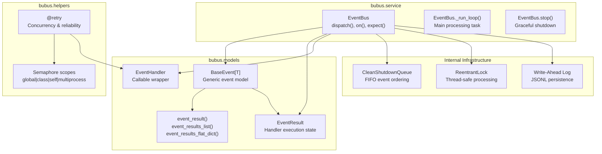
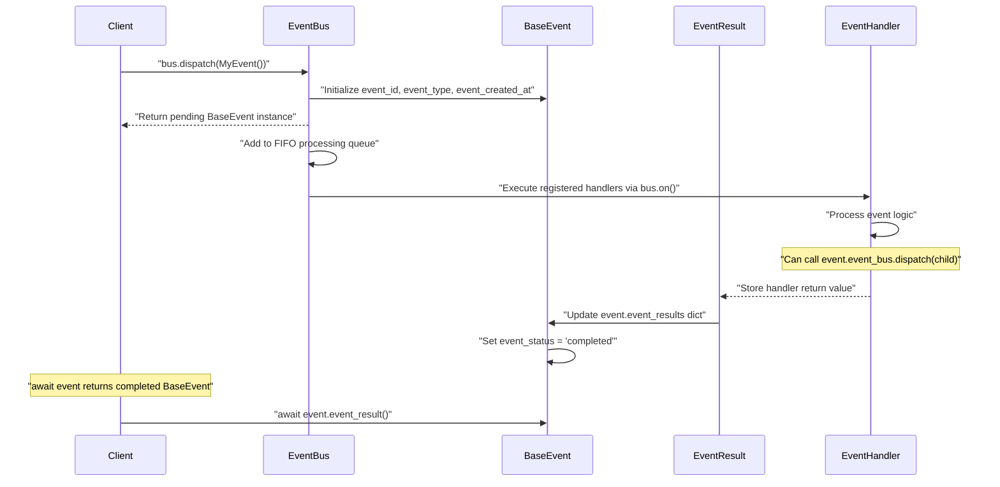
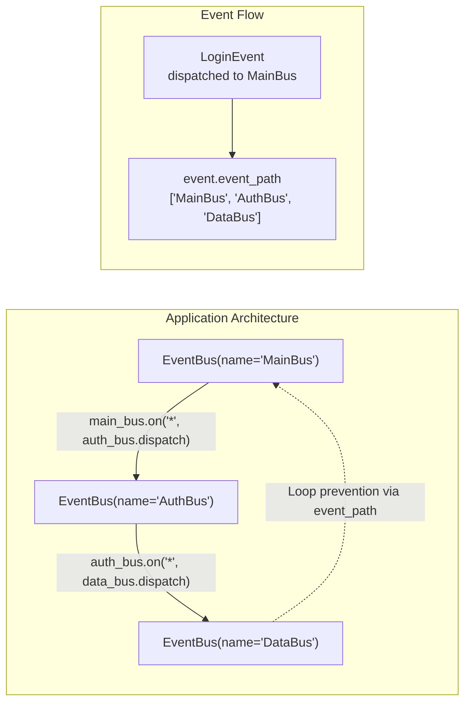
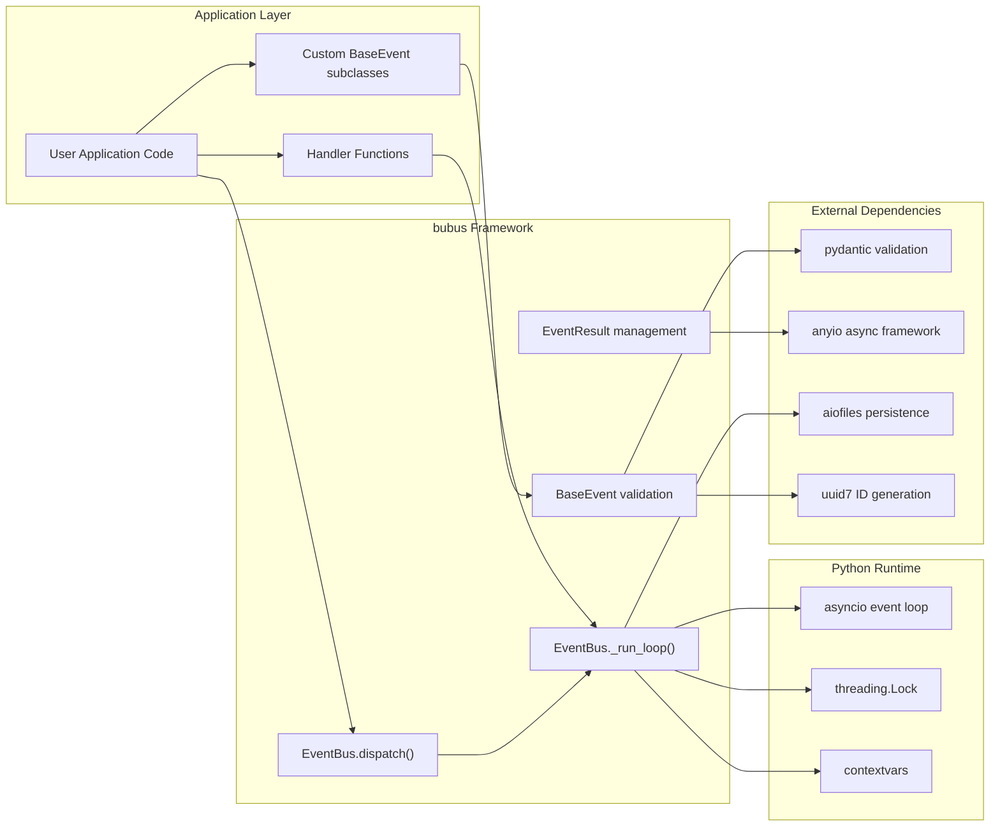

<!-- source: DeepWiki mcp.deepwiki.com · repo browser-use/bubus · page 1 Overview · fetched 2026-10-30 -->

# Overview

<details>
<summary>Relevant source files</summary>

The following files were used as context for generating this wiki page:

- [README.md](README.md)
- [bubus/__init__.py](bubus/__init__.py)

</details>


The `bubus` library is a production-ready, Pydantic-powered asynchronous event bus system for Python applications. It provides type-safe event processing with FIFO ordering, automatic parent-child event tracking, multi-bus communication, and advanced concurrency controls.

For detailed implementation specifics, see [Core Architecture](#2). For complete API documentation, see [API Reference](#3). For advanced usage patterns and debugging capabilities, see [Advanced Features](#4).

## Purpose and Core Value Proposition

`bubus` enables event-driven architectures with strong type safety and predictable execution semantics. The system combines Pydantic's validation capabilities with async Python patterns to deliver reliable event processing for both simple pub-sub patterns and complex distributed event workflows.

Key benefits include automatic event metadata management, built-in concurrency controls via the `@retry` decorator, write-ahead logging for durability, and sophisticated debugging tools for event tree visualization.

### Core Architecture Components



Sources: [bubus/__init__.py:1-14](), [README.md:507-513](), [README.md:592-622]()

## Core Event Processing Model

The system operates on a publish-subscribe pattern where `EventBus` instances manage event dispatch and handler execution. Events are defined as Pydantic models inheriting from `BaseEvent`, providing type safety and validation. Each event dispatch creates `EventResult` objects that track handler execution outcomes.

### Key Components Overview

| Component | Purpose | Key Features |
|-----------|---------|--------------|
| `EventBus` | Central event broker | FIFO processing, parallel handlers, inter-bus forwarding |
| `BaseEvent` | Event data model | Pydantic validation, automatic metadata, parent-child tracking |
| `EventResult` | Handler execution tracker | Async result handling, error tracking, timeout management |
| `CleanShutdownQueue` | Event ordering | FIFO guarantees, graceful shutdown |
| `ReentrantLock` | Concurrency control | Thread-safe processing, context tracking |

Sources: [README.md:499-589](), [README.md:592-779]()

### Event Processing Flow



Sources: [README.md:21-42](), [README.md:546-553](), [README.md:643-670]()

## Core Capabilities

| Feature | Description | Key Components |
|---------|-------------|----------------|
| **Type-Safe Events** | Pydantic models with `BaseEvent[T]` generic typing | `BaseEvent`, automatic validation |
| **Handler Registration** | Multiple registration patterns with wildcard support | `bus.on(EventClass, handler)`, `bus.on('*', handler)` |
| **FIFO Processing** | Strict event ordering with async handler support | `CleanShutdownQueue`, sequential execution |
| **Event Hierarchies** | Automatic parent-child tracking for nested events | `event_parent_id`, `event_children` |
| **Multi-Bus Forwarding** | Event routing between `EventBus` instances | `event_path`, loop prevention |
| **Result Aggregation** | Multiple handlers per event with result collection | `event_results_list()`, `event_results_flat_dict()` |
| **Concurrency Control** | Built-in retry logic and semaphore management | `@retry` decorator, semaphore scopes |
| **Persistence** | Write-ahead logging to JSONL files | `wal_path` parameter |

### Multi-Bus Event Forwarding



Sources: [README.md:145-165](), [README.md:151-164]()

### Built-in Concurrency and Reliability

The `@retry` decorator provides automatic retry logic with semaphore-based concurrency control:

```python
from bubus.helpers import retry

@retry(
    retries=3,
    wait=2,
    semaphore_limit=5,
    semaphore_scope='global'
)
async def reliable_handler(event: MyEvent):
    # Automatic retry on failures
    # Maximum 5 concurrent executions
    return await external_api_call()
```

Sources: [README.md:822-924](), [README.md:838-853]()

## Integration Architecture



Sources: [README.md:17-42](), [README.md:70-87]()

The `bubus` system provides a comprehensive foundation for building reactive applications with strong type safety, flexible concurrency models, and sophisticated event relationship tracking. Its modular architecture allows for both simple pub-sub patterns and complex event-driven workflows with inter-service communication capabilities.

---

