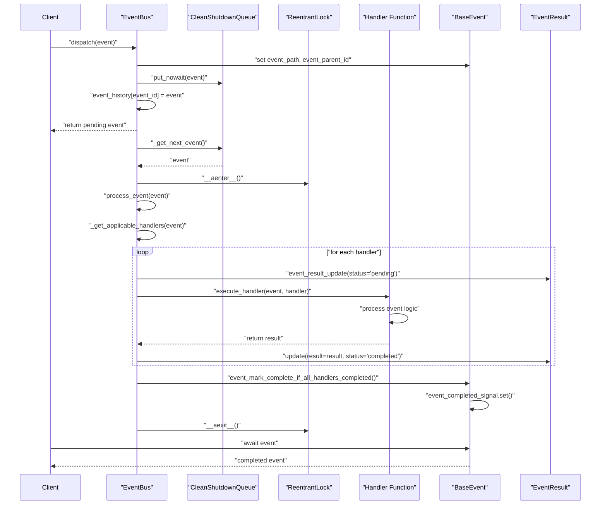
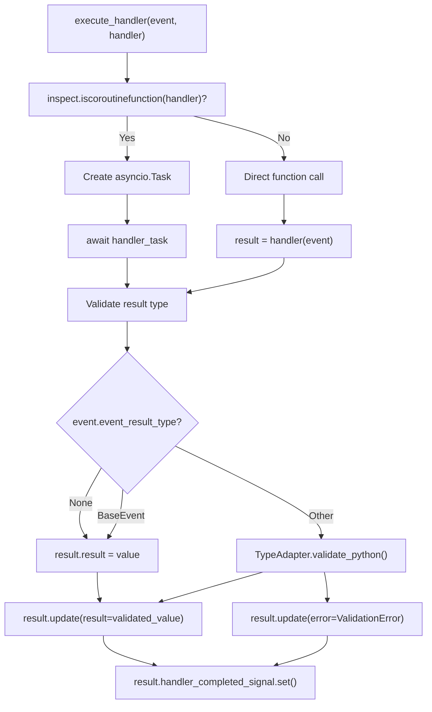
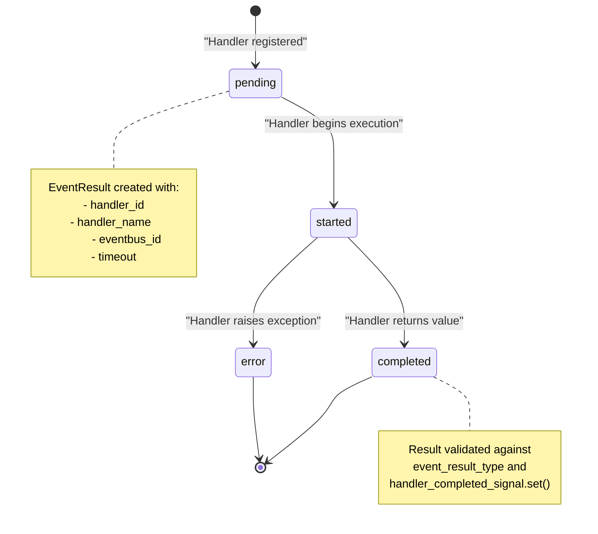
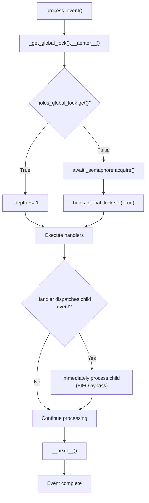
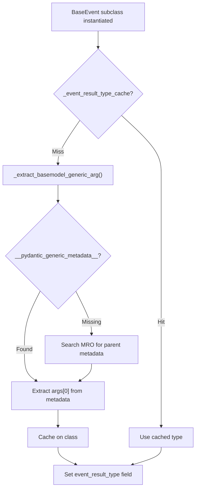
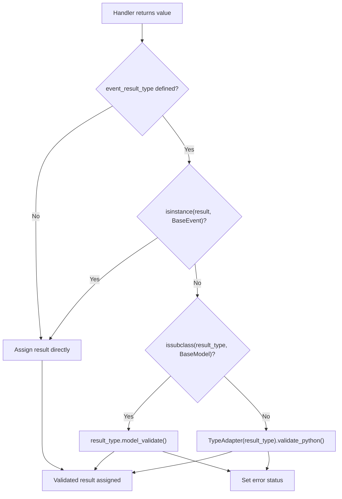

<!-- source: DeepWiki mcp.deepwiki.com · repo browser-use/bubus · page 2 Core Architecture · fetched 2026-10-30 -->

# Core Architecture

<details>
<summary>Relevant source files</summary>

The following files were used as context for generating this wiki page:

- [README.md](README.md)
- [bubus/models.py](bubus/models.py)
- [bubus/service.py](bubus/service.py)

</details>


This document provides a detailed overview of the core architectural components and design patterns in the bubus event bus system. It covers the foundational classes, data models, and processing pipelines that enable asynchronous, type-safe event-driven programming in Python.

For specific API documentation and method signatures, see [EventBus API](#3.1) and [BaseEvent and EventResult API](#3.2). For advanced features like multi-bus communication and debugging tools, see [Advanced Features](#4).

## Core Class Architecture

The bubus architecture centers around three primary classes that work together to provide a complete event processing system:

### Class Hierarchy and Relationships

```mermaid
classDiagram
    class EventBus {
        +str name
        +str id
        +dict handlers
        +CleanShutdownQueue event_queue
        +dict event_history
        +bool _is_running
        +dispatch(event) BaseEvent
        +on(pattern, handler) None
        +expect(event_type) BaseEvent
        +step() BaseEvent
        +process_event(event) None
        +execute_handler(event, handler) Any
    }
    
    class BaseEvent~T~ {
        +str event_type
        +str event_id
        +str event_parent_id
        +list event_path
        +dict event_results
        +datetime event_created_at
        +Any event_result_type
        +__await__() Self
        +event_result() T
        +event_mark_complete_if_all_handlers_completed()
    }
    
    class EventResult~T~ {
        +str handler_id
        +str handler_name
        +str status
        +T result
        +BaseException error
        +datetime started_at
        +datetime completed_at
        +list event_children
        +__await__() T
        +update(**kwargs) Self
    }
    
    class CleanShutdownQueue~T~ {
        +bool _is_shutdown
        +deque _getters
        +deque _putters
        +shutdown(immediate) None
        +get() T
        +put(item) None
    }
    
    class ReentrantLock {
        +asyncio.Semaphore _semaphore
        +int _depth
        +__aenter__() Self
        +__aexit__() None
        +locked() bool
    }
    
    EventBus ||--o{ BaseEvent : "manages"
    EventBus ||--|| CleanShutdownQueue : "uses"
    BaseEvent ||--o{ EventResult : "contains"
    EventBus ||--|| ReentrantLock : "synchronizes with"
    
    note for BaseEvent "Generic type T defines expected result type"
    note for EventResult "Auto-casting to T with Pydantic validation"
```

Sources: [bubus/service.py:250-1506](), [bubus/models.py:200-972]()

### Event Bus Service Core

The `EventBus` class in [bubus/service.py:250-1506]() serves as the central event dispatcher and coordination hub. It maintains several key data structures:

- **`handlers`**: Dictionary mapping event patterns to handler functions [bubus/service.py:270]()
- **`event_queue`**: FIFO queue for pending events using `CleanShutdownQueue` [bubus/service.py:271]()  
- **`event_history`**: Dictionary tracking all processed events by ID [bubus/service.py:272]()
- **`_runloop_task`**: Background asyncio task processing the event queue [bubus/service.py:275]()

The service maintains a global registry of all active instances via `EventBus.all_instances` [bubus/service.py:261]() to enable cross-bus communication and memory monitoring.

Sources: [bubus/service.py:250-342]()

## Event Processing Pipeline

The event processing follows a structured pipeline from dispatch to completion:

### Event Lifecycle Flow



Sources: [bubus/service.py:485-588](), [bubus/service.py:929-1013](), [bubus/service.py:1080-1232]()

### Handler Execution Model

Handler execution supports both synchronous and asynchronous functions with automatic type validation:



Sources: [bubus/service.py:1080-1232](), [bubus/models.py:897-960]()

## Event Model System

### BaseEvent Structure

The `BaseEvent` class in [bubus/models.py:200-792]() provides the foundational data model for all events. It extends Pydantic's `BaseModel` with event-specific metadata and processing capabilities:

| Field Category | Fields | Purpose |
|----------------|--------|---------|
| **Identity** | `event_id`, `event_type`, `event_schema` | Unique identification and versioning |
| **Hierarchy** | `event_parent_id`, `event_path`, `event_children` | Parent-child relationships and routing |
| **Timing** | `event_created_at`, `event_started_at`, `event_completed_at` | Lifecycle timestamps |
| **Processing** | `event_results`, `event_timeout`, `event_status` | Handler execution tracking |
| **Type System** | `event_result_type` | Expected return type validation |

Sources: [bubus/models.py:216-258]()

### EventResult Tracking

Each handler execution creates an `EventResult` instance that tracks the processing state and outcome:



Sources: [bubus/models.py:811-968]()

## Concurrency and Synchronization

### Global Lock Coordination

The system uses a `ReentrantLock` [bubus/service.py:147-198]() to coordinate event processing across all EventBus instances while allowing nested event dispatch from within handlers:



Sources: [bubus/service.py:147-210](), [bubus/service.py:951-953]()

### Context Variable Management  

The system uses several `ContextVar` instances to track execution state across async boundaries:

- **`_current_event_context`**: Tracks the currently processing event [bubus/service.py:138]()
- **`inside_handler_context`**: Indicates if code is executing within a handler [bubus/service.py:140]()  
- **`holds_global_lock`**: Tracks lock ownership for reentrancy [bubus/service.py:142]()
- **`_current_handler_id_context`**: Identifies the active handler for child event tracking [bubus/service.py:144]()

Sources: [bubus/service.py:137-145](), [bubus/service.py:1103-1107]()

## Type System Integration

### Generic Type Extraction

The type system automatically extracts expected result types from `BaseEvent[T]` generic parameters using Pydantic's metadata:



Sources: [bubus/models.py:172-198](), [bubus/models.py:375-410]()

### Result Validation Pipeline

Handler return values are automatically validated and cast to the expected type:



Sources: [bubus/models.py:909-940]()

This architecture provides a robust foundation for building event-driven applications with strong typing, automatic validation, and comprehensive lifecycle management while maintaining high performance through careful concurrency control and memory management.

---

