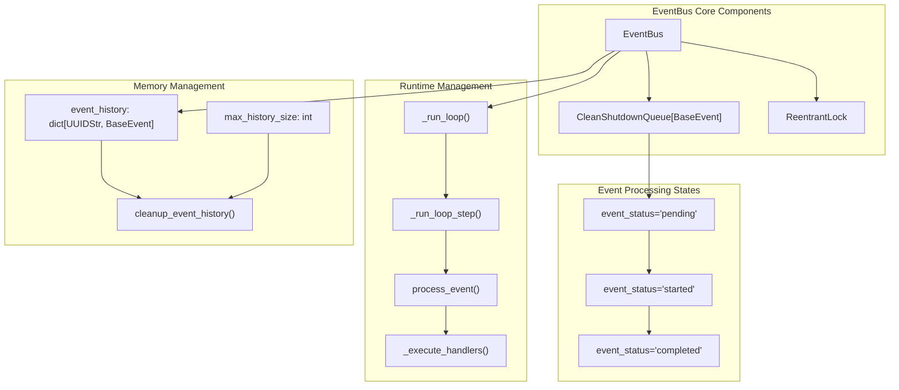
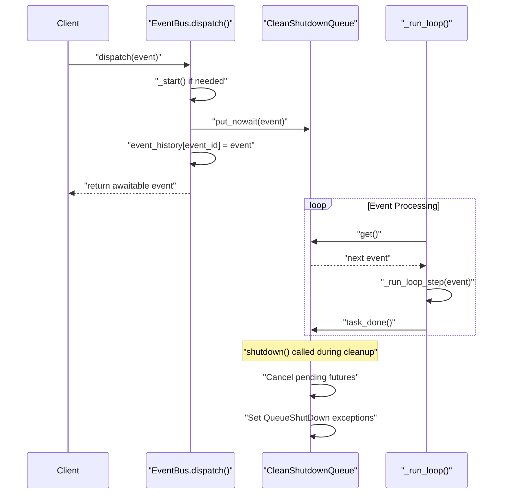
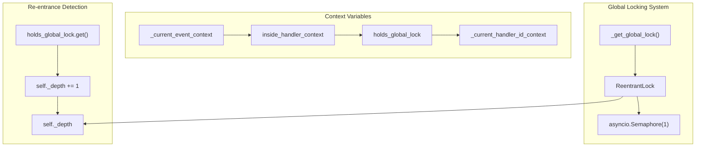
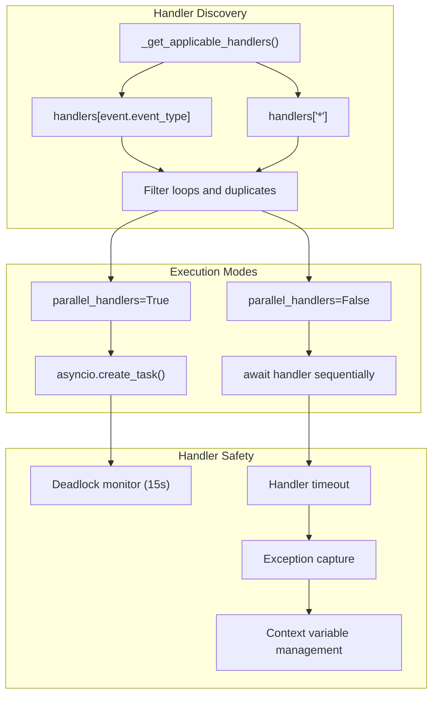
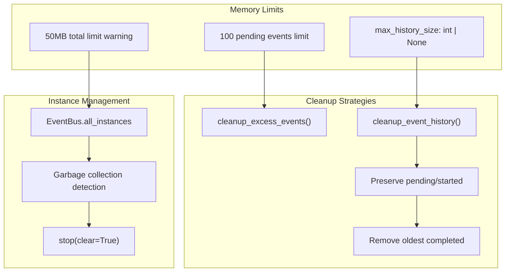

<!-- source: DeepWiki mcp.deepwiki.com · repo browser-use/bubus · page 2.1 EventBus Service Implementation · fetched 2026-10-30 -->

# EventBus Service Implementation

Relevant source files

The following files were used as context for generating this wiki page:

- [bubus/service.py](bubus/service.py)
- [tests/test_eventbus.py](tests/test_eventbus.py)

This document covers the internal architecture and implementation details of the `EventBus` class, which serves as the central event processing engine in the bubus library. It focuses on the asynchronous processing mechanisms, concurrency control, and event lifecycle management.

For information about the data models that EventBus processes, see [Data Models](#2.2). For details about retry mechanisms and semaphore-based concurrency, see [Resilience and Concurrency](#2.3).

## Core Architecture Overview

The `EventBus` class implements a sophisticated asynchronous event processing system with guaranteed FIFO (First-In-First-Out) ordering and comprehensive lifecycle management. The implementation centers around three core components: the event bus controller, a custom queue system, and a global locking mechanism.

**Sources:** [bubus/service.py:250-342](), [bubus/service.py:56-135](), [bubus/service.py:147-198]()

## Event Queue Management

The `CleanShutdownQueue` class extends `asyncio.Queue` to provide clean shutdown capabilities without generating warnings during event loop closure. This custom implementation handles graceful termination and prevents common asyncio shutdown errors.

Key queue management features:

| Feature | Implementation | Purpose |
|---------|---------------|---------|
| Clean Shutdown | `shutdown(immediate=True)` | Prevents asyncio warnings on cleanup |
| Capacity Control | `maxsize=50` when `max_history_size` set | Memory leak prevention |
| Exception Handling | `QueueShutDown` exception | Graceful termination signaling |

**Sources:** [bubus/service.py:56-135](), [bubus/service.py:485-588](), [bubus/service.py:742-809]()

## Event Processing Pipeline

The event processing pipeline implements a multi-stage architecture that ensures proper event lifecycle management and handler execution ordering.

```mermaid
graph LR
    subgraph "Dispatch Stage"
        DISPATCH["dispatch()"]
        VALIDATE["Validate event fields"]
        PARENT["Set event_parent_id"]
        QUEUE["Queue event"]
    end
    
    subgraph "Processing Stage"
        GET["_get_next_event()"]
        LOCK["Acquire global lock"]
        HANDLERS["_get_applicable_handlers()"]
        EXECUTE["_execute_handlers()"]
    end
    
    subgraph "Completion Stage"
        LOG["_default_log_handler()"]
        WAL["_default_wal_handler()"]
        MARK["event_mark_complete()"]
        PARENT_CHECK["Check parent completion"]
    end
    
    DISPATCH --> VALIDATE
    VALIDATE --> PARENT
    PARENT --> QUEUE
    
    QUEUE --> GET
    GET --> LOCK
    LOCK --> HANDLERS
    HANDLERS --> EXECUTE
    
    EXECUTE --> LOG
    LOG --> WAL
    WAL --> MARK
    MARK --> PARENT_CHECK
```

The pipeline processes events through these key methods:

- `dispatch()`: Synchronous event queuing with validation [bubus/service.py:485-588]()
- `step()`: Single event processing cycle [bubus/service.py:929-960]()
- `process_event()`: Handler execution coordination [bubus/service.py:962-1012]()
- `_execute_handlers()`: Parallel or serial handler execution [bubus/service.py:1037-1077]()

**Sources:** [bubus/service.py:485-588](), [bubus/service.py:929-1012](), [bubus/service.py:1037-1077]()

## Concurrency and Locking

The EventBus implements a sophisticated concurrency model using a global re-entrant lock that works across different asyncio tasks through context variables.

The concurrency system provides:

| Component | Purpose | Implementation |
|-----------|---------|---------------|
| `ReentrantLock` | Cross-task re-entrance | Context variable tracking [bubus/service.py:147-198]() |
| `_current_event_context` | Parent-child event linking | ContextVar for event hierarchy [bubus/service.py:138]() |
| `inside_handler_context` | Nested event detection | Prevents recursive handler calls [bubus/service.py:140]() |
| `holds_global_lock` | Lock state tracking | Re-entrance depth management [bubus/service.py:142]() |

**Sources:** [bubus/service.py:137-210](), [bubus/service.py:951](), [bubus/service.py:1103-1107]()

## Handler Execution Engine

The handler execution engine supports both synchronous and asynchronous handlers with comprehensive error handling and deadlock detection.

Handler execution features:

- **Loop Prevention**: Checks event path and handler history [bubus/service.py:1233-1287]()
- **Deadlock Detection**: 15-second monitor task [bubus/service.py:1110-1120]()
- **Context Management**: Proper context variable propagation [bubus/service.py:1102-1174]()
- **Result Tracking**: Handler-specific result objects [bubus/service.py:1098-1100]()

**Sources:** [bubus/service.py:1014-1035](), [bubus/service.py:1080-1231](), [bubus/service.py:1233-1287]()

## Memory Management and Cleanup

The EventBus implements comprehensive memory management to prevent memory leaks in long-running applications.

Memory management mechanisms:

| Mechanism | Trigger | Implementation |
|-----------|---------|---------------|
| Event History Cleanup | After each event | `cleanup_event_history()` [bubus/service.py:1371-1431]() |
| Capacity Limiting | Before dispatch | 100 pending events check [bubus/service.py:547-557]() |
| Instance Tracking | Class-level | `WeakSet` for garbage collection [bubus/service.py:261]() |
| Memory Monitoring | On shutdown/cleanup | Total usage warning [bubus/service.py:1439-1505]() |

**Sources:** [bubus/service.py:1371-1431](), [bubus/service.py:547-557](), [bubus/service.py:1439-1505](), [bubus/service.py:261]()

## Instance Management

The EventBus class implements sophisticated instance lifecycle management with automatic cleanup hooks and name collision detection.

```mermaid
graph LR
    subgraph "Instance Creation"
        INIT["__init__()"]
        NAME_CHECK["Check name conflicts"]
        UUID_SUFFIX["Auto-generate suffix"]
        WEAK_SET_ADD["Add to all_instances"]
    end
    
    subgraph "Lifecycle Hooks"
        EVENT_LOOP["Get running loop"]
        HOOK_CLOSE["Hook loop.close()"]
        REGISTER["Register in loop"]
        AUTO_START["_start() on first dispatch"]
    end
    
    subgraph "Cleanup"
        STOP["stop()"]
        CLEAR_FLAG["clear=True"]
        REMOVE_WEAK["Remove from WeakSet"]
        GC_CHECK["_check_total_memory_usage()"]
    end
    
    INIT --> NAME_CHECK
    NAME_CHECK --> UUID_SUFFIX
    UUID_SUFFIX --> WEAK_SET_ADD
    
    WEAK_SET_ADD --> EVENT_LOOP
    EVENT_LOOP --> HOOK_CLOSE
    HOOK_CLOSE --> REGISTER
    REGISTER --> AUTO_START
    
    AUTO_START --> STOP
    STOP --> CLEAR_FLAG
    CLEAR_FLAG --> REMOVE_WEAK
    REMOVE_WEAK --> GC_CHECK
```

Key instance management features:

- **Name Uniqueness**: Automatic suffix generation for conflicts [bubus/service.py:276-312]()
- **Auto-start**: Lazy initialization on first `dispatch()` call [bubus/service.py:667-723]()
- **Loop Integration**: Event loop close hook registration [bubus/service.py:675-708]()
- **Graceful Shutdown**: Clean termination with optional clearing [bubus/service.py:725-789]()

**Sources:** [bubus/service.py:261-325](), [bubus/service.py:667-723](), [bubus/service.py:725-789](), [bubus/service.py:332-348]()

---

