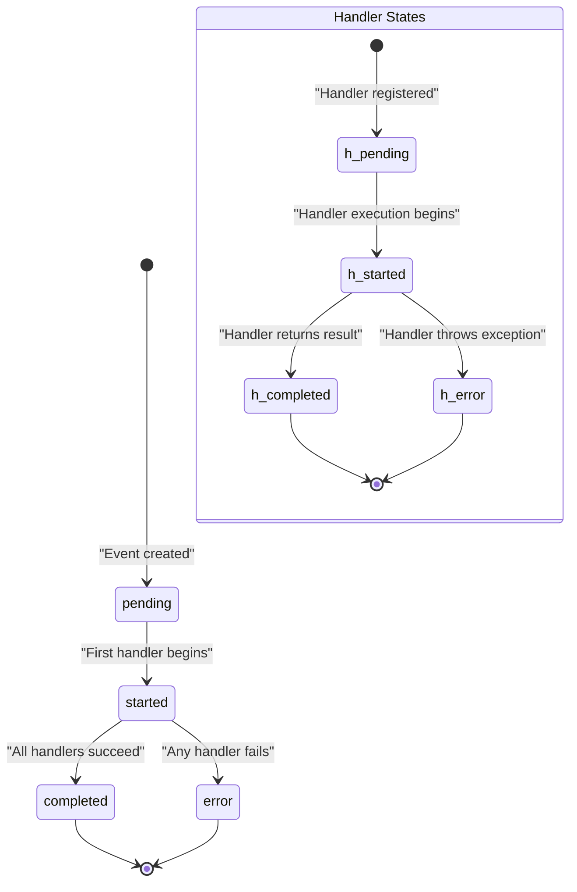
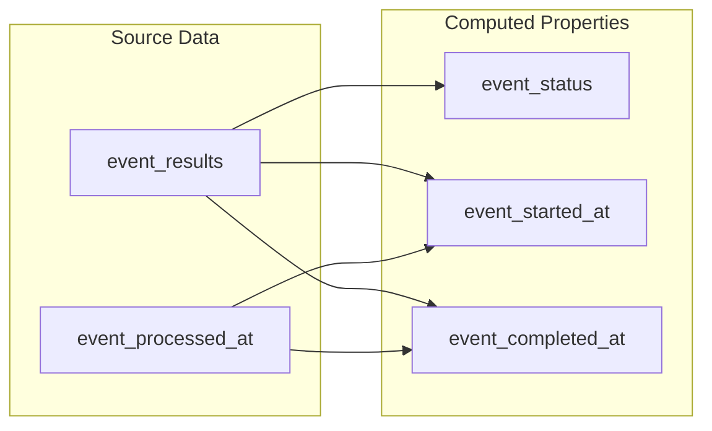
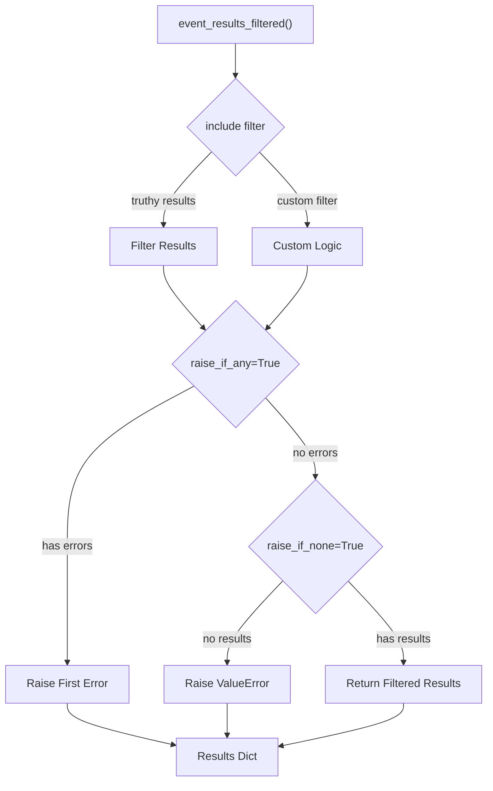
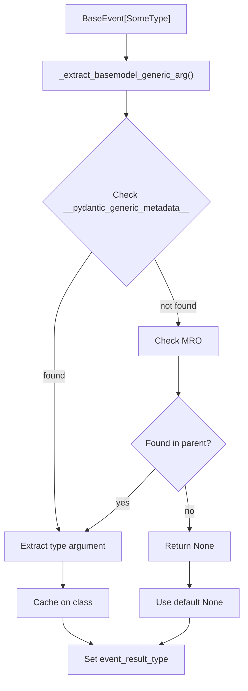
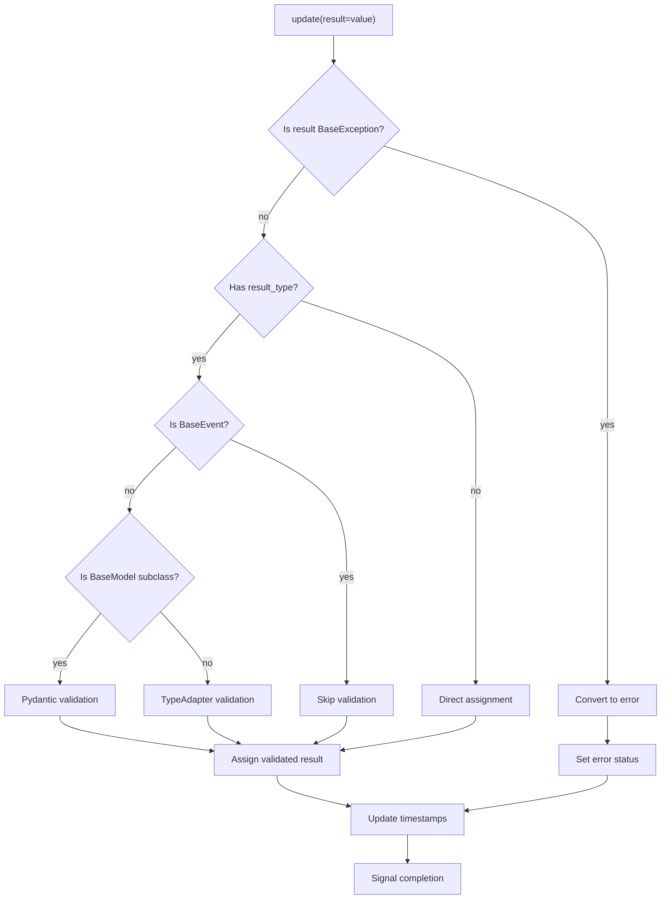
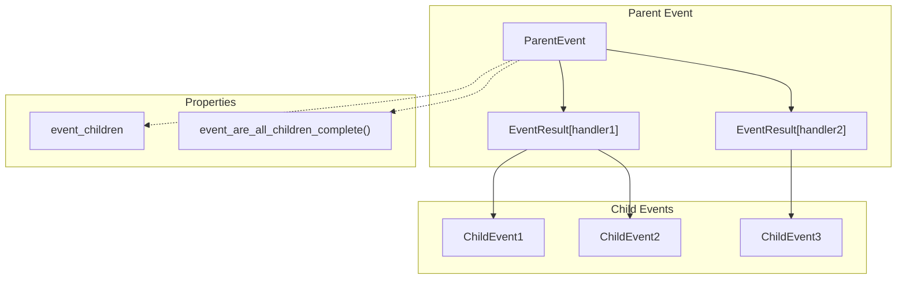
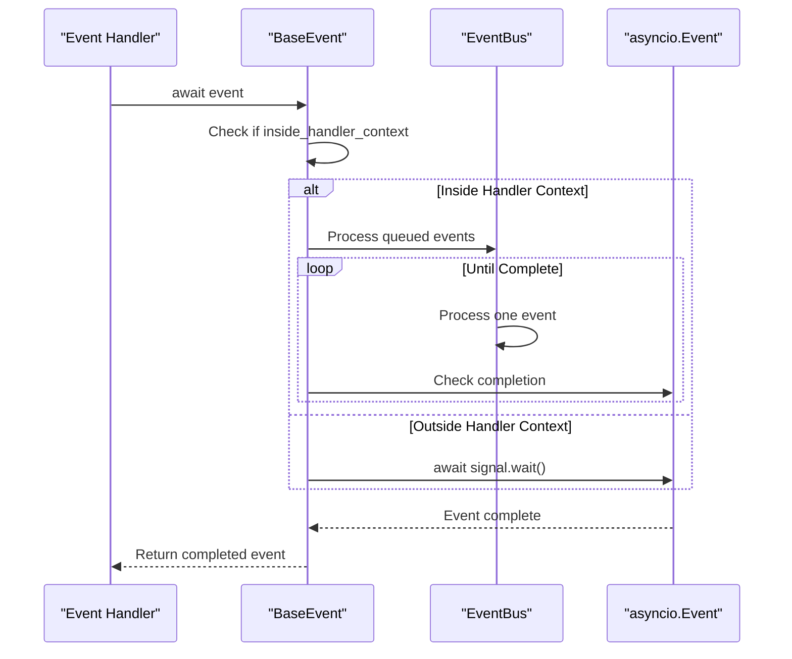

<!-- source: DeepWiki mcp.deepwiki.com · repo browser-use/bubus · page 2.2 Event Models and Result System · fetched 2026-10-30 -->

# Event Models and Result System

<details>
<summary>Relevant source files</summary>

The following files were used as context for generating this wiki page:

- [bubus/models.py](bubus/models.py)
- [tests/test_attribute_error_fix.py](tests/test_attribute_error_fix.py)

</details>


This document covers the core data structures and lifecycle management for events and their results in the bubus library. It focuses on the `BaseEvent` and `EventResult` classes, their properties, state management, and result aggregation patterns.

For information about how these models integrate with the EventBus service implementation, see [EventBus Service Implementation](#2.1). For details on multi-bus communication patterns that use these models, see [Multi-Bus Communication and Event Forwarding](#4.2).

## Event Model Architecture

The event system is built around two primary model classes that work together to track event processing and results.

```mermaid
classDiagram
    class BaseEvent~T_EventResultType~ {
        +event_id: UUIDStr
        +event_type: PythonIdentifierStr
        +event_schema: str
        +event_timeout: float
        +event_result_type: Any
        +event_path: list[PythonIdentifierStr]
        +event_parent_id: UUIDStr
        +event_created_at: datetime
        +event_processed_at: datetime
        +event_results: dict[PythonIdStr, EventResult]
        +_event_completed_signal: asyncio.Event
        +event_result() → T_EventResultType
        +event_results_list() → list[T_EventResultType]
        +event_mark_complete_if_all_handlers_completed()
        +__await__() → Self
    }
    
    class EventResult~T_EventResultType~ {
        +id: UUIDStr
        +status: Literal["pending", "started", "completed", "error"]
        +event_id: UUIDStr
        +handler_id: PythonIdStr
        +handler_name: str
        +result_type: Any
        +result: T_EventResultType
        +error: BaseException
        +event_children: list[BaseEvent]
        +_handler_completed_signal: asyncio.Event
        +update(**kwargs) → Self
        +__await__() → T_EventResultType
    }
    
    BaseEvent ||--o{ EventResult : "contains"
    EventResult ||--o{ BaseEvent : "event_children"
    BaseEvent --> BaseEvent : "parent-child hierarchy"
```

Sources: [bubus/models.py:200-972]()

## Event Lifecycle State Machine

Events progress through distinct states as they are processed by the EventBus system. Each handler execution creates an `EventResult` that tracks its own lifecycle in parallel.



Sources: [bubus/models.py:424-458](), [bubus/models.py:824-960]()

## Core Event Properties

The `BaseEvent` class provides comprehensive metadata tracking and result aggregation through its properties and methods.

### Event Identification and Metadata

| Property | Type | Description |
|----------|------|-------------|
| `event_id` | `UUIDStr` | UUID7 identifier for the event |
| `event_type` | `PythonIdentifierStr` | Event class name (auto-set) |
| `event_schema` | `str` | Schema version with library version |
| `event_timeout` | `float` | Handler timeout in seconds |
| `event_path` | `list[PythonIdentifierStr]` | Bus routing history |

Sources: [bubus/models.py:216-241]()

### Timing and Status Properties

The event model provides computed properties that aggregate timing information from all handler results:



Sources: [bubus/models.py:424-458]()

## Result Collection System

`BaseEvent` provides multiple methods for collecting and processing handler results with different aggregation patterns.

### Result Access Methods

| Method | Return Type | Purpose |
|--------|-------------|---------|
| `event_result()` | `T_EventResultType \| None` | Get first non-None result |
| `event_results_list()` | `list[T_EventResultType]` | Get all results as list |
| `event_results_by_handler_id()` | `dict[PythonIdStr, T_EventResultType]` | Results keyed by handler ID |
| `event_results_by_handler_name()` | `dict[str, T_EventResultType]` | Results keyed by handler name |
| `event_results_flat_dict()` | `dict[str, Any]` | Merge dict results into single dict |
| `event_results_flat_list()` | `list[Any]` | Flatten list results into single list |

Sources: [bubus/models.py:566-647]()

### Result Filtering System

All result collection methods accept filtering parameters for flexible result processing:



Sources: [bubus/models.py:474-533]()

## Type System Integration

The event model integrates with Python's type system through generic parameters and automatic result validation.

### Generic Type Parameter

Events can be parameterized with expected result types using the generic `T_EventResultType`:

```python
class ScreenshotEvent(BaseEvent[bytes]):
    event_result_type = bytes
    screenshot_width: int = 1920
    screenshot_height: int = 1080
```

### Automatic Result Type Inference

The `_extract_basemodel_generic_arg()` function automatically extracts the generic type parameter and sets `event_result_type`:



Sources: [bubus/models.py:172-198](), [bubus/models.py:375-411]()

## EventResult Lifecycle Management

Each handler execution creates an `EventResult` that tracks its individual processing state and manages result validation.

### Result Update Process

The `EventResult.update()` method handles result assignment with automatic type validation:



Sources: [bubus/models.py:897-960]()

## Parent-Child Event Hierarchy

The event system automatically tracks parent-child relationships when handlers dispatch new events during execution.

### Hierarchy Structure



### Completion Dependency

Parent events wait for all child events to complete before marking themselves as complete:

Sources: [bubus/models.py:691-741]()

## Async Completion Patterns

Both `BaseEvent` and `EventResult` implement `__await__` to enable async/await syntax for waiting on completion.

### Event Await Behavior

The `BaseEvent.__await__()` method implements sophisticated logic to handle deadlock prevention when waiting for child events from within handler contexts:



Sources: [bubus/models.py:277-354]()

## Event Validation and Schema Management

The event model includes comprehensive validation through Pydantic model validators that automatically set metadata fields.

### Automatic Field Population

Three model validators automatically populate event metadata:

| Validator | Purpose |
|-----------|---------|
| `_set_event_type_from_class_name` | Sets `event_type` to class name |
| `_set_event_schema_from_class_name` | Sets `event_schema` with version |
| `_set_event_result_type_from_generic_arg` | Extracts generic type parameter |

Sources: [bubus/models.py:355-411]()

---

