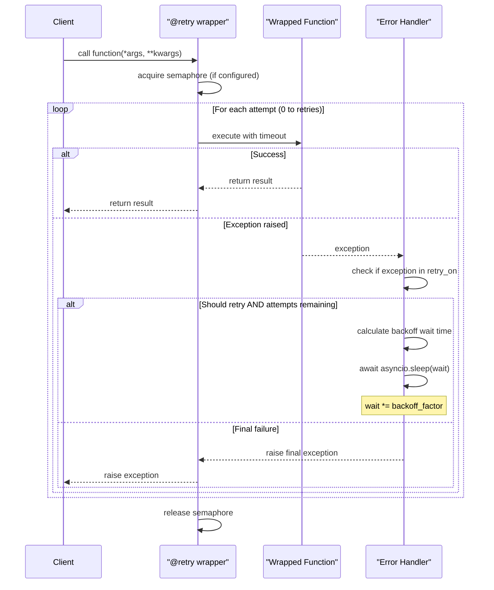
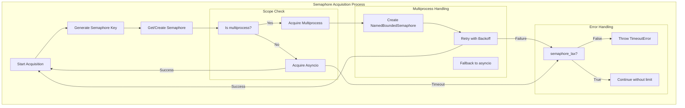
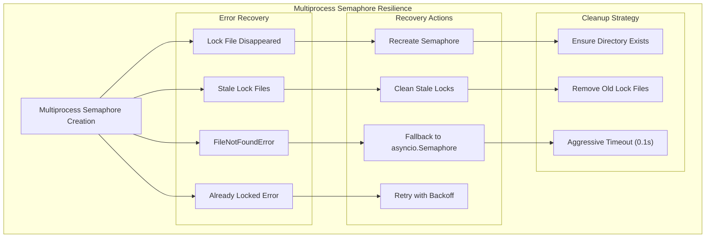
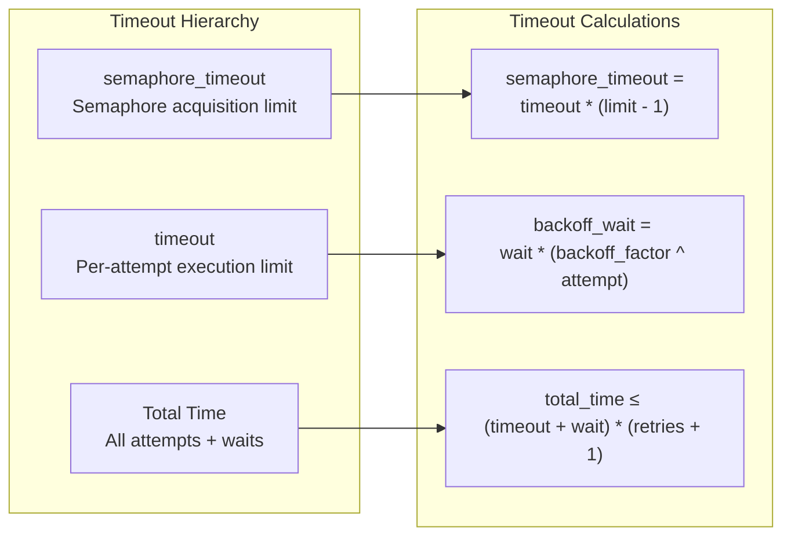
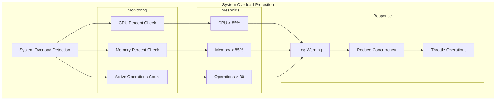
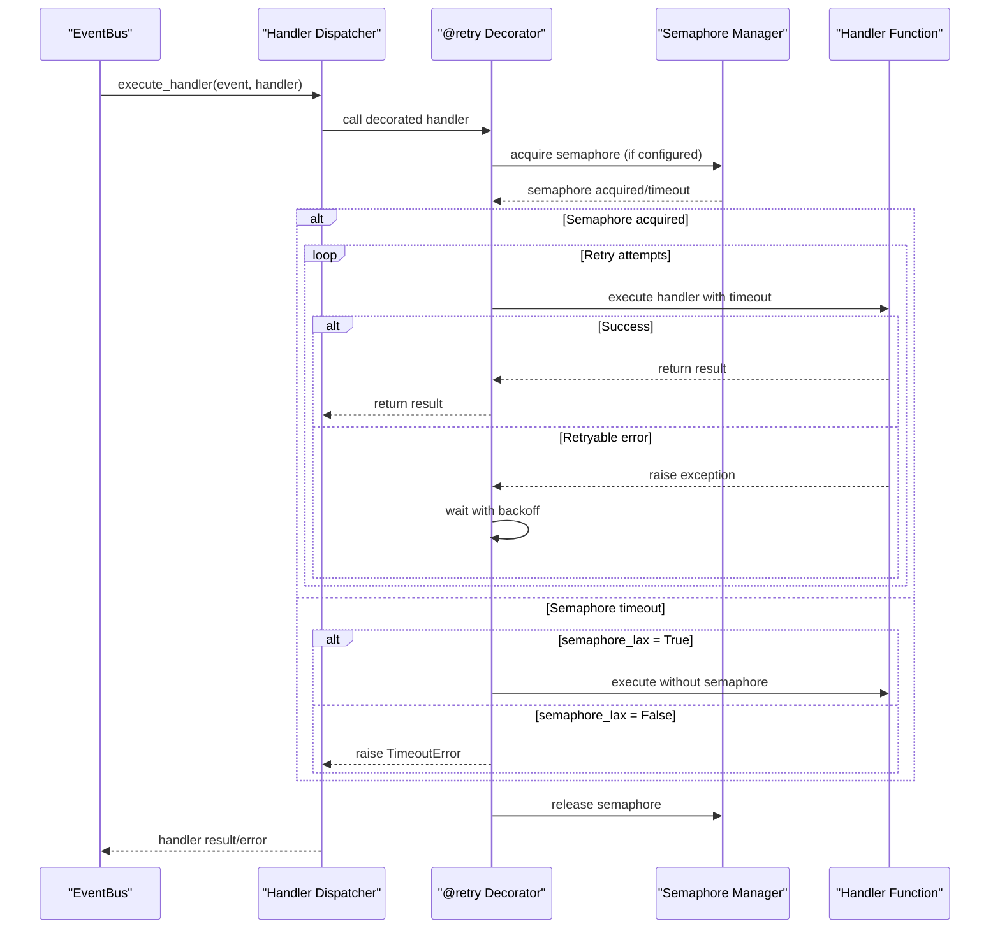
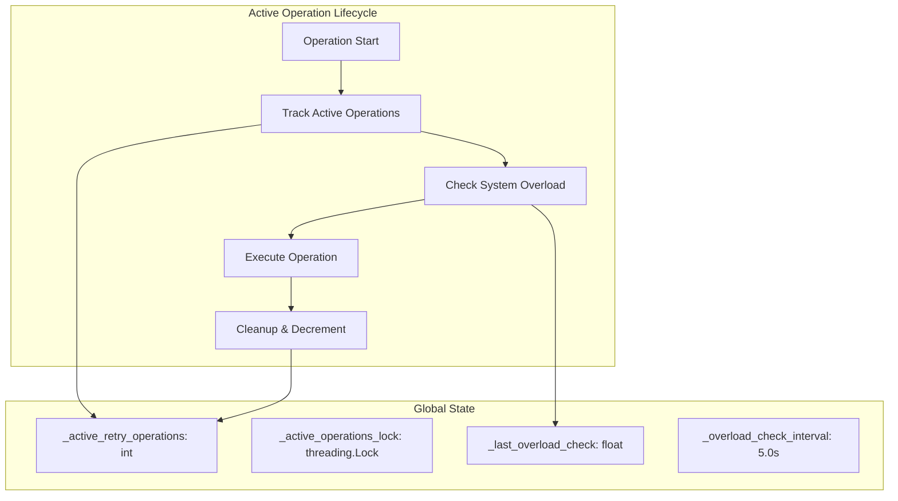

<!-- source: DeepWiki mcp.deepwiki.com · repo browser-use/bubus · page 2.3 Concurrency Control and Reliability · fetched 2026-10-30 -->

# Concurrency Control and Reliability

<details>
<summary>Relevant source files</summary>

The following files were used as context for generating this wiki page:

- [bubus/helpers.py](bubus/helpers.py)
- [tests/test_handler_timeout.py](tests/test_handler_timeout.py)
- [tests/test_name_conflict_gc.py](tests/test_name_conflict_gc.py)
- [tests/test_semaphores.py](tests/test_semaphores.py)
- [tests/test_stress_20k_events.py](tests/test_stress_20k_events.py)

</details>


## Purpose and Scope

This document covers bubus's comprehensive concurrency control and reliability mechanisms, focusing on the `@retry` decorator system, semaphore-based resource management, timeout handling, and system overload protection. These features ensure robust, reliable event processing under load while preventing resource exhaustion and system instability.

For information about the core EventBus service implementation, see [EventBus Service Implementation](#2.1). For details about event models and result handling, see [Event Models and Result System](#2.2).

## The @retry Decorator System

The `@retry` decorator in [bubus/helpers.py:427-530]() provides the foundation for reliable asynchronous function execution with built-in concurrency control, timeout management, and retry logic.

### Core Decorator Architecture

```mermaid
graph TB
    subgraph "Retry Decorator System"
        RD["`@retry`<br/>Decorator"]
        
        subgraph "Configuration Parameters"
            RP["retries: int"]
            RW["wait: float"]
            RT["timeout: float"]
            RO["retry_on: tuple[Exception]"]
            BF["backoff_factor: float"]
        end
        
        subgraph "Semaphore Parameters"
            SL["semaphore_limit: int"]
            SN["semaphore_name: str"]
            SS["semaphore_scope: Literal"]
            ST["semaphore_timeout: float"]
            SX["semaphore_lax: bool"]
        end
        
        subgraph "Execution Pipeline"
            SA["Semaphore Acquisition"]
            EE["Function Execution"]
            RH["Retry Handling"]
            CU["Cleanup & Release"]
        end
    end
    
    RD --> RP
    RD --> SL
    RD --> SA
    SA --> EE
    EE --> RH
    RH --> CU
    
    RP --> RH
    SL --> SA
```

**Sources:** [bubus/helpers.py:427-470]()

### Retry Logic and Error Handling

The retry system implements exponential backoff with configurable exception filtering:



**Sources:** [bubus/helpers.py:349-403](), [tests/test_semaphores.py:849-890]()

## Semaphore-Based Concurrency Control

The semaphore system provides fine-grained concurrency control with four different scopes to match various use cases.

### Semaphore Scope Types

| Scope | Key Generation | Use Case | Implementation |
|-------|----------------|----------|----------------|
| `global` | `semaphore_name` | System-wide limits | `asyncio.Semaphore` |
| `class` | `ClassName.semaphore_name` | Per-class limits | `asyncio.Semaphore` |
| `self` | `id(instance).semaphore_name` | Per-instance limits | `asyncio.Semaphore` |
| `multiprocess` | `semaphore_name` | Cross-process limits | `portalocker.NamedBoundedSemaphore` |

**Sources:** [bubus/helpers.py:124-146](), [bubus/helpers.py:148-198]()

### Semaphore Acquisition Flow



**Sources:** [bubus/helpers.py:215-320](), [bubus/helpers.py:322-347]()

### Multiprocess Semaphore Reliability

The multiprocess semaphore implementation includes sophisticated error recovery:



**Sources:** [bubus/helpers.py:154-192](), [bubus/helpers.py:253-295]()

## Timeout Management and System Protection

### Per-Operation Timeout Control

Each retry-decorated function operates under strict timeout controls:



**Sources:** [bubus/helpers.py:200-213](), [bubus/helpers.py:349-403]()

### System Overload Detection

The system continuously monitors resource usage to prevent overload conditions:

| Resource | Threshold | Action |
|----------|-----------|---------|
| CPU Usage | > 85% | Log warning |
| Memory Usage | > 85% | Log warning |
| Active Operations | > 30 | Log warning |



**Sources:** [bubus/helpers.py:84-122](), [bubus/helpers.py:406-425]()

## Integration with EventBus Architecture

### Handler Execution with Retry Control

The `@retry` decorator integrates seamlessly with EventBus handler execution:



**Sources:** [tests/test_semaphores.py:632-695](), [tests/test_semaphores.py:696-774]()

### Event Handler Reliability Patterns

Common patterns for applying concurrency control to EventBus handlers:

```python
# Global concurrency limit for expensive operations
@retry(
    wait=3,
    retries=3, 
    timeout=30,
    semaphore_limit=2,
    semaphore_scope='global'
)
async def expensive_handler(event: MyEvent) -> str:
    # Only 2 instances of this handler run system-wide
    pass

# Per-instance concurrency for stateful handlers  
@retry(
    timeout=10,
    semaphore_limit=1,
    semaphore_scope='self'
)
async def stateful_handler(self, event: MyEvent) -> str:
    # Only 1 handler per instance can run
    pass

# Cross-process coordination
@retry(
    semaphore_limit=3,
    semaphore_scope='multiprocess',
    semaphore_lax=True  # Graceful degradation
)
async def shared_resource_handler(event: MyEvent) -> str:
    # Max 3 handlers across all processes
    pass
```

**Sources:** [tests/test_semaphores.py:522-627](), [bubus/helpers.py:427-470]()

### Active Operation Tracking

The system tracks active operations for monitoring and overload detection:



**Sources:** [bubus/helpers.py:84-87](), [bubus/helpers.py:406-425](), [bubus/helpers.py:500-527]()

This concurrency control and reliability system ensures that bubus can handle high-throughput event processing while maintaining system stability and providing graceful degradation under load conditions. The integration of semaphores, timeouts, retry logic, and system monitoring creates a robust foundation for reliable distributed event processing.

---

