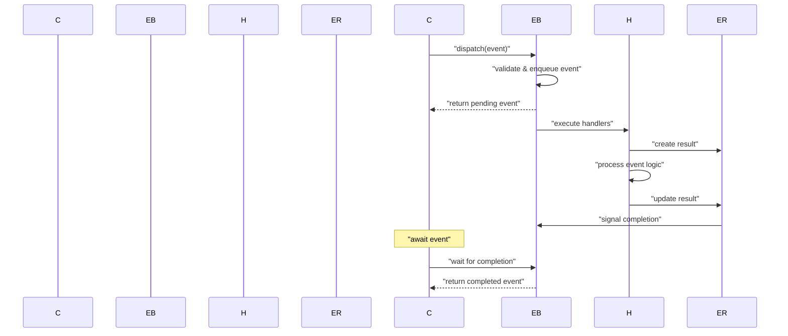
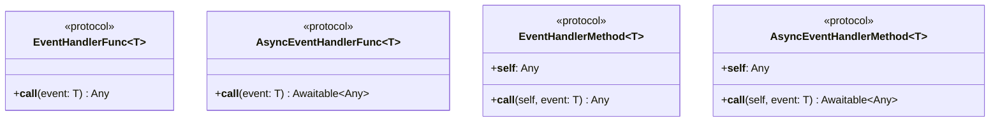

<!-- source: DeepWiki mcp.deepwiki.com · repo browser-use/bubus · page 3 API Reference · fetched 2026-10-30 -->

# API Reference

<details>
<summary>Relevant source files</summary>

The following files were used as context for generating this wiki page:

- [README.md](README.md)
- [bubus/models.py](bubus/models.py)
- [bubus/service.py](bubus/service.py)

</details>


This document provides complete API reference documentation for all public interfaces and methods in the bubus event bus library. It covers the core classes (`EventBus`, `BaseEvent`, `EventResult`), their methods, properties, and usage patterns.

For architectural overview and design patterns, see [Core Architecture](#2). For advanced usage patterns and examples, see [Advanced Features](#4). For testing and development workflows, see [Development and Testing](#5).

## Core API Classes

The bubus API consists of three primary classes that work together to provide the event bus functionality:

### Class Relationships

```mermaid
classDiagram
    class EventBus {
        +name: str
        +id: str
        +event_history: dict
        +handlers: dict
        +dispatch(event) BaseEvent
        +on(pattern, handler) void
        +expect(event_type) BaseEvent
        +wait_until_idle() void
        +stop() void
    }
    
    class BaseEvent~T~ {
        +event_id: str
        +event_type: str
        +event_status: str
        +event_results: dict
        +event_children: list
        +event_result() T
        +event_results_list() list
        +event_results_by_handler_id() dict
        +__await__() Self
    }
    
    class EventResult~T~ {
        +id: str
        +handler_id: str
        +handler_name: str
        +status: str
        +result: T
        +error: Exception
        +started_at: datetime
        +completed_at: datetime
        +__await__() T
    }
    
    EventBus ||--o{ BaseEvent : "manages"
    BaseEvent ||--o{ EventResult : "contains"
    EventResult ||--o{ BaseEvent : "tracks children"
```

Sources: [bubus/service.py:250-506](), [bubus/models.py:200-792](), [bubus/models.py:811-968]()

## EventBus API

The `EventBus` class is the central component that manages event processing and handler execution.

### Constructor

```python
EventBus(
    name: str | None = None,
    wal_path: Path | str | None = None, 
    parallel_handlers: bool = False,
    max_history_size: int | None = 50
)
```

| Parameter | Type | Default | Description |
|-----------|------|---------|-------------|
| `name` | `str \| None` | `None` | Unique bus identifier (auto-generated if not provided) |
| `wal_path` | `Path \| str \| None` | `None` | Path for write-ahead logging to JSONL file |
| `parallel_handlers` | `bool` | `False` | If True, handlers run concurrently per event |
| `max_history_size` | `int \| None` | `50` | Max events to keep in history (None = unlimited) |

Sources: [bubus/service.py:278-348]()

### Core Methods

#### `dispatch(event: BaseEvent) -> BaseEvent`

Synchronously enqueue an event for processing and return the pending event object immediately.

```python
# Returns immediately with pending event
event = bus.dispatch(MyEvent(data="test"))

# Await the event to get completed version  
completed_event = await event
```

**Parameters:**
- `event`: BaseEvent instance to process

**Returns:** The same event object (now with pending status and handler results)

**Behavior:**
- Validates event metadata (id, type, schema)
- Sets parent-child relationships automatically
- Updates event path tracking  
- Enforces memory limits (100 pending events max if `max_history_size` set)
- Auto-starts event loop if not running

Sources: [bubus/service.py:485-588]()

#### `on(event_pattern, handler) -> None`

Register a handler function for events matching a pattern.

```python
# By event class (recommended)
bus.on(UserEvent, handle_user)

# By string pattern  
bus.on('UserEvent', handle_user)

# Wildcard - all events
bus.on('*', universal_handler)

# Forward to another bus
bus.on('*', other_bus.dispatch)
```

**Parameters:**
- `event_pattern`: Event class, string name, or `'*'` for all events
- `handler`: Sync/async function, method, or classmethod

**Handler Signatures Supported:**
- `handler(event: BaseEvent) -> Any` (function)
- `handler(self, event: BaseEvent) -> Any` (method) 
- `handler(cls, event: BaseEvent) -> Any` (classmethod)

Sources: [bubus/service.py:423-483]()

#### `expect(event_type, *, include=None, exclude=None, timeout=None) -> BaseEvent`

Wait for a specific event type to be dispatched with optional filtering.

```python
# Wait for any ResponseEvent
response = await bus.expect(ResponseEvent, timeout=30)

# Wait with custom filter
response = await bus.expect(
    ResponseEvent,
    include=lambda e: e.request_id == "123",
    timeout=30
)
```

**Parameters:**
- `event_type`: Event class or string name to wait for
- `include`: Optional filter function that must return True
- `exclude`: Optional filter function that must return False  
- `timeout`: Max wait time in seconds (None = wait forever)

**Returns:** First matching event when dispatched (not when completed)

**Raises:** `asyncio.TimeoutError` if timeout exceeded

Sources: [bubus/service.py:590-683]()

#### `wait_until_idle(timeout=None) -> None`

Wait until all events are processed and the bus is idle.

```python
await bus.wait_until_idle()           # Wait indefinitely
await bus.wait_until_idle(timeout=5)  # Wait up to 5 seconds
```

**Parameters:**
- `timeout`: Max wait time in seconds (None = wait forever)

**Raises:** `TimeoutError` if timeout exceeded

Sources: [bubus/service.py:817-863]()

#### `stop(timeout=None, clear=False) -> None`

Stop the event bus, optionally waiting for completion and clearing memory.

```python
await bus.stop()                    # Immediate shutdown
await bus.stop(timeout=1.0)        # Graceful stop, wait up to 1s  
await bus.stop(clear=True)         # Stop and free all memory
```

**Parameters:**
- `timeout`: Max wait time for pending events (None = immediate, 0 = don't wait)
- `clear`: If True, clear event history and remove from global tracking

Sources: [bubus/service.py:742-816]()

### Properties

#### Core State Properties

| Property | Type | Description |
|----------|------|-------------|
| `name` | `str` | Bus identifier name |
| `id` | `str` | Unique UUID7 for this bus instance |
| `parallel_handlers` | `bool` | Whether handlers run concurrently |
| `max_history_size` | `int \| None` | Memory limit for event history |

#### Event Status Properties

| Property | Type | Description |
|----------|------|-------------|
| `events_pending` | `list[BaseEvent]` | Events not yet started processing |
| `events_started` | `list[BaseEvent]` | Events currently being processed |
| `events_completed` | `list[BaseEvent]` | Events that finished processing |
| `event_history` | `dict[str, BaseEvent]` | All events by event_id |

Sources: [bubus/service.py:374-390]()

### Event Processing Flow



Sources: [bubus/service.py:929-983](), [bubus/service.py:1080-1232]()

## BaseEvent API

The `BaseEvent` class is the base class for all events in the bubus system, providing metadata tracking and result access methods.

### Generic Type Parameter

`BaseEvent` is a generic class that accepts a type parameter specifying the expected return type from handlers:

```python
class MyEvent(BaseEvent[str]):  # Handlers must return str
    data: str

class DataEvent(BaseEvent[dict]):  # Handlers must return dict  
    query: str
```

Sources: [bubus/models.py:200-225]()

### Core Fields

#### Metadata Fields

| Field | Type | Default | Description |
|-------|------|---------|-------------|
| `event_type` | `str` | Class name | Event type identifier |
| `event_id` | `str` | Generated UUID7 | Unique event identifier |
| `event_schema` | `str` | `ClassName@version` | Schema version string |
| `event_timeout` | `float` | `300.0` | Handler timeout in seconds |
| `event_result_type` | `type` | Auto-detected | Expected handler return type |

#### Tracking Fields

| Field | Type | Default | Description |
|-------|------|---------|-------------|
| `event_path` | `list[str]` | `[]` | Bus names that processed this event |
| `event_parent_id` | `str \| None` | `None` | Parent event ID (auto-set) |
| `event_created_at` | `datetime` | `now()` | When event was created |
| `event_results` | `dict` | `{}` | Handler results by handler_id |

Sources: [bubus/models.py:216-254]()

### Properties

#### Status Properties

| Property | Type | Description |
|----------|------|-------------|
| `event_status` | `str` | `'pending'`, `'started'`, or `'completed'` |
| `event_started_at` | `datetime \| None` | When first handler started |
| `event_completed_at` | `datetime \| None` | When all handlers completed |
| `event_children` | `list[BaseEvent]` | Child events dispatched during handling |

Sources: [bubus/models.py:424-458]()

#### Utility Properties

```python
# Get the current EventBus (only works inside handlers)
current_bus = event.event_bus
```

Sources: [bubus/models.py:771-791]()

### Awaiting Events

Events can be awaited directly to wait for completion:

```python
# Dispatch returns immediately
event = bus.dispatch(MyEvent())

# Await to wait for all handlers to complete  
completed_event = await event
```

**Behavior:**
- Returns the same event object after all handlers complete
- If called from within a handler, processes child events immediately (prevents deadlock)
- Does not raise handler exceptions by default

Sources: [bubus/models.py:277-353]()

### Result Access Methods

#### `event_result(timeout=None, include=None, raise_if_any=True, raise_if_none=True) -> T`

Get the first successful handler result.

```python
# Get first non-None result
result = await event.event_result()

# Get result with custom filter
result = await event.event_result(
    include=lambda r: isinstance(r.result, str) and len(r.result) > 5
)

# Don't raise on errors or missing results
result = await event.event_result(raise_if_any=False, raise_if_none=False)
```

**Parameters:**
- `timeout`: Max wait time (None = use event timeout)
- `include`: Filter function for results to include
- `raise_if_any`: Raise if any handler had an error
- `raise_if_none`: Raise if no valid results found

Sources: [bubus/models.py:566-578]()

#### `event_results_list(timeout=None, include=None, raise_if_any=True, raise_if_none=True) -> list[T]`

Get all handler results as a list.

```python
# Get all successful results
results = await event.event_results_list()  # [result1, result2, ...]

# Get all results including errors/None
all_results = await event.event_results_list(raise_if_any=False, raise_if_none=False)
```

Sources: [bubus/models.py:580-591]()

#### `event_results_by_handler_id(timeout=None, include=None, raise_if_any=True, raise_if_none=True) -> dict[str, T]`

Get results organized by handler ID.

```python
results = await event.event_results_by_handler_id()
# {'handler_id_1': result1, 'handler_id_2': result2}
```

Sources: [bubus/models.py:534-548]()

#### `event_results_by_handler_name(timeout=None, include=None, raise_if_any=True, raise_if_none=True) -> dict[str, T]`

Get results organized by handler name.

```python
results = await event.event_results_by_handler_name() 
# {'MyClass.method_name': result1, 'function_name': result2}
```

Sources: [bubus/models.py:550-564]()

#### `event_results_flat_dict(timeout=None, include=None, raise_if_any=True, raise_if_none=False, raise_if_conflicts=True) -> dict`

Merge all dict results into a single flat dict.

```python
# Merge all handler dict results
config = await event.event_results_flat_dict()
# {'key1': 'value1', 'key2': 'value2', ...}

# Allow key conflicts (last handler wins)  
config = await event.event_results_flat_dict(raise_if_conflicts=False)
```

Sources: [bubus/models.py:593-625]()

#### `event_results_flat_list(timeout=None, include=None, raise_if_any=True, raise_if_none=True) -> list`

Merge all list results into a single flat list.

```python
items = await event.event_results_flat_list()
# [item1, item2, item3, ...]
```

Sources: [bubus/models.py:627-646]()

## EventResult API

The `EventResult` class represents the result of a single handler execution, tracking status, return values, and errors.

### Core Fields

#### Handler Information

| Field | Type | Description |
|-------|------|-------------|
| `id` | `str` | Unique result identifier |
| `handler_id` | `str` | Unique handler identifier |
| `handler_name` | `str` | Human-readable handler name |
| `eventbus_id` | `str` | ID of bus that executed handler |
| `eventbus_name` | `str` | Name of bus that executed handler |

#### Execution Status

| Field | Type | Description |
|-------|------|-------------|
| `status` | `str` | `'pending'`, `'started'`, `'completed'`, or `'error'` |
| `started_at` | `datetime \| None` | When handler started execution |
| `completed_at` | `datetime \| None` | When handler finished execution |
| `timeout` | `float \| None` | Handler timeout in seconds |

#### Results

| Field | Type | Description |
|-------|------|-------------|
| `result` | `T \| None` | Handler return value (validated against result_type) |
| `error` | `Exception \| None` | Exception if handler failed |
| `event_children` | `list[BaseEvent]` | Child events dispatched during execution |

Sources: [bubus/models.py:822-849]()

### Awaiting Results

EventResult objects can be awaited to get the handler result:

```python
# Get specific handler result
handler_result = event.event_results['handler_id']
value = await handler_result  # Returns result or raises exception
```

**Behavior:**
- Waits for handler to complete with timeout
- Returns result value on success
- Raises handler exception on error
- Raises TimeoutError if handler times out

Sources: [bubus/models.py:870-895]()

### Result Validation and Type Casting

When a handler returns a value, EventResult automatically validates and casts it according to the event's `event_result_type`:

```python
class MyEvent(BaseEvent[int]):  # Expect int results
    pass

# Handler must return int or validation error occurs
def handler(event: MyEvent) -> int:
    return 42  # ✅ Valid
    # return "42"  # ❌ Would raise ValidationError
```

**Validation Rules:**
- `BaseEvent` results are always allowed (for event forwarding)
- Pydantic models are validated using `model_validate()`
- Other types are validated using `TypeAdapter.validate_python()`
- Validation errors are captured in `error` field

Sources: [bubus/models.py:897-959]()

## Type System Integration

### Handler Type Protocols

The bubus API uses protocol-based typing to support various handler patterns:



This enables proper type checking for all handler patterns:

```python
# All of these are properly typed
def sync_function(event: MyEvent) -> str: ...
async def async_function(event: MyEvent) -> str: ...

class Service:
    def method(self, event: MyEvent) -> str: ...
    async def async_method(self, event: MyEvent) -> str: ...
    
    @classmethod 
    def class_method(cls, event: MyEvent) -> str: ...
```

Sources: [bubus/models.py:70-150]()

### Generic Type Extraction

BaseEvent automatically extracts the generic type parameter for result validation:

```python
class MyEvent(BaseEvent[list[str]]):  # Complex generic types supported
    pass

# Type is automatically detected and cached
assert MyEvent().__dict__['event_result_type'] == list[str]
```

Sources: [bubus/models.py:172-410]()

## Memory Management

### Automatic Cleanup

EventBus includes automatic memory management features:

- **History Limits**: `max_history_size` parameter controls event retention
- **Smart Cleanup**: Prioritizes keeping active events over completed ones  
- **Memory Monitoring**: Warns when total memory usage exceeds 50MB
- **Cleanup Methods**: `cleanup_event_history()` and `cleanup_excess_events()`

```python
# Configure memory limits
bus = EventBus(max_history_size=100)  # Keep max 100 events

# Manual cleanup
removed_count = bus.cleanup_event_history()

# Complete memory cleanup  
await bus.stop(clear=True)
```

Sources: [bubus/service.py:1346-1505]()

### Hard Limits

When memory limits are enabled, EventBus enforces a hard limit of 100 pending events to prevent runaway memory usage:

```python
# Will raise RuntimeError if 100+ events are pending
event = bus.dispatch(MyEvent())  # May fail if at capacity
```

Sources: [bubus/service.py:547-557]()

This comprehensive API reference covers all public interfaces and methods in the bubus library. For usage examples and patterns, see the other sections of this documentation.

---

