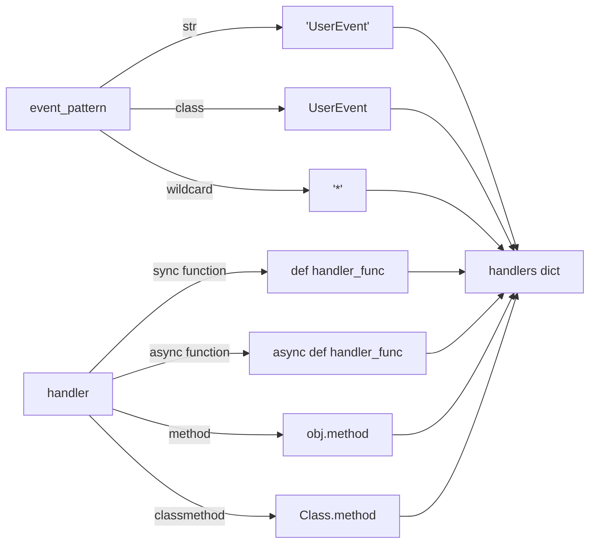
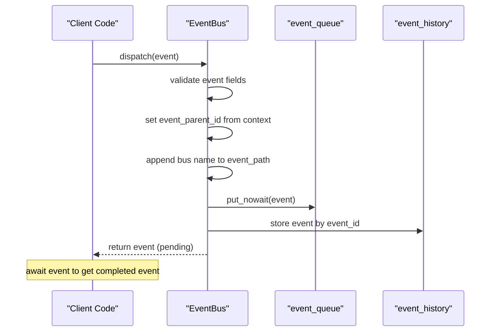
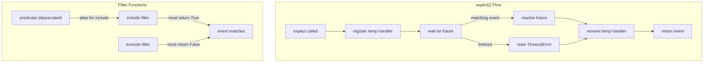
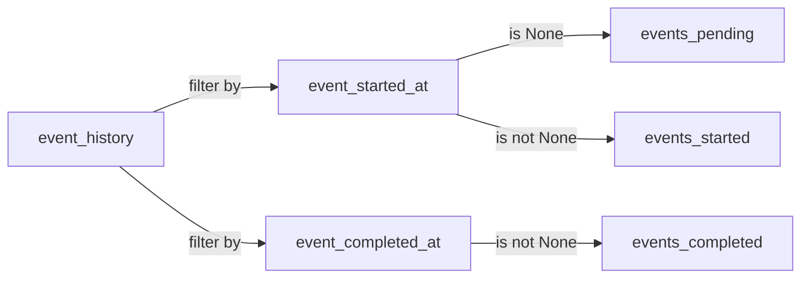
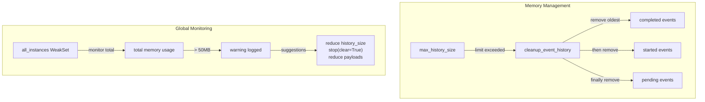
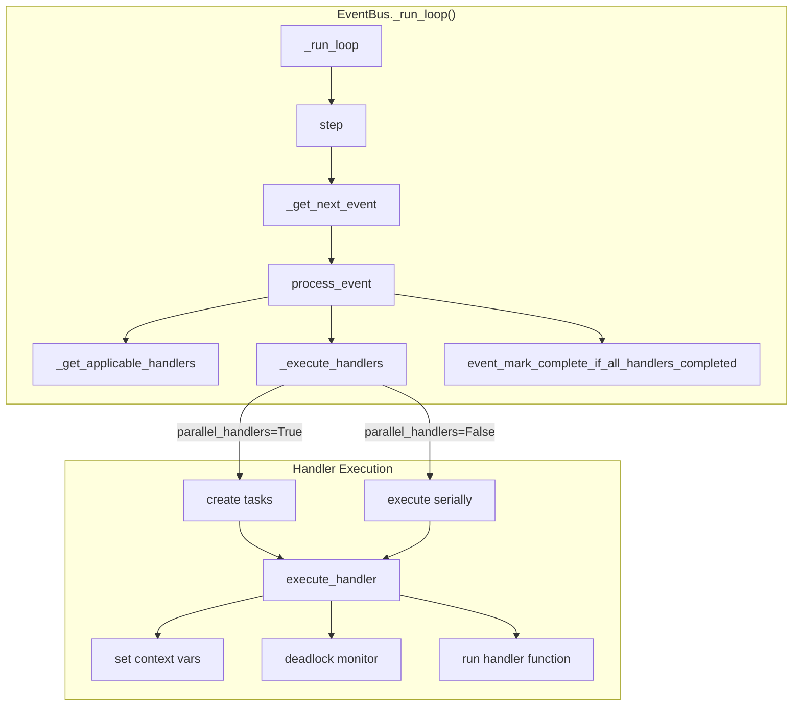

<!-- source: DeepWiki mcp.deepwiki.com · repo browser-use/bubus · page 3.1 EventBus API · fetched 2026-10-30 -->

# EventBus API

<details>
<summary>Relevant source files</summary>

The following files were used as context for generating this wiki page:

- [README.md](README.md)
- [bubus/service.py](bubus/service.py)
- [tests/test_event_bus_property.py](tests/test_event_bus_property.py)

</details>


This document provides comprehensive API documentation for the `EventBus` class, the central dispatcher component of the bubus library. It covers all public methods, properties, configuration parameters, and usage patterns for managing event processing and handler execution.

For information about event models and result handling, see [BaseEvent and EventResult API](#3.2). For advanced concurrency features like the retry decorator, see [Retry Decorator and Helpers API](#3.3).

## EventBus Class Architecture

The `EventBus` class serves as the central event dispatcher, managing event queuing, handler execution, and result aggregation across asynchronous processing workflows.

```mermaid
classDiagram
    class EventBus {
        +name: str
        +id: UUIDStr
        +parallel_handlers: bool
        +wal_path: Path
        +max_history_size: int
        +event_queue: CleanShutdownQueue
        +event_history: dict
        +handlers: dict
        +all_instances: WeakSet
        
        +on(event_pattern, handler)
        +dispatch(event) BaseEvent
        +expect(event_type, timeout) BaseEvent
        +wait_until_idle(timeout)
        +stop(timeout, clear)
        +events_pending: list
        +events_started: list  
        +events_completed: list
        +log_tree() str
    }
    
    class CleanShutdownQueue {
        +get() BaseEvent
        +put(item)
        +shutdown(immediate)
        +qsize() int
        +empty() bool
    }
    
    class BaseEvent {
        +event_id: str
        +event_type: str
        +event_results: dict
        +event_status: str
    }
    
    EventBus ||--o CleanShutdownQueue : "manages"
    EventBus ||--o{ BaseEvent : "processes"
    EventBus --> EventBus : "all_instances WeakSet"
```

Sources: [bubus/service.py:250-348]()

## Core Event Management Methods

### `on()` - Handler Registration

The `on()` method subscribes handlers to specific event types or patterns, supporting multiple registration patterns and handler types.



**Method Signature:**
```python
def on(
    self,
    event_pattern: str | Type[BaseEvent] | Literal['*'],
    handler: Callable[[BaseEvent], Any]
) -> None
```

**Parameters:**
- `event_pattern`: Event type to match - can be event class, string name, or `'*'` for all events
- `handler`: Function or method to execute when pattern matches

**Handler Types Supported:**
- Sync functions: `def handler(event: BaseEvent) -> Any`
- Async functions: `async def handler(event: BaseEvent) -> Any`
- Instance methods: `obj.method(event: BaseEvent) -> Any`
- Class methods: `@classmethod def method(cls, event: BaseEvent) -> Any`
- Static methods: `@staticmethod def method(event: BaseEvent) -> Any`

Sources: [bubus/service.py:423-484](), [README.md:56-110]()

### `dispatch()` - Event Queuing

The `dispatch()` method enqueues events for processing and returns the event object immediately for awaiting completion.



**Method Signature:**
```python
def dispatch(self, event: T_ExpectedEvent) -> T_ExpectedEvent
```

**Parameters:**
- `event`: BaseEvent instance to process

**Returns:**
- The same event object, which can be awaited for completion

**Key Behaviors:**
- Synchronous enqueueing with immediate return
- Automatic parent-child relationship tracking via context variables
- Hard limit of 100 pending events when `max_history_size` is set
- Auto-starts the event processing loop on first dispatch

Sources: [bubus/service.py:485-588](), [README.md:485-502]()

### `expect()` - Event Waiting

The `expect()` method waits for specific events to be dispatched with optional filtering and timeout support.



**Method Signature:**
```python
async def expect(
    self,
    event_type: str | Type[BaseEvent],
    include: Callable[[BaseEvent], bool] = lambda _: True,
    exclude: Callable[[BaseEvent], bool] = lambda _: False,
    predicate: Callable[[BaseEvent], bool] = lambda _: True,  # deprecated
    timeout: float | None = None
) -> BaseEvent
```

**Parameters:**
- `event_type`: Event type string or class to wait for
- `include`: Filter function that must return `True` for event to match
- `exclude`: Filter function that must return `False` for event to match  
- `timeout`: Maximum wait time in seconds (`None` = wait forever)

**Returns:**
- The first matching event when dispatched (not when completed)

Sources: [bubus/service.py:590-683](), [README.md:273-314]()

## Lifecycle Management Methods

### `wait_until_idle()` - Completion Waiting

Waits until all events are processed and the bus has no pending work.

**Method Signature:**
```python
async def wait_until_idle(self, timeout: float | None = None) -> None
```

**Behavior:**
- Waits for event queue to empty via `queue.join()`
- Waits for internal `_on_idle` event to be set
- Double-checks no events are in `started` or `pending` states
- Yields control to allow runloop to settle completely

Sources: [bubus/service.py:817-863]()

### `stop()` - Bus Shutdown

Gracefully stops the event bus with optional timeout and memory cleanup.

**Method Signature:**
```python
async def stop(self, timeout: float | None = None, clear: bool = False) -> None
```

**Parameters:**
- `timeout`: Maximum time to wait for pending events (`None` = immediate shutdown)
- `clear`: If `True`, clears event history and removes from global tracking

**Shutdown Process:**
1. Wait for idle state (if timeout > 0)
2. Signal shutdown to queue and runloop
3. Cancel runloop task
4. Clean up memory and references (if `clear=True`)

Sources: [bubus/service.py:742-816]()

## State Inspection Properties

The EventBus provides properties for inspecting current processing state:

| Property | Type | Description |
|----------|------|-------------|
| `events_pending` | `list[BaseEvent]` | Events not yet started processing |
| `events_started` | `list[BaseEvent]` | Events currently being processed |
| `events_completed` | `list[BaseEvent]` | Events that finished processing |
| `event_history` | `dict[str, BaseEvent]` | All events by `event_id` |

**Property Implementation:**


Sources: [bubus/service.py:374-389]()

## Configuration Parameters

### Constructor Parameters

```python
def __init__(
    self,
    name: str | None = None,
    wal_path: Path | str | None = None,
    parallel_handlers: bool = False,
    max_history_size: int | None = 50
)
```

**Configuration Options:**

| Parameter | Default | Description |
|-----------|---------|-------------|
| `name` | `f"{class}_{uuid[-8:]}"` | Unique bus identifier |
| `wal_path` | `None` | Path for write-ahead logging to JSONL |
| `parallel_handlers` | `False` | Execute handlers concurrently vs serially |
| `max_history_size` | `50` | Max events in history (`None` = unlimited) |

**Name Uniqueness:**
- Auto-generates unique suffix if name conflicts detected
- Uses WeakSet to track active instances across event loops
- Warns on conflicts and suggests using `stop(clear=True)`

Sources: [bubus/service.py:278-348]()

## Memory Management Features

### Automatic Cleanup



**Memory Limits:**
- Default 50 event history limit prevents unbounded growth
- Hard limit of 100 pending events when memory management enabled
- Global memory monitoring across all EventBus instances
- Warnings when total memory exceeds 50MB

Sources: [bubus/service.py:1371-1506](), [README.md:416-448]()

## Event Processing Pipeline

### Internal Processing Flow



**Context Variables:**
- `_current_event_context`: Current event being processed
- `inside_handler_context`: Whether inside handler execution  
- `_current_handler_id_context`: Current handler ID for child tracking
- `holds_global_lock`: Global lock re-entrancy tracking

Sources: [bubus/service.py:864-894](), [bubus/service.py:1037-1232]()

## Usage Patterns

### Basic Event Handling
```python
bus = EventBus(name='MyBus')
bus.on(UserLoginEvent, handle_login)
event = await bus.dispatch(UserLoginEvent(username='alice'))
result = await event.event_result()
```

### Multi-Bus Event Forwarding  
```python
main_bus = EventBus(name='Main')
auth_bus = EventBus(name='Auth')
main_bus.on('*', auth_bus.dispatch)  # Forward all events
```

### Event Expectation with Filtering
```python
response = await bus.expect(
    APIResponseEvent,
    include=lambda e: e.request_id == request.id,
    timeout=30.0
)
```

Sources: [README.md:21-42](), [README.md:145-165](), [README.md:277-310]()

---

