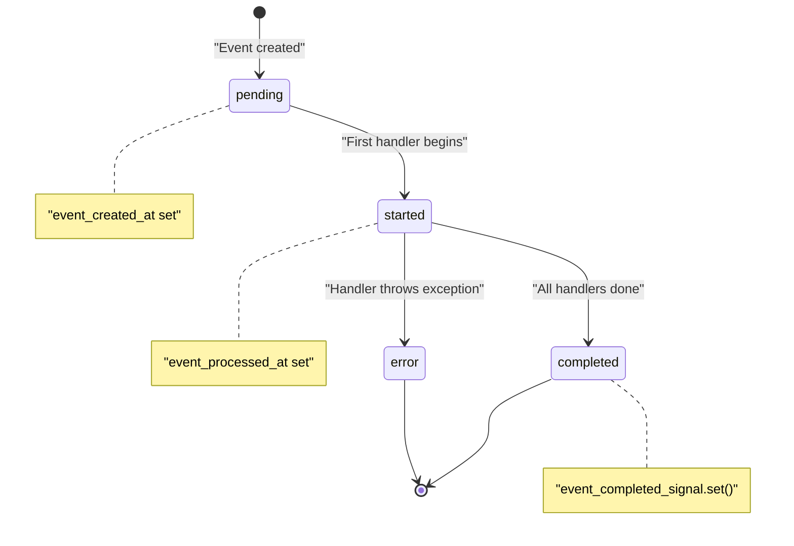
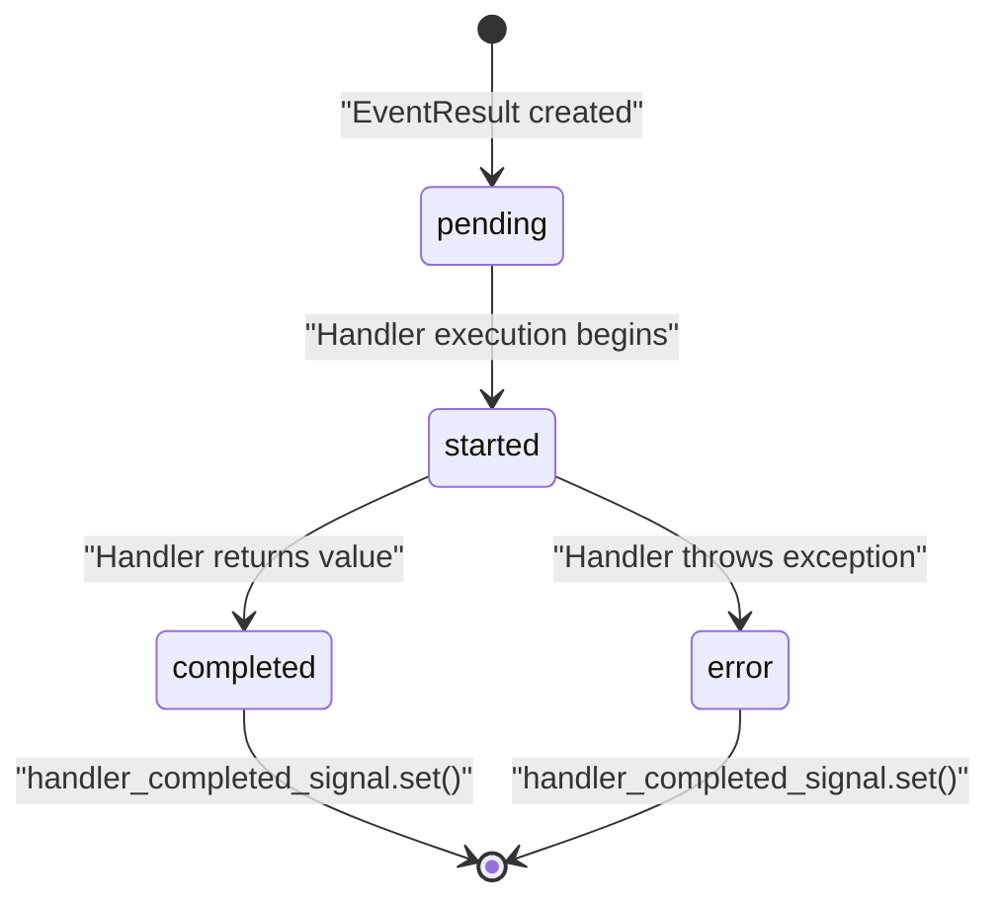
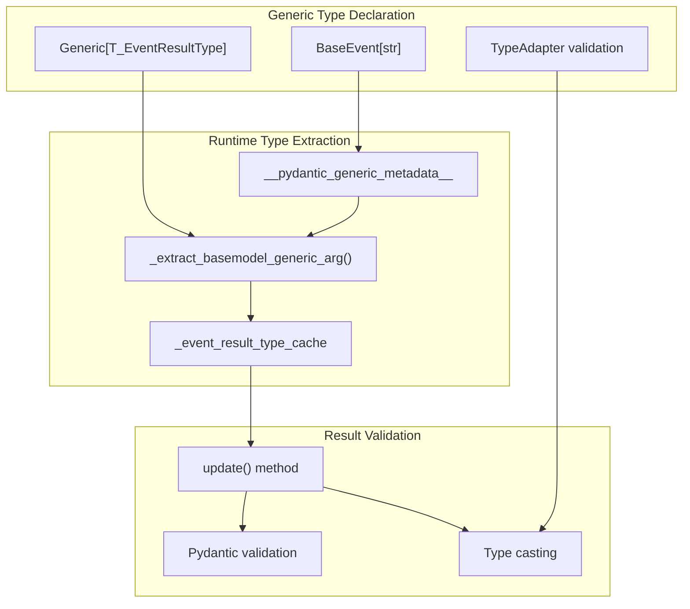
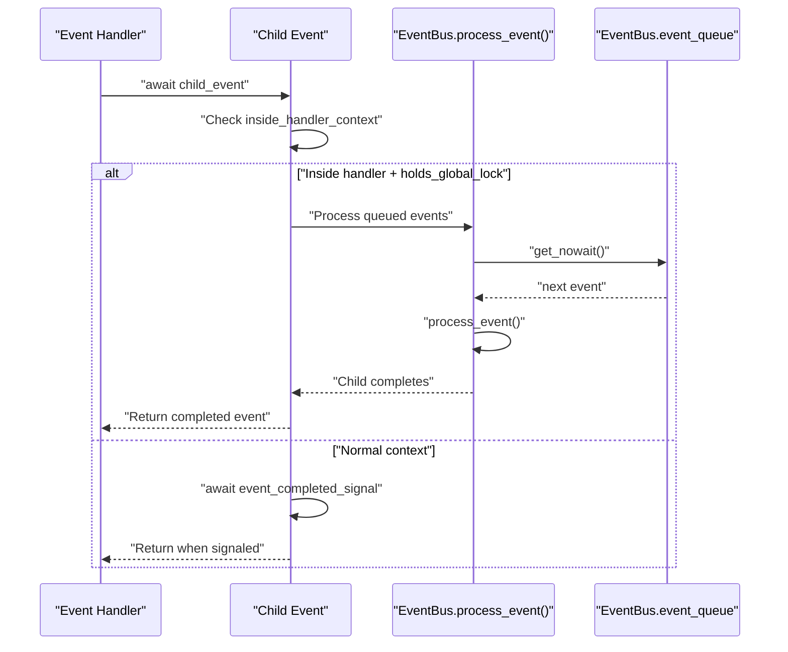
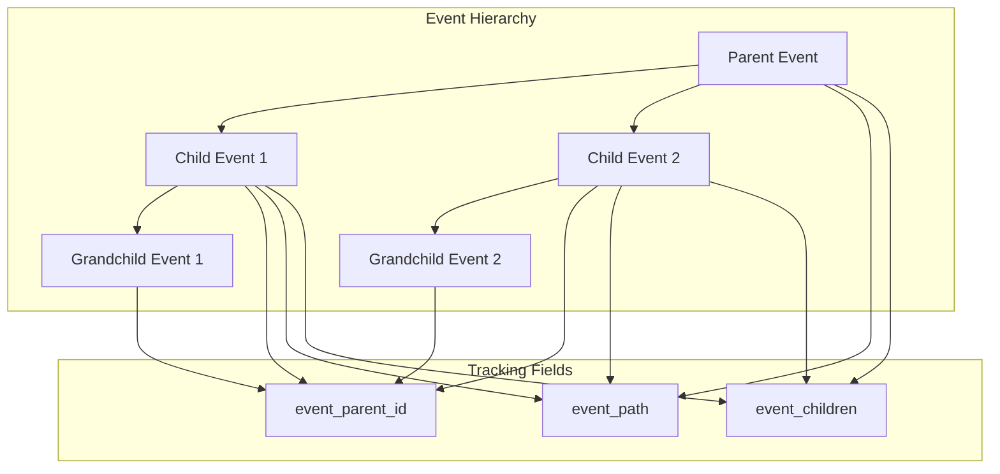

<!-- source: DeepWiki mcp.deepwiki.com · repo browser-use/bubus · page 3.2 BaseEvent and EventResult API · fetched 2026-10-30 -->

# BaseEvent and EventResult API

<details>
<summary>Relevant source files</summary>

The following files were used as context for generating this wiki page:

- [.pre-commit-config.yaml](.pre-commit-config.yaml)
- [README.md](README.md)
- [bubus/models.py](bubus/models.py)
- [tests/test_simple_typed_results.py](tests/test_simple_typed_results.py)
- [tests/test_typed_event_results.py](tests/test_typed_event_results.py)

</details>


This page provides comprehensive API documentation for the `BaseEvent` and `EventResult` classes, which form the core data models of the bubus event system. These classes handle event lifecycle management, type-safe result collection, and hierarchical event relationships.

For information about the EventBus implementation that processes these models, see [EventBus API](#3.1). For details about the retry mechanisms that work with these classes, see [Retry Decorator API](#3.3).

## BaseEvent Class Overview

The `BaseEvent` class is the foundation of all events in the bubus system. It extends Pydantic's `BaseModel` and implements the `Generic[T_EventResultType]` pattern for type-safe result handling.

### Core Event Structure

```mermaid
classDiagram
    class BaseEvent {
        +event_type: str
        +event_schema: str  
        +event_timeout: float
        +event_result_type: Any
        +event_id: UUIDStr
        +event_path: list[str]
        +event_parent_id: UUIDStr
        +event_created_at: datetime
        +event_processed_at: datetime
        +event_results: dict[str, EventResult]
        +__await__()
        +event_result()
        +event_results_list()
        +event_results_by_handler_name()
    }
    
    class EventResult {
        +id: UUIDStr
        +status: Literal["pending", "started", "completed", "error"]
        +event_id: UUIDStr
        +handler_id: str
        +handler_name: str
        +result_type: Any
        +result: T_EventResultType
        +error: BaseException
        +event_children: list[BaseEvent]
        +__await__()
        +update()
    }
    
    BaseEvent ||--o{ EventResult : "contains"
    EventResult ||--o{ BaseEvent : "tracks children"
```

Sources: [bubus/models.py:200-254](), [bubus/models.py:811-849]()

### Event Lifecycle and Status Management

Events progress through distinct lifecycle stages, tracked automatically by the system:



The `event_status` property [bubus/models.py:404-406]() dynamically computes the current status based on completion timestamps. The `__str__` method [bubus/models.py:263-275]() displays status using emoji indicators: ⏳ (pending), 🏃 (started), ✅ (completed), ❌ (error).

Sources: [bubus/models.py:424-458](), [bubus/models.py:263-275]()

## EventResult Class Overview

Each `EventResult` instance represents the outcome of a single handler processing an event. EventResults are automatically created and managed by the EventBus during event processing.

### Result Status Transitions



The `update()` method [bubus/models.py:853-915]() handles status transitions and automatic timestamp management, including type validation when `result_type` is specified.

Sources: [bubus/models.py:811-849](), [bubus/models.py:867-915]()

## Type System Integration

The bubus type system uses Pydantic and Generic typing to provide compile-time and runtime type safety:



The `_extract_basemodel_generic_arg()` function [bubus/models.py:172-197]() extracts Generic type parameters from the class hierarchy, with caching for performance. The `_set_event_result_type_from_generic_arg()` validator [bubus/models.py:356-391]() automatically sets `event_result_type` from Generic declarations.

Sources: [bubus/models.py:172-197](), [bubus/models.py:375-410](), [bubus/models.py:897-915]()

## Async Patterns and Event Awaiting

Both `BaseEvent` and `EventResult` implement the `__await__` protocol for seamless async integration:

### BaseEvent Awaiting with Deadlock Prevention

The `BaseEvent.__await__()` method [bubus/models.py:277-334]() includes sophisticated deadlock prevention when awaiting events from within handlers:



Sources: [bubus/models.py:277-353](), [bubus/models.py:286-342]()

### EventResult Awaiting

EventResult awaiting [bubus/models.py:916-929]() is simpler, waiting for the handler to complete and returning the result or raising any error:

```python
# EventResult.__await__ simplified logic
async def wait_for_handler_to_complete_and_return_result():
    await asyncio.wait_for(self.handler_completed_signal.wait(), timeout=self.timeout)
    if self.status == 'error' and self.error:
        raise self.error
    return self.result
```

Sources: [bubus/models.py:916-929]()

## Result Aggregation Methods

BaseEvent provides multiple methods for collecting and filtering handler results:

### Core Result Methods

| Method | Return Type | Purpose |
|--------|-------------|---------|
| `event_result()` | `T_EventResultType \| None` | First non-None result |
| `event_results_list()` | `list[T_EventResultType]` | All results as list |
| `event_results_by_handler_name()` | `dict[str, T_EventResultType]` | Results by handler name |
| `event_results_by_handler_id()` | `dict[str, T_EventResultType]` | Results by handler ID |
| `event_results_flat_dict()` | `dict[str, Any]` | Merged dict results |
| `event_results_flat_list()` | `list[Any]` | Merged list results |

All result methods accept common parameters:

- `timeout`: Override default event timeout
- `include`: Filter function for result inclusion  
- `raise_if_any`: Raise on handler errors (default True)
- `raise_if_none`: Raise if no results match filter (default True)

Sources: [bubus/models.py:566-646]()

### Result Filtering

The default filter function `_event_result_is_truthy()` [bubus/models.py:460-472]() excludes:
- Non-completed results (`status != 'completed'`)
- `None` results
- Exception results
- BaseEvent results (forwarded events)

Custom filters can be provided via the `include` parameter:

```python
# Example: Include only string results
string_results = await event.event_results_list(
    include=lambda r: isinstance(r.result, str) and r.status == 'completed'
)
```

Sources: [bubus/models.py:460-472](), [bubus/models.py:474-532]()

## Parent-Child Event Relationships

Events can spawn child events during handler execution, creating hierarchical relationships tracked automatically:



The `event_children` property [bubus/models.py:408-414]() aggregates children from all EventResults. The `event_are_all_children_complete()` method [bubus/models.py:696-713]() recursively checks completion status with cycle detection.

Sources: [bubus/models.py:427-433](), [bubus/models.py:723-740](), [bubus/models.py:849]()

## Property Reference

### BaseEvent Core Properties

| Property | Type | Default | Description |
|----------|------|---------|-------------|
| `event_type` | `str` | Class name | Event type identifier |
| `event_schema` | `str` | `{module}.{class}@{version}` | Schema version string |
| `event_timeout` | `float` | `300.0` | Processing timeout in seconds |
| `event_result_type` | `Any` | Auto-extracted from Generic | Expected result type |
| `event_id` | `str` | UUID7 | Unique event identifier |
| `event_path` | `list[str]` | `[]` | Bus routing path |
| `event_parent_id` | `str \| None` | `None` | Parent event ID |

Sources: [bubus/models.py:216-254]()

### BaseEvent Computed Properties

| Property | Type | Description |
|----------|------|-------------|
| `event_status` | `str` | Current lifecycle status |
| `event_children` | `list[BaseEvent]` | All child events |
| `event_started_at` | `datetime \| None` | First handler start time |
| `event_completed_at` | `datetime \| None` | All handlers completion time |
| `event_bus` | `EventBus` | Currently processing bus (handler context only) |

Sources: [bubus/models.py:424-458](), [bubus/models.py:770-791]()

### EventResult Properties

| Property | Type | Description |
|----------|------|-------------|
| `id` | `str` | Unique result ID |
| `status` | `Literal` | Handler execution status |
| `event_id` | `str` | Associated event ID |
| `handler_id` | `str` | Unique handler identifier |
| `handler_name` | `str` | Human-readable handler name |
| `result_type` | `Any` | Expected result type |
| `result` | `T_EventResultType` | Handler return value |
| `error` | `BaseException \| None` | Handler exception |
| `event_children` | `list[BaseEvent]` | Child events spawned during execution |

Sources: [bubus/models.py:823-849]()

## Usage Patterns

### Basic Event Definition
```python
from bubus import BaseEvent

class UserLoginEvent(BaseEvent[dict]):
    username: str
    timestamp: datetime
```

### Result Access Patterns
```python
# Wait for first result
user_data = await event.event_result()

# Get all results by handler name  
all_results = await event.event_results_by_handler_name()

# Merge dict results from multiple handlers
merged = await event.event_results_flat_dict()
```

### Child Event Handling
```python
async def parent_handler(event: ParentEvent):
    # Dispatch child event using current bus
    child = await event.event_bus.dispatch(ChildEvent())
    return child.result
```

Sources: [tests/test_event_bus_property.py:244-320]()

---

