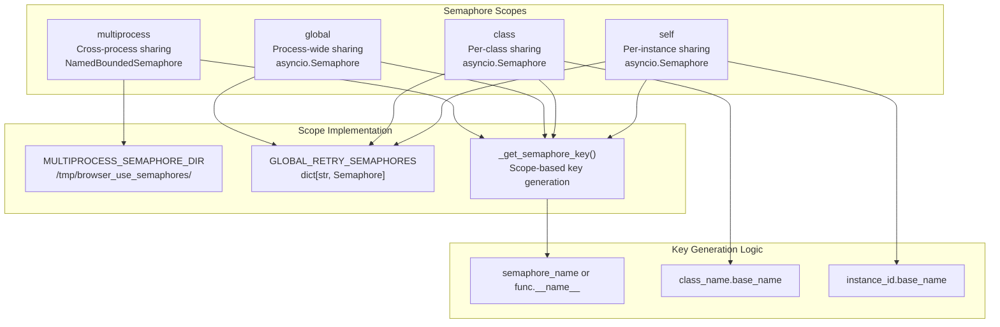
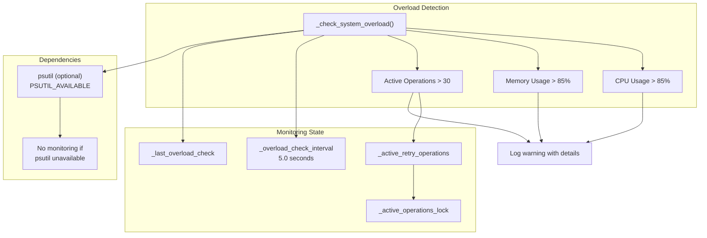
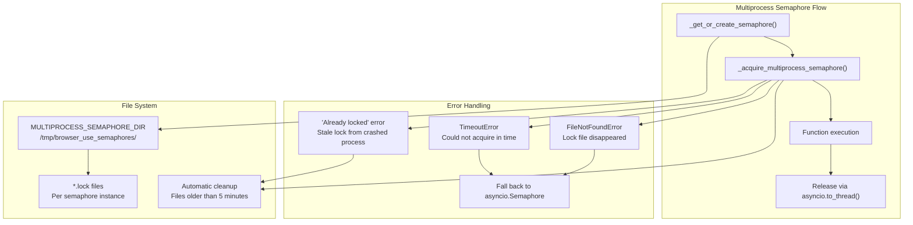

<!-- source: DeepWiki mcp.deepwiki.com · repo browser-use/bubus · page 3.3 Retry Decorator and Helpers API · fetched 2026-10-30 -->

# Retry Decorator and Helpers API

<details>
<summary>Relevant source files</summary>

The following files were used as context for generating this wiki page:

- [README.md](README.md)
- [bubus/helpers.py](bubus/helpers.py)
- [tests/test_name_conflict_gc.py](tests/test_name_conflict_gc.py)

</details>


This page documents the helper utilities provided by the `bubus.helpers` module, including the `@retry` decorator for robust retry mechanisms with semaphore-based concurrency control, the `@time_execution` decorator for performance monitoring, and utility functions for system resource management.

These utilities are designed for use with EventBus handlers but can be applied to any asynchronous functions that require reliability, concurrency control, or performance monitoring.

For information about EventBus handler registration, see [EventBus API](#3.1). For details about the underlying event processing architecture, see [EventBus Service Implementation](#2.1).

## Retry Decorator

### Function Signature and Core Parameters

The `retry` decorator is defined in [bubus/helpers.py:427-470]() with the following signature:

```python
def retry(
    wait: float = 3,
    retries: int = 3,
    timeout: float = 5,
    retry_on: tuple[type[Exception], ...] | None = None,
    backoff_factor: float = 1.0,
    semaphore_limit: int | None = None,
    semaphore_name: str | None = None,
    semaphore_lax: bool = True,
    semaphore_scope: Literal['multiprocess', 'global', 'class', 'self'] = 'global',
    semaphore_timeout: float | None = None,
)
```

### Core Retry Parameters

| Parameter | Type | Default | Description |
|-----------|------|---------|-------------|
| `wait` | `float` | `3` | Seconds to wait between retries |
| `retries` | `int` | `3` | Number of retry attempts after initial failure |
| `timeout` | `float` | `5` | Per-attempt timeout in seconds |
| `retry_on` | `tuple[type[Exception], ...] \| None` | `None` | Specific exception types to retry on (None = retry all) |
| `backoff_factor` | `float` | `1.0` | Multiplier for wait time after each retry (1.0 = no backoff) |

### Semaphore Parameters

| Parameter | Type | Default | Description |
|-----------|------|---------|-------------|
| `semaphore_limit` | `int \| None` | `None` | Maximum concurrent executions (creates semaphore if set) |
| `semaphore_name` | `str \| None` | `None` | Custom name for semaphore (defaults to function name) |
| `semaphore_lax` | `bool` | `True` | If True, continue without semaphore on acquisition failure |
| `semaphore_scope` | `Literal[...]` | `'global'` | Scope for semaphore sharing |
| `semaphore_timeout` | `float \| None` | `None` | Maximum time to wait for semaphore acquisition |

Sources: [bubus/helpers.py:427-470]()

## Semaphore Scoping and Concurrency Control

The decorator provides four distinct semaphore scopes that control how concurrency limits are applied:



### Scope Behavior

- **`multiprocess`**: Uses [portalocker.utils.NamedBoundedSemaphore]() for cross-process coordination via filesystem locks
- **`global`**: Shares one semaphore across all calls to any function with the same name
- **`class`**: All instances of a class share one semaphore per function name
- **`self`**: Each instance gets its own semaphore per function name

### Semaphore Key Generation

The semaphore key is generated by [_get_semaphore_key():124-146]():

```python
def _get_semaphore_key(func_name, semaphore_name, semaphore_scope, args):
    base_name = semaphore_name or func_name
    
    if semaphore_scope == 'class' and args and hasattr(args[0], '__class__'):
        return f'{args[0].__class__.__name__}.{base_name}'
    elif semaphore_scope == 'self' and args:
        return f'{id(args[0])}.{base_name}'
    else:
        return base_name
```

Sources: [bubus/helpers.py:124-197](), [bubus/helpers.py:76-81]()

## Timeout and Retry Behavior

The retry mechanism implements exponential backoff and sophisticated timeout handling:

```mermaid
sequenceDiagram
    participant Client
    participant "retry() wrapper" as Wrapper
    participant "Semaphore System" as Sem
    participant "Target Function" as Func
    participant "System Monitor" as Monitor
    
    Client->>Wrapper: "Call decorated function"
    Wrapper->>Monitor: "_check_system_overload_if_needed()"
    Wrapper->>Monitor: "_track_active_operations(increment=True)"
    
    alt semaphore_limit is set
        Wrapper->>Sem: "_get_or_create_semaphore()"
        Wrapper->>Sem: "acquire(timeout=semaphore_timeout)"
        alt acquisition fails and semaphore_lax=False
            Sem-->>Wrapper: "TimeoutError"
            Wrapper-->>Client: "TimeoutError"
        end
    end
    
    loop retries + 1 attempts
        Wrapper->>Func: "asyncio.timeout(timeout)"
        alt function succeeds
            Func-->>Wrapper: "return result"
            break
        else function fails
            Func-->>Wrapper: "raise exception"
            alt not in retry_on types
                break
            end
            alt not final attempt
                Wrapper->>Wrapper: "await asyncio.sleep(wait * backoff_factor^attempt)"
            end
        end
    end
    
    Wrapper->>Monitor: "_track_active_operations(increment=False)"
    alt semaphore was acquired
        Wrapper->>Sem: "release()"
    end
    Wrapper-->>Client: "return result or raise final exception"
```

### Timeout Calculation

Semaphore timeout is calculated by [_calculate_semaphore_timeout():200-213]():

```python
def _calculate_semaphore_timeout(semaphore_timeout, timeout, semaphore_limit):
    if semaphore_timeout is None:
        # Default: wait if all slots occupied with max timeout operations
        return max(timeout, timeout * (semaphore_limit - 1))
    else:
        return max(0.01, semaphore_timeout) if semaphore_timeout == 0 else semaphore_timeout
```

### Backoff Strategy

Wait time between retries follows the formula: `wait * (backoff_factor ** attempt)`

Sources: [bubus/helpers.py:349-403](), [bubus/helpers.py:200-213](), [bubus/helpers.py:374-390]()

## System Overload Detection

The decorator includes built-in system monitoring to prevent resource exhaustion:



The system checks for overload conditions every 5 seconds and logs warnings when thresholds are exceeded. This helps identify when too many concurrent operations might cause system instability.

Sources: [bubus/helpers.py:90-122](), [bubus/helpers.py:406-425](), [bubus/helpers.py:21-28]()

## Multiprocess Semaphore Implementation

For multiprocess coordination, the decorator uses filesystem-based semaphores with robust error handling:



### Multiprocess Error Recovery

The implementation includes sophisticated error recovery for filesystem-based coordination:

1. **Automatic cleanup**: Removes stale lock files older than 5 minutes
2. **Recreation on disappearance**: Recreates semaphores if lock files are removed
3. **Fallback mechanism**: Falls back to asyncio semaphores if filesystem operations fail
4. **Exponential backoff**: Uses increasing delays for acquisition retries

Sources: [bubus/helpers.py:215-320](), [bubus/helpers.py:154-197](), [bubus/helpers.py:76-82]()

## Integration with EventBus

The retry decorator integrates seamlessly with EventBus handlers:

```python
from bubus import BaseEvent, EventBus
from bubus.helpers import retry

class WorkEvent(BaseEvent[str]):
    event_result_type = str
    work_id: int

bus = EventBus(name='work_bus')

@retry(
    retries=3,
    wait=1.0,
    timeout=10.0,
    semaphore_limit=5,
    semaphore_scope='global'
)
async def process_work(event: WorkEvent) -> str:
    # Handler implementation with retry protection
    return f"Processed work {event.work_id}"

bus.on('WorkEvent', process_work)
```

### Handler Registration Patterns

The decorator can be applied in multiple ways:

1. **Direct handler decoration**: Apply `@retry` directly to handler functions
2. **Class method decoration**: Use with class-based handlers and appropriate semaphore scope
3. **Dynamic registration**: Apply to handlers registered via `bus.on()`

Sources: [tests/test_semaphores.py:632-694](), [tests/test_semaphores.py:696-773]()

## Configuration Examples

### Basic Retry Configuration

```python
@retry(wait=2.0, retries=5, timeout=30.0)
async def unreliable_operation():
    # Will retry up to 5 times with 2-second waits
    pass
```

### Selective Exception Retry

```python
@retry(
    retries=3,
    retry_on=(ConnectionError, TimeoutError),
    backoff_factor=2.0
)
async def network_operation():
    # Only retries on specific exceptions with exponential backoff
    pass
```

### Multiprocess Concurrency Control

```python
@retry(
    semaphore_limit=3,
    semaphore_scope='multiprocess',
    semaphore_name='cpu_intensive_work',
    semaphore_lax=False
)
async def cpu_intensive_task():
    # Limited to 3 concurrent executions across all processes
    pass
```

### Class-Scoped Semaphores

```python
class Worker:
    @retry(
        semaphore_limit=2,
        semaphore_scope='class',
        semaphore_timeout=10.0
    )
    async def process_item(self, item):
        # All Worker instances share the same semaphore
        # Max 2 concurrent process_item calls across all instances
        pass
```

Sources: [tests/test_semaphores.py:525-627](), [bubus/helpers.py:458-469]()

---

