<!-- source: DeepWiki mcp.deepwiki.com · repo browser-use/bubus · page 4 Advanced Features · fetched 2026-10-30 -->

# Advanced Features

Relevant source files

The following files were used as context for generating this wiki page:

- [README.md](README.md)
- [tests/test_comprehensive_patterns.py](tests/test_comprehensive_patterns.py)

This document covers the sophisticated capabilities of bubus that go beyond basic event dispatching and handling. These features enable complex event-driven architectures with reliable concurrency control, event persistence, debugging capabilities, and multi-service communication patterns.

For basic EventBus usage and API reference, see [EventBus API](#3.1). For testing patterns specific to advanced features, see [Testing Framework and Patterns](#5.2).

## Event Hierarchy and Parent-Child Relationships

The bubus event system automatically tracks relationships between events when handlers dispatch child events. This creates a tree structure that enables sophisticated debugging and audit trails.

### Parent-Child Event Tracking Architecture

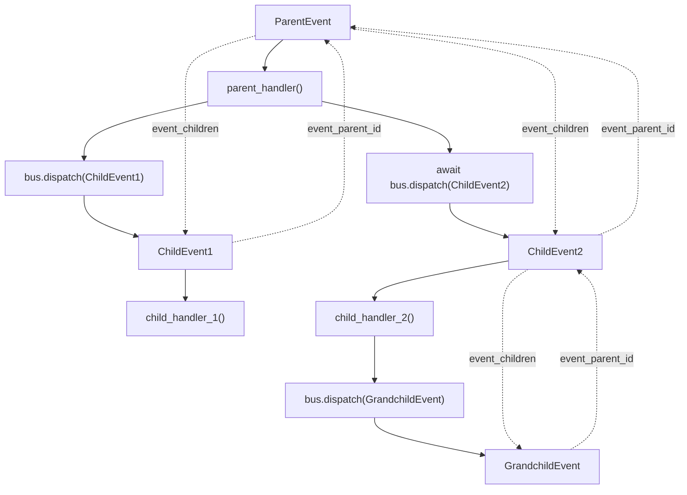

**Sources:** [README.md:230-265](), [tests/test_comprehensive_patterns.py:47-102]()

### Sync vs Async Child Event Processing

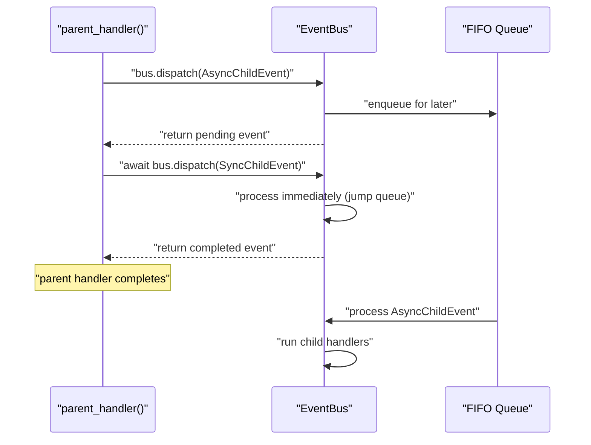

**Sources:** [README.md:208-226](), [tests/test_comprehensive_patterns.py:55-66]()

Child events dispatched with `await` jump the FIFO queue and process immediately, while non-awaited dispatches are queued for later processing. The `event_parent_id` field automatically links children to their parent, and `event_children` provides reverse lookup.

## Multi-Bus Communication and Event Forwarding

Multiple `EventBus` instances can forward events between each other, enabling microservice-style architecture with automatic loop prevention.

### Event Forwarding Implementation

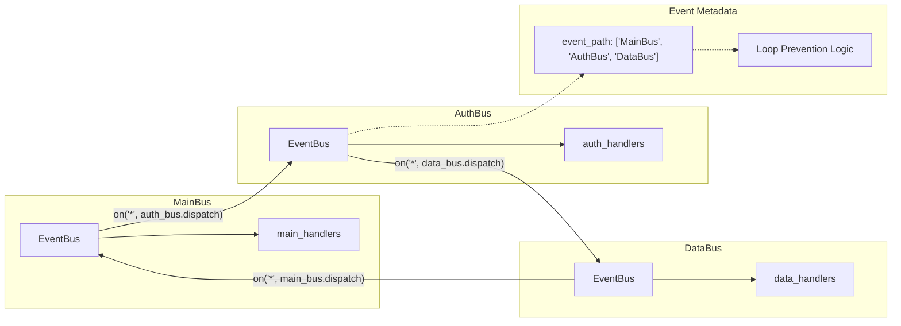

**Sources:** [README.md:145-165](), [tests/test_comprehensive_patterns.py:29-45]()

### Loop Prevention Mechanism

The `event_path` field tracks which buses have already processed an event, preventing infinite forwarding loops:

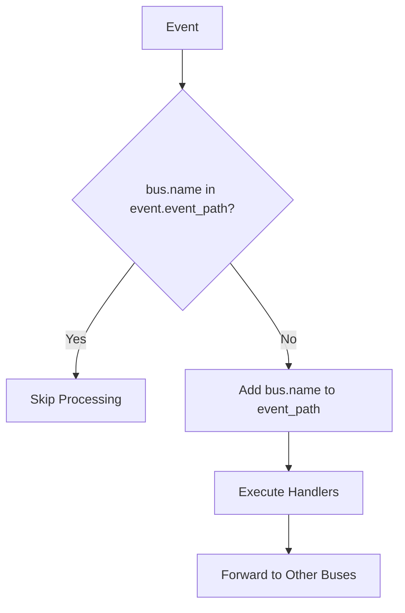

**Sources:** [README.md:158-164](), [tests/test_comprehensive_patterns.py:76-87]()

Each bus checks if its name is already in `event.event_path` before processing. If found, the event is skipped to prevent loops.

## Type System and Automatic Result Validation

The bubus type system leverages Pydantic for automatic validation of event data and handler return values.

### Generic Event Result Types

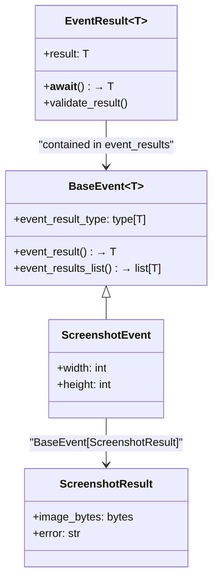

**Sources:** [README.md:356-411](), [README.md:602-635]()

### Result Validation Pipeline

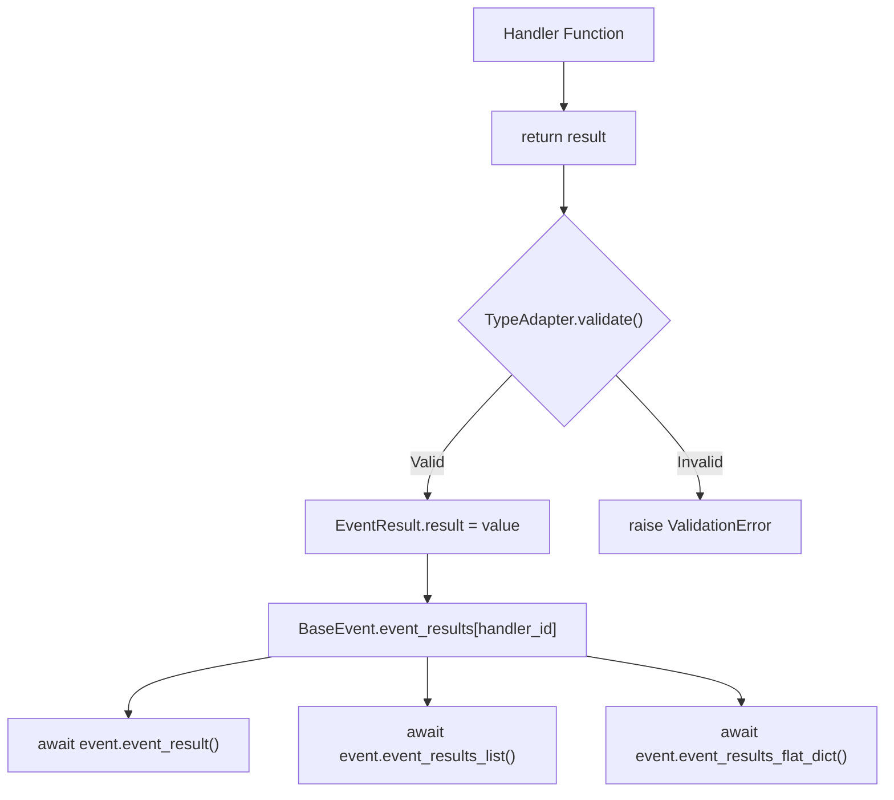

**Sources:** [README.md:377-390](), [README.md:650-763]()

The `TypeAdapter` from Pydantic validates but does not coerce handler return values, ensuring strict type safety.

## Event Debugging and Tree Visualization

The bubus logging system provides comprehensive debugging capabilities for complex event trees and handler execution analysis.

### Event Tree Structure Visualization

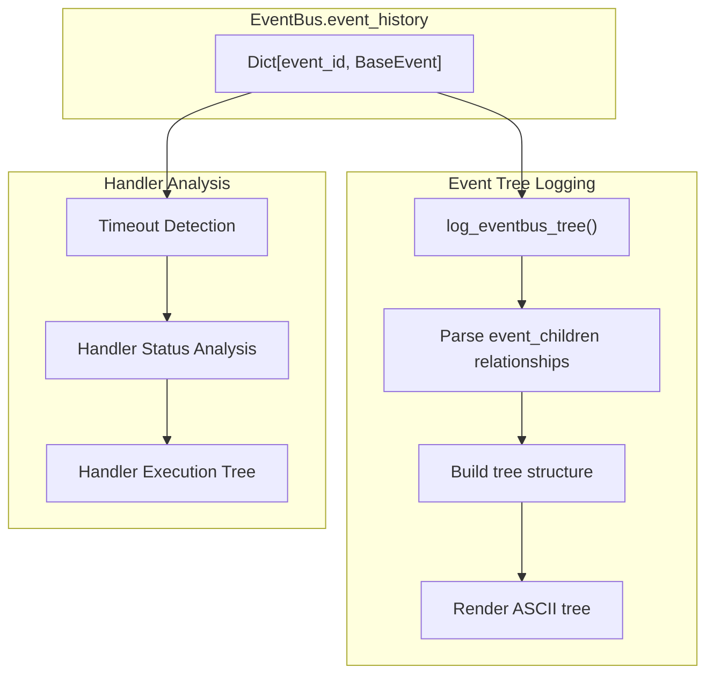

**Sources:** [README.md:267-268](), [tests/test_comprehensive_patterns.py:167-171]()

### Event Status and Timeout Tracking

The system tracks detailed execution metadata for debugging handler issues:

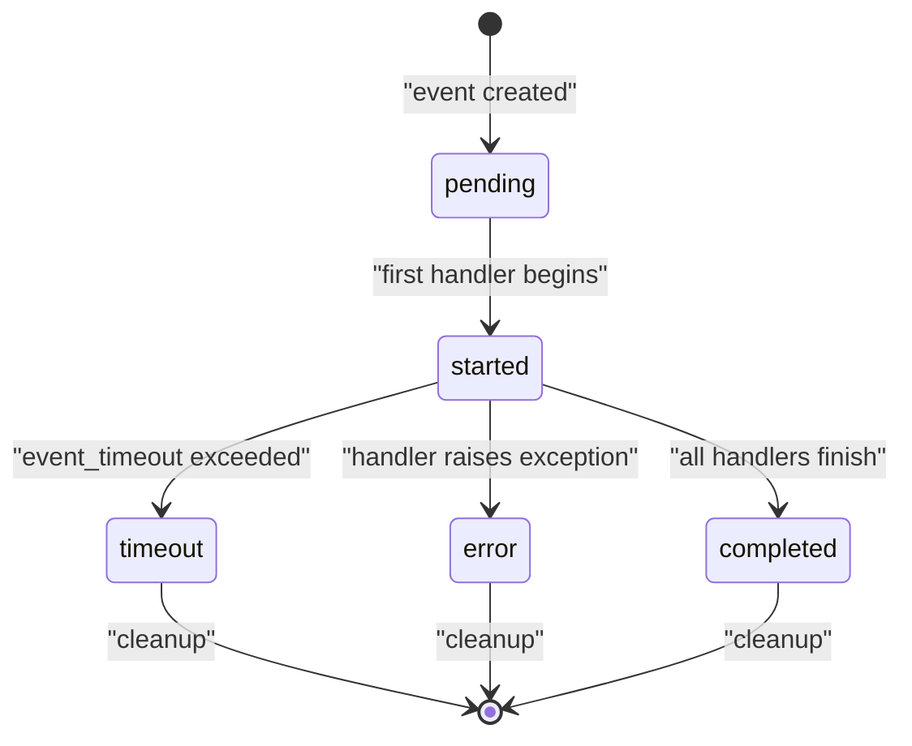

**Sources:** [README.md:628-631](), [README.md:804-807]()

The `log_eventbus_tree()` function in `bubus.logging` provides visual debugging output showing the complete event hierarchy and handler execution status.

## Concurrency Control and Retry Mechanisms

The `@retry` decorator provides sophisticated concurrency control with semaphores and automatic retry logic for unreliable operations.

### Retry Decorator Architecture

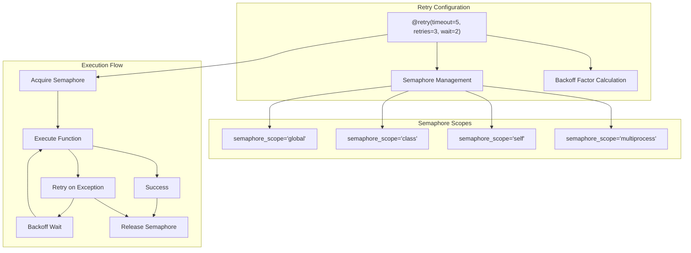

**Sources:** [README.md:825-924]()

### Semaphore Scope Implementation

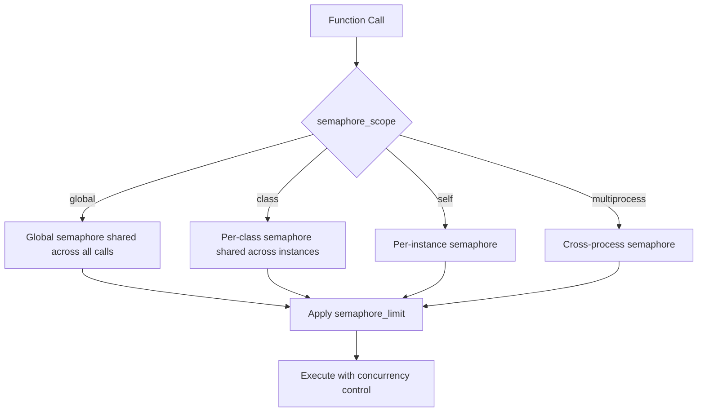

**Sources:** [README.md:868-890]()

The retry system supports different semaphore scopes to control concurrency at various levels, from global limits to per-instance restrictions.

## Write-Ahead Logging and Persistence

The WAL system persists completed events to JSONL files for audit trails, debugging, and event replay capabilities.

### WAL Implementation Architecture

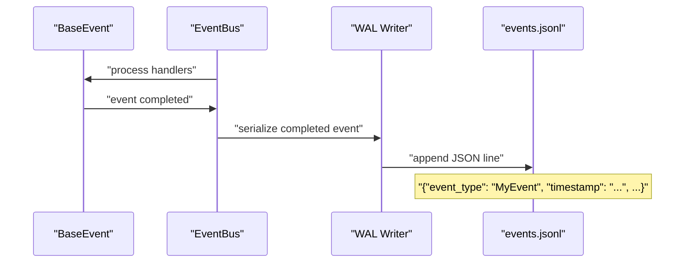

**Sources:** [README.md:475-492]()

### Event Serialization Format

The WAL system serializes events using Pydantic's JSON serialization, creating a structured log of all completed events:

| Field | Description | Source |
|-------|-------------|---------|
| `event_type` | Event class name | `BaseEvent.event_type` |
| `event_id` | Unique identifier | `BaseEvent.event_id` |
| `event_created_at` | Creation timestamp | `BaseEvent.event_created_at` |
| `event_completed_at` | Completion timestamp | `BaseEvent.event_completed_at` |
| Custom fields | Event-specific data | Subclass fields |

**Sources:** [README.md:488-491](), [README.md:607-622]()

The WAL is enabled by setting `wal_path` when creating an `EventBus` instance: `EventBus(wal_path='./events.jsonl')`.

---

