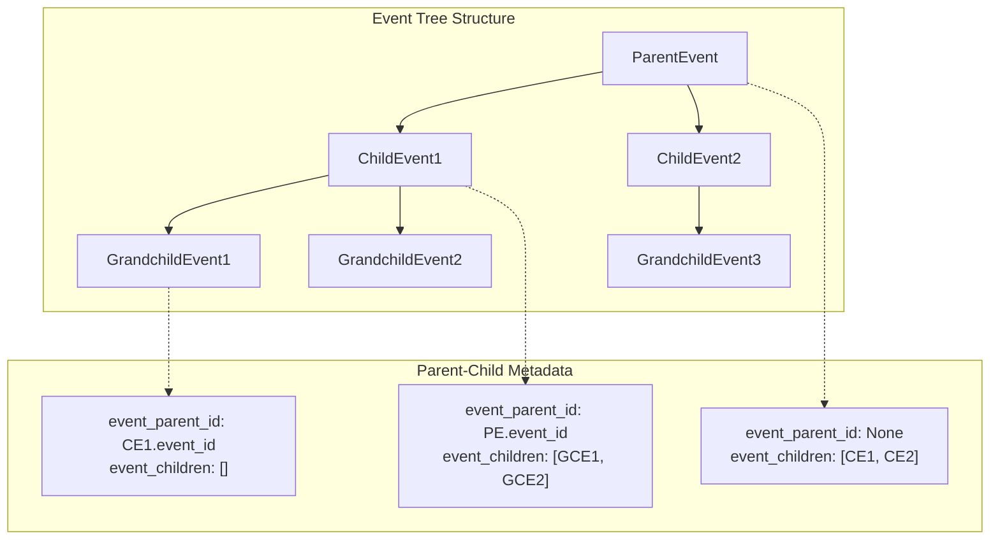
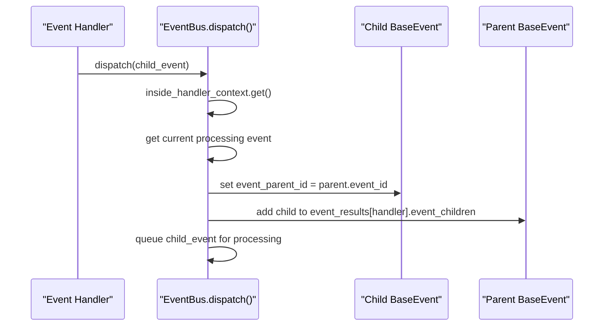
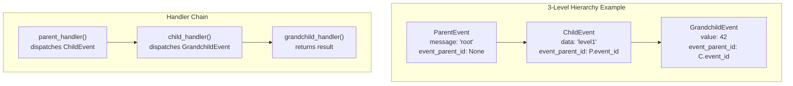
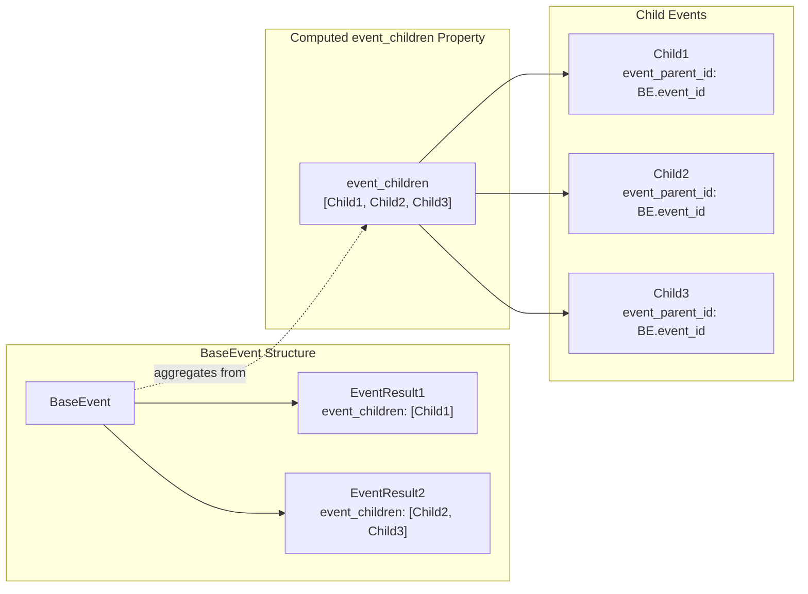
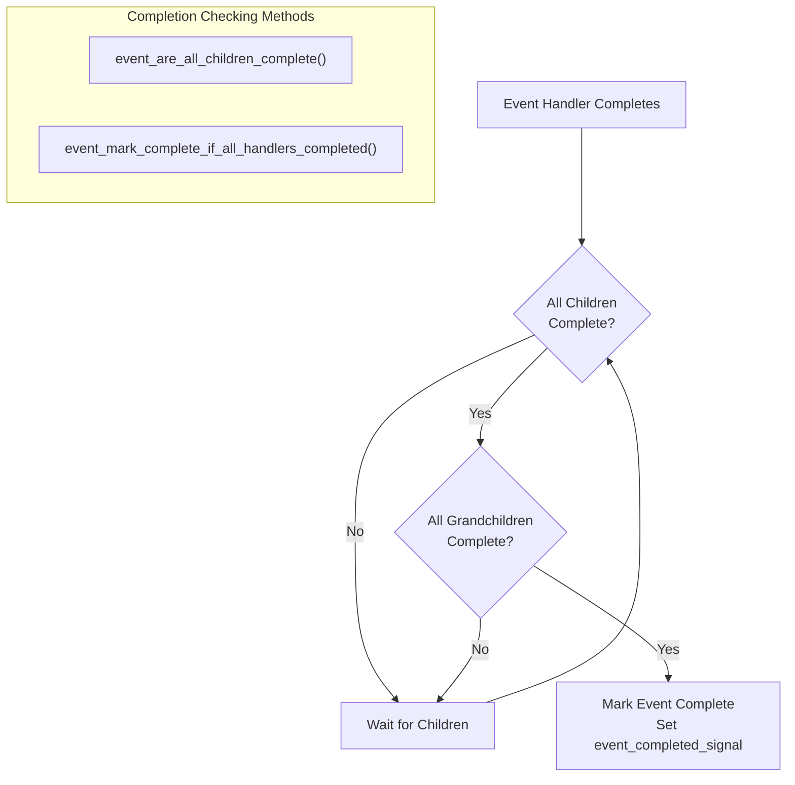
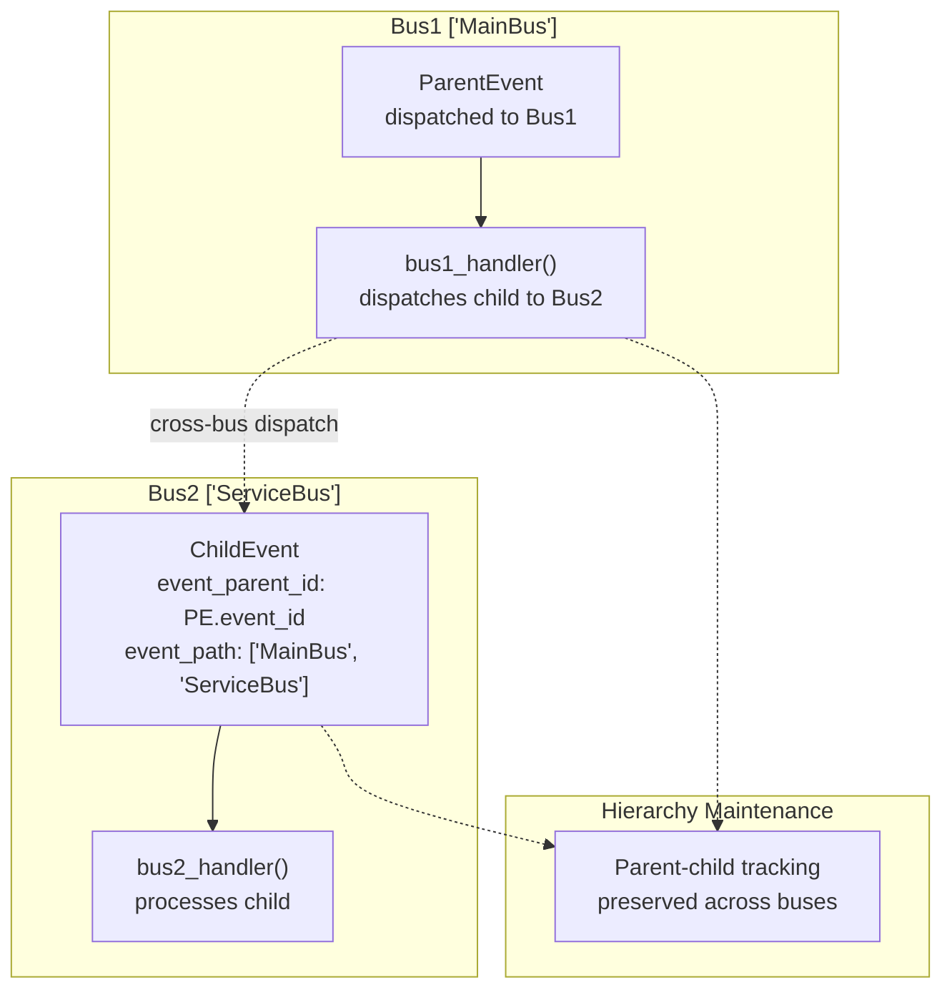

<!-- source: DeepWiki mcp.deepwiki.com · repo browser-use/bubus · page 4.1 Event Hierarchies and Parent-Child Tracking · fetched 2026-10-30 -->

# Event Hierarchies and Parent-Child Tracking

<details>
<summary>Relevant source files</summary>

The following files were used as context for generating this wiki page:

- [bubus/models.py](bubus/models.py)
- [tests/test_parent_event_tracking.py](tests/test_parent_event_tracking.py)

</details>


This document covers how bubus automatically tracks hierarchical relationships between events, enabling complex event workflows where handlers can dispatch child events and the system maintains parent-child relationships across multiple levels. This includes automatic parent ID assignment, child event tracking, and completion semantics that consider entire event trees.

For information about multi-bus event forwarding patterns, see [Multi-Bus Communication and Event Forwarding](#4.2). For debugging event trees and visualization, see [Event Debugging and Tree Visualization](#4.4).

## Core Hierarchy Architecture

The bubus event system automatically establishes and maintains parent-child relationships when events are dispatched from within event handlers. This creates a tree structure where each event can have multiple children, and completion tracking propagates through the entire hierarchy.



**Sources:** [bubus/models.py:238-240](), [bubus/models.py:428-433](), [tests/test_parent_event_tracking.py:74-114]()

## Automatic Parent ID Assignment

When an event is dispatched from within an event handler, the bubus system automatically sets the `event_parent_id` field to track the hierarchical relationship. This happens transparently without requiring explicit configuration.



The system uses context variables to track which event is currently being processed and automatically assigns parent relationships:

| Field | Purpose | Set By | Example Value |
|-------|---------|--------|---------------|
| `event_parent_id` | References parent event | EventBus during dispatch | `"01234567-89ab-cdef-0123-456789abcdef"` |
| `event_children` | List of child events | Computed from EventResult.event_children | `[ChildEvent1, ChildEvent2]` |
| `event_path` | Bus routing path | EventBus during dispatch | `["MainBus", "PluginBus"]` |

**Sources:** [bubus/models.py:238-240](), [tests/test_parent_event_tracking.py:42-73](), [tests/test_parent_event_tracking.py:175-198]()

## Multi-Level Event Hierarchies

The system supports arbitrarily deep event hierarchies where grandchildren, great-grandchildren, and deeper levels are automatically tracked. Each level maintains its own parent-child relationships.



The parent-child chain is established automatically as handlers execute:

```python
# Parent handler creates child
async def parent_handler(event: ParentEvent) -> str:
    child = ChildEvent(data='level1')  # No parent_id specified
    eventbus.dispatch(child)           # parent_id set automatically
    return 'parent'

# Child handler creates grandchild  
async def child_handler(event: ChildEvent) -> str:
    grandchild = GrandchildEvent(value=42)  # No parent_id specified
    eventbus.dispatch(grandchild)           # parent_id set automatically
    return 'child'
```

**Sources:** [bubus/models.py:428-433](), [tests/test_parent_event_tracking.py:74-114](), [tests/test_parent_event_tracking.py:330-364]()

## Event Children Tracking

Parent events maintain references to their child events through the `event_children` property, which aggregates children from all handler results. This enables traversing the event tree and checking completion status.



The `event_children` property implementation aggregates children from all EventResult instances:

**Sources:** [bubus/models.py:428-433](), [bubus/models.py:849](), [tests/test_parent_event_tracking.py:296-328](), [tests/test_parent_event_tracking.py:366-399]()

## Completion Semantics with Hierarchies

Event completion in bubus considers not only the event's own handlers but also all child events in the hierarchy. An event is only considered complete when both its handlers finish AND all descendant events complete.



The completion checking algorithm recursively verifies the entire descendant tree:

| Method | Purpose | Recursion |
|--------|---------|-----------|
| `event_are_all_children_complete()` | Check if all descendants complete | Visits all child events recursively |
| `event_mark_complete_if_all_handlers_completed()` | Mark complete if possible | Calls `event_are_all_children_complete()` |
| `__await__()` | Wait for event completion | Processes child events during wait |

**Sources:** [bubus/models.py:691-722](), [bubus/models.py:723-740](), [bubus/models.py:277-353](), [tests/test_parent_event_tracking.py:438-473]()

## Cross-EventBus Hierarchies

Parent-child relationships work across multiple EventBus instances, enabling complex distributed event patterns where a handler on one bus dispatches events to another bus while maintaining hierarchy tracking.



Cross-bus hierarchies maintain the same parent-child semantics:

- `event_parent_id` references the original parent regardless of bus
- `event_path` tracks routing through multiple buses  
- Completion still requires all children to complete across all buses

**Sources:** [bubus/models.py:237](), [tests/test_parent_event_tracking.py:200-239]()

## Implementation Details

The parent-child tracking system integrates with several core bubus components to provide seamless hierarchy management:

```mermaid
classDiagram
    class BaseEvent {
        +event_parent_id: str|None
        +event_children: list~BaseEvent~
        +event_are_all_children_complete() bool
        +event_mark_complete_if_all_handlers_completed() None
        +__await__() Self
    }
    
    class EventResult {
        +event_children: list~BaseEvent~
        +handler_completed_signal: asyncio.Event
    }
    
    class EventBus {
        +dispatch(event) BaseEvent
        +process_event(event) None
        -inside_handler_context: ContextVar
    }
    
    BaseEvent ||--o{ EventResult : "contains"
    EventResult ||--o{ BaseEvent : "tracks children"
    EventBus ||--o{ BaseEvent : "processes"
```

Key implementation components:

| Component | Responsibility | Key Methods |
|-----------|---------------|-------------|
| `BaseEvent.event_parent_id` | Store parent reference | Automatically set by EventBus |
| `EventResult.event_children` | Track handler's child events | Populated during handler execution |
| `BaseEvent.event_children` | Aggregate all children | Property computing from EventResults |
| `EventBus.dispatch()` | Set parent relationships | Uses context variables for tracking |

**Sources:** [bubus/models.py:238-240](), [bubus/models.py:428-433](), [bubus/models.py:849](), [bubus/models.py:691-722](), [bubus/models.py:723-740]()

---

