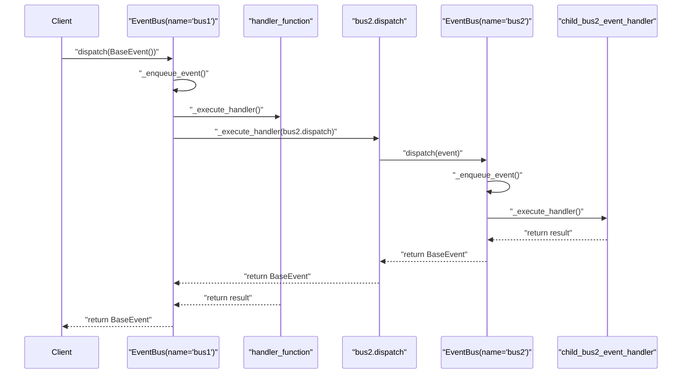
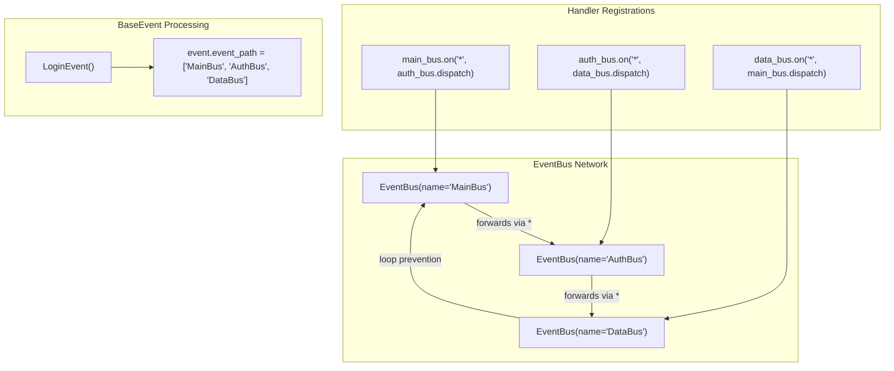
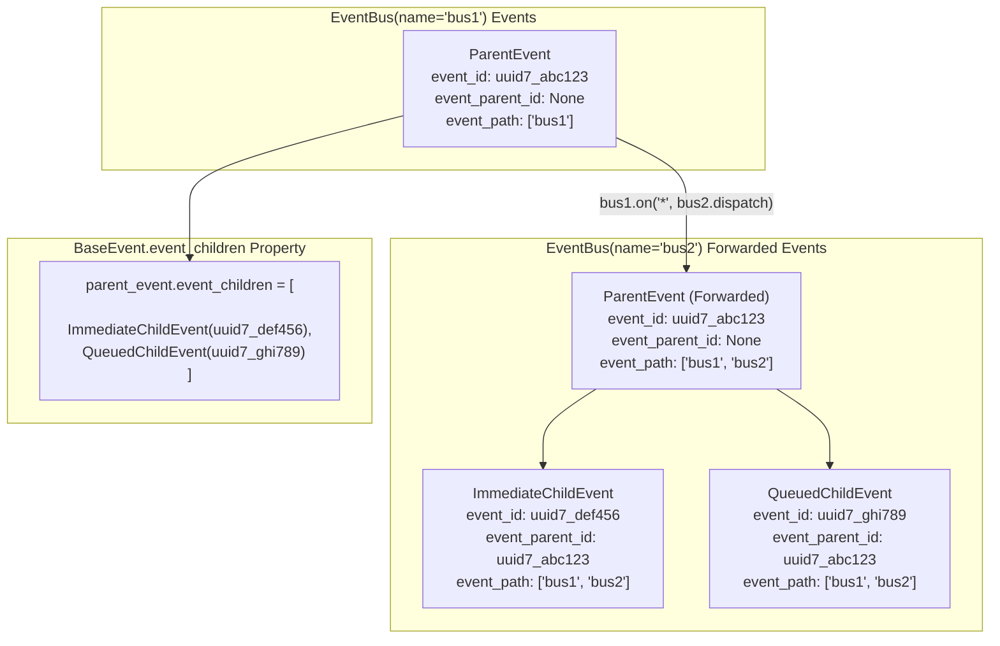
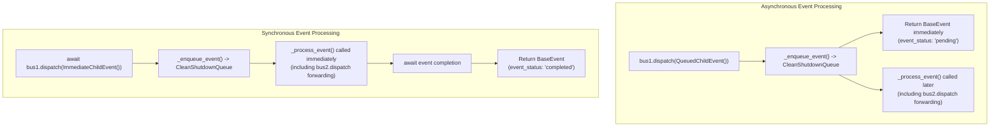
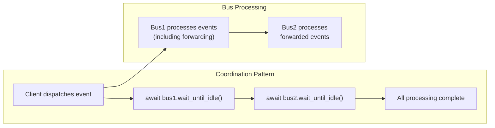

<!-- source: DeepWiki mcp.deepwiki.com · repo browser-use/bubus · page 4.2 Multi-Bus Communication and Event Forwarding · fetched 2026-10-30 -->

# Event Forwarding and Multi-Bus Communication

<details>
<summary>Relevant source files</summary>

The following files were used as context for generating this wiki page:

- [bubus/service.py](bubus/service.py)
- [tests/test_comprehensive_patterns.py](tests/test_comprehensive_patterns.py)
- [tests/test_eventbus.py](tests/test_eventbus.py)

</details>


This document covers event forwarding mechanisms between `EventBus` instances and multi-bus communication patterns. This enables building distributed event-driven architectures where events can traverse multiple bus instances while maintaining proper parent-child relationships and preventing infinite loops.

For information about basic EventBus functionality, see [EventBus Implementation](#2.1). For parent-child event relationships within a single bus, see [Parent-Child Event Tracking](#4.1).

## Event Forwarding Fundamentals

Event forwarding allows events from one `EventBus` instance to be automatically dispatched to another `EventBus`. This is achieved by registering the target bus's `dispatch` method as an event handler on the source bus using the `EventBus.on()` method.

The basic forwarding pattern uses wildcard handler registration:

```python
bus1.on('*', bus2.dispatch)  # Forward all events from bus1 to bus2
```

This creates a forwarding relationship where any event dispatched to `bus1` will also be dispatched to `bus2`. The forwarding happens automatically during event processing in the `EventBus._process_event()` method, maintaining the original event's metadata and parent-child relationships.

**EventBus.dispatch() Forwarding Flow**



Sources: [tests/test_comprehensive_patterns.py:44-45](), [README.md:157-158]()

## Multi-Bus Communication Patterns

The bubus system supports several multi-bus communication patterns through its forwarding mechanism.

### Universal Forwarding

Universal forwarding uses wildcard patterns to forward all events through the `EventBus.on()` method:

| Pattern | Effect | Handler Registration |
|---------|--------|---------------------|
| `main_bus.on('*', auth_bus.dispatch)` | Forward all events from main_bus to auth_bus | Wildcard string pattern |
| `auth_bus.on('*', data_bus.dispatch)` | Forward all events from auth_bus to data_bus | Wildcard string pattern |
| `data_bus.on('*', main_bus.dispatch)` | Bidirectional forwarding (with automatic loop prevention) | Wildcard string pattern |

### Selective Forwarding

Selective forwarding targets specific event types using `BaseEvent` subclasses or string patterns:

```python
main_bus.on(LoginEvent, auth_bus.dispatch)      # Forward only LoginEvent instances
auth_bus.on('RequestEvent', data_bus.dispatch)  # Forward events matching string pattern
```

### Event Path Tracking

Events maintain an `event_path` attribute that tracks which buses have processed them. This enables debugging and loop detection across bus boundaries.

**Multi-EventBus Communication Architecture**



Sources: [README.md:151-164](), [tests/test_comprehensive_patterns.py:76-87]()

## Parent-Child Relationships Across Buses

Parent-child event relationships are preserved when events traverse multiple buses. Child events created on any bus maintain references to their parent events, regardless of which bus the parent originated from.

### Cross-Bus Parent Tracking

When a handler on one bus creates child events, those child events properly reference the original parent event ID through the `BaseEvent.event_parent_id` field:

```python
# Parent event on bus1
parent_event = await bus1.dispatch(ParentEvent())

# Handler on bus2 (via forwarding) creates child events  
child_event = bus2.dispatch(ChildEvent())  # child_event.event_parent_id == parent_event.event_id
```

The parent-child relationship verification occurs during event creation in `BaseEvent.__init__()` and is validated across bus boundaries. The `EventBus._set_event_context()` method ensures proper parent ID tracking.

**BaseEvent Parent-Child Tracking Across EventBus Instances**



Sources: [tests/test_comprehensive_patterns.py:89-95](), [tests/test_comprehensive_patterns.py:122-124]()

## Synchronous vs Asynchronous Forwarding

Event forwarding behavior differs based on how events are dispatched and awaited:

### Asynchronous Forwarding
Events forwarded without awaiting are enqueued in the `CleanShutdownQueue` for later processing:

```python
child_event_async = bus1.dispatch(QueuedChildEvent())
# child_event_async.event_status != 'completed'
# Forwarded event will be processed asynchronously via _process_event()
```

### Synchronous Forwarding  
Events forwarded with awaiting are processed immediately, bypassing the FIFO queue:

```python
child_event_sync = await bus1.dispatch(ImmediateChildEvent())
# child_event_sync.event_status == 'completed'
# Forwarded event is fully processed via _process_event() before return
```

**EventBus.dispatch() Async vs Sync Processing**



Sources: [tests/test_comprehensive_patterns.py:55-66]()

## Loop Prevention Mechanisms

The bubus system includes implicit loop prevention through its event processing model:

### Event Identity Preservation
Forwarded events maintain their original `event_id`, preventing duplicate processing of the same event instance on the same bus.

### Path Tracking
The `event_path` attribute records which buses have processed an event, enabling detection of circular forwarding patterns.

### Handler Registration Patterns
Careful handler registration prevents infinite forwarding loops:

```python
# Safe: One-way forwarding
bus1.on('*', bus2.dispatch)

# Potentially unsafe: Bidirectional forwarding without filtering
# bus1.on('*', bus2.dispatch)
# bus2.on('*', bus1.dispatch)  # Could create loops
```

## Implementation Details

### EventBus.dispatch Method as Handler

The `EventBus.dispatch` method can be registered directly as an event handler using `EventBus.on()`, enabling clean forwarding syntax:

```python
def child_bus2_event_handler(event: BaseEvent[str]) -> str:
    return 'processed on bus2'

bus2.on('*', child_bus2_event_handler)
bus1.on('*', bus2.dispatch)  # EventBus.dispatch method acts as a forwarding handler
```

When registered as a handler, `EventBus.dispatch` receives the event as its first parameter and returns the dispatched `BaseEvent` instance, allowing the forwarding handler to complete successfully.

### Event Result Aggregation

Forwarded events return the `BaseEvent` object itself as the handler result, allowing access to results from the target bus through `BaseEvent.event_results`:

```python
forwarded_event = await bus1.dispatch(event)
# Check if event was processed on target bus via event_path tracking
assert 'bus2' in forwarded_event.event_path

# Access EventResult objects from target bus handlers
target_results = forwarded_event.event_results  # dict[str, EventResult]
```

The `EventResult` objects contain handler execution metadata including `handler_name`, `eventbus_name`, and the raw result values from each bus that processed the event.

### Bus Coordination

When working with multiple buses, proper coordination ensures all processing completes:

```python
# Wait for all buses to finish processing
await bus1.wait_until_idle()
await bus2.wait_until_idle()
```

**Multi-Bus Coordination Flow**



Sources: [tests/test_comprehensive_patterns.py:109-111](), [tests/test_comprehensive_patterns.py:227-228]()

---

