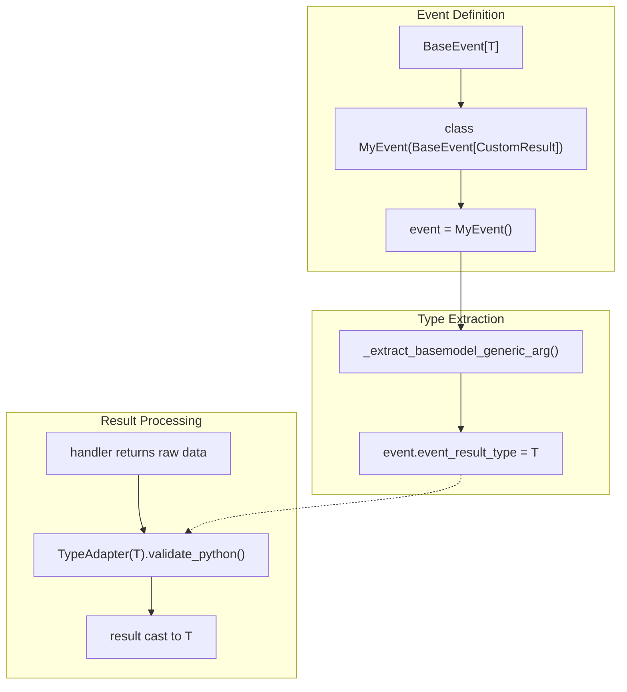
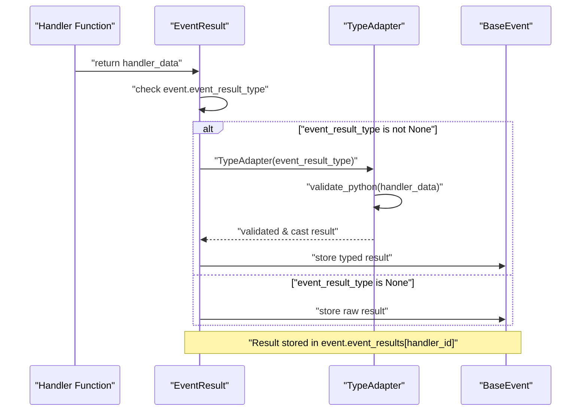
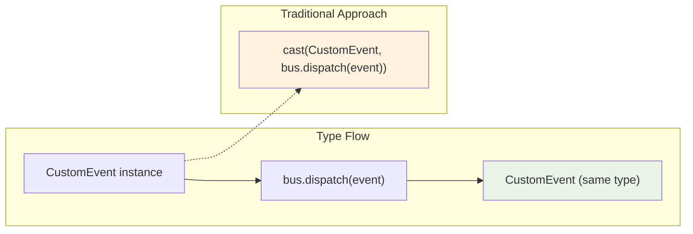
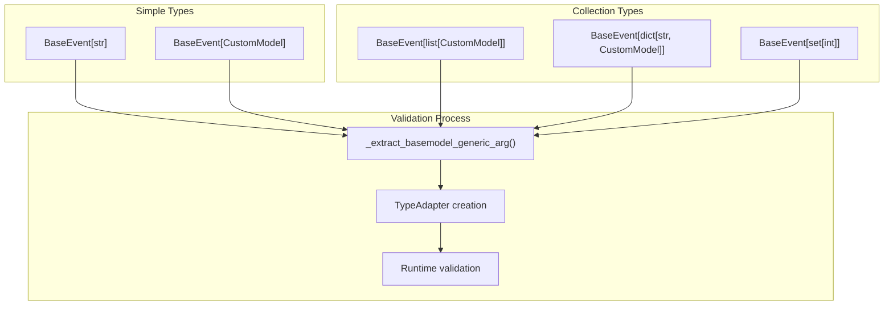
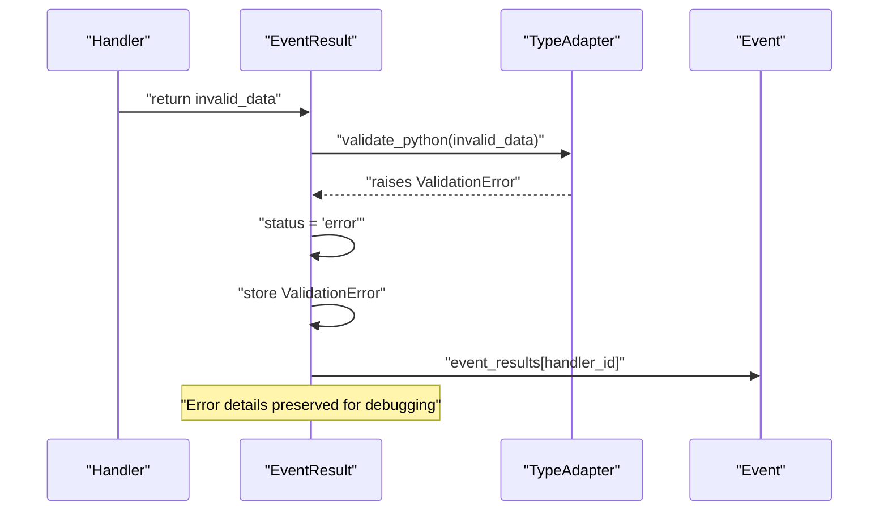
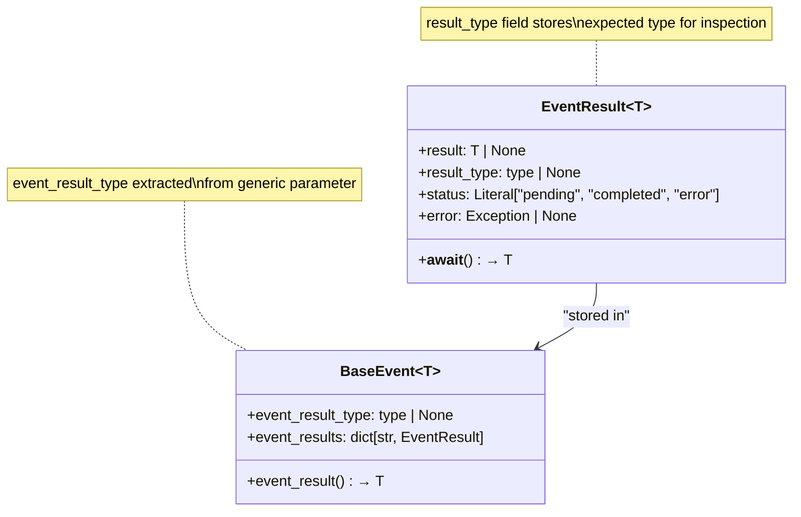

<!-- source: DeepWiki mcp.deepwiki.com · repo browser-use/bubus · page 4.3 Type System and Automatic Result Validation · fetched 2026-10-30 -->

# Type System and Automatic Result Validation

<details>
<summary>Relevant source files</summary>

The following files were used as context for generating this wiki page:

- [.pre-commit-config.yaml](.pre-commit-config.yaml)
- [tests/test_auto_event_result_type.py](tests/test_auto_event_result_type.py)
- [tests/test_simple_typed_results.py](tests/test_simple_typed_results.py)
- [tests/test_typed_event_results.py](tests/test_typed_event_results.py)

</details>


This document covers bubus's comprehensive type system that provides automatic result validation, type inference, and seamless integration with Pydantic models. The system automatically extracts type information from generic parameters in `BaseEvent[T]` classes and enforces type safety throughout the event processing pipeline.

For information about the broader event model architecture, see [Event Models and Result System](#2.2). For API details on result access methods, see [BaseEvent and EventResult API](#3.2).

## Generic Type Parameter System

The bubus type system is built around Python's generic type system, where event classes inherit from `BaseEvent[T]` to specify their expected result type. The type parameter `T` is automatically extracted and used for result validation.

### Type Extraction Process



The `_extract_basemodel_generic_arg` function in `bubus.models` analyzes the class hierarchy to extract the generic type parameter from `BaseEvent[T]` declarations.

**Sources:** [tests/test_auto_event_result_type.py:257-315](), [bubus/models.py:8]()

### Supported Type Categories

| Type Category | Example | Automatic Detection |
|---------------|---------|-------------------|
| Built-in Types | `BaseEvent[str]`, `BaseEvent[int]` | ✅ |
| Pydantic Models | `BaseEvent[CustomResult]` | ✅ |
| Complex Generics | `BaseEvent[list[CustomType]]` | ✅ |
| Dict Types | `BaseEvent[dict[str, int]]` | ✅ |
| None Type | `BaseEvent[None]` | ✅ |

**Sources:** [tests/test_auto_event_result_type.py:44-150]()

## Automatic Result Casting

When event handlers return data, bubus automatically validates and casts the results to the expected type specified in the event's generic parameter.

### Result Casting Pipeline



**Sources:** [tests/test_typed_event_results.py:29-53]()

### Pydantic Model Casting Example

```python
class ScreenshotEventResult(BaseModel):
    screenshot_base64: bytes | None = None
    error: str | None = None

class ScreenshotEvent(BaseEvent[ScreenshotEventResult]):
    screenshot_width: int = 1080
    screenshot_height: int = 900

def screenshot_handler(event: ScreenshotEvent):
    # Handler returns dict - automatically cast to ScreenshotEventResult
    return {'screenshot_base64': b'fake_screenshot_data', 'error': None}
```

The handler returns a dictionary, but bubus automatically validates it against the `ScreenshotEventResult` schema and returns a fully-typed Pydantic model instance.

**Sources:** [tests/test_typed_event_results.py:11-53]()

## Type Inference in EventBus Methods

The `EventBus` class provides strong type inference for its `dispatch()` and `expect()` methods, eliminating the need for manual type casting in most cases.

### Dispatch Type Preservation



The `dispatch()` method returns the exact same type as its input parameter, preserving full type information without requiring manual casting.

**Sources:** [tests/test_typed_event_results.py:243-291]()

### Expect Method Type Inference

The `expect()` method provides different type behavior based on the event type parameter:

| Input Type | Return Type | Example |
|------------|-------------|---------|
| Event Class | Same Class | `await bus.expect(CustomEvent)` → `CustomEvent` |
| String | `BaseEvent[Any]` | `await bus.expect('CustomEvent')` → `BaseEvent[Any]` |

**Sources:** [tests/test_typed_event_results.py:174-241]()

## Complex Generic Types

The type system supports complex generic constructions, including nested types and collections containing custom models.

### Complex Type Extraction



**Sources:** [tests/test_auto_event_result_type.py:83-114](), [tests/test_auto_event_result_type.py:186-203]()

### Module-Level vs Local Types

The type extraction system handles both module-level and locally-defined types:

```python
# Module-level type (automatically detected)
class ModuleLevelResult(BaseModel):
    result_id: str
    success: bool

class ModuleEvent(BaseEvent[ModuleLevelResult]):
    # No manual event_result_type needed
    pass

# Local type (requires manual specification in some cases)
def test_function():
    class LocalResult(BaseModel):
        data: str
    
    class LocalEvent(BaseEvent[LocalResult]):
        event_result_type: Any = LocalResult  # Manual override needed
    
    return LocalEvent()
```

**Sources:** [tests/test_auto_event_result_type.py:167-184]()

## Error Handling and Validation

The type system gracefully handles validation failures and type mismatches, storing detailed error information in `EventResult` objects.

### Validation Error Flow



**Sources:** [tests/test_typed_event_results.py:89-118]()

### Error Information Storage

When validation fails, the `EventResult` object contains:

- `status`: Set to `'error'`
- `error`: The actual `ValidationError` or `ValueError` exception
- `result`: `None` (no valid result)
- `result_type`: The expected type that failed validation

**Sources:** [tests/test_typed_event_results.py:113-118]()

## Type Introspection and Runtime Access

The type system provides runtime access to type information for debugging and introspection purposes.

### EventResult Type Information



The `EventResult.result_type` field stores the expected type for runtime inspection, enabling debugging tools and type verification.

**Sources:** [tests/test_typed_event_results.py:148-172]()

### Backwards Compatibility

The type system maintains full backwards compatibility with explicit type declarations:

```python
class LegacyEvent(BaseEvent[str]):
    event_result_type: Any = int  # Explicit override still works
    
# The explicit override takes precedence over auto-extraction
assert LegacyEvent().event_result_type is int  # Not str
```

**Sources:** [tests/test_auto_event_result_type.py:116-126]()

---

