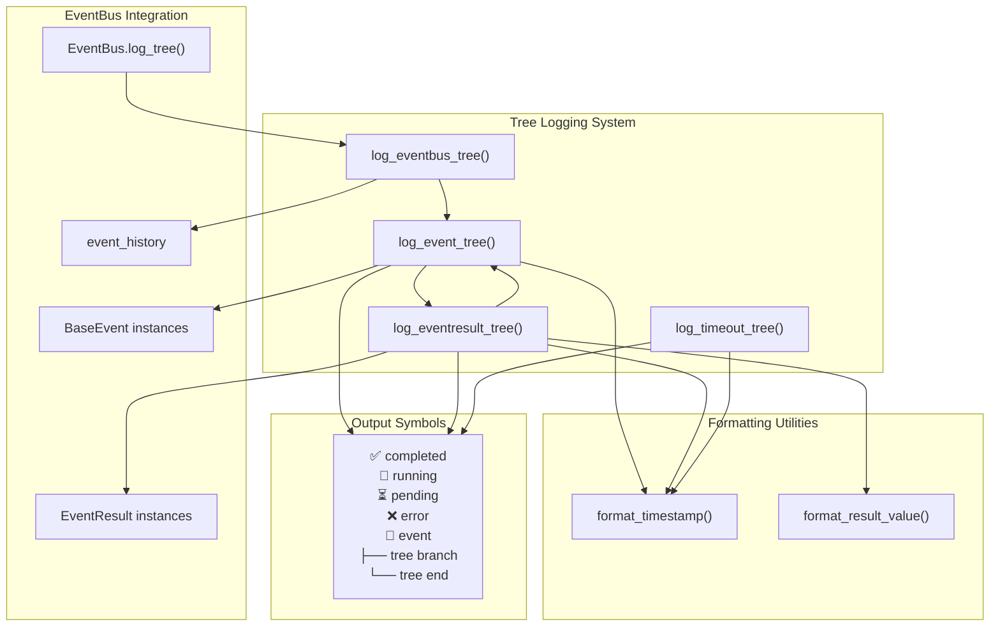
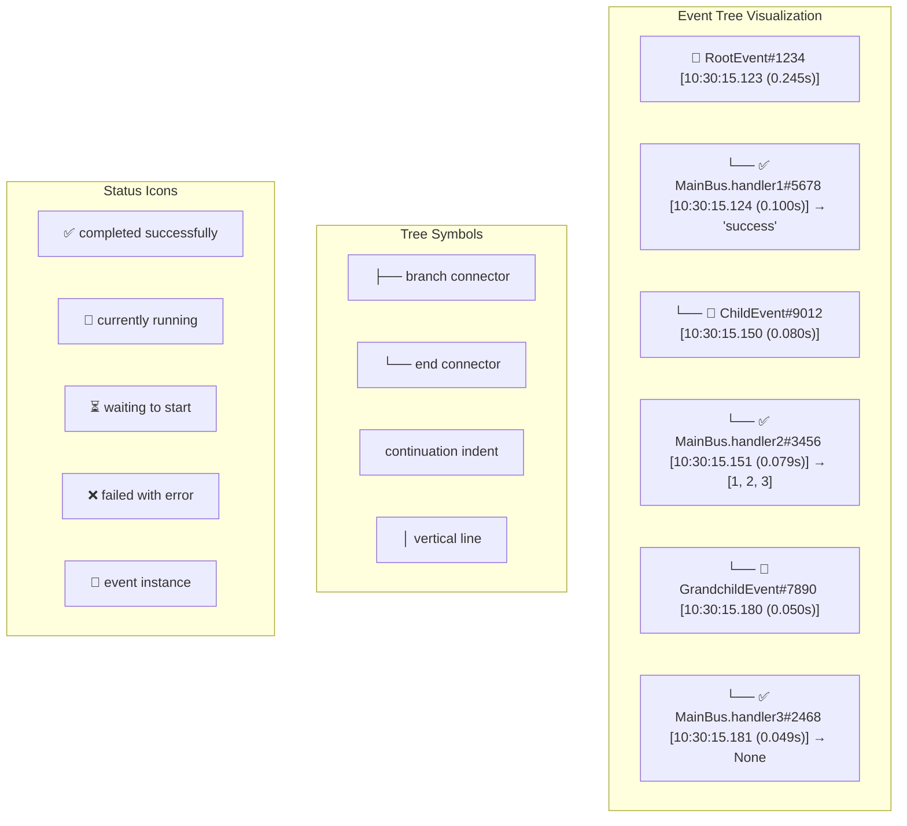
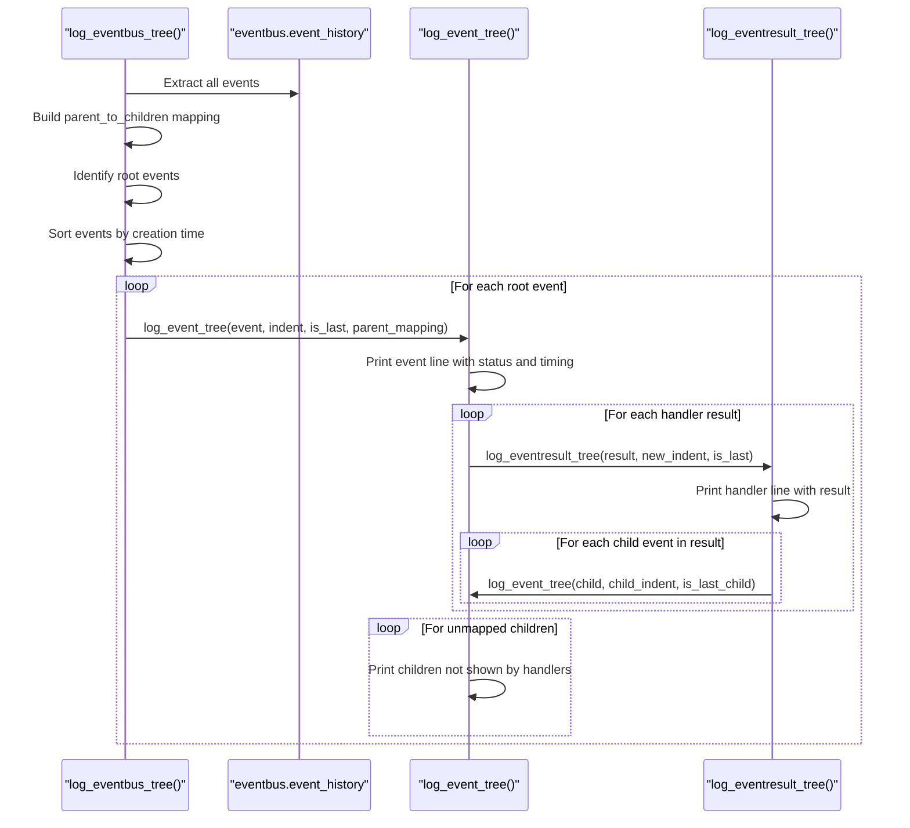
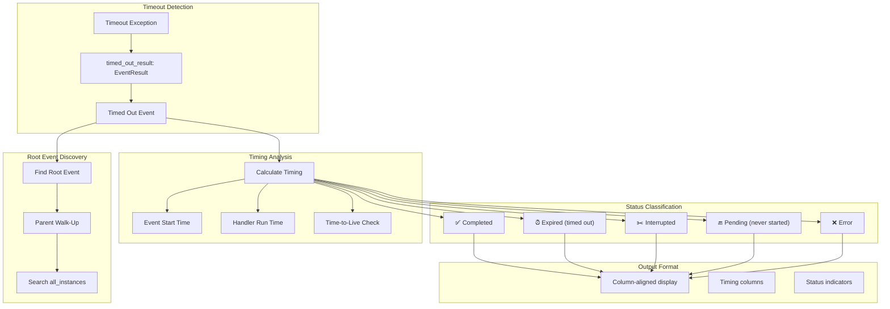
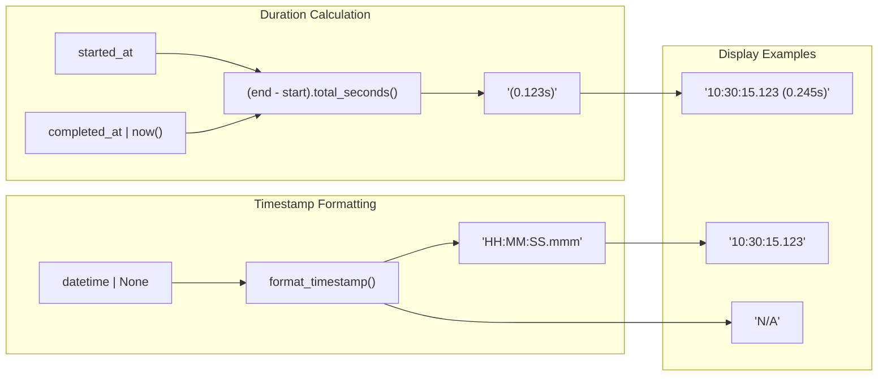
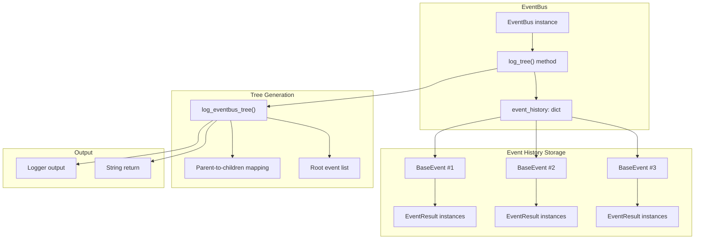
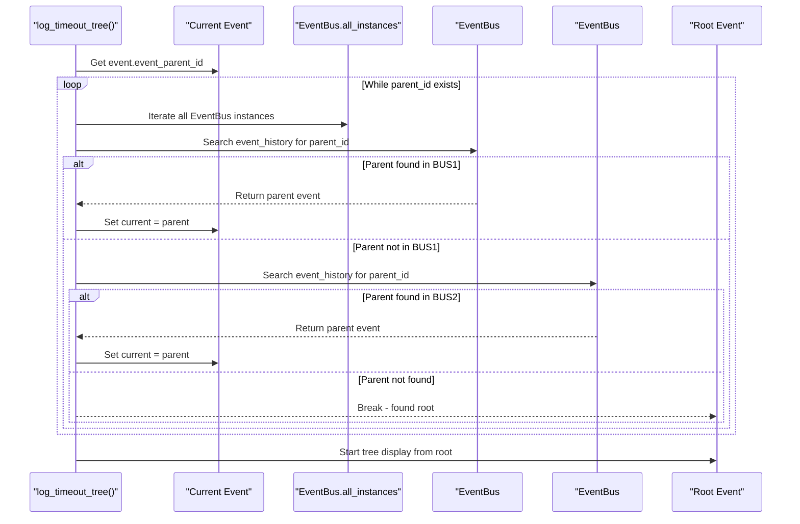

<!-- source: DeepWiki mcp.deepwiki.com · repo browser-use/bubus · page 4.4 Event Debugging and Tree Visualization · fetched 2026-10-30 -->

# Event Debugging and Tree Visualization

Relevant source files

The following files were used as context for generating this wiki page:

- [bubus/logging.py](bubus/logging.py)
- [tests/test_log_history_tree.py](tests/test_log_history_tree.py)

This document covers the event debugging and tree visualization capabilities of the bubus event system. These tools provide visual representations of event hierarchies, handler execution flow, timing analysis, and timeout debugging. For information about event persistence and audit trails, see [Persistence and Write-Ahead Logging](#4.5). For testing and performance analysis tools, see [Performance Testing and Stress Analysis](#5.3).

## Tree Visualization System

The bubus library provides comprehensive tree visualization capabilities through the logging module, which renders event hierarchies as ASCII trees with detailed timing, status, and result information.

### Core Tree Logging Functions

The tree visualization system consists of several specialized functions that work together to provide different views of event execution:

Sources: [bubus/logging.py:36-163](), [bubus/logging.py:166-208]()

### Event Tree Structure Visualization

The tree logging system renders events and their relationships using a hierarchical ASCII structure:

Sources: [bubus/logging.py:36-101](), [bubus/logging.py:104-163]()

## Event Hierarchy and Parent-Child Tracking

The tree visualization system leverages the event hierarchy system to build comprehensive views of event relationships and execution flow.

### Parent-Child Relationship Mapping

The `log_eventbus_tree` function builds a complete mapping of parent-child relationships from the EventBus history:

| Component | Purpose | Data Structure |
|-----------|---------|----------------|
| `parent_to_children` | Maps parent IDs to child event lists | `dict[str \| None, list[BaseEvent]]` |
| `root_events` | Events with no parent (`None` parent ID) | `list[BaseEvent]` |
| `child_events_by_parent` | Hierarchical event organization | Passed recursively through tree functions |

Sources: [bubus/logging.py:166-208](), [bubus/logging.py:36-101](), [bubus/logging.py:104-163]()

## Timeout Debugging System

The timeout debugging system provides detailed analysis when handlers exceed their configured timeout limits, showing the complete execution context and timing breakdown.

### Timeout Analysis Components

The `log_timeout_tree` function performs comprehensive timeout analysis:

Sources: [bubus/logging.py:211-451]()

### Timeout Display Format

The timeout tree uses a specialized columnar format for detailed timing analysis:

| Column | Content | Example |
|--------|---------|---------|
| 1 | Indentation and tree structure | `    ├──` |
| 2 | Status icon | `⏰` (expired), `✂️` (interrupted) |
| 3 | Handler description | `MainBus.handler_name#1234` |
| 4 | Padding to column 64 | (spaces) |
| 5 | Timing icon | `⌛️` (timed out), `⏳` (running) |
| 6 | Elapsed time | `15s` (red if timed out) |
| 7 | Slash separator | `/` |
| 8 | Max allowed time | `10s` (red if exceeded) |
| 9 | Status message | `⬅️ TIMEOUT HERE ⏰` |

Sources: [bubus/logging.py:244-331](), [bubus/logging.py:333-451]()

## Formatting and Display Utilities

The logging system includes specialized formatting functions for consistent display of timestamps, result values, and complex data structures.

### Timestamp and Duration Formatting

The `format_timestamp` function provides millisecond-precision time formatting:

Sources: [bubus/logging.py:14-18]()

### Result Value Formatting

The `format_result_value` function handles diverse result types with intelligent formatting:

| Result Type | Detection Logic | Display Format |
|-------------|----------------|----------------|
| `None` | `value is None` | `'None'` |
| `BaseEvent` | Has `event_type` and `event_id` attributes | `'Event(EventType#1234)'` |
| Primitives | `isinstance(value, (str, int, float, bool))` | `repr(value)` |
| `dict` | `isinstance(value, dict)` | `'dict(5 items)'` |
| `list` | `isinstance(value, list)` | `'list(3 items)'` |
| Other objects | Default case | `'ClassName(...)'` |

Sources: [bubus/logging.py:21-33]()

## EventBus Integration

The tree visualization system integrates seamlessly with the EventBus through the `log_tree()` method and event history tracking.

### EventBus Tree Logging Integration

The EventBus `log_tree()` method serves as the primary entry point for tree visualization, automatically calling `log_eventbus_tree()` and providing both logger output and return string for programmatic access.

Sources: [bubus/logging.py:166-208](), [tests/test_log_history_tree.py:23-262]()

### Multi-Bus Event Tracking

For timeout analysis across multiple EventBus instances, the system searches through `all_instances` to find parent events:

Sources: [bubus/logging.py:219-231]()

---

