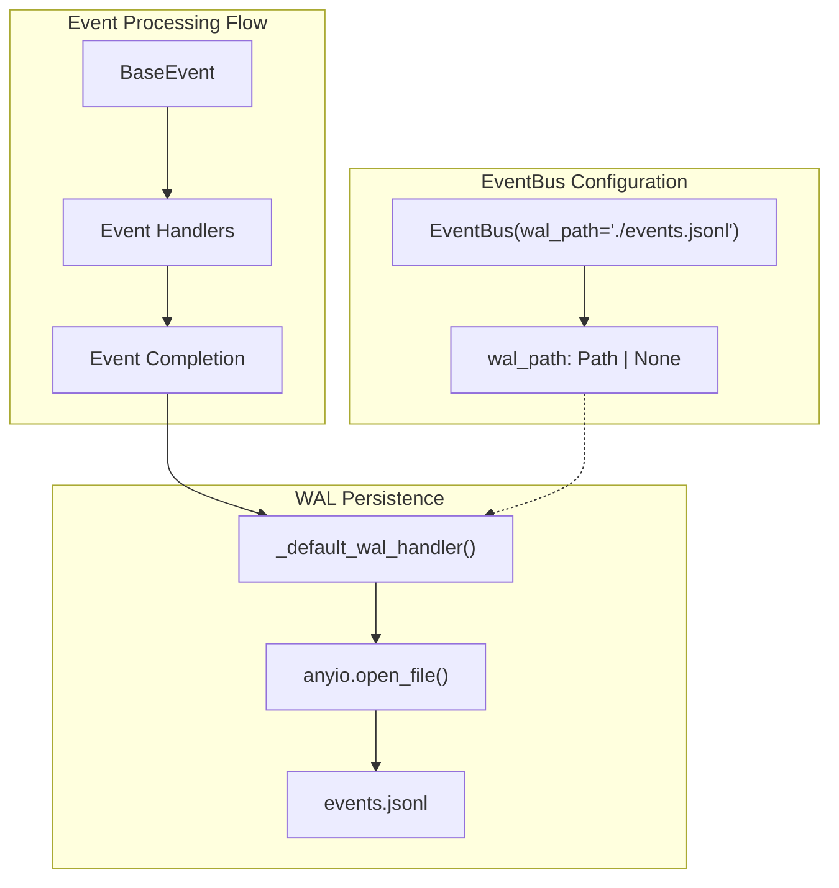
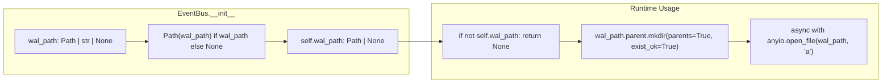
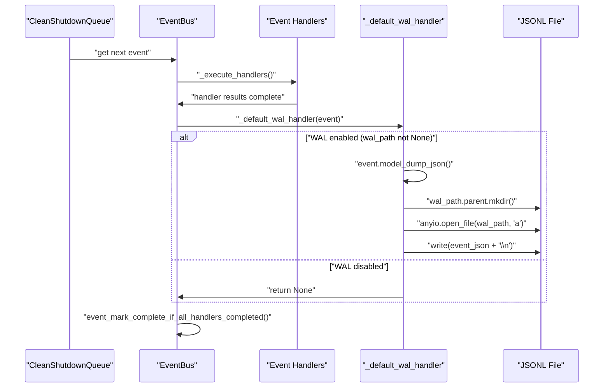
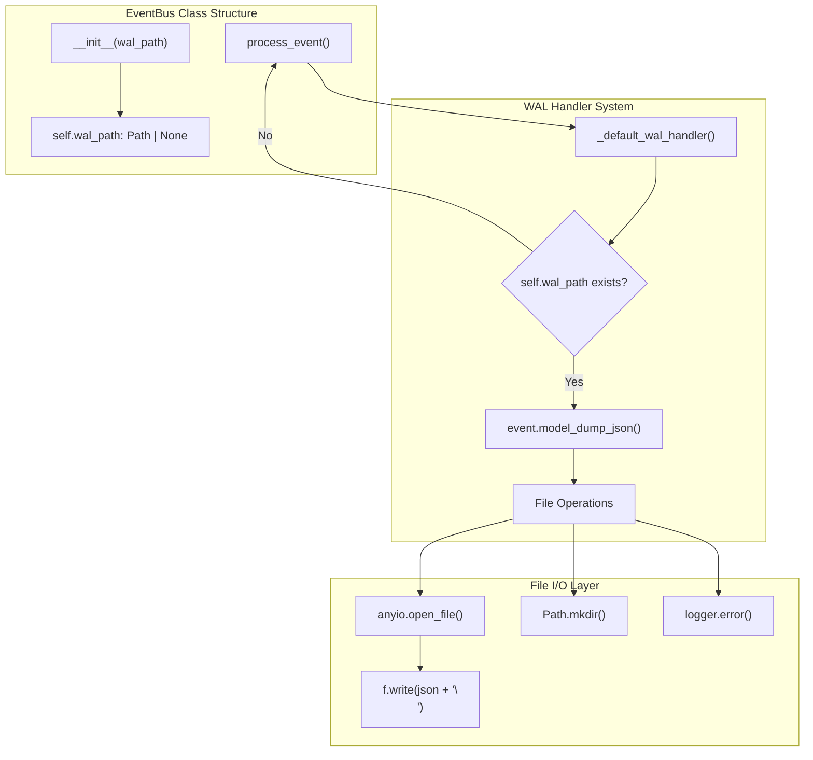

<!-- source: DeepWiki mcp.deepwiki.com · repo browser-use/bubus · page 4.5 Persistence and Write-Ahead Logging · fetched 2026-10-30 -->

# Persistence and Write-Ahead Logging

<details>
<summary>Relevant source files</summary>

The following files were used as context for generating this wiki page:

- [bubus/service.py](bubus/service.py)
- [tests/test_eventbus.py](tests/test_eventbus.py)

</details>


Write-Ahead Logging (WAL) provides automatic persistence of completed events to disk for debugging, replay, recovery, and audit purposes. This document covers the WAL implementation in bubus, including configuration, file formats, event persistence lifecycle, and recovery patterns.

For information about event processing and lifecycle management, see [Core Architecture](#2). For performance considerations and testing approaches, see [Performance and Scale Testing](#5.2).

## WAL Overview

WAL in bubus automatically persists completed events as JSON Lines (JSONL) to a specified file path. This enables event replay, audit trails, and debugging of complex event flows without requiring manual logging infrastructure.



**Sources:** [bubus/service.py:266](), [bubus/service.py:1332-1344](), [tests/test_eventbus.py:690-790]()

## Configuration and Setup

WAL is configured through the `wal_path` parameter when creating an `EventBus` instance. When `wal_path` is `None`, WAL is disabled.

| Parameter | Type | Description |
|-----------|------|-------------|
| `wal_path` | `Path \| str \| None` | File path for event persistence. Creates parent directories if needed. |

```python
# Enable WAL with file path
bus = EventBus(name='MyBus', wal_path='./logs/events.jsonl')

# WAL disabled (default)
bus = EventBus(name='MyBus')  # wal_path=None
```

The WAL file path is stored as a `Path` object and accessed throughout the event lifecycle:



**Sources:** [bubus/service.py:266](), [bubus/service.py:335](), [bubus/service.py:1340]()

## Event Persistence Workflow

WAL persistence occurs after event processing completes, ensuring only successfully processed events are recorded. The `_default_wal_handler` method is called from `process_event` for every completed event.



**Sources:** [bubus/service.py:962-982](), [bubus/service.py:1332-1344]()

The persistence implementation handles errors gracefully and uses async I/O to avoid blocking event processing:

| Step | Implementation | Error Handling |
|------|----------------|----------------|
| JSON Serialization | `event.model_dump_json()` | Pydantic handles serialization errors |
| Directory Creation | `wal_path.parent.mkdir(parents=True, exist_ok=True)` | Built-in path safety |
| File Writing | `anyio.open_file(wal_path, 'a', encoding='utf-8')` | Async context manager cleanup |
| Error Logging | `logger.error()` with event details | Non-blocking error reporting |

**Sources:** [bubus/service.py:1338-1344]()

## File Format and Structure

WAL files use the JSON Lines format, with one complete event object per line. Each line contains the full event state including metadata, results, and timestamps.

### JSONL Structure

```json
{"event_type": "UserLoginEvent", "event_id": "01234567-89ab-cdef-0123-456789abcdef", "event_created_at": "2025-01-10T20:39:56.462000+00:00", "username": "alice", "is_admin": true, "event_results": {...}}
{"event_type": "AuthRequestEvent", "event_id": "01234567-89ab-cdef-0123-456789abcdef", "event_created_at": "2025-01-10T20:39:57.123000+00:00", "auth_token": "xyz123", "event_results": {...}}
```

### Event Fields Persisted

The complete `BaseEvent` model is serialized, including:

| Field Category | Fields | Purpose |
|----------------|--------|---------|
| Identity | `event_id`, `event_type`, `event_schema` | Event identification and versioning |
| Timing | `event_created_at`, `event_started_at`, `event_completed_at` | Lifecycle timestamps |
| Relationships | `event_parent_id`, `event_path`, `event_children` | Event hierarchy and routing |
| Results | `event_results`, `event_result_type` | Handler outcomes and type information |
| User Data | Custom fields from event subclasses | Domain-specific event data |

**Sources:** [bubus/models.py:76-150](), [bubus/service.py:1339]()

## Implementation Architecture

The WAL system integrates with the core event processing pipeline through a default handler pattern:



**Sources:** [bubus/service.py:278-342](), [bubus/service.py:1332-1344]()

### Handler Registration Pattern

The WAL handler is not registered through the normal `on()` method. Instead, it's called directly from `process_event()` as a built-in post-processing step:

```python
# In process_event() method:
await self._default_log_handler(event)
await self._default_wal_handler(event)  # WAL persistence happens here
```

This ensures WAL persistence occurs for every event regardless of user-defined handlers, and happens after all user handlers complete.

**Sources:** [bubus/service.py:978-979]()

## Usage Patterns and Best Practices

### Basic WAL Configuration

```python
from pathlib import Path
from bubus import EventBus, BaseEvent

# Configure WAL with automatic directory creation
bus = EventBus(
    name='ProductionBus',
    wal_path='./logs/events.jsonl'
)

class OrderEvent(BaseEvent):
    order_id: str
    customer_id: str
    total: float

# Events automatically persisted after processing
event = await bus.dispatch(OrderEvent(order_id="123", customer_id="456", total=99.99))
```

### WAL File Management

WAL files grow continuously as events are appended. Consider rotation strategies for production use:

| Strategy | Implementation | Use Case |
|----------|----------------|----------|
| Daily rotation | Include date in `wal_path`: `f'./logs/events-{date.today()}.jsonl'` | High-volume applications |
| Size-based rotation | External log rotation tools | Long-running services |
| Event-based rotation | Restart EventBus with new `wal_path` after N events | Batch processing |

### Error Handling and Monitoring

WAL errors are logged but do not interrupt event processing:

```python
# WAL errors logged but events continue processing
try:
    event_json = event.model_dump_json()
    # ... file operations
except Exception as e:
    logger.error(f'❌ {self} Failed to save event {event.event_id} to WAL file: {type(e).__name__} {e}\n{event}')
```

Monitor WAL health by watching for error logs and verifying file growth patterns match event processing rates.

**Sources:** [bubus/service.py:1270-1271](), [bubus/service.py:1259-1271]()

---

