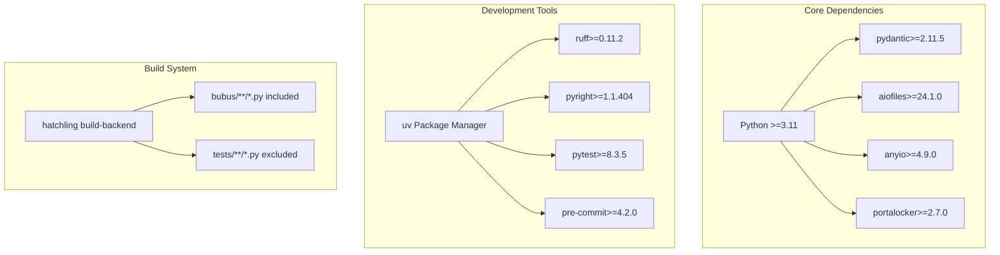
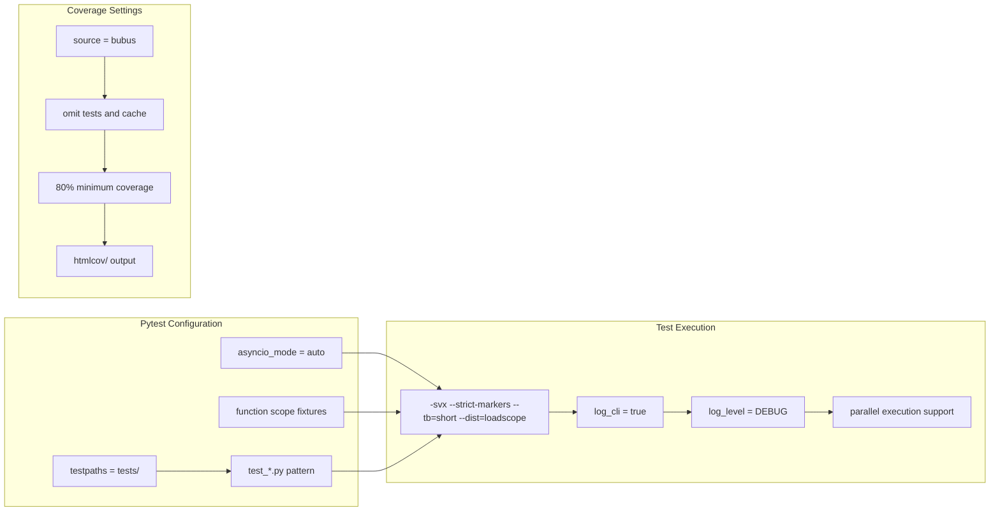
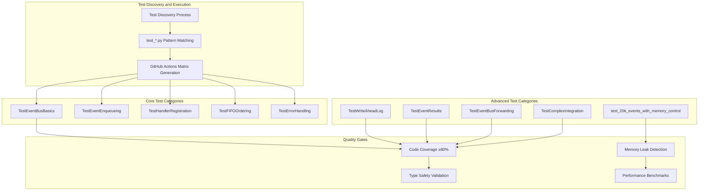
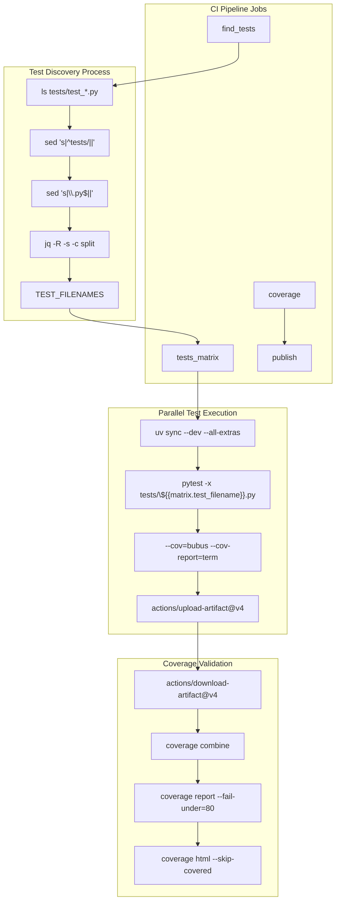
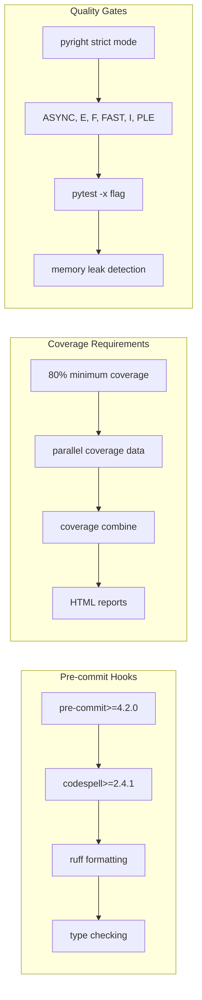
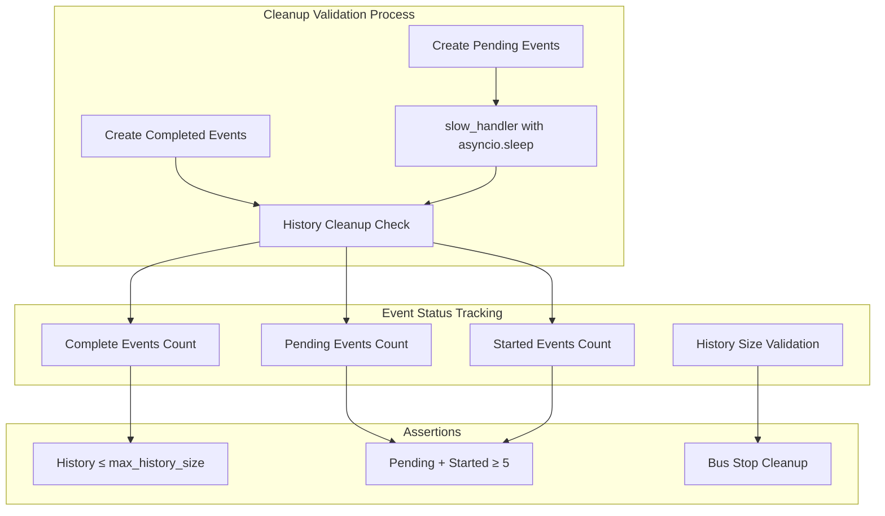

<!-- source: DeepWiki mcp.deepwiki.com · repo browser-use/bubus · page 5 Development and Testing · fetched 2026-10-30 -->

# Development and Testing

<details>
<summary>Relevant source files</summary>

The following files were used as context for generating this wiki page:

- [pyproject.toml](pyproject.toml)
- [tests/conftest.py](tests/conftest.py)

</details>


This page provides a comprehensive guide for developers working with and testing bubus applications. It covers the development environment setup, project configuration, testing strategies, and CI/CD practices that ensure code quality and system reliability.

For detailed project configuration, see page 5.1. For comprehensive testing patterns, see page 5.2. For performance benchmarking, see page 5.3. For CI/CD pipeline details, see page 5.4.

## Development Environment Setup

### Project Configuration and Build System

The bubus project uses modern Python tooling with `pyproject.toml` as the central configuration file. The project requires Python ≥3.11 and uses `hatchling` as the build backend with `uv` for dependency management.



**Sources:** [pyproject.toml:1-28](), [pyproject.toml:58-66](), [pyproject.toml:113-128]()

### Code Quality Configuration

The development environment enforces strict code quality standards through automated tooling:

| Tool | Purpose | Key Configuration |
|------|---------|-------------------|
| `ruff` | Linting and Formatting | Line length 130, single quotes, strict async checks |
| `pyright` | Type Checking | Strict mode, missing imports as errors |
| `codespell` | Spell Checking | Custom ignore list, JSON skip |
| `pre-commit` | Git Hooks | Automated quality checks |

The `ruff` configuration enables preview features and selects specific rule sets including `ASYNC`, `E`, `F`, `FAST`, `I`, and `PLE` rules while ignoring `ASYNC109` for unbounded async functions.

**Sources:** [pyproject.toml:29-49](), [pyproject.toml:51-56]()

## Testing Strategy and Framework

### Testing Philosophy

The bubus project employs a multi-layered testing approach that prioritizes both functional correctness and system performance under realistic load conditions. The testing strategy encompasses unit testing for component isolation, integration testing for workflow validation, and comprehensive performance testing that processes tens of thousands of events while monitoring system resources.

### Test Configuration

The `pytest` configuration in `pyproject.toml` establishes the testing framework with async support and comprehensive logging:



The `conftest.py` file sets the default logging level to `WARNING` for tests to reduce noise during test execution.

**Sources:** [pyproject.toml:67-82](), [pyproject.toml:84-111](), [tests/conftest.py:6-9]()

### Test Organization Structure



The testing framework automatically discovers all test files matching the `test_*.py` pattern and executes them in parallel using GitHub Actions matrix strategy. Each test class validates specific aspects of the `EventBus` system, from basic functionality to complex multi-bus integration scenarios.

**Sources:** [tests/test_eventbus.py:86-1735](), [tests/test_20k_events.py:1-243]()

## Core Test Suite Structure

### Functional Testing Categories

The `tests/test_eventbus.py` file contains 16 comprehensive test classes that validate all aspects of EventBus functionality:

| Test Class | Purpose | Key Validations |
|------------|---------|-----------------|
| `TestEventBusBasics` | Core initialization and lifecycle | `_is_running`, `_runloop_task`, auto-start |
| `TestEventEnqueueing` | Event dispatch and queuing | `event_status`, `event_id`, `event_created_at` |
| `TestHandlerRegistration` | Handler registration patterns | String, class, wildcard handlers |
| `TestFIFOOrdering` | Event processing order | Sequential processing with delays |
| `TestErrorHandling` | Exception isolation | Handler error capture, isolation |
| `TestBatchOperations` | Bulk event processing | `asyncio.gather` patterns |
| `TestWriteAheadLog` | Persistence mechanisms | WAL file creation, JSONL format |
| `TestEventCompletion` | Async result handling | `await event`, completion tracking |
| `TestEventResults` | Result aggregation | `event_results_flat_dict`, type casting |
| `TestEventBusHierarchy` | Multi-bus communication | `event_path`, circular prevention |
| `TestComplexIntegration` | End-to-end scenarios | Multi-bus forwarding, result flattening |

```mermaid
graph TD
    subgraph "Test Execution Flow"
        TEB[TestEventBusBasics] --> "bus._is_running validation"
        TEE[TestEventEnqueueing] --> "event.event_status tracking"
        THR[TestHandlerRegistration] --> "bus.on() patterns"
        TFO[TestFIFOOrdering] --> "Sequential processing"
        TEH[TestErrorHandling] --> "Exception isolation"
    end
    
    subgraph "Advanced Integration"
        TER[TestEventResults] --> "event_results_flat_dict()"
        TEF[TestEventBusForwarding] --> "Multi-bus communication"
        TCI[TestComplexIntegration] --> "End-to-end validation"
        TEH_hierarchy[TestEventBusHierarchy] --> "event_path tracking"
    end
    
    subgraph "Persistence and Lifecycle"
        TWA[TestWriteAheadLog] --> "WAL JSONL persistence"
        TEC[TestEventCompletion] --> "await event patterns"
        TEM[TestExpectMethod] --> "bus.expect() functionality"
    end
```

**Sources:** [tests/test_eventbus.py:86-1735]()

### High-Volume Performance Testing

The `test_20k_events_with_memory_control` function represents the cornerstone of performance validation, processing 20,000 events while maintaining strict memory usage controls and performance benchmarks.

```mermaid
graph LR
    subgraph "Performance Test Components"
        IMB[get_memory_usage_mb] --> "psutil.Process.memory_info"
        EB[EventBus] --> "max_history_size enforcement"
        SH[SimpleEvent] --> "BaseEvent without Generic"
        PCL[processed_count] --> "Handler execution tracking"
    end
    
    subgraph "Memory Monitoring"
        PS[psutil_Process] --> "RSS memory tracking"
        GC[gc_collect] --> "Memory sampling at 10K intervals"
        ML[memory_samples] --> "Peak growth validation"
        MG[memory_growth] --> "< 100MB assertion"
    end
    
    subgraph "Capacity Management"
        PE[pending_events] --> "Queue overflow handling"
        RC[RuntimeError] --> "EventBus at capacity"
        BE[bus_event_queue_maxsize] --> "Default limit enforcement"
    end
    
    IMB --> ML
    EB --> PE
    SH --> PCL
    PS --> GC
    GC --> MG
    PE --> RC
```

The performance test implements sophisticated memory monitoring using `psutil.Process` to track RSS memory usage and detect potential memory leaks. The test enforces strict limits: peak memory growth must remain under 100MB, processing duration must complete within 120 seconds, and the EventBus must properly enforce its configured history limits.

**Sources:** [tests/test_20k_events.py:26-156](), [tests/test_20k_events.py:13-17]()

### Capacity and Backpressure Testing

The `test_hard_limit_enforcement` function validates the EventBus capacity management system by attempting to dispatch more events than the configured limit and ensuring proper `RuntimeError` exceptions are raised with the message "EventBus at capacity".

| Test Scenario | Expected Behavior | Validation Method |
|---------------|-------------------|-------------------|
| Dispatch 150 events | Capacity limit at 100 | `RuntimeError` count > 0 |
| Queue overflow | Backpressure activation | Events dispatched ≤ 100 |
| Slow handler processing | Pending event accumulation | `asyncio.sleep(0.5)` simulation |

**Sources:** [tests/test_20k_events.py:158-194]()

## Continuous Integration and Deployment

### CI Pipeline Architecture

The GitHub Actions workflow implements automated testing, quality assurance, and publishing through a multi-job pipeline that ensures code quality and system reliability.



The pipeline uses `uv` package manager for dependency management and `pytest` with coverage reporting. Each test file executes independently with the `-x` flag to fail fast on errors, and coverage data is collected using the `--cov=bubus` flag and aggregated across all test runs using `coverage combine`.

**Sources:** [pyproject.toml:113-128]()

### Development Workflow and Quality Assurance

The development workflow integrates multiple quality assurance practices to maintain code reliability and consistency:



The system enforces a minimum code coverage threshold of 80% and generates comprehensive coverage reports. The `pre-commit` hooks ensure code quality before commits, while the CI pipeline provides comprehensive validation including memory leak detection through the performance test suite.

**Sources:** [pyproject.toml:29-56](), [pyproject.toml:84-111](), [pyproject.toml:114-128]()

## Quality Assurance Practices

### Type Safety and Static Analysis

The project enforces strict type checking and code quality through automated tooling integrated into the CI pipeline. The `uv sync --dev --all-extras` command ensures all development dependencies including type checkers and linters are properly installed.

### Memory Management Validation

The `test_cleanup_prioritizes_pending` function validates that the EventBus properly manages memory by prioritizing pending events over completed ones when enforcing history limits. This test creates a mix of completed and pending events, then verifies that cleanup operations preserve the most relevant events.



**Sources:** [tests/test_20k_events.py:196-242]()

### Resource Cleanup and Test Isolation

All performance tests implement proper cleanup procedures using `await bus.stop(timeout=0, clear=True)` to ensure test isolation and prevent resource leaks between test runs. This approach forces immediate cleanup without waiting for graceful shutdown, which is appropriate for test environments.

**Sources:** [tests/test_20k_events.py:154-155](), [tests/test_20k_events.py:192-193](), [tests/test_20k_events.py:241-242]()

---

